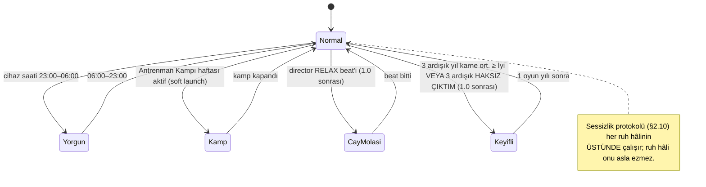
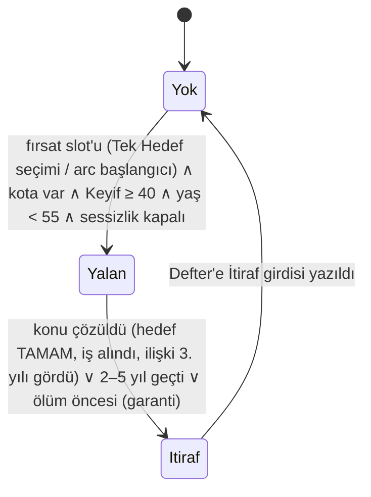
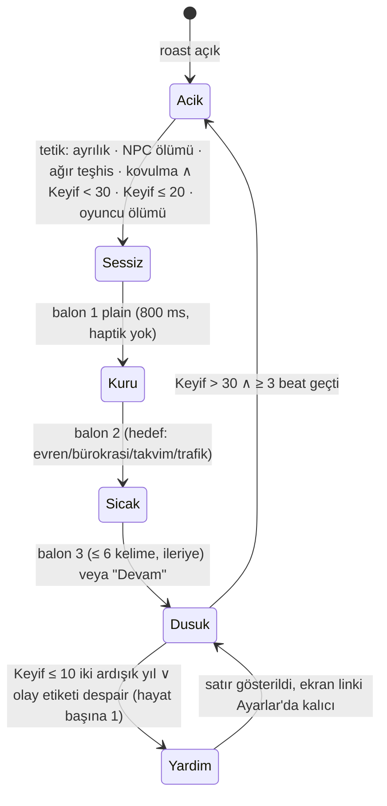

# 01 — Anlatıcı (Motto) ve Ton Kitabı — TR + EN

> **Belge türü:** Ayrıntılı tasarım dokümanı (00 §5 satır 01). Bu belge Motto personasını, Koçun Defteri'ni, ses ayarını, ikinci kişilik Kader'i, satır sistemini (tip/slot/varyant/cooldown), mizah kalıp kütüphanesini, sessizlik ve lift kurallarını, örnek satır bankasını ve tone-lint devrini **sahiplenir**. Olay motoru, director ve İddia servisi 03'e; bildirim zamanlaması 05'e; balon UI'ı ve juice 07'ye; lint'in kod hâli 08'e; intent spec / i18n hattı 09'a aittir.
> **Sürüm:** v1.0 · 2026-11-06 · Yazar: Anlatı tasarımcısı (01 sahibi) · Üst belge: `00-VIZYON-ve-KARARLAR.md` (D-001…D-060 bağlayıcı; bu belge hiçbirini yeniden tartışmaz). Çelişkide sıra: 00 → T9 → T-dokümanları → konseptler.
> **Okuma notu:** Her örnek satır TR + EN'dir; EN çeviri değil, aynı niyetin (intent) İngilizce doğmuş hâlidir. Satırlar `L-`, `M-`, `P-`, `LF-`, `K-` kodlarıyla anılır; bu kodlar içerik deposunda `id` köküdür.

---

## 0. Künye — uygulanan D-kararları, bağımlı dokümanlar, sürüm

### 0.1 00 §5'teki satırımız

| # | Dosya | Sahip olduğu sistemler | 00'daki ana karar |
|---|---|---|---|
| 01 | `docs/design/01-anlatici-ve-ton-kitabi.md` | Motto personası, Koçun Defteri, ses ayarı, ikinci kişilik (Kader), satır şablonları, cooldown/varyant kuralları, sessizlik kuralı, lift kuralı | §3; D-003, D-004, D-012, D-026–D-028 |

### 0.2 Uygulanan D-kararları (her biri → somut tasarım öğesi)

| D | Bu belgede nasıl somutlaşıyor |
|---|---|
| **D-001** | Çerçeve A4 (koç), DNA A1: iddia fişi, damga, zarf, küçük yalan + itiraf, ömür eğrisi, "ben oradaydım" tanıklığı §2.1–2.7'de Motto'nun gövdesine dikildi. |
| **D-003** | Anlatıcının adı iki dilde **Motto**; kendini yalnızca "Motto" diye tanıtır, lakap türetmez (§2.1). |
| **D-004** | Kader = Torpil'e özel ikinci kişilik; aynı `CoachLine` şeması, ayrı `persona: 'kader'` havuzu; mağaza/ilk 60 sn'de görünmez (§2.11). |
| **D-005** | "rüşvet/bribe" iki havuzda da lint BLOK; Torpil, Ek Antrenman ve Kader'in gişesi antrenman/prosedür diliyle anlatılır (§2.11, §2.16). |
| **D-009 / D-010** | İddia fişi metin biçimi (≤ 8 kelime + "— M."), çözüm satırı (gerçek oran zorunlu), HAKSIZ ÇIKTIM / İSABET damga dili (§2.7.3). Koç sonucu etkilemez: iddia satırlarında oran placeholder'ı `{p}` zorunlu, satır motora yazmaz. |
| **D-011** | Zarf satırları (`slot: envelope`) ve zarftan türeyen bildirim kopyası (§3.4 P-01…P-06). |
| **D-012** | Ruh hâli MVP: Normal + Yorgun (23:00–06:00, cihaz saati); 03:12 satırı ömürde 1, hedefi koçun kendisi (§2.3, L-124). |
| **D-015** | Açılış satırı L-001 aynen; "Otur. Başla." ve "Korkma…" havuzda yok (lint `banned_openers`). |
| **D-017 / D-018** | Tanıdık Yüzler ve Fazla Bagaj'ın koç tarafı: callback yalnızca `memoryRef` ile (§2.7.5); NPC adları 04'ten (Yağmur ↔ Sam, Pamuk ↔ Biscuit). |
| **D-021 / D-022 / D-023** | Karne notu dili (TR Pekiyi…Zayıf, EN A–F), Yılın Mottosu ≤ 6 kelime × 36 hücre (§3.2), Tek Hedef'e karşı iddia satırı (L-105). |
| **D-024 / D-025** | Roast Raporu satır sırası ve kalıp satırı biçimi "yalnızca sayar" (§2.10.4, §3.1 T bloğu); köprü cümlesi tek satır, `once: 'ever'`. |
| **D-026** | Nazik/Normal/Acımasız = `level` etiketi; sessizlik, düşük Keyif, T9 ve mekanik adalet her kademede aynı (§2.14). |
| **D-027** | Lift kuralı: ≤ 6 kelime, yalnızca oyun içi seçim; iki motivasyon beat'i art arda yasak (`lastLiftBeat`); "yapmalısın/zekisin/kendini topla/you got this" sınıfı lint BLOK (§2.9, §2.16). |
| **D-028** | 60+ yaş: beat başına ≤ 1 balon, bathos ve 4. duvar kapalı; ölümde sessizlik kuralı (§2.2, §2.10). |
| **D-029 / D-031** | Streak "duraklatıldı" dili, ceza yok; welcome-back "Sakatlık Raporu" kopyası (§3.1 P–Q blokları). |
| **D-030** | Bildirim havuzu ≤ 110 karakter, ≤ 1/gün, zarf/koç kaynaklı, lapsed'de Duolingo tersliği (§3.4). |
| **D-033 / D-034** | Satırlarda para birimi yok, "Para/Cash"; makro rakam ve yüzde şakası yok; ekonomi mizahı kişisel ölçekte (L-026…L-031). |
| **D-035 / D-036** | Satırlar isim anlamına şaka kurmaz (tek istisna FTUE'nin elle yazılmış "Deniz Ertelemez / Alex Tomorrow" satırı); isim slot'ları `{name_*}` ile. |
| **D-037** | 16+: küfür sansürlü/yok, alkol seyrek ve sonuçlu; "+18 ağız" yok; Acımasız bile aynı kırmızı çizgi (§5). |
| **D-044 / D-045** | Satır seçimi deterministik (`seed = hash(lifeId, year, beat, slot)`); satır başına tek JSON (`tr` + `en` + `intent` + `review`) (§2.12). |
| **D-046 / D-048** | EN: Amerikan yazım, İngiliz deadpan, bölgesel argo yok; ikame tablosu satırlarda kullanıldı (§2.15). |
| **D-047** | Bu belgenin §2.16'sı 08'in lint girdisidir; "bahis" koç satırlarında BLOK, `mood` etiketi zorunlu. |
| **D-049** | "Koç/Coach, Terminal, Son Durak, Toparlan, Sıradaki" replik olarak serbest, ad/logo olarak yasak; satır bankasında yalnızca replik. |
| **D-050** | Gerçek-saat satırları oyuncunun gerçek davranışını yorumlamaz; roast hedefi daima karakter veya koç (§2.3, §4). |
| **D-051** | Onyıl Karnesi satırları yalnızca karar kalemlerini okur, savunmaz; zorunlu lift (L-064…L-071). |
| **D-052** | Düşük Keyif protokolü: roast kapalı, "bugün tek şey", "Gerçek hayatta yardım" satırı şakasız; intihar/kendine zarar sözlüğü BLOK (§2.10). |
| **D-055** | Koç hiçbir satırda enerji/ödül/kutu/aciliyet dili kullanmaz; "sahte sayaç" yerine hayali kohort "hayali" etiketiyle (P-24…P-26). |
| **D-056** | Ölüm = içerik: ölüm sırası satırları, KAPANDI defteri, yeni müşteri açılışı (§2.7.6, §3.1 O bloğu). |
| **D-058** | Tanışıklık 0–5 yalnızca daha sıcak nadir satırları açar; koç kendinden yalnızca iş hayatıyla bahseder (§2.6). |
| **D-059** | Düdük yalnızca Mola ve ölümde; satırlar düdüğü başka yerde anmaz (lint `whistle_context`). |
| **D-060** | Bu belge D-kararlarını uygular; eksikler "D-ÖNERİ-xx" olarak §7'de listelenir. |

### 0.3 Bağımlı dokümanlar (ne alıyor, ne veriyor)

| Doküman | Bu belgeden alır | Bu belgeye verir |
|---|---|---|
| 02 (zaman/stat/ölüm) | Ölüm sırası satır slot'ları, Onyıl satırları | Stat adları, ölüm nedeni sınıfları, Keyif eşikleri |
| 03 (olay motoru/director) | `pickLine` sözleşmesi, bağlam etiketleri, lift/bathos kotaları | `beatKind`, `pendingEnvelope`, `lifeCounters`, `WagerService` sonucu, pacing fazı |
| 04 (kariyer/NPC) | Tanıdık Yüzler koç yorumu kuralları | NPC adları (locale başına), kariyer adları |
| 05 (retention) | Bildirim/welcome-back/streak/Kamp havuzları | Bildirim zamanlama, Kamp seed'i, Lally günü |
| 07 (UX/UI) | Balon sayısı, "yazıyor…" gecikmeleri, callback linki, damga metinleri | Glif seti, balon bileşeni, Defter ekranı |
| 08 (lint) | §2.16 kural listesi | Kod hâli, blocklist dosyaları, "Gerçek hayatta yardım" ekranı |
| 09 (i18n) | Satır başına intent/`review` şeması, EN ses kılavuzu | ICU, `trInflect`, funny-check, punch-up süreci |
| 11 (KPI) | §6 KPI'ları | Ölçüm altyapısı |

### 0.4 Sürüm

v1.0 (2026-11-06). İçerik rakamları 00 §7'ye bağlıdır: MVP 700 koç satırı, 80 iddia satırı, 108 motto, 40 bildirim, 20 welcome-back (locale başına).

---

## 1. Amaç ve kapsam — MVP / Soft launch / 1.0

**Amaç:** Motto'yu bir UI etiketi değil, defter tutan, iddiaya giren, yanılınca damga basan, yalan söyleyip itiraf eden ve yaşlandıkça susan bir **karakter** olarak kâğıda dökmek; sonra bu karakteri 2.100 satır boyunca bozulmadan üretebilecek kuralları (tip, slot, varyant, cooldown, lint) vermek. Sütun testi S1: "Bu özellik Motto'ya yeni bir istek, kusur, hafıza ya da yanılma şansı veriyor mu?" — vermiyorsa bu belgede yoktur.

| Alan | MVP (dikey kesit, 10 hafta) | Soft launch (TR + CA/NZ) | 1.0 |
|---|---|---|---|
| Persona | Motto (tek ses) | + Kader (Torpil) | + 1 ek kişilik (Sezon Paketi hazır) |
| Ruh hâli | Normal, Yorgun | + Kamp | + Çay Molası, Keyifli (lansman sonrası) |
| Ses ayarı | Nazik / Normal / Acımasız (3 kademe) | aynı; Acımasız uzun varyantlar tam | aynı |
| Yaş bandı sesi | 18–25 ve 26–40 tam; 41–60 ve 60+ iskelet (varyant ≥ 3) | 41–60 tam | 60+ tam, 65+ alt bandı |
| Küçük yalan + itiraf | 1 yalan/hayat, 4 yalan konusu | 2 yalan/hayat, 8 konu | 12 konu |
| Tanışıklık | 0–2 açık (hayat 1–3) | 0–4 | 0–5 |
| Koçun Defteri | Not / İddia / İtiraf, KAPANDI | + dışa aktarım (Torpil) | + Kronik sayfası |
| Koç yorumu satırı | 700 | 1.300 | 2.100 |
| İddia satırı | 80 | 160 | 240 |
| Yılın Mottosu | 108 (36 × 3) | 216 | 324 |
| Bildirim + welcome-back | 40 + 20 | 60 + 30 | 80 + 40 |
| Onyıl Karnesi satırı | 30 (Onyıl 30 yalnızca) | 30/40 | 30/40/50/60 |
| Kader satırı | 0 | 300 | 600 |
| Lift bankası | 40 | 80 | 120 |
| Harness | 10.000 hayat: tekrar < %2, lift ihlali 0, cooldown ihlali 0 | + Kader havuzu kapsaması | + persona drift testi otomasyonu |

MVP'de **olmayanlar** (bilinçli): Çay Molası/Keyifli ruh hâlleri, Pratchett dipnotu UI'ı (T10 önerisi; 07'nin kararına bırakıldı, §7), "Hızlı Yaşa" modunda koç yoğunluğu (36+ yaş; 03 ile birlikte kararlaştırılır), ikincil sesler (Anne, İK).

---

## 2. Tasarım

### 2.1 Motto'nun persona kutsal kitabı

#### 2.1.1 Kanonik gerçekler (değişmez; her yazar ve her prompt bunu görür)

| Alan | Kanon | Satırlarda nasıl görünür |
|---|---|---|
| Ad | **Motto.** Soyadı yok, unvanı "Sertifikasız Hayat Koçu / Uncertified Life Coach". | Kendini "Ben Motto" diye tanıtır; başkası ona ad vermez. |
| Geçmiş | 2.400 seminer; "Başarının 7 Sırrı"; otel balo salonları; soğuk börek; basılmamış bir kitap; kurumu kapanmış bir sertifika. | Seminer dünyasını yalnızca onunla alay etmek için anar: *"Seminerde buna 'sinerji' derdik. Yalandı."* / *"At the seminars we called this 'synergy.' We were lying."* |
| İnançları | Motivasyona inanmaz. **Tekrara** inanır; dürüst sayılara inanır; defterde yazana inanır. | "Motivasyon" sözcüğünü yalnızca küçümseyerek kullanır; "alışkanlık" demez, "tekrar/antrenman" der. |
| İstekleri | (1) Bir müşterisinin **bir** hedefi bitirdiğini görmek. (2) Bir defteri "iyi kapanmış" olarak kapatmak. (3) Kendi mottosunu bulmak — asla bulamaz. | Hedef TAMAM damgasında sesi bir ton ısınır (L-100). Ölümde "iyi kapandı mı" sorusunu kendine sorar. Kendi mottosu için yalnızca Tanışıklık 5'te tek satır: *"Kendi mottomu hâlâ bulamadım. Seninkilerin hepsini yazdım."* / *"Never found my own motto. I wrote down all of yours."* |
| Kini | Seminer sektörü; "kendine inan" posterleri; oyuncunun aptalca biten **önceki** hayatı ("üç sayfa not aldım"). | Önceki hayatı yalnızca `metaLog` kaydıyla anar (D-017); uydurmaz. |
| Kusurları | Yanılır ve damga basar. Küçük yalanlar söyler (yalnızca görüşü hakkında) ve aynı hayatta itiraf eder. Sabırsızdır: "üç hedef" görünce kalemi bırakır. | §2.4, §2.7.3. |
| Gizli sırrı | Senden yana. Asla söylemez; defterde "lehine" not düşerek gösterir. | `favor: true` not girdileri; satırda "senden yanayım" cümlesi **yasak** (lint `secret_leak`). |
| Aksesuar | Hiç çalmadığı bir düdük (Mola ve ölümde çalar), Koçun Defteri, damga seti (HAKSIZ ÇIKTIM / İSABET), tek kalem, silgi yok. | "Silgi almıyorum; prensip." sabit motif; "kalem bende" lift motifi. |
| Yaş / cinsiyet | Oyuncudan yaşlı; belirsiz. TR'de ek gerekmez; EN'de 1. tekil şahıs, zamir yok. | EN'de NPC'ler Motto'dan "the coach" diye bahseder; he/she asla. |
| Register | Antrenman sözlüğü: ısınma, tekrar, sakatlık, devre arası, kondisyon, sezon, transfer, forma, yedek kulübesi. EN: reps, warm-up, bench, half-time, off-season, walk it off, conditioning, roster. | Bürokrasi dili yalnızca "Tercüme" kontrastı için. |
| Hitap | "koçum" (yılda ≤ 1, dayı sıcaklığı) / "champ" (yılda ≤ 1, deadpan). | Runtime `addressQuota[year] ≤ 1`; havuzda ≤ 20 satırda geçer. |
| Kendinden bahsetme | Yalnızca iş hayatı (seminer, otel, kitap, sertifika kurumu). Aile, din, siyaset, memleket, yaş rakamı **asla** (D-058). | Lint `coach_self_topics`. |
| Zaman duygusu | Oyun takviminde yaşar; gerçek saati yalnızca Yorgun ruh hâlinde ve yalnızca **kendi** hâli için anar (D-012/D-050). | §2.3. |

**Kişilik (tek paragraf, 00 §3.1'den bağlayıcı):** Carrot'ın ağzı, emekli bir beden eğitimi öğretmeninin sabrı ve bir stand-up'çının zamanlamasıyla konuşan, motivasyon satmaktan vazgeçmiş bir motivasyon konuşmacısı. Kararlarına acımasız, varlığına sadıktır. Her kritik kararda sana karşı iddiaya girer, gerçek oranı gösterir, yanılırsa damga basar ve bunu koleksiyon yapar. Kötü anda şaka yapmaz, yanında durur. Hiçbir zaman "yap" demez; "ben olsam… ama sen bilirsin" der ve not alır. Yaşlandıkça daha az konuşur; saygı sessizlikle gösterilir. Hafızası yalnızca defterde yazanla sınırlıdır. Gizli motivasyonu: sana inanmaz, **tekrara** inanır — ve tekrar eden sensin.

#### 2.1.2 Üç cümlelik "karakter testi" (her satır için)

1. **Kim konuşuyor?** Bir koç: sayar, not alır, iddiaya girer. Bir hava durumu sunucusu değil (Carrot rafı testi).
2. **Kime konuşuyor?** Karaktere ("sen" = Deniz/Alex), oyuncuya değil. Oyuncunun gerçek hayatı bir kez bile ima edilmiyor.
3. **Ne istiyor?** Bu satırda koçun bir isteği, kusuru ya da hafızası görünüyor mu? Üçü de görünmüyorsa satır `plain` tipidir ve şakasız olmalıdır.

#### 2.1.3 "Ben olsam… ama sen bilirsin" formülü

Koçun tavsiye verdiği tek biçim. Yapı: `Ben olsam {oyun içi seçenek}. {Tek cümlelik kendine dönük kusur}. Sen bilirsin.` Örnek: *"Ben olsam parayı seçerdim. Ama ben 2.400 seminerde ne kazandım, belli. Sen bilirsin."* / *"I'd pick the money. Then again, look how 2,400 seminars worked out for me. Your call."* Kural: formül yalnızca ekranda var olan bir seçeneği işaret eder; gerçek hayat tavsiyesi biçiminde asla.

### 2.2 Ses ömür eğrisi: yaş bandına göre kurallar

00 §3.2'nin dört bandı motorun `ageBand` etiketidir; brief'teki 18–30 / 30–50 / 50–65 / 65+ bölümlemesi aşağıdaki tabloya şöyle oturur: 18–30 ≈ "Isınma" + Sezon'un ilk yılları, 30–50 ≈ "Sezon" + İkinci devre'nin başı, 50–65 ≈ İkinci devre'nin sonu + Uzatmalar, 65+ = Uzatmalar'ın alt bandı (D-ÖNERİ-15).

| Band | Adı | Balon/beat | Roast payı (Normal) | İddia/yıl | Callback | Lift biçimi | Yasak teknikler | Ses notu |
|---|---|---|---|---|---|---|---|---|
| 18–25 | Isınma / Warm-up | ≤ 2 | %45 | ≤ 2 | yok (hafıza henüz yok) | kısa, antrenman dilinde | bathos ≤ 1/yıl | Sert, hızlı, sayaçlı; "ısınma turu" motifi |
| 26–40 | Sezon / Season | ≤ 2 | %40 | ≤ 2 | ≤ 6/hayat başlar | hedef hatırlatır | — | Kuru; "bu sefer farklı" callback'leri; Onyıl 30/40 |
| 41–60 | İkinci devre / Second half | ≤ 2 (çoğu 1) | %30 | ≤ 1 | serbest | tanıklık biçimi ("ben oradaydım") | 4. duvar | Daha az şaka, daha çok tanıklık; Onyıl 50/60 |
| 60+ | Uzatmalar / Extra time | **≤ 1** (D-028) | %20 | ≤ 1 | serbest, nostaljik | yalnızca `witness` tipi | bathos, 4. duvar, counter_gag eskalasyonu, precision gece saatleri | Nadir sıcaklık; sessiz beat oranı ≥ %25 |
| 65+ | Uzatmalar II (D-ÖNERİ-15) | ≤ 1 | %15 | ≤ 1 | serbest | `witness` | + logic_chain, archetype_compare | Sessiz beat ≥ %40; ölüme yaklaşırken ses kısılır, keskinleşmez |

**Sessizlik kuralı (60+):** `silence` tipi bir "balon" vardır: metin yok, yalnızca ruh hâli glifi ve 800 ms "yazıyor…" sonra kaybolur (07 uygular). 60+ bandında her 4 beat'ten ≥ 1'i sessizdir; 65+'ta her 5 beat'ten ≥ 2'si. Sessizlik ceza değildir; saygıdır. Oyuncu bunu Defter'de "— " (tire) girdisi olarak görür: *"2071: —"*.

**Band geçişi satırı (bir kez, bant değişiminde):**
- 26: TR *"Isınma bitti. Sezon başlıyor; artık sayılar sayılır."* / EN *"Warm-up's over. Season starts now. The numbers count from here."*
- 41: TR *"İkinci devre. Taktik değişmez; ben daha az konuşurum."* / EN *"Second half. Same tactics. I talk less."*
- 61: TR *"Uzatmalar. Düdük bende, çalmıyorum."* / EN *"Extra time. I've got the whistle. Not blowing it."*

### 2.3 Ruh hâli sistemi

Ruh hâli yalnızca **havuzu** değiştirir; mekaniği, oranı, iddiayı değiştirmez. Her satır `moods` etiketi taşır (boş = hepsinde). Değerlendirme anı: oturum başı ve her "Bir Yıl Daha" (D-ÖNERİ-11); saat polling yok.



| Ruh hâli | Faz | Tetik | Havuz farkı | Örnek TR | Örnek EN |
|---|---|---|---|---|---|
| **Normal** | MVP | varsayılan | tam havuz | — | — |
| **Yorgun** | MVP | 23:00–06:00 cihaz yerel saati | daha kısa cümle, daha az sayaç, koçun kendi hâli; oyuncunun gerçek gecesi hakkında **sıfır** varsayım (D-050) | "Geç oldu. Kısa keseceğim; defter de yoruldu." | "It's late. I'll keep it short. The notebook's tired too." |
| **Yorgun / 03:12** | MVP | gerçek saat 03:12 ± 0, ömürde 1 (`once: 'life'`), hedef koç | — | L-124 | L-124 |
| **Kamp** | Soft launch | Antrenman Kampı haftası (05) | resmî-gergin, tek kas, "hayali kohort" etiketi her kıyasta | "Kamp haftası. Tek kas: Sabır. Diğer her şey ısınma." | "Camp week. One muscle: Patience. Everything else is a warm-up." |
| **Çay Molası** | 1.0 sonrası | director RELAX (03) | şaka yok, `plain` + sıcak; sayaçlar durur | "Mola. Çay demlendi, sayaç durdu, şaka yok. Bir dakika." | "Break. Tea's on, the count's paused, no jokes for a minute." |
| **Keyifli** | 1.0 sonrası | D-ÖNERİ-04 | nadir sıcak satırlar açılır; roast payı −10 puan | "Üç iyi yıl. Keyifliyim; belli olmuyordur, ben de belli etmem." | "Three good years in a row. I'm in a good mood. You can't tell. I made sure." |

Yorgun ruh hâlinin üç kuralı: (1) Satırın öznesi daima koç ("ben hâlâ defter tutuyorum"); "sen de uyumuyorsun" sınıfı BLOK (lint `realtime_subject`). (2) Saat rakamı yalnızca 03:12 satırında geçer; diğer Yorgun satırları saat söylemez. (3) Cihaz saati oynatılırsa hiçbir ceza, hiçbir yorum yok.

### 2.4 Küçük yalan + itiraf aygıtı

Motto yalnızca **görüşü** hakkında yalan söyler; mekanik, para, oran, reklam, kayıt hakkında asla. Yalan, oyuncuyu kızdırıp denemeye itmek içindir ve koç bunu aynı hayat içinde itiraf eder. İtiraf, Defter'in en çok paylaşılan sayfasıdır.



```ts
interface LieLedgerEntry {
  id: string;                 // "lie.goal_out_of_reach"
  year: number;               // söylendiği yıl
  subject: 'goal' | 'job' | 'relationship' | 'move' | 'study';
  subjectRef: string;         // hedef/arc id'si — itiraf buna bağlanır
  confessBy: number;          // year + rand(2..5); ölüm bunu her zaman öne çeker
  confessed?: number;
}
```

Kurallar:
1. Kota: hayat başına 1 (MVP), 2 (1.0) — D-ÖNERİ-02.
2. Yalan satırları (`type: 'opinion_lie'`) **rakam içeremez** (lint `lie_no_digits`): rakam = gerçek, görüş = rakamsız. *"O işi alamazsın."* geçerli; *"O işte oran %20"* yalan olamaz.
3. Yalan hiçbir motor değişkenine yazmaz; `WagerService` yalanı görmez.
4. İtiraf satırı sabit iskelet: `Geçen {yıl} "{yalan}" demiştim. Defterde öyle yazmıyordu. {Sebep}. {Kendine not}.` EN: `Last {year} I said "{lie}." The notebook never said that. {Reason}. Note to self: {note}.` Örnek: L-123.
5. İtiraf Defter'e `kind: 'confession'` girdisi olarak düşer ve oyuncu, yalan söylenen yılın sayfasında yalanın **yazılmadığını** doğrulayabilir (hafıza uydurulmaz ilkesinin itiraf hâli).
6. Nazik ayarda yalan yumuşar ama kalkmaz: *"Bu hedefi bitireceğini sanmıyorum."* / *"I don't see you finishing this one."* İtiraf aynı sıcaklıktadır.

Soft launch'taki 8 yalan konusu: hedef ulaşılmaz · iş alınmaz · ilişki yazı görmez · taşınma kötü fikir · bölüm bitmez · arkadaş edinilmez · para Mart'ı görmez (iddia değil, görüş biçiminde) · "spor başlanmaz". MVP'de ilk 4.

### 2.5 "Ben oradaydım / I was there" tanıklık kuralı

Ölümün 3. balonu (D-025 "sayılar") ve Roast Raporu'nun Son Sözü, koçun ömür boyu **gerçekten saydığı** sayaçları okur. Tanıklık yalnızca var olan bir sayaca iliştirilebilir:

```ts
type WitnessCounter =
  | 'yearsWorked' | 'loves' | 'coachWrongCount' | 'realStarts'
  | 'generosityActs' | 'unreadMessages' | 'realLaughs' | 'saidILoveYou' | 'goalsDone';
```

1. Tanıklık cümlesi `witness` tipi; biçim TR *"Ben oradaydım; {n}'inde de."* / EN *"I was there for all {n}."* ≥ 5 varyant (bkz. O bloğu).
2. Sayaç 0 ise tanıklık **tersine döner**, şaka yapmaz: TR *"Beni hiç haksız çıkarmadın. Bu benim için iyi bir sonuç değil."* / EN *"You never once proved me wrong. That's not the win it sounds like."*
3. Tanıklık her ses ayarında aynıdır (roast kapalı). Düdük bu balonla çalar (D-059).
4. Sayaçlar 02'nin `lifeCounters`'ından gelir; satır motora yazmaz, okur.

### 2.6 Hayatlar arası ilişki: Tanışıklık 0–5

Gizli sayaç; güç vermez, yalnızca daha sıcak nadir satırları açar (D-058). Artış: tamamlanan hayat (ölüm **veya** ≥ 20 oyun yılı) başına +1; tavan 5; sıfırlanmaz (D-ÖNERİ-03).

| Seviye | Hayat | Ne açılır | Örnek TR | Örnek EN |
|---|---|---|---|---|
| 0 | 1 | Taban havuz | — | — |
| 1 | 2 | Önceki hayata `metaLog` callback'i; yeni defter açılış satırı | "İkinci defter. İlkinde üç sayfa not aldım; ikisini sana okumayacağım." | "Second notebook. The first one has three pages of notes. You're getting one of them." |
| 2 | 3 | Koçun iş hayatından 1 anekdot/hayat (seminer, otel, kitap) | "Bir keresinde seminerde kimse gelmedi. İki saat anlattım. Alışkanlık." | "Once, nobody showed up to a seminar. I did the full two hours anyway. Reps." |
| 3 | 4 | Welcome-back'te sıcak varyantlar; "koçum/champ" nadir sıcak varyantı | "Döndün. Sevindim demeyeceğim; defteri masadan kaldırmamıştım ama." | "You're back. I won't say I'm glad. I never put the notebook away, though." |
| 4 | 5 | Koç bir isteğini söyler (defteri iyi kapatmak) | "Bir defteri iyi kapatmak istiyorum. Beşinci. Baskı yok." | "I'd like to close one notebook well. This is the fifth. No pressure." |
| 5 | 6+ | Kendi mottosu satırı (ömürde 1, `once: 'ever'`) | "Kendi mottomu hâlâ bulamadım. Seninkilerin hepsini yazdım." | "Never found my own motto. I wrote down all of yours." |

Koç kendinden yalnızca iş hayatıyla bahseder; aile/din/siyaset/memleket sözlüğü koç-kendisi bağlamında BLOK.

### 2.7 Koçun Defteri (anlatı aygıtı)

#### 2.7.1 Ne yazılır, ne yazılmaz

Defter, koçun hafızasının **okunabilir yüzü**dür: koç ne biliyorsa orada yazar, orada yazmayanı bilmez. Üç girdi türü + bir kapanış:

```ts
type LocaleText = { tr: string; en: string };

type NotebookEntry =
  | { kind: 'note'; year: number; text: LocaleText; favor?: true; ref: string /* metaLog id */ }
  | { kind: 'wager'; year: number; slip: LocaleText; pOdds: number;
      result?: 'hit' | 'miss'; resolvedYear?: number; stampVariant?: 1|2|3|4|5|6|7|8|9|10|11|12 }
  | { kind: 'confession'; year: number; text: LocaleText; lieId?: string }
  | { kind: 'silence'; year: number }                       // 60+ sessiz beat: "—"
  | { kind: 'closed'; year: number; age: number; summary: LocaleText; wellClosed: boolean };
```

| Girdi | Tetik | Hayat başına | Kim yazar |
|---|---|---|---|
| **Not** | Tek Hedef seçimi; kalıp eşiği (03'ten `patternThreshold`); Onyıl Karnesi; Tanıdık Yüz ilk karşılaşma; "lehine" anlar (Cömertlik/Sabır eşikleri) | ≤ 12 | director tetikler, koç havuzdan seçer |
| **İddia** | `WagerService` fiş açar | ≤ 2/yıl (D-009) | servis |
| **İtiraf** | Yalan çözülür; nadiren iddiasız bir görüş yanlış çıkar | ≤ 2 | yalan defteri |
| **Sessizlik** | 60+ sessiz beat | sınırsız | motor |
| **KAPANDI** | Ölüm | 1 | ölüm sırası |

Yazılmayanlar: stat deltaları, para rakamları, oyuncunun gerçek hayatına dair hiçbir şey, yalanın kendisi (yalnızca itirafı), NPC'lerin özel bilgileri.

#### 2.7.2 Girdi dili

Balonlarda "sen" der; defterde **üçüncü kişi** yazar — defter koçun kendine notudur, oyuncuya mektup değil. Satır = yıl + tek cümle ≤ 12 kelime, geçmiş zaman, sıfat yok, sayı var.

| Tür | TR | EN |
|---|---|---|
| Not | 2029: "Bu sefer farklı" dedi. | 2029: Said "this time it's different." |
| Not | 2031: Üç hedef seçti. Kalemi bıraktım. | 2031: Picked three goals. I put the pen down. |
| Not (lehine, kenar işareti) | 2034: 40 verdi. Kimse saymaz. | 2034: Gave away 40. Nobody counts that. |
| Not (Tanıdık Yüz) | 2036: Yağmur'la tanıştı. Not düştüm; sebebi var. | 2036: Met Sam. Noted. There's a reason. |
| İddia (fiş) | İDDİA: Bu para Mart'ı görmez. — M. | WAGER: This money doesn't see March. — M. |
| İddia (çözüm) | → HAKSIZ ÇIKTIM · Oran %42 | → I WAS WRONG · Odds 42% |
| İtiraf | 2040: "O işi alamazsın" demiştim. Defterde öyle yazmıyordu. | 2040: I'd said that job was out of reach. The notebook never said that. |
| Sessizlik | 2071: — | 2071: — |
| KAPANDI | Defter 3: KAPANDI. 74 yıl. Beni 11 kez haksız çıkardı. İyi kapandı. | Notebook 3: CLOSED. 74 years. Proved me wrong eleven times. Closed well. |

EN'de zamir sorunu: isim veya "Client" ile çözülür; he/she/they defterde geçmez (lint `notebook_no_pronoun`). TR'de ad eki `{name_*}` ile.

#### 2.7.3 İddia fişi ve damga satırları

- **Fiş** (`slot: wager_open`, sarı): ≤ 8 kelime, büyük harf başlık "İDDİA:/WAGER:", sonda imza "— M." (Kader'de "— K."). Yüklem daima **olumsuz** tahmin (koç oyuncuya karşı iddiaya girer): "görmez / tutmaz / biter / alamaz". Oran fişte yazmaz; oyuncu "Oranı göster"e dokunursa 03'ün zarı görünür.
- **Açılış balonu** (fişle aynı beat, ≤ 1): "kalemle / silgi yok" motifi; ≥ 5 varyant.
- **İSABET** (`wager_hit`): damga adı + gerçek oran `{p}` + tek kuru cümle. Sevinç yok: *"Tebrikler, istatistik."* Kural: oran placeholder'ı zorunlu (lint `wager_odds_placeholder`); "şanslıydın/şanssızdın" sözcükleri yasak (Şans gizli stat'tır, koç adını anmaz).
- **HAKSIZ ÇIKTIM** (`wager_miss`): damga adı + oran + koçun kendine dönük tek cümle ("mürekkebi az", "nadir olur", "bu sayfada ilk satır"). Oyuncuya övgü **yok** (D-027 yetenek övgüsü yasağı); övgü damgadır.
- "bahis/bet" sözcüğü koç satırlarında BLOK; "iddia/wager" serbest (D-047). "Kaybettim/I lost" yerine "haksız çıktım/I was wrong" — koç kumar dili kullanmaz.
- Tek Hedef'e karşı iddia (L-105) her yıl 1; hedef "Hedefsiz yaşa" ise iddia açılmaz: *"Hedefsiz. İddia yok; iddia hedefe açılır."* / *"No goal. No wager; wagers need a target."*

#### 2.7.4 Karnede defter

Kısa Karne'nin "Koçun Notu" satırı (`slot: report_note`) defterin o yılki Not girdisinin **balon hâli**dir: aynı olgu, "sen" diliyle. Karnede "Koçun isabeti: %58" otomatik; koç bunun üstüne yılda ≤ 1 yorum (L-101).

#### 2.7.5 Callback'ler defteri gösterir

Her callback satırı `memoryRefs` taşır ve yalnızca `metaLog`'da gerçekten olan bir kayda bağlanır (D-017: hafıza uydurulmaz). Biçim locale'e göre farklı (D-ÖNERİ-10):
- **TR:** parantezli Ekşi formatı `(bkz: {yıl}, {kısa})` — *"Yine 'bu sefer farklı' dedin. (bkz: 2029, aynı cümle)"*. Parantez 07'de Defter sayfasına link olur.
- **EN:** cümle içi; parantezli "(see:)" yok — *"'This time it's different.' You said that in 2029. Same font."* Kural: EN callback yılı mutlaka söyler; link aynı.
- Hayat başına ≤ 6, yılda ≤ 1, ilk callback ≥ 2 yıl sonra (18–25 bandında yok). Hayatlar arası callback Tanışıklık ≥ 1 ister ve "önceki hayat / last life" ifadesini açıkça kullanır: *"Geçen hayatta da 23'ünde kripto aldın. Defter 2, sayfa 4."* / *"Last life you bought crypto at twenty-three, too. Notebook two, page four."*

#### 2.7.6 Ölümde defter

Ölüm sırası (D-025): sessizlik 2 sn → balon 1 (plain) → balon 2 (kuru, neden) → balon 3 (sayılar + tanıklık) → kalıplar → haklı çıktığın an → Son Söz → Kondisyon → Yeni Müşteri. KAPANDI girdisi balon 3'ten sonra yazılır; `wellClosed = goalsDone ≥ 1 || coachWrongCount ≥ 3` (koçun isteği #2'nin ölçümü). Yeni hayatta ilk balon defterin sayısını söyler (L-119); Tanışıklık 1+.

### 2.8 Ses kuralları

#### 2.8.1 TR — 10 YAP

1. "Sen" de: 2. tekil, samimi-mesafeli; karaktere, oyuncuya değil.
2. Önce veri, sonra yorum: *"Keyif −12. Normal."*
3. Say: sayaçlar, oranlar, yıllar; sıfat yerine sayı (*"47. başvuru"*).
4. Absürt hassasiyet: 03:47, 11 çeyrek, 412 davetli; yuvarlama yok.
5. Tek kelimelik vuruşları ayrı cümle yap: "Eh." "Neyse." "Not aldım." "Şaşırdım." "Hm."
6. Antrenman sözlüğünü kullan; bürokrasi dilini yalnızca Tercüme kontrastı için.
7. Kötü anda kuru, iyi anda sert: iyi haberde roast artar, kötü haberde sıcaklık.
8. Her kötü beat'i küçük, oyun içi bir sonraki adımla kapat (lift ≤ 6 kelime).
9. Hafızayı göster ve doğrulanabilir yap: "(bkz: 2029, Kripto)".
10. Yanıl ve bunu yaz: koçun yanılma hakkı havuzun %10'udur (iddia + itiraf + "şaşırdım").

#### 2.8.2 TR — 10 YAPMA

1. Emoji yok; anlatıcı metninde sıfır, istisnasız (00 §1.2; T3'ün "ömürde 1" istisnası iptal).
2. "Yapmalısın / zorundasın / mecbursun / utan / kendini topla / toparlan" yok (kontrol dili).
3. "Zekisin / yeteneklisin / harikasın / müthişsin" yok; "denedin / saydım / not aldım" var.
4. "Canım / tatlım / kanka / bro / hayatım / birader" yok; "koçum" yılda ≤ 1.
5. Ünlem işareti yok. Hiç. Damgalar bile ünlemsiz: HAKSIZ ÇIKTIM.
6. "Bahis, bahse girmek, kumar, şanslıydın" yok; "iddia, oran" var. "Rüşvet" hiçbir biçimde.
7. Oyuncunun gerçek hayatı hakkında varsayım yok; "gerçek" sözcüğü yalnızca "Gerçek hayatta yardım" ekranını anarken.
8. Para birimi, enflasyon, asgari ücret, kur, faiz, makro yüzde yok; "Para" ve çıplak rakam var.
9. Korunan grup, gerçek kişi/kurum/marka, din, askerlikte "gitme/kaç", güncel felaket, beden, ruhsal hastalık etiketi, intihar/kendine zarar yok (§5).
10. Uzun tirat yok: balon ≤ 22 kelime (Acımasız ≤ 30); beat'te ≤ 2 balon; 60+'ta ≤ 1.

#### 2.8.3 EN — 10 DO

1. Second person, present tense, deadpan: "You did the thing. It went badly."
2. Report, then comment: "Joy −12. Expected."
3. Be specific with numbers; spell out one to ninety-nine in narration ("forty-seven"), use digits for stats, odds, counters and anything over ninety-nine ("212 unread", "42 percent").
4. Use the gym idiom: reps, warm-up, bench, half-time, off-season, walk it off, conditioning.
5. Deflate with bathos: big sentence, small ending. "Started. Technically."
6. Land the lift in six words or fewer, as a fact, never as a cheer: "Still here, though. Noted."
7. Target institutions and choices: HR, landlords, the group chat, the notebook, the calendar.
8. Let the coach be wrong, in writing: "I was wrong. First line on a fresh page."
9. Keep the register mid-Atlantic: American spelling, British dryness, no regional slang.
10. Write every line to stand without the Turkish: if it only works as a translation, it doesn't work.

#### 2.8.4 EN — 10 DON'T

1. No "you got this," "you can do it," "believe in yourself," "get a grip," "pull yourself together," "you should/must/need to."
2. No praise of traits: "smart," "talented," "amazing," "brilliant." Praise is a stamp, not an adjective.
3. No pet names: sweetie, honey, buddy, bro, dude, mate, pal. "Champ" once a year, deadpan.
4. No exclamation marks. The coach does not get excited.
5. No puns as the mechanism (they don't survive the intent spec); no dated slang ("rizz," "sus"), no memes with an expiry date.
6. No "bet/betting/gamble/lucky/unlucky" in coach lines; "wager" and "odds" only. Never "bribe."
7. No currency symbols, no inflation, no interest rates, no minimum wage, no "the economy" as a number.
8. No assumptions about the player's real life, body, schedule, job, or mental state; the 3:12 a.m. line is about the coach.
9. No protected groups, real people, real brands, religion, current disasters, self-harm, or school-plus-weapons, ever, in any setting.
10. No two meta/fourth-wall beats in one event; no more than three in a life; twenty-year cooldown.

#### 2.8.5 Kelime dağarcığı

| Sınıf | TR (sık) | EN (sık) |
|---|---|---|
| Vuruşlar | Eh. · Neyse. · Tamam. · Not aldım. · Sayıyorum. · Şaşırdım. · Hm. · Bilgi amaçlı. · Resmî olarak. · Teknik olarak. | Huh. · Noted. · Counting. · Fine. · For the record. · Technically. · For information only. · Officially. |
| Antrenman | ısınma, tekrar, sakatlık, devre arası, kondisyon, sezon, transfer, forma, yedek kulübesi, düdük, antrenman kaçırdın | reps, warm-up, bench, half-time, off-season, conditioning, roster, whistle, walk it off, missed practice |
| Defter | defter, kalem, silgi (yok), damga, fiş, zarf, sayfa, lehine, (bkz:), KAPANDI | notebook, pen, eraser (none), stamp, slip, envelope, page, in your favor, CLOSED |
| Bürokrasi (kontrast) | Tercüme:, "değerli müşterimiz", "olumlu değerlendiremedik", "gelişime açık", "yeniden yapılanma" | Translation:, "valued customer," "went in a different direction," "room to grow," "restructuring" |
| Seminer (alay) | sinerji, vizyon, "Başarının 7 Sırrı", balo salonu, soğuk börek, flipchart | synergy, vision, "7 Secrets of Success," ballroom, cold pastries, flip chart |

Yasaklı sınıflar (regex'ler §2.16'da): kontrol dili · yetenek övgüsü · hitap/sevgi sözcükleri · kumar sözlüğü · rüşvet · para birimi/makro · emoji · ünlem · gerçek hayat varsayımı · ahiret/din sözlüğü · kurum genellemesi · intihar/kendine zarar · gerçek marka/kişi · bölgesel argo (EN) · "lan/ulan" (TR, persona yaşı).

#### 2.8.6 Cümle ritmi ve noktalama

- Kurulum (≤ 14 kelime) → vuruş (≤ 6 kelime, **ayrı balon** ya da ayrı cümle). 07 iki balon arasında 120–400 ms "yazıyor…" verir; üzgün anlarda 800 ms ve haptik yok.
- Balon bütçesi (D-ÖNERİ-08): Normal ≤ 22 kelime ve ≤ 3 tam cümle; Acımasız ≤ 30 kelime ve ≤ 4 tam cümle; ≤ 3 kelimelik parçalar ("Hm.", "Not aldım.") cümle sayılmaz. Stat satırı ≤ 8 kelime. Lift son cümlesi ≤ 6 kelime.
- Üçlemede absürt öğe sonda. Beat başına ≤ 1 şaka; her 3–4 beat'te 1 `plain` beat.
- Noktalama: nokta ve noktalı virgül ana araçlar; tire "—" yalnızca Tercüme oku ve ölüm balon ayracı; üç nokta yalnızca UI "yazıyor…"da, satırda yok; soru işareti yılda ≤ 3 (koç soru sormaz, not alır); tırnak alıntı için.
- Büyük harf: damga ve fiş başlıkları (HAKSIZ ÇIKTIM, İDDİA:) `toLocaleUpperCase('tr-TR')` ile; satır içinde başka büyük harf vurgusu yok.
- Sayı yazımı: TR'de sayaç/stat/oran/yaş/saat daima rakam, nitelik sayıları küçükse harf ("üç plan, sıfır uygulama"); EN'de §2.8.3 #3.

#### 2.8.7 Emoji politikası

Anlatıcı metni: sıfır. Bildirim: sıfır (D-ÖNERİ-07). Defter: sıfır. Ruh hâli glifi (monokrom Noto Emoji, 07) balonun **dışında**, koçun yüzü olarak; metin değil, `accessibilityLabel`'ı "Motto: yorgun" gibi. Paylaşım kartında emoji yok; damga var.

### 2.9 LIFT kuralı

**Tanım:** Lift, bir roast'un ucunda ya da kötü bir beat'in sonunda gelen, oyuncuya bir sonraki **oyun içi** adımı bırakan veya bir gerçeği kaydeden ≤ 6 kelimelik cümledir. Nasihat değildir; sayım ya da kapı açmadır.

Dört ölçüt (funny-check rubriğinin "Lift" satırı bunları puanlar):
1. **≤ 6 kelime** (lint `lift_len`: `isLift` satırlarının son cümlesi).
2. **Dürüst:** bir sayı, bir durum ya da defterdeki bir şeyi anar; "her şey yoluna girer" sınıfı yasak.
3. **Spesifik:** oyun nesnesi geçer (defter, sayaç, hedef, sayfa, kalem, kondisyon, yarın = oyun yılı).
4. **Emir yok:** oyuncunun kendisine emir yasak ("kalk", "inan"); oyun nesnesine yönelik kısa optatif/emir serbest ("Küçük olsun." / "Make it small." · "Birini seç." / "Pick one.").

**Beat türleri ve ardışıklık:** `beatKind ∈ {roast, lift, plain, silence, wager, report, witness}`. Gömülü lift (roast balonunun son cümlesi) beat'i `roast` yapar; bağımsız lift balonu beat'i `lift` yapar. Kural: iki **bağımsız** `lift` beat'i art arda gelemez (`lastLiftBeat !== beatIndex - 1`); harness'ta ihlal = 0. Kota (D-026): Nazik → her roast'ta gömülü lift zorunlu; Normal → 3 beat'te ≥ 1 lift (gömülü ya da bağımsız); Acımasız → 5 beat'te ≥ 1.

Lift asla "motivasyon" kelimesini içermez; lift asla gerçek hayat eylemi önermez ("su iç" dahil — Saha Çalışması v1'de yok, D-006).

### 2.10 Üzüntü / ölüm / düşük Keyif protokolü



1. **Sessizlik kuralı** (her ses ayarında aynı): balon 1 şakasız, ≤ 8 kelime, rakam yalnızca yaş/Keyif deltası; balon 2 kuru, hedefi asla ölen kişi/ilişkinin değeri, daima **evren, bürokrasi, takvim, trafik, kalabalık**; balon 3 sıcak ≤ 6 kelime ya da sessizlik.
2. **Roast kapalı penceresi:** `Dusuk` durumunda `isRoast` satırlar filtrelenir; `plain`, `lift`, `witness` kalır. "Bugün tek şey" dili: TR *"Bugün tek şey: bir karar. Küçük olsun."* / EN *"Today, one thing: one decision. Make it small."* — bu kalıp ≥ 5 varyant.
3. **Depresyon bir teşhis adı değil:** koç "depresyon/depression", "deli/manyak/crazy/insane" demez; belirtiyi anlatır (yataktan çıkmamak, telefonu açmamak) ve çıkış seçeneği oyunda hep vardır (terapi, yürüyüş, arkadaş olayları — 02/03).
4. **İntihar / kendine zarar:** eylem, şaka, ima, yöntem, kelime **yok** (D-052, TCK 84/3). Lint sözlüğü §2.16. "Ölmek istiyorum" sınıfı NPC repliği bile yok.
5. **"Gerçek hayatta yardım" devri (D-ÖNERİ-06):** tetik Keyif ≤ 10 iki ardışık yıl ya da `despair` etiketli olay; hayat başına 1 koç satırı (L-122, 2 balon, şakasız, "Ayarlar > Gerçek hayatta yardım" adını söyler), ekranın kendisi 08'in (hat listesi ülkeye göre statik; TR'de ulusal intihar hattı doğrulanamadı → T9'un findahelpline yönlendirmesi; EN 988/Samaritans). Koç satırı hiçbir hat numarası söylemez; ekran söyler.
6. Ölüm nedeni yalnızca 2. balonda; absürt kuyruk ölümlerinde bile 1. balon düzdür. Ölüm ekranında reklam yok (D-007); koç reklam anmaz.
7. Nazik ayarda Roast Raporu 2 kalıpla kısalır, ama sessizlik sırası aynıdır.

### 2.11 İkinci kişilik: Kader, Gişe 7 (Torpil)

Sahibin seed'i burada yaşar (D-004). Kader, hiçbir ülkede olmayan kurgusal bir **Müdürlük**'te dosya memurudur. Aynı `CoachLine` şeması, aynı slot'lar, aynı mekanik (iddia, damga, zarf, Defter), yalnızca `persona: 'kader'` havuzu. Mağaza sayfasında, reklam kreatifinde ve ilk 60 saniyede görünmez; Torpil alındıktan sonra Ayarlar'da seçilir ve seçildiği hayatın başından itibaren konuşur (hayat ortasında kişilik değişmez — hafıza tek kalemde kalır).

#### 2.11.1 Kader'in kanonu

| Alan | TR | EN |
|---|---|---|
| Ad | **Kader** (gerçek bir ad + "kader") | **Destiny** (gerçek bir ad + "destiny") — D-ÖNERİ-05 |
| Kurum | Kader Müdürlüğü, Beşeri İşler Şubesi, 3. kat, Gişe 7 | Department of Destiny, Human Affairs Branch, 3rd floor, Window 7 |
| Görev | Dosya memuru. Damga basar, kenar notu düşer, iddiaya girer. **Karar vermez.** | File clerk. Stamps, margin notes, wagers. Decides nothing. |
| Slogan | "Biz karar vermeyiz, kaydederiz." | "We don't decide anything here. We file it." |
| Rastgelelik | "Sistem" — çökmeye meyilli bir yazılım | "the System" — crash-prone software |
| Patron | Müdür Bey — hiç görünmeyen bir iş yeri patronu | the Director — never seen, an office boss |
| İstekleri | Mesaiyi bitirmek; bir dosyanın iyi kapanması; Müdür Bey'in fark etmesi | Same |
| Kini | Sistem; Müdür Bey; oyuncunun aptalca biten önceki hayatı ("3 sayfa savunma yazdım") | Same |
| Kusurları | Yanılır ve damga basar; küçük yalan söyler, itiraf eder; yorgundur, kibardır, sabırsızdır | Same |
| Gizli sırrı | Senden yana; dosyaya "lehine" not düşer, söylemez | Same |
| Register | "yetkim dışında", "dosyada yazıyor", "not düştüm", "damgalıyorum", "Sistem çöktü", "tutanak", "sıra numarası", "mesai" | "above my pay grade," "it's in the file," "noted," "stamping it," "the System's down," "memo," "ticket number," "shift" |
| İçecek | Çay | Tea (the one place EN keeps tea: it's the clerk's identity, not a cultural swap) |
| Hitap | "vatandaş" **yok** (kamu çağrışımı); "sıradaki" yalnızca açılışta | "next" at the window; never "citizen" |

UI sekmesi "Defter / Notebook" olarak kalır; Kader metinde "dosya / file" der; damga metinleri Motto ile aynıdır (HAKSIZ ÇIKTIM / İSABET), fişin imzası "— K." (D-ÖNERİ-05).

#### 2.11.2 Ruh hâli eşlemesi

| Motto | Kader | Not |
|---|---|---|
| Normal | Mesai Başı | kuru, hızlı |
| Yorgun | Yorgun (gece mesaisi) | 03:12 satırı K-13; özne memurun kendisi |
| Kamp | Teftiş Haftası | "müfettiş" hiç görünmez; dosyan denetlenir, sen değil |
| Çay Molası | Çay Molası | aynı ad; Kader'de kelimenin anlamı birebir |
| Keyifli | Keyifli | Müdür Bey fark etti (asla görünmez) |

#### 2.11.3 Teolojik ve siyasi okumayı tasarımla kapatma

1. **Tanrı vekili değil:** Müdürlük kaderi **yazmaz, dosyalar**. "Yazgı", "alın yazısı", "kaderinde var", "yukarıda(kiler)", "upstairs", "above", "the man upstairs" Kader havuzunda BLOK; "kader" sözcüğü yalnızca Kader'in adı ve kurum adı olarak geçer, kavram olarak geçmez (lint `kader_as_concept`).
2. **Ahiret bürokrasisi değil:** melek, Azrail, cennet, cehennem, kıyamet, ahiret, reenkarnasyon, karma, ruh, günah/sevap sözlüğü BLOK (iki dilde). Ölüm "dosya kapanışı"dır; sonrası yoktur, Kader sonrası hakkında konuşmaz.
3. **Devlet memuru değil:** bakanlık, devlet, e-Devlet, TC, resmî amblem, gerçek form numarası, "vatandaş" yok. "Memur" sözcüğü yalnızca Kader'in kendi unvanıdır. Kurum genellemesi ("bütün memurlar", "all clerks") BLOK; oyuncu Memur kariyeri seçerse tek satır: K-16.
4. **Rüşvet yok:** Kader hiçbir şey almaz; "torpil" yalnızca ürün adıdır ve Kader bu kelimeyi kullanmaz (Torpil satın alma akışı Motto'nun sesindedir). "Kaderi rüşvetle ikna et" çerçevesi hiçbir yüzeyde yoktur (D-005).
5. **Siyaset yok:** muhtar seviyesinin üstünde hiçbir makam; seçim, parti, lider, bayrak sözlüğü BLOK.
6. **İsim şakası dozajı:** "Kader Müdürlüğü'nde çalışan Kader" şakası hayat başına 1, yalnızca tanışmada.
7. **Avukat incelemesi:** Kader havuzunun tamamı lansman öncesi ayrı hukuki okumadan geçer (00 açık soru #3); bu doküman o okumanın brief'idir.

#### 2.11.4 Kader — 20 örnek satır (TR + EN)

| # | Durum | TR | EN |
|---|---|---|---|
| K-01 | Tanışma | Sıradaki. Dosyan geldi: 18 yaş, bir diploma, sıfır başarı. Boş dosya seviyorum; az iş. | Next. Your file just landed: eighteen, one diploma, zero achievements. I like an empty file. Less to read. |
| K-02 | Kendini tanıtma | Ben Kader. Gişe 7. Biz karar vermeyiz, kaydederiz. Kararlar senin; kâğıt bizim. | I'm Destiny. Window 7. We don't decide anything here; we file it. The decisions are yours. The paper is ours. |
| K-03 | İsim yorumu | Deniz Ertelemez. Soyadı dosyada "vaat" olarak işaretli. İşaret benim değil; Sistem'in. | Alex Tomorrow. The last name is flagged in the file as "promissory." Not my flag. The System's. |
| K-04 | İddia açılışı | İddia: bu para Mart'ı görmez. Dosyaya yazdım, kalemle. Silgi stoklamıyoruz. | Wager: this money doesn't see March. Writing it in the file. In pen. We don't stock erasers. |
| K-05 | Haksız çıktı | Haksız çıktım. Damgayı basıyorum: HAKSIZ ÇIKTIM. Mürekkebi az; bu gişede kimse kullanmıyor. | I was wrong. Stamping it: I WAS WRONG. The ink's nearly dry. Nobody at this window uses it. |
| K-06 | İsabet | İSABET. Oran %44'tü. Dosyaya işlendi. Tebrik yok; prosedür. | CALLED IT. Odds were 44 percent. Filed. No congratulations; it's procedure. |
| K-07 | İş reddi | İK "olumlu değerlendiremedik" dedi. Tercüme: okudular mı, dosyada yazmıyor. Ben okudum. O da bir şey. | HR "went in a different direction." The direction was away from you. For the record, I read your application. Someone had to. |
| K-08 | Terfi | Terfi ettin. Masan aynı, unvanın uzadı. Dosyana "Kıdemli" yazdım; "ağrıları olan" demek. | Promoted. Same desk, longer title. I've put "Senior" in your file. It means "has back pain." |
| K-09 | Sistem çöktü (aside) | Sistem çöktü. Yarım yıl kayboldu; hayır, senin yılın değil, benim mesaim. Sen devam et. | The System crashed. Half a year is gone. Not your year; my shift. Carry on. |
| K-10 | Müdür Bey | Müdür Bey dosyana baktı. Bir şey demedi. Müdür Bey hiçbir şeye bir şey demez; bu bir yorumdu. | The Director looked at your file. Said nothing. The Director says nothing about everything, so that was a review. |
| K-11 | Ayrılık (sessizlik) | Ayrıldınız. Keyif −20. — Sayılar üzülmez, sen üzülürsün; birimiz ayık kalsın. — Dosyayı bugün kapatmıyorum; yarın bakarız. | It's over. Joy −20. — Numbers don't grieve; you do. One of us has to stay sober. — Not closing the file today. Tomorrow. |
| K-12 | Yalan itirafı | Geçen yıl "o işi alamazsın" demiştim. Dosyada öyle yazmıyordu. Seni kızdırmak istedim; çalıştı. Tutanak: bir daha yapmayacağım. Tutanak imzalandı; yine yaparım. | Last year I said that job was out of reach. The file never said that. I wanted you annoyed enough to try. It worked. Memo to self: never again. Memo filed. Memo ignored. |
| K-13 | 03:12 (ömürde 1) | Saat 03:12. Sen hayat simülasyonu oynuyorsun, ben mesaideyim. Benim dosyam endişe verici. Seninkine bakmıyorum. | It's 3:12 a.m. You're playing a life simulator; I'm on shift. My file is concerning. I'm not looking at yours. |
| K-14 | Ölüm (3 balon) | Öldün. 71 yaşındaydın. — Cenaze 14:00'te. Helva iyiydi; tutanağa geçsin. — Özet: 49 yıl çalıştın, 3 kez sevdin, beni 11 kez haksız çıkardın. Dosyayı kapatıyorum. Ben oradaydım. | You died. You were seventy-one. — Service at two. The casserole was good, for the record. — Summary: forty-nine years of work, three loves, eleven times you proved me wrong. Closing the file. I was there for all of it. |
| K-15 | Yeni dosya (Tanışıklık ≥ 1) | Yeni dosya. Ama seni tanıyorum: üçüncü hayatında da 23'ünde kripto aldın. Bu sefer kalemi hazır tutuyorum. | New file. Same you, though: third life running, you bought crypto at twenty-three. I've got the pen ready this time. |
| K-16 | Memur kariyeri | Memur oldun. Meslektaş. Başın sağ olsun; dosya işi, dosya bitmez. | You took a government job. Colleague. My condolences; paperwork is the one thing that never retires. |
| K-17 | Karne | Karne işlendi: Para Zayıf, Cesaret Pekiyi. Dosya kalınlaşıyor; dolap dar. | Report card filed: Money F, Courage A. The file's getting thick. The cabinet isn't. |
| K-18 | Streak duraklatıldı | 3 gün gelmedin. Gişe açıktı. Sıra numaran duruyor; sıfırlamıyoruz, yetkim yok. | Three days, no visit. The window was open. Your ticket number still stands. We don't reset; it's not in my authority. |
| K-19 | Lift | Dosyada boş sayfa var. Bilgi amaçlı. | There's a blank page in the file. For information only. |
| K-20 | Tanışıklık 2 (kendinden) | Ben de bir kez başvurmuştum. Planlama'ya. Olmadı. Gişe 7 de fena değil; insan görüyorsun. | I applied once, too. For Planning. Didn't happen. Window 7 isn't bad. You meet people. |

### 2.12 Satır sistemi

#### 2.12.1 Tipler, slot'lar, bağlam etiketleri

```ts
type Locale = 'tr' | 'en';
type Persona = 'motto' | 'kader';
type VoiceLevel = 'gentle' | 'normal' | 'brutal' | 'showcase'; // showcase = mağaza vitrini (D-ÖNERİ-14)
type Mood = 'normal' | 'tired' | 'camp' | 'teabreak' | 'cheerful';
type AgeBand = '18-25' | '26-40' | '41-60' | '60+' | '65+';
type Rarity = 'common' | 'uncommon' | 'rare' | 'legendary';

type LineType =
  | 'stat_deadpan' | 'bureau_translate' | 'triple' | 'precision' | 'counter_gag'
  | 'callback_notebook' | 'bathos' | 'noted_setup' | 'said_meant' | 'logic_chain'
  | 'mom_pressure' | 'seminar_mock' | 'archetype_compare' | 'year_report' | 'honest_consequence'
  | 'lift' | 'plain' | 'silence' | 'witness' | 'confession' | 'opinion_lie' | 'fourth_wall';

type Slot =
  | 'beat_comment' | 'result_comment' | 'stat_delta'
  | 'wager_open' | 'wager_hit' | 'wager_miss'
  | 'goal_prompt' | 'goal_stamp' | 'report_note' | 'motto' | 'envelope'
  | 'decade_card' | 'band_transition'
  | 'death_1' | 'death_2' | 'death_3' | 'roast_open' | 'roast_pattern' | 'roast_moment' | 'roast_close' | 'bridge' | 'new_client'
  | 'welcome_back' | 'streak' | 'mola' | 'camp' | 'push'
  | 'low_joy' | 'help_handoff' | 'notebook_entry' | 'aside' | 'ad_frame' | 'purchase';

type ContextTag =
  | `age:${AgeBand}` | 'mood:up' | 'mood:flat' | 'mood:down'
  | 'money:broke' | 'money:ok' | 'money:rich'
  | 'rel:single' | 'rel:dating' | 'rel:married' | 'rel:divorced' | 'rel:widowed'
  | 'kids:0' | 'kids:1+' | 'job:none' | 'job:new' | 'job:senior' | 'job:fired'
  | 'streak:0' | 'streak:1-6' | 'streak:7+' | 'streak:paused'
  | 'life:1' | 'life:2-4' | 'life:5+' | `fam:${0|1|2|3|4|5}`
  | 'goal:none' | 'goal:active' | 'goal:done' | 'goal:postponed'
  | 'wager:open' | 'wager:none' | 'envelope:pending'
  | `pattern:${string}` | `npc:${string}` | 'absurd_tail' | 'target:self' | 'target:world';

interface CoachLine {
  id: string;                      // "motto.rejection.counter.03"
  persona: Persona;
  slot: Slot;
  type: LineType;
  level: VoiceLevel[];             // hangi ses ayarlarında görünür
  moods?: Mood[];                  // boş = hepsi
  ageBands?: AgeBand[];            // boş = hepsi
  tags: ContextTag[];              // zorunlu (AND)
  anyTags?: ContextTag[];          // en az biri (OR)
  rarity: Rarity;                  // ağırlık 1 / 0.35 / 0.10 / 0.02
  valence: 'up' | 'flat' | 'down';
  isRoast: boolean;
  isLift: boolean;                 // gömülü lift veya bağımsız lift
  cooldown: { self: number; lives?: number };   // yıl; hayatlar arası
  once?: 'life' | 'ever';
  memoryRefs?: string[];           // callback: metaLog olay etiketleri (zorunlu eşleşme)
  familiarityMin?: 0 | 1 | 2 | 3 | 4 | 5;
  addresses?: boolean;             // "koçum/champ" içerir → yıllık kota
  text: Record<Locale, string>;    // ICU; TR ekleri {name_e} vb.
  intent: { target: string; mechanism: LineType; setup: string; punch: string; lift?: string };
  review: Record<Locale, { rev: number; reviewedRev: number; status: 'draft' | 'needs-review' | 'approved' }>;
}
```

#### 2.12.2 Varyant minimumları ve nadirlik

| Sıklık sınıfı | Tanım (hayat başına beklenen gösterim) | Varyant minimumu | Örnek slot |
|---|---|---|---|
| Sık | ≥ 5 | **≥ 5** (00) | stat_delta, result_comment (genel), welcome_back, streak, mola |
| Orta | 1–4 | **≥ 3** (00) | iş reddi, ayrılık, terfi, kira zammı, wager_open |
| Nadir | ≤ 1 | ≥ 2 (D-ÖNERİ-01) | piyango, ölüm nedeni, band_transition, Onyıl |
| Bir kez | `once` | 1 (varyantsız) | L-001, 03:12, köprü cümlesi, kendi mottosu |

Nadirlik ödül olarak: `rarity: 'legendary'` satırlar gösterilince balonda rozet **yok** (keşif hissi), Defter sayfasında küçük yıldız + gerçek olasılık yazısı ("Bu satırın görülme olasılığı %0,5'ti" — deterministik RNG'den gerçek sayı, sahte sayaç değil); paylaşım kartı yapılabilir. Oturum başına 1 nadir satır garantisi: oturumda hiç `rare+` çıkmadıysa oturum sonu karnesinin Koçun Notu nadir havuzdan seçilir (D-ÖNERİ-13).

#### 2.12.3 Seçim algoritması

```ts
function pickLine(ctx: PickContext): CoachLine | null {
  const rng = sfc32(hash(ctx.lifeId, ctx.year, ctx.beatIndex, ctx.slot));       // D-044 deterministik
  let pool = lines.filter(l =>
    l.persona === ctx.persona && l.slot === ctx.slot &&
    l.level.includes(ctx.voiceLevel) &&
    (!l.moods || l.moods.includes(ctx.mood)) &&
    (!l.ageBands || l.ageBands.includes(ctx.ageBand)) &&
    l.tags.every(t => ctx.tags.has(t)) &&
    (!l.anyTags || l.anyTags.some(t => ctx.tags.has(t))) &&
    (l.familiarityMin ?? 0) <= ctx.familiarity &&
    (!l.memoryRefs || l.memoryRefs.every(r => ctx.metaLog.has(r)))              // hafıza uydurulmaz
  );
  // sessizlik protokolü ve bant kuralları
  if (ctx.silenceWindow) pool = pool.filter(l => !l.isRoast);
  if (ctx.ageBand === '60+' || ctx.ageBand === '65+') pool = pool.filter(l => !['bathos','fourth_wall','logic_chain','archetype_compare'].includes(l.type));
  // cooldown'lar
  pool = pool.filter(l => !seen.inLife(l.id) && seen.yearsSince(l.id) >= l.cooldown.self && seen.livesSince(l.id) >= (l.cooldown.lives ?? 2));
  pool = pool.filter(l => !(l.once === 'life' && seen.inLife(l.id)) && !(l.once === 'ever' && seen.ever(l.id)));
  pool = pool.filter(l => typeQuota.allows(l.type, ctx.year, ctx.lifeId));       // bathos 1/yıl vb.
  // lift ardışıklığı
  if (ctx.lastBeatKind === 'lift') pool = pool.filter(l => !(l.isLift && l.type === 'lift'));
  if (ctx.addressQuotaUsed) pool = pool.filter(l => !l.addresses);
  if (pool.length === 0) return fallbackPlain(ctx);                            // plain her slot'ta ≥ 5
  // en spesifik kural kazanır
  const score = (l: CoachLine) => l.tags.length + (l.anyTags?.length ? 1 : 0) + (l.moods ? 1 : 0) + (l.ageBands ? 1 : 0);
  const top = Math.max(...pool.map(score));
  let bucket = pool.filter(l => score(l) === top);
  // least-recently-viewed, nadirlik ağırlıklı
  bucket.sort((a, b) => seen.lastSeen(a.id) - seen.lastSeen(b.id));
  bucket = bucket.slice(0, Math.max(3, Math.ceil(bucket.length / 2)));
  return weightedPick(bucket, l => RARITY_W[l.rarity], rng);
}
```

Kalıp-tipi yıl kotaları (D-ÖNERİ-09): bathos 1/yıl · bureau_translate 1/yıl · callback_notebook 1/yıl ve 6/hayat · fourth_wall 3/hayat ve 20 yıl · precision 2/yıl · triple 2/yıl · logic_chain 1/yıl · archetype_compare 1/yıl · seminar_mock 2/yıl · counter_gag yalnızca eşik aşımında (3/10/25/50/100/500/1000) · opinion_lie kota §2.4 · witness yalnızca death_3/roast_close · said_meant 2/yıl.

`seen` deposu cihazda (MMKV, 10): `lastSeenLifeId`, `lastSeenYear`, `lastSeenAt` satır başına; hayatlar arası ≥ 2 hayat varsayılan cooldown. Harness: "aynı satırı 3+ kez gördü" < %2 / hayat (00 KPI).

#### 2.12.4 Slot başına balon/beat bütçesi

| Slot | Balon | Not |
|---|---|---|
| beat_comment + result_comment | toplam ≤ 2 (60+: ≤ 1) | wager_open aynı beat'teyse result_comment düşer |
| stat_delta | satır içi, ≤ 8 kelime | 07 stat çubuğuna yazar |
| report_note | 1 | Kısa Karne'de |
| decade_card | 2 (liste + puan) + zorunlu lift | D-051 |
| death_1/2/3 | 1 + 1 + 1 | 800 ms gecikmeler |
| roast_open → roast_close | 1 + 3 + 1 + 1 | her adım atlanabilir |
| welcome_back | 1 (≤ 40 sn özetin üst satırı) | D-031 |
| push | başlık sabit "Motto" (veya boş), gövde ≤ 110 karakter | D-030 |

### 2.13 Mizah kalıp kütüphanesi — 15 şablon

Her şablon içerik deposunda `type` değeridir; slot'lar ICU argümanıdır; Türkçe ekler `{x_e}` türevleriyle gelir (09). Yılda ≤ n kotası §2.12.3'te.

| # | ID | Kalıp | Slot'lar / kural | TR örnek | EN örnek |
|---|---|---|---|---|---|
| 1 | `stat_deadpan` | `{stat} {delta}. {düz_yorum}` | düz_yorum havuzu işaret × büyüklük; ≥ 8 varyant; cooldown 0 | Keyif −20. Sayılar üzülmez. | Joy −20. Numbers don't grieve. |
| 2 | `bureau_translate` | `"{resmî_ifade}" → Tercüme: {gerçek_anlam}.` | kurum hayali; Sözlük anahtarı zorunlu; 1/yıl | "Evladım gibisin, ama…" → Tercüme: zam geliyor. | "You've been like family, but…" → Translation: rent's going up. |
| 3 | `triple` | `{sıradan_1}, {sıradan_2} ve {absürt}.` | absürt sonda; 2/yıl | Bir diploma, bir CV ve annenin "biz senin yaşındayken" arşiviyle başvurdun. | You applied with a diploma, a resume, and your mom's complete "when I was your age" archive. |
| 4 | `precision` | `{olay}. Saat {hh:mm}. {n} {birim}.` | saat 02–05 ağırlıklı (60+'ta değil); yuvarlama yok; 2/yıl | Eski sevgiline mesaj attın. Saat 03:47. 11 kelime. | You texted your ex. 3:47 a.m. Eleven words. |
| 5 | `counter_gag` | `{şey} {n}. kez {eylem}. {sayaç_yorumu}` | eşikler 3/10/25/50/100/500/1000; eşik dışı sessiz | Annen 47. kez "ne zaman" dedi. Artık soru değil, hava durumu. | Your mom asked "when" for the forty-seventh time. It's not a question anymore. It's weather. |
| 6 | `callback_notebook` | TR `{yorum} (bkz: {yıl}, {kısa})` · EN cümle içi yıl | memoryRefs zorunlu; ≥ 2 yıl sonra; 6/hayat | Yine "bu sefer farklı" dedin. (bkz: 2029, aynı cümle) | "This time it's different." You said that in 2029. Same font. |
| 7 | `bathos` | `{epik_cümle}. {küçük_gerçek}.` | epik × küçük gerçek, aynı olay etiketi; 1/yıl; 60+ yok | Bu, bir neslin umudu. Otobüste uyuyakaldı. | This is the hope of a generation. Asleep on the bus. |
| 8 | `noted_setup` | `Not aldım: {olay_özeti}. {vaat}` | callback tohumu; vaat havuzu | Not aldım: patrona "tabii ki" dedin. Düğünde hatırlatırım. | Noted: you told your boss "of course." I'll bring it up at the wedding. |
| 9 | `said_meant` | `"{söylenen}" = "{kastedilen}".` | NPC diyaloglarında; ilişki tipine göre çift listesi; 2/yıl | "Konuşmamız lazım" = "Konuşacağım, sen dinleyeceksin." | "We need to talk" = "I'll talk. You'll listen." |
| 10 | `logic_chain` | `{seçim} → {makul} → {absürt}.` | Reigns zinciri; absürt stat'a bağlı; 1/yıl; 60+ yok | Fazla mesai → terfi → kedinin seni tanımaması. | Overtime → promotion → the cat no longer recognizes you. |
| 11 | `mom_pressure` | `Annen: "{anne_cümlesi}". {koç_yorumu}` | Anne Baskısı eşikli; yaş/medeni hâl etiketli; "Mom" dozu EN'de %60 | Annen: "Komşunun oğlu ev aldı." Komşunun oğlu 41, evi annesi aldı. | Mom: "The neighbor's son bought a house." He's forty-one. His mom bought it. |
| 12 | `seminar_mock` | `Seminerde buna "{seminer_terimi}" derdik. {gerçek}.` | yalnızca Motto; 2.400 seminer kanonu; 2/yıl | Seminerde buna "konfor alanından çıkmak" derdik. Kira zammı da aynı şeyi yapıyor; bedava. | At the seminars we called this "leaving your comfort zone." Your landlord does it for free. |
| 13 | `archetype_compare` | `{yaş} yaşında bir {arketip} {başarı}. Sen {durum}. Ama o {dezavantaj}.` | gerçek kişi ASLA; dezavantaj şefkatli; 1/yıl; 60+ yok | 26 yaşında bir girişimci şirket sattı. Sen kira ödedin. Ama onun uykusu yok, seninki var. | A twenty-six-year-old founder sold a company. You paid rent. They don't sleep. You do. |
| 14 | `year_report` | `Bu yıl: {iyi} iyi, {kötü} kötü, {tuhaf} tuhaf şey. Net: {değerlendirme}.` | karne; değerlendirme havuzu net skora göre | Bu yıl: 2 iyi, 5 kötü, 1 tuhaf şey. Net: yaşıyorsun. Bu bir sonuç. | This year: two good things, five bad, one weird. Net: you're alive. That's a result. |
| 15 | `honest_consequence` | `{seçim}. Sonuç: {gerçek}. {dürüstlük_kapanışı}` | kapanış havuzu ("Bunu sana kimse söylemezdi."); near-miss'te `pendingBonus` gerçekten uygulanır | Yalan söyledin. Sonuç: tuttu. Üç yıl sonra tutmayacak; not aldım. | You lied. Result: it worked. In three years it won't; noted. |

Şaka olmayan iki tip: `plain` (düz haber; her slot'ta ≥ 5 varyant; mizahın nefes alanı) ve `lift` (§2.9). `witness`, `confession`, `opinion_lie`, `silence` özel aygıtlardır (§2.4–2.5).

### 2.14 Ses ayarı: Nazik / Normal / Acımasız

00 §3.6 bağlayıcıdır; buradaki ekler uygulama ayrıntısıdır.

| | Nazik / Gentle | Normal | Acımasız / Brutal |
|---|---|---|---|
| Havuz | `level` içinde `gentle` olan satırlar (roast'ların yumuşak varyantları + tüm plain/lift) | `normal` | `brutal` (uzun varyantlar + ek roast) |
| Balon bütçesi | ≤ 18 kelime | ≤ 22 | ≤ 30 (D-ÖNERİ-08) |
| Roast payı | %25 | %35–45 | %55 |
| Lift | her roast'ta gömülü | 3 beat'te ≥ 1 | 5 beat'te ≥ 1 |
| Yalan | yumuşak biçim, aynı kota | — | — |
| Değişmeyenler | sessizlik · düşük Keyif · T9 · kimliğe roast yok · iddia sıklığı ve oranlar · "Gerçek hayatta yardım" | aynı | aynı |

Ayar ilk "Bugünlük yeter"den sonra tek soruyla sorulur (koç ağzında): TR *"Bir soru. Ağzım nasıl olsun: Nazik, Normal, Acımasız? Sonra değişir; Ayarlar'da."* / EN *"One question. How do you want me: Gentle, Normal, Brutal? You can change it later, in Settings."* Satın almayla ilgisi yok; purchase akışında (`slot: purchase`) roast tamamen kapalı ve ses ayarı etkisiz.

`showcase` seviyesi (D-ÖNERİ-14): mağaza ekran görüntüleri ve metadata yalnızca bu etiketli satırlardan (4+ vitrin, Apple 2.3.8); oyun içinde seçilmez.

### 2.15 EN ses kılavuzu — özel notlar

**Varyant (T10 kararı, D-046):** en-US yazım (color, favorite, apartment, resume, mom), noktalama Amerikan (çift tırnak, nokta tırnak içinde), komedi refleksi İngiliz deadpan ("punching in", understatement). Tek EN paketi; en-GB mağaza varyantı yalnızca listing (09).

**Yasak bölgesel sözcükler:** quid, knackered, mate, bloke, flat (daire), dude, bro, y'all, 401(k), NHS, "the DMV" (ikame: "the licensing office"), "Thanksgiving" yalnızca `localized` olaylarda, aksi hâlde "the holidays".

**EN'e özgü araçlar:** "Noted." ve "For the record." vuruşları; "Technically." tek kelimelik bathos; "Congratulations, statistics." tarzı kuru tebrik; semicolon deadpan'ın ana aracı; "champ" yılda 1; sayıları yazıyla yazmak (forty-seven) sesi yavaşlatır ve koçun kalemle yazdığını hissettirir — stat/oran/sayaç rakamla.

**Zamir:** Motto kendinden 1. tekil; karakter için EN'de ICU `select` (`{gender, select, female {…} male {…} other {…}}`), her dalda tam cümle; defterde zamir yok (isim). Motto'nun cinsiyeti hiçbir NPC repliğinde geçmez.

**Bankada kullanılan kültürel ikameler (D-048 tablosundan):** dayı → your uncle · aile grubu → the family group chat · "evladım gibisin" → "like family" · helva → the casserole · dolmuş → the bus · çay → coffee (Kader'de tea kalır) · simit → bagel · KPSS → the government job exam · askerlik → student loans (ikame olay, bu belgede satır yok) · site aidatı → HOA fees · bayram → the holidays · "okundu bırakmak" → left on read · "hayırlı olsun" → "congrats!!" · çeyrek altın → envelopes (düğün) · kolonya → yalnızca TR.

**EN punch-up'a giden Tier A (09):** tüm iddia/damga satırları, tüm motto hücreleri, Roast Raporu blokları, ölüm sırası, bildirimler, L-001…L-030 ve Kader'in 20 satırı. Punch-up yazarı TR'yi görmez; intent'i görür.

### 2.16 Tone-lint devri (doküman 08 için kural listesi)

Seviye: **BLOK** (release kırar) · **UYARI** (PR'da görünür, insan onayıyla geçer) · **BİLGİ**. Tüm regex'ler Unicode, case-insensitive, kelime sınırı Türkçe harfleri kapsar (`[a-zçğıöşü]`). Kapsam: `CoachLine.text`, `NotebookEntry`, push, karne notları, motto, Tercüme metinleri; UI stringleri 09'un lint'i.

| # | Kural | Regex / mantık | Locale | Seviye |
|---|---|---|---|---|
| 1 | Kontrol dili | TR `\b(yapmalısın|yapmak zorundasın|zorundasın|mecbursun|utan|kendini topla|toparlan)\b` · EN `\b(you (should|must|have to|need to|gotta)|get a grip|pull yourself together|you got this|you can do it|believe in yourself)\b` | tr/en | BLOK |
| 2 | Yetenek övgüsü | TR `\b(zekisin|yeteneklisin|harikasın|müthişsin|çok akıllısın)\b` · EN `\byou(?:'re| are) (so |really |very )?(smart|talented|amazing|brilliant|gifted)\b` | tr/en | BLOK |
| 3 | Hitap/sevgi sözcüğü | TR `\b(canım|tatlım|kanka|bro|birader|hayatım|aşkım|lan|ulan)\b` · EN `\b(sweetie|honey|buddy|bro|dude|mate|pal|babe)\b` | tr/en | BLOK |
| 4 | Yıllık hitap kotası | `koçum` / `champ` içeren satır `addresses: true` olmalı; havuzda ≤ 20 satır | tr/en | BLOK |
| 5 | Kumar sözlüğü | TR `\b(bahis|bahse|kumar|şanslıydın|şanssızdın)\b` · EN `\b(bet|bets|betting|gamble|gambling|lucky|unlucky)\b` (koç satırları; olay metni hariç) | tr/en | BLOK |
| 6 | Rüşvet | `\b(rüşvet|bribe|bribery|kickback)\b` (tüm yüzeyler, kod dahil) | tr/en | BLOK |
| 7 | Emoji | `\p{Extended_Pictographic}` anlatıcı metni, defter, push, motto | tr/en | BLOK |
| 8 | Ünlem | `!` koç satırlarında | tr/en | BLOK |
| 9 | Üç nokta | `\.{3}|…` koç satırlarında (UI "yazıyor…" hariç) | tr/en | UYARI |
| 10 | Para birimi / makro | `[₺$€£]|\b(TL|lira|dolar|dollar|euro|enflasyon|inflation|asgari ücret|minimum wage|faiz|interest rate|kur|exchange rate|the economy)\b` | tr/en | BLOK |
| 11 | Gerçek hayat varsayımı | TR `\b(gerçek hayatta sen|sen de (işsiz|yalnız|uyumuyorsun)|senin de (işin|sevgilin))\b` · EN `\b(in real life you|you(?:'re| are) probably|you too, in real life)\b`; push'ta karakter durumu geçen satır `{character}`/`oyunda`/`in-game`/`in the game` işareti taşımalı | tr/en | BLOK |
| 12 | Gerçek-saat öznesi | `moods` içinde `tired` olan satırda `sen`/`you` + (uyku/gece/sleep/awake) birlikteliği → özne koç olmalı | tr/en | BLOK |
| 13 | Ahiret/din sözlüğü | TR `\b(melek|azrail|cennet|cehennem|kıyamet|ahiret|reenkarnasyon|karma|yukarıdakiler|alın yazısı|yazgı|günah|sevap|nazar)\b` · EN `\b(angel|grim reaper|heaven|afterlife|karma|reincarnat\w*|upstairs|the man upstairs|sin|blessed)\b`; EN `\bhell\b` → UYARI (ünlem değeri insan kararı) | tr/en | BLOK |
| 14 | Kader havuzu: kavram olarak kader | `persona: 'kader'` satırlarında `\bkader(in|de|e|i)?\b` yalnızca "Kader" (ad) veya "Kader Müdürlüğü" biçiminde | tr | BLOK |
| 15 | Kurum genellemesi | TR `\b(bütün|tüm|hepsi)\s+(memurlar|polisler|doktorlar|öğretmenler|avukatlar|askerler|hemşireler)\b` · EN `\b(all|every)\s+(cops?|clerks|doctors|teachers|lawyers|soldiers|nurses)\b` | tr/en | BLOK |
| 16 | İntihar / kendine zarar | TR `\b(intihar|kendini öldür|canına kıy|kendine zarar|ölmek istiyor)\w*` · EN `\b(suicide|kill (my|your|him|her|them)self|self-harm|self harm|want(s)? to die|end it all)\b` | tr/en | BLOK |
| 17 | Ruhsal hastalık etiketi | TR `\b(deli|manyak|psikopat|depresyon(da)?)\b` · EN `\b(crazy|insane|psycho|depressed|depression)\b` (koç ağzında) | tr/en | BLOK |
| 18 | Beden | TR `\b(kilo|şişman|zayıf(sın)|boyun|çirkin)\b` · EN `\b(fat|chubby|ugly|skinny|overweight|short)\b` (Çekicilik bağlamında) | tr/en | BLOK |
| 19 | Gerçek marka/kişi | 08'in blocklist dosyası (`content/redlines/brands.txt`, `people.txt`) | tr/en | BLOK |
| 20 | Bölgesel argo (EN) | `\b(quid|knackered|mate|bloke|y'all|dude|bro|rizz|sus|no cap)\b` | en | BLOK |
| 21 | Yasaklı açılışlar | `^(Otur\. Başla\.|Korkma)` · `^(Sit down\. Start\.|Don't be afraid)` | tr/en | BLOK |
| 22 | Sır sızıntısı | TR `\b(senden yanayım|seni seviyorum|sana inanıyorum)\b` · EN `\b(I'm on your side|I believe in you|I love you)\b` (koç ağzında) | tr/en | BLOK |
| 23 | Düdük bağlamı | `düdük|whistle` yalnızca `slot ∈ {mola, death_3, new_client, band_transition}` | tr/en | BLOK |
| 24 | Balon bütçesi | kelime sayısı > 22 (normal), > 30 (brutal), > 18 (gentle); tam cümle > 3/4/3 | tr/en | BLOK |
| 25 | Lift uzunluğu | `isLift` satırının son cümlesi > 6 kelime | tr/en | BLOK |
| 26 | Lift gerçek hayat | `isLift` satırında `\b(su iç|yürüyüşe çık|annen(i)? ara|drink water|go for a walk|call your mom)\b` | tr/en | BLOK |
| 27 | Yalan rakamsız | `type: 'opinion_lie'` satırında `\d|%` | tr/en | BLOK |
| 28 | İddia oran placeholder'ı | `slot ∈ {wager_hit, wager_miss}` ve `{p` yok | tr/en | BLOK |
| 29 | Fiş biçimi | `wager_open` fiş: `^(İDDİA|WAGER):` + ≤ 8 kelime + `— (M|K)\.$` | tr/en | BLOK |
| 30 | Ölüm balonu 1 | `death_1`: `type: 'plain'`, ≤ 8 kelime, rakam yalnızca yaş | tr/en | BLOK |
| 31 | Ölüm balonu 2 hedefi | `death_2`: `tags` içinde `target:world`; ölen kişi/ilişki sıfatı yok (sıfat listesi 08) | tr/en | UYARI |
| 32 | 60+ yasak tipler | `ageBands` 60+/65+ içeren satırda `type ∈ {bathos, fourth_wall, logic_chain, archetype_compare}` | — | BLOK |
| 33 | Defterde zamir | `notebook_entry` EN: `\b(he|she|they|his|her|their)\b` | en | BLOK |
| 34 | Callback hafıza | `type: 'callback_notebook'` ve `memoryRefs` boş | — | BLOK |
| 35 | Callback biçimi | TR `\(bkz: \d{4}, [^)]+\)` zorunlu; EN `\(see:` yasak, dört haneli yıl zorunlu | tr/en | BLOK |
| 36 | Mood etiketi | `moods` alanı yok veya geçersiz değer | — | BLOK (D-047) |
| 37 | Varyant minimumu | slot+tag kümesi başına sık < 5, orta < 3, nadir < 2 | — | BLOK |
| 38 | Türkçe elle ek | `\{[a-z_]+\}'[a-zçğıöşü]+` | tr | BLOK |
| 39 | EN belirsiz tanımlık | `\b(a|an) \{` | en | BLOK |
| 40 | Uzunluk oranı | `len(en)/len(tr)` 0,7–1,3 dışı | — | UYARI |
| 41 | Push bütçesi | gövde > 110 karakter; başlık ≠ "" ve ≠ "Motto" | tr/en | BLOK |
| 42 | Push gerçek saat | push metninde `\b\d{1,2}:\d{2}\b` (Android bestEffort; "bu akşam" dili) | tr/en | BLOK |
| 43 | Aynı beat'te çift meta | bir olayın koç satırlarında 2+ `fourth_wall` | — | BLOK |
| 44 | Mottoda uzunluk | `slot: motto` > 6 kelime | tr/en | BLOK |
| 45 | "motivasyon" sözcüğü | koç satırında yalnızca `type: seminar_mock` veya küçümseme bağlamı; metadata'da her zaman BLOK (D-053) | tr/en | UYARI |
| 46 | Askerlik | olay etiketi `askerlik` + `\b(gitme|kaç|firar|sakatlan|çürük)\b` | tr | BLOK (D-047) |
| 47 | Review durumu | `review[locale].status !== 'approved'` veya `reviewedRev < rev` | — | BLOK (release) |
| 48 | Intent | `intent.mechanism === 'pun'` veya intent boş | — | BLOK |

BİLGİ seviyesinde raporlar: tip dağılımı (bathos oranı, plain oranı ≥ %20), lift/roast oranı, ses ayarı başına varyant sayısı, Tanışıklık seviyesi başına satır sayısı, ikame tablosu dışı TR-özgü anahtar kelime.

---

## 3. Örnek içerik — TR + EN

Her satır: `#` · etiket (slot/tip/seviye; boş = normal) · TR · EN. Rakamlar örnektir; depoda ICU argümanıdır (`{n}`, `{p}`, `{age}`). Tüm EN satırlar Tier A punch-up'a gider.

### 3.1 Durum bankası (124 satır)

**A. 18 yaş**

| # | Etiket | TR | EN |
|---|---|---|---|
| L-001 | beat_comment · plain · once:ever (D-015) | 18 oldun. Tebrikler. Buradan sonrası resmî olarak senin suçun. | Eighteen. Congratulations. From here on, everything is officially your fault. |
| L-002 | triple | Elinde bir diploma, biraz para ve annenin "biz senin yaşındayken" arşivi var. Isınmaya başla. | You've got a diploma, some cash, and your mom's complete "when I was your age" archive. Start stretching. |
| L-003 | stat_deadpan | Hayat bir yarış değil. Puan tablosu var ama. Şu an sonuncusun; herkes gibi. | Life isn't a race. There is a scoreboard, though. You're last. So is everyone. |
| L-004 | noted_setup | İlk gün. Üç plan yaptın, birini bile yazmadın. Ben yazdım. Şimdi üçü de belge. | Day one. Three plans, none written down. I wrote them down. Now they're evidence. |
| L-005 | plain + lift | 18 yaşında kimsede bir şey yok. Sende de yok; bu seferlik normalsin. | Nobody has anything at eighteen. Neither do you. Enjoy being normal; it's temporary. |
| L-006 | brutal · triple | 18. Yasal olarak yetişkin, pratik olarak bir cüzdan ve bir şarj kablosu. İkisi de annenin. | Eighteen. Legally an adult. Practically, a wallet and a phone charger. Both your mom's. |

**B. İlk iş**

| # | Etiket | TR | EN |
|---|---|---|---|
| L-007 | bureau_translate | İlk iş. Unvan: "Stajyer". Tercüme: ücretsiz, ama kahve var. | First job. Title: "Intern." Translation: unpaid, but the coffee is free. Technically a salary. |
| L-008 | noted_setup | İşe girdin. Maaş günü ayın 15'i. Takvime yazdım; sen yazmazsın, bilirim. | You're hired. Payday is the fifteenth. I put it in the notebook; you'd have put it in your memory, which is not a place. |
| L-009 | triple + bathos | İlk mesai. Sekiz saat, bir masa, üç tanışma, bir "yarın da gel". Başladı. Teknik olarak. | First shift. Eight hours, one desk, three handshakes, one "see you tomorrow." Started. Technically. |
| L-010 | stat_deadpan | İlk maaşın geldi. Kirayı ödedi, seni ödemedi. Sıralama doğru. | First paycheck. It paid the rent. It did not pay you. Correct order, sadly. |
| L-011 | counter_gag + lift | Patronun adını yanlış söyledi. Üç kez. Deftere "isimsiz çalışan" yazmadım; ben hatırlıyorum. | Your boss got your name wrong. Three times. I didn't write "employee" in the notebook. I remember it. Somebody should. |

**C. Ret**

| # | Etiket | TR | EN |
|---|---|---|---|
| L-012 | counter_gag · 00 §3.5 #7 | 47. başvuru, 47. ret. Antrenmanda buna "tekrar" deriz. Hayatta da öyle; sadece daha az ter. | Application forty-seven, rejection forty-seven. In training we call that reps. In life we call it Tuesday. |
| L-013 | bureau_translate + lift | İK "olumlu değerlendiremedik" dedi. Tercüme: okudular mı, belirsiz. Ben okudum. Sayılır. | HR "went in a different direction." The direction was away from you. For the record, I read it. That counts. Not for much. |
| L-014 | honest_consequence + lift | Üç hafta beklettiler, tek cümleyle reddettiler. Verimlilik onların işi değil. Senin de değil; henüz. | They took three weeks to say no in one sentence. Efficiency isn't their thing. Neither, apparently, are you. Yet. |
| L-015 | said_meant | "Özgeçmişinizi arşivimizde tutacağız." Arşiv bir çöp kutusu. Çöp kutusu da dolu. | "We'll keep your resume on file." The file is a trash can. The trash can is also full. |
| L-016 | counter_gag + lift | Ret. Sayaç: 12. Bilgi amaçlı: 13, çoğu hikâyede işe yarayan sayı. Hikâye değil bu; sayı. | Rejected. Count: twelve. For information only: thirteen is the one that works in most stories. This isn't a story. Still, twelve is behind you. |
| L-017 | brutal · honest_consequence | Mülakatta "beş yıl sonra kendini nerede görüyorsun" dediler, "burada değil" dedin. Cesur. Doğru da. İşe alınmadın. | They asked where you see yourself in five years. You said "not here." Brave. Accurate. Unemployed. |

**D. Terfi**

| # | Etiket | TR | EN |
|---|---|---|---|
| L-018 | stat_deadpan · 00 §3.5 #8 | Terfi. Maaş %12, sorumluluk %140. Matematik koçu değilim ama bu iki sayı aynı odada durmaz. | Promoted. Salary up 12 percent, responsibility up 140. I'm not a math coach, but those two numbers should not share a room. |
| L-019 | said_meant | Artık "Kıdemli"sin. Kıdemli ne demek? "Ağrıları olan." | You're "Senior" now. Senior means "has back pain." Congratulations on the back pain. |
| L-020 | noted_setup + lift | Terfi ettin. Kimse alkışlamadı. Deftere yazdım; alkış orada. | You got promoted. Nobody clapped. I wrote it in the notebook. That's the clap. |
| L-021 | bathos | Yeni unvan, aynı masa, bir harf uzun e-posta imzası. İlerleme artık imzayla ölçülüyor. | New title, same desk, slightly longer email signature. Progress is measured in signatures now. |

**E. Kovulma**

| # | Etiket | TR | EN |
|---|---|---|---|
| L-022 | bureau_translate | Kovuldun. "Yeniden yapılanma" dediler. Tercüme: yapı sensiz. | Fired. They called it "restructuring." Translation: the structure no longer includes you. |
| L-023 | plain + lift | İşten çıkarıldın. Kutu küçük, eşya az. Verimli bir çıkış; girişten iyi. | Laid off. Small box, few belongings. An efficient exit. Better than the entrance, honestly. |
| L-024 | stat_deadpan + lift | Kovuldun. Keyif −12, Para aşağı. Not: işini kaybettin, sayacı değil. Sayaç bende. | Fired. Joy −12, Cash down. Note: you lost the job, not the count. I keep the count. |
| L-025 | brutal · counter_gag | Üç yılda iki işten çıkarıldın. Rekor değil; eğilim. Eğilimleri deftere yazarım. | Two layoffs in three years. Not a record; a trend. Trends go in the notebook. In pen. |

**F. Meteliksiz**

| # | Etiket | TR | EN |
|---|---|---|---|
| L-026 | stat_deadpan · D-034 | Bakiye: 0. Yuvarlamadım; sıfır yuvarlanmaz. | Balance: zero. I didn't round. Zero doesn't round. |
| L-027 | logic_chain | Ay bitti, maaş bitti. İkisi de aynı takvimdeydi; biri anlaşmaya uymadı. | The month ended. The money ended first. Same calendar; one of them didn't honor the agreement. |
| L-028 | honest_consequence | Kredi kartı asgarisi için borç aldın. Bunu bir finans kitabına yazarlar, "yapmayın" bölümüne. | You borrowed to make the credit card minimum. That's in a finance book somewhere, under "don't." |
| L-029 | bathos + lift | Meteliksizsin. İyi haber: kimse sende olmayanı alamaz. Kötü haber: gerisi. | You're broke. Good news: nobody can take what you don't have. Bad news: everything else. |
| L-030 | precision + lift | Para: 3. Planında 0 vardı. Planı aştın. | Cash: three. Your plan had zero. You beat the plan. |
| L-031 | brutal · bureau_translate | Bakiye eksi. Bankanın "değerli müşterimiz" mektubu geldi. Tercüme: borcun var, biliyoruz. | Balance negative. The bank sent a "valued customer" letter. Translation: you owe us, and we both know it. |

**G. Beklenmedik para**

| # | Etiket | TR | EN |
|---|---|---|---|
| L-032 | bathos | Beklenmedik para. Evren lehine bir muhasebe hatası yaptı. Fark etmeden harca. | Unexpected cash. The universe made an accounting error in your favor. Spend it before it notices. |
| L-033 | plain · FTUE | Dayın "hayata atıl" diye para verdi. Dayın 2009'da yaşıyor. | Your uncle handed you cash to "get started." Your uncle lives in 2009. |
| L-034 | counter_gag | Piyango. Küçük ikramiye. Akrabaların arttı: kuzen 9 → 31. | Lottery. Small prize. Your relatives multiplied: cousins, nine to thirty-one. |
| L-035 | honest_consequence | Para geldi. Karakterin değişmedi; aynı hataları daha pahalı yerlerde yapacaksın. | Money arrived. Your character didn't change; you'll now make the same mistakes in nicer rooms. |

**H. Flört**

| # | Etiket | TR | EN |
|---|---|---|---|
| L-036 | precision + lift | İlk buluşma. 11 kelime konuştun, 9'u "evet". Dinlemek de bir yetenek; sen onu seçtin. | First date. You said eleven words. Nine were "yeah." Listening is a skill. You picked the skill. |
| L-037 | precision | Mesaj attın. Saat 03:47. Okundu, cevap yok. Artık "okundu"nun ne demek olduğunu biliyorsun. | You texted at 3:47 a.m. Read, no reply. You now know what "read" means. A skill. A sad one. |
| L-038 | stat_deadpan | Flört. Keyif +6, Kafa −3. Olması gereken bu. | Dating. Joy +6, Brain −3. That's the exchange rate. |
| L-039 | said_meant | "Konuşmamız lazım" yazdı. Tercüme: konuşacak, sen dinleyeceksin. | They texted "we need to talk." Translation: they'll talk. You'll listen. |
| L-040 | plain + lift | İkinci buluşma oldu. Birinci de olmuştu; demek ki bir şeyi doğru yaptın. Hangisini, bilmiyorum. | Second date happened. So the first one went fine. You did something right. No idea what. Neither do you. |
| L-041 | brutal · precision | Üç ay, 412 mesaj, 1 buluşma. Oran bende; sende değil. | Three months, 412 messages, one date. I have the ratio. You have the messages. |

**I. Ayrılık (sessizlik sırası; her ayarda aynı)**

| # | Etiket | TR | EN |
|---|---|---|---|
| L-042 | death-like 1 · plain · 800 ms | Ayrıldınız. Keyif −20. | It's over. Joy −20. |
| L-043 | 2 · kuru · target:world | Sayılar üzülmez, sen üzülürsün; birimiz ayık kalsın. | Numbers don't grieve; you do. One of us has to stay sober. |
| L-044 | 3 · sıcak ≤ 6 kelime | Defteri bugün kapatıyorum. Yarın bakarız. | Closing the notebook for today. Tomorrow. |
| L-045 | sonraki yıl · normal | "Sorun bende değil, sende" dedi. Anlatı olarak en az %40 sende. Deftere yazmadım; sen biliyorsun. | They said it's not you. Narratively, it was at least 40 percent you. Not in the notebook. You already know. |

**J. Evlilik**

| # | Etiket | TR | EN |
|---|---|---|---|
| L-046 | plain | Evlendin. "Evet" dedin; akrabaların sana söylenmemiş planlar yapıyor. | You said yes. Your relatives are already planning things you haven't been told about. |
| L-047 | precision | Düğünde 412 kişi vardı, 390'ını tanımıyordun. Takı: 11 çeyrek, bir "sonra veririz". | Four hundred twelve guests; you knew twenty-two. Gifts: eleven envelopes, one "we'll get you something." |
| L-048 | triple + lift | Evlendin. İki kişi, bir banyo, termostat hakkında sonsuz fikir. Kolay gelsin; ciddiyim. | Married. Two people, one bathroom, infinite opinions about the thermostat. Good luck, honestly. |
| L-049 | noted_setup | "Ölüm bizi ayırana dek" dedin. Ben buradayım, duydum. Not aldım. | "Till death do us part." I was in the room. I heard it. Noted. |

**K. Çocuk (varsa)**

| # | Etiket | TR | EN |
|---|---|---|---|
| L-050 | stat_deadpan | Çocuk oldu. Uyku: bir stat değil artık, bir anı. | You have a kid. Sleep is no longer a stat. It's a memory. |
| L-051 | precision · target:self | Bebek 03:12'de uyandı. Sen de. Ben zaten uyanıktım; defter tutuyordum. | The baby woke up at 3:12. So did you. I was already up. Notebook. |
| L-052 | callback_notebook | Çocuğun ilk kelimesi "hayır". Senden öğrendi. Ben söylemedim; ben "ben olsam" derim. | Your kid's first word was "no." Learned it from you. Not from me; I say "if it were me." |
| L-053 | bureau_translate | Veli toplantısı. Öğretmen "gelişime açık" dedi. Tercüme bende var; sana vermiyorum. | Parent-teacher night. The teacher said "room to grow." I have the translation. I'm not giving it to you. |

**L. Ev / ev sahibi**

| # | Etiket | TR | EN |
|---|---|---|---|
| L-054 | bureau_translate · 00 §3.5 #9 | "Evladım gibisin, ama…" → Tercüme: zam geliyor. Sözlüğe yazdım. | "You've been like family, but…" → Translation: rent's going up. Added to the glossary. |
| L-055 | precision + noted_setup | Taşındın. 14 koli, 3'ü "sonra bakarım". O üçü beş yıl açılmayacak; iddiaya girmem, sayarım. | You moved. Fourteen boxes; three labeled "later." Those three stay sealed five years. No wager; just a count. |
| L-056 | bathos | Kira zammı. Yıllık sürpriz; sürpriz olmayan tek sürpriz. | Rent hike. The landlord's annual surprise. The only surprise nobody is surprised by. |
| L-057 | logic_chain | Site aidatı geldi. Asansör hâlâ bozuk. Aidat asansör için değil; aidat için. | HOA fees are due. The elevator is still broken. The fee isn't for the elevator. The fee is for the fee. |
| L-058 | callback_notebook · brutal | Ev arkadaşın bulaşıkları "yarın" yıkayacak. Bu kelimeyi tanıyorum; defterde 1.204 kez geçiyor. Senin ağzından. | Your roommate will do the dishes "tomorrow." I know that word. It's in the notebook 1,204 times. In your handwriting. |
| L-059 | brutal · honest_consequence | Ev aldın. Yani 30 yıl bankayla ev aldın. Anahtar sende, tapu ortak. | You bought a house. Meaning you and the bank bought a house. You hold the keys. The bank holds the rest. |

**M. Sağlık korkusu**

| # | Etiket | TR | EN |
|---|---|---|---|
| L-060 | said_meant | Doktor "stres" dedi. Doktorlar bilmediklerine stres der; sen de patronuna "yoğunluk" diyorsun. Aynı şey. | The doctor said "stress." Doctors say stress when they don't know. You tell your boss "it's busy." Same move. |
| L-061 | plain + lift | Teşhis: Latince adı olan bir şey. Tedavi: dinlenme, su ve bir kez olsun vücudunu dinlemek. | Diagnosis: a thing with a Latin name. Treatment: rest, water, and listening to your body for once. |
| L-062 | noted_setup + lift | Check-up. Sonuçlar: çoğu normal, biri "takip edelim". Takip ediyorum. İkimiz de. | Check-up. Results: mostly normal, one "let's keep an eye on it." I'm keeping an eye. Both of us are. |
| L-063 | precision | Hastaneye yattın. Yan yatakta 83 yaşında biri "ben senin yaşındayken" diye başladı. Serum takılı; kaçış yok. | Hospital stay. The person in the next bed is eighty-three and has started a "when I was your age." You're on an IV. No exit. |

**N. Yaş dönümleri (Onyıl Karnesi; yalnızca karar kalemleri, zorunlu lift — D-051)**

| # | Etiket | TR | EN |
|---|---|---|---|
| L-064 | 30 · decade_card · 00 §3.5 #19 | 30 Karnesi — listede: ev yok, "bir şeyler" var. Listede olmayan ama yaptığın şeyler: 3. Puan: 3. Listeyi ben yazmadım; puanı ben verdim. | Age-30 review. On the list: no house, "some things." Not on the list, but done: three. Points: three. I didn't write the list. I did give the points. |
| L-065 | 30 · callback | 30. "Bu sene" demeyi bıraktın. "Önümüzdeki dönem" diyorsun. Kelime büyüdü; sen de, biraz. | Thirty. You stopped saying "this year." You say "this next chapter." The word got bigger. So did you, a little. |
| L-066 | 40 · witness · 00 §3.2 | 40. Kararlarının rövanşı başladı. Ben oradaydım, hepsinde. | Forty. Your decisions are coming back for their rematch. I saw every one. |
| L-067 | 40 · decade_card | 40 Karnesi — listede: "kariyer", "huzur". Kariyer var, huzur "takip ediliyor". | Age-40 review. On the list: "career," "peace." Career: present. Peace: under review. |
| L-068 | 50 · plain + lift | 50. Eskiden hızlı yanılırdın. Şimdi daha az yanılıyorsun; daha yavaş da. İkisi de sayılır. | Fifty. You used to be wrong fast. Now you're wrong less, and slower. Both count. |
| L-069 | 50 · decade_card | 50 Karnesi — listedekilerin yarısı yapıldı, yarısı "sonra". "Sonra" 50'de de geliyor; not aldım. | Age-50 review. Half the list done, half "later." "Later" still shows up at fifty. Noted. |
| L-070 | 60 · band 60+ · 00 §3.5 #20 | 60. Eskiden hızlı yanılırdın. Şimdi yavaş yanılıyorsun. Gelişme. | Sixty. You used to be wrong fast. Now you're wrong slowly. That's growth. |
| L-071 | 60 · decade_card · ≤ 1 balon | 60 Karnesi. Kısa tutacağım. Defter kalın; sen bilirsin. | Age-60 review. I'll keep it short. The notebook is thick. You know what's in it. |

**O. Ölüm — 5 neden × 3 balon (sessizlik 2 sn → plain → kuru → sayılar + tanıklık; neden yalnızca 2. balonda)**

| # | Neden / balon | TR | EN |
|---|---|---|---|
| L-072 | Yaşlılık · 1 | Öldün. 81 yaşındaydın. | You died. You were eighty-one. |
| L-073 | Yaşlılık · 2 | Uykuda. Cenaze 14:00'te. Trafik var. | In your sleep. Service at two. Traffic. |
| L-074 | Yaşlılık · 3 · witness | Sayılar: 51 yıl çalıştın, 3 kez sevdin, beni 11 kez haksız çıkardın. Ben oradaydım; on birinde de. | The numbers: fifty-one years of work, three loves, eleven times you proved me wrong. I was there for all eleven. |
| L-075 | Kalp · 1 | Öldün. 58 yaşındaydın. | You died. You were fifty-eight. |
| L-076 | Kalp · 2 | Kalp. Doktor "takip edelim" demişti; takvim takip etmedi. Cenaze cumartesi; herkes geliyor. | Heart. The doctor said "let's keep an eye on it." The calendar didn't. Service Saturday. Everyone's coming. |
| L-077 | Kalp · 3 · witness | Sayılar: 34 yıl çalıştın, 2 kez sevdin, 1 kez gerçekten güldün. Ben oradaydım; gülüşte de. | The numbers: thirty-four years of work, two loves, one real laugh. I was there. For the laugh, too. |
| L-078 | Kaza · 1 | Öldün. 44 yaşındaydın. | You died. You were forty-four. |
| L-079 | Kaza · 2 | Trafik kazası. Yol kapandı; şehir seni iki saat daha hatırladı. | Traffic accident. The road closed. The city remembered you for two extra hours. |
| L-080 | Kaza · 3 · witness | Sayılar: 26 yıl çalıştın, 3 kez sevdin, 847 mesajı okumadın. Ben okudum. Hepsinde "iyi misin" vardı. | The numbers: twenty-six years of work, three loves, 847 unread messages. I read them. They all asked if you were okay. |
| L-081 | Hastalık · 1 | Öldün. 67 yaşındaydın. | You died. You were sixty-seven. |
| L-082 | Hastalık · 2 | Uzun hastalık. Hastane koridoru, bir otomat, bozuk para istemeyen tek otomat. Cenaze 11:00'de. | A long illness. A hospital hallway, one vending machine, the only one that never asked for exact change. Service at eleven. |
| L-083 | Hastalık · 3 · witness | Sayılar: 41 yıl çalıştın, 1 kez sevdin, bunu 19 kez söyledin. Ben oradaydım; on dokuzunda da. | The numbers: forty-one years of work, one love, said out loud nineteen times. I was there for all nineteen. |
| L-084 | Absürt kuyruk · 1 | Öldün. 52 yaşındaydın. | You died. You were fifty-two. |
| L-085 | Absürt kuyruk · 2 | Merdiven. Beş yıldır "tamir ettireceğim" dediğin basamak. Basamak sözünü tuttu. | The stairs. The step you'd "get fixed" for five years. The step kept its word. |
| L-086 | Absürt kuyruk · 3 · witness | Sayılar: 30 yıl çalıştın, 2 kez sevdin, 203 kez cömert davrandın. Bunu kimse saymaz. Ben saydım. | The numbers: thirty years of work, two loves, 203 acts of generosity. Nobody counts that. I did. |

**P. Welcome-back (Sakatlık Raporu — D-031)**

| # | Etiket | TR | EN |
|---|---|---|---|
| L-087 | welcome_back · 00 §3.5 #13 | Sakatlık Raporu: 3 ay yoktun. Karakter döndü. Annen 14 kez aradı, patron 1. Sıralama doğru. | Injury report: three months out. Your character's back. Mom called fourteen times, your boss once. Correct order. |
| L-088 | welcome_back · 1 gün | Dün gelmedin. Hayat devam etti; zaten pek sana sormuyordu. | You skipped yesterday. Life went on. It rarely asks you first. |
| L-089 | welcome_back · fam:3 | Geri döndün. "Sevindim" demeyeceğim; "eh" diyorum. "Eh" benden büyük laf. | You're back. I won't say "glad." I'll say "huh." From me, "huh" is a speech. |
| L-090 | welcome_back + envelope | Yine sen. Kaldığımız yer: iflasın eşiği, açılmamış bir zarf. Hazır mısın? Ben hazırım; defter açık. | You again. Where we left off: the edge of broke, one unopened envelope. Ready? I am. Notebook's open. |

**Q. Streak duraklatıldı (D-029)**

| # | Etiket | TR | EN |
|---|---|---|---|
| L-091 | streak · 00 §3.5 #12 | 3 gün yoktun. Antrenman kaçırdın. Ceza yok; gıcıklık için varım, ceza için değil. Sayaç: 47 gün, duraklatıldı. | Three days, no practice. No penalty; I'm here to annoy you, not to fine you. Streak: 47 days, paused. Like a gym membership, but honest. |
| L-092 | streak + lift | Sayaç duraklatıldı. Sıfırlanmadı; sıfırlamam. Bir gün atlamak alışkanlığı bozmaz; bunu bir araştırma söylüyor, ben değil. | Streak paused. Not reset; I don't do resets. One missed day doesn't break a habit. That's research, not me being nice. |
| L-093 | streak · Sakatlık İzni | Sakatlık İzni kullanıldı. İki vardı, biri gitti. Haftaya yenilenir. Bilgi amaçlı. | Injury leave used. You had two; one's gone. Renews next week. For information only. |
| L-094 | streak · 7 gün | 7 gün. Bir hafta boyunca her gün bir karar verdin. Gerçek hayatta bunu yapan son kişiyi 2019'da gördüm. | Seven days. One decision every day for a week. The last person I saw do that was in 2019. I keep a list. |

**R. Karne başlıkları / Koçun Notu**

| # | Etiket | TR | EN |
|---|---|---|---|
| L-095 | report_note · 00 §3.5 #15 | Karne: Para Zayıf, İlişkiler Orta, Cesaret Pekiyi. Parasız ama gözü kara. Üniversite ikinci sınıf gibi. | Report card: Money F, Relationships C, Courage A. Broke but fearless. So, a sophomore. |
| L-096 | year_report | Bu yıl: 2 iyi, 5 kötü, 1 tuhaf şey. Net: yaşıyorsun. Bu bir sonuç. | This year: two good things, five bad, one weird. Net: you're alive. That's a result. |
| L-097 | report_note · Davranış | Davranış: Orta. Kimseye bağırmadın, kimseyi aramadın. Dengeli. | Conduct: C. You yelled at no one. You also called no one. Balanced. |
| L-098 | report_note | Sağlık İyi, Kafa Geçer. Vücut çalışıyor, kullanıcı değil. | Health B, Brain D. The hardware's fine. The user needs work. |
| L-099 | goal_stamp · ERTELENDİ | Hedef: ERTELENDİ. Geçen yıl da. Damgayı değiştirmedim; mürekkep israfı. | Goal: POSTPONED. Same as last year. I didn't change the stamp. Saves ink. |
| L-100 | goal_stamp · TAMAM | Hedef: TAMAM. İlk kez. Damga yeni gibi; çünkü yeni. | Goal: DONE. First time. The stamp looks brand new because it is. |
| L-101 | report_note · isabet | Koçun isabeti: %58. Senin isabetin: %42. Toplam 100; en azından matematik tutuyor. | Coach accuracy: 58 percent. Yours: 42. Adds up to a hundred. At least the math works. |
| L-102 | report_note · yıl 2 | Karne hazır. Konfeti yok; ilk yıl bitti. Geri kalanı antrenman. | Report card's ready. No confetti; that was year one. The rest is practice. |

**S. İddia / damga (D-009, D-010)**

| # | Etiket | TR | EN |
|---|---|---|---|
| L-103 | wager_open · fiş | İDDİA: Bu para Mart'ı görmez. — M. | WAGER: This money doesn't see March. — M. |
| L-104 | wager_open · balon · 00 §3.5 #4 | İddia: bu para Mart'ı görmez. Deftere yazdım, kalemle. Silgi almıyorum; prensip. | Wager: this money doesn't see March. It's in the notebook, in pen. I don't buy erasers. Principle. |
| L-105 | wager_open · Tek Hedef | Deftere niyet yazdın. İddia: tutmaz. Kalemle. | You wrote an intention in the notebook. Wager: it doesn't hold. In pen. |
| L-106 | wager_open · fiş | İDDİA: Mülakat üçüncü soruda biter. — M. | WAGER: Interview ends at question three. — M. |
| L-107 | wager_hit · 00 §3.5 #6 | İSABET. Oran %42'ydi. Tuttu. Tebrikler, istatistik. | CALLED IT. Odds were 42 percent. It landed. Congratulations, statistics. |
| L-108 | wager_hit | İSABET. Sevinmiyorum; sayıyorum. Oran %55'ti. | CALLED IT. Not celebrating; counting. Odds were 55 percent. |
| L-109 | wager_hit · brutal | İSABET. Oran %61'di. Zor bir iddia değildi; sen kolaylaştırdın. | CALLED IT. Odds were 61 percent. Not a hard call. You made it easy. |
| L-110 | wager_miss · 00 §3.5 #5 | Hm. Haksız çıktım. Damga: HAKSIZ ÇIKTIM. Mürekkebi az; kimse kullanmıyor. | Huh. I was wrong. Stamp: I WAS WRONG. Ink's nearly dry on that one. Nobody uses it. |
| L-111 | wager_miss | HAKSIZ ÇIKTIM. Oran %38'di; %38 geldi. Koleksiyona bir tane daha. Benim değil, senin. | I WAS WRONG. Odds were 38 percent. The 38 showed up. One more for the collection. Yours, not mine. |
| L-112 | wager_miss + lift | Haksız çıktım. Bu sayfada ilk satır. Keyfini çıkar; nadir olur. | I was wrong. First line on a fresh page. Enjoy it; it's rare. |

**T. Roast Raporu açılış / kalıp / kapanış + ömürler arası (D-024, D-025)**

| # | Etiket | TR | EN |
|---|---|---|---|
| L-113 | roast_open · 2 sn sessizlik sonrası | Rapor. Kısa tutacağım; defter uzun. | The report. I'll keep it short. The notebook isn't. |
| L-114 | roast_open | Roast Raporu. Yargı yok; sayım var. Sayılar benim, kararlar senindi. | Roast Report. No verdicts; just counts. The counts are mine. The choices were yours. |
| L-115 | roast_pattern · 00 §6 | Erteleme: 1.204 seçim (%31). "Sonra" 9 kez geldi. İyi bir oran değil; dürüst bir oran. | Procrastination: 1,204 choices (31%). "Later" showed up nine times. Not a good ratio; an honest one. |
| L-116 | roast_close · pozitif kalıp | Cömertlik: 203. Bunu kimse saymaz. Ben saydım. | Generosity: 203. Nobody counts that. I did. |
| L-117 | roast_moment · haklı çıktığın an | Son söz: haklı çıktığın an 2041'di, iş teklifini reddettin. Ben "al" demiştim. Deftere "lehine" yazdım; ilk kez. | Last word: your moment was 2041, when you turned down that job. I'd said take it. I wrote "point to you" in the margin. First time. |
| L-118 | bridge · once:ever | Bu kalıp tanıdık geldiyse, o senin meselen; ben oyun koçuyum. Ama not aldım. | If that pattern sounds familiar, that's your business; I coach the game. Noted, though. |
| L-119 | new_client · fam ≥ 2 · 00 §3.5 #22 | Üçüncü hayat. Defterde iki hayat var. Üçüncüsünü farklı yazmak istiyorum; sen ister misin, bilmiyorum. | Third life. Two lives in the notebook. I'd like to write this one differently. Whether you would, I don't know. |
| L-120 | new_client · düdük | Yeni Müşteri. Düdük. İlk kez çalıyorum; bitirmek için değil, başladığını duy diye. | New client. The whistle. First time I've blown it. Not to end anything. So you hear it start. |
| L-121 | low_joy · her ayarda aynı · 00 §3.5 #17 | Zor bir yıl. Bugün tek şey: bir karar. Küçük olsun. Ben buradayım. | Rough year. Today, one thing: one decision. Make it small. I'm not going anywhere. |
| L-122 | help_handoff · 2 balon · hayat başına 1 | Bir şey daha, şakasız: hayatta bu kadar dibe inen karakterler yardım alıyor. — Ayarlar'da bir sayfa var, "Gerçek hayatta yardım". Oyunla ilgisi yok. Orada dursun. | One more thing, no joke: characters who get this low get help. — There's a page in Settings called "Help in real life." Nothing to do with the game. It's just there. |
| L-123 | confession · 00 §3.5 #18 | Geçen yıl "o işi alamazsın" demiştim. Defterde öyle yazmıyordu. Seni kızdırmak istedim; çalıştı. Not: bir daha yapmayacağım. Yaptım ama. | Last year I said that job was out of reach. The notebook never said that. I wanted you annoyed enough to try. It worked. Note to self: never again. Noted. Ignored. |
| L-124 | aside · tired · 03:12 · once:life · target:self (D-012) | Saat 03:12. Ben hâlâ defter tutuyorum. Bu benim sorunum. Seninki beni ilgilendirmez; sormuyorum. | It's 3:12 a.m. I'm still keeping the notebook. That's my problem. Yours is none of my business; I'm not asking. |

### 3.2 Yılın Mottosu — 20 örnek (hücre = baskın kalıp × net valans; ≤ 6 kelime; locale başına ayrı yazılır — D-022)

| # | Hücre | TR | EN |
|---|---|---|---|
| M-01 | Erteleme × − | Başladı. Teknik olarak. | Started. Technically. |
| M-02 | Erteleme × 0 | Yarın geldi. Yine. | Tomorrow came. Again. |
| M-03 | Erteleme × + | Geç başladı, bitirdi. | Late start. Still finished. |
| M-04 | Dürtüsel Harcama × − | Niyet tam, bakiye yarım. | Full intent, half a balance. |
| M-05 | Dürtüsel Harcama × 0 | Alındı. Kullanılmadı. Kutusu duruyor. | Bought. Unused. Box kept. |
| M-06 | Risk × + | Cesur, parasız, sigortasız. | Brave, broke, uninsured. |
| M-07 | Risk × − | Zar atıldı. Zar kazandı. | Rolled the dice. Dice won. |
| M-08 | Herkesi Memnun Etme × − | Herkes memnun. Sen hariç. | Everyone's happy. Except you. |
| M-09 | Herkesi Memnun Etme × 0 | "Tabii ki" dedin. 212 kez. | Said "of course." 212 times. |
| M-10 | Aşırı Çalışma × 0 | Mesai bitti. Sen bitmedin. | Shift's over. You're not. |
| M-11 | Aşırı Çalışma × − | Terfi aldı, kediyi kaybetti. | Got promoted. Lost the cat. |
| M-12 | Aileye Yaslanma × 0 | Annen aradı. Sen açtın. Gelişme. | Mom called. You answered. Growth. |
| M-13 | Aileye Yaslanma × − | Borç: anneden. Faiz: nasihat. | Loan from Mom. Interest: advice. |
| M-14 | Kısa Yol × − | Kestirme uzun sürdü. | The shortcut took longer. |
| M-15 | Gurur × 0 | Haklıydın. Yalnız kaldın. | You were right. Alone, but right. |
| M-16 | Cömertlik × + | Verdi. Sayılmadı. Sayıldı. | Gave. Uncounted. Counted here. |
| M-17 | Sabır × + | Bekledi. İşe yaradı. Şaşırdım. | Waited. It worked. I'm surprised. |
| M-18 | Kendine Bakım × + | Su içti. Yürüdü. Rekor. | Drank water. Walked. A record. |
| M-19 | Kaçınma × − | Görüldü. Cevap yok. Yıl boyu. | Seen. No reply. All year. |
| M-20 | Kalıpsız yıl · nadir | Hiçbir şey olmadı. Kutla. | Nothing happened. Celebrate. |

### 3.3 Koçun Defteri — örnek sayfa (hayat 2, yıl 2029–2034)

| TR | EN |
|---|---|
| 2029: "Bu sefer farklı" dedi. | 2029: Said "this time it's different." |
| 2029 · İDDİA: Bu para Mart'ı görmez. — M. → HAKSIZ ÇIKTIM · Oran %42 | 2029 · WAGER: This money doesn't see March. — M. → I WAS WRONG · Odds 42% |
| 2031: Üç hedef seçti. Kalemi bıraktım. | 2031: Picked three goals. I put the pen down. |
| 2032 · İDDİA: Mülakat üçüncü soruda biter. — M. → İSABET · Oran %55 | 2032 · WAGER: Interview ends at question three. — M. → CALLED IT · Odds 55% |
| 2034: 40 verdi. Kimse saymaz. ✓ (lehine) | 2034: Gave away 40. Nobody counts that. ✓ (in Deniz's favor) |
| 2034: "O işi alamazsın" demiştim. Defterde öyle yazmıyordu. (İtiraf) | 2034: I'd said that job was out of reach. The notebook never said that. (Confession) |

(✓ işareti 07'nin lime kenar işaretidir, metin değil.)

### 3.4 Bildirimler — 30 satır (≤ 110 karakter, emoji yok, ≤ 1/gün, özne karakter/zarf/koç — D-030)

| # | Bağlam | TR | EN |
|---|---|---|---|
| P-01 | zarf | Defterde açılmamış bir zarf var. Açmadım. Hâlâ. | There's an unopened envelope in the notebook. I haven't opened it. Still. |
| P-02 | zarf · patron | Zarf: patronun odasına çağıracak. Ne için, zarfta yazıyor. Zarf bende. | Envelope: your boss wants a word. What about is in the envelope. The envelope is with me. |
| P-03 | zarf · eski sevgili | Yağmur'dan bir mesaj bekliyor. Oyunda. Gerçekte kim olduğunu bilmiyorum, sormuyorum. | A message from Sam is waiting. In the game. Who Sam is out here, I don't know and won't ask. |
| P-04 | zarf · kira | Kira zarfı geldi. Açmadan ne yazdığını biliyorsun; yine de aç. | The rent envelope arrived. You know what it says without opening it. Open it anyway. |
| P-05 | zarf · dayı | Dayın aradı. Oyundaki dayın. Yine "hayata atıl" diyecek; para da var. | Your uncle called. The in-game one. He'll say "get started" again. There's cash involved. |
| P-06 | zarf · iş | Zarfta bir iş teklifi var. Oran %48. İddiaya girmedim; henüz. | There's a job offer in the envelope. Odds: 48 percent. No wager yet. Yet. |
| P-07 | karakter | {karakter} yarın mülakata giriyor. Senin aksine hazırlandı. | {character} has an interview tomorrow. Unlike you, they prepared. |
| P-08 | karakter | {karakter} 34 yaşında ve oyundaki annesini aramadı. Oyundaki. | {character} is thirty-four and hasn't called their mom. In the game. I only speak for the game. |
| P-09 | karakter · Okunmamış | Okunmamış: 847. Hepsi oyunda. Birini okusan 846 olur; büyük hamle değil, hamle. | Unread: 847. All in-game. Read one and it's 846. Not a big move. A move. |
| P-10 | karakter · maaş | Maaş günü. Oyunda. Grup sohbetinden iyidir. | Payday in-game. Still better than your group chat. |
| P-11 | karakter · kedi | Kedi üç gündür yalnız. Pamuk. Oyundaki kedi. Ben bakıyorum ama ben bir koçum. | The cat's been alone three days. Biscuit. In-game cat. I'm feeding him, but I'm a coach, not a vet. |
| P-12 | karakter · akraba | Bir akrabanın senin hakkında bir fikri var. Gel dinle; kısa. | A relative has an opinion about you. Come hear it. It's short. It's never short. |
| P-13 | mola | Bugün tek bir karar. Yanlış da olsa benim için malzeme. | One decision today. Even a wrong one is material for me. |
| P-14 | mola | Mola saati. 90 saniye, bir karar, sayaç devam. Bilgi amaçlı. | Practice time. Ninety seconds, one decision, the count continues. For information only. |
| P-15 | streak | Sayaç duraklatıldı: 47 gün. Sıfırlanmaz. Devam etmek için bir karar yeter. | Streak paused at 47. It doesn't reset. One decision gets it moving. |
| P-16 | streak · 66 | 66. gün yarın. Lally günü. Bir araştırma var; anlatırım. | Day 66 is tomorrow. Lally day. There's a study. I'll explain. Briefly. |
| P-17 | streak · izin | Sakatlık İzni devrede. Sayaç bekliyor, ben de. Panik yok. | Injury leave kicked in. The streak's waiting. So am I. No panic. |
| P-18 | lapsed D3 | 3 gün. Oyunda 3 ay. {karakter} hâlâ hayatta; annesi 14 kez aradı. | Three days. Three months in-game. {character} is still alive. Mom called fourteen times. |
| P-19 | lapsed D7 | Bir hafta. Defteri kapatmadım; açık bırakmak alışkanlık. | A week. I haven't closed the notebook. Leaving it open is a habit. |
| P-20 | lapsed D14 | İki hafta. Sakatlık Raporu hazır, 40 saniye, atlanabilir. Büyük karar rafta bekliyor. | Two weeks. Injury report's ready: forty seconds, skippable. The big decision is still on the shelf. |
| P-21 | lapsed D21 · Duolingo tersliği | Tamam, susuyorum. Hayatın bensiz de devam eder; benimki de sensiz. Kapı açık. | These reminders aren't working. I'll stop. Your life goes on without me; mine without you. Door's open. |
| P-22 | lapsed D30 · son | Son bildirim. Defter kapanmadı; KAPANDI damgasını yalnızca ölüme basarım. | Last notification. The notebook isn't closed. I only stamp CLOSED for a death. |
| P-23 | geri dönen D1 | Dün döndün. Bugün de dönersen bu bir seri olur. İki, seri değil; ama başlangıç. | You came back yesterday. Come back today and that's a streak. Two isn't a streak. It's a start. |
| P-24 | Kamp · Pazartesi | Pazartesi. Antrenman Kampı açıldı: bu hafta tek kas, Sabır. Hayali 40 kişiyle yarışıyorsun. | Monday. Training Camp is open: one muscle this week, Patience. You're up against forty fictional people. |
| P-25 | Kamp · ara | Kamp cuma biter. Hayali Ayşe senden önde. Hayali olması durumu değiştirmiyor. | Camp ends Friday. Fictional Dana is ahead of you. Being fictional hasn't slowed her down. |
| P-26 | Kamp · sonuç | Kamp sonucu hazır. Kıyas kartı: sen, 40 hayali kişi, bir sayı. | Camp results are in. Comparison card: you, forty fictional people, one number. |
| P-27 | Onyıl | Karakterin 30 oluyor. Onyıl Karnesi. Listeyi ben yazmadım. | Your character turns thirty. Decade review. I didn't write the list. |
| P-28 | yıl sonu | Yıl bitiyor. Karne geliyor. Mottoyu ben yazarım; sen yaşadın. | Year's ending. Report card incoming. I write the motto; you lived it. |
| P-29 | lehine not | Defterde bir "lehine" not var. Ne olduğunu burada söylemem. | There's a note in your favor in the notebook. I'm not saying what it is here. |
| P-30 | hayat 3 | Üçüncü hayat bir yıldır açık. Defterde iki KAPANDI var. Üçüncüsü farklı mı, bakalım. | Third life, one year in. Two CLOSED stamps in the notebook. Let's see if this one's different. |

Lapsed merdiveni D3 → D7 → D14 → D21 → D30'da biter (Android hibernation ve iOS 64 tavanı, §4); D21 satırı tek seferliktir; "Beni rahat bırak" tüm merdiveni iptal eder.

### 3.5 Lift bankası — 20 satır (≤ 6 kelime; dürüst, spesifik, emir yok)

| # | TR | EN |
|---|---|---|
| LF-01 | Hâlâ buradasın. Not aldım. | Still here, though. Noted. |
| LF-02 | Denedin. Saydım. | You tried. I counted it. |
| LF-03 | Bugün tek karar yeter. | One decision today is enough. |
| LF-04 | Küçük olsun. Olsun ama. | Make it small. Make it. |
| LF-05 | Isınma sayılır. | Counts as a warm-up. |
| LF-06 | Tekrar. Daha az ter. | Reps. Less sweat this time. |
| LF-07 | Kalem bende, sıra sende. | I've got the pen. Your move. |
| LF-08 | Defter açık. | Notebook's open. |
| LF-09 | Sonraki sayfa boş. İyi. | Next page is blank. Good. |
| LF-10 | Yanlış oldu. Sayfa bitmedi. | Wrong call. Page isn't full. |
| LF-11 | Yarın var. Onu da sayarız. | Tomorrow exists. We'll count it. |
| LF-12 | Gelişme. Yavaş; gelişme. | Growth. Slow, but growth. |
| LF-13 | Oran %42'ydi. Sen 58'sin. | Odds were 42. You're the 58. |
| LF-14 | Düştün. Manzara aynı, sen değilsin. | You fell. Same view, different you. |
| LF-15 | Seri bozulmadı; durdu. | Streak didn't break. It paused. |
| LF-16 | Bunu kimse saymaz. Ben saydım. | Nobody counts that. I did. |
| LF-17 | Beni haksız çıkar. Yine. | Prove me wrong. Again. |
| LF-18 | Kondisyon birikiyor. | Conditioning carries over. |
| LF-19 | Ben olsam denerdim. Sen bilirsin. | I'd try it. Your call. |
| LF-20 | Başladı. Teknik olarak sayılır. | Started. Technically counts. |

---

## 4. Platform notları (iOS / Android)

Oyun iki platformda **aynı** sesle, aynı satır havuzuyla ve aynı seçim motoruyla çalışır: `packages/engine` saf TS'tir, platform farkı yalnızca sunum katmanında ve bildirim teslimatındadır. Aşağıdaki tablo bu dokümanın sahip olduğu her şeyin iki platformda nasıl farklılaştığını ve nasıl kapatıldığını listeler.

| Konu | iOS (16.4+) | Android (minSdk 24) | Bu belgenin kuralı |
|---|---|---|---|
| **Bildirim izni** | Soft-ask → sistem prompt'u; `allowProvisional` reddedenler için ikinci şans değil (iki prompt aynı anda olmaz, T7) → D3'te ikinci soft-ask | `POST_NOTIFICATIONS` (13+) runtime izni; en az bir channel oluşturulmadan prompt görünmez; 2. oturumdan önce asla (D-030) | Soft-ask metni koç ağzında, tek cümle, "söz" içerir: TR *"Önemli bir şey olunca haber vereyim mi? Günde en fazla bir, gece yok, söz."* / EN *"Want a heads-up when something happens in there? One a day, never at night. Promise."* Emir yok, suçluluk yok. |
| **Bekleyen bildirim tavanı** | 64; forumlarda 65. sonrası hiç gelmeme vakaları | ~500; ama Doze erteler, 3 ay dokunulmamış uygulama hibernation'a girer, force-stop alarmları siler | Her foreground/background geçişinde `cancelAll + en yakın 12` ritüeli (05). Lapsed merdiveni D30'da **biter**; bu yüzden P-22 "son bildirim"dir ve ötesi için satır yazılmaz. |
| **Zamanlama hassasiyeti** | `DATE` trigger dakika hassas | `bestEffort` (exact alarm izni istenmez; Play yalnızca alarm/takvim uygulamalarına veriyor) → "istenen zamandan geç" teslim | Push metninde saat **yok** (lint #42); "bu akşam / tonight" dili. Sessiz saat 22:30–09:00 hesaplaması cihaz yerel saatiyle; Android'de teslim gecikirse sessiz saate kayan bildirim **iptal** edilir, ertelenmez (05 uygular). |
| **Bildirim kesme/görünüm** | Banner ~4 satır; `interruptionLevel: passive` lapsed'de; `timeSensitive` **asla** (oyun olayı acil değildir, Apple 4.5.4) | Daraltılmış durumda tek satır; genişletince tam gövde; `priority: default`; lapsed için düşük önem kanalı | Gövde ≤ 110 karakter ve **punch ilk 60 karakterde** (Android daraltılmış satır); başlık boş ya da "Motto"; kanal adları sistem ayarlarında görünür, bu yüzden sade ve koç ağzından değil: "Koçun haberleri / Coach updates", "Sessiz / Quiet". |
| **Bildirim görseli** | `attachments` ile karne küçük görseli mümkün | `largeIcon`/renk sınırlı | Kopya görsele dayanmaz; her bildirim yalnız metinle çalışır. |
| **Gerçek-saat ruh hâli** | Cihaz saati, saat dilimi, yaz saati sistemden | aynı; kullanıcı saati elle oynatabilir | Yorgun yalnızca saat aralığına bakar; ağ/konum **yok** (KVKK ek veri yok, D-050). Saat oynatma cezasız ve yorumsuz. 03:12 kontrolü oturum başı + "Bir Yıl Daha"da; dakika tam eşleşme; kaçırılırsa bir daha şans yok (nadirlik gerçek). |
| **Türkçe tipografi** | San Francisco sistem fontu İ/ı/Ş/Ğ tam; ama koç balonu ve damgalar paketlenmiş fontla (Fraunces italik, 07) | Sistem fallback'i cihaza göre değişir (Roboto/OEM); paketlenmemiş glif = kutu | Tüm koç metni `expo-font` ile paketlenmiş fontta; font cmap CI kontrolü (09). Damga büyük harfi string düzeyinde `toLocaleUpperCase('tr-TR')` (HAKSIZ ÇIKTIM'daki "I" doğru); CSS `textTransform` **kullanılmaz** (RN'de locale duyarsız). |
| **Dinamik yazı boyutu** | Dynamic Type %200'e kadar; `allowFontScaling` açık | Font ölçeği 1.3–2.0 + ekran yoğunluğu | Balon bütçesi (≤ 22 kelime) ve 375 pt genişlikte XL ölçekte 6 satırı geçmeme testi (Playwright pseudo-loc + XL snapshot). Damga metni görsel değil **metin** olarak render edilir (ölçeklenir, erişilebilir). |
| **Ekran okuyucu** | VoiceOver: balon `accessibilityLabel` = metin; ruh hâli glifi "Motto: yorgun"; damga "Damga: Haksız çıktım" | TalkBack: `accessibilityLiveRegion="polite"` yeni balonu okur | "(bkz: 2029, Kripto)" linki için `accessibilityHint` "Defter sayfasını açar"; "—" ölüm ayracı okunmaz (`accessibilityElementsHidden`); sessiz beat ("—") "Koç sessiz" etiketi alır. |
| **Haptik** | Taptic Engine: Light/Medium/Heavy ayrımı net; damga "tak" + Medium, HAKSIZ ÇIKTIM Heavy (D-059) | Çoğu cihazda kaba titreşim; Heavy/Medium ayrımı belirsiz | Satır zamanlaması ("yazıyor…" 120–400 ms, üzgün anda 800 ms) haptikten bağımsız; her haptik ses + görselle yedeklenir; `reduceMotion`/titreşim kapalıysa metin ritmi değişmez. |
| **Geri tuşu / jest** | Edge-swipe geri; ölüm sırasında geri = "Devam" | Donanım/jest geri tuşu; ölüm sırasında geri = "Devam" | Sessizlik sırasında geri tuşu **atlama** yapar (D-025 "her adım atlanabilir"), asla reklam/mağaza/çıkış tetiklemez; "Bugünlük yeter" akışı geri tuşuyla başlamaz. |
| **Paylaşım kartı metni** | Share sheet; 9:16 + 1:1 yerel render | Share sheet; aynı | Motto/damga/karne metni iki platformda aynı paketlenmiş fontla çizilir → ekran görüntüleri birebir; kartta emoji yok, seed kodu var, sahte sayaç yok. |
| **Mağaza inceleme** | Apple 1.1.1 "mean-spirited" riski; 2.3.8 metadata 4+ | Google Play IARC anketi; "çocuklara yönelik değil" | İnceleme notlarına sabit açıklama: *"Satirical life-coach narrator; roasts the character's choices, never identity; all text passes an automated red-line lint."* Metadata ve ekran görüntüleri yalnızca `showcase` havuzundan; her iki mağazada **aynı** vitrin satırları. |
| **Intl / ICU** | Hermes `Intl.NumberFormat` var; `PluralRules` için formatjs polyfill | Android 7–9'da NumberFormat kenar durumları | Satırlardaki sayılar `{n, number}`; para birimi stili hiç kullanılmaz; polyfill koşulsuz yüklenir, `parseErrorHandler` ham metne düşer (satır boş kalmaz). |
| **Uygulama kapanırken** | Arka plana geçişte `seen` deposu MMKV'ye eşzamanlı yazılır | Aynı; düşük RAM'de süreç öldürülebilir | `seen` her balon gösteriminde anında yazılır (batch yok); aksi hâlde cooldown kaçar ve "aynı satırı 3 kez gördü" oranı Android'de yükselir. |

İki platformda **değişmeyenler:** satır havuzu, seçim motoru, cooldown deposu biçimi, ses ayarı davranışı, sessizlik protokolü, lint. Platform farkı yüzünden bir satırın yalnızca bir platformda görünmesi **yasaktır** (lint `platform_gate` yok; `CoachLine` şemasında platform alanı bilinçli olarak bulunmaz).

---

## 5. Hukuk ve politika kontrolü

### 5.1 Bu sistem 09 / 00 §1.2'nin içinde nasıl kalıyor

| Kırmızı çizgi (00 §1.2 / T9) | Bu belgedeki mekanizma |
|---|---|
| Gerçek kişi / Atatürk / siyaset / parti | Koç yalnızca arketipten bahseder (`archetype_compare`), isim üretmez; `people.txt` blocklist (08); "muhtar" üstü makam yok. |
| Din, mezhep, etnik köken, inanç nesnesi (nazar dahil) | Lint #13; kültürel pratik (cenaze, helva) nötr/sıcak; Kader'de "yukarı/ahiret" sözlüğü BLOK (#13–14). |
| Gerçek marka/kurum | "Pelikan Bankası" tipi hayali kurum; `brands.txt`; EN'de "the streaming password", "the professional network". |
| Alkol/sigara/uyuşturucu | Koç özendirmez, "nasıl yapılır" yok; satır bankasında alkol yalnızca sonuçlu olay yorumunda (bu belgede örnek yok; 02/03'te sonuçlu). |
| Simüle kumar | "bahis/bet/kumar/şanslı" koç satırlarında BLOK (#5); iddia bir tahmindir, ödülü damgadır, para değil. |
| İntihar / kendine zarar | Lint #16; sessizlik protokolü; "Gerçek hayatta yardım" devri şakasız (L-122). |
| Askerlikte "gitme/kaç/sakatlan" | Lint #46; koç askerlik olaylarında yalnızca gündelik absürdü yorumlar. |
| Güncel felaket | Deprem/salgın sözlüğü `redlines/{tr,en}.txt`'de; ölüm nedenleri kurgusal ve tarihsiz. |
| Kurum genellemesi | Lint #15; Kader "meslektaş" der, "memurlar" demez. |
| "Rüşvet" | Lint #6 tüm yüzeylerde; Torpil/Ek Antrenman antrenman dilinde. |
| Cinsel içerik | "Kapı kapalı": flört satırları mesaj/buluşma/termostat düzeyinde; ima var, tasvir yok. |
| Oyuncunun gerçek kimliği/konumu/saati | Lint #11–12; 03:12 satırı koç hakkında; bildirimler karakter hakkında. |
| Küfür | Sıfır; "lan" dahil (#3). |
| İkonik karakter adları | 08'in isim üreteci blocklist'i; koç isim şakası yapmaz (D-035). |
| "BitLife" ve rakip adları | Koç rakip anmaz; metadata 09/11. |
| Tasarım ASLA'ları (enerji, günlük ödül, streak utandırma, sahte sayaç, ölüm ekranında reklam, emoji, "yap", iki motivasyon beat'i, gerçek hayat varsayımı, makro rakam) | Satır sözlüğünde yoklar; lint #1, #7, #10, #11; `pickLine` ardışık lift engeli; Kamp kohortu her kartta "hayali/fictional". |

### 5.2 Bilinçli olarak tasarımdan çıkarılan 5 en cazip ihlal

1. **Oyuncunun gerçek gecesine roast ("Saat 03:12, sen de uyumuyorsun").** En komik Yorgun satırı budur ve Carrot bunu yapar. Çıkarıldı: Apple "creepy", KVKK ek veri, D-050. Yerine hedef koçun kendisi (L-124); satır bu hâliyle daha karakterli.
2. **Kader'i ahiret bürokrasisi yapmak ("yukarıdakiler", "dosyan sonrasına gidiyor").** Seed'in doğal çekim alanı. Çıkarıldı: TCK 216, Apple 1.1.5. Yerine: Müdürlük dosyalar, "Sistem" bir yazılım, "Müdür Bey" bir patron; ölüm dosya kapanışıdır, sonrası yoktur.
3. **Torpil'i "koça rüşvet" olarak anlatmak.** Sahibin ilk seed'inde vardı; komik ve akılda kalıcı. Çıkarıldı: D-005, Apple 1.1.1, TR'de kurulu şirket itibarı. Yerine "koçun gözdesi / the nepotism pass" ve antrenman dili; Kader hiçbir şey almaz.
4. **Depresyonu BoJack tonunda roast etmek.** Kara komedinin en sevilen damarı. Çıkarıldı: D-052, TCK 84/3, Google self-harm. Yerine sessizlik protokolü, "bugün tek şey", teşhis adı kullanmayan belirti dili ve şakasız yardım devri.
5. **Enflasyon/kur/asgari ücret şakaları.** TR'de her oyuncunun ilk beklediği satır. Çıkarıldı: D-033/D-034 (6 ayda bayatlar, TR'de siyasi okunur). Yerine kişisel ölçek ("Bakiye: 0. Sıfır yuvarlanmaz.") ve soyut "Para".

Ek olarak çıkarılanlar: beden/kilo roast'u (Carrot Fit şikâyeti), gerçek motivasyon konuşmacısı parodisi (yalnızca "seminer sektörü" arketipi), Zaytung tarzı `fake_headline` şablonu ("yetkililer" ifadesi T3 açık sorusu; 15 şablondan çıkarılıp `seminar_mock` kondu), "+18 ağız" ayarı.

---

## 6. Ölçüm ve kabul kriterleri

### 6.1 KPI'lar (11 ile ortak; bu belgenin sahiplendiği satırlar)

| KPI | Hedef | Kaynak |
|---|---|---|
| Time-to-first-laugh (locale bazlı) | ≤ 4 sn hedef, ≤ 10 sn kapı (5/8 oyuncu) | playtest + balon "😂" tepkisi proxy'si (07) |
| "Aynı satırı 3+ kez gördü" oranı | < %2 / hayat | yerel sayaç + harness |
| Funny-check | ≥ 15/25 ve hiçbir ölçüt 0, iki dilde ayrı | 09 rubriği |
| Lift ihlali (iki bağımsız lift art arda) | 0 | harness |
| Cooldown/kota ihlali (bathos 2/yıl vb.) | 0 | harness |
| 60+ bandında beat başına balon | ≤ 1, %100 | harness |
| Persona drift (100 rastgele satır, 3 okuyucu) | ≤ 3 "karakter dışı" işareti/100 | sprint ritüeli |
| EN "çeviri kokusu" (5 anadil okuyucu) | ≤ 1/20 satır işaretli | 09 playtest |
| Lint BLOK sayısı (release dalı) | 0 | CI |
| Push open (bağlamsal zarf push'u) | ≥ %12 | 05/11 |
| Paylaşılan Defter/İtiraf sayfası oranı | ölçülür; hedef 1.0'da konur | 11 |

### 6.2 Harness ve simülasyon testleri (10.000 sentetik hayat, D-044)

- **H-01 Tekrar:** her satırın hayat içi gösterimi ≤ 1; hayatlar arası ≥ 2 hayat; 3+ gösterim oranı < %2.
- **H-02 Kota:** tip başına yıl kotaları (§2.12.3) ihlal = 0; 4. duvar ≤ 3/hayat.
- **H-03 Lift:** `lift` beat'i art arda = 0; Nazik'te roast balonlarının %100'ünde gömülü lift; Normal'de 3 beat'te ≥ 1 lift oranı ≥ %99.
- **H-04 Sessizlik:** her tetikte sıra plain → kuru → sıcak; `isRoast` satır gösterimi pencerede = 0; death_1 kelime ≤ 8.
- **H-05 Yaş bandı:** 60+ beat balon ≤ 1; yasak tipler = 0; sessiz beat oranı 60+ ≥ %25, 65+ ≥ %40.
- **H-06 İddia dili:** her `wager_hit/miss` satırında oran placeholder'ı dolu ve 03'ün `pOdds`'una eşit; iddia isabeti %50–62 (03'ün kabulü; koç satırı sonucu değiştirmedi testi).
- **H-07 Yalan:** hayat başına ≤ kota; her yalan ölümden önce itiraf edildi (%100); yalan satırında rakam = 0.
- **H-08 Hafıza:** her callback'in `memoryRefs`'i `metaLog`'da var (%100); Tanışıklık ≥ 1 olmadan hayatlar arası callback = 0.
- **H-09 Hitap:** "koçum/champ" yılda ≤ 1 (%100).
- **H-10 Ruh hâli:** Yorgun satırlarında özne koç (lint) ve 03:12 ömürde ≤ 1; Kamp satırlarında "hayali/fictional" etiketi %100.
- **H-11 Fallback:** `pickLine` null döndürme = 0 (her slot'ta ≥ 5 plain).
- **H-12 Kader kapsaması:** Kader havuzunda her slot için Motto'nun ≥ %60'ı kadar satır; aynı harness kuralları.
- **H-13 Determinizm:** aynı seed → aynı satır dizisi (%100); iOS/Android/web export'ta aynı sonuç.
- **H-14 Bütçe:** balon kelime/cümle bütçesi ihlali = 0; push ≤ 110 karakter = %100.

### 6.3 Kabul kriterleri (sprint planı için; numaralı, test edilebilir)

| AC | Kriter | Doğrulama |
|---|---|---|
| AC-01-01 | Her koç satırı `CoachLine` şemasına uyar; `persona`, `slot`, `type`, `level`, `moods`, `rarity`, `intent`, `review` zorunlu alanları doludur. | Şema lint, CI |
| AC-01-02 | MVP havuzu ≥ 700 koç satırı + 80 iddia + 108 motto + 40 bildirim + 20 welcome-back, locale başına; her ikisi de `approved`. | İçerik raporu |
| AC-01-03 | Sık slot'larda ≥ 5, orta ≥ 3, nadir ≥ 2 varyant; eksik = lint BLOK. | Lint #37 |
| AC-01-04 | 10.000 hayat harness'ında "aynı satır 3+ kez" < %2, cooldown ihlali 0. | H-01, H-02 |
| AC-01-05 | İki bağımsız lift beat'i art arda hiç gelmez; Nazik'te her roast balonu gömülü lift taşır. | H-03 |
| AC-01-06 | `isLift` satırların son cümlesi ≤ 6 kelime; gerçek hayat eylemi içeren lift yok. | Lint #25–26 |
| AC-01-07 | Yasaklı sınıflar (kontrol dili, yetenek övgüsü, hitap, kumar, rüşvet, emoji, ünlem, para birimi/makro, ahiret, genelleme, intihar, beden, bölgesel argo) havuzda 0 eşleşme. | Lint #1–#20 |
| AC-01-08 | 60+ bandında beat başına ≤ 1 balon; bathos/4. duvar/logic_chain/archetype_compare 60+'ta 0. | H-05, lint #32 |
| AC-01-09 | Sessizlik protokolü her tetikte plain → kuru → sıcak sırasını izler; pencerede roast 0; `death_1` ≤ 8 kelime ve neden içermez. | H-04, lint #30–31 |
| AC-01-10 | "Gerçek hayatta yardım" satırı tetikte hayat başına 1 kez, 2 balon, şakasız; ekran linki Ayarlar'da kalıcı. | UI testi + H-04 |
| AC-01-11 | Her iddia satırı gerçek oranı gösterir; harness isabeti %50–62; koç satırları motor durumuna yazmaz (saf okuma). | H-06, kod incelemesi |
| AC-01-12 | Küçük yalan: hayat başına ≤ 1 (MVP); %100 aynı hayatta itiraf; yalan satırında rakam yok; Defter'de İtiraf girdisi oluşur. | H-07, lint #27 |
| AC-01-13 | Her callback `memoryRefs` ile `metaLog`'a bağlıdır; oyuncu Defter'den doğrulayabilir (link açılır). | H-08, UI testi |
| AC-01-14 | Yorgun ruh hâli yalnızca 23:00–06:00 cihaz saatinde; satır öznesi koç; 03:12 ömürde 1; saat oynatma yorumsuz. | H-10, birim testi |
| AC-01-15 | Tanışıklık tamamlanan hayatla +1, tavan 5; yalnızca `familiarityMin` filtresini etkiler, hiçbir stat/olasılığı değiştirmez. | Birim testi |
| AC-01-16 | Defter girdileri üçüncü kişi, ≤ 12 kelime; Not ≤ 12/hayat; EN'de zamir yok; KAPANDI girdisi her ölümde. | Lint #33, H-01 |
| AC-01-17 | Ses ayarı değişince havuz anında değişir; sessizlik, düşük Keyif, iddia sıklığı ve oranlar üç kademede aynıdır. | Birim + harness karşılaştırması |
| AC-01-18 | Kader havuzu (soft launch) aynı şemayı kullanır; "yukarı/upstairs", ahiret sözlüğü, genelleme, "rüşvet" 0 eşleşme; mağaza/ilk 60 sn'de Kader satırı yok. | Lint #6, #13–15; FTUE testi |
| AC-01-19 | Bildirim gövdesi ≤ 110 karakter, saat yok, emoji yok, karakter durumu geçen her satırda "oyunda/in-game" işareti; lapsed merdiveni D30'da biter. | Lint #41–42, 05 testi |
| AC-01-20 | iOS ve Android'de aynı seed aynı satır dizisini üretir; hiçbir satırda platform kapısı yoktur. | H-13, cihaz testi |
| AC-01-21 | Koç metni iki platformda paketlenmiş fontla, XL yazı ölçeğinde 375 pt genişlikte ≤ 6 satır; damga büyük harfi `tr-TR` ile doğru. | Playwright XL + cihaz |
| AC-01-22 | EN satırları Tier A punch-up'tan geçmiş, `reviewedRev == rev`; 5 anadil okuyucu testinde "çeviri kokusu" ≤ 1/20. | 09 süreci |
| AC-01-23 | Funny-check iki dilde ayrı ≥ 15/25; "Lift" ölçütü 0 olan satır havuza girmez. | 09 rubriği |
| AC-01-24 | Persona drift testi her sprint: 100 rastgele satır, 3 okuyucu, ≤ 3 işaret; işaretli satırlar yeniden yazılır. | Sprint ritüeli |
| AC-01-25 | `showcase` havuzu ≥ 30 satır/locale; mağaza ekran görüntüleri ve metadata yalnızca bu havuzdan. | 11/08 kontrolü |

---

## 7. Açık sorular, riskler ve D-ÖNERİ listesi

### 7.1 Açık sorular

1. **Kader havuzunun ayrı hukuki okuması** (00 açık soru #3): bu belgenin §2.11 brief'iyle lansman öncesi avukata; "Department of Destiny" adının EN'de bir oyun markasıyla komşuluğu (yalnızca oyun içi kişilik adı, metadata'da yok) 08/avukat kontrolüne.
2. **Pratchett dipnotu UI öğesi** (T10 §1.5): 07 kabul ederse `footnote` alanı `CoachLine`'a opsiyonel eklenir; içerik maliyeti ≈ +%10 satır.
3. **"Hızlı Yaşa" modunda (36+) koç yoğunluğu:** 3 yılda 1 balon mu, yalnızca kesmelerde mi — 02/03 ile birlikte.
4. **TR'de aktif ulusal intihar hattı** doğrulanamadı (T9); "Gerçek hayatta yardım" ekranının TR içeriği 08 + avukat.
5. **"Çocukla devam" (Aile Bileti) 1.0 sonrası gelirse** koçun yeni müşteriye "çocuk" diye hitap kuralları (Tanışıklık devri, Defter mirası) ayrı eklenti.
6. **Ses ayarı sorusunun zamanı** (ilk "Bugünlük yeter") oturum < 8 dk olursa sorulmaz; o zaman ikinci oturumda mı, 3. karnede mi — 05/07.
7. **Nadir satır rozeti:** balonda yok, Defter'de var kararı playtest'te "keşif" mi "ödül" mü hissi ölçülerek teyit edilir.

### 7.2 Riskler

| Risk | Belirti | Azaltma |
|---|---|---|
| Persona drift (2.100 satır, AI üretimi) | "Bu Motto gibi değil" işareti; karakter dışı sıcaklık/sertlik | §2.1.2 üç soru her prompt'ta; sprint drift testi; lint #22 sır sızıntısı |
| Lift vaaz okunur | Playtest'te "cringe", "nasihat" yorumları | ≤ 6 kelime + oyun nesnesi zorunluluğu; funny-check "Lift" ölçütü; lint #26 |
| EN "çevrilmiş Türkçe" | Publisher demosunda 5 dakikada fark | EN prompt'u TR'yi görmez; Tier A punch-up; 5 anadil okuyucu |
| Kader teolojik/memur okuması | Yorum/şikâyet | §2.11.3; mağaza/ilk dakikada görünmez; avukat |
| 03:12 satırı "ürkütücü" | Apple "creepy" yorumu, oyuncu şikâyeti | Özne koç; ömürde 1; D-050; playtest'te ölçüm, gerekirse Acımasız'a taşınır |
| İddia satırları tekrar hissi verir (80 satır, yılda 2) | "Yine aynı damga cümlesi" | wager_* slot'ları "sık" sınıfında (≥ 5 varyant), 12 kozmetik damga, oran değiştikçe satır değişir |
| Türkçe ek hataları slot'larda | "Ayşe'ya" itibar kaybı | `{name_*}` sözleşmesi, lint #38, golden CSV (09) |
| Android'de cooldown kaybı (süreç ölümü) | Tekrar oranı Android'de yüksek | `seen` anında MMKV yazımı (§4) |
| Acımasız ayarı mağaza incelemesinde sorun | Apple 1.1.1 | Acımasız de lint'ten geçer; `showcase` ayrı; inceleme notu |

### 7.3 D-ÖNERİ listesi (00'ın kapsamadığı kararlar; onaylanırsa 00 §11'e yeni D-kaydı olarak girer)

| ID | Karar | Gerekçe |
|---|---|---|
| **D-ÖNERİ-01** | Nadir satırlarda varyant minimumu ≥ 2; `once` satırlar varyantsız; nadirlik ağırlıkları common 1 / uncommon 0,35 / rare 0,10 / legendary 0,02. | 00 yalnızca sık ≥ 5, orta ≥ 3 der; nadir sınıf tanımsız kalmasın. |
| **D-ÖNERİ-02** | Küçük yalan kotası hayat başına 1 (MVP) / 2 (1.0); itiraf aynı hayatta, ölümden önce garanti; yalan satırında rakam yasak; Keyif < 40 ve 55+ yaşta yalan açılmaz. | Aygıtın "koç oyuncuyu kandırıyor" riskini sayısal sınırda tutar. |
| **D-ÖNERİ-03** | Tanışıklık artışı: tamamlanan hayat (ölüm veya ≥ 20 yıl) +1; tavan 5; sıfırlanmaz; Torpil defter dışa aktarımı Tanışıklık'ı taşımaz (cihaz bağlı). | 00 "hayat sayısıyla artar" der; "hayat" tanımı gerekliydi. |
| **D-ÖNERİ-04** | "Keyifli" ruh hâli tetiği: 3 ardışık yıl karne ortalaması ≥ İyi **veya** 3 ardışık HAKSIZ ÇIKTIM; süre 1 oyun yılı; roast payı −10 puan. | 00 ruh hâlini adlandırır, tetiklemez. |
| **D-ÖNERİ-05** | Kader EN adı "Destiny, Window 7"; kurum "Department of Destiny, Human Affairs Branch"; Müdür Bey ↔ the Director; UI sekmesi "Defter/Notebook" sabit, Kader metinde "dosya/file"; fiş imzası "— K."; damga metinleri Motto ile aynı. | A1'in isim şakası kişilik düzeyinde korunur; UI tek kalır. |
| **D-ÖNERİ-06** | "Gerçek hayatta yardım" koç satırı tetiği: Keyif ≤ 10 iki ardışık yıl veya `despair` olay etiketi; hayat başına 1; 2 balon; hat numarası ekranda, satırda değil. | D-052'nin tetik eşiği tanımsızdı. |
| **D-ÖNERİ-07** | Bildirimde emoji sıfır (T3/T7'nin "en fazla 1"i yerine); başlık boş veya "Motto". | Push koçun ağzıdır; 00 §1.2 emoji yasağı anlatıcı metnine uygulanır. |
| **D-ÖNERİ-08** | Balon bütçesi: Nazik ≤ 18 / Normal ≤ 22 / Acımasız ≤ 30 kelime; tam cümle ≤ 3/3/4; ≤ 3 kelimelik parçalar cümle sayılmaz; stat satırı ≤ 8; lift son cümlesi ≤ 6. | T3'ün "≤ 2 cümle"si 00'ın kendi örnekleriyle çelişiyordu; kelime bütçesi ölçülebilir. |
| **D-ÖNERİ-09** | Kalıp-tipi yıl kotaları: bathos 1, Tercüme 1, callback 1 (6/hayat), 4. duvar 3/hayat + 20 yıl, precision 2, triple 2, logic_chain 1, archetype 1, seminar_mock 2, said_meant 2; counter_gag yalnızca eşiklerde. | 00 yalnızca "aynı yılda iki bathos yok" der. |
| **D-ÖNERİ-10** | Callback biçimi locale'e göre: TR "(bkz: yıl, kısa)" parantezli ve linkli; EN cümle içi yıl, "(see:)" yasak. | T3'ün "Ekşi tınısı EN'de yok" tespiti. |
| **D-ÖNERİ-11** | Ruh hâli değerlendirme anı: oturum başı + her "Bir Yıl Daha"; saat polling yok; saat oynatma cezasız. | D-012'nin uygulama ayrıntısı. |
| **D-ÖNERİ-12** | Sessizlik protokolü tetik listesi (ayrılık, NPC ölümü, ağır teşhis, kovulma ∧ Keyif < 30, Keyif ≤ 20, oyuncu ölümü) ve roast-kapalı penceresi: Keyif > 30 ∧ ≥ 3 beat. | D-052 tetikleri adlandırmıyordu. |
| **D-ÖNERİ-13** | Oturum başına 1 nadir satır garantisi: oturumda `rare+` çıkmadıysa oturum sonu Koçun Notu nadir havuzdan. | T3 §3.2 #5; "her oturumda paylaşılacak bir şey". |
| **D-ÖNERİ-14** | `showcase` ses seviyesi: mağaza metadata ve ekran görüntüleri yalnızca bu etiketli satırlardan; oyun içinde seçilmez. | Apple 2.3.8 / T3 "vitrin havuzu" önerisi karara dönüşür. |
| **D-ÖNERİ-15** | 65+ alt bandı: beat başına ≤ 1 balon korunur, roast payı ≤ %15, iddia ≤ 1/yıl, sessiz beat ≥ %40, logic_chain/archetype_compare kapalı. | Brief'in 50–65/65+ bölümlemesi ile 00'ın 60+ bandını uzlaştırır; ölüme yaklaşırken sesi kısar. |
| **D-ÖNERİ-16** | `fake_headline` (Zaytung) şablonu kütüphaneden çıkarıldı; yerine `seminar_mock`. | T3 açık sorusu ("yetkililer" ifadesi) ve gerçek kurum çağrışımı; Motto'nun kanonu daha iyi malzeme. |

### 7.4 Diğer dokümanlarla çelişki kayıtları (bu belge 00'ı uyguladı)

- T3 §5a "ömürde 1 emoji (4. duvar)" istisnası → 00 §1.2 "emoji anlatıcı metninde ASLA" ile **iptal**.
- T3 §3.2 varyant minimumları 8/5/3 → 00 §5 "sık ≥ 5, orta ≥ 3" uygulandı; nadir için D-ÖNERİ-01.
- T3 §5a anlatıcı adı "Felek" → D-003 Motto.
- T10 §1.3 "tone: mild | spicy" → D-026 üç kademe.
- T7 bildirim örneklerinde `{ad}` (oyuncu adı) ve "sen 30 gün yaşlandın" → D-050 ile çelişir, kullanılmadı; özne daima karakter.
- T3 push örnekleri #40/#44/#47/#48 ("gerçek hayat göndermesi sınırında") → kullanılmadı.
- A1'in "Sıra Numarası" rewarded yerleşimi (Kader) → 00 §8 yerleşim listesinde yok, Kader'e reklam çerçevesi yazılmadı.
- T9 "18+ beyanı" → D-037 16+ (00 açık soru #2'de avukata).

*Sonraki adım: 03 (`pickLine` sözleşmesi, `beatKind`, kota servisi), 08 (§2.16 lint'in kod hâli) ve 09 (intent spec + punch-up brief'i bu belgenin §2.15'inden) bu belgeyi girdi olarak alır.*
