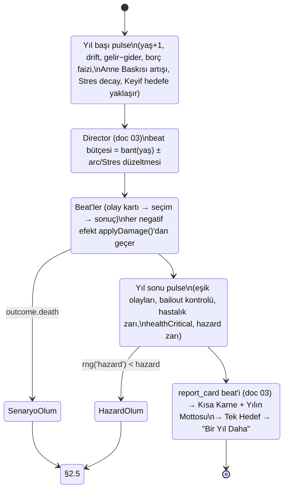

# 02 — Zaman, Statlar, Ekonomi, Sağlık ve Ölüm

> **Belge türü:** Ayrıntılı sistem tasarımı (Motto tasarım paketi, doküman 02/11). Üstünde `00-VIZYON-ve-KARARLAR.md` (D-001..D-060) ve T9 (hukuk) vardır; bu belge D-kararlarını **uygular**, tartışmaz. Kapsamadığı yerde karar verir ve bunu **D-ÖNERİ-02-xx** olarak işaretler (§7).
> **Sahip olduğu sistemler:** yıl/beat zamanı · 4 çekirdek stat + Para + Ego/Cringe/Anne Baskısı + gizli Şans/Stres · soyut para ve ekonomi · koruma penceresi · Gompertz hazard ve ölüm nedenleri · hastalık arkları · ölüm akışı ve Roast Raporu orkestrasyonu · Onyıl Karnesi girdileri · 10.000 hayat harness'ının denge kabulleri.
> **Sürüm:** v1.0 · 2026-11-06 · Yazar: Sistem tasarımı (02 sahibi) · Platform: iOS 16.4+ ve Android minSdk 24, tek Expo/RN/TS kod tabanı; motor saf TS (`packages/engine`), UI'dan bağımsız.

---

## 0. Künye — uygulanan D-kararları, bağımlı dokümanlar, sürüm

### 0.1 Uygulanan D-kararları (00 §5 satırı + bu belgenin dokunduğu diğerleri)

| D | Karar (kısa) | Bu belgede somut karşılığı |
|---|---|---|
| **D-020** | Yıl medyanı 90 sn, tavan 120 sn | §2.1.2 beat bütçesi yaş bandına göre 3,5 / 3 / 2,5 / 2 / 1,5; yıl sonu pulse + Kısa Karne + Tek Hedef sabit 12,4 sn; 18–25 bandı 4 beat ile 120 sn tavanına değer, aşmaz |
| **D-032** | Stat seti T4 aynen; Karma → **Şans** | §2.2: Sağlık, Keyif, Kafa, Çekicilik + Para + Ego, Cringe, Anne Baskısı + gizli Şans (−50..+50) ve Stres (0–100); "Karma" sözcüğü motor, içerik ve lint'te yok |
| **D-033** | Para içeride reel birim, ekranda soyut "Para/Cash"; TL/$ ve makro rakam yok | §2.3.1 **Birim** (1 Birim = giriş seviyesi aylık net gelir), ekranda ×1.000 ölçekli "Para"; nominal/enflasyon katmanı tamamen kaldırıldı (D-ÖNERİ-02-01); lint listesi §5 |
| **D-034** | Ekonomi mizahı kişisel ölçekte; makro yüzde şakası yok | §2.3.1 görüntüleme kuralları: yüzde yalnızca iddia oranı ve kalıp payı için; kira zammı, faiz, borç daima mutlak Para olarak yazılır |
| **D-016** | Ölüm → yeni hayatın ilk kelimesi ≤ 40 sn; her ölümde ≥ 1 Kondisyon açılımı; tek büyük "Yeni Müşteri" + "Aynı kondisyonla" | §2.5.2 zamanlama tablosu: otomatik akış 32,5 sn + geçişler, 7 sn pay; Yedek Kulübesi pity; `deathFlowStep` kalıcı |
| **D-025** | Roast Raporu sırası sabit; ölüm nedeni yalnızca 2. balonda | §2.5.2 adım makinesi; `RoastReport` sözleşmesi; neden metni yalnızca `step=2`'de render edilir, paylaşım kartına girmez |
| D-007 / D-008 | Ölüm ekranında reklam yok; ölümden dönüş satılmaz; interstitial ölüm akışında asla | §2.5.1 `deathFlow` durumunda `AdService` çağrısı derleme düzeyinde yasak (tip sistemi: `DeathFlowContext` içinde reklam API'si yok); Fizyoterapi yalnızca ölümden **önceki** sağlık-kritik yılda (§2.4.6) |
| D-021 | Karne 6 not; Cesaret ve Davranış stat değil türev | §2.2.6 `gradeFor()` + Cesaret (risk sayacı) + Davranış (Cringe/Ego olayları) formülleri |
| D-024 | Kalıp Dedektörü yargılamaz sayar | §2.5.2 Roast Raporu kalıp bloğu yalnızca sayı + pay; sıfat yok; sayımlar doc 03'ten okunur |
| D-028 | 60+ yaşta beat başına ≤ 1 balon | §2.1.2 66+ bandı 1–2 beat; koç balonu kotası doc 01'e `ageBand` ile iletilir |
| D-031 | Welcome-back = Sakatlık Raporu; gerçek yokluk → oyun zamanı | §2.1.4: çevrim tablosu **T7 §3.1 / doc 05'tendir**, burada yeniden tanımlanmaz; bu belge yalnızca `advanceTime()` arayüzünü verir |
| D-039 | Fizyoterapi ölüm öncesi sağlık-kritik yılda, ömürde 1 | §2.4.6 `healthCritical` tanımı ve etkisi (Sağlık +15, o yılın hazard zarı atlanır) |
| D-042 / D-056 | Kondisyon çeşitlilik verir, güç vermez; ölüm = içerik | §2.5.3 taşınanlar tablosu: stat/Para/Şans taşınmaz; perk listesi doc 05'te |
| D-018 / D-017 | Fazla Bagaj; Tanıdık Yüzler metaMemories | §2.5.3 `LifeRecord.highestCringeEvent` ölümde yazılır; NPC hafızası doc 04'ün yazdığı alandan kopyalanır |
| D-044 | Motor saf TS, deterministik; harness kabulü medyan ölüm 72–80 | §2.7 ve §6: medyan hedefi **72–78** (T4 ile aynı, D-044'ün bandının içinde); kanal bazlı RNG (`hazard`, `outcome`) |
| D-051 | Onyıl Karnesi yalnızca karar kalemleri; zorunlu lift gerçek Kondisyon puanı | §2.6 girdi şeması tip düzeyinde kimlik alanı içermez |
| D-052 | Düşük Keyif: roast kapalı, "bugün tek şey", yardım ekranı; intihar/kendine zarar yok | §2.4.7 `lowJoy` protokolü ve doc 01/08 devri; ölüm nedeni tablolarında yasaklı sınıf (§2.4.3) |
| D-055 | Enerji yok, stat editörü yok, sahte sayaç yok | §2.1: T4'ün "enerji 4/yıl serbest aksiyon menüsü" alınmadı; tüm eylemler beat'tir |
| D-009 / D-010 | İddia gerçek oran; HAKSIZ ÇIKTIM sayımı | §2.2.5 Şans'ın orana etkisi görünen orana **dahildir**; §2.5.2 "beni N kez haksız çıkardın" sayacı |

### 0.2 Bağımlı dokümanlar (arayüz sözleşmeleri)

| Doküman | Bu belge ona ne verir | Ondan ne alır |
|---|---|---|
| **01** Anlatıcı | `ageBand`, `lowJoy`, `healthCritical`, `deathFlowStep`, rozet-metre eşik olayları (koç satır tetikleyicisi) | Satır havuzları; sessizlik kuralı metinleri; 60+ balon kotası |
| **03** Olay motoru | Yıl sonu pulse sırası, `applyDamage()`/`protection()` (olay efektleri buradan geçer), hazard ve ölüm nedeni servisleri, `GameClock` | `patternCounts`, iddia sayımı (`wagersTotal`, `wagersPlayerWon`), `report_card` beat'i, director'ün beat bütçesi talebi |
| **04** Kariyer/ilişkiler | Gelir kademeleri T0–T6, barınma kademeleri, borç/kefalet kuralları, Anne Baskısı'nın yıllık artış girdileri | Kariyer → kademe eşlemesi; NPC `alive` bayrakları (anne); evlilik/çocuk/ev olayları; `metaMemories` |
| **05** Retention/miras | `LifeRecord` (metaLog kaydı), Fazla Bagaj etiketi, Onyıl Karnesi lift puanı, `lifeEnded` efekti (bildirim iptali) | Kondisyon perk listesi ve Yedek Kulübesi pity; Teşhis hesaplaması; welcome-back çevrim tablosu (T7) |
| **06** Monetizasyon | `healthCritical` tetikleyicisi (Fizyoterapi), `deathFlow` durumunda reklam yasağı | Fizyoterapi/Ek Antrenman kabul edildi sinyali |
| **07** UX/UI | Rozet-metre eşik animasyon anları, Roast Raporu adım süreleri, Para görüntü kuralları | Ekran bileşenleri; paylaşım kartı render'ı |
| **08** Hukuk/linter | §5 yasaklı sözcük listesi (para, ölüm, sağlık alanları), ölüm nedeni onaylı listesi, "Gerçek hayatta yardım" tetikleyicisi | Lint kuralları; yardım ekranı içeriği |
| **09** i18n | ICU `number` kullanım kuralı (gruplama locale'e göre), EN karşılık adları (Mom Pressure, Cash, Debt) | Çift locale realizasyon |
| **10** Teknik | `step(state, action)` içinde yıl pulse ve ölüm commit'inin atomikliği gereksinimi | RNG (`sfc32`), kayıt katmanı |
| **11** KPI | §6 KPI'lar ve harness metrik şeması | Soft launch kapıları |

### 0.3 Sürüm

v1.0 (2026-11-06). Değişiklik yalnızca bu dosyada ve yeni D-kaydıyla; §7'deki D-ÖNERİ'ler 00'a alınınca buradaki numaralar korunur.

---

## 1. Amaç ve kapsam — MVP / Soft launch / 1.0 farkları

**Amaç.** Oyuncunun 55–75 dakikada 18'den ölüme yaşadığı, her "Yaşlan" basışında bir şey kazandığı ya da kaybettiği, 28'inden önce hiçbir zaman "bitmiş" hissetmediği, 50'sinden sonra ise gerçekten gergin bir hayat eğrisi kurmak; bu eğrinin **ölçülebilir** olması (harness), **okunabilir** olması (karne, rozet-metre, Roast Raporu) ve **şikâyet edilemez** olması (gerçek para birimi yok, gerçek felaket yok, intihar yok). Bu belge "ne kadar" sorularının cevabıdır: kaç beat, kaç yıl, kaç Birim, hangi olasılık.

**Kapsam farkları.**

| Alan | MVP (dikey kesit, 10 hafta) | Soft launch (+8 hafta) | 1.0 |
|---|---|---|---|
| Zaman | Yıl + beat; 18–35 tam bütçe; 36+ **Hızlı Yaşa** varsayılan (1 beat/yıl, Kısa Karne otomatik); alt-tur yalnızca **hastalık arkı** | 36–50 tam bütçe; askerlik alt-turu (TR) / student loans ikamesi (EN, alt-tur yok) | Tüm bantlar tam; hamilelik ve sınav alt-turları (doc 04) |
| Statlar | 4 çekirdek + Para + 3 rozet-metre + gizli Şans/Stres **hepsi** (motor tam) | Aynı | Aynı; tuning'de yalnızca sabitler değişir |
| Ekonomi | Birim modeli, 6 gelir kademesi, 6 barınma kademesi, kart borcu + iflas olayı, koruma penceresi + 3 bailout olayı, 4 sürpriz gelir | Banka kredisi (kredili ev), kefalet borcu, geç oyun sağlık gideri, spiral çıkışı | Miras (uzak akraba), emeklilik kademeleri, 24 kariyerin tam gelir eşlemesi |
| Sağlık/ölüm | Gompertz hazard, 4 yaş bandı × 6 neden sınıfı, absürt kuyruk 12 satır/locale, 1 hastalık arkı (3 kart), senaryo ölümü kanalı (2 olay) | Absürt kuyruk 24 satır, 3 hastalık arkı, Fizyoterapi kancası canlı, 6 senaryo ölümü | Absürt kuyruk 40 satır, 5 hastalık arkı (kronik dahil), yaş bandı başına 8 varyant neden metni |
| Ölüm akışı | Roast Raporu tam sıra (8 blok × 4 varyant), 3 Kondisyon perk'i, Fazla Bagaj, `LifeRecord` | 8 × 6 varyant, Yedek Kulübesi pity, Nazik/Acımasız rapor uzunlukları | 8 × 8, 10 perk, "Aynı kondisyonla" |
| Onyıl Karnesi | Yok (motor girdileri hesaplanır, ekran yok) | 30 ve 40 | 30/40/50/60 |
| Harness | 10.000 hayat, 5 persona; ölüm yaşı + para persentilleri + erken ölüm oranı | + neden dağılımı, bailout oranı, Fizyoterapi tetiklenme oranı | + Onyıl puan dağılımı; sim–playtest sapması raporu |

---

## 2. Tasarım

### 2.1 Zaman modeli

#### 2.1.1 Yıl = tur

Oyuncu **Yaşlan** basar; motor bir yılı tek `step` zinciriyle oynatır. Yıl beş fazdan oluşur ve faz sırası sabittir — harness snapshot'ları bu sıraya bağlıdır.



İki kural: (1) **Senaryo ölümü yılı anında bitirir** — kalan beat'ler oynanmaz, karne gösterilmez, akış §2.5'e geçer. (2) **Hazard zarı karneden önce** atılır; ölen karakter karne almaz, Roast Raporu alır ("son karne" Roast Raporu'nun 3. balonundaki sayılardır).

#### 2.1.2 Beat bütçesi yaş bandına göre

Beat ≈ 28 sn (kart 6–10 sn okuma + karar + sonuç + ≤ 2 koç balonu). Yıl sabit payı 12,4 sn (Yaşlan geçişi ≤ 0,4 + Kısa Karne ≤ 8 + Tek Hedef ≤ 4; "Aynı hedef" tek dokunuş). D-020'nin 90 sn medyanı ve 120 sn tavanı buradan çıkar:

| Yaş bandı (koç adı) | Beat bütçesi (medyan) | Tipik yıl süresi | Yıl sayısı | Beat toplamı | Dakika | Not |
|---|---|---|---|---|---|---|
| 18–25 "Isınma" | 3–4 (3,5) | ~110 sn | 8 | 28 | 14,7 | 4 beat'li yıl 124 sn'ye değer; director 4. beat'i yalnızca aktif arc varsa verir, böylece tavan korunur |
| 26–35 "Sezon" | 3 | ~96 sn | 10 | 30 | 16,1 | Medyan yıl burada; D-020'nin "90 sn" çapası |
| 36–50 "Sezon / İkinci devre" | 2–3 (2,5) | ~77 sn | 15 | 38 | 19,4 | Her 2 yılda 1 ekstra beat (arc ya da zarf açılışı) |
| 51–65 "İkinci devre" | 2 | ~60 sn | 15 | 30 | 15,1 | Koç çoğu beat'te 1 balon |
| 66–75 "Uzatmalar" | 1–2 (1,5) | ~45 sn | 10 | 15 | 7,6 | ≤ 1 balon (D-028); "yıllar su gibi" hissi mekaniktir, replik değil |
| 76+ | 1 | ~40 sn | — | — | — | Hazard zaten yüksek; her yıl bir "küçük şey" |
| **Toplam 18–75** | | | **58** | **≈ 141** | **≈ 73** | 00 §4.1 "55–75 dk" bandının içinde; Hızlı Yaşa ile ≈ 53 dk |

Düzeltmeler: **Stres > 70 → +1 beat** (hayat "yoğun"; T4), tavan 4. **Aktif arc** kendi beat'ini bütçeden alır, bütçeyi aşamaz (Valve dersi: scripted track pacing'den ayrı ama yılın 2 beat'ini geçmez). **Hızlı Yaşa** (oyuncu açar/kapar; MVP'de 36+ varsayılan açık): bütçe 1, Kısa Karne otomatik 3 sn, Tek Hedef "Aynı hedef" varsayılan; zarf ve arc beat'leri yine oynanır (Hızlı Yaşa hikâyeyi atlamaz, dolguyu atlar).

#### 2.1.3 Alt-turlar yalnızca arklarda

Yıl bölünmez; **ay** yalnızca belirli arkların içinde "hızlandırılmış kart" olarak görünür. Bu belgenin sahip olduğu alt-turlu ark **hastalık arkı**dır (§2.4.5): 3–6 ay, 2–3 kart. Doc 04'ün alt-turları: askerlik (TR, 6–12 ay, 3 kart; EN ikamesi student loans alt-tur **içermez**), sınav dönemi, hamilelik. Alt-turun kuralı: **yıl sayacı ilerlemez**, beat bütçesinden düşer, karne o yılın sonunda tek kez gelir.

```ts
// packages/engine/src/time.ts
export type AgeBand = 'warmup' | 'season' | 'secondHalf' | 'overtime';   // 18–25 | 26–50 | 51–65 | 66+
export interface GameClock {
  year: number;            // takvim yılı (FTUE'de 2026'dan başlar; sadece karne başlığı için)
  age: number;             // 18..100
  month?: 1|2|3|4|5|6|7|8|9|10|11|12;   // yalnızca alt-tur arkı içinde tanımlı
  arcId?: string;          // açık alt-tur arkı
}
export function ageBand(age: number): AgeBand {
  return age <= 25 ? 'warmup' : age <= 50 ? 'season' : age <= 65 ? 'secondHalf' : 'overtime';
}
export function beatBudget(age: number, stress: number, hasActiveArc: boolean, fastLife: boolean): number {
  if (fastLife) return 1;
  const base = age <= 25 ? (hasActiveArc ? 4 : 3)
             : age <= 35 ? 3
             : age <= 50 ? (age % 2 === 0 ? 3 : 2)
             : age <= 65 ? 2
             : age <= 75 ? (age % 2 === 0 ? 2 : 1) : 1;
  return Math.min(4, base + (stress > 70 ? 1 : 0));
}
```

#### 2.1.4 Gerçek zaman → oyun zamanı (referans, yeniden tanım yok)

Welcome-back çevrimi (gerçek 1–3 gün → 1–3 ay; 14–29 gün → 1–2 yıl; 30+ gün → 2 yıl tavanı; büyük karar rafta bekler; geri dönülemez kayıp yok) **T7 §3.1'de tanımlıdır ve doc 05 uygular**. Bu belge yalnızca kancayı verir: doc 05'in `AbsenceEngine.resolve()` çıktısı `advanceTime({ months })` aksiyonuna çevrilir; `months ≥ 12` ise motor §2.1.1'deki yıl pulse'ını **beat'siz** çalıştırır (drift, gelir–gider, hazard zarı dahil — çünkü yokluk ölüm riskini silmez, ama Sakatlık Raporu'nda ölüm **asla** gerçekleşmez: `advanceTime` içinde hazard zarı `rng('hazard')` ile atılır fakat sonuç `pendingDeathRisk` olarak rafa konur ve oyuncunun ilk Yaşlan'ında normal akışta çözülür). Motor gerçek saati **hiç okumaz**; `advanceTime` payload olarak gelir. Ruh hâli (Yorgun 23:00–06:00) doc 01'in meselesidir.

### 2.2 Statlar

#### 2.2.1 Çekirdek dörtlü

| Stat (TR / EN) | Başlangıç aralığı (FTUE sabit) | Taban / tavan | Yaşa göre yıllık drift | Mekanik rol |
|---|---|---|---|---|
| **Sağlık / Health** | 65–80 (70) | 0 / 100; drift tek başına 5'in altına indiremez | 18–29: 0 · 30–44: −0,4 · 45–59: −0,7 · 60–69: −1,0 · 70+: −1,2 · `sporcu` +0,5 · `sigara` −0,3 · Stres > 70: −2 · Stres > 85: −4 | Hazard çarpanı (§2.4.1); `healthCritical`; hastalık zarı eşiği (< 40) |
| **Keyif / Joy** | 45–65 (55) | 5 / 100 (asla 0: "hiçbir şey işe yaramaz" durumu yok) | Türev: hedefe %30 yaklaşır (2.2.2) | lowJoy protokolü (< 25); Kafa tavanı; sosyal olay ağırlığı |
| **Kafa / Smarts** | 45–70 (60) | 0 / 100; **Keyif < 30 iken 70'i aşamaz** (LLTQ kuralı, "depresif dahi" engeli) | öğrenci +1,5 (doc 04) · 60–69: −0,3 · 70+: −0,6 | Eğitim/kariyer kilitleri (doc 04) |
| **Çekicilik / Looks** | 35–65 (50) | 10 / 100 | 30–39: −0,3 · 40+: −1,0 · `sporcu` +0,3 | İlişki başlangıç şansı (doc 04); Ego ile çarpışınca roast |

İlk hayat (FTUE) **elle yazılmıştır ve deterministiktir**: 70 / 55 / 60 / 50, Para 2 Birim (dayının parası). Sonraki hayatlarda aralık içinden `rng('names')` kanalıyla çekilir; Kondisyon perk'leri bu aralıkları **değiştirmez** (D-042).

#### 2.2.2 Keyif türevi

Sims modeli: Keyif bir hedefe doğru çekilir, olaylar üstüne biner.

```
keyifHedef = 50 + 0,15·(Sağlık − 50) + 8·tanh(Para / 24) + 0,10·(ilişkiOrt − 50) − 0,25·max(0, Stres − 50)
Keyif(yıl başı) = Keyif + 0,30·(keyifHedef − Keyif)
```

`Para` Birim cinsinden; `tanh` doygunluğu sayesinde 24 Birim (iki yıllık giriş maaşı) birikim +6 verir, 200 Birim +8'de kalır — **zenginlik mutluluğu satın almaz, borç satın alır** (Borç −24 → −6). `ilişkiOrt` doc 04'ün hayattaki NPC affinity ortalaması. Pozitif geri besleme (Sims): Keyif ≥ 70 iken sosyal/absürt olayların director ağırlığı ×1,2; Keyif < 30 iken ×0,6 ve "bugün tek şey" havuzu açılır.

#### 2.2.3 Para (özet; ekonomi §2.3'te)

İç birim **Birim**, ekranda **Para / Cash** (×1.000). Negatif bakiye ekranda **"Borç 1.200" / "Debt 1,200"** olarak kırmızı yazılır; eksi işareti hiçbir yerde görünmez (koç: *"Bakiye: 0. Yuvarlamadım; sıfır yuvarlanmaz."*).

#### 2.2.4 Komedi metreleri: Ego, Cringe, Anne Baskısı

Üçü de gerçek stat'tır (kararla değişir, olay kapılar, uçta sonuç üretir) ama **rozet-metre** olarak çizilir: HUD'da ikon + küçük sayı; yalnızca bir eşik geçildiğinde 600 ms büyür, koç 1 satır der, sonra küçülür. Dört çekirdek bar + Para her zaman görünür; rozet-metreler dikkat istemez, kazanır.

| Metre (TR / EN) | Aralık, başlangıç | Nasıl yükselir | Nasıl düşer | Eşikler ve kapıladığı şeyler |
|---|---|---|---|---|
| **Ego** | 0–100, 40–60 (50) | Risk başarısı +4..+10; terfi +6; "pazarlık" kazanımı +5; iltifat olayları +3; Kripto kazancı +20 (tek seferlik tavan) | Yılda 2 puan 50'ye doğru geri çekilir; ret/başarısızlık −3..−8; "sus" seçenekleri −4 | **< 15 "Görünmez"**: fırsat olayları (iş teklifi, flört açılışı) director'de ×0,3; **15–30**: işbirliği seçeneklerinde başarı +%5; **70–85 "Parlak"**: risk seçeneklerinde +%5, ilişki decay ×1,5; **> 85 "Narsist"**: ilişki decay ×2, "patronla kavga" ailesi açılır, roast ekseni Ego; **100**: ölüm **yok** (D-ÖNERİ-02-02); 2 yıl "Narsist Sezon" + tek seferlik komik olay (kendi heykeli; Para −6 Birim, Cringe +15) |
| **Cringe** | 0–100, 0–10 | Olay sonuçları +3..+20 (tek sonuç tavanı 20) | **−10/yıl** sabit decay | **≥ 60**: "utanç callback" olayları açılır (eski olay anıya referans); **≥ 90**: "Şehir değiştir" olayı zorunlu beat (taşınma; Cringe −50, Para −3 Birim); hayatın **en yüksek Cringe olayı** ölümde Fazla Bagaj olur (D-018) |
| **Anne Baskısı / Mom Pressure** | 0–100, 0 ("doğdu" ilk aile kartında) | Yıl başı pulse (anne hayattayken): 24+ ve bekâr +3 · işsiz +3 · anne evinde +4 · o yıl "Görüldü, cevap yok" +2 · toplam yıllık tavan **+12** | Ev (kira/sahip) −30 · iş −10 · evlilik/çocuk −30 (doc 04 olayları) · "annenle 1 saat konuş" seçenekleri −5..−10 · bayram ziyareti −8 | **≥ 50**: Aile Grubu kartı salience ×1,5; **≥ 80**: "görücü" zinciri zorunlu beat (TR) / "the setup dinner" (EN); **100**: "Annen yanına taşındı" komik olay (−40, Keyif −5, Para +1 Birim: yemek); **anne ölürse metre dondurulur ve gizlenir**, bir daha değişmez (D-ÖNERİ-02-04) |

Ego uçlarında ölüm olmaması bilinçli bir sapmadır (T4 açık soru 2): 60 dakikalık bir hayatı 2 dakikalık Reigns saltanatı gibi bitirmek adaletsiz okunur; uç, ölüm değil **içerik** üretir.

#### 2.2.5 Gizli statlar: Şans ve Stres

**Şans (−50..+50; UI'da hiç yok; motor ve içerikte adı yalnızca "Şans/luck").** Başlangıç `rng('names')` ile −10..+10. Değişim: doc 03'ün `luck` efektleri (Cömertlik seçimleri +2, Kısa Yol −3, kediyi kabul +3, kapıyı kapat −5 gibi; tek efekt tavanı ±8). Her yıl %15 sıfıra geri çekilir. Etkisi:

```
pEtkin = clamp(p · (1 + Şans/500), 0,02, 0,98)          // ±%10 çarpan, yalnızca luckScaled sonuçlarda
M_şans(hazard) = 1 − Şans/1000                             // ±%5
```

**Dürüstlük kuralı (D-009):** İddia fişinde ve "Oranı göster"de gösterilen oran `pEtkin`'dir, `p` değil. Koç Şans'ı adıyla asla anmaz; nadir ifşa satırı (ömürde ≤ 1): TR *"Şans değil bu. Sayılar. Ama sayılar da bugün senden yana."* / EN *"That wasn't luck. That was math. Math happened to like you today."* "Karma", "evren", "kader", "nazar" sözcükleri Şans bağlamında lint BLOK.

**Stres (0–100; ipuçlarıyla görünür, sayı olarak asla).** Başlangıç 25. Yükselme: iş olayları +3..+12; Para < 0 yıl başı +8; Anne Baskısı ≥ 70 yıl başı +3; hastalık arkı +10; "Görüldü, cevap yok" +2. Düşme: yıl başı doğal decay −4; Keyif ≥ 70 ek −3; tatil/spor/terapi seçimleri −6..−15; kedi +0 (kedi stres düşürmez, kedi stres **yönetir**: Keyif +). Etkiler: > 70 → Sağlık −2/yıl ve hazard ×1,25 ve beat bütçesi +1; > 85 → Sağlık −4/yıl ve "uyuyamıyorsun" olay ailesi açılır; Keyif hedefi §2.2.2'deki terimle baskılanır. Oyuncuya yüzeyi: olay metni ve koç ipucu (TR *"Uyku: dört saat. Bu bir sayı değil, bir itiraf."* / EN *"Sleep: four hours. That's not a number, that's a confession."*).

#### 2.2.6 Karne türevleri: Cesaret ve Davranış (D-021)

Karne 6 not alır; ilk dördü stat deltasından, ikisi davranış sayaçlarından. Bu belge `gradeFor()`'u tanımlar, doc 07 çizer, doc 03 `report_card` beat'inde çağırır.

```ts
export type Grade = 0|1|2|3|4;   // TR Zayıf/Geçer/Orta/İyi/Pekiyi · EN F/D/C/B/A
export const gradeForDelta = (d: number): Grade => d >= 10 ? 4 : d >= 3 ? 3 : d >= -2 ? 2 : d >= -9 ? 1 : 0;
// Para: yıllık net değişim / yıllık toplam gider (gelire değil gidere oranlı: zengin de kötü yıl geçirebilir)
export const gradeForMoney = (netDelta: number, yearlyCost: number): Grade => {
  const r = netDelta / Math.max(yearlyCost, 1);
  return r >= 0.5 ? 4 : r >= 0.15 ? 3 : r >= -0.15 ? 2 : r >= -0.5 ? 1 : 0;
};
// İlişkiler: hayattaki NPC affinity ortalamasının yıllık deltası (doc 04 verir) → gradeForDelta
// Cesaret: o yıl `pattern: 'risk'` etiketli seçim sayısı
export const gradeForCourage = (riskChoices: number): Grade => Math.min(4, riskChoices) as Grade;
// Davranış: 2'den başla; her Cringe sıçraması (tek sonuçta ≥ 8) −1; Ego bu yıl 85'i geçtiyse −1;
// ≥ 2 Cömertlik/Sabır seçimi +1; hiç Cringe sıçraması yoksa +1; clamp 0..4
export function gradeForConduct(y: YearStats): Grade {
  let s = 2 - y.cringeSpikes - (y.egoCrossed85 ? 1 : 0) + (y.kindChoices >= 2 ? 1 : 0) + (y.cringeSpikes === 0 ? 1 : 0);
  return Math.max(0, Math.min(4, s)) as Grade;
}
```

Davranış notunun koç cümlesi daima **olaya** bağlanır, sıfata değil: TR *"Davranış: Orta. Düğünde mikrofon aldın."* / EN *"Conduct: C. You took the mic at a wedding."*

#### 2.2.7 Tipler

```ts
export interface CoreStats { health: number; joy: number; smarts: number; looks: number; }   // 0–100
export interface Meters   { ego: number; cringe: number; momPressure: number | null; }        // null = anne öldü, donduruldu
export interface Hidden   { luck: number; stress: number; }                                   // −50..50 · 0–100
export interface Money    { balance: number; debt: { card: number; bank: number; cosign: number }; } // Birim
export interface LifeState {
  clock: GameClock; stats: CoreStats; meters: Meters; hidden: Hidden; money: Money;
  flags: Set<string>;                 // 'sporcu','sigara','kiraci','anne_evinde','bailoutUsed','physioUsed',...
  housing: HousingTier; incomeTier: IncomeTier; yearsWorked: number;
  spiralYears: number; lowJoy: boolean; healthCritical: boolean;
  yearStats: YearStats;               // karne türevleri için yıl içi sayaçlar
}
```

### 2.3 Ekonomi

#### 2.3.1 Birim ve görüntüleme kuralları (D-033, D-034)

- **Birim** iç birimdir: 1 Birim = giriş seviyesi (kademe T1) **aylık** net gelir. Her maaş, kira, borç ve sürpriz Birim cinsinden yazılır; içerik JSON'ında `"money": "-0.3"` gibi (Birim), eski `AU` gösterimi kullanılmaz.
- **Nominal/enflasyon katmanı yoktur** (D-ÖNERİ-02-01). T4 §3.3'ün `priceIndex` çarpanı, D-033/D-034 ile kalan tek işlevini (enflasyon esprisi) yitirdiği için kaldırıldı. Reel denge zaten çekirdekteydi; yüzey artık çekirdeğin kendisi.
- **Ekran:** `Para = round(Birim × 1.000)`; ICU `{n, number}` ile locale gruplaması (TR 3.400 · EN 3,400); ≥ 1.000.000'da ICU compact (TR "1,2 Mn" · EN "1.2M"). Negatif bakiye **"Borç N" / "Debt N"**; eksi işareti yok.
- **Yüzde** yalnızca iki yerde: İddia oranı ("Oran %42'ydi") ve Roast Raporu kalıp payı ("%31"). Kira zammı, zam, faiz, borç büyümesi **mutlak Para** ile yazılır: TR *"Kiran 300 arttı. Maaşın artmadı."* / EN *"Rent went up 300. Your pay went up a compliment."*
- **Yasaklı sözcükler (02 alanı, iki locale, lint BLOK):** TL, lira, ₺, dolar, $, €, euro, kur, enflasyon/inflation, asgari ücret/minimum wage, faiz oranı/interest rate, zam oranı, "yüzde" + makro bağlam, "ekonomi kötü/economy's bad" tipi genelleme. "Faiz/interest" sözcüğü serbest, oran olarak yazımı yasak.
- **Küçük sayı mizahı serbest ve teşvikli:** TR *"Bakiye: 0. Yuvarlamadım; sıfır yuvarlanmaz."* / EN *"Balance: zero. I didn't round. Zero doesn't round."*

#### 2.3.2 Gelir: kariyer kademeleri

Kariyerler doc 04'tedir; bu belge **kademeleri** tanımlar, doc 04 her kariyer basamağını bir kademeye eşler. Yıllık gelir = 12 × kademe × performans çarpanı (0,9–1,1; doc 04 "performans" barı).

| Kademe | Aylık gelir (Birim) | Tipik basamak (doc 04'ten örnek) | Hayat payı hedefi (harness) |
|---|---|---|---|
| T0 | 0 (anne evinde 0,1 harçlık; öğrenci 0,15 yarı zamanlı) | işsiz, öğrenci, atama bekleyen | 18–23 arası çoğunluk; 30+ ≤ %12 |
| T1 | 1,0 | garson, kurye, çırak, ücretli öğretmen (0,8–1,2 bandı) | ilk iş |
| T2 | 1,6 | şef yardımcısı, memur başlangıç, junior | 25–32 medyan |
| T3 | 2,5 | usta, uzman, mid | 33–45 medyan |
| T4 | 4,0 | senior, müdür, ortak | hayatların %30–45'i ulaşır |
| T5 | 6,0 | prof, restoran sahibi, başrol | %8–15 ("zirve" T4 kabulü) |
| T6 | 10–15 | "yurt dışına kaçtı", özel hastane, franchise | %2–5; yıllık gelir tavanı 60 Birim (legendary hariç) |
| Emekli | 0,9 × son kademe (≥ 20 yıl çalışmışsa), aksi 0,5 | otomatik 60–65 (doc 04 kariyere göre) | — |

**Volatil gelir** (Influencer, Kripto Gurusu, Kahve Falcısı): kademe yerine yıllık `lognormal(μ, 0,7)` çekilir, 0,3–6,0 Birim'e kırpılır; iki ardışık yıl aynı yöne gidemez (harness: "sonsuz para" exploit'i yok).

#### 2.3.3 Gider: barınma kademeleri ve yaşam tarzı

| Barınma kademesi | Aylık toplam sabit gider (temel geçim + barınma, Birim) | Giriş/çıkış | Anne Baskısı |
|---|---|---|---|
| Anne evi | 0,10 | 18'de varsayılan; "Annenin yanına taşın" olayı | +4/yıl |
| Oda / ev arkadaşı | 0,60 | Ev Arkadaşı (Barış ↔ Jordan) olayları | 0 |
| 1+1 kiracı | 0,85 | Kira zammı olayları yılda 1 aday | −30 girişte |
| Geniş kiracı | 1,10 | Yaşam tarzı; Ego +3 girişte | — |
| Kredili ev | 1,25 (15 yıl), sonra Sahip | Peşinat ≥ 24 Birim + T2 üstü gelir; banka evrak kartı (Tercüme) | −30 girişte |
| Ev sahibi (borçsuz) | 0,45 | Kredi biter / miras | — |

Ek giderler: **yaşam tarzı harcaması** = gelirin %15'i (Dürtüsel Harcama kalıbı baskınsa %35; Sabır baskınsa %10 — doc 03 kalıp sayımı yıl başında okunur); **sağlık gideri** (geç oyun gerilimi): 45–59 yaş 0,10 · 60–69 0,25 · 70+ 0,45 Birim/ay, hastalık arkı tedavi seçimleri ayrı; **küçük yıllık sürprizler** |N(0, 0,8)| Birim negatif (araba, diş, düğün takısı ↔ wedding gift).

#### 2.3.4 Borç

| Borç türü | Nasıl oluşur | Yıllık büyüme (iç sabit; ekranda asla oran olarak yok) | Çıkış |
|---|---|---|---|
| Kart borcu | Bakiye < 0 | ×1,18 | Pozitif bakiye borcu kapatır; **İcra/İflas olayı**: borç < −24 Birim → zorunlu beat, borç −6'ya iner, Ego −15, Cringe +20, `iflas` bayrağı (kredili ev 10 yıl kapanır) |
| Banka kredisi | Kredili ev | Taksit kademeye gömülü (1,25), ayrıca büyümez | 15 yıl; erken kapatma olayı |
| Kefalet borcu | "Arkadaşına kefil oldun" olayı (TR klasiği ↔ EN "co-signed a lease") | 0; **sürpriz** olarak 2–6 yıl sonra 3–8 Birim düşer | Ödersin ya da arkadaş kaybedersin (doc 04 anı) |

Koç borcu kişisel ölçekte sayar: TR *"Borç 4.200. Geçen yıl 3.100'dü. Büyüyen tek şeyin."* / EN *"Debt: 4,200. Last year, 3,100. It's the only thing you've grown."*

#### 2.3.5 Sürpriz gelirler (windfalls)

Sabit liste; **piyango, bahis, kumar, şans oyunu yoktur** (D-ÖNERİ-02-09; T9 #4 ve 16+ derecelendirme). Her biri olaydır, oran görünür, hazard'la ilgisi yoktur.

| Sürpriz | Yaş | Miktar (Birim) | Hayatta en çok | Not |
|---|---|---|---|---|
| Dayı parası | 18 (FTUE) | +2 | 1 | "Dayın 2009'da yaşıyor" |
| Kıdem tazminatı | işten çıkarılma | +1 × çalışılan yıl (tavan 20) | — | Sakatlık değil, "transfer" |
| Düğün takısı ↔ Wedding gifts | evlilik olayı (doc 04) | +3..+8 | 1 | Para +, Anne Baskısı −30 |
| Unutulmuş hesap ↔ Forgotten account | 30+ | +1..+3 | 1 | Absürt-sıcak |
| Uzak akraba mirası ↔ Distant relative's estate | 45–65 | +12..+36 | 1 | 1.0; kurgusal akraba, isim üreteci |
| Kripto kazancı | 21–35 | +6 (p ≈ 0,2) | 2 (cooldown 5 yıl) | Kaybı −2..−10; **tekrarlı bahis döngüsü yok**, iki olay, oran yazılı |

#### 2.3.6 Koruma penceresi 18–28 (T11 #11, 00 §4.1)

```ts
export const protection = (age: number) => clamp(1 - (age - 18) / 10, 0, 1);        // 18→1, 28→0
export function applyDamage(kind: 'money'|'health', raw: number, st: LifeState, rng: Rng): number {
  if (raw >= 0) return raw;
  const mult = 1 - 0.5 * protection(st.clock.age);                                    // 18: ×0,5 … 28: ×1,0 (lineer)
  let dmg = raw * mult;
  if (kind === 'money' && st.money.balance > 20 * monthlyCost(st)) dmg *= 1 + 0.5 * rng.next();  // çok rahat oyuncuya varyans
  return dmg;
}
export function bailoutCheck(st: LifeState, rng: Rng): StoryletId | null {
  if (st.money.balance < 0 && protection(st.clock.age) > 0 && !st.flags.has('bailoutUsed')) {
    st.flags.add('bailoutUsed');                                                        // hayat başına 1, yalnızca 18–27
    return pick(['evt_anne_borc_verdi', 'evt_dayi_is_buldu', 'evt_ev_arkadasi_kira'], rng);
  }
  return null;
}
```

Bailout üç olaydan biridir; hepsi **+3 Birim** verir ve bir borç bırakır: "anne borç verdi" → Anne Baskısı +15 ve 3 yıl sonra "Annen parayı sormadı. Bu daha kötü." callback'i; "dayı iş buldu" → T1 iş + Ego −5; "ev arkadaşı kirayı ödedi" → Barış/Jordan anısı `borc_verdi`. Koç satırı §3.6'da. Senaryo ölümü kanalı pencerede kapalıdır (§2.4.4).

#### 2.3.7 Geç oyun gerilimi ve spiral çıkışı

28'den sonra koruma yoktur: hasar ×1,0, bailout yok, sağlık gideri yaşla büyür, emekli geliri düşer, hastalık arkları Para ister. **Ölüm spirali** (Para < 0 ∧ Sağlık < 20) üst üste 3 yıl sürerse ve yaş ≥ 28 ise, hayatta **bir kez** anlatısal çıkış olayı tetiklenir (D-ÖNERİ-02-03): "uzak akraba mirası (küçük)", "eski patron pişman oldu (T2 iş)", "unutulmuş hesap" — yalnızca **Para** düzeltir (+6..+12 Birim), Sağlık'a dokunmaz, satılmaz, reklamla ilgisi yoktur. Bu bir pity'dir (T11 3d): oyuncuyu 3 yıl boyunca hiçbir seçeneğin işe yaramadığı bir durumda bırakmak "bir yıl daha"yı öldürür; ama **ölümü ertelemez**.

#### 2.3.8 Üç arketipin 70 yıllık para eğrileri (Birim; ekran = ×1.000)

Headless simülasyonla üretildi (başlangıç 2 Birim; yıllık küçük sürprizler; borç ×1,18; iflas −24'te; sağlık gideri yaşla). Net varlık ev öz sermayesini içerir (kredili ev taksitleri birikime sayılır; "sahip" olunca gider düşer).

| Yaş | **A — Sağlamcı** (üni 18–22, T1 23, T2 27, T3 33, T4 42; anne evi → oda → 1+1 → kredili 36 → sahip 51; harcama %15; 36'da −30 kaza; emekli 63) | **B — Riskli** (kurye 19, volatil gelir 22–39, kripto −4 @23 / +8 @29 / −10 @34; oda → geniş kiracı 28–40 → 1+1; harcama %35; T2 40, T3 48; emekli 65, düşük) | **C — Anne Evi** (atama bekleyen 24–30, T2 31, T3 36, T4 45; anne evi 18–34 → 1+1 → kredili 44 → sahip 59; harcama %10; 44'te −25; emekli 60) |
|---|---|---|---|
| 18 | 1,8 | 0,3 | 1,4 |
| 22 | 1,5 | 1,7 | 2,3 (bailout: anne borç verdi, 22) |
| 25 | 15 | 10 (bailout 23) | 3 |
| 28 | 34 | 63 (kripto yılı) | 3 |
| 30 | 48 | 72 | 4 |
| 35 | 103 | 67 | 61 |
| 40 | 123 (kaza yılı sonrası) | 79 | 116 |
| 45 | 234 | 86 | 152 (−25 şoku sonrası) |
| 50 | 352 | 108 | 255 |
| 55 | 520 | 145 | 375 |
| 60 | 684 | 181 | 479 |
| 65 | 790 | 194 | 532 |
| 70 | 857 | 142 (düşük emekli + sağlık gideri: **düşüş başlar**) | 582 |
| 75 | 915 | 81 | 622 |
| 80 | 972 | 19 (ölmezse 82'de Borç) | 662 |

Okuma: **A** 28'de "güvende" ama hiçbir yılı Pekiyi değil; **B**'nin eğrisi oyunun en iyi hikâyesi — 28'de A'nın iki katı, 80'de sıfır; **C** 30'a kadar düz çizgi (Anne Baskısı 80+ "görücü" zinciri burada tetiklenir), sonra A'yı yakalar ama geçemez. Harness kabulü: 10.000 hayatta 28 yaşında Para < 0 oranı ≤ %5; 60 yaşında Para medyanı 150–400 Birim; 60 yaşında Borç oranı %8–18 (geç oyun gergin kalmalı, çökmemeli).

### 2.4 Sağlık ve ölüm

#### 2.4.1 Hazard formülü

Gompertz hazard × sağlık × yaşam tarzı × Şans. Sabitler bu belgenin sağlık drift'iyle (§2.2.1) birlikte kalibre edildi; T4'ün `a = 0,00043`'ü sabit Sağlık 50 varsayımı içindi, drift eklenince medyanı 69'a çekiyordu.

```
hazard(age, h) = a · exp(b · (age − 18)) · M_health(h) · M_lifestyle · M_şans
  a = 0,00030
  b = ln 2 / 8 ≈ 0,0866            // 8 yılda ikiye katlanma (Gompertz)
  M_health  = exp(k · (50 − h) / 50),  k = 1,0   // h=100: 0,37× · h=50: 1× · h=20: 1,82× · h=0: 2,72×
  M_lifestyle = Π { sigara 1,4 · sporcu 0,8 · Stres>70 1,25 · kronik_hastalık 1,3 }
  M_şans = 1 − Şans/1000           // ±%5
  age ≥ 100 → hazard = 1 (tavan; koç: "Yüz. Yeter. Oyun da yoruldu.")
```

Kapalı form: sabit h için medyan ölüm yaşı `T: (a·M/b)·(e^{bT} − 1) = ln 2`. h = 70 sabit → ~82; h = 50 → ~75; h = 30 → ~69. Gerçek hayatlar drift'le aşağı kayar; 5 persona karışımında medyan **74** (§2.7).

#### 2.4.2 Yıllık ölüm kontrolü

```
yılSonuPulse(st):
  eşikOlayları(st)                      // Ego/Cringe/Anne eşik geçişleri → doc 01'e sinyal
  bailoutCheck(st) / spiralCheck(st)    // §2.3.6–7
  hastalıkZarı(st)                      // §2.4.5: Sağlık < 40 ise p=0,35 hastalık arkı başlar (gelecek yıl)
  st.healthCritical = (st.stats.health < 15) || (hazard(st.age+1, st.stats.health) ≥ 0,20)
  if st.stats.health ≤ 0: scheduleFinalArc(st)   // §2.4.5: ölüm değil, son evre arkı (D-ÖNERİ-02-07)
  r = rng('hazard').next()
  if r < hazard(st): return die(st, pickCause(st, rng('hazard')), channel='hazard')
```

Sıra önemlidir: `healthCritical` **hazard zarından önce** hesaplanır ki doc 06'nın Fizyoterapi teklifi (sonraki yılın başında) ölümden önce gelsin; teklif kabul edilirse o yılın zarı atlanır (§2.4.6).

#### 2.4.3 Ölüm nedeni tabloları (hazard kanalı)

T4'ün TÜİK-türevi dağılımı tabandır; "Senaryo" sütunu ayrı kanala taşındığı için çıkarıldı ve ağırlıklar yeniden normalize edildi; **absürt kuyruk her bantta %5**. Tüm nedenler kurgusaldır, **yüceltmez, ayrıntı vermez, gerçek bir trajediyi çağırmaz**; neden metni yalnızca Roast Raporu 2. balonunda okunur (D-025).

| Yaş bandı | Dolaşım | Tümör | Solunum | Kaza (trafik, düşme) | Dışsal (iş kazası, ev kazası) | **Absürt kuyruk** |
|---|---|---|---|---|---|---|
| 18–29 | 8 | 12 | 5 | 45 | 25 | 5 |
| 30–44 | 24 | 25 | 6 | 22 | 18 | 5 |
| 45–64 | 42 | 28 | 11 | 8 | 6 | 5 |
| 65+ | 48 | 19 | 19 | 4 | 5 | 5 |

Bayrak düzeltmeleri (ağırlık çarpanı, yeniden normalize): `sigara` → Solunum ×2, Tümör ×1,5; `sporcu` → Dolaşım ×0,7; `kronik_hastalık` → ilgili sınıf ×2; `kurye`/`dolmus_soforu`/`ehliyet` → Kaza ×1,6; `kombi_tamircisi` → Dışsal ×1,3 (ironi, patlama değil: "merdiven").

**Neden metni sınıfı (2. balon, kuru, ≤ 12 kelime):**

| Sınıf | TR örnek | EN örnek |
|---|---|---|
| Dolaşım | Kalbin durdu. Yıllardır uyarıyordu; sen "yürüyorum zaten" diyordun. | Your heart stopped. It had been sending memos for years. |
| Tümör | Uzun bir hastalıktı. Sayılar kısa: üç yıl, iki tedavi, bir vasiyet. | A long illness. Short numbers: three years, two treatments, one will. |
| Solunum | Nefesin yetmedi. Sigara 31 yıl sürdü; sen 68. | You ran out of breath. The smoking lasted thirty-one years. You lasted sixty-eight. |
| Kaza | Yeşil yandı, sen geçtin. Karşıdan gelen de öyle düşünmüş. | The light was green. The other driver thought so too. |
| Dışsal | Merdiven. Dördüncü basamak. Hep "tamir ederim" dediğin. | The stairs. Fourth step. The one you kept saying you'd fix. |
| Absürt | Balkondan saksı. Senin saksın değildi. Senin balkonun da değildi. | A flowerpot, from a balcony. Not your flowerpot. Not your balcony either. |

**Absürt kuyruk onaylı listesi (MVP 12/locale; karikatür mantığı, gerçek acı yok):** balkondan saksı · site toplantısının 6. saatinde (TR) ↔ HOA meeting hour six (EN) · Excel dosyası açılırken (A2) · çok gülmekten (ölüm anı komik bir şeyde) · halay başı çekerken, mendil elde ↔ leading the conga line · kedi yolunu kesti, merdiven · "kombi tamircisiysen: merdiven, ironi ×2" · tavla/okey masasında "bir el daha" (oyun **kumar değil**, para yok; EN: one more hand of cards at the retirement home) · 112. yaş günü pastasının mumları (yalnızca ≥ 95 yaş) · kargo kutusunu açarken (içinde ne olduğu hiç söylenmez) · uzun bir cümlenin ortasında (koç: "Ben bitirdim.") · emekli maaşı kuyruğunda, sıra sende.

**Yasaklı ölüm nedenleri (lint BLOK, iki locale):** intihar/kendine zarar her biçimi · deprem, sel, yangın, salgın, terör, savaş, güncel felaket · ateşli silah (düğünde havaya ateş dahil) · gaz/kombi patlaması, bina çökmesi · otobüs/tren/uçak kazası (toplu ölüm çağrışımı) · boğulma · cinayet/şiddet kurbanı · alkol/uyuşturucu doğrudan neden olarak (dolaylı: "kronik" bayrağıyla sınıf ağırlığı) · gerçek hastalık adı + gerçek kurum/hastane adı · gerçek dünya istatistiği metinde ("yılda 6.000 kişi…", "Avrupa'da olsan 3 yıl daha…").

#### 2.4.4 Senaryo ölümü kanalı

Olay JSON'ındaki `outcome.death` ayrı kanaldır; hazard'la çarpılmaz, pacing'den etkilenmez. Kurallar (D-ÖNERİ-02-05): `rarity ≥ rare` · tek sonuçta `p ≤ 0,05` · olayın en az bir seçeneği ölümsüz (oyuncu ajansı: ölüm daima **seçilen** riskin kuyruğudur) · **yaş < 25: devre dışı** (motor `death` sonucunu "ağır yaralanma" sonucuna dönüştürür: Sağlık −35, `kronik_agri`) · 25–28: `p × (1 − protection(age))` · yaşam boyu senaryo ölümü payı toplam ölümlerin ≤ %15'i (harness) · neden anahtarı §2.4.3 sınıflarından biri olmalı; yasaklı liste aynı. MVP'de 2 senaryo ölümü vardır (trafik: "Bir şeyim yok de" zinciri; dışsal: "Tamir ederim" merdiven zinciri); ikisi de en az iki yıl önce ipucu verir.

#### 2.4.5 Hastalık arkları

Yıl sonu "doktor zarı": Sağlık < 40 ise p = 0,35 (Sağlık < 25 ise 0,55) ile bir hastalık arkı **gelecek yıl** başlar. Ark alt-turludur (3–6 ay, 2–3 kart), yıl sayacı ilerlemez.

```mermaid
stateDiagram-v2
    [*] --> Belirti
    Belirti: Belirti kartı\n("Uyanınca yorgunsun. Uyurken de.")\n[Doktora git] [Geçer] [Annene sor]
    Belirti --> Teshis: Doktora git
    Belirti --> Ertelenmis: Geçer (Stres +6; 1–2 yıl sonra Belirti ×1,5 ağır)
    Teshis: TAHLİL SONUCU evrak kartı (document, Tercüme)\n"Değerleriniz referans aralığının dışında" → "Hasta sendin, şimdi resmî."
    Teshis --> Tedavi
    Tedavi: Tedavi seçimi (Para vs Sağlık)\n[Tam tedavi −4..−8 Birim, Sağlık +12] [Yarım −1, Sağlık +4, kronik p 0,5] [Bekle, Sağlık −10]
    Tedavi --> Iyilesme: Tam/Yarım başarı
    Tedavi --> Kronik: kronik bayrağı
    Iyilesme --> [*]
    Kronik: `kronik_hastalık` (M_lifestyle 1,3; yıllık −1 Sağlık; "ilaç saati" rahatlama kartı)
    Kronik --> [*]
    Ertelenmis --> Belirti
```

**Son evre arkı (D-ÖNERİ-02-07):** Sağlık ≤ 0 anında ölüm **değildir**; "son evre" arkı (1 yıl, 2 kart: hastane evrakı + "kimler geldi" kartı) başlar ve yıl sonunda `channel='health'` ölümüyle biter — Fizyoterapi (§2.4.6) kullanılmadıysa. Böylece oyuncu ölümü **görür**, sürpriz sıfır yok. Hastalık adı hiçbir zaman gerçek bir tanı değildir ("değerler", "bir şey çıktı", "uzun bir hastalık"); doc 08 lint listesi.

#### 2.4.6 Sağlık-kritik yıl ve Fizyoterapi kancası (D-039, D-007)

`healthCritical = Sağlık < 15 ∨ hazard(yıl+1) ≥ 0,20`. Yıl başında `healthCritical` doğruysa, yaş ≥ 28 ise ve `physioUsed` yoksa motor `offer:physio` efekti yayar; doc 06 ödüllü reklamı sunar (kabul/ret eşit büyüklükte buton). Kabul: **Sağlık +15, o yılın hazard zarı atlanır, `physioUsed`**. Ömürde 1. Ölüm anında ya da sonrasında **asla** (deathFlow'da `offer:*` efektleri derleme düzeyinde yoktur). Ret: hiçbir ceza; koç yorum yapmaz. Koç satırı doc 06'da sabit ("Mucize değil; prosedür.").

#### 2.4.7 Düşük Keyif protokolü (D-052; devir doc 01 + doc 08)

Keyif < 25 → `lowJoy = true` (≥ 35'te kapanır; histerezis). Motor etkileri: director `roast` jokeType'ı 0'a çeker (doc 03), koç satır havuzu "bugün tek şey" moduna geçer (doc 01), beat bütçesi en az 2 (tek karar her zaman mümkün), "Gerçek hayatta yardım" ekranı bağlantısı Ayarlar'da zaten var olan girişine ek olarak yıl sonu kartında **şakasız** bir satır olur (doc 08 içerik). Motor hiçbir zaman "depresyon" tanısı koymaz; durum **belirti**dir (yataktan çıkmamak, telefonu açmamak), çıkış seçimleri (yürüyüş, arkadaş, terapi: Keyif +6..+12, Stres −8..−15) **her yıl** en az bir olayda erişilebilirdir (harness: lowJoy yıllarında ≥ 1 çıkış seçeneği, %100). İntihar/kendine zarar: olay yok, seçenek yok, neden yok, şaka yok, sözcük yok.

### 2.5 Ölüm akışı

#### 2.5.1 Ölüm ekranı kuralları

- **Reklam yok** (D-007): `deathFlow` durumunda `AdService`, `offer:*` efektleri ve interstitial zamanlayıcısı erişilemez; tip düzeyinde `DeathFlowContext` reklam API'si içermez; birim testi `AdService` mock'unun çağrılmadığını doğrular.
- **Ölümden dönüş yok:** satın alma, reklam, perk, hiçbir yol ("defibrilatör" perk'i T4'ten alınmadı).
- **Sessizlik kuralı** (D-025, T3): ilk balon şakasız, haptik yok, düdük bir kez (D-059: düdük yalnızca Mola ve ölümde).
- **Her adım atlanabilir** (dokunma = sonraki adım); hiçbir adım atlanınca içerik kaybolmaz: Roast Raporu Koçun Defteri'nde "KAPANDI" sayfası olarak kalır.
- **Kesinti güvenliği:** `deathFlowStep` ve `LifeRecord` ölüm anında **önce** yazılır (atomik; §4), sonra ekran çizilir; uygulama ölürse aynı adımdan devam.
- **Bildirim:** `lifeEnded` efekti doc 05'e tüm planlı yerel bildirimleri iptal ettirir; ölümden sonra ilk bildirim en erken yeni hayatın ilk oturumundan sonra.

#### 2.5.2 Roast Raporu: içerik, veri sözleşmesi, zamanlama (≤ 40 sn)

| # | Adım | Otomatik süre | İçerik kaynağı | TR | EN |
|---|---|---|---|---|---|
| 1 | Sessizlik + kuru ölüm cümlesi | 2,0 sn | `ageAtDeath` | Öldün. 74 yaşındaydın. | You died. You were seventy-four. |
| 2 | Kuru balon + **neden** (yalnızca burada) | 3,0 | `cause.lineKey` (§2.4.3) | Cenaze 14:00'te. Trafik var. | Service at two. Traffic. |
| 3 | Sayılar | 5,0 | `yearsWorked`, `loves` (doc 04), `wagersPlayerWon/Total` (doc 03), `unreadFinal` (doc 04) | 51 yıl çalıştın, 3 kez sevdin, beni 11 kez haksız çıkardın. Okunmamış: 847. | Fifty-one years of work, three loves, eleven times you proved me wrong. Unread: 847. |
| 4 | 3 kalıp sayıyla (Nazik: 2) | 3 × 3,5 = 10,5 | `patternCounts` top-3 (doc 03): `count`, `share`, `followThrough` | Erteleme: 1.204 seçim (%31). "Sonra" 9 kez geldi. İyi bir oran değil; dürüst bir oran. | Procrastination: 1,204 choices (31%). "Later" showed up nine times. Not a good ratio; an honest one. |
| 5 | Haklı çıktığın 1 an | 4,0 | en yüksek `pOdds` kaybedilen iddia ya da en büyük pozitif sürpriz (`rightMoment`) | 2041. "Bu iş olmaz" demiştim. Oldu. Damga hâlâ duruyor. | 2041. I said that job was a long shot. It landed. The stamp's still on the page. |
| 6 | Koçun Son Sözü (pozitif kalıp) | 3,0 | en yüksek pozitif kalıp (Cömertlik/Sabır/Kendine Bakım) | Cömertlik: 203. Bunu kimse saymaz. Ben saydım. | Generosity: 203. Nobody counts that. I did. |
| 7 | Kondisyon açılımı (≥ 1 garanti) | 4,5 | doc 05 (`unlocks[]`; boşsa Yedek Kulübesi pity) | Açıldı: "Kedi". Gelecek müşteri kediyle başlıyor. Kedi fikrini sormadım. | Unlocked: "The Cat." Next client starts with a cat. I didn't ask the cat. |
| 8 | Tek büyük buton **Yeni Müşteri / New Client** + küçük "Aynı kondisyonla / Same conditioning" | — | — | Köprü cümlesi (ömürde 1, ilk ölümde): Bu kalıp tanıdık geldiyse, o senin meselen; ben oyun koçuyum. Ama not aldım. | If that pattern sounds familiar, that's your business; I coach the game. Noted, though. |
| | **Toplam otomatik** | **32,0 sn** + 8 geçiş × 0,3 ≈ **34,4 sn** | | Yeni hayatın ilk metni ≤ 300 ms (D-059) → **≤ 35 sn**; 40 sn'ye 5 sn pay (Acımasız'da "Kronik" sayfası +3 sn) | |

```ts
export interface RoastReport {
  ageAtDeath: number;
  cause: { band: '18-29'|'30-44'|'45-64'|'65+'; cls: 'circ'|'tumor'|'resp'|'accident'|'external'|'absurd'|'health'|'scripted'; lineKey: string; isAbsurd: boolean };
  numbers: { yearsWorked: number; loves: number; wagersTotal: number; wagersPlayerWon: number; unreadFinal: number; peakMoney: number };
  patterns: Array<{ id: PatternId; count: number; share: number; followThrough?: number }>;   // top-3, doc 03
  rightMoment?: { eventId: string; year: number; pOdds?: number };
  lastWord: { pattern: PatternId; count: number };
  unlocks: KondisyonId[];                 // ≥ 1 (doc 05 pity)
  topDiagnosis?: DiagnosisId;             // doc 05
  chronic?: PatternId;                    // 3 hayat aynı #1
}
```

Sayılar **asla uydurulmaz**: her alan `LifeRecord`'dan gelir ve Koçun Defteri'nden doğrulanabilir (00 §3.3 "hafıza uydurulmaz").

#### 2.5.3 Ölümde yazılan kayıt ve taşınanlar

```ts
export interface LifeRecord {                 // metaLog girdisi; ölüm anında atomik yazılır
  lifeId: string; seed: string; contentHash: string; name: string; startCity: string;
  ageAtDeath: number; cause: RoastReport['cause']; channel: 'hazard'|'scripted'|'health';
  peakIncomeTier: IncomeTier; peakMoney: number; endedInDebt: boolean;
  topPatterns: PatternId[]; patternCounts: Record<PatternId, number>;
  highestCringeEvent?: { eventId: string; year: number; delta: number };   // → Fazla Bagaj (D-018)
  wagers: { total: number; playerWon: number }; diagnoses: DiagnosisId[];
  decadeReviews: DecadeReview[];                                           // §2.6
  notebookClosed: true;
}
```

| Taşınır (hayatlar arası) | Nereye | Taşınmaz |
|---|---|---|
| **Kondisyon** açılımları (çeşitlilik: şehir, karne teması, kedi, başlangıç kariyer seçenekleri, Sessiz Sezon…) | doc 05 perk deposu | Stat değerleri, Para, borç, bayraklar |
| **Fazla Bagaj** = `highestCringeEvent` etiketi → 1 callback olayı; atılamaz, satılamaz, cezasız; 3 hayat aynı → Kronik'e eklenir | yeni hayatın `pre.meta` kapısı | Şans ve Stres (sıfırlanır) |
| **Tanıdık Yüzler** `metaMemories` (doc 04 yazar, 02 kopyalar) | 8 NPC | Anne Baskısı (her hayatta "doğar") |
| **Koçun Defteri** KAPANDI defteri (ücretsizde son 3, Torpil'de sınırsız) | Defter sekmesi | Tek Hedef geçmişi (karnelerde kalır, mekanik etkisi yok) |
| Kalıp sıraları (Kronik tespiti), Teşhisler, Tanışıklık +1 | doc 05 | Hızlı Yaşa ayarı (oyuncu tercihi, hayat değil) |

**"Aynı kondisyonla"**: önceki hayatın aktif perk seçimini kopyalar, yeni ad/şehir çeker, Müşteri Dosyası kartını atlamaz (kimlik tek ekran kalır).

### 2.6 Onyıl Karnesi (30/40/50/60) — girdiler ve kalem düzeni (D-051)

Onyıl Karnesi doc 05'in ekranıdır; bu belge **girdi şemasını** ve **puanı** tanımlar. Yalnızca karar kalemleri; tip düzeyinde kimlik alanı yoktur (medeni durum, çocuk, cinsiyet, sağlık tanısı, din, köken → şemada yer yok, lint'te BLOK).

```ts
export interface DecadeReview {
  age: 30|40|50|60;
  rows: [
    { key: 'home';   value: 'momsHouse'|'roommate'|'renting'|'mortgage'|'owner' },
    { key: 'work';   value: IncomeTier | 'someThings' },          // volatil gelir → "bir şeyler"
    { key: 'goals';  value: { done: number; attempted: number } }, // on yılın Tek Hedef TAMAM / toplam
    { key: 'money';  value: 'inDebt'|'aroundZero'|'saving'|'comfortable'|'full' },  // Birim bantları: <0 · 0–6 · 6–60 · 60–240 · >240
    { key: 'shape';  value: 'athlete'|'walksToFridge'|'postponedCheckups'; checkupsPostponed: number }
  ];
  offList: { kindChoices: number; kondisyonPoints: number };     // Cömertlik+Sabır+Kendine Bakım seçimleri; +1 puan / 8 seçim, tavan 5
}
```

Düzen: antetli evrak kartı ("30 KARNESİ / AGE-30 REVIEW"), 5 satır, altında ayrı çizgiyle **"Listede olmayan ama yaptığın şeyler: N. Puan: N."** — lift zorunludur ve `kondisyonPoints` **gerçekten** doc 05'in Kondisyon deposuna yazılır. Koç listeyi okur, savunmaz, yorum ≤ 1 balon. Örnek §3.3.

### 2.7 Simülasyon kabulü ve tuning sabitleri

Harness: `packages/engine/sim` · 10.000 hayat · 5 persona (`safe`, `risky`, `chaotic`, `speedrunner`, `completionist`; T11 §4.3) · Node'da < 60 sn · her tuning PR'ında CI.

| Hedef | Değer | Kalibrasyon sonucu (bu belgenin sabitleriyle) |
|---|---|---|
| Medyan ölüm yaşı (tüm personalar) | **72–78** | 74 |
| p05 / p10 / p90 / p95 | ≥ 42 / ≥ 50 / ≤ 92 / ≤ 96 | 43 / 51 / 91 / 95 |
| 28'den önce ölüm | ≤ %2 (hedef ≤ %1) | %0,76 |
| 25'ten önce senaryo ölümü | 0 | 0 (kanal kapalı) |
| 45'ten önce ölüm | ≤ %7 | %5,7 |
| `safe` persona medyanı / `chaotic` medyanı | ≥ 82 / ≥ 64 (ajans görünür) | 86 / 67 |
| 28 yaşında Para < 0 | ≤ %5 | 28'de üç arketip de pozitif |
| 60 yaşında Para medyanı / Borç oranı | 150–400 Birim / %8–18 | arketipler 181–684 (persona dağılımı sim'de) |
| Absürt kuyruk payı (hazard ölümlerinde) | %4–6 | tablo ağırlığı %5 |
| Senaryo ölümü payı | ≤ %15 | sim varsayımı ≈ %9 |
| Bailout tetiklenme | hayat başına ≤ 1, yalnızca 18–27; hayatların %25–50'sinde | arketip B 23, C 22 |
| Fizyoterapi teklifi | hayatların %60–85'inde en az 1 kez, ömürde ≤ 1 | — (S2) |

**Tuning sabitleri (başlangıç değerleri; `tuning.json`, dev dashboard'dan canlı):**

| Sabit | Değer | Sabit | Değer |
|---|---|---|---|
| `GOMPERTZ_A` | 0,00030 | `HEALTH_DRIFT` 30–44 / 45–59 / 60–69 / 70+ | −0,4 / −0,7 / −1,0 / −1,2 |
| `GOMPERTZ_B` | ln2/8 | `HEALTH_DRIFT_FLOOR` | 5 |
| `HEALTH_EXP_K` | 1,0 | `JOY_FLOOR` / `JOY_PULL` | 5 / 0,30 |
| `LIFESTYLE` sigara / sporcu / stres / kronik | 1,4 / 0,8 / 1,25 / 1,3 | `SMARTS_CAP_LOW_JOY` | 70 @ Keyif < 30 |
| `LUCK_P_SCALE` / `LUCK_HAZARD_SCALE` | 500 / 1000 | `LUCK_REVERSION` | 0,15 |
| `STRESS_DECAY` / `STRESS_HEALTH_70` / `_85` | −4 / −2 / −4 | `STRESS_BEAT_BONUS` | 1 @ > 70 |
| `PROTECTION_WINDOW` / `MIN_MULT` | 18–28 / 0,5 | `BAILOUT_AMOUNT` | 3 Birim |
| `SPIRAL_YEARS` / `SPIRAL_MIN_AGE` | 3 / 28 | `SPIRAL_RESCUE` | +6..+12 Birim, 1/hayat |
| `DEBT_GROWTH` / `BANKRUPTCY_AT` / `BANKRUPTCY_RESET` | 1,18 / −24 / −6 | `START_MONEY` | 2 Birim |
| `DISPLAY_SCALE` | ×1.000 | `INCOME_TIERS` T1..T6 | 1,0 / 1,6 / 2,5 / 4,0 / 6,0 / 10–15 |
| `HOUSING_COST` anne/oda/1+1/geniş/kredili/sahip | 0,10 / 0,60 / 0,85 / 1,10 / 1,25 / 0,45 | `HEALTH_COST` 45 / 60 / 70 | 0,10 / 0,25 / 0,45 |
| `ILLNESS_P` @ Sağlık < 40 / < 25 | 0,35 / 0,55 | `HEALTH_CRITICAL` | Sağlık < 15 ∨ hazard ≥ 0,20 |
| `PHYSIO_HEALTH` | +15, zar atlanır | `SCRIPTED_DEATH_MAX_P` / `MIN_AGE` | 0,05 / 25 |
| `ABSURD_SHARE` | 0,05 | `AGE_HARD_CAP` | 100 |
| `EGO_INVISIBLE` / `_NARCISSIST` / `_REVERSION` | 15 / 85 / 2 pt/yıl | `CRINGE_DECAY` / `_CALLBACK` / `_MOVE` | −10 / 60 / 90 |
| `MOM_YEARLY_CAP` / `_SETUP` / `_MOVEIN` | +12 / 80 / 100 | `BEAT_BUDGET` bantlar | 3,5 / 3 / 2,5 / 2 / 1,5 / 1 |
| `ROAST_STEP_MS` 1..7 | 2000 / 3000 / 5000 / 3500×3 / 4000 / 3000 / 4500 | `DEATH_TO_FIRST_TEXT_MS` | ≤ 40.000 (otomatik ≈ 34.400) |

---

## 3. Örnek içerik — TR + EN

### 3.1 Sekiz olay (doc 03 şema stilinde; D-045: `tr` + `en` + `intent`, seçeneklerde `pattern`, efektler Birim)

```jsonc
// 1 — Para, koruma penceresi, bailout
{ "id": "evt_anne_borc_verdi", "type": "event", "tags": ["para","aile","bailout"], "universality": "universal",
  "pre": { "age": {"max": 27}, "money": {"max": -0.01}, "flags": {"none": ["bailoutUsed"]} }, "maxPerLife": 1,
  "intent": { "setup": "bakiye eksi, annen fark etti", "mechanism": "yardım + borcun gizli faturası", "punch": "para değil, yemek bahanesi", "lift": "borç değil, kayıt" },
  "tr": { "text": "Annen 'yemeğe gel' dedi. Yemek yoktu. Zarf vardı. İçinde 3.000. 'Borç değil' dedi. Borç.",
          "choices": [ {"label":"Al, teşekkür et","pattern":"aileyeYaslanma"}, {"label":"Al, geri ödeme planı yap","pattern":"sabır"}, {"label":"Alma","pattern":"gurur"} ] },
  "en": { "text": "Mom said 'come for dinner.' There was no dinner. There was an envelope. 3,000 inside. 'It's not a loan,' she said. It's a loan.",
          "choices": [ {"label":"Take it, say thanks","pattern":"leaningOnFamily"}, {"label":"Take it, make a plan","pattern":"patience"}, {"label":"Don't take it","pattern":"pride"} ] },
  "outcomes": { "al": {"money": "+3", "meters": {"momPressure": 15}, "followUp": [{"eventId":"evt_anne_parayi_sormadi","delay":[3,3]}]},
                "plan": {"money": "+3", "meters": {"momPressure": 8}, "hidden": {"stress": -3}},
                "alma": {"money": "+0", "meters": {"ego": 4, "momPressure": 6}, "stats": {"joy": -3}} },
  "coach": { "tr": "Zarf. Antrenman dilinde buna 'yedek kulübesi' deriz. Oyuna girdin, hâlâ yedeksin.", "en": "An envelope. In training we call this the bench. You're in the game; you're still on the bench." } }

// 2 — Sağlık, doktor zarı, hastalık arkı girişi
{ "id": "evt_belirti_yorgunluk", "type": "arc:start", "arc": "hastalik_01", "tags": ["saglik","ark"], "universality": "universal",
  "pre": { "stats": {"health": {"max": 39}} },
  "intent": { "setup": "yorgunluk uyuyunca geçmiyor", "mechanism": "erteleme vs doktor", "punch": "yorgunluğun da yorgun", "lift": "bir randevu, bir karar" },
  "tr": { "text": "Uyanınca yorgunsun. Uyurken de. Yorgunluğun kendine bir yorgunluk edinmiş.",
          "choices": [ {"label":"Doktora git","pattern":"kendineBakım"}, {"label":"Geçer","pattern":"erteleme"}, {"label":"Annene sor","pattern":"aileyeYaslanma"} ] },
  "en": { "text": "You wake up tired. You sleep tired. Your tiredness has started delegating.",
          "choices": [ {"label":"See a doctor","pattern":"selfCare"}, {"label":"It'll pass","pattern":"procrastination"}, {"label":"Ask Mom","pattern":"leaningOnFamily"} ] },
  "outcomes": { "doktor": {"arcNext": "evt_tahlil_sonucu", "money": "-0.3"}, "gecer": {"hidden": {"stress": 6}, "followUp": [{"eventId":"evt_belirti_yorgunluk","delay":[1,2],"weight":1.5}]},
                "anne": {"stats": {"health": 2}, "meters": {"momPressure": 4}, "arcNext": "evt_tahlil_sonucu"} } }

// 3 — Tahlil Sonucu (document + Tercüme), hastalık arkı 2. kart
{ "id": "evt_tahlil_sonucu", "type": "document", "arc": "hastalik_01", "tags": ["saglik","evrak"], "universality": "universal",
  "document": { "letterhead": {"tr": "ÖZEL TAHLİL LABORATUVARI (kurgusal)", "en": "CLINICAL LAB RESULTS (fictional)"},
                "translate": { "tr": {"from": "Bazı değerleriniz referans aralığının dışındadır. Hekiminize danışınız.", "to": "Hasta sendin, şimdi resmî."},
                               "en": {"from": "Several values fall outside the reference range. Please consult your physician.", "to": "You were sick before. Now it's notarized."} },
                "glossaryKey": "saglik.referans_araligi" },
  "tr": { "choices": [ {"label":"Tam tedavi","pattern":"kendineBakım","hint":"Para −4.000..−8.000"}, {"label":"Yarım tedavi","pattern":"kısaYol"}, {"label":"Bekle","pattern":"kaçınma"} ] },
  "en": { "choices": [ {"label":"Full treatment","pattern":"selfCare","hint":"Cash −4,000..−8,000"}, {"label":"Half treatment","pattern":"shortcut"}, {"label":"Wait","pattern":"avoidance"} ] },
  "outcomes": { "tam": {"money": "-6", "stats": {"health": 12}, "hidden": {"stress": -5}}, "yarim": {"money": "-1", "stats": {"health": 4}, "flagsP": {"kronik_hastalik": 0.5}},
                "bekle": {"stats": {"health": -10}, "hidden": {"stress": 10}, "arcNext": "evt_belirti_yorgunluk"} },
  "coach": { "tr": "Sayıları okudum. Hekim değilim; koçum. Koç olarak: bu antrenmanı kaçırma.", "en": "I read the numbers. I'm not a doctor; I'm a coach. As a coach: don't skip this session." } }

// 4 — Ekonomi, kira zammı (mutlak Para, yüzde yok)
{ "id": "evt_kira_zammi", "type": "event", "tags": ["para","ev"], "universality": "universal", "cooldown": {"self": 2},
  "pre": { "housing": ["renting","wide"] },
  "intent": { "setup": "ev sahibi 'evladım gibisin'", "mechanism": "sevgi dili = zam dili", "punch": "evlatlarına da böyle mi", "lift": "pazarlık bir tekrar" },
  "tr": { "text": "Ev sahibin aradı. 'Evladım gibisin.' Kiran 300 arttı. Evlatlarına da böyle yapıyor demek.",
          "choices": [ {"label":"Kabul et, iç çek","pattern":"kaçınma"}, {"label":"Pazarlık et","pattern":"risk","requires":{"meters":{"ego":{"min":30}}}}, {"label":"Annenin yanına taşın","pattern":"aileyeYaslanma","requires":{"npc":{"anne":{"alive":true}}}} ] },
  "en": { "text": "Your landlord called. 'You're like family.' Rent went up 300. So that's how he treats family.",
          "choices": [ {"label":"Accept, sigh","pattern":"avoidance"}, {"label":"Negotiate","pattern":"risk","requires":{"meters":{"ego":{"min":30}}}}, {"label":"Move back in with Mom","pattern":"leaningOnFamily","requires":{"npc":{"mom":{"alive":true}}}} ] },
  "outcomes": { "kabul": {"money": "-0.3", "stats": {"joy": -4}, "hidden": {"stress": 6}},
                "pazarlik": [ {"p": 0.45, "luckScaled": true, "money": "-0.15", "meters": {"ego": 5}, "stats": {"joy": 3}}, {"p": 0.55, "money": "-0.3", "meters": {"ego": -6, "cringe": 8}} ],
                "tasin": {"money": "+0.4", "housing": "momsHouse", "meters": {"momPressure": 25, "ego": -10}} },
  "wager": { "eligible": true, "check": "pazarlik", "coachTr": "İddia: zam aynen kalır. — M.", "coachEn": "Wager: the rent stays raised. — M." } }

// 5 — Sağlık/yaşam tarzı, Stres ipucu (sayı yok)
{ "id": "evt_uyuyamiyorsun", "type": "event", "tags": ["saglik","stres"], "universality": "universal",
  "pre": { "hidden": {"stress": {"min": 86}} }, "cooldown": {"self": 3},
  "intent": { "setup": "gece 3, tavan", "mechanism": "stres sayı değil itiraf", "punch": "tavanı ezbere biliyorsun", "lift": "yürüyüş sayılır" },
  "tr": { "text": "Saat 03:00. Tavanı ezbere biliyorsun. Tavan da seni. Uyku geldi mi? Gelmedi. Haber de yok.",
          "choices": [ {"label":"Yürüyüşe çık (sabah)","pattern":"kendineBakım"}, {"label":"Terapi randevusu","pattern":"kendineBakım"}, {"label":"Telefona bak","pattern":"kaçınma"} ] },
  "en": { "text": "3 a.m. You know the ceiling by heart. The ceiling knows you back. Sleep? Not coming. Didn't text either.",
          "choices": [ {"label":"Morning walk","pattern":"selfCare"}, {"label":"Book therapy","pattern":"selfCare"}, {"label":"Check your phone","pattern":"avoidance"} ] },
  "outcomes": { "yuru": {"hidden": {"stress": -8}, "stats": {"health": 3, "joy": 3}}, "terapi": {"money": "-0.5", "hidden": {"stress": -15}, "stats": {"joy": 6}}, "telefon": {"hidden": {"stress": 3}, "stats": {"joy": -2}, "meters": {"momPressure": 2}} },
  "coach": { "tr": "Uyku: dört saat. Bu bir sayı değil, bir itiraf.", "en": "Sleep: four hours. That's not a number, that's a confession." } }

// 6 — Ego eşiği, Narsist Sezon tek seferlik olayı (Ego 100; ölüm yok)
{ "id": "evt_kendi_heykeli", "type": "event", "tags": ["ego","absurt","para"], "universality": "universal", "maxPerLife": 1,
  "pre": { "meters": {"ego": {"min": 100}} },
  "intent": { "setup": "ego tavan", "mechanism": "kendine anıt", "punch": "anıt da seni beğenmedi", "lift": "küçük bir şey yap" },
  "tr": { "text": "Bir heykeltıraşa kendi büstünü sipariş ettin. Bitti. Benzemiyor. Heykeltıraş 'benzedi' diyor. İkiniz de haklısınız.",
          "choices": [ {"label":"Salona koy","pattern":"gurur"}, {"label":"Annene hediye et","pattern":"aileyeYaslanma"}, {"label":"İptal et, parayı yak","pattern":"dürtüselHarcama"} ] },
  "en": { "text": "You commissioned a bust of yourself. It's done. It doesn't look like you. The sculptor says it does. You're both right.",
          "choices": [ {"label":"Living room","pattern":"pride"}, {"label":"Gift it to Mom","pattern":"leaningOnFamily"}, {"label":"Cancel, eat the cost","pattern":"impulseSpending"} ] },
  "outcomes": { "salon": {"money": "-6", "meters": {"cringe": 15, "ego": -10}}, "anne": {"money": "-6", "meters": {"momPressure": -10, "cringe": 8, "ego": -15}}, "iptal": {"money": "-3", "meters": {"ego": -20}, "stats": {"joy": -2}} },
  "coach": { "tr": "Ego 100. Kimse ölmedi. Bu oyunda egodan ölünmez; yalnızca izlenir.", "en": "Ego: one hundred. Nobody died. In this game ego doesn't kill you; it just gets watched." } }

// 7 — Senaryo ölümü kanalı (yaş ≥ 25; p ≤ 0,05; ipucu zinciri)
{ "id": "evt_merdiven_tamir", "type": "event", "tags": ["ev","saglik","dark"], "universality": "universal", "rarity": "rare", "cooldown": {"self": 6},
  "pre": { "age": {"min": 25}, "housing": ["owner","mortgage"], "flags": {"all": ["merdiven_gicirdiyor"]} },
  "intent": { "setup": "dördüncü basamak yıllardır gıcırdıyor", "mechanism": "ertelemenin fiziksel hâli", "punch": "basamak da erteledi", "lift": "bir ustayı aramak bir karar" },
  "tr": { "text": "Dördüncü basamak. Üç yıldır 'tamir ederim' dediğin. Bu gece daha yüksek sesle gıcırdadı. Seninle konuşuyor gibi.",
          "choices": [ {"label":"Ustayı ara","pattern":"kendineBakım"}, {"label":"Yine atla, alıştın","pattern":"erteleme"} ] },
  "en": { "text": "Fourth step. The one you've been 'getting to' for three years. Tonight it creaked louder. Almost like it's bringing it up.",
          "choices": [ {"label":"Call someone","pattern":"selfCare"}, {"label":"Skip it, like always","pattern":"procrastination"} ] },
  "outcomes": { "usta": {"money": "-0.4", "flags": {"remove": ["merdiven_gicirdiyor"]}, "hidden": {"stress": -2}},
                "atla": [ {"p": 0.75, "stats": {"health": -4}}, {"p": 0.20, "stats": {"health": -25}, "flags": {"add": ["kronik_agri"]}}, {"p": 0.05, "death": {"cls": "external", "lineKey": "stairs_fourth_step"}} ] } }

// 8 — Onyıl Karnesi tetikleyici öncesi, geç oyun para gerilimi (emekli)
{ "id": "evt_emekli_ilk_maas", "type": "event", "tags": ["para","emekli"], "universality": "universal", "maxPerLife": 1,
  "pre": { "flags": {"all": ["emekli"]} },
  "intent": { "setup": "ilk emekli maaşı", "mechanism": "matematik kişisel ölçek", "punch": "bakiye tek haneli", "lift": "bütçe bir karar" },
  "tr": { "text": "İlk emekli maaşın yattı: 2.250. Kiran 850, ilaçlar 450, torunların doğum günü sayısı 4. Hesap makinesi değil, takvim gerek.",
          "choices": [ {"label":"Bütçe yap","pattern":"sabır"}, {"label":"Çocuklardan iste","pattern":"aileyeYaslanma"}, {"label":"Yarı zamanlı iş","pattern":"aşırıÇalışma"} ] },
  "en": { "text": "First pension payment: 2,250. Rent 850, pills 450, grandkids' birthdays this year: four. You don't need a calculator. You need a calendar.",
          "choices": [ {"label":"Make a budget","pattern":"patience"}, {"label":"Ask the kids","pattern":"leaningOnFamily"}, {"label":"Part-time job","pattern":"overwork"} ] },
  "outcomes": { "butce": {"hidden": {"stress": -4}, "stats": {"joy": 2}}, "cocuk": {"money": "+1.5", "meters": {"ego": -6}}, "is": {"money": "+6", "stats": {"health": -4}, "hidden": {"stress": 8}} } }
```

### 3.2 Roast Raporu — tam örnek (Normal ağız)

**TR:** Öldün. 74 yaşındaydın. — Cenaze 14:00'te. Trafik var. — Sayılar: 51 yıl çalıştın, 3 kez sevdin, beni 11 kez haksız çıkardın. Okunmamış: 847. — Erteleme: 1.204 seçim (%31). "Sonra" 9 kez geldi. İyi bir oran değil; dürüst bir oran. — Kaçınma: 412. En çok "Görüldü, cevap yok." — Aileye Yaslanma: 388. Zarfın sayısı: 1. Yemek sayısı: 388. — 2041. "Bu iş olmaz" demiştim. Oldu. Damga hâlâ duruyor. — Cömertlik: 203. Bunu kimse saymaz. Ben saydım. — Açıldı: "Kedi". Gelecek müşteri kediyle başlıyor. Kedi fikrini sormadım. — **[Yeni Müşteri]** · Aynı kondisyonla

**EN:** You died. You were seventy-four. — Service at two. Traffic. — The numbers: fifty-one years of work, three loves, eleven times you proved me wrong. Unread: 847. — Procrastination: 1,204 choices (31%). "Later" showed up nine times. Not a good ratio; an honest one. — Avoidance: 412. Mostly "seen, no reply." — Leaning on Family: 388. Envelopes: one. Dinners: 388. — 2041. I said that job was a long shot. It landed. The stamp's still on the page. — Generosity: 203. Nobody counts that. I did. — Unlocked: "The Cat." Next client starts with a cat. I didn't ask the cat. — **[New Client]** · Same conditioning

### 3.3 Onyıl Karnesi — 40 örneği

**TR:** 40 KARNESİ — Ev: kiracı. İş: "bir şeyler" (gelir yıldan yıla). Hedefler: 10 yılda 4 tamam / 9 deneme. Para: birikim var. Kondisyon: buzdolabına yürüyor; ertelenen check-up: 6. — Listede olmayan ama yaptığın şeyler: 27 (Cömertlik 14, Sabır 9, Kendine Bakım 4). Puan: 3. — Koç: "Listeyi ben yazmadım. Puanı ben verdim. Sonraki 10 yıl: tek hedef, bir kalem."
**EN:** AGE-40 REVIEW — Home: renting. Work: "some things" (income varies by year). Goals: 4 done / 9 attempted this decade. Money: saving. Shape: walks to the fridge; postponed checkups: 6. — Not on the list, but done: 27 (Generosity 14, Patience 9, Self-care 4). Points: 3. — Coach: "I didn't write the list. I did give the points. Next ten years: one goal, one pen."

### 3.4 Rozet-metre eşik satırları (eşik geçişinde 1 balon)

| Eşik | TR | EN |
|---|---|---|
| Ego < 15 | Ego 14. Odaya girdin, kimse fark etmedi. Ben ettim; iş tanımım. | Ego: fourteen. You walked in; nobody noticed. I did. It's in my job description. |
| Ego > 85 | Ego 86. Profiline "vizyoner" yazdın. Vizyon: kendi profilin. | Ego: eighty-six. Your bio says "visionary." The vision is your bio. |
| Cringe ≥ 60 | Cringe 60. Eski utançlar geri dönüş turuna çıktı. Bilet sende. | Cringe: sixty. Your old embarrassments are on a reunion tour. You're the venue. |
| Cringe ≥ 90 | Cringe 91. Şehir değiştirme eşiği. Kutular koçtan. | Cringe: ninety-one. That's the move-to-another-city threshold. I'll bring boxes. |
| Anne Baskısı ≥ 80 | Anne Baskısı 80. Pazar yemeğine bir "tanıdık" geliyor. Yemek bahane. | Mom Pressure: eighty. Sunday dinner has a "friend of the family" on the guest list. Dinner is the pretext. |
| Anne Baskısı doğdu | Anne Baskısı: doğdu. Evet, bu bir stat. | Mom Pressure: born. Yes, that's a stat. |

### 3.5 Yıl sonu pulse satırları (Stres/Sağlık ipuçları, sayı yok)

TR *"Bu yıl üç kez 'check-up yaptırırım' dedin. Takvim üç kez boş kaldı. Takvimi suçlamıyorum."* / EN *"Three times this year you said 'I'll book a checkup.' The calendar stayed empty three times. I don't blame the calendar."* · TR *"Sağlık 38. Nokia kadar dayanıklısın; şarjın da Nokia kadar."* / EN *"Health: thirty-eight. You're built like an old flip phone. Battery included, barely."*

### 3.6 Koruma penceresi / bailout koç satırları

TR *"Yirmi iki yaş. Bakiye eksi. Antrenman dilinde buna 'ısınma sakatlığı' deriz: sayılır, ama sezonu bitirmez."* / EN *"Twenty-two. Balance below zero. In training we call that a warm-up injury: it counts, it doesn't end the season."* · TR (28, pencere kapandı) *"Yirmi sekiz. Yedek kulübesi kaldırıldı. Sahada yalnız sen varsın. Defter burada."* / EN *"Twenty-eight. The bench has been removed. It's just you on the field now. The notebook stays."*

---

## 4. Platform notları (iOS / Android)

Sahibin kuralı: oyun iki platformda **kusursuz** çalışır. Bu belgenin sistemleri saf TS motorda yaşar; platform farkı yalnızca motorun kenarlarında çıkar. Aşağıdakiler bu belgeye özgü farklar ve çözümleri; genel UI/mağaza farkları doc 07/08/10'dadır.

| Konu | iOS | Android | Bizim çözüm (02 kapsamı) |
|---|---|---|---|
| **Zaman kaynağı** | Duvar saati kullanıcı değiştirebilir; arka planda uygulama dondurulur | Aynı + bazı OEM'lerde saat/zaman dilimi agresif senkron; Doze modunda zamanlayıcılar ertelenir | Motor **gerçek saati hiç okumaz**; `advanceTime({months})` doc 05'ten payload gelir. Roast Raporu otomatik ilerlemesi `setTimeout` değil, `requestAnimationFrame`'den bağımsız **monoton** zamanlayıcı (`performance.now()` tabanlı) ile; arka plana giderse adım korunur, zamanlayıcı sıfırdan başlar |
| **Sayı biçimlendirme (ICU)** | Sistem ICU tam; `Intl.NumberFormat` güvenilir | Hermes Intl, RN 0.70+ tam ama bazı düşük segment/Go cihazlarda locale verisi eksik; "1.204" (TR) ve "1,204" (EN) karışabilir | Tüm Para/sayı render'ı tek yardımcıdan (`fmtNumber(locale)`), i18next-icu üzerinden; CI'da iki platform için golden test: `1204 → "1.204" | "1,204"`, compact `1200000 → "1,2 Mn" | "1.2M"`; eksi işareti asla üretilmez (Borç/Debt sözcüğü) |
| **Haptik** | Taptic Engine: Light/Medium/Heavy impact ve Success/Error notification ayrımı net | Birçok cihazda amplitüd kontrolü yok (API 26 altı ya da zayıf motor); `expo-haptics` sessizce basit titreşime düşer | Ölüm ekranı: **haptik yok** iki platformda (sessizlik kuralı); HAKSIZ ÇIKTIM Heavy iOS'ta, Android'de `impactAsync(Heavy)` desteklenmezse **atla** (uzun titreşim yasak); stat tik-up Light; eşik rozet-metresi Medium tek vuruş |
| **Geri jesti / tuşu** | Kenardan kaydırma geri; Roast Raporu'nda yanlışlıkla çıkış riski | Donanım/gesture geri tuşu; Android 14+ predictive back | Ölüm akışında geri = **"sonraki adım"** (asla çıkış, asla başka ekran); iOS swipe-back `gestureEnabled:false`; Android `BackHandler` adımı ilerletir; predictive back kapatılır. "Yeni Müşteri" basılmadan hayat **zaten** commit edilmiştir, o yüzden çıkış veri kaybetmez |
| **Kayıt dayanıklılığı** | Arka planda askıya alma; nadir kill | Düşük RAM'de agresif kill; bazı OEM'ler kapatılan uygulamayı yeniden başlatır | `LifeRecord` + `deathFlowStep` tek SQLite transaction'ında **ekran çizilmeden önce** yazılır; MMKV'de `currentLifeId` pointer'ı en son güncellenir; açılışta `deathFlowStep` varsa aynı adımdan devam; harness "yıl ortasında kill" snapshot testi iki platform jest-expo'da |
| **Mağaza derecelendirme** | Apple 16+: "sık olgun tema"; ölüm metni grafik olmamalı; "Realistic violence: none" | IARC 16 / Google "çocuklara yönelik değil"; "Health" politikası: sağlık tavsiyesi ya da tanı iddiası yok | Ölüm nedeni metinleri ≤ 12 kelime, kan/yara/yöntem sözcükleri lint BLOK; Sağlık statı oyun değeridir, tanı yok ("değerler", "bir şey çıktı"); "Gerçek hayatta yardım" ekranı (doc 08) iki platformda aynı, bölgeye göre statik hat tablosu; intihar sözcüğü hiçbir yerde |
| **Yazı ölçekleme** | Dynamic Type AX5'e kadar; `allowFontScaling` | `fontScale` 2,0'a kadar; Samsung "çok büyük" | Roast Raporu sayıları ve rozet-metre pill'leri `maxFontSizeMultiplier=1.6`; sayı satırları tek satırda kalmazsa 2. satıra kırılır, hiçbir sayı kesilmez (AC-02-26) |
| **Hareket azaltma** | Reduce Motion | Geliştirici seçenekleri "animasyon süresi 0", `isReduceMotionEnabled` | Roast Raporu otomatik ilerlemesi animasyon callback'ine değil zamanlayıcıya bağlı; animasyon 0 ise süreler aynen korunur (adımlar atlanmaz/yapışmaz) |
| **Kesintiler** | Bildirim banner'ı, gelen arama (tam ekran değil) | Gelen arama tam ekran, Picture-in-Picture | Ölüm akışı `AppState` 'background' → zamanlayıcı durur; 'active' → aynı adım devam; kaçırılan adım yok |
| **Performans** | A12+ bol | minSdk 24, 2 GB RAM, Hermes | Yıl adımı (pulse + hazard + eşikler) hedef ≤ 8 ms, tavan 16 ms düşük segmentte; hazard `Math.exp` tek çağrı; olay adaylığı doc 03'te; harness Node'da, cihazda profil Sprint 1 |
| **Paylaşım anı** | Share sheet | Share intent / Nearby | Ölüm ekranı **yakalanmaya güvenli**: reklam yok, kişisel veri yok, saat yok; kalıp kartı yalnızca `RoastReport` alanlarından (doc 07 render) |
| **Yerel bildirim** | iOS 64 planlı bildirim limiti | Doze; OEM kısıtları | `lifeEnded` → `cancelAllScheduledNotificationsAsync()` iki platformda; yeni hayatta planlama doc 05 |
| **Belleğe kalıcı ayar** | — | — | Hızlı Yaşa ve ses ayarı MMKV'de cihaz başına; hayata bağlı değil; iki platformda aynı anahtar |

---

## 5. Hukuk ve politika kontrolü

### 5.1 Kırmızı çizgi eşlemesi (T9 ve 00 §1.2 → bu belgedeki mekanizma)

| Çizgi | Bu belgede nasıl sağlanır |
|---|---|
| Gerçek para birimi / makro rakam / enflasyon (D-033, D-034; T9 DİKKATLİ "siyasi okuma") | Birim + soyut Para; nominal katman yok; yüzde yalnızca iddia ve kalıp payı; §2.3.1 yasaklı sözcük listesi lint BLOK iki locale |
| İntihar / kendine zarar (TCK 84/3, Google self-harm, Apple 1.1; D-052) | Ölüm nedeni tablolarında sınıf yok; lowJoy protokolünde eylem/seçenek/şaka/sözcük yok; Keyif tabanı 5 ("hiçbir şey işe yaramaz" durumu motorda imkânsız); çıkış seçenekleri her lowJoy yılında garanti |
| Güncel felaket (deprem, salgın), toplu ölüm, silah (Apple 1.1.7; T9) | §2.4.3 yasaklı neden listesi; absürt kuyruk karikatür mantığı; "Devran otobüsü" tipi metaforlar kazaya girmez |
| Din / ahiret sözlüğü ("melek, Azrail, yukarıdakiler, kıyamet, reenkarnasyon, karma, ahiret") | Karma → Şans (D-032); ölüm akışının tüm sözlüğü antrenman dili ("Yeni Müşteri", "Kondisyon", "Yedek Kulübesi"); "evren/kader/nazar" Şans bağlamında lint BLOK; T4'ün minibüs yazısı örneği ("Allah korusun") içeriğe **girmez** |
| Alkol/sigara/uyuşturucu: markasız, özendirmesiz, sonuçlu (TCK 190/2, 4250/4207; D-037 16+) | `sigara` yalnızca bayrak + çarpan (1,4) + drift (−0,3) + neden ağırlığı; marka/"nasıl" yok; doğrudan neden metni yok ("31 yıl sürdü" sonuçtur); alkol bu belgede sayı olarak yoktur, olay içeriği doc 03/04'te "seyrek ve sonuçlu" |
| Simüle kumar / loot box (TCK 228, Apple, Reklam Kurulu) | Sürpriz gelir listesinde piyango/bahis yok; kripto 2 olay + cooldown, tekrarlı döngü yok; "bir el daha" absürt kuyruğu parasızdır; Kondisyon pity rastgele ama ücretsiz ve deterministik seed'li |
| Ölümden dönüş satışı, ölüm ekranında reklam, kayıp-kovalama (D-007, D-055; T11 ret listesi) | `DeathFlowContext` reklam API'siz; Fizyoterapi ölümden önce ve ömürde 1; spiral çıkışı Para'ya dokunur, ölüme değil, satılmaz |
| Sağlık/wellness iddiası (Apple 1.4.5, Google Health) | Sağlık bir oyun statıdır; tanı adı yok; koç karakteri koçlar, oyuncuyu değil ("Hekim değilim; koçum"); gerçek hayat tavsiyesi yok (D-050) |
| Gerçek kişi/kurum/istatistik metinde | Ölüm/para metinlerinde yalnızca karakterin sayıları; "Türkiye'de yılda N kişi", "Avrupa'da 3 yıl daha" tipi cümleler lint BLOK; TÜİK yalnızca bu belgenin kalibrasyon kaynağıdır, oyun metninde yoktur |
| Kurum genellemesi (TCK 125/301 komşuluğu) | Ev sahibi, doktor, banka tekil kurgusal kişi/evrak; "bütün ev sahipleri/doktorlar" lint BLOK (doc 08 dedektörü) |
| Askerlik (TCK 318) | Bu belgede askerlik alt-turunun yalnızca zaman kuralı var; "sakatlan" sözcüğü askerlik bağlamında BLOK (doc 08); hazard/neden tablolarında askerlik yok |
| KVKK | Bu belgenin hiçbir sistemi gerçek veri okumaz; yaş/sağlık **karakterin** değerleridir; gerçek yokluk süresi doc 05'in alanı ve cihazda kalır |

### 5.2 Bilinçli olarak tasarımdan çıkarılan en cazip 5 ihlal

1. **Enflasyon mizahı ve nominal para katmanı (T4 §3.3).** "Maaşın 3 katına çıktı, alım gücün yarıya indi" oyunun en kolay güldüren cümlesiydi. Türkiye'de her enflasyon cümlesi siyasidir, 6 ayda bayatlar ve mağaza metninde "gerçek makro rakam" lint'ine takılır. Katman kaldırıldı; mizah kişisel ölçeğe indi ("Kiran 300 arttı. Maaşın artmadı.").
2. **Ölüm ekranında geri dönüş.** A1'in "İtiraz" ödüllü reklamı ve T4'ün "defibrilatör" perk'i hem gelir hem komedi vaat ediyordu ("Ölüme itiraz? Formu ben doldururum."). Ölüm = içerik kararını (D-007/D-016/D-056) ve BitLife'ın en çok şikâyet edilen noktasını bozar; satılmaz, reklamla verilmez. Fizyoterapi ölümden **önce** kaldı.
3. **"Gerçek acı" absürt ölümleri.** Düğünde havaya ateş, kombi patlaması, otobüs kazası, deprem — T4 ve A3'ün listelerinde vardı ve Türkiye'de herkesin tanıdığı bir haber başlığıdır. Apple 1.1.7 ve "güncel felaket" çizgisi; bir ekran görüntüsü yeter. Absürt kuyruk yalnızca karikatür fiziğinde kaldı (saksı, Excel, site toplantısı).
4. **Gerçek istatistikle roast.** Real Lives'ın "bu %0,3 ihtimalle olur, sana oldu" formatı ve T4'ün "Türkiye'de yılda 6.000+ kişi bu cümleyi kuramıyor" / "Avrupa'da olsan 3 yıl daha yaşardın" satırları keskin ve doğru; ama gerçek ölüm verisiyle şaka, ülke kıyası ve siyasi okuma kapısı aynı anda. Oyun yalnızca **karakterin** sayılarını sayar.
5. **Şans oyunu sürpriz gelirleri ve kripto "zar" döngüsü.** Piyango ikramiyesi, iddia kuponu, "her yıl kripto zarı" (T4 Kripto Gurusu: −%80/+%300) oynanış olarak cazip ve "sonsuz tekrar" üretir. Simüle kumar derecelendirmeyi 18+'a iter, Reklam Kurulu/loot-box komşuluğu; çıkarıldı. Kripto iki anlatı olayı ve 5 yıl cooldown'la, oranı yazılı, bahis döngüsü olmadan kaldı.

Ayrıca kapatılanlar: "Hayalet Anne Baskısı" (anne ölümünden sonra anlatıcı sesiyle devam — ahiret okuması; metre dondurulur), Ego 100'de ölüm (adaletsiz), hastalık arkında gerçek tanı adları, Müteahhit "deprem yönetmeliği" olayı (doc 04'e "ruhsat kuyruğu" ikamesi notu).

---

## 6. Ölçüm ve kabul kriterleri

### 6.1 KPI'lar (00 §2.2 ile hizalı; doc 11 ölçer)

| KPI | Hedef | Kaynak |
|---|---|---|
| Ölüm → yeni hayat (2 dk içinde) | ≥ %65 (MVP kapısı ≥ %60) | D-016 |
| Roast Raporu tamamlanma (tümü atlanmadı) | ≥ %60 | yerel telemetri |
| Roast kalıp kartı paylaşımı / ölüm | ≥ %3 | doc 07 share export |
| "Bir Yıl Daha" / karne | ≥ %70 | 00 |
| Yıl süresi medyanı / p90 | 90 sn / ≤ 120 sn (26–35 bandı) | cihaz telemetri |
| Ömür süresi medyanı (serbest / Hızlı Yaşa) | 55–75 dk / 40–55 dk | — |
| İlk ölümde yaş medyanı (gerçek oyuncu) | 68–80 | sim–gerçek sapması ≤ %30 |
| Fizyoterapi teklif → kabul | %25–45 (ödül daima verilir) | doc 06 |
| lowJoy yılında "Gerçek hayatta yardım" ekranı açılma | izlenir, hedef yok (şikâyet 0) | doc 08 |

### 6.2 Harness / simülasyon testleri (CI, her tuning PR'ında)

1. **Ölüm dağılımı:** 10.000 hayat × 5 persona → medyan, p05/p10/p90/p95, < 28, < 45, > 95 oranları; persona bazlı medyanlar.
2. **Kanal payları:** hazard / scripted / health; absürt kuyruk payı; neden sınıfı dağılımı yaş bandına göre tablo ±%2.
3. **Para persentilleri yaşa göre:** 28/40/60'ta medyan, p10, Borç oranı; iflas oranı; "sonsuz para" (yıllık gelir > 60 Birim) = 0.
4. **Koruma penceresi:** 18–27 negatif efekt çarpanı birim testi (18: 0,5; 23: 0,75; 28: 1,0); bailout ≤ 1 ve yalnızca pencerede; 25 altı `death` dönüşümü.
5. **Eşik olayları:** Ego/Cringe/Anne geçişleri tam bir kez; anne öldükten sonra `momPressure === null` kalır.
6. **lowJoy:** Keyif < 25 yıllarında roast satırı 0, ≥ 1 çıkış seçeneği.
7. **Determinizm:** aynı `seed+contentHash` → aynı ölüm yaşı, neden, para serisi (snapshot); yıl ortasında save/load → aynı sonuç.
8. **Ölüm akışı zamanlaması:** otomatik ilerleme toplamı ≤ 35 sn (Normal), ≤ 38 sn (Acımasız + Kronik); `AdService` çağrısı 0.
9. **Dead content:** hiç tetiklenmeyen hastalık/ölüm/bailout olayı raporu.
10. **Invariant'lar:** `health ∈ [0,100]`, `joy ≥ 5`, drift tek başına `health < 5` yapmaz, `smarts ≤ 70` iken `joy < 30`, Para görüntüsünde eksi yok.

### 6.3 Numaralı kabul kriterleri (sprint planı için)

| AC | Kriter | Doğrulama |
|---|---|---|
| **AC-02-01** | Beat bütçesi yaş bandına göre `beatBudget()` tablosunu uygular; 10.000 hayatta bant medyanları 3,5 / 3 / 2,5 / 2 / 1,5 (±0,3) | harness |
| **AC-02-02** | Serbest modda 18–75 toplam beat 130–155; yıl süresi 26–35 bandında p50 85–95 sn, p90 ≤ 120 sn (cihaz) | harness + telemetri |
| **AC-02-03** | Medyan ölüm yaşı 72–78 (tüm personalar, 10.000 hayat) | harness |
| **AC-02-04** | p05 ≥ 42, p10 ≥ 50, p90 ≤ 92, p95 ≤ 96; hiçbir hayat 100'ü geçmez | harness |
| **AC-02-05** | 28'den önce ölüm ≤ %2; 25'ten önce senaryo ölümü 0 (motor `death` → yaralanma dönüşümü) | harness + birim |
| **AC-02-06** | `safe` persona medyanı ≥ 82, `chaotic` ≥ 64 (sağlık ajansı görünür) | harness |
| **AC-02-07** | 28 yaşında Para < 0 oranı ≤ %5; bailout hayat başına ≤ 1 ve yalnızca 18–27 | harness + birim |
| **AC-02-08** | Yıllık gelir > 60 Birim olan hayat 0 (legendary olay hariç); volatil gelir iki ardışık yıl aynı yöne gitmez | harness |
| **AC-02-09** | Negatif bakiye ekranda "Borç N / Debt N" olarak, eksi işareti ve para birimi simgesi olmadan; iflas olayı −24'te tetiklenir ve −6'ya çeker | birim + UI snapshot |
| **AC-02-10** | Hazard ölümlerinde absürt kuyruk payı %4–6; her neden `lineKey` onaylı listede; yasaklı neden listesi lint'te 0 eşleşme (iki locale) | harness + lint |
| **AC-02-11** | Ölüm nedeni metni yalnızca Roast Raporu adım 2'de render edilir; paylaşım kartı `cause` alanını içermez | UI test |
| **AC-02-12** | `deathFlow` boyunca `AdService`/`offer:*` çağrısı 0; tip düzeyinde `DeathFlowContext` reklam API'si içermez | birim + tsc |
| **AC-02-13** | Ölümden yeni hayatın ilk metnine otomatik akış ≤ 35 sn (Normal) ve ≤ 40 sn (her ağız), min-spec Android'de ölçülür | cihaz testi |
| **AC-02-14** | Her ölümde `unlocks.length ≥ 1` (Yedek Kulübesi pity dahil) | harness |
| **AC-02-15** | `highestCringeEvent` yalnızca ≥ 8 delta'lı bir Cringe olayı varsa yazılır; yoksa `undefined`, yeni hayatta hiçbir ceza yok | birim |
| **AC-02-16** | `offer:physio` yalnızca `healthCritical && age ≥ 28 && !physioUsed` iken, ömürde ≤ 1, `deathFlow`'da hiç; kabulde Sağlık +15 ve o yıl hazard zarı atlanır | birim + harness |
| **AC-02-17** | Keyif < 25 → `lowJoy`; o yılın koç çıktısında roast 0; ≥ 1 çıkış seçeneği; ≥ 35'te kapanır | harness + lint |
| **AC-02-18** | Ego/Cringe/Anne eşik geçiş olayları her geçişte tam 1 kez; anne öldükten sonra `momPressure` `null` kalır ve HUD'da gizlenir | birim |
| **AC-02-19** | Şans'ın `p` üzerindeki etkisi ±%10 ile sınırlı; İddia fişinde ve "Oranı göster"de yazılan oran `pEtkin`'e eşit | birim |
| **AC-02-20** | Stres > 70 → Sağlık −2/yıl, > 85 → −4/yıl uygulanır; Stres sayı olarak hiçbir UI yüzeyinde görünmez | birim + UI grep |
| **AC-02-21** | Aynı `seed+contentHash` → aynı ölüm yaşı/nedeni/para serisi; yıl ortasında save/load sonucu değiştirmez | snapshot |
| **AC-02-22** | 02 alanı metinlerinde (iki locale) para birimi simgesi/adı, "enflasyon/inflation", "asgari/minimum wage", oran olarak faiz 0 eşleşme | lint |
| **AC-02-23** | `DecadeReview` şeması kimlik alanı kabul etmez (tsc + zod); `kondisyonPoints` doc 05 deposuna yazılır | tip + entegrasyon |
| **AC-02-24** | Drift tek başına Sağlık'ı 5'in altına indirmez; Keyif ≥ 5; Keyif < 30 iken Kafa ≤ 70 | harness invariant |
| **AC-02-25** | `applyDamage` 18'de ×0,5, 23'te ×0,75, 28'de ×1,0; pozitif efektlere dokunmaz | birim |
| **AC-02-26** | Yıl pulse sırası sabit (yaş → drift → gelir/gider → faiz → metreler → beat'ler → eşikler → bailout → hastalık → healthCritical → hazard → karne); senaryo ölümü yılı anında bitirir | birim + snapshot |
| **AC-02-27** | `LifeRecord` ve `deathFlowStep` ekran çiziminden önce tek transaction'da yazılır; kill-restart testi aynı adımdan devam eder (iOS sim + Android emu) | jest-expo + e2e |
| **AC-02-28** | Roast Raporu sayı satırları `fontScale` 2,0'da kesilmez; ICU gruplama iki platformda locale'e uygun ("1.204" / "1,204") | golden test |

---

## 7. Açık sorular, riskler ve D-ÖNERİ listesi

### 7.1 Açık sorular

1. **TÜİK yaş-özel qx tablosuyla yeniden kalibrasyon (T4 Q9):** `a = 0,00030` drift'li persona karışımına göre türetildi; gerçek qx ile 18–30 bandı karşılaştırılacak (Sprint 2; yalnızca kalibrasyon, metne girmez).
2. **Harness persona gerçekçiliği:** gerçek oyuncu ilk ölüm yaşı medyanı sim'den %30'dan fazla saparsa (muhtemelen daha erken ölüm: kaos oynama), `HEALTH_DRIFT` mi `GOMPERTZ_A` mı ayarlanacak? Karar kuralı: önce drift (hissedilen ajans), sonra `a`.
3. **Hızlı Yaşa'nın MVP'de 36+ varsayılan açık olması** oyuncuya "oyun beni hızlandırıyor" hissi verir mi? RITE'ta ölçülür; alternatif: 36'da tek soruluk teklif.
4. **"Mom Pressure" adı EN'de:** A2 bunu yazdı ve komik; T4 "Family Pressure" demişti. 5 anadil playtest'inde "Mom" cinsiyetli/cici okunursa "Family Pressure"a dönüş.
5. **Anne ölünce metrenin gizlenmesi** EN oyuncuda "metre kayboldu, bug mu?" sorusu üretir mi? Tek koç satırı (sessizlik kuralı içinde) yeter mi: TR *"Anne Baskısı: kapandı. Yerini sessizlik aldı. O da bir baskı."* / EN *"Mom Pressure: closed. Silence took the slot. That's a pressure too."*
6. **Kafa tavanı (Keyif < 30 → ≤ 70)** oyuncuya adaletsiz gelir mi; koç bunu nasıl açıklar ("Kafan çalışıyor, sen çalışmıyorsun")?
7. **Borç büyümesi ×1,18** gerçek dünyada "faiz" okunur mu? Metinde oran yok; yine de T9 "siyasi okuma" lensiyle avukat incelemesi (doc 08).
8. **"Çocukla devam" (Aile Bileti)** 1.0 sonrası ayrı karar (D-056); bu belgenin `LifeRecord`'u o gün için `heirId?` alanı rezerve eder, kullanmaz.
9. **Yaş 100 tavanı** "Yüz. Yeter." satırıyla gelir; 95+ oyuncu oranı %4 — mizahı mı, sabrı mı test ediyoruz?

### 7.2 Riskler

| Risk | Belirti | Azaltma |
|---|---|---|
| Erken ölüm hissi (oyuncu 40'larında ölür ve "oyun beni öldürdü" der) | İlk ölüm → yeni hayat < %50 | Koruma penceresi; senaryo ölümü 25 altı kapalı; son evre arkı (ölüm görünür); Fizyoterapi teklifi |
| Geç oyun sıkıcı (para yeter, sağlık yavaş düşer, beat 1–2) | 50+ yaşta oturum terk oranı yüksek | Sağlık gideri, emekli geliri, hastalık arkları Para ister; 60+ beat'leri "küçük ama kesin" sürpriz; Hızlı Yaşa |
| Rozet-metre fazlalığı (8 görünür metre) | Playtest'te "ekran kalabalık" | Yalnızca eşikte büyür; HUD'da ikon + küçük sayı; A/B: Anne Baskısı yalnızca ≥ 20'de görünür |
| Harness–gerçek sapması | sim medyan 74, gerçek 66 | Persona güncellemesi; drift ayarı; dev dashboard slider'ları |
| Para sayılarının "gerçek para" okunması (1.080.000) | Yorumlarda "bu kadar para kim kazanıyor" | Ölçek ×1.000 yerine ×100 A/B (Sprint 1 karar); compact gösterim; koç kişisel ölçekte |
| Hastalık arkı metni tanı gibi okunur | Mağaza incelemesinde "health" sorusu | Tanı adı yok, "değerler"; doc 08 lint; koç "hekim değilim" satırı |

### 7.3 D-ÖNERİ listesi (00'a eklenmek üzere)

| ID | Öneri | Gerekçe |
|---|---|---|
| **D-ÖNERİ-02-01** | Nominal/enflasyon katmanı yok; tek iç birim **Birim** (1 = giriş seviyesi aylık gelir), ekranda ×1.000 "Para/Cash"; negatif "Borç/Debt" | D-033/D-034 ile `priceIndex`'in tek işlevi (enflasyon esprisi) yasaklandı; iki katman yalnızca bug yüzeyi |
| **D-ÖNERİ-02-02** | Ego uçlarında ölüm yok; Ego 100 → 2 yıl "Narsist Sezon" + tek seferlik komik olay | 60 dk'lık hayat Reigns gibi bitmez; T4 açık soru 2 kapanır |
| **D-ÖNERİ-02-03** | Geç oyun spiral çıkışı: Para < 0 ∧ Sağlık < 20 üst üste 3 yıl, yaş ≥ 28 → 1 kez anlatısal Para düzeltmesi (+6..+12), Sağlık'a dokunmaz, satılmaz | T11 3d pity; 3 yıl seçeneksiz durum "bir yıl daha"yı öldürür; ölümü ertelemez |
| **D-ÖNERİ-02-04** | Anne ölünce Anne Baskısı dondurulur ve gizlenir; "hayalet baskı" yok; EN adı **Mom Pressure** | Ahiret okuması riski; sessizlik kuralı; A2'nin EN satırı |
| **D-ÖNERİ-02-05** | Senaryo ölümü kanalı: yaş < 25 kapalı (yaralanmaya dönüşür), 25–28 `p × (1 − protection)`, tek sonuç p ≤ 0,05, rarity ≥ rare, en az bir ölümsüz seçenek, toplam pay ≤ %15 | ≤ %2 erken ölüm hedefi; ölüm daima seçilen riskin kuyruğu |
| **D-ÖNERİ-02-06** | `healthCritical = Sağlık < 15 ∨ hazard(yıl+1) ≥ 0,20`; Fizyoterapi etkisi Sağlık +15 + o yılın hazard zarı atlanır; yaş ≥ 28; ömürde 1 | D-039'un "sağlık-kritik yıl"ını sayısallaştırır; doc 06 yerleşimi değişmez |
| **D-ÖNERİ-02-07** | Sağlık ≤ 0 anında ölüm değil, 1 yıllık "son evre" arkı → `channel='health'` ölümü (Fizyoterapi yoksa) | Sürpriz sıfır ölümü yok; oyuncu ölümü görür; Roast Raporu'na hazırlanır |
| **D-ÖNERİ-02-08** | Beat bütçesi bantları 3,5 / 3 / 2,5 / 2 / 1,5 / 1 (18–25 / 26–35 / 36–50 / 51–65 / 66–75 / 76+); Stres > 70 +1, tavan 4; Hızlı Yaşa = 1 beat, arc/zarf korunur | D-020'nin 90/120 sn'si ve 00 §4.1 "55–75 dk" aynı anda ancak böyle tutuluyor |
| **D-ÖNERİ-02-09** | Sürpriz gelir listesi sabit (dayı, kıdem, düğün takısı, unutulmuş hesap, uzak akraba mirası, kripto ×2); piyango/bahis/şans oyunu yok | T9 #4, 16+ derecelendirme, Reklam Kurulu |
| **D-ÖNERİ-02-10** | Ölüm nedeni yasaklı sınıf listesi (intihar, felaket, silah, gaz, toplu taşıma kazası, boğulma, cinayet, madde, gerçek tanı/kurum, gerçek istatistik) doc 08 lint'ine **BLOK** olarak eklenir; absürt kuyruk yalnızca onaylı listeden | "Gerçek acı" filtresi; Apple 1.1.7 |
| **D-ÖNERİ-02-11** | Gompertz sabitleri `a = 0,00030`, `b = ln2/8`, `k = 1,0`, drift tablosu §2.2.1; yaş 100 sert tavan; harness medyan hedefi 72–78 (D-044 bandı 72–80'in içinde) | Drift'li gerçek hayatlarda T4'ün 0,00043'ü medyanı 69'a çekiyordu; kalibrasyon §2.7 |
| **D-ÖNERİ-02-12** | Hazard zarı welcome-back (`advanceTime`) içinde atılır ama `pendingDeathRisk` olarak rafa konur; Sakatlık Raporu'nda ölüm asla gerçekleşmez | D-031 "geri dönülemez kayıp yok" + yokluğun ölüm riskini silmemesi |

*Son not: bu belgenin sabitleri `tuning.json`'da yaşar ve dev dashboard'dan canlı değişir; ama D-ÖNERİ'ler 00'a alınmadan sabitlerin **anlamı** değişmez. Sayılar değişir, kurallar değişmez.*
