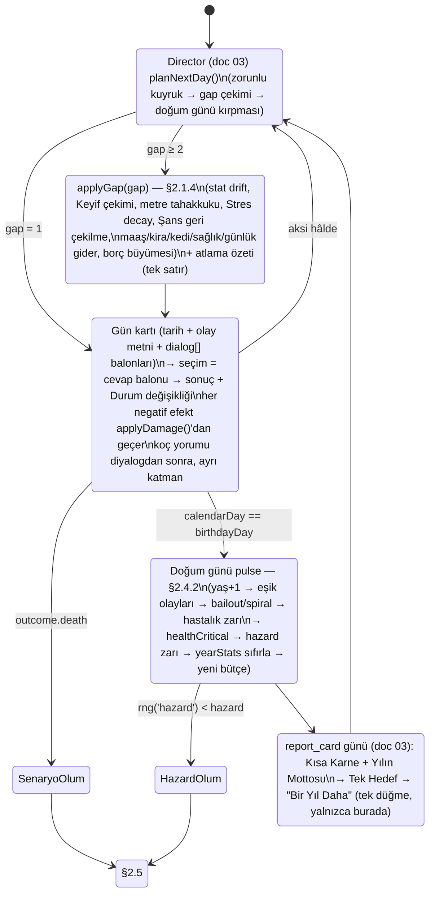

# 02 — Zaman, Statlar, Ekonomi, Sağlık ve Ölüm

> **Belge türü:** Ayrıntılı sistem tasarımı (Motto tasarım paketi, doküman 02/11). Üstünde `00-VIZYON-ve-KARARLAR.md` (D-001..D-067; **§12 > §11**, yani D-061..D-067 önceki kararları geçersiz kılar) ve T9 (hukuk) vardır; bu belge D-kararlarını **uygular**, tartışmaz. Kapsamadığı yerde karar verir ve bunu **D-ÖNERİ-02-xx** olarak işaretler (§7).
> **Sahip olduğu sistemler:** gün/takvim zamanı (`dayIndex` + `calendarDay`, yaş bandına göre gösterilen gün bütçesi, atlama özeti ve pasif güncelleme, doğum günü = yıl sınırı) · 4 çekirdek stat + Para + Ego/Cringe/Anne Baskısı + gizli Şans/Stres · soyut para ve **akış** ekonomisi (maaş günü, kira günü, günlük küçük gider) · koruma penceresi · Gompertz hazard ve ölüm nedenleri · hastalık arkları · ölüm akışı ve Roast Raporu orkestrasyonu · Onyıl Karnesi girdileri · 10.000 hayat harness'ının denge kabulleri.
> **Sürüm:** v1.1 · 2026-11-06 (akşam) · Yazar: Sistem tasarımı (02 sahibi) · Platform: iOS 16.4+ ve Android minSdk 24, tek Expo/RN/TS kod tabanı; motor saf TS (`packages/engine`), UI'dan bağımsız.

> **Değişiklik günlüğü**
> - **v1.1 — gün tabanlı revizyon, D-061** (2026-11-06 akşam başladı; §2.3–§7 2026-11-07'de tamamlandı). 00 §12 uygulandı: D-061 (zaman birimi GÜN), D-062 (NPC diyalog balonları), D-064 (roast dozu), D-066 (zaman kendi kendine akar, "Ertesi Gün" düğmesi yok), D-067 (hayat kalıcı durumdur, para akışla değişir). §2.1 zaman modeli yıl/beat'ten **gün/takvim**'e yazıldı (`dayIndex` + `calendarDay`; yaş bandına göre gösterilen gün bütçesi 12–18 / 8–12 / 5–8 / 3–5; atlama özeti + pasif güncelleme; doğum günü = yıl sınırı = Karne; oturum 15–25 gün; ömür 450–600 gün ≈ 90–120 dk). Tüm yıllık drift ve decay sabitleri **gün** ve **gösterilen gün** formülüyle verildi (§2.2, yıl toplamı değişmez). Para **akış** modeline geçti: maaş ayın 1'i, kira ayın 5'i, kedi ayın 10'u, sağlık gideri ayın 20'si, günlük küçük gider; "Kira günü" zorunlu olay (§2.3.2–2.3.4). Hazard zarı **doğum gününe** taşındı; Gompertz sabitleri ve koruma penceresi 18–28 **değişmedi** (§2.4.2, §2.3.6). Örnekler **GÜN kartı** + `dialog[]` ile yeniden yazıldı, atlama özeti / maaş-kira satırları / doğum günü kartı eklendi (§3). Harness ve KPI'lar gün tabanlı (§6.1–6.2); AC-02-01/02/20/21/26 metni güncellendi (numaralar korundu), **AC-02-29..AC-02-42** eklendi; D-ÖNERİ-02-08 geçersiz, **D-ÖNERİ-02-13..18** eklendi (§7). "Beat" sözcüğü bu belgede yalnızca "gün kartı içindeki karar anı" anlamında kaldı; D-020'nin "yıl medyanı 90 sn" kuralı D-061 ile geçersizdir.
> - **v1.0** (2026-11-06): ilk sürüm, yıl = tur modeli.

---

## 0. Künye — uygulanan D-kararları, bağımlı dokümanlar, sürüm

### 0.1 Uygulanan D-kararları (00 §5 satırı + bu belgenin dokunduğu diğerleri)

| D | Karar (kısa) | Bu belgede somut karşılığı |
|---|---|---|
| ~~D-020~~ → **D-061** | **Zaman birimi GÜN**; D-020'nin "yıl medyanı 90 sn" kuralı geçersiz | §2.1: her gösterilen gün = tarihli kart + tam bir olay; olaysız günler tek satırla atlanır; gösterilen gün bütçesi yaş bandına göre **12–18 / 8–12 / 5–8 / 3–5**; doğum günü = yıl sınırı, Karne ve hazard zarı doğum gününde; oturum 15–25 gösterilen gün; ömür 450–600 gösterilen gün ≈ 90–120 dk; ayar harness'la (§6.2) |
| **D-066** | Zaman kendi kendine akar; "Ertesi Gün" düğmesi yok; ▶ 1 gün ≈ 6 sn, ▶▶ ≈ 2 sn; Otomatik mod | §2.1.5 gün süresi çapası (▶'de gösterilen gün ≈ 12 sn: 6 sn akış + okuma/karar); akış zamanlayıcısı UI'dadır, motor yalnızca `NEXT_DAY` aksiyonu alır ve gerçek saati okumaz (§4); zaman Karne/ölüm/ANNE ARIYOR/"Bugünlük yeter"de durur; doğum günü Karnesi'nin tek düğmesi "Bir Yıl Daha" |
| **D-067** | Hayat kalıcı durumdur; Para **akışla** değişir | §2.2.7 `status` alanı (İş, Ev, İlişki, Varlıklar); §2.3.2 maaş günü (ayın 1'i), §2.3.3 kira günü (ayın 5'i) + kedi (10) + sağlık gideri (20) + günlük küçük gider; olaylar durumu değiştirir, akış durumdan türer; "Kira günü" zorunlu olayı; her kararın ≥ 1 kalıcı izi (harness §6.2 #17) |
| D-062 / D-064 | NPC diyalog balonları; roast dozu (Normal'de her sonuçta ≥ 1 roast) | §3 örnekleri `dialog[]` + `you` balonu + `coach[]` taşır; koç diyalogdan **sonra**, ayrı katman; lowJoy'da roast 0 kuralı (§2.4.7) D-064'ün tek istisnasıdır; havuzlar doc 01/03/04 |
| **D-032** | Stat seti T4 aynen; Karma → **Şans** | §2.2: Sağlık, Keyif, Kafa, Çekicilik + Para + Ego, Cringe, Anne Baskısı + gizli Şans (−50..+50) ve Stres (0–100); "Karma" sözcüğü motor, içerik ve lint'te yok |
| **D-033** | Para içeride reel birim, ekranda soyut "Para/Cash"; TL/$ ve makro rakam yok | §2.3.1 **Birim** (1 Birim = giriş seviyesi aylık net gelir), ekranda ×1.000 ölçekli "Para"; nominal/enflasyon katmanı tamamen kaldırıldı (D-ÖNERİ-02-01); lint listesi §5 |
| **D-034** | Ekonomi mizahı kişisel ölçekte; makro yüzde şakası yok | §2.3.1 görüntüleme kuralları: yüzde yalnızca iddia oranı ve kalıp payı için; kira zammı, faiz, borç daima mutlak Para olarak yazılır |
| **D-016** | Ölüm → yeni hayatın ilk kelimesi ≤ 40 sn; her ölümde ≥ 1 Kondisyon açılımı; tek büyük "Yeni Müşteri" + "Aynı kondisyonla" | §2.5.2 zamanlama tablosu: otomatik akış 32,5 sn + geçişler, 7 sn pay; Yedek Kulübesi pity; `deathFlowStep` kalıcı |
| **D-025** | Roast Raporu sırası sabit; ölüm nedeni yalnızca 2. balonda | §2.5.2 adım makinesi; `RoastReport` sözleşmesi; neden metni yalnızca `step=2`'de render edilir, paylaşım kartına girmez |
| D-007 / D-008 | Ölüm ekranında reklam yok; ölümden dönüş satılmaz; interstitial ölüm akışında asla | §2.5.1 `deathFlow` durumunda `AdService` çağrısı derleme düzeyinde yasak (tip sistemi: `DeathFlowContext` içinde reklam API'si yok); Fizyoterapi yalnızca ölümden **önceki** sağlık-kritik yılda (§2.4.6) |
| D-021 | Karne 6 not; Cesaret ve Davranış stat değil türev | §2.2.6 `gradeFor()` + Cesaret (risk sayacı) + Davranış (Cringe/Ego olayları) formülleri |
| D-024 | Kalıp Dedektörü yargılamaz sayar | §2.5.2 Roast Raporu kalıp bloğu yalnızca sayı + pay; sıfat yok; sayımlar doc 03'ten okunur |
| D-028 | 60+ yaşta gün başına ≤ 1 balon | §2.1.3 61+ bandı 3–5 gösterilen gün/yıl; koç balonu kotası doc 01/03'e `ageBand` ile iletilir |
| D-031 | Welcome-back = Sakatlık Raporu; gerçek yokluk → oyun zamanı | §2.1.7: çevrim tablosu **T7 §3.1 / doc 05'tendir**, burada yeniden tanımlanmaz; bu belge yalnızca `advanceTime({ days })` arayüzünü verir (tek büyük boşluk gibi oynatılır) |
| D-039 | Fizyoterapi ölüm öncesi sağlık-kritik yılda, ömürde 1 | §2.4.6 `healthCritical` doğum günü pulse'ında hesaplanır, teklif sonraki gösterilen güne düşer; etkisi Sağlık +15 ve **bir sonraki doğum gününün** hazard zarı atlanır |
| D-042 / D-056 | Kondisyon çeşitlilik verir, güç vermez; ölüm = içerik | §2.5.3 taşınanlar tablosu: stat/Para/Şans taşınmaz; perk listesi doc 05'te |
| D-018 / D-017 | Fazla Bagaj; Tanıdık Yüzler metaMemories | §2.5.3 `LifeRecord.highestCringeEvent` ölümde yazılır; NPC hafızası doc 04'ün yazdığı alandan kopyalanır |
| D-044 | Motor saf TS, deterministik; harness kabulü medyan ölüm 72–80 | §2.7 ve §6: medyan hedefi **72–78** (T4 ile aynı, D-044'ün bandının içinde); kanal bazlı RNG (`hazard` yalnızca doğum gününde, `outcome`, `director` boşluk/bütçe); seed `lifeSeed:dayIndex:kanal` (doc 03 §2.11) |
| D-051 | Onyıl Karnesi yalnızca karar kalemleri; zorunlu lift gerçek Kondisyon puanı | §2.6 girdi şeması tip düzeyinde kimlik alanı içermez |
| D-052 | Düşük Keyif: roast kapalı, "bugün tek şey", yardım ekranı; intihar/kendine zarar yok | §2.4.7 `lowJoy` protokolü ve doc 01/08 devri; ölüm nedeni tablolarında yasaklı sınıf (§2.4.3) |
| D-055 | Enerji yok, stat editörü yok, sahte sayaç yok | §2.1: T4'ün "enerji 4/yıl serbest aksiyon menüsü" alınmadı; tüm eylemler gün kartıdır (gün = olay, olay = seçenekler) |
| D-009 / D-010 | İddia gerçek oran; HAKSIZ ÇIKTIM sayımı | §2.2.5 Şans'ın orana etkisi görünen orana **dahildir**; §2.5.2 "beni N kez haksız çıkardın" sayacı |

### 0.2 Bağımlı dokümanlar (arayüz sözleşmeleri)

| Doküman | Bu belge ona ne verir | Ondan ne alır |
|---|---|---|
| **01** Anlatıcı | `ageBand`, `lowJoy`, `healthCritical`, `deathFlowStep`, rozet-metre eşik olayları (koç satır tetikleyicisi) | Satır havuzları; sessizlik kuralı metinleri; 60+ balon kotası |
| **03** Olay motoru | Doğum günü pulse sırası, `applyGap(days)` pasif güncelleme fonksiyonu, `applyDamage()`/`protection()` (olay efektleri buradan geçer), hazard ve ölüm nedeni servisleri, `GameClock`, maaş/kira/kedi/sağlık gideri vadeleri (`dueQueue` girdisi), `evt_kira_gunu` zorunlu olay kancası | `patternCounts`, iddia sayımı (`wagersTotal`, `wagersPlayerWon`), `report_card` günü, Gün Director'ünün yıl bütçesi (`yearBudget`) ve boşluk (`gap`) çıktısı, atlama özeti havuzu |
| **04** Kariyer/ilişkiler | Gelir kademeleri T0–T6, barınma kademeleri, borç/kefalet kuralları, Anne Baskısı'nın yıllık artış girdileri | Kariyer → kademe eşlemesi; NPC `alive` bayrakları (anne); evlilik/çocuk/ev olayları; `metaMemories` |
| **05** Retention/miras | `LifeRecord` (metaLog kaydı; `shownDays`, `calendarDays`), Fazla Bagaj etiketi, Onyıl Karnesi lift puanı, `lifeEnded` efekti (bildirim iptali), oturum gün sayacı (`sessionDayIndex`) | Kondisyon perk listesi ve Yedek Kulübesi pity; Teşhis hesaplaması; welcome-back çevrim tablosu (T7, gerçek gün → takvim günü) |
| **06** Monetizasyon | `healthCritical` tetikleyicisi (Fizyoterapi), `deathFlow` durumunda reklam yasağı | Fizyoterapi/Ek Antrenman kabul edildi sinyali |
| **07** UX/UI | Rozet-metre eşik animasyon anları, Roast Raporu adım süreleri, Para görüntü kuralları, Durum şeridi alanları (`status`, D-067), canlı saat/tarih kaynağı (`GameClock`, D-066), gün süresi çapası | Ekran bileşenleri; akış zamanlayıcısı (⏸ / ▶ / ▶▶); "YAŞLANIYORSUN" geçişi; paylaşım kartı render'ı |
| **08** Hukuk/linter | §5 yasaklı sözcük listesi (para, ölüm, sağlık alanları), ölüm nedeni onaylı listesi, "Gerçek hayatta yardım" tetikleyicisi | Lint kuralları; yardım ekranı içeriği |
| **09** i18n | ICU `number` kullanım kuralı (gruplama locale'e göre), EN karşılık adları (Mom Pressure, Cash, Debt) | Çift locale realizasyon |
| **10** Teknik | `step(state, action)` içinde yıl pulse ve ölüm commit'inin atomikliği gereksinimi | RNG (`sfc32`), kayıt katmanı |
| **11** KPI | §6 KPI'lar ve harness metrik şeması | Soft launch kapıları |

### 0.3 Sürüm

v1.1 (2026-11-06 akşam → 2026-11-07 tamamlandı; değişiklik günlüğü belgenin başında). v1.0 aynı gün, yıl = tur modeli. Değişiklik yalnızca bu dosyada ve yeni D-kaydıyla; §7'deki D-ÖNERİ'ler 00'a alınınca buradaki numaralar korunur; AC numaraları hiçbir sürümde yeniden kullanılmaz.

---

## 1. Amaç ve kapsam — MVP / Soft launch / 1.0 farkları

**Amaç.** Oyuncunun 90–120 dakikada (450–600 gösterilen gün) 18'den ölüme **gün gün** yaşadığı, her gösterilen günde bir şey kazandığı ya da kaybettiği, 28'inden önce hiçbir zaman "bitmiş" hissetmediği, 50'sinden sonra ise gerçekten gergin bir hayat eğrisi kurmak; bu eğrinin **ölçülebilir** olması (harness), **okunabilir** olması (karne, rozet-metre, Roast Raporu) ve **şikâyet edilemez** olması (gerçek para birimi yok, gerçek felaket yok, intihar yok). Bu belge "ne kadar" sorularının cevabıdır: kaç gösterilen gün, kaç takvim günü boşluk, kaç yıl, kaç Birim, hangi gün maaş, hangi olasılık.

**Kapsam farkları.**

| Alan | MVP (dikey kesit, 10 hafta) | Soft launch (+8 hafta) | 1.0 |
|---|---|---|---|
| Zaman | Gün + takvim (D-061); bant bütçeleri tam (12–18 / 8–12 / 5–8 / 3–5); atlama özeti havuzu 40 satır/locale; 36+ **Hızlı Yaşa** varsayılan (bant minimumu, özet 1,2 sn); akış hızı ▶ / ▶▶ (D-066), Otomatik mod yok; takvim günü gecikmeli ark yalnızca **hastalık arkı**; maaş/kira/günlük gider akışı tam (D-067) | Otomatik mod; askerlik arkı (TR) / student loans ikamesi (EN, ark yok); özet havuzu 100 satır; kedi/varlık giderleri | Tüm arklar (hamilelik, sınav; doc 04); özet havuzu 200 satır; mevsim/hafta günü etiketli özetler |
| Statlar | 4 çekirdek + Para + 3 rozet-metre + gizli Şans/Stres **hepsi** (motor tam) | Aynı | Aynı; tuning'de yalnızca sabitler değişir |
| Ekonomi | Birim modeli, 6 gelir kademesi, 6 barınma kademesi, kart borcu + iflas olayı, koruma penceresi + 3 bailout olayı, 4 sürpriz gelir | Banka kredisi (kredili ev), kefalet borcu, geç oyun sağlık gideri, spiral çıkışı | Miras (uzak akraba), emeklilik kademeleri, 24 kariyerin tam gelir eşlemesi |
| Sağlık/ölüm | Gompertz hazard, 4 yaş bandı × 6 neden sınıfı, absürt kuyruk 12 satır/locale, 1 hastalık arkı (3 kart), senaryo ölümü kanalı (2 olay) | Absürt kuyruk 24 satır, 3 hastalık arkı, Fizyoterapi kancası canlı, 6 senaryo ölümü | Absürt kuyruk 40 satır, 5 hastalık arkı (kronik dahil), yaş bandı başına 8 varyant neden metni |
| Ölüm akışı | Roast Raporu tam sıra (8 blok × 4 varyant), 3 Kondisyon perk'i, Fazla Bagaj, `LifeRecord` | 8 × 6 varyant, Yedek Kulübesi pity, Nazik/Acımasız rapor uzunlukları | 8 × 8, 10 perk, "Aynı kondisyonla" |
| Onyıl Karnesi | Yok (motor girdileri hesaplanır, ekran yok) | 30 ve 40 | 30/40/50/60 |
| Harness | 10.000 hayat, 5 persona; ölüm yaşı + para persentilleri + erken ölüm oranı | + neden dağılımı, bailout oranı, Fizyoterapi tetiklenme oranı | + Onyıl puan dağılımı; sim–playtest sapması raporu |

---

## 2. Tasarım

### 2.1 Zaman modeli (v1.1: gün tabanlı — D-061, D-066, D-067)

#### 2.1.1 Gün = tur, doğum günü = yıl sınırı

Zaman birimi **gün**dür. Hayat Akışı bir takvimdir; her kart tarihli bir gündür (*"Gün 1 · Salı, 3 Mart 2026"* / *"Day 1 · Tuesday, March 3, 2026"*) ve **her gösterilen günde tam bir olay** olur (D-061). İki sayaç birlikte yürür (doc 03 §2.1 ile aynı tanım; tip doc 10 `GameClock`):

- **`dayIndex`** — yalnızca *gösterilen* günleri sayan monoton sayaç (0'dan başlar). Oturum ölçümü, pity, cooldown ve RNG seed'i (`lifeSeed:dayIndex:kanal`) bunun üstünde çalışır.
- **`calendarDay`** — 18. doğum gününden itibaren geçen takvim günü. Tarih, mevsim, doğum günü, maaş/kira günleri, zarf vadesi, zincir gecikmesi ve **tüm pasif güncellemeler** bunun üstünde çalışır.

Olaysız günler gösterilmez: aradaki boşluk (`gap`, takvim günü) tek satırlık **atlama özeti** ile geçilir ve yıllık her sabit `gap` ile orantılı uygulanır (§2.1.4). Yıl artık bölünmez bir tur değildir; **doğum günü** yıl sınırıdır: yaş +1, "YAŞLANIYORSUN" geçişi (D-063), Karne + Yılın Mottosu + Tek Hedef ve **hazard zarı** yalnızca orada (§2.4.2). D-066 gereği "Ertesi Gün" düğmesi yoktur: zaman üstteki canlı saat/tarihle kendi kendine akar, yalnızca bir karar beklerken, tam ekran anlarda (Karne, ölüm, ANNE ARIYOR) ve "Bugünlük yeter"de durur; doğum günü Karnesi'nin tek düğmesi **"Bir Yıl Daha / One More Year"**dır.



Üç kural: (1) **Senaryo ölümü günü anında bitirir** — o günün kalan diyaloğu ve koç yorumu oynanmaz, akış §2.5'e geçer. (2) **Hazard zarı karneden önce** atılır; ölen karakter karne almaz, Roast Raporu alır ("son karne" Roast Raporu'nun 3. balonundaki sayılardır). (3) **Doğum günü kartı yıl bütçesine dahildir ve asla ötelenmez** (doc 03 §2.3.2): bütçe erken tükenirse boşluklar uzar, geç kalırsa kısalır — takvim kendini düzeltir.

#### 2.1.2 Takvim ve tarih

- FTUE takvimi **2026**'da başlar; karakterin doğum günü `rng('names')` ile çekilir; Gün 1 = 18. doğum gününün ertesi günü. Takvim **kozmetiktir**: oyuncunun gerçek tarihine, saatine, konumuna bağlanmaz (D-050); bayram, anma, seçim, gerçek tarihli olay taşımaz (§5). Hafta günü ve mevsim yalnızca içerik etiketidir (`weekday`, `season`; doc 03 §2.2).
- Tarih iki locale'de ICU `date` ile yazılır (TR *"Salı, 3 Mart 2026"* · EN *"Tuesday, March 3, 2026"*); saat yalnızca üst şeritte (D-066, oyun saati) ve koç satırlarında (03:12 ömürde 1).
- `calendarDay` 32-bit tam sayıdır; tarih = `startDate + calendarDay`; artık yıl hesaplanır, mekanik etkisi yoktur (doğum günü aralığı 365 ya da 366 gün).

#### 2.1.3 Gösterilen gün bütçesi yaş bandına göre (D-061)

Yıl bütçesi doğum gününde `rng('director')` ile bant aralığından düzgün çekilir; doğum günü kartı bütçeye dahildir. Gösterilen gün süresi çapası **≈ 12 sn** (▶ akış 6 sn + okuma/karar/sonuç ≈ 6 sn; §2.1.5) — v1.0'ın 28 sn'lik beat'i yerine.

| Yaş bandı (koç adı) | Gösterilen gün / yıl (medyan) | Ort. boşluk (takvim günü) | Yıl sayısı (medyan ömür 74) | Gösterilen gün toplamı | Dakika (12 sn/gün) | Not |
|---|---|---|---|---|---|---|
| 18–25 "Isınma" | **12–18** (15) | ~24 | 8 | 120 | 24 | Roast dozu ve iddia sıklığı en yüksek; koruma penceresi; FTUE yılı elle yazılmış 15 gün |
| 26–40 "Sezon" | **8–12** (10) | ~36 | 15 | 150 | 30 | Medyan yıl; callback'ler başlar; Onyıl Karnesi 30 ve 40 doğum gününde |
| 41–60 "İkinci devre" | **5–8** (6,5) | ~56 | 20 | 130 | 26 | Her yıl ≥ 1 gün zarf/ark için ayrılır; sağlık gideri başlar |
| 61+ "Uzatmalar" | **3–5** (4) | ~91 | 14 | 56 | 11 | ≤ 1 koç balonu/gün (D-028); "yıllar su gibi" hissi mekaniktir, replik değil |
| **Toplam 18–74** | | | **57** | **≈ 456** | **≈ 91** | Düzeltmelerle 450–600 gün ≈ 90–120 dk (D-061 hedefi; harness §6.2 #11–12) |

Düzeltmeler (doc 03 §2.3.1 ile birebir; tavan = bant maksimumu + 2): **Stres > 70 → +1**; **aktif zincir/ark → +1**; **Anne Baskısı ≥ 75 → 1 ANNE ARIYOR günü bütçe dışı** (D-063); **hastalık arkı** kendi 2–3 gününü bütçeden alır; **lowJoy** yılında bütçe bant minimumunun altına inmez ve ≥ 1 gün çıkış olayı taşır (§2.4.7). **Hızlı Yaşa** (oyuncu ayarı; MVP'de 36+ varsayılan açık; D-066'nın ▶▶ hız anahtarından **ayrı**): bütçe = bant minimumu, atlama özeti 1,2 sn, Kısa Karne otomatik 3 sn; zarf, ark, ANNE ARIYOR ve kira günü olayları yine oynanır (Hızlı Yaşa hikâyeyi atlamaz, dolguyu atlar).

**Oturum ve ömür.** Oturum = **15–25 gösterilen gün** (medyan 20 ≈ 4 dk saf gün süresi + Mola 90 sn + 1–3 Karne + zarf; 12–15 dk oturum medyanı 00 §4.1 ile uyumlu). Ömür = **450–600 gösterilen gün ≈ 90–120 dk** (Hızlı Yaşa 36+ ile ≈ 380 gün / 70–80 dk). 18–25 bandında oturum ≈ 1,3 yıl, 41–60'ta ≈ 3 yıl, 61+'da ≈ 5 yıl: aynı 20 günlük oturum yaşlandıkça daha çok takvim yutar — "zaman hızlanıyor" hissi mekaniktir.

```ts
// packages/engine/src/time.ts (v1.1)
export function dayBudget(age: number, st: LifeState, rng: Rng): number {
  const [lo, hi] = age <= 25 ? [12, 18] : age <= 40 ? [8, 12] : age <= 60 ? [5, 8] : [3, 5];
  let b = st.settings.fastLife ? lo : lo + Math.floor(rng.next() * (hi - lo + 1));
  if (st.hidden.stress > 70) b += 1;
  if (hasActiveChain(st)) b += 1;
  if (st.lowJoy) b = Math.max(b, lo);
  return Math.min(hi + 2, b);            // doğum günü kartı dahil; ANNE ARIYOR günü bütçe dışı
}
```

#### 2.1.4 Atlama özeti ve pasif güncelleme kuralları

`gap ≥ 2` ise akışa **tek satır** ayraç yazılır: ≤ 14 kelime, en fazla bir sayı (gerçek sayaçtan), roast yok, kimlik yok; NPC adı geçebilir ama balon yoktur (havuz ve kovalar doc 03 §2.3.3; örnekler §3.7). Bu belgenin kuralı **pasif güncelleme**dir: yıllık her sabit, atlanan **takvim günü** sayısıyla orantılı uygulanır (`applyGap`), gösterilen gün sayısıyla değil — böylece 3 günlük boşlukla 90 günlük boşluk aynı hayat değişimini vermez ve yıl toplamı bant bütçesinden bağımsız kalır.

```ts
export function applyGap(st: LifeState, gap: number, rng: Rng): GapSummary {
  const f = gap / 365;
  driftStats(st, f);        // §2.2.1: yıllık drift × f; taban/tavan her boşlukta (Sağlık ≥ 5 drift'le, Keyif ≥ 5, Kafa ≤ 70 @ Keyif < 30)
  pullJoy(st, f);           // §2.2.2: Keyif += (1 − 0,70^f)·(hedef − Keyif)
  accrueMeters(st, f);      // §2.2.4: Ego 50'ye 2·f; Cringe −10·f; Anne Baskısı +yıllık·f (doğum günü arası tavan 12)
  decayHidden(st, f);       // §2.2.5: Stres −4·f (Keyif ≥ 70: −7·f); Şans ×0,85^f
  cashflow(st, gap, rng);   // §2.3.2–2.3.4: boşluğa düşen maaş/kira/kedi/sağlık günleri + gap × günlük gider; borç ×1,18^f
  return summarize(st, gap);// tek satır (rng('director')) + Durum şeridi değişiklikleri (D-067)
}
```

Kurallar: (a) **Eşik olayları boşlukta tetiklenmez**; boşluk sonunda bir eşik geçilmişse (Ego/Cringe/Anne) eşik olayı `dueQueue` ile **sonraki gösterilen güne** düşer ve gün kartı olur. (b) **Hazard zarı boşlukta atılmaz** — yalnızca doğum gününde; doğum günü boşluğun içine düşemez (`gap` doğum gününe kırpılır). (c) **Para kesintisi gösterilir:** boşlukta bakiye eksiye düşerse özet satırı bunu bir sayıyla söyler (*"Maaş yattı, kira çıktı. Bakiye: eksi."*) ve kira günü olayı (§2.3.3) sonraki gösterilen günde zorunlu olur. (d) **Ölüm boşlukta gerçekleşmez** (Sağlık ≤ 0 → son evre arkı §2.4.5; gösterilir). (e) Özet deterministiktir (`rng('director')`); save/load aynı satırı verir. (f) Olay efektleri (stat delta, Para, bayrak) gösterilen günde **anında** uygulanır, drift'e karışmaz.

#### 2.1.5 Gün süresi çapası ve akış hızı (D-066)

| Hız | Gün akışı | Gösterilen gün toplam ≈ | Nerede |
|---|---|---|---|
| ⏸ | durur | — | Karar bekleniyor; Karne / ölüm / ANNE ARIYOR tam ekran; "Bugünlük yeter"; uygulama arka planda |
| ▶ (varsayılan) | 1 gün ≈ 6 sn | ≈ 12 sn (6 + okuma/karar ≈ 6) | Normal oyun; harness dakika çapası |
| ▶▶ | 1 gün ≈ 2 sn | ≈ 7 sn | Oyuncu seçer; 36+ Hızlı Yaşa ile birlikte "yıllar su gibi" |
| Otomatik (soft launch) | ▶▶ + koç kararları verir | ≈ 3 sn | Oyuncu açar; koç kendi seçimini deftere "koç seçti" notuyla yazar, bu günlerde **iddia açılmaz** (D-009 adaleti) |

Motor hızı **bilmez**: akış zamanlayıcısı UI'dadır (doc 07), motor yalnızca `NEXT_DAY` aksiyonu alır; `NEXT_DAY` → ilk metin ≤ 300 ms (D-059, Royal Match "sürtünme sıfır"). Harness çapayı yalnızca dakika tahmini için kullanır (§6.2 #12); gerçek değer cihaz telemetrisiyle kalibre edilir (§6.1).

#### 2.1.6 Arklar ve alt-turlar takvim günleriyle yazılır

"Ay" alt-turu yoktur; her ark **takvim günü gecikmeli gösterilen günler** dizisidir (doc 03 `chain.next.delayDays`). Bu belgenin sahip olduğu ark **hastalık arkı**dır (§2.4.5): 3–6 takvim ayı içinde 2–3 gösterilen gün. Doc 04'ün arkları: askerlik (TR, 6–12 ay, 3 gün; EN ikamesi student loans ark **içermez**), sınav dönemi, hamilelik. Kural: ark günleri yıl bütçesinden düşer (yılda en fazla 2, kalan sonraki yıla taşar); doğum günü ark ortasına gelebilir (Karne gelir, ark devam eder); yıl sayacı yalnızca doğum gününde ilerler.

```ts
// packages/engine/src/time.ts (v1.1)
export type AgeBand = 'warmup' | 'season' | 'secondHalf' | 'overtime';   // 18–25 | 26–40 | 41–60 | 61+
export interface GameClock {
  dayIndex: number;        // gösterilen gün sayacı (0..); seed, pity, cooldown, oturum ölçümü
  calendarDay: number;     // 18. doğum gününden itibaren takvim günü (0..); drift, vade, tarih
  age: number;             // 18..100; yalnızca doğum gününde artar
  birthdayDay: number;     // bir sonraki doğum gününün calendarDay değeri
  startDate: string;       // ISO; FTUE'de "2026-03-03" gibi; tarih = startDate + calendarDay (kozmetik)
  sessionDayIndex: number; // bu oturumda gösterilen gün (15–25 hedefi; doc 03 yoğunluk eğrisi)
}
export const ageBand = (age: number): AgeBand =>
  age <= 25 ? 'warmup' : age <= 40 ? 'season' : age <= 60 ? 'secondHalf' : 'overtime';
export const isBirthday = (c: GameClock) => c.calendarDay === c.birthdayDay;
export const dayOfMonth = (c: GameClock) => calendarFrom(c.startDate, c.calendarDay).day;   // maaş (1), kira (5), kedi (10), sağlık (20)
```

#### 2.1.7 Gerçek zaman → oyun zamanı (referans, yeniden tanım yok)

Welcome-back çevrimi (gerçek 1–3 gün → 1–3 ay; 14–29 gün → 1–2 yıl; 30+ gün → 2 yıl tavanı; büyük karar rafta bekler; geri dönülemez kayıp yok) **T7 §3.1'de tanımlıdır ve doc 05 uygular**. Bu belge yalnızca kancayı verir: doc 05'in `AbsenceEngine.resolve()` çıktısı `advanceTime({ days })` aksiyonuna çevrilir; motor bunu **tek büyük boşluk** gibi `applyGap(days)` ile oynatır (drift, akış, borç dahil — yokluk hayatı dondurmaz, Sakatlık Raporu özetler: *"Annen 14 kez aradı, patron 1."*). Aradaki doğum günleri **kartsız** pulse olarak işlenir: yaş artar, Karne Sakatlık Raporu'nun içinde tek satıra iner, hazard zarı `rng('hazard')` ile atılır fakat sonuç `pendingDeathRisk` olarak rafa konur ve oyuncunun ilk gösterilen gününde normal akışta çözülür (D-ÖNERİ-02-12): Sakatlık Raporu'nda ölüm **asla** gerçekleşmez. Motor gerçek saati **hiç okumaz**; `advanceTime` payload olarak gelir. Ruh hâli (Yorgun 23:00–06:00) doc 01'in meselesidir; üst şeritteki canlı saat (D-066) **oyun** saatidir, cihaz saati değil.

### 2.2 Statlar

#### 2.2.1 Çekirdek dörtlü

| Stat (TR / EN) | Başlangıç aralığı (FTUE sabit) | Taban / tavan | Yaşa göre **yıllık** drift (doğum günü arası toplam; gün formülü aşağıda) | Mekanik rol |
|---|---|---|---|---|
| **Sağlık / Health** | 65–80 (70) | 0 / 100; drift tek başına 5'in altına indiremez | 18–29: 0 · 30–44: −0,4 · 45–59: −0,7 · 60–69: −1,0 · 70+: −1,2 · `sporcu` +0,5 · `sigara` −0,3 · Stres > 70: −2 · Stres > 85: −4 | Hazard çarpanı (§2.4.1); `healthCritical`; hastalık zarı eşiği (< 40) |
| **Keyif / Joy** | 45–65 (55) | 5 / 100 (asla 0: "hiçbir şey işe yaramaz" durumu yok) | Türev: hedefe %30 yaklaşır (2.2.2) | lowJoy protokolü (< 25); Kafa tavanı; sosyal olay ağırlığı |
| **Kafa / Smarts** | 45–70 (60) | 0 / 100; **Keyif < 30 iken 70'i aşamaz** (LLTQ kuralı, "depresif dahi" engeli) | öğrenci +1,5 (doc 04) · 60–69: −0,3 · 70+: −0,6 | Eğitim/kariyer kilitleri (doc 04) |
| **Çekicilik / Looks** | 35–65 (50) | 10 / 100 | 30–39: −0,3 · 40+: −1,0 · `sporcu` +0,3 | İlişki başlangıç şansı (doc 04); Ego ile çarpışınca roast |

İlk hayat (FTUE) **elle yazılmıştır ve deterministiktir**: 70 / 55 / 60 / 50, Para 2 Birim (dayının parası). Sonraki hayatlarda aralık içinden `rng('names')` kanalıyla çekilir; Kondisyon perk'leri bu aralıkları **değiştirmez** (D-042).

**Günlük ve gösterilen gün formülleri (v1.1).** Tablodaki her yıllık sabit `Y` için:

- **Takvim günü başına:** `Y_gün = Y / 365`; boşlukta `Δ = Y × gap / 365` (`applyGap`, §2.1.4). Örnek: 50 yaş, Stres ≤ 70 → Sağlık −0,7/yıl → 36 günlük boşlukta −0,069.
- **Gösterilen gün başına** (bant medyanıyla; yalnızca sezgi, dev dashboard ve koç satırı kalibrasyonu için — motor bunu **kullanmaz**): `Y_gösterilen = Y / N_bant`, N = 15 / 10 / 6,5 / 4. Örnek: 70+ Sağlık −1,2/yıl ÷ 4 = **−0,3 / gösterilen gün**; 30–44 bandı −0,4 ÷ 10 = −0,04.
- **Yıl toplamı değişmez:** doğum günü arası `Σ gap = 365|366` olduğundan toplam drift tam `Y`'dir (artık yılda 366/365 sapması kabul; AC-02-33).
- Taban/tavan `applyGap` içinde her boşlukta uygulanır (Sağlık drift'le < 5 olmaz; Keyif ≥ 5; Keyif < 30 iken Kafa ≤ 70). Olay efektleri gösterilen günde anında biner, drift'e karışmaz.

| Sabit | Yıl | Takvim günü | Gösterilen gün (18–25 / 26–40 / 41–60 / 61+) |
|---|---|---|---|
| Sağlık 30–44 | −0,4 | −0,0011 | — / −0,04 / — / — |
| Sağlık 45–59 | −0,7 | −0,0019 | — / — / −0,11 / — |
| Sağlık 60–69 | −1,0 | −0,0027 | — / — / −0,15 (60) / −0,25 |
| Sağlık 70+ | −1,2 | −0,0033 | — / — / — / −0,30 |
| Stres > 70 → Sağlık | −2 | −0,0055 | −0,13 / −0,20 / −0,31 / −0,50 |
| Stres > 85 → Sağlık | −4 | −0,011 | −0,27 / −0,40 / −0,62 / −1,00 |
| Kafa 60–69 / 70+ | −0,3 / −0,6 | −0,0008 / −0,0016 | — / — / −0,05 (60) / −0,08 · −0,15 |
| Çekicilik 30–39 / 40+ | −0,3 / −1,0 | −0,0008 / −0,0027 | — / −0,03 · −0,10 (40) / −0,15 / −0,25 |
| `sporcu` Sağlık / Çekicilik | +0,5 / +0,3 | +0,0014 / +0,0008 | yıl ÷ N_bant |
| `sigara` Sağlık | −0,3 | −0,0008 | yıl ÷ N_bant |
| Öğrenci Kafa (doc 04) | +1,5 | +0,0041 | +0,10 (18–25) |


#### 2.2.2 Keyif türevi

Sims modeli: Keyif bir hedefe doğru çekilir, olaylar üstüne biner.

```
keyifHedef = 50 + 0,15·(Sağlık − 50) + 8·tanh(Para / 24) + 0,10·(ilişkiOrt − 50) − 0,25·max(0, Stres − 50)
Keyif(yıl)       = Keyif + 0,30·(keyifHedef − Keyif)                   // yıllık eşdeğer (v1.0; harness kıyası için)
Keyif(gap gün)   = Keyif + (1 − 0,70^(gap/365))·(keyifHedef − Keyif)   // v1.1: her boşlukta; 1 gün ≈ %0,10 · 24 gün ≈ %2,3 · 36 gün ≈ %3,5 · 91 gün ≈ %8,5 · 365 gün = %30
```

`keyifHedef` her boşlukta güncel statlarla yeniden hesaplanır (Para akışla değiştiği için hedef ay içinde oynar: maaş günü sonrası yukarı, kira günü sonrası aşağı — "ayın 1'i ile 5'i arasındaki mutluluk" mekaniktir, replik değil).

`Para` Birim cinsinden; `tanh` doygunluğu sayesinde 24 Birim (iki yıllık giriş maaşı) birikim +6 verir, 200 Birim +8'de kalır — **zenginlik mutluluğu satın almaz, borç satın alır** (Borç −24 → −6). `ilişkiOrt` doc 04'ün hayattaki NPC affinity ortalaması. Pozitif geri besleme (Sims): Keyif ≥ 70 iken sosyal/absürt olayların director ağırlığı ×1,2; Keyif < 30 iken ×0,6 ve "bugün tek şey" havuzu açılır.

#### 2.2.3 Para (özet; ekonomi §2.3'te)

İç birim **Birim**, ekranda **Para / Cash** (×1.000). Negatif bakiye ekranda **"Borç 1.200" / "Debt 1,200"** olarak kırmızı yazılır; eksi işareti hiçbir yerde görünmez (koç: *"Bakiye: 0. Yuvarlamadım; sıfır yuvarlanmaz."*).

#### 2.2.4 Komedi metreleri: Ego, Cringe, Anne Baskısı

Üçü de gerçek stat'tır (kararla değişir, olay kapılar, uçta sonuç üretir) ama **rozet-metre** olarak çizilir: HUD'da ikon + küçük sayı; yalnızca bir eşik geçildiğinde 600 ms büyür, koç 1 satır der, sonra küçülür. Dört çekirdek bar + Para her zaman görünür; rozet-metreler dikkat istemez, kazanır.

| Metre (TR / EN) | Aralık, başlangıç | Nasıl yükselir | Nasıl düşer | Eşikler ve kapıladığı şeyler |
|---|---|---|---|---|
| **Ego** | 0–100, 40–60 (50) | Risk başarısı +4..+10; terfi +6; "pazarlık" kazanımı +5; iltifat olayları +3; Kripto kazancı +20 (tek seferlik tavan) | Yılda 2 puan 50'ye doğru geri çekilir (boşlukta 2·gap/365); ret/başarısızlık −3..−8; "sus" seçenekleri −4 | **< 15 "Görünmez"**: fırsat olayları (iş teklifi, flört açılışı) director'de ×0,3; **15–30**: işbirliği seçeneklerinde başarı +%5; **70–85 "Parlak"**: risk seçeneklerinde +%5, ilişki decay ×1,5; **> 85 "Narsist"**: ilişki decay ×2, "patronla kavga" ailesi açılır, roast ekseni Ego; **100**: ölüm **yok** (D-ÖNERİ-02-02); 2 yıl "Narsist Sezon" + tek seferlik komik olay (kendi heykeli; Para −6 Birim, Cringe +15) |
| **Cringe** | 0–100, 0–10 | Olay sonuçları +3..+20 (tek sonuç tavanı 20) | **−10/yıl** sabit decay (boşlukta −10·gap/365; gösterilen gün başına ≈ −0,7 / −1,0 / −1,5 / −2,5) | **≥ 60**: "utanç callback" olayları açılır (eski olay anıya referans); **≥ 90**: "Şehir değiştir" olayı zorunlu gün (taşınma; Cringe −50, Para −3 Birim; `status.home` değişir); hayatın **en yüksek Cringe olayı** ölümde Fazla Bagaj olur (D-018) |
| **Anne Baskısı / Mom Pressure** | 0–100, 0 ("doğdu" ilk aile kartında) | **Günlük tahakkuk** (anne hayattayken; `applyGap`, `status`'tan okunur): yıllık +3 (24+ ve bekâr) · +3 (işsiz) · +4 (anne evinde) × gap/365; her "Görüldü, cevap yok" günü anında +2; doğum günü arası toplam tavan **+12** (`yearStats.momAccrued`) | Ev (kira/sahip) −30 · iş −10 · evlilik/çocuk −30 (doc 04 olayları) · "annenle 1 saat konuş" seçenekleri −5..−10 · bayram ziyareti −8 | **≥ 50**: Aile Grubu kartı salience ×1,5; **≥ 75 ANNE ARIYOR**: tam ekran çağrı günü, bütçe dışı, ertesi gün (D-063; doc 03 §2.3.8); **≥ 80**: "görücü" zinciri zorunlu gün (TR) / "the setup dinner" (EN); **100**: "Annen yanına taşındı" komik olay (−40, Keyif −5, Para +1 Birim: yemek); **anne ölürse metre dondurulur ve gizlenir**, bir daha değişmez (D-ÖNERİ-02-04) |

Ego uçlarında ölüm olmaması bilinçli bir sapmadır (T4 açık soru 2): 60 dakikalık bir hayatı 2 dakikalık Reigns saltanatı gibi bitirmek adaletsiz okunur; uç, ölüm değil **içerik** üretir.

#### 2.2.5 Gizli statlar: Şans ve Stres

**Şans (−50..+50; UI'da hiç yok; motor ve içerikte adı yalnızca "Şans/luck").** Başlangıç `rng('names')` ile −10..+10. Değişim: doc 03'ün `luck` efektleri (Cömertlik seçimleri +2, Kısa Yol −3, kediyi kabul +3, kapıyı kapat −5 gibi; tek efekt tavanı ±8). Her yıl %15 sıfıra geri çekilir (boşlukta ×0,85^(gap/365); gösterilen gün başına ≈ %1,1 / %1,6 / %2,5 / %4). Etkisi:

```
pEtkin = clamp(p · (1 + Şans/500), 0,02, 0,98)          // ±%10 çarpan, yalnızca luckScaled sonuçlarda
M_şans(hazard) = 1 − Şans/1000                             // ±%5
```

**Dürüstlük kuralı (D-009):** İddia fişinde ve "Oranı göster"de gösterilen oran `pEtkin`'dir, `p` değil. Koç Şans'ı adıyla asla anmaz; nadir ifşa satırı (ömürde ≤ 1): TR *"Şans değil bu. Sayılar. Ama sayılar da bugün senden yana."* / EN *"That wasn't luck. That was math. Math happened to like you today."* "Karma", "evren", "kader", "nazar" sözcükleri Şans bağlamında lint BLOK.

**Stres (0–100; ipuçlarıyla görünür, sayı olarak asla).** Başlangıç 25. Yükselme: iş olayları +3..+12; **kira gününde bakiye < kira** +8 (ayda ≤ 1; §2.3.3 — v1.0'ın "Para < 0 yıl başı +8"inin akış karşılığı); Anne Baskısı ≥ 70 iken doğum günü +3; hastalık arkı +10; "Görüldü, cevap yok" +2. Düşme: doğal decay **−4/yıl** (boşlukta −4·gap/365; gösterilen gün başına ≈ −0,27 / −0,4 / −0,6 / −1,0); Keyif ≥ 70 ek −3/yıl aynı oranla; tatil/spor/terapi seçimleri −6..−15 (gösterilen günde anında); kedi +0 (kedi stres düşürmez, kedi stres **yönetir**: Keyif +). Etkiler: > 70 → Sağlık −2/yıl (boşlukta gap/365 ile) ve hazard ×1,25 ve gün bütçesi +1; > 85 → Sağlık −4/yıl ve "uyuyamıyorsun" olay ailesi açılır; Keyif hedefi §2.2.2'deki terimle baskılanır. Oyuncuya yüzeyi: olay metni ve koç ipucu (TR *"Uyku: dört saat. Bu bir sayı değil, bir itiraf."* / EN *"Sleep: four hours. That's not a number, that's a confession."*).

#### 2.2.6 Karne türevleri: Cesaret ve Davranış (D-021)

Karne 6 not alır; ilk dördü stat deltasından, ikisi davranış sayaçlarından. Bu belge `gradeFor()`'u tanımlar, doc 07 çizer, doc 03 `report_card` beat'inde çağırır.

```ts
export type Grade = 0|1|2|3|4;   // TR Zayıf/Geçer/Orta/İyi/Pekiyi · EN F/D/C/B/A
export const gradeForDelta = (d: number): Grade => d >= 10 ? 4 : d >= 3 ? 3 : d >= -2 ? 2 : d >= -9 ? 1 : 0;
// Para: doğum günü arası net değişim / aynı dönem toplam gider — ikisi de AKIŞTAN sayılır (Σ maaş günleri − Σ kira/kedi/sağlık günleri − 365×günlük gider ± olay efektleri; §2.3)
// (gelire değil gidere oranlı: zengin de kötü yıl geçirebilir)
export const gradeForMoney = (netDelta: number, yearlyCost: number): Grade => {
  const r = netDelta / Math.max(yearlyCost, 1);
  return r >= 0.5 ? 4 : r >= 0.15 ? 3 : r >= -0.15 ? 2 : r >= -0.5 ? 1 : 0;
};
// İlişkiler: hayattaki NPC affinity ortalamasının yıllık deltası (doc 04 verir) → gradeForDelta
// Cesaret: o yıl (doğum günü arası, `yearStats`) `pattern: 'risk'` etiketli seçim sayısı
export const gradeForCourage = (riskChoices: number): Grade => Math.min(4, riskChoices) as Grade;
// Davranış: 2'den başla; her Cringe sıçraması (tek sonuçta ≥ 8) −1; Ego bu yıl 85'i geçtiyse −1;
// ≥ 2 Cömertlik/Sabır seçimi +1; hiç Cringe sıçraması yoksa +1; clamp 0..4
export function gradeForConduct(y: YearStats): Grade {
  let s = 2 - y.cringeSpikes - (y.egoCrossed85 ? 1 : 0) + (y.kindChoices >= 2 ? 1 : 0) + (y.cringeSpikes === 0 ? 1 : 0);
  return Math.max(0, Math.min(4, s)) as Grade;
}
```

`yearStats` doğum günü pulse'ında sıfırlanır (§2.4.2); Karne daima doğum günü kartında gelir, başka hiçbir günde gelmez (D-061). Davranış notunun koç cümlesi daima **olaya** bağlanır, sıfata değil: TR *"Davranış: Orta. Düğünde mikrofon aldın."* / EN *"Conduct: C. You took the mic at a wedding."*

#### 2.2.7 Tipler

```ts
export interface CoreStats { health: number; joy: number; smarts: number; looks: number; }   // 0–100
export interface Meters   { ego: number; cringe: number; momPressure: number | null; }        // null = anne öldü, donduruldu
export interface Hidden   { luck: number; stress: number; }                                   // −50..50 · 0–100
export interface Money    { balance: number; debt: { card: number; bank: number; cosign: number }; } // Birim
export interface Status   {                                   // D-067: kalıcı Durum şeridi; olaylar bunu DEĞİŞTİRİR, akış bundan TÜRER
  job: { title: string; tier: IncomeTier; monthly: number; since: number } | null;   // since = calendarDay; monthly Birim (kademe × performans)
  home: { kind: HousingTier; rent: number; since: number };    // rent Birim/ay (kira günü); kredili evde taksit; anne evinde 0,10 "katkı"
  relationship: { npcId: string; since: number } | null;      // doc 04 yazar; "bekâr / kiminle, kaç yıldır"
  assets: AssetId[];                                           // 'kedi' | 'telefon' | 'araba' | 'bisiklet' | … (doc 04 listesi); kedi ayda 0,05 Birim yer
}
export interface LifeState {
  clock: GameClock; stats: CoreStats; meters: Meters; hidden: Hidden; money: Money; status: Status;
  flags: Set<string>;                 // 'sporcu','sigara','anne_evinde','bailoutUsed','physioUsed',...  ('kiraci' artık status.home.kind'dan türer)
  incomeTier: IncomeTier; yearsWorked: number;   // incomeTier = status.job?.tier ?? 'T0'; yearsWorked doğum gününde status.job doluysa +1
  spiralYears: number; lowJoy: boolean; healthCritical: boolean;
  pendingDeathRisk?: { cause: CauseKey };        // yalnızca advanceTime sonrası (§2.1.7)
  yearStats: YearStats;               // doğum gününde sıfırlanır: karne sayaçları + momAccrued + paydays + rentDays + rentEvents
  settings: { fastLife: boolean };    // Hızlı Yaşa (bant minimumu); akış hızı (▶/▶▶) motorda YOK, UI'da
}
```

### 2.3 Ekonomi

#### 2.3.1 Birim ve görüntüleme kuralları (D-033, D-034)

- **Birim** iç birimdir: 1 Birim = giriş seviyesi (kademe T1) **aylık** net gelir. Her maaş, kira, borç ve sürpriz Birim cinsinden yazılır; içerik JSON'ında `"money": "-0.3"` gibi (Birim), eski `AU` gösterimi kullanılmaz.
- **Nominal/enflasyon katmanı yoktur** (D-ÖNERİ-02-01). T4 §3.3'ün `priceIndex` çarpanı, D-033/D-034 ile kalan tek işlevini (enflasyon esprisi) yitirdiği için kaldırıldı. Reel denge zaten çekirdekteydi; yüzey artık çekirdeğin kendisi.
- **Ekran:** `Para = round(Birim × 1.000)`; ICU `{n, number}` ile locale gruplaması (TR 3.400 · EN 3,400); ≥ 1.000.000'da ICU compact (TR "1,2 Mn" · EN "1.2M"). Negatif bakiye **"Borç N" / "Debt N"**; eksi işareti yok.
- **Yüzde** yalnızca iki yerde: İddia oranı ("Oran %42'ydi") ve Roast Raporu kalıp payı ("%31"). Kira zammı, zam, faiz, borç büyümesi **mutlak Para** ile yazılır: TR *"Kiran 300 arttı. Maaşın artmadı."* / EN *"Rent went up 300. Your pay went up a compliment."*
- **Yasaklı sözcükler (02 alanı, iki locale, lint BLOK):** TL, lira, ₺, dolar, $, €, euro, kur, enflasyon/inflation, asgari ücret/minimum wage, faiz oranı/interest rate, zam oranı, "yüzde" + makro bağlam, "ekonomi kötü/economy's bad" tipi genelleme. "Faiz/interest" sözcüğü serbest, oran olarak yazımı yasak.
- **Küçük sayı mizahı serbest ve teşvikli:** TR *"Bakiye: 0. Yuvarlamadım; sıfır yuvarlanmaz."* / EN *"Balance: zero. I didn't round. Zero doesn't round."*

#### 2.3.2 Gelir: kariyer kademeleri ve **maaş günü** (ayın 1'i; D-067)

Kariyerler doc 04'tedir; bu belge **kademeleri** tanımlar, doc 04 her kariyer basamağını bir kademeye eşler. **Aylık maaş** `status.job.monthly = kademe × performans çarpanı` (0,9–1,1; doc 04 "performans" barı) ve **ayın 1'inde** bakiyeye girer; yıllık gelir = 12 × aylık (harness ve karne için yıllık eşdeğer). Para akışla değişir (D-067): işe girildiği gün maaş akmaya **başlar** (ilk maaş sonraki ayın 1'i; "ilk maaşa kadar" günleri gerçek gerilimdir), işten çıkarıldığı gün **kesilir**, zam/terfi `monthly`'yi kalıcı değiştirir. Maaş günü gösterilen güne denk gelirse Durum şeridinde Para yeşil tik-up alır (D-063 uçan sayı) ve olay metni bir satırla anabilir; boşluğa düşerse `applyGap` uygular ve atlama özeti sayıyla söyler (*"Maaş yattı: 1.600."*). Koç maaş gününde yorum yapmaz; **maaş gününe 3 gün kala bakiye < günlük gider × 3** ise tek satır (ayda ≤ 1): TR *"Ayın 28'i. Bakiye: 140. Ayın 1'i bir tarih değil, bir umut."* / EN *"The 28th. Balance: 140. The 1st isn't a date; it's a belief system."*

```ts
// packages/engine/src/economy.ts (v1.1) — akış: boşluğa ya da gösterilen güne düşen her vade
export const DUE = { payday: 1, rent: 5, cat: 10, healthCost: 20 } as const;          // ayın günü
export function cashflow(st: LifeState, gap: number, rng: Rng): FlowLog {
  const log: FlowLog = [];
  for (let d = 1; d <= gap; d++) {
    const c = calendarFrom(st.clock.startDate, st.clock.calendarDay - gap + d);
    if (c.day === DUE.payday && st.status.job)      credit(st, st.status.job.monthly, 'payday', log);     // maaş / emekli maaşı
    if (c.day === DUE.payday && !st.status.job)     credit(st, allowance(st), 'allowance', log);       // anne evi 0,10 · öğrenci 0,15 · aksi 0
    if (c.day === DUE.rent)                         debit(st, st.status.home.rent, 'rent', log);       // §2.3.3; bakiye < kira → evt_kira_gunu kuyruğa
    if (c.day === DUE.cat && st.status.assets.includes('kedi')) debit(st, 0.05, 'cat', log);
    if (c.day === DUE.healthCost)                   debit(st, healthCost(st.clock.age), 'health', log);  // 45+: 0,10 / 0,25 / 0,45
    debit(st, dailySpend(st), 'daily', log);                                                            // her takvim günü, §2.3.3
    if (st.money.balance < 0) st.money.debt.card *= Math.pow(1.18, 1 / 365);                           // §2.3.4
  }
  return log;                                                                                           // özet satırı ve Durum şeridi buradan okur
}
```

| Kademe | Aylık gelir (Birim) | Tipik basamak (doc 04'ten örnek) | Hayat payı hedefi (harness) |
|---|---|---|---|
| T0 | 0 (anne evinde 0,1 harçlık; öğrenci 0,15 yarı zamanlı) | işsiz, öğrenci, atama bekleyen | 18–23 arası çoğunluk; 30+ ≤ %12 |
| T1 | 1,0 | garson, kurye, çırak, ücretli öğretmen (0,8–1,2 bandı) | ilk iş |
| T2 | 1,6 | şef yardımcısı, memur başlangıç, junior | 25–32 medyan |
| T3 | 2,5 | usta, uzman, mid | 33–45 medyan |
| T4 | 4,0 | senior, müdür, ortak | hayatların %30–45'i ulaşır |
| T5 | 6,0 | prof, restoran sahibi, başrol | %8–15 ("zirve" T4 kabulü) |
| T6 | 10–15 | "yurt dışına kaçtı", özel hastane, franchise | %2–5; yıllık gelir tavanı 60 Birim (legendary hariç) |
| Emekli | 0,9 × son kademe (≥ 20 yıl çalışmışsa), aksi 0,5 | otomatik 60–65 (doc 04 kariyere göre) | — |

**Volatil gelir** (Influencer, Kripto Gurusu, Kahve Falcısı): kademe yerine **doğum gününde** o yılın aylık değeri `lognormal(μ, 0,7)` ile çekilir, 0,3–6,0 Birim'e kırpılır ve 12 maaş gününe eşit bölünür (ekranda "bir şeyler"; Durum şeridi *"gelir yıldan yıla"*); iki ardışık yıl aynı yöne gidemez (harness: "sonsuz para" exploit'i yok). **Emekli maaşı** aynı maaş gününde yatar (0,9 × son kademe).

#### 2.3.3 Gider: barınma kademeleri, **kira günü** (ayın 5'i) ve **günlük küçük gider** (D-067)

Aylık sabit gider iki parçaya ayrılır: **kira** (`status.home.rent`, kademe tablosunun barınma payı; ayın 5'inde tek seferde çıkar) ve **temel geçim** (kalan pay; `dailySpend` ile her takvim günü eşit bölünerek düşer). Tablo aylık toplamı verir; kira payı sütunda ayrıca yazılıdır.

| Barınma kademesi | Aylık toplam sabit gider (temel geçim + barınma, Birim) | Giriş/çıkış | Anne Baskısı |
|---|---|---|---|
| Anne evi | 0,10 (kira günü "katkı" 0,10; günlük 0) | 18'de varsayılan; "Annenin yanına taşın" olayı | +4/yıl |
| Oda / ev arkadaşı | 0,60 (kira 0,30 + günlük 0,30/30) | Ev Arkadaşı (Barış ↔ Jordan) olayları | 0 |
| 1+1 kiracı | 0,85 (kira 0,50 + günlük 0,35/30) | Kira zammı olayları yılda 1 aday; zam `rent`'i **kalıcı** artırır | −30 girişte |
| Geniş kiracı | 1,10 (kira 0,70 + günlük 0,40/30) | Yaşam tarzı; Ego +3 girişte | — |
| Kredili ev | 1,25 (taksit 0,80 kira gününde, 15 yıl; günlük 0,45/30), sonra Sahip | Peşinat ≥ 24 Birim + T2 üstü gelir; banka evrak kartı (Tercüme) | −30 girişte |
| Ev sahibi (borçsuz) | 0,45 (aidat 0,10 kira gününde + günlük 0,35/30) | Kredi biter / miras | — |

**Kira günü kuralı.** Ayın 5'inde `rent` bakiyeden düşer. `bakiye < rent` ise (a) kira yine düşer (bakiye eksiye geçer, kart borcu başlar — §2.3.4), (b) Stres **+8** (ayda ≤ 1; v1.0'ın "yıl başı Para < 0 +8"inin akış karşılığı), (c) **`evt_kira_gunu` zorunlu olayı** `dueQueue`'ya düşer ve **sonraki gösterilen gün** olur (ötelenmez; valans koruması bile 1 günden fazla erteleyemez — doc 03 §2.3.7): ev sahibi / Barış / banka diyalogda konuşur, seçenekler "Yarısını ver, kalanı 15'ine" (`sabır`; Anne Baskısı 0, ev sahibi anısı `gec_odedi`) · "Annenden iste" (`aileyeYaslanma`; +rent, Anne Baskısı +10) · "Görmezden gel" (`kaçınma`; Stres +6, Cringe +6; 2. ayda "Tahliye ihtarı" evrak kartı) · pencerede ise bailout (§2.3.6) bu olayın **içinden** teklif edilir. Bakiye yeterliyse olay **yoktur**: gösterilen güne denk gelirse Durum şeridi kırmızı tik-down + bir satır (*"Kira çıktı: 500. Ev sahibi 'teşekkürler' yazmadı."*), boşluğa düşerse atlama özeti sayıyla söyler. Harness: hayat başına kira günü olayı medyanı 2–6 (gergin ama sürekli değil; AC-02-31).

**Günlük küçük gider.** `dailySpend = (temelGeçim + yaşamTarzı) / 30` Birim/takvim günü; her takvim günü (gösterilen ya da boşlukta) düşer; doğum günü arası toplamı yıllık tabloyla aynıdır (AC-02-32). Ekranda tek tek görünmez; Durum şeridi "günlük ≈ 12" satırı ve atlama özeti toplamı taşır (*"23 gün: market, yol, bir kahve. 280 gitti."*). **Kedi** ayın 10'unda 0,05 Birim yer (Pamuk/Biscuit: *"Mama."*); **sağlık gideri** ayın 20'sinde (45–59: 0,10 · 60–69: 0,25 · 70+: 0,45 Birim).

Ek giderler: **yaşam tarzı harcaması** = gelirin %15'i (Dürtüsel Harcama kalıbı baskınsa %35; Sabır baskınsa %10 — doc 03 kalıp sayımı **doğum gününde** okunur, yıl boyunca `dailySpend`'e gömülü kalır); **sağlık gideri** (geç oyun gerilimi): 45–59 yaş 0,10 · 60–69 0,25 · 70+ 0,45 Birim/ay, ayın 20'sinde; hastalık arkı tedavi seçimleri ayrı ve gösterilen günde anında; **küçük sürprizler** |N(0, 0,8)| Birim negatif, yılda 1–2 kez `rng('director')` ile rastgele bir **gösterilen güne** düşer ve o günün kartında bir satırdır (araba, diş, düğün takısı ↔ wedding gift) — boşlukta sürpriz yoktur, sürpriz görülür.

#### 2.3.4 Borç

| Borç türü | Nasıl oluşur | Büyüme (iç sabit; ekranda asla oran olarak yok) — yıllık / takvim günü | Çıkış |
|---|---|---|---|
| Kart borcu | Bakiye < 0 (çoğunlukla kira gününde) | ×1,18 / yıl = ×1,18^(1/365) ≈ ×1,000453 / takvim günü (`cashflow`, her gün; 36 günlük boşlukta ×1,0165) | Pozitif bakiye (maaş günü) borcu kapatır; **İcra/İflas olayı**: borç < −24 Birim → `dueQueue` zorunlu **gün kartı** (banka evrakı, Tercüme), borç −6'ya iner, Ego −15, Cringe +20, `iflas` bayrağı (kredili ev 10 yıl kapanır) |
| Banka kredisi | Kredili ev | Taksit kademeye gömülü (1,25), ayrıca büyümez | 15 yıl; erken kapatma olayı |
| Kefalet borcu | "Arkadaşına kefil oldun" olayı (TR klasiği ↔ EN "co-signed a lease") | 0; **sürpriz** olarak 2–6 yıl sonra 3–8 Birim düşer | Ödersin ya da arkadaş kaybedersin (doc 04 anı) |

Koç borcu kişisel ölçekte ve **doğum gününde** sayar (Karne Para notu akıştan türer, §2.2.6): TR *"Borç 4.200. Geçen doğum gününde 3.100'dü. Büyüyen tek şeyin."* / EN *"Debt: 4,200. Last birthday, 3,100. It's the only thing you've grown."* Ay içinde koç borcu anmaz; Durum şeridi "Borç N" yazar, o kadar.

#### 2.3.5 Sürpriz gelirler (windfalls)

Sabit liste; **piyango, bahis, kumar, şans oyunu yoktur** (D-ÖNERİ-02-09; T9 #4 ve 16+ derecelendirme). Her biri olaydır, oran görünür, hazard'la ilgisi yoktur.

| Sürpriz | Yaş | Miktar (Birim) | Hayatta en çok | Not |
|---|---|---|---|---|
| Dayı parası | 18 (FTUE) | +2 | 1 | "Dayın 2009'da yaşıyor" |
| Kıdem tazminatı | işten çıkarılma | +1 × çalışılan yıl (tavan 20) | — | Sakatlık değil, "transfer" |
| Düğün takısı ↔ Wedding gifts | evlilik olayı (doc 04) | +3..+8 | 1 | Para +, Anne Baskısı −30 |
| Unutulmuş hesap ↔ Forgotten account | 30+ | +1..+3 | 1 | Absürt-sıcak |
| Uzak akraba mirası ↔ Distant relative's estate | 45–65 | +12..+36 | 1 | 1.0; kurgusal akraba, isim üreteci |
| Kripto kazancı | 21–35 | +6 (p ≈ 0,2) | 2 (cooldown 5 yıl) | Kaybı −2..−10; **tekrarlı bahis döngüsü yok**, iki olay, oran yazılı |

#### 2.3.6 Koruma penceresi 18–28 (T11 #11, 00 §4.1)

```ts
export const protection = (age: number) => clamp(1 - (age - 18) / 10, 0, 1);        // 18→1, 28→0
export function applyDamage(kind: 'money'|'health', raw: number, st: LifeState, rng: Rng): number {
  if (raw >= 0) return raw;
  const mult = 1 - 0.5 * protection(st.clock.age);                                    // 18: ×0,5 … 28: ×1,0 (lineer)
  let dmg = raw * mult;
  if (kind === 'money' && st.money.balance > 20 * monthlyCost(st)) dmg *= 1 + 0.5 * rng.next();  // çok rahat oyuncuya varyans
  return dmg;
}
export function bailoutCheck(st: LifeState, rng: Rng): StoryletId | null {
  if (st.money.balance < 0 && protection(st.clock.age) > 0 && !st.flags.has('bailoutUsed')) {
    st.flags.add('bailoutUsed');                                                        // hayat başına 1, yalnızca 18–27
    return pick(['evt_anne_borc_verdi', 'evt_dayi_is_buldu', 'evt_ev_arkadasi_kira'], rng);
  }
  return null;
}
```

Bailout üç olaydan biridir ve `bailoutCheck` **kira günü olayının içinde** ya da doğum günü pulse'ında çağrılır (boşlukta değil; teklif daima bir gün kartıdır); hepsi **+3 Birim** verir ve bir borç bırakır: "anne borç verdi" → Anne Baskısı +15 ve ~1.095 takvim günü sonra (`delayDays`) "Annen parayı sormadı. Bu daha kötü." callback'i; "dayı iş buldu" → T1 iş + Ego −5; "ev arkadaşı kirayı ödedi" → Barış/Jordan anısı `borc_verdi`. Koç satırı §3.6'da. Senaryo ölümü kanalı pencerede kapalıdır (§2.4.4).

#### 2.3.7 Geç oyun gerilimi ve spiral çıkışı

28'den sonra koruma yoktur: hasar ×1,0, bailout yok, sağlık gideri yaşla büyür, emekli geliri düşer, hastalık arkları Para ister. **Ölüm spirali** (Para < 0 ∧ Sağlık < 20) üst üste 3 **doğum gününde** ölçülürse (`spiralYears`, pulse'ta sayılır) ve yaş ≥ 28 ise, hayatta **bir kez** anlatısal çıkış olayı tetiklenir (D-ÖNERİ-02-03): "uzak akraba mirası (küçük)", "eski patron pişman oldu (T2 iş)", "unutulmuş hesap" — yalnızca **Para** düzeltir (+6..+12 Birim), Sağlık'a dokunmaz, satılmaz, reklamla ilgisi yoktur. Bu bir pity'dir (T11 3d): oyuncuyu 3 yıl boyunca hiçbir seçeneğin işe yaramadığı bir durumda bırakmak "bir yıl daha"yı öldürür; ama **ölümü ertelemez**.

#### 2.3.8 Üç arketipin 70 yıllık para eğrileri (Birim; ekran = ×1.000)

Headless simülasyonla üretildi (başlangıç 2 Birim; yıllık küçük sürprizler; borç ×1,18; iflas −24'te; sağlık gideri yaşla). Net varlık ev öz sermayesini içerir (kredili ev taksitleri birikime sayılır; "sahip" olunca gider düşer). **v1.1 notu:** değerler yıllık toplam modeliyle üretildi; günlük akış modeli (maaş 1 / kira 5 / günlük gider) aynı yıllık toplamları verir (Σ 12 maaş − Σ 12 kira − 365 × günlük = yıllık net), yalnızca **ay içi** dalgalanma eklenir (ayın 1–5'i arası tepe, 28–30 arası dip; harness §6.2 #14 iki modelin doğum günü bakiyelerini ±%2'de tutar). Ay içi dip, kira günü olayının ve Keyif hedefi oynamasının (§2.2.2) kaynağıdır — eğriler **doğum günü** değerleridir.

| Yaş | **A — Sağlamcı** (üni 18–22, T1 23, T2 27, T3 33, T4 42; anne evi → oda → 1+1 → kredili 36 → sahip 51; harcama %15; 36'da −30 kaza; emekli 63) | **B — Riskli** (kurye 19, volatil gelir 22–39, kripto −4 @23 / +8 @29 / −10 @34; oda → geniş kiracı 28–40 → 1+1; harcama %35; T2 40, T3 48; emekli 65, düşük) | **C — Anne Evi** (atama bekleyen 24–30, T2 31, T3 36, T4 45; anne evi 18–34 → 1+1 → kredili 44 → sahip 59; harcama %10; 44'te −25; emekli 60) |
|---|---|---|---|
| 18 | 1,8 | 0,3 | 1,4 |
| 22 | 1,5 | 1,7 | 2,3 (bailout: anne borç verdi, 22) |
| 25 | 15 | 10 (bailout 23) | 3 |
| 28 | 34 | 63 (kripto yılı) | 3 |
| 30 | 48 | 72 | 4 |
| 35 | 103 | 67 | 61 |
| 40 | 123 (kaza yılı sonrası) | 79 | 116 |
| 45 | 234 | 86 | 152 (−25 şoku sonrası) |
| 50 | 352 | 108 | 255 |
| 55 | 520 | 145 | 375 |
| 60 | 684 | 181 | 479 |
| 65 | 790 | 194 | 532 |
| 70 | 857 | 142 (düşük emekli + sağlık gideri: **düşüş başlar**) | 582 |
| 75 | 915 | 81 | 622 |
| 80 | 972 | 19 (ölmezse 82'de Borç) | 662 |

Okuma: **A** 28'de "güvende" ama hiçbir yılı Pekiyi değil; **B**'nin eğrisi oyunun en iyi hikâyesi — 28'de A'nın iki katı, 80'de sıfır; **C** 30'a kadar düz çizgi (Anne Baskısı 80+ "görücü" zinciri burada tetiklenir), sonra A'yı yakalar ama geçemez. Harness kabulü: 10.000 hayatta 28 yaşında Para < 0 oranı ≤ %5; 60 yaşında Para medyanı 150–400 Birim; 60 yaşında Borç oranı %8–18 (geç oyun gergin kalmalı, çökmemeli).

### 2.4 Sağlık ve ölüm

#### 2.4.1 Hazard formülü

Gompertz hazard × sağlık × yaşam tarzı × Şans. Sabitler bu belgenin sağlık drift'iyle (§2.2.1) birlikte kalibre edildi; T4'ün `a = 0,00043`'ü sabit Sağlık 50 varsayımı içindi, drift eklenince medyanı 69'a çekiyordu.

```
hazard(age, h) = a · exp(b · (age − 18)) · M_health(h) · M_lifestyle · M_şans
  a = 0,00030
  b = ln 2 / 8 ≈ 0,0866            // 8 yılda ikiye katlanma (Gompertz)
  M_health  = exp(k · (50 − h) / 50),  k = 1,0   // h=100: 0,37× · h=50: 1× · h=20: 1,82× · h=0: 2,72×
  M_lifestyle = Π { sigara 1,4 · sporcu 0,8 · Stres>70 1,25 · kronik_hastalık 1,3 }
  M_şans = 1 − Şans/1000           // ±%5
  age ≥ 100 → hazard = 1 (tavan; koç: "Yüz. Yeter. Oyun da yoruldu.")
```

Kapalı form: sabit h için medyan ölüm yaşı `T: (a·M/b)·(e^{bT} − 1) = ln 2`. h = 70 sabit → ~82; h = 50 → ~75; h = 30 → ~69. Gerçek hayatlar drift'le aşağı kayar; 5 persona karışımında medyan **74** (§2.7).

#### 2.4.2 Doğum günü pulse'ı ve ölüm kontrolü (v1.1: yıllık zar **doğum gününe** taşındı; Gompertz değişmedi)

Hazard formülü, sabitleri ve zar sıklığı v1.0 ile **aynıdır**: yılda **tam bir** zar, `rng('hazard')` kanalında, yalnızca doğum gününde (boşlukta ve gün kartlarında **asla**; AC-02-29). Değişen tek şey zarın takvimdeki yeri: "yıl sonu" artık doğum günüdür. Drift, gelir/gider ve metre tahakkuku **pulse'ta değil**, boşluklarda `applyGap` ile olur (§2.1.4); pulse yalnızca yılda bir yapılan kontrolleri ve sayaç sıfırlamalarını içerir.

```
birthdayPulse(st):                       // calendarDay == birthdayDay; doğum günü kartı gösterilmeden ÖNCE, atomik (§4)
  st.clock.age += 1; if st.status.job: st.yearsWorked += 1
  eşikKuyruğu(st)                        // boşlukta geçilmiş Ego/Cringe/Anne eşikleri zaten dueQueue'dadır; burada yalnızca doğrulanır
  bailoutCheck(st) / spiralCheck(st)     // §2.3.6–7 (bailout kira günü olayında zaten tetiklenmediyse)
  hastalıkZarı(st)                       // §2.4.5: Sağlık < 40 → p=0,35 (< 25 → 0,55) hastalık arkı; ilk kartı 30–90 takvim günü sonra (dueQueue)
  st.healthCritical = (st.stats.health < 15) || (hazard(st.clock.age, st.stats.health) ≥ 0,20)
  if st.healthCritical && age ≥ 28 && !physioUsed: dueQueue.push(offer:physio, nextShownDay)   // §2.4.6
  if st.stats.health ≤ 0: scheduleFinalArc(st)    // §2.4.5: ölüm değil, son evre arkı (D-ÖNERİ-02-07)
  if !st.flags.has('physioThisYear'):
    r = rng('hazard').next()
    if r < hazard(st): return die(st, pickCause(st, rng('hazard')), channel='hazard')   // Karne gelmez, Roast Raporu gelir
  st.flags.delete('physioThisYear')
  st.yearStats = freshYearStats()        // karne sayaçları, momAccrued, paydays, rentDays, rentEvents
  st.director.yearBudget = dayBudget(st.clock.age, st, rng('director'))   // §2.1.3
  dueQueue.push(report_card, today)      // doğum günü kartı = YAŞLANIYORSUN → Kısa Karne → Tek Hedef → "Bir Yıl Daha"
```

Sıra önemlidir: (1) `healthCritical` **hazard zarından önce** hesaplanır; Fizyoterapi teklifi doğum gününden **sonraki ilk gösterilen güne** düşer ve kabul edilirse **bir sonraki doğum gününün** zarı atlanır (`physioThisYear`; §2.4.6) — yani teklif daima ölüm şansından bir yıl önce gelir. (2) Hazard zarı Karne'den önce: ölen karakter Karne almaz. (3) Senaryo ölümü (`outcome.death`) pulse'a bağlı değildir; günü anında bitirir. (4) `advanceTime` içindeki doğum günleri aynı pulse'ı **kartsız** çalıştırır, zar sonucu `pendingDeathRisk`'e gider (§2.1.7). Gün tabanlı modelde yılda zar sayısı değişmediği için harness ölüm dağılımı (§2.7) v1.0 ile aynıdır; AC-02-03..06 değişmedi.

#### 2.4.3 Ölüm nedeni tabloları (hazard kanalı)

T4'ün TÜİK-türevi dağılımı tabandır; "Senaryo" sütunu ayrı kanala taşındığı için çıkarıldı ve ağırlıklar yeniden normalize edildi; **absürt kuyruk her bantta %5**. Tüm nedenler kurgusaldır, **yüceltmez, ayrıntı vermez, gerçek bir trajediyi çağırmaz**; neden metni yalnızca Roast Raporu 2. balonunda okunur (D-025).

| Yaş bandı | Dolaşım | Tümör | Solunum | Kaza (trafik, düşme) | Dışsal (iş kazası, ev kazası) | **Absürt kuyruk** |
|---|---|---|---|---|---|---|
| 18–29 | 8 | 12 | 5 | 45 | 25 | 5 |
| 30–44 | 24 | 25 | 6 | 22 | 18 | 5 |
| 45–64 | 42 | 28 | 11 | 8 | 6 | 5 |
| 65+ | 48 | 19 | 19 | 4 | 5 | 5 |

Bayrak düzeltmeleri (ağırlık çarpanı, yeniden normalize): `sigara` → Solunum ×2, Tümör ×1,5; `sporcu` → Dolaşım ×0,7; `kronik_hastalık` → ilgili sınıf ×2; `kurye`/`dolmus_soforu`/`ehliyet` → Kaza ×1,6; `kombi_tamircisi` → Dışsal ×1,3 (ironi, patlama değil: "merdiven").

**Neden metni sınıfı (2. balon, kuru, ≤ 12 kelime):**

| Sınıf | TR örnek | EN örnek |
|---|---|---|
| Dolaşım | Kalbin durdu. Yıllardır uyarıyordu; sen "yürüyorum zaten" diyordun. | Your heart stopped. It had been sending memos for years. |
| Tümör | Uzun bir hastalıktı. Sayılar kısa: üç yıl, iki tedavi, bir vasiyet. | A long illness. Short numbers: three years, two treatments, one will. |
| Solunum | Nefesin yetmedi. Sigara 31 yıl sürdü; sen 68. | You ran out of breath. The smoking lasted thirty-one years. You lasted sixty-eight. |
| Kaza | Yeşil yandı, sen geçtin. Karşıdan gelen de öyle düşünmüş. | The light was green. The other driver thought so too. |
| Dışsal | Merdiven. Dördüncü basamak. Hep "tamir ederim" dediğin. | The stairs. Fourth step. The one you kept saying you'd fix. |
| Absürt | Balkondan saksı. Senin saksın değildi. Senin balkonun da değildi. | A flowerpot, from a balcony. Not your flowerpot. Not your balcony either. |

**Absürt kuyruk onaylı listesi (MVP 12/locale; karikatür mantığı, gerçek acı yok):** balkondan saksı · site toplantısının 6. saatinde (TR) ↔ HOA meeting hour six (EN) · Excel dosyası açılırken (A2) · çok gülmekten (ölüm anı komik bir şeyde) · halay başı çekerken, mendil elde ↔ leading the conga line · kedi yolunu kesti, merdiven · "kombi tamircisiysen: merdiven, ironi ×2" · tavla/okey masasında "bir el daha" (oyun **kumar değil**, para yok; EN: one more hand of cards at the retirement home) · 112. yaş günü pastasının mumları (yalnızca ≥ 95 yaş) · kargo kutusunu açarken (içinde ne olduğu hiç söylenmez) · uzun bir cümlenin ortasında (koç: "Ben bitirdim.") · emekli maaşı kuyruğunda, sıra sende.

**Yasaklı ölüm nedenleri (lint BLOK, iki locale):** intihar/kendine zarar her biçimi · deprem, sel, yangın, salgın, terör, savaş, güncel felaket · ateşli silah (düğünde havaya ateş dahil) · gaz/kombi patlaması, bina çökmesi · otobüs/tren/uçak kazası (toplu ölüm çağrışımı) · boğulma · cinayet/şiddet kurbanı · alkol/uyuşturucu doğrudan neden olarak (dolaylı: "kronik" bayrağıyla sınıf ağırlığı) · gerçek hastalık adı + gerçek kurum/hastane adı · gerçek dünya istatistiği metinde ("yılda 6.000 kişi…", "Avrupa'da olsan 3 yıl daha…").

#### 2.4.4 Senaryo ölümü kanalı

Olay JSON'ındaki `outcome.death` ayrı kanaldır; hazard'la çarpılmaz, pacing'den etkilenmez. Kurallar (D-ÖNERİ-02-05): `rarity ≥ rare` · tek sonuçta `p ≤ 0,05` · olayın en az bir seçeneği ölümsüz (oyuncu ajansı: ölüm daima **seçilen** riskin kuyruğudur) · **yaş < 25: devre dışı** (motor `death` sonucunu "ağır yaralanma" sonucuna dönüştürür: Sağlık −35, `kronik_agri`) · 25–28: `p × (1 − protection(age))` · yaşam boyu senaryo ölümü payı toplam ölümlerin ≤ %15'i (harness) · neden anahtarı §2.4.3 sınıflarından biri olmalı; yasaklı liste aynı. MVP'de 2 senaryo ölümü vardır (trafik: "Bir şeyim yok de" zinciri; dışsal: "Tamir ederim" merdiven zinciri); ikisi de en az iki yıl önce ipucu verir.

#### 2.4.5 Hastalık arkları

**Doğum günü** "doktor zarı" (`rng('hazard')` değil, `rng('outcome')`; hazard kanalı yalnızca ölüm zarıdır): Sağlık < 40 ise p = 0,35 (Sağlık < 25 ise 0,55) ile bir hastalık arkı başlar; ilk kartı doğum gününden **30–90 takvim günü sonra** `dueQueue`'ya düşer. Ark **takvim günü gecikmeli 2–3 gösterilen gün**dür (`chain.next.delayDays` 20–60; toplam 3–6 ay), yıl bütçesinden düşer (§2.1.6; yılda en fazla 2 ark günü, kalan sonraki yıla taşar), doğum günü ark ortasına gelebilir (Karne gelir, ark sürer).

```mermaid
stateDiagram-v2
    [*] --> Belirti
    Belirti: Belirti kartı\n("Uyanınca yorgunsun. Uyurken de.")\n[Doktora git] [Geçer] [Annene sor]
    Belirti --> Teshis: Doktora git
    Belirti --> Ertelenmis: Geçer (Stres +6; 365–730 takvim günü sonra Belirti ×1,5 ağır)
    Teshis: TAHLİL SONUCU evrak kartı (document, Tercüme)\n"Değerleriniz referans aralığının dışında" → "Hasta sendin, şimdi resmî."
    Teshis --> Tedavi
    Tedavi: Tedavi seçimi (Para vs Sağlık)\n[Tam tedavi −4..−8 Birim, Sağlık +12] [Yarım −1, Sağlık +4, kronik p 0,5] [Bekle, Sağlık −10]
    Tedavi --> Iyilesme: Tam/Yarım başarı
    Tedavi --> Kronik: kronik bayrağı
    Iyilesme --> [*]
    Kronik: `kronik_hastalık` (M_lifestyle 1,3; −1 Sağlık/yıl = −0,0027/takvim günü, applyGap; "ilaç saati" rahatlama kartı)
    Kronik --> [*]
    Ertelenmis --> Belirti
```

**Son evre arkı (D-ÖNERİ-02-07):** Sağlık ≤ 0 anında ölüm **değildir**; "son evre" arkı (**2 gösterilen gün**, aralarında 60–180 takvim günü: hastane evrakı günü + "kimler geldi" günü; Anne/Yağmur/Barış diyalogda, koç ≤ 1 balon, roast kapalı) başlar ve **ikinci kartın sonunda** `channel='health'` ölümüyle biter — Fizyoterapi (§2.4.6) ilk kartta kabul edilmediyse. Ark sırasında araya giren doğum günü hazard zarı atmaz (ölüm zaten planlı; çift ölüm yok). Böylece oyuncu ölümü **görür**, sürpriz sıfır yok. Hastalık adı hiçbir zaman gerçek bir tanı değildir ("değerler", "bir şey çıktı", "uzun bir hastalık"); doc 08 lint listesi.

#### 2.4.6 Sağlık-kritik yıl ve Fizyoterapi kancası (D-039, D-007)

`healthCritical = Sağlık < 15 ∨ hazard(yaş, Sağlık) ≥ 0,20`, **doğum günü pulse'ında** hesaplanır (§2.4.2). Doğruysa, yaş ≥ 28 ise ve `physioUsed` yoksa motor `offer:physio` efektini doğum gününden **sonraki ilk gösterilen güne** (`dueQueue`) koyar; doc 06 ödüllü reklamı o günün kartında sunar (kabul/ret eşit büyüklükte buton; kart bir olaydır, pop-up değil: fizyoterapist durumsal NPC olarak diyalogda konuşur). Kabul: **Sağlık +15, bir sonraki doğum gününün hazard zarı atlanır (`physioThisYear`), `physioUsed`**. Ömürde 1. Ölüm anında ya da sonrasında **asla** (deathFlow'da `offer:*` efektleri derleme düzeyinde yoktur). Ret: hiçbir ceza; koç yorum yapmaz. Koç satırı doc 06'da sabit ("Mucize değil; prosedür.").

#### 2.4.7 Düşük Keyif protokolü (D-052; devir doc 01 + doc 08)

Keyif < 25 → `lowJoy = true` (≥ 35'te kapanır; histerezis). Motor etkileri: director `roast` jokeType'ı 0'a çeker (doc 03), koç satır havuzu "bugün tek şey" moduna geçer (doc 01; D-064'ün "her sonuçta ≥ 1 roast" kuralının **tek** istisnası), gün bütçesi bant minimumunun altına inmez ve boşluklar kısalır (lowJoy yılında ort. `gap` ×0,7: "yalnız günler uzun sürmez"), "Gerçek hayatta yardım" ekranı bağlantısı Ayarlar'da zaten var olan girişine ek olarak doğum günü Karne kartında **şakasız** bir satır olur (doc 08 içerik). Motor hiçbir zaman "depresyon" tanısı koymaz; durum **belirti**dir (yataktan çıkmamak, telefonu açmamak), çıkış seçimleri (yürüyüş, arkadaş, terapi: Keyif +6..+12, Stres −8..−15) lowJoy açıkken **her 3 gösterilen günde** en az bir olayda erişilebilirdir (harness: lowJoy günlerinde 3 günlük her pencerede ≥ 1 çıkış seçeneği, %100). Atlama özeti lowJoy'da da roast'suzdur ve "hiçbir şey olmadı" kovasını **kullanmaz** (boşluk, boşluk hissi vermez; doc 03 §2.3.3 `lowJoy` kovası). İntihar/kendine zarar: olay yok, seçenek yok, neden yok, şaka yok, sözcük yok.

### 2.5 Ölüm akışı

#### 2.5.1 Ölüm ekranı kuralları

- **Reklam yok** (D-007): `deathFlow` durumunda `AdService`, `offer:*` efektleri ve interstitial zamanlayıcısı erişilemez; tip düzeyinde `DeathFlowContext` reklam API'si içermez; birim testi `AdService` mock'unun çağrılmadığını doğrular.
- **Ölümden dönüş yok:** satın alma, reklam, perk, hiçbir yol ("defibrilatör" perk'i T4'ten alınmadı).
- **Sessizlik kuralı** (D-025, T3): ilk balon şakasız, haptik yok, düdük bir kez (D-059: düdük yalnızca Mola ve ölümde).
- **Her adım atlanabilir** (dokunma = sonraki adım); hiçbir adım atlanınca içerik kaybolmaz: Roast Raporu Koçun Defteri'nde "KAPANDI" sayfası olarak kalır.
- **Kesinti güvenliği:** `deathFlowStep` ve `LifeRecord` ölüm anında **önce** yazılır (atomik; §4), sonra ekran çizilir; uygulama ölürse aynı adımdan devam.
- **Bildirim:** `lifeEnded` efekti doc 05'e tüm planlı yerel bildirimleri iptal ettirir; ölümden sonra ilk bildirim en erken yeni hayatın ilk oturumundan sonra.

#### 2.5.2 Roast Raporu: içerik, veri sözleşmesi, zamanlama (≤ 40 sn)

| # | Adım | Otomatik süre | İçerik kaynağı | TR | EN |
|---|---|---|---|---|---|
| 1 | Sessizlik + kuru ölüm cümlesi | 2,0 sn | `ageAtDeath` | Öldün. 74 yaşındaydın. | You died. You were seventy-four. |
| 2 | Kuru balon + **neden** (yalnızca burada) | 3,0 | `cause.lineKey` (§2.4.3) | Cenaze 14:00'te. Trafik var. | Service at two. Traffic. |
| 3 | Sayılar | 5,0 | `yearsWorked`, `loves` (doc 04), `wagersPlayerWon/Total` (doc 03), `unreadFinal` (doc 04) | 51 yıl çalıştın, 3 kez sevdin, beni 11 kez haksız çıkardın. Okunmamış: 847. | Fifty-one years of work, three loves, eleven times you proved me wrong. Unread: 847. |
| 4 | 3 kalıp sayıyla (Nazik: 2) | 3 × 3,5 = 10,5 | `patternCounts` top-3 (doc 03): `count`, `share`, `followThrough` | Erteleme: 1.204 seçim (%31). "Sonra" 9 kez geldi. İyi bir oran değil; dürüst bir oran. | Procrastination: 1,204 choices (31%). "Later" showed up nine times. Not a good ratio; an honest one. |
| 5 | Haklı çıktığın 1 an | 4,0 | en yüksek `pOdds` kaybedilen iddia ya da en büyük pozitif sürpriz (`rightMoment`) | 2041. "Bu iş olmaz" demiştim. Oldu. Damga hâlâ duruyor. | 2041. I said that job was a long shot. It landed. The stamp's still on the page. |
| 6 | Koçun Son Sözü (pozitif kalıp) | 3,0 | en yüksek pozitif kalıp (Cömertlik/Sabır/Kendine Bakım) | Cömertlik: 203. Bunu kimse saymaz. Ben saydım. | Generosity: 203. Nobody counts that. I did. |
| 7 | Kondisyon açılımı (≥ 1 garanti) | 4,5 | doc 05 (`unlocks[]`; boşsa Yedek Kulübesi pity) | Açıldı: "Kedi". Gelecek müşteri kediyle başlıyor. Kedi fikrini sormadım. | Unlocked: "The Cat." Next client starts with a cat. I didn't ask the cat. |
| 8 | Tek büyük buton **Yeni Müşteri / New Client** + küçük "Aynı kondisyonla / Same conditioning" | — | — | Köprü cümlesi (ömürde 1, ilk ölümde): Bu kalıp tanıdık geldiyse, o senin meselen; ben oyun koçuyum. Ama not aldım. | If that pattern sounds familiar, that's your business; I coach the game. Noted, though. |
| | **Toplam otomatik** | **32,0 sn** + 8 geçiş × 0,3 ≈ **34,4 sn** | | Yeni hayatın ilk metni ≤ 300 ms (D-059) → **≤ 35 sn**; 40 sn'ye 5 sn pay (Acımasız'da "Kronik" sayfası +3 sn) | |

```ts
export interface RoastReport {
  ageAtDeath: number;
  cause: { band: '18-29'|'30-44'|'45-64'|'65+'; cls: 'circ'|'tumor'|'resp'|'accident'|'external'|'absurd'|'health'|'scripted'; lineKey: string; isAbsurd: boolean };
  numbers: { yearsWorked: number; loves: number; wagersTotal: number; wagersPlayerWon: number; unreadFinal: number; peakMoney: number;
             shownDays: number; calendarDays: number; rentEvents: number };   // v1.1: "512 gün not aldım" / "kira günü 9 kez geldi" satırları buradan
  patterns: Array<{ id: PatternId; count: number; share: number; followThrough?: number }>;   // top-3, doc 03
  rightMoment?: { eventId: string; year: number; pOdds?: number };
  lastWord: { pattern: PatternId; count: number };
  unlocks: KondisyonId[];                 // ≥ 1 (doc 05 pity)
  topDiagnosis?: DiagnosisId;             // doc 05
  chronic?: PatternId;                    // 3 hayat aynı #1
}
```

Sayılar **asla uydurulmaz**: her alan `LifeRecord`'dan gelir ve Koçun Defteri'nden doğrulanabilir (00 §3.3 "hafıza uydurulmaz").

#### 2.5.3 Ölümde yazılan kayıt ve taşınanlar

```ts
export interface LifeRecord {                 // metaLog girdisi; ölüm anında atomik yazılır
  lifeId: string; seed: string; contentHash: string; name: string; startCity: string;
  ageAtDeath: number; cause: RoastReport['cause']; channel: 'hazard'|'scripted'|'health';
  shownDays: number; calendarDays: number; sessions: number;             // v1.1 (D-061): doc 05 oturum/ömür ölçümü + Kamp kıyası
  peakIncomeTier: IncomeTier; peakMoney: number; endedInDebt: boolean;
  topPatterns: PatternId[]; patternCounts: Record<PatternId, number>;
  highestCringeEvent?: { eventId: string; year: number; delta: number };   // → Fazla Bagaj (D-018)
  wagers: { total: number; playerWon: number }; diagnoses: DiagnosisId[];
  decadeReviews: DecadeReview[];                                           // §2.6
  notebookClosed: true;
}
```

| Taşınır (hayatlar arası) | Nereye | Taşınmaz |
|---|---|---|
| **Kondisyon** açılımları (çeşitlilik: şehir, karne teması, kedi, başlangıç kariyer seçenekleri, Sessiz Sezon…) | doc 05 perk deposu | Stat değerleri, Para, borç, bayraklar |
| **Fazla Bagaj** = `highestCringeEvent` etiketi → 1 callback olayı; atılamaz, satılamaz, cezasız; 3 hayat aynı → Kronik'e eklenir | yeni hayatın `pre.meta` kapısı | Şans ve Stres (sıfırlanır) |
| **Tanıdık Yüzler** `metaMemories` (doc 04 yazar, 02 kopyalar) | 8 NPC | Anne Baskısı (her hayatta "doğar") |
| **Koçun Defteri** KAPANDI defteri (ücretsizde son 3, Torpil'de sınırsız) | Defter sekmesi | Tek Hedef geçmişi (karnelerde kalır, mekanik etkisi yok) |
| Kalıp sıraları (Kronik tespiti), Teşhisler, Tanışıklık +1 | doc 05 | Hızlı Yaşa ayarı (oyuncu tercihi, hayat değil) |

**"Aynı kondisyonla"**: önceki hayatın aktif perk seçimini kopyalar, yeni ad/şehir çeker, Müşteri Dosyası kartını atlamaz (kimlik tek ekran kalır).

### 2.6 Onyıl Karnesi (30/40/50/60) — girdiler ve kalem düzeni (D-051)

Onyıl Karnesi doc 05'in ekranıdır; bu belge **girdi şemasını** ve **puanı** tanımlar. Yalnızca karar kalemleri; tip düzeyinde kimlik alanı yoktur (medeni durum, çocuk, cinsiyet, sağlık tanısı, din, köken → şemada yer yok, lint'te BLOK).

```ts
export interface DecadeReview {
  age: 30|40|50|60;
  rows: [
    { key: 'home';   value: 'momsHouse'|'roommate'|'renting'|'mortgage'|'owner' },
    { key: 'work';   value: IncomeTier | 'someThings' },          // volatil gelir → "bir şeyler"
    { key: 'goals';  value: { done: number; attempted: number } }, // on yılın Tek Hedef TAMAM / toplam
    { key: 'money';  value: 'inDebt'|'aroundZero'|'saving'|'comfortable'|'full' },  // Birim bantları: <0 · 0–6 · 6–60 · 60–240 · >240
    { key: 'shape';  value: 'athlete'|'walksToFridge'|'postponedCheckups'; checkupsPostponed: number }
  ];
  offList: { kindChoices: number; kondisyonPoints: number };     // Cömertlik+Sabır+Kendine Bakım seçimleri; +1 puan / 8 seçim, tavan 5
}
```

Düzen: antetli evrak kartı ("30 KARNESİ / AGE-30 REVIEW"), 5 satır, altında ayrı çizgiyle **"Listede olmayan ama yaptığın şeyler: N. Puan: N."** — lift zorunludur ve `kondisyonPoints` **gerçekten** doc 05'in Kondisyon deposuna yazılır. Koç listeyi okur, savunmaz, yorum ≤ 1 balon. Örnek §3.3.

### 2.7 Simülasyon kabulü ve tuning sabitleri

Harness: `packages/engine/sim` · 10.000 hayat · 5 persona (`safe`, `risky`, `chaotic`, `speedrunner`, `completionist`; T11 §4.3) · Node'da < 90 sn (gün tabanlı: hayat başına ≈ 500 gün kartı + ≈ 20.000 takvim günü `applyGap` adımı; v1.0'ın 60 sn'si 57 yıl adımı içindi) · her tuning PR'ında CI. Persona aksiyon dizileri gün kartlarına cevap verir; oturum simülasyonu 20 gösterilen günde bir "Bugünlük yeter" işaretler.

| Hedef | Değer | Kalibrasyon sonucu (bu belgenin sabitleriyle) |
|---|---|---|
| Medyan ölüm yaşı (tüm personalar) | **72–78** | 74 |
| p05 / p10 / p90 / p95 | ≥ 42 / ≥ 50 / ≤ 92 / ≤ 96 | 43 / 51 / 91 / 95 |
| 28'den önce ölüm | ≤ %2 (hedef ≤ %1) | %0,76 |
| 25'ten önce senaryo ölümü | 0 | 0 (kanal kapalı) |
| 45'ten önce ölüm | ≤ %7 | %5,7 |
| `safe` persona medyanı / `chaotic` medyanı | ≥ 82 / ≥ 64 (ajans görünür) | 86 / 67 |
| 28 yaşında Para < 0 | ≤ %5 | 28'de üç arketip de pozitif |
| 60 yaşında Para medyanı / Borç oranı | 150–400 Birim / %8–18 | arketipler 181–684 (persona dağılımı sim'de) |
| Absürt kuyruk payı (hazard ölümlerinde) | %4–6 | tablo ağırlığı %5 |
| Senaryo ölümü payı | ≤ %15 | sim varsayımı ≈ %9 |
| Bailout tetiklenme | hayat başına ≤ 1, yalnızca 18–27; hayatların %25–50'sinde | arketip B 23, C 22 |
| Fizyoterapi teklifi | hayatların %60–85'inde en az 1 kez, ömürde ≤ 1 | — (S2) |
| **Gösterilen gün toplamı (18–ölüm, serbest)** | **450–600** (p10–p90), medyan ≈ 480 | 456 (medyan ömür 74, bant medyanları) |
| Gösterilen gün / yıl bant medyanları | 15 / 10 / 6,5 / 4 (±1) | tablo §2.1.3 |
| Ömür dakika tahmini (12 sn/gün + Karne + Mola) | 90–120 dk; Hızlı Yaşa 36+ ile 70–80 dk | ≈ 91 / ≈ 74 |
| Oturum (20 günlük pencere) | 1–3 doğum günü; 18–25 bandında ≈ 1,3 yıl, 61+ bandında ≈ 5 yıl | formül §2.1.3 |
| Maaş / kira günü sayısı | her takvim yılında 12 / 12; kira günü **olayı** hayat başına medyan 2–6 | §2.3.3 |
| Yıllık drift toplamı (applyGap Σ) | = Y (±366/365) | AC-02-33 |
| Hazard zar sayısı | = ölüm yaşı − 18 (+ advanceTime doğum günleri); boşlukta 0 | AC-02-29 |

**Tuning sabitleri (başlangıç değerleri; `tuning.json`, dev dashboard'dan canlı):**

| Sabit | Değer | Sabit | Değer |
|---|---|---|---|
| `GOMPERTZ_A` | 0,00030 | `HEALTH_DRIFT` 30–44 / 45–59 / 60–69 / 70+ | −0,4 / −0,7 / −1,0 / −1,2 |
| `GOMPERTZ_B` | ln2/8 | `HEALTH_DRIFT_FLOOR` | 5 |
| `HEALTH_EXP_K` | 1,0 | `JOY_FLOOR` / `JOY_PULL` | 5 / 0,30 |
| `LIFESTYLE` sigara / sporcu / stres / kronik | 1,4 / 0,8 / 1,25 / 1,3 | `SMARTS_CAP_LOW_JOY` | 70 @ Keyif < 30 |
| `LUCK_P_SCALE` / `LUCK_HAZARD_SCALE` | 500 / 1000 | `LUCK_REVERSION` | 0,15 |
| `STRESS_DECAY` / `STRESS_HEALTH_70` / `_85` | −4 / −2 / −4 (yıl; applyGap gap/365) | `STRESS_DAY_BONUS` | +1 gösterilen gün/yıl @ > 70 |
| `PROTECTION_WINDOW` / `MIN_MULT` | 18–28 / 0,5 | `BAILOUT_AMOUNT` | 3 Birim |
| `SPIRAL_YEARS` / `SPIRAL_MIN_AGE` | 3 / 28 | `SPIRAL_RESCUE` | +6..+12 Birim, 1/hayat |
| `DEBT_GROWTH` / `BANKRUPTCY_AT` / `BANKRUPTCY_RESET` | 1,18 / −24 / −6 | `START_MONEY` | 2 Birim |
| `DISPLAY_SCALE` | ×1.000 | `INCOME_TIERS` T1..T6 | 1,0 / 1,6 / 2,5 / 4,0 / 6,0 / 10–15 |
| `HOUSING_COST` anne/oda/1+1/geniş/kredili/sahip | 0,10 / 0,60 / 0,85 / 1,10 / 1,25 / 0,45 | `HEALTH_COST` 45 / 60 / 70 | 0,10 / 0,25 / 0,45 |
| `ILLNESS_P` @ Sağlık < 40 / < 25 | 0,35 / 0,55 | `HEALTH_CRITICAL` | Sağlık < 15 ∨ hazard ≥ 0,20 |
| `PHYSIO_HEALTH` | +15, zar atlanır | `SCRIPTED_DEATH_MAX_P` / `MIN_AGE` | 0,05 / 25 |
| `ABSURD_SHARE` | 0,05 | `AGE_HARD_CAP` | 100 |
| `EGO_INVISIBLE` / `_NARCISSIST` / `_REVERSION` | 15 / 85 / 2 pt/yıl | `CRINGE_DECAY` / `_CALLBACK` / `_MOVE` | −10 / 60 / 90 |
| `MOM_YEARLY_CAP` / `_SETUP` / `_MOVEIN` | +12 / 80 / 100 | `DAY_BUDGET` bantlar (18–25 / 26–40 / 41–60 / 61+) | 12–18 / 8–12 / 5–8 / 3–5 (+2 tavan düzeltme) |
| `DUE_PAYDAY` / `DUE_RENT` / `DUE_CAT` / `DUE_HEALTH` | 1 / 5 / 10 / 20 (ayın günü) | `RENT_DAY_STRESS` / `RENT_EVENT_PER_MONTH` | +8 / ≤ 1 |
| `DAILY_SPEND` | (temel geçim + yaşam tarzı) / 30 | `CAT_MONTHLY` | 0,05 Birim |
| `DAY_SECONDS` ▶ / ▶▶ / Otomatik | 12 / 7 / 3 (UI çapası; motor bilmez) | `SESSION_DAYS` / `LIFE_DAYS` | 15–25 / 450–600 |
| `SKIP_LINE_MS` (normal / Hızlı Yaşa) | 1.500 / 1.200 | `ILLNESS_FIRST_CARD_DELAY` / `FINAL_ARC_GAP` | 30–90 / 60–180 takvim günü |
| `JOY_PULL_DAILY` | 1 − 0,70^(1/365) ≈ 0,00098 | `DEBT_GROWTH_DAILY` | 1,18^(1/365) ≈ 1,000453 |
| `ROAST_STEP_MS` 1..7 | 2000 / 3000 / 5000 / 3500×3 / 4000 / 3000 / 4500 | `DEATH_TO_FIRST_TEXT_MS` | ≤ 40.000 (otomatik ≈ 34.400) |

---

## 3. Örnek içerik — TR + EN

### 3.1 Sekiz **gün kartı** (doc 03 v1.1 şeması; D-045 `intent` + `tr`/`en`, D-062 `dialog[]` + `you` balonu, D-064 her sonuçta ≥ 1 `roast:true`, efektler Birim)

Her kart tarihli bir gündür; tarih JSON'da değil, `GameClock`'tan gelir (yorum satırı yalnızca okuma kolaylığı için). Koç `coach[]` ayrı katmandır, diyalogda yoktur. `cooldownDays` takvim günüdür (v1.0'ın `cooldown.self` yıl değeri × 365). NPC ses kuralları doc 04 §2.5.3 / doc 03 §2.2.3 (Anne ≤ 8 kelime, soru işareti ≥ %50; Barış BÜYÜK HARF; Yağmur ≤ 3 kelime; Pamuk tek kelime; Şükran Teyze "canım" + komşu gözlemi). Örneklerdeki `pre.dayOfMonth`, `pre.rentShortfall`, `forced`, efektlerde `status.*`, `chainNext/chainDelayDays/chainWeight` ve `bailoutCheck` alanları bu belgenin doc 03 `pre` DSL'ine ve `effects` şemasına **önerdiği** eklerdir (D-ÖNERİ-02-15); doc 03 kabul edene kadar zod şemasında yoktur.

```jsonc
// 1 — GÜN 71 · Pazar, 12 Mayıs 2026 · Para, koruma penceresi, bailout (kira günü olayının içinden ya da doğum günü pulse'ından gelir)
{ "id": "evt_anne_borc_verdi", "v": 1, "type": "event", "tags": ["para","aile","bailout"], "rarity": "uncommon", "valence": 0, "intensity": 0.6,
  "universality": "universal", "maxPerLife": 1,
  "pre": { "age": {"max": 27}, "money": {"max": -0.01}, "flags": {"none": ["bailoutUsed"]}, "npc": {"mom": {"alive": true}} },
  "intent": { "setup": "bakiye eksi, annen fark etti", "mechanism": "yardım + borcun gizli faturası", "punch": "para değil, yemek bahanesi", "lift": "borç değil, kayıt", "target": "decision" },
  "dialog": [
    { "speaker": "mom", "avatar": "neutral", "tr": "Yemeğe geliyor musun?", "en": "Coming for dinner?" },
    { "speaker": "mom", "avatar": "worried", "tr": "Yemek yok. Zarf var. Tamam mı?", "en": "No dinner. An envelope. Okay?", "delayMs": 700 },
    { "speaker": "mom", "avatar": "neutral", "tr": "Borç değil. Sorma?", "en": "Not a loan. Don't ask?" }
  ],
  "tr": { "text": "Zarfta 3.000. 'Borç değil' dedi. Borç." }, "en": { "text": "Three thousand in the envelope. 'Not a loan,' she said. It's a loan." },
  "choices": [
    { "id": "al", "tr": "Sağ ol anne", "en": "Thanks, Mom", "pattern": "aileyeYaslanma" },
    { "id": "plan", "tr": "Alırım, ayın 1'inde başlarım ödemeye", "en": "I'll take it. Repaying from the 1st", "pattern": "sabır" },
    { "id": "alma", "tr": "Almam", "en": "I can't", "pattern": "gurur" }
  ],
  "outcomes": {
    "al":   { "effects": { "money": "+3", "meters": {"momPressure": 15}, "flags": {"add": ["bailoutUsed"]}, "npc": [{"role": "mom", "memory": "borc_verdi"}], "chain": {"id": "anne_borc", "next": [{"node": "sormadi", "delayDays": [1000, 1200]}]} },
              "tr": "Zarf cebinde. Yemek de yedirdi. İkisi de sayıldı.", "en": "Envelope in your pocket. She fed you anyway. Both got counted.",
              "coach": [ { "tr": "Bakiye artı. Anne Baskısı da artı. Bu oyunda bedava para yok; bedava yemek var.", "en": "Balance: positive. Mom Pressure: also positive. No free money in this game. Free dinner, yes.", "roast": true } ] },
    "plan": { "effects": { "money": "+3", "meters": {"momPressure": 6}, "flags": {"add": ["bailoutUsed","anne_odeme_plani"]}, "npc": [{"role": "mom", "memory": "borc_plan"}] },
              "tr": "Annen güldü. 'Tamam.' Takvime yazdın: ayın 1'i.", "en": "Mom laughed. 'Okay.' You wrote it down: the 1st.",
              "coach": [ { "tr": "Ödeme planı. İlk 'plan'ın bu hayatta. Deftere yazdım; takvimine sen yaz.", "en": "A repayment plan. Your first plan this life. I wrote it in the notebook; you write it in the calendar.", "roast": true },
                         { "tr": "Ayın 1'i. Bir satır.", "en": "The 1st. One line.", "roast": false, "lift": true } ] },
    "alma": { "effects": { "meters": {"ego": 4, "momPressure": -4}, "hidden": {"stress": 6}, "flags": {"add": ["bailoutUsed"]}, "npc": [{"role": "mom", "memory": "almadi"}] },
              "tr": "Zarf masada kaldı. Annen bir şey demedi; bu daha kötüydü.", "en": "The envelope stayed on the table. Mom said nothing. That was worse.",
              "coach": [ { "tr": "Gurur: bir öğün. Bakiye: hâlâ eksi. Kira günü 12 gün sonra; takvim gururu saymıyor.", "en": "Pride: one meal. Balance: still negative. Rent day in twelve days; the calendar doesn't count pride.", "roast": true } ] }
  },
  "wager": { "eligible": false, "reason": "bailout; adalet" },
  "review": { "status": "curated", "legal": "ok", "funnyTr": 3, "funnyEn": 3 } }

// 2 — GÜN 231 · Salı, 9 Şubat 2038 · Sağlık, doğum günü doktor zarıyla başlayan hastalık arkı (ilk kart; doğum gününden 30–90 gün sonra)
{ "id": "evt_belirti_yorgunluk", "v": 1, "type": "arc:start", "arc": "hastalik_01", "tags": ["saglik","ark"], "rarity": "uncommon", "valence": -1, "intensity": 0.5,
  "universality": "universal", "pre": { "stats": {"health": {"max": 39}} },
  "chain": { "id": "hastalik_01", "node": "belirti", "next": [ { "node": "tahlil", "delayDays": [20, 45] } ] },
  "intent": { "setup": "yorgunluk uyuyunca geçmiyor", "mechanism": "erteleme vs doktor", "punch": "yorgunluğun da yorgun", "lift": "bir randevu, bir karar", "target": "decision" },
  "dialog": [
    { "speaker": "cat", "avatar": "neutral", "tr": "Miyav.", "en": "Mrow.", "when": { "assets": ["kedi"] } },
    { "speaker": "partner", "avatar": "worried", "tr": "Yine mi yorgunsun?", "en": "Tired again?", "when": { "status": {"relationship": true} } }
  ],
  "tr": { "text": "Uyanınca yorgunsun. Uyurken de. Yorgunluğun kendine bir yorgunluk edinmiş." },
  "en": { "text": "You wake up tired. You sleep tired. Your tiredness has started delegating." },
  "choices": [ { "id": "doktor", "tr": "Doktora git", "en": "See a doctor", "pattern": "kendineBakım" },
               { "id": "gecer", "tr": "Geçer", "en": "It'll pass", "pattern": "erteleme" },
               { "id": "anne", "tr": "Anneme sorayım", "en": "I'll ask Mom", "pattern": "aileyeLeaning", "requires": {"npc": {"mom": {"alive": true}}} } ],
  "outcomes": {
    "doktor": { "effects": { "money": "-0.3", "chainNext": "tahlil" }, "tr": "Randevu: perşembe. Sekreter 'aç karnına' dedi. Zaten.", "en": "Appointment: Thursday. 'Come fasting,' said the receptionist. Already was.",
                "coach": [ { "tr": "Doktora gittin. Üç yıldır ilk. Antrenmanda buna 'ısınma' deriz; sen 'tahlil' diyorsun.", "en": "You saw a doctor. First time in three years. In training we call that a warm-up. You call it bloodwork.", "roast": true } ] },
    "gecer":  { "effects": { "hidden": {"stress": 6}, "chainNext": "belirti", "chainDelayDays": [365, 730], "chainWeight": 1.5 }, "tr": "Geçmedi. Alıştın. Alışmak geçmek değil.", "en": "It didn't pass. You got used to it. Used to isn't the same as better.",
                "coach": [ { "tr": "'Geçer.' Defterde bu kelime 14 kez var. Hiçbirinde geçmedi.", "en": "'It'll pass.' That phrase is in the notebook fourteen times. It has passed zero times.", "roast": true } ] },
    "anne":   { "effects": { "stats": {"health": 2}, "meters": {"momPressure": 4}, "chainNext": "tahlil", "npc": [{"role": "mom", "memory": "hasta_sordu"}] }, "tr": "Annen 'çorba' dedi. Sonra 'doktor' dedi. Sonra ikisini birden.", "en": "Mom said 'soup.' Then 'doctor.' Then both, at once.",
                "coach": [ { "tr": "Çorba Sağlık +2. Doktor randevusunu annen aldı. Sen 34 yaşındasın.", "en": "Soup: Health +2. Mom booked the doctor. You are thirty-four.", "roast": true } ] }
  },
  "wager": { "eligible": false, "reason": "ark girişi" }, "review": { "status": "curated", "legal": "ok", "funnyTr": 3, "funnyEn": 4 } }

// 3 — GÜN 233 · Perşembe, 4 Mart 2038 · TAHLİL SONUCU (document + Tercüme; kurye diyalogda), hastalık arkı 2. gün
{ "id": "evt_tahlil_sonucu", "v": 1, "type": "document", "arc": "hastalik_01", "tags": ["saglik","evrak"], "rarity": "uncommon", "valence": -1, "intensity": 0.7, "universality": "universal",
  "chain": { "id": "hastalik_01", "node": "tahlil" },
  "document": { "letterhead": {"tr": "ÖZEL TAHLİL LABORATUVARI (kurgusal)", "en": "CLINICAL LAB RESULTS (fictional)"},
                "translate": { "tr": {"from": "Bazı değerleriniz referans aralığının dışındadır. Hekiminize danışınız.", "to": "Hasta sendin, şimdi resmî."},
                               "en": {"from": "Several values fall outside the reference range. Please consult your physician.", "to": "You were sick before. Now it's notarized."} },
                "glossaryKey": "saglik.referans_araligi" },
  "dialog": [ { "speaker": "courier", "avatar": "neutral", "tr": "İmza.", "en": "Signature." },
              { "speaker": "courier", "avatar": "neutral", "tr": "Kapıda yoktunuz. Üç kez.", "en": "Weren't home. Three times.", "delayMs": 500 } ],
  "choices": [ { "id": "tam", "tr": "Tam tedavi", "en": "Full treatment", "pattern": "kendineBakım", "hint": {"tr": "Para −4.000..−8.000", "en": "Cash −4,000..−8,000"} },
               { "id": "yarim", "tr": "Yarım tedavi", "en": "Half treatment", "pattern": "kısaYol" },
               { "id": "bekle", "tr": "Bekle", "en": "Wait", "pattern": "kaçınma" } ],
  "outcomes": { "tam":   { "effects": { "money": "-6", "stats": {"health": 12}, "hidden": {"stress": -5} }, "tr": "İki hafta, bir reçete, bir fatura. Değerler aralığa döndü.", "en": "Two weeks, one prescription, one bill. The values came home.",
                           "coach": [ { "tr": "Para −6.000, Sağlık +12. Bu oyunda en pahalı şey beden; en ucuz şey 'geçer'.", "en": "Cash −6,000, Health +12. Most expensive thing in this game: a body. Cheapest: 'it'll pass.'", "roast": true } ] },
                "yarim": { "effects": { "money": "-1", "stats": {"health": 4}, "flagsP": {"kronik_hastalik": 0.5} }, "tr": "Reçetenin yarısı. 'Gerisi gerekmez' dedin. Eczacı bakmadı bile.", "en": "Half the prescription. 'Don't need the rest,' you said. The pharmacist didn't even look up.",
                           "coach": [ { "tr": "Yarım tedavi. Yarım kalan şeyler listen: diyet, kurs, bu.", "en": "Half a treatment. Your list of halves: the diet, the course, this.", "roast": true } ] },
                "bekle": { "effects": { "stats": {"health": -10}, "hidden": {"stress": 10}, "chainNext": "belirti", "chainDelayDays": [60, 120] }, "tr": "Beklemek de bir karardır. Değerler de bekledi; kötüleşerek.", "en": "Waiting is a decision too. The values waited with you. They got worse at it.",
                           "coach": [ { "tr": "Sayıları okudum. Hekim değilim; koçum. Koç olarak: bu antrenmanı kaçırdın.", "en": "I read the numbers. I'm not a doctor; I'm a coach. As a coach: you skipped this session.", "roast": true } ] } },
  "wager": { "eligible": false, "reason": "sağlık evrakı" }, "review": { "status": "curated", "legal": "ok", "funnyTr": 4, "funnyEn": 4 } }

// 4 — GÜN 118 · Çarşamba, 5 Ağustos 2027 (kira günü) · Ekonomi, kira zammı (mutlak Para, yüzde yok; ev sahibi diyalogda; iddia 0,45 bandında)
{ "id": "evt_kira_zammi", "v": 1, "type": "event", "tags": ["para","ev"], "rarity": "common", "valence": -1, "intensity": 0.6, "universality": "universal",
  "cooldownDays": { "self": 730 }, "pre": { "housing": ["renting","wide"], "dayOfMonth": [5] },
  "intent": { "setup": "ev sahibi 'evladım gibisin'", "mechanism": "sevgi dili = zam dili", "punch": "evlatlarına da böyle mi", "lift": "pazarlık bir tekrar", "target": "decision" },
  "dialog": [ { "speaker": "landlord", "avatar": "smile", "tr": "Evladım gibisin.", "en": "You're like family." },
              { "speaker": "landlord", "avatar": "neutral", "tr": "Kira ayın 5'inden itibaren 300 fazla.", "en": "Rent's 300 more, starting the 5th.", "delayMs": 800 },
              { "speaker": "landlord", "avatar": "smile", "tr": "Evlatlarıma da böyle yapıyorum.", "en": "I do this to my own kids too." } ],
  "tr": { "text": "Bugün ayın 5'i. Kira çıktı. Zam da." }, "en": { "text": "It's the 5th. Rent went out. So did the raise." },
  "choices": [ { "id": "kabul", "tr": "Tamam, iç çek", "en": "Fine. Sigh", "pattern": "kaçınma" },
               { "id": "pazarlik", "tr": "200 olsun?", "en": "Make it 200?", "pattern": "risk", "requires": {"meters": {"ego": {"min": 30}}} },
               { "id": "tasin", "tr": "Annemin yanına taşınırım", "en": "I'll move back in with Mom", "pattern": "aileyeYaslanma", "requires": {"npc": {"mom": {"alive": true}}} } ],
  "outcomes": {
    "kabul":    { "effects": { "status": {"home": {"rent": "+0.3"}}, "stats": {"joy": -4}, "hidden": {"stress": 6} }, "tr": "Kiran 800 oldu. Kalıcı. Durum şeridi güncellendi; sen güncellenmedin.", "en": "Rent is 800 now. Permanent. The status bar updated. You didn't.",
                  "coach": [ { "tr": "Kiran 300 arttı. Maaşın artmadı. İki sayı aynı evde oturuyor; biri kira ödemiyor.", "en": "Rent went up 300. Your pay went up a compliment. Two numbers, one apartment; only one pays rent.", "roast": true } ] },
    "pazarlik": [ { "p": 0.45, "luckScaled": true, "effects": { "status": {"home": {"rent": "+0.15"}}, "meters": {"ego": 5}, "stats": {"joy": 3} }, "tr": "'200 olsun.' Kabul etti. Evlat olmanın avantajı.", "en": "'Make it 200.' He took it. Perks of being family.",
                    "coach": [ { "tr": "Pazarlık tuttu. Oran %45'ti. İddiayı ben kaybettim; damga sende.", "en": "The haggle landed. Odds were 45 percent. I lost the wager; the stamp's yours.", "roast": true } ] },
                  { "p": 0.55, "effects": { "status": {"home": {"rent": "+0.3"}}, "meters": {"ego": -6, "cringe": 8} }, "tr": "'Evladım, piyasa bu.' Piyasa evlat tanımıyor.", "en": "'Son, it's the market.' The market has no children.",
                    "coach": [ { "tr": "Pazarlık tutmadı. Cringe +8: 'evladım' kelimesini sen de kullandın.", "en": "The haggle failed. Cringe +8: you said 'like family' back to him.", "roast": true } ] } ],
    "tasin":    { "effects": { "status": {"home": {"kind": "momsHouse", "rent": 0.10}}, "money": "+0.4", "meters": {"momPressure": 25, "ego": -10}, "npc": [{"role": "mom", "memory": "geri_tasindi"}] }, "tr": "Kutular. Annen odanı aynı bırakmış. Posterler dahil.", "en": "Boxes. Mom kept your room the same. Posters included.",
                  "coach": [ { "tr": "Kira: 100. Anne Baskısı: +25. Ucuz ev yok; faturası başka metreye kesilen ev var.", "en": "Rent: 100. Mom Pressure: +25. There's no cheap housing. There's housing billed to a different meter.", "roast": true } ] }
  },
  "wager": { "eligible": true, "check": "pazarlik", "coachTr": "İddia: zam aynen kalır. — M.", "coachEn": "Wager: the rent stays raised. — M." },
  "review": { "status": "curated", "legal": "ok", "funnyTr": 4, "funnyEn": 4 } }

// 5 — GÜN 302 · Cumartesi, 03:00 · Sağlık/yaşam tarzı, Stres > 85 (sayı yok; NPC yok, kedi varsa tek kelime)
{ "id": "evt_uyuyamiyorsun", "v": 1, "type": "event", "tags": ["saglik","stres"], "rarity": "common", "valence": -1, "intensity": 0.6, "universality": "universal",
  "pre": { "hidden": {"stress": {"min": 86}} }, "cooldownDays": { "self": 1095 },
  "intent": { "setup": "gece 3, tavan", "mechanism": "stres sayı değil itiraf", "punch": "tavanı ezbere biliyorsun", "lift": "yürüyüş sayılır", "target": "decision" },
  "dialog": [ { "speaker": "cat", "avatar": "neutral", "tr": "Miyav.", "en": "Mrow.", "when": { "assets": ["kedi"] } } ],
  "tr": { "text": "Saat 03:00. Tavanı ezbere biliyorsun. Tavan da seni. Uyku geldi mi? Gelmedi. Haber de yok." },
  "en": { "text": "3 a.m. You know the ceiling by heart. The ceiling knows you back. Sleep? Not coming. Didn't text either." },
  "choices": [ { "id": "yuru", "tr": "Sabah yürüyüşe çıkarım", "en": "Morning walk", "pattern": "kendineBakım" },
               { "id": "terapi", "tr": "Terapi randevusu alırım", "en": "Book therapy", "pattern": "kendineBakım" },
               { "id": "telefon", "tr": "Telefona bakayım", "en": "Check my phone", "pattern": "kaçınma" } ],
  "outcomes": { "yuru":    { "effects": { "hidden": {"stress": -8}, "stats": {"health": 3, "joy": 3} }, "tr": "Yürüdün. 07:10. Şehir uyanmamıştı; sen uyumamıştın. Berabere.", "en": "You walked. 7:10. The city wasn't up; you hadn't been down. A draw.",
                             "coach": [ { "tr": "Yürüyüş. Dört saat uyku + kırk dakika yürüyüş. Bu bir program değil; ama bir satır.", "en": "A walk. Four hours of sleep plus forty minutes of walking. Not a program. A line, though.", "roast": true } ] },
                "terapi":  { "effects": { "money": "-0.5", "hidden": {"stress": -15}, "stats": {"joy": 6} }, "tr": "Randevu: salı. Elli dakika. İlk on dakikası 'nereden başlasam'.", "en": "Appointment: Tuesday. Fifty minutes. The first ten were 'where do I start.'",
                             "coach": [ { "tr": "Terapi. Para −500. Sertifikalı birine gittin; kıskandım, not aldım.", "en": "Therapy. Cash −500. You went to someone with a certificate. I'm jealous. Noted.", "roast": true } ] },
                "telefon": { "effects": { "hidden": {"stress": 3}, "stats": {"joy": -2}, "meters": {"momPressure": 2} }, "tr": "Aile grubu: 212 okunmamış. 03:14'te okudun. 03:15'te pişman oldun.", "en": "Family group: 212 unread. Read at 3:14. Regretted at 3:15.",
                             "coach": [ { "tr": "Uyku: dört saat. Bu bir sayı değil, bir itiraf.", "en": "Sleep: four hours. That's not a number, that's a confession.", "roast": true } ] } },
  "wager": { "eligible": false, "reason": "check yok" }, "review": { "status": "curated", "legal": "ok", "funnyTr": 4, "funnyEn": 4 } }

// 6 — GÜN 266 · Cuma, 18 Eylül 2043 · Ego 100, Narsist Sezon tek seferlik olayı (ölüm yok; heykeltıraş durumsal NPC)
{ "id": "evt_kendi_heykeli", "v": 1, "type": "event", "tags": ["ego","absurt","para","lol"], "rarity": "rare", "valence": 0, "intensity": 0.7, "isLOL": true, "universality": "universal", "maxPerLife": 1,
  "pre": { "meters": {"ego": {"min": 100}} },
  "intent": { "setup": "ego tavan", "mechanism": "kendine anıt", "punch": "anıt da seni beğenmedi", "lift": "küçük bir şey yap", "target": "decision" },
  "dialog": [ { "speaker": "sculptor", "avatar": "neutral", "tr": "Bitti.", "en": "It's done." },
              { "speaker": "sculptor", "avatar": "smile", "tr": "Benzedi.", "en": "It's you.", "delayMs": 900 } ],
  "tr": { "text": "Kendi büstün. Benzemiyor. Heykeltıraş 'benzedi' diyor. İkiniz de haklısınız." },
  "en": { "text": "A bust of yourself. It doesn't look like you. The sculptor says it does. You're both right." },
  "choices": [ { "id": "salon", "tr": "Salona", "en": "Living room", "pattern": "gurur" },
               { "id": "anne", "tr": "Anneme hediye", "en": "Gift it to Mom", "pattern": "aileyeYaslanma", "requires": {"npc": {"mom": {"alive": true}}} },
               { "id": "iptal", "tr": "İptal, parayı yak", "en": "Cancel, eat the cost", "pattern": "dürtüselHarcama" } ],
  "outcomes": { "salon": { "effects": { "money": "-6", "meters": {"cringe": 15, "ego": -10}, "status": {"assets": {"add": ["bust"]}} }, "tr": "Salonda. Misafirler bakıyor, sonra sana bakıyor, sonra yine ona.", "en": "In the living room. Guests look at it, then at you, then back at it.",
                           "coach": [ { "tr": "Ego 100. Kimse ölmedi. Bu oyunda egodan ölünmez; yalnızca izlenir. Varlıklar: kedi, telefon, büst.", "en": "Ego: one hundred. Nobody died. In this game ego doesn't kill you; it just gets watched. Assets: cat, phone, bust.", "roast": true } ] },
                "anne":  { "effects": { "money": "-6", "meters": {"momPressure": -10, "cringe": 8, "ego": -15}, "npc": [{"role": "mom", "memory": "bust_hediye"}] }, "tr": "Annen vitrine koydu. Şükran Teyze gördü. Site gördü.", "en": "Mom put it in the cabinet. Mrs. Dale saw it. The building saw it.",
                           "coach": [ { "tr": "Anne Baskısı −10. Cringe +8. Net: bir büst, iki metre, sıfır ders.", "en": "Mom Pressure −10. Cringe +8. Net: one bust, two meters, zero lessons.", "roast": true } ] },
                "iptal": { "effects": { "money": "-3", "meters": {"ego": -20}, "stats": {"joy": -2} }, "tr": "Kapora gitti. Büst atölyede kaldı. Hâlâ benzemiyor.", "en": "Deposit gone. The bust stays at the studio. Still doesn't look like you.",
                           "coach": [ { "tr": "Para −3.000, büst yok. Bu hayatta ilk kez bir şeyi yarım bırakman işe yaradı.", "en": "Cash −3,000, no bust. First time this life that quitting halfway paid off.", "roast": true } ] } },
  "wager": { "eligible": false, "reason": "check yok" }, "review": { "status": "curated", "legal": "ok", "funnyTr": 4, "funnyEn": 4 } }

// 7 — GÜN 341 · Pazartesi, 2 Kasım 2048 · Senaryo ölümü kanalı (yaş ≥ 25; p ≤ 0,05; ipucu zinciri; Yağmur ≤ 3 kelime)
{ "id": "evt_merdiven_tamir", "v": 1, "type": "event", "tags": ["ev","saglik","dark"], "rarity": "rare", "valence": -1, "intensity": 0.5, "universality": "universal", "cooldownDays": { "self": 2190 },
  "pre": { "age": {"min": 25}, "housing": ["owner","mortgage"], "flags": {"all": ["merdiven_gicirdiyor"]} },
  "intent": { "setup": "dördüncü basamak yıllardır gıcırdıyor", "mechanism": "ertelemenin fiziksel hâli", "punch": "basamak da erteledi", "lift": "bir ustayı aramak bir karar", "target": "decision" },
  "dialog": [ { "speaker": "partner", "avatar": "neutral", "tr": "Gıcırdıyor. Yine.", "en": "Creaking. Again.", "when": { "status": {"relationship": true} } } ],
  "tr": { "text": "Dördüncü basamak. Üç yıldır 'tamir ederim' dediğin. Bu gece daha yüksek sesle gıcırdadı. Seninle konuşuyor gibi." },
  "en": { "text": "Fourth step. The one you've been 'getting to' for three years. Tonight it creaked louder. Almost like it's bringing it up." },
  "choices": [ { "id": "usta", "tr": "Ustayı arayayım", "en": "I'll call someone", "pattern": "kendineBakım" },
               { "id": "atla", "tr": "Atlarım, alıştım", "en": "I'll skip it, like always", "pattern": "erteleme" } ],
  "outcomes": { "usta": { "effects": { "money": "-0.4", "flags": {"remove": ["merdiven_gicirdiyor"]}, "hidden": {"stress": -2} }, "tr": "Usta geldi. 'Bu basamak üç yıldır mı böyle?' Evet.", "en": "The handyman came. 'Three years like this?' Yes.",
                          "coach": [ { "tr": "Usta çağırdın. Para −400. Üç yıllık erteleme, kırk dakikalık iş. Oran: 40.000'e 1.", "en": "You called the handyman. Cash −400. Three years of putting it off; forty minutes of work. Ratio: forty thousand to one.", "roast": true } ] },
                "atla": [ { "p": 0.75, "effects": { "stats": {"health": -4} }, "tr": "Atladın. Dizin bir şey dedi. Sen demedin.", "en": "You skipped it. Your knee said something. You didn't.",
                            "coach": [ { "tr": "Sağlık −4. Basamak kazandı. Seri: 1.096 gün.", "en": "Health −4. The step wins. Streak: 1,096 days.", "roast": true } ] },
                          { "p": 0.20, "effects": { "stats": {"health": -25}, "flags": {"add": ["kronik_agri"]} }, "tr": "Dördüncü basamak kırıldı. Sen de biraz. Alçı: altı hafta.", "en": "The fourth step gave. So did you, a little. Cast: six weeks.",
                            "coach": [ { "tr": "Sağlık −25. 'Tamir ederim' dedin; basamak seni tamir etti.", "en": "Health −25. You said you'd fix the step. The step fixed you.", "roast": true } ] },
                          { "p": 0.05, "effects": { "death": {"cls": "external", "lineKey": "stairs_fourth_step"} } } ] },
  "wager": { "eligible": false, "reason": "ölüm kuyruğu olan sonuçta iddia yok" }, "review": { "status": "curated", "legal": "ok", "funnyTr": 4, "funnyEn": 4 } }

// 8 — GÜN 498 · Pazartesi, 1 Mart 2071 (maaş günü) · Geç oyun para gerilimi: ilk emekli maaşı yattı (Şükran Teyze komşu gözlemi)
{ "id": "evt_emekli_ilk_maas", "v": 1, "type": "event", "tags": ["para","emekli"], "rarity": "uncommon", "valence": 0, "intensity": 0.5, "universality": "universal", "maxPerLife": 1,
  "pre": { "flags": {"all": ["emekli"]}, "dayOfMonth": [1] },
  "intent": { "setup": "ilk emekli maaşı", "mechanism": "matematik kişisel ölçek", "punch": "hesap makinesi değil takvim", "lift": "bütçe bir karar", "target": "decision" },
  "dialog": [ { "speaker": "neighbor", "avatar": "smile", "tr": "Canım, emekli maaşı yattı mı? Bizimki 2.100.", "en": "Dear, did the pension land? Ours was 2,100." },
              { "speaker": "neighbor", "avatar": "neutral", "tr": "Torunların doğum günü var bu ay, değil mi canım?", "en": "The grandkids have birthdays this month, don't they, dear?", "delayMs": 800 } ],
  "tr": { "text": "İlk emekli maaşın yattı: 2.250. Kiran 850, ilaçlar 450 (ayın 20'si), torun doğum günü bu ay: dört. Hesap makinesi değil, takvim gerek." },
  "en": { "text": "First pension payment: 2,250. Rent 850, pills 450 (on the 20th), grandkids' birthdays this month: four. You don't need a calculator. You need a calendar." },
  "choices": [ { "id": "butce", "tr": "Bütçe yaparım", "en": "I'll make a budget", "pattern": "sabır" },
               { "id": "cocuk", "tr": "Çocuklardan isterim", "en": "I'll ask the kids", "pattern": "aileyeYaslanma" },
               { "id": "is", "tr": "Yarı zamanlı iş bulurum", "en": "I'll find part-time work", "pattern": "aşırıÇalışma" } ],
  "outcomes": { "butce": { "effects": { "hidden": {"stress": -4}, "stats": {"joy": 2}, "flags": {"add": ["emekli_butce"]} }, "tr": "Buzdolabına bir kâğıt: 1'i maaş, 5'i kira, 20'si ilaç. Takvim artık bir bütçe.", "en": "A sheet on the fridge: 1st pay, 5th rent, 20th pills. The calendar is a budget now.",
                           "coach": [ { "tr": "Bütçe. 67 yaşında ilk. Antrenmanda buna 'geç ısınma' deriz; sayılır.", "en": "A budget. First one, at sixty-seven. In training we call that a late warm-up. It counts.", "roast": true } ] },
                "cocuk": { "effects": { "money": "+1.5", "meters": {"ego": -6}, "npc": [{"role": "child", "memory": "para_istedi"}] }, "tr": "Çocuklar gönderdi. 'Sorun değil' dediler. Sorun değildi; ağırdı.", "en": "The kids sent it. 'No problem,' they said. It wasn't a problem. It was heavy.",
                           "coach": [ { "tr": "Para +1.500, Ego −6. Elli yıl önce zarfı sana annen veriyordu. Zarf döndü.", "en": "Cash +1,500, Ego −6. Fifty years ago the envelope came from Mom. The envelope came back around.", "roast": true } ] },
                "is":    { "effects": { "status": {"job": {"title": "yari_zamanli", "tier": "T1", "monthly": 0.5}}, "stats": {"health": -4}, "hidden": {"stress": 8} }, "tr": "Üç gün kasa. Maaş ayın 1'inde, emekli maaşıyla aynı gün. Takvim kalabalık.", "en": "Three days a week at the register. Paid on the 1st, same day as the pension. Crowded calendar.",
                           "coach": [ { "tr": "Yarı zamanlı. Sağlık −4. 'Emekli' sözcüğü bu hayatta bir unvan değil, bir ara.", "en": "Part-time. Health −4. 'Retired' isn't a title in this life. It's a half-time break.", "roast": true } ] } },
  "wager": { "eligible": false, "reason": "check yok" }, "review": { "status": "curated", "legal": "ok", "funnyTr": 4, "funnyEn": 4 } }
```

### 3.2 Roast Raporu — tam örnek (Normal ağız)

**TR:** Öldün. 74 yaşındaydın. — Cenaze 14:00'te. Trafik var. — Sayılar: 51 yıl çalıştın, 3 kez sevdin, beni 11 kez haksız çıkardın. Okunmamış: 847. — Erteleme: 1.204 seçim (%31). "Sonra" 9 kez geldi. İyi bir oran değil; dürüst bir oran. — Kaçınma: 412. En çok "Görüldü, cevap yok." — Aileye Yaslanma: 388. Zarfın sayısı: 1. Yemek sayısı: 388. — 2041. "Bu iş olmaz" demiştim. Oldu. Damga hâlâ duruyor. — Cömertlik: 203. Bunu kimse saymaz. Ben saydım. — Açıldı: "Kedi". Gelecek müşteri kediyle başlıyor. Kedi fikrini sormadım. — **[Yeni Müşteri]** · Aynı kondisyonla

**EN:** You died. You were seventy-four. — Service at two. Traffic. — The numbers: fifty-one years of work, three loves, eleven times you proved me wrong. Unread: 847. — Procrastination: 1,204 choices (31%). "Later" showed up nine times. Not a good ratio; an honest one. — Avoidance: 412. Mostly "seen, no reply." — Leaning on Family: 388. Envelopes: one. Dinners: 388. — 2041. I said that job was a long shot. It landed. The stamp's still on the page. — Generosity: 203. Nobody counts that. I did. — Unlocked: "The Cat." Next client starts with a cat. I didn't ask the cat. — **[New Client]** · Same conditioning

### 3.3 Onyıl Karnesi — 40 örneği

**TR:** 40 KARNESİ — Ev: kiracı. İş: "bir şeyler" (gelir yıldan yıla). Hedefler: 10 yılda 4 tamam / 9 deneme. Para: birikim var. Kondisyon: buzdolabına yürüyor; ertelenen check-up: 6. — Listede olmayan ama yaptığın şeyler: 27 (Cömertlik 14, Sabır 9, Kendine Bakım 4). Puan: 3. — Koç: "Listeyi ben yazmadım. Puanı ben verdim. Sonraki 10 yıl: tek hedef, bir kalem."
**EN:** AGE-40 REVIEW — Home: renting. Work: "some things" (income varies by year). Goals: 4 done / 9 attempted this decade. Money: saving. Shape: walks to the fridge; postponed checkups: 6. — Not on the list, but done: 27 (Generosity 14, Patience 9, Self-care 4). Points: 3. — Coach: "I didn't write the list. I did give the points. Next ten years: one goal, one pen."

### 3.4 Rozet-metre eşik satırları (eşik geçişinde 1 balon)

| Eşik | TR | EN |
|---|---|---|
| Ego < 15 | Ego 14. Odaya girdin, kimse fark etmedi. Ben ettim; iş tanımım. | Ego: fourteen. You walked in; nobody noticed. I did. It's in my job description. |
| Ego > 85 | Ego 86. Profiline "vizyoner" yazdın. Vizyon: kendi profilin. | Ego: eighty-six. Your bio says "visionary." The vision is your bio. |
| Cringe ≥ 60 | Cringe 60. Eski utançlar geri dönüş turuna çıktı. Bilet sende. | Cringe: sixty. Your old embarrassments are on a reunion tour. You're the venue. |
| Cringe ≥ 90 | Cringe 91. Şehir değiştirme eşiği. Kutular koçtan. | Cringe: ninety-one. That's the move-to-another-city threshold. I'll bring boxes. |
| Anne Baskısı ≥ 80 | Anne Baskısı 80. Pazar yemeğine bir "tanıdık" geliyor. Yemek bahane. | Mom Pressure: eighty. Sunday dinner has a "friend of the family" on the guest list. Dinner is the pretext. |
| Anne Baskısı doğdu | Anne Baskısı: doğdu. Evet, bu bir stat. | Mom Pressure: born. Yes, that's a stat. |

### 3.5 Doğum günü pulse satırları (Stres/Sağlık ipuçları; Karne'nin yanında, sayı yok)

TR *"Bu yıl üç kez 'check-up yaptırırım' dedin. Takvim üç kez boş kaldı. Takvimi suçlamıyorum."* / EN *"Three times this year you said 'I'll book a checkup.' The calendar stayed empty three times. I don't blame the calendar."* · TR *"Sağlık 38. Nokia kadar dayanıklısın; şarjın da Nokia kadar."* / EN *"Health: thirty-eight. You're built like an old flip phone. Battery included, barely."*

### 3.6 Koruma penceresi / bailout koç satırları

TR *"Yirmi iki yaş. Bakiye eksi. Antrenman dilinde buna 'ısınma sakatlığı' deriz: sayılır, ama sezonu bitirmez."* / EN *"Twenty-two. Balance below zero. In training we call that a warm-up injury: it counts, it doesn't end the season."* · TR (28, pencere kapandı) *"Yirmi sekiz. Yedek kulübesi kaldırıldı. Sahada yalnız sen varsın. Defter burada."* / EN *"Twenty-eight. The bench has been removed. It's just you on the field now. The notebook stays."*

### 3.7 Atlama özeti satırları (`gap ≥ 2`; ≤ 14 kelime, ≤ 1 sayı, roast yok, kimlik yok; sistem sesi, koç değil)

| Kova (doc 03 §2.3.3) | TR | EN |
|---|---|---|
| Hiçbir şey | 11 gün geçti. Hiçbir şey olmadı; bu da bir olay. | Eleven days passed. Nothing happened; that's an event too. |
| İş rutini | 23 gün: işe gittin, geldin. Pamuk her sabah beşte uyandırdı. | Twenty-three days of commute. Biscuit's five a.m. alarm, every morning. |
| Para akışı (eksi) | Maaş yattı, kira çıktı. Bakiye: eksi. | Pay landed, rent left. Balance: below zero. |
| Para akışı (artı) | Kira günü iki kez geldi. İkisinde de ödedin. | Rent day came twice. You paid both times. |
| Aile | Annen 4 kez aradı. Telefon masada kaldı. | Mom called four times. The phone stayed on the table. |
| Mevsim | Bir kış geçti. Kombi bozuldu, tamir edildi, yine bozuldu. | A winter went by. The boiler broke, got fixed, broke again. |
| 61+ | 91 gün. Domatesler bu yıl da olmadı. | Ninety-one days. The tomatoes didn't happen this year either. |
| İlişki | Üç ay. Yağmur'la iki film, bir tartışma. | Three months. Two movies with Sam, one argument. |
| lowJoy (boşluk kısa, "hiçbir şey" kovası kapalı) | Beş gün. Perdeler kapalıydı; kedi değildi. | Five days. The curtains stayed shut. The cat didn't. |

Sayı daima gerçek sayaçtan gelir (`momCalls`, `rentDays`, `gap`); Durum şeridi değişiklikleri (maaş girdi, kira çıktı, borç başladı) özetin **altında** ikonla gösterilir, cümleye sıkıştırılmaz (D-067, doc 07).

### 3.8 Maaş günü ve kira günü — Durum şeridi satırları ve `evt_kira_gunu` zorunlu günü

**Gösterilen güne denk gelen vade (olay değil, satır):** TR *"Maaş yattı: 1.600."* · *"Kira çıktı: 500. Ev sahibi 'teşekkürler' yazmadı."* · *"Pamuk'un maması: 50. Pamuk yorum yapmadı."* · *"İlaç: 250. Ayın 20'si; takvim hatırladı, sen değil."* / EN *"Pay landed: 1,600."* · *"Rent out: 500. The landlord didn't say thanks."* · *"Biscuit's food: 50. Biscuit declined to comment."* · *"Pills: 250. The 20th; the calendar remembered, you didn't."*

```jsonc
// GÜN 212 · Perşembe, 5 Şubat 2032 (kira günü; bakiye < kira) · zorunlu olay, dueQueue öncelik 6 (forced), ötelenmez
{ "id": "evt_kira_gunu", "v": 1, "type": "event", "tags": ["para","ev","kira_gunu"], "rarity": "common", "valence": -1, "intensity": 0.7, "universality": "universal",
  "forced": true, "cooldownDays": { "self": 28 }, "pre": { "housing": ["roommate","renting","wide","mortgage"], "rentShortfall": true },
  "intent": { "setup": "ayın 5'i, bakiye kiradan az", "mechanism": "akış durumu çarptı", "punch": "ev sahibi 'teşekkürler' yazmaz, 'hatırlatma' yazar", "lift": "yarısı da bir ödeme", "target": "decision" },
  "dialog": [ { "speaker": "landlord", "avatar": "neutral", "tr": "Hatırlatma: bugün 5.", "en": "Reminder: it's the 5th." },
              { "speaker": "roommate", "avatar": "shock", "tr": "KİRA. BUGÜN. KESİN Mİ YATIRDIN?", "en": "RENT. TODAY. SURE THING YOU SENT IT?", "when": { "housing": ["roommate"] }, "delayMs": 600 } ],
  "tr": { "text": "Ayın 5'i. Kira 500, bakiye 320. Takvim senden önce uyanmış." }, "en": { "text": "The 5th. Rent 500, balance 320. The calendar woke up before you did." },
  "choices": [ { "id": "yarim", "tr": "Yarısını yatırırım, kalanı 15'ine", "en": "Half now, the rest on the 15th", "pattern": "sabır" },
               { "id": "anne", "tr": "Annemden isterim", "en": "I'll ask Mom", "pattern": "aileyeYaslanma", "requires": {"npc": {"mom": {"alive": true}}} },
               { "id": "gormezden", "tr": "Görmedim", "en": "Didn't see it", "pattern": "kaçınma" } ],
  "outcomes": {
    "yarim":     { "effects": { "money": "-0.25", "flags": {"add": ["kira_gec"]}, "hidden": {"stress": 4}, "npc": [{"role": "landlord", "memory": "gec_odedi"}], "followUp": [{"eventId": "evt_kira_kalan", "delayDays": [10, 10], "forced": true}] },
                   "tr": "Yarısı gitti. Ev sahibi: 'Tamam.' Tek kelime; faturası 15'inde.", "en": "Half sent. Landlord: 'Okay.' One word, invoiced on the 15th.",
                   "coach": [ { "tr": "Yarım kira. Bakiye: 70. Antrenmanda buna 'set bitmeden bırakmak' deriz; en azından sete girdin.", "en": "Half the rent. Balance: 70. In training we call that quitting mid-set. At least you started the set.", "roast": true },
                              { "tr": "15'i. Takvime.", "en": "The 15th. Calendar.", "roast": false, "lift": true } ] },
    "anne":      { "effects": { "money": "+0.5", "meters": {"momPressure": 10}, "npc": [{"role": "mom", "memory": "kira_istedi"}], "bailoutCheck": true },
                   "tr": "Annen gönderdi. Açıklama: 'yemek'. Kira 'yemek' olarak ödendi.", "en": "Mom sent it. Memo line: 'food.' Rent paid as 'food.'",
                   "coach": [ { "tr": "Kira annenden. Anne Baskısı +10. Ev sahibi parayı aldı; annen hikâyeyi.", "en": "Rent, courtesy of Mom. Mom Pressure +10. The landlord got the money; Mom got the story.", "roast": true } ] },
    "gormezden": { "effects": { "hidden": {"stress": 6}, "meters": {"cringe": 6}, "flags": {"add": ["kira_odenmedi"]}, "followUp": [{"eventId": "evt_tahliye_ihtari", "delayDays": [28, 32], "forced": true}] },
                   "tr": "Görmedin. Ev sahibi gördü. Kart borcu başladı; sessizce.", "en": "You didn't see it. The landlord did. Card debt started. Quietly.",
                   "coach": [ { "tr": "'Görmedim.' Borç: 180. Borç seni gördü. Ayın 5'i her ay gelir; bu bir tehdit değil, takvim.", "en": "'Didn't see it.' Debt: 180. The debt saw you. The 5th comes every month; that's not a threat, that's a calendar.", "roast": true } ] }
  },
  "wager": { "eligible": false, "reason": "zorunlu olay; adalet" }, "review": { "status": "curated", "legal": "ok", "funnyTr": 4, "funnyEn": 4 } }
```

### 3.9 Doğum günü kartı (yıl sınırı: YAŞLANIYORSUN → hazard zarı (görünmez) → Kısa Karne → Tek Hedef → "Bir Yıl Daha")

**GÜN 143 · Cuma, 2 Mart 2029 · 21 yaş** — tek ekran, ≤ 8 sn okuma (D-020'nin kalan tek kuralı: Kısa Karne hızlı), tek düğme.

| Blok | TR | EN |
|---|---|---|
| Geçiş (D-063) | **YAŞLANIYORSUN** → 21 | **YOU'RE AGING** → 21 |
| Diyalog (Anne, ≤ 8 kelime, soru) | Anne: "Doğum günün kutlu olsun. Yedin mi?" | Mom: "Happy birthday. Did you eat?" |
| Sen (cevap balonu, seçim) | Sen: "Yedim anne." / "Pasta sayılır mı?" | You: "I ate, Mom." / "Does cake count?" |
| Kısa Karne (6 not, akıştan ve sayaçlardan) | Sağlık Orta (−3) · Keyif İyi (+5) · Kafa Orta · Para **Zayıf** (12 maaş − 12 kira − 365 gün: net −1.900) · İlişkiler Orta · Cesaret Pekiyi (4 risk) · Davranış Orta ("düğünde mikrofon") | Health C (−3) · Joy B (+5) · Smarts C · Money **F** (12 paydays − 12 rent days − 365 days: net −1,900) · Relationships C · Courage A (4 risks) · Conduct C ("took the mic at a wedding") |
| Yılın Mottosu | "Niyet tam, bakiye yarım." | "Full intent, half a balance." |
| Koç (≤ 2 balon; roast + lift) | "Yirmi bir. Gösterilen gün: 16. Kira günü 3 kez kapıyı çaldı, 2'sinde açtın. Oran %67; antrenmanda buna 'devam' deriz." — "Tek hedef. Bir kalem." | "Twenty-one. Days on record: sixteen. Rent day knocked three times; you answered twice. Sixty-seven percent; in training we call that 'still in.'" — "One goal. One pen." |
| Tek Hedef | 3 öneri + "Hedefsiz yaşa" + tek dokunuş "Aynı hedef" | 3 suggestions + "No goal" + one-tap "Same goal" |
| Düğme (yalnızca burada) | **Bir Yıl Daha** | **One More Year** |

Doğum günü gösterilen gün bütçesine dahildir ve ötelenmez; kart kapanınca akış kaldığı yerden kendi kendine devam eder (D-066) — bir sonraki kart "Gün 144"tür, "Ertesi Gün" düğmesi yoktur. Hazard zarı bu kartın **arkasında**, kart çizilmeden önce atılır; zar ölümle sonuçlanırsa YAŞLANIYORSUN geçişi EKG'ye döner (doc 07) ve Karne yerine §3.2 gelir.

---

## 4. Platform notları (iOS / Android)

Sahibin kuralı: oyun iki platformda **kusursuz** çalışır. Bu belgenin sistemleri saf TS motorda yaşar; platform farkı yalnızca motorun kenarlarında çıkar. Aşağıdakiler bu belgeye özgü farklar ve çözümleri; genel UI/mağaza farkları doc 07/08/10'dadır.

| Konu | iOS | Android | Bizim çözüm (02 kapsamı) |
|---|---|---|---|
| **Zaman kaynağı** | Duvar saati kullanıcı değiştirebilir; arka planda uygulama dondurulur | Aynı + bazı OEM'lerde saat/zaman dilimi agresif senkron; Doze modunda zamanlayıcılar ertelenir | Motor **gerçek saati hiç okumaz**; `advanceTime({ days })` doc 05'ten payload gelir; gün akışı zamanlayıcısı (D-066 ▶/▶▶) UI'dadır ve `AppState` 'background'da **durur** (arka planda gün ilerlemez; dönüşte aynı gün, aynı kalan süre). Roast Raporu otomatik ilerlemesi `setTimeout` değil, `requestAnimationFrame`'den bağımsız **monoton** zamanlayıcı (`performance.now()` tabanlı) ile; arka plana giderse adım korunur, zamanlayıcı sıfırdan başlar |
| **Sayı biçimlendirme (ICU)** | Sistem ICU tam; `Intl.NumberFormat` güvenilir | Hermes Intl, RN 0.70+ tam ama bazı düşük segment/Go cihazlarda locale verisi eksik; "1.204" (TR) ve "1,204" (EN) karışabilir | Tüm Para/sayı render'ı tek yardımcıdan (`fmtNumber(locale)`), i18next-icu üzerinden; CI'da iki platform için golden test: `1204 → "1.204" | "1,204"`, compact `1200000 → "1,2 Mn" | "1.2M"`; eksi işareti asla üretilmez (Borç/Debt sözcüğü) |
| **Haptik** | Taptic Engine: Light/Medium/Heavy impact ve Success/Error notification ayrımı net | Birçok cihazda amplitüd kontrolü yok (API 26 altı ya da zayıf motor); `expo-haptics` sessizce basit titreşime düşer | Ölüm ekranı: **haptik yok** iki platformda (sessizlik kuralı); HAKSIZ ÇIKTIM Heavy iOS'ta, Android'de `impactAsync(Heavy)` desteklenmezse **atla** (uzun titreşim yasak); stat tik-up Light; eşik rozet-metresi Medium tek vuruş |
| **Geri jesti / tuşu** | Kenardan kaydırma geri; Roast Raporu'nda yanlışlıkla çıkış riski | Donanım/gesture geri tuşu; Android 14+ predictive back | Ölüm akışında geri = **"sonraki adım"** (asla çıkış, asla başka ekran); iOS swipe-back `gestureEnabled:false`; Android `BackHandler` adımı ilerletir; predictive back kapatılır. "Yeni Müşteri" basılmadan hayat **zaten** commit edilmiştir, o yüzden çıkış veri kaybetmez |
| **Kayıt dayanıklılığı** | Arka planda askıya alma; nadir kill | Düşük RAM'de agresif kill; bazı OEM'ler kapatılan uygulamayı yeniden başlatır | `LifeRecord` + `deathFlowStep` tek SQLite transaction'ında **ekran çizilmeden önce** yazılır; MMKV'de `currentLifeId` pointer'ı en son güncellenir; açılışta `deathFlowStep` varsa aynı adımdan devam; her `CHOOSE` ve her `NEXT_DAY` sonrası `persist:'now'` (doc 10); harness "gün ortasında kill" (seçim sonrası, applyGap sonrası, doğum günü pulse sonrası / kart öncesi) snapshot testleri iki platform jest-expo'da |
| **Mağaza derecelendirme** | Apple 16+: "sık olgun tema"; ölüm metni grafik olmamalı; "Realistic violence: none" | IARC 16 / Google "çocuklara yönelik değil"; "Health" politikası: sağlık tavsiyesi ya da tanı iddiası yok | Ölüm nedeni metinleri ≤ 12 kelime, kan/yara/yöntem sözcükleri lint BLOK; Sağlık statı oyun değeridir, tanı yok ("değerler", "bir şey çıktı"); "Gerçek hayatta yardım" ekranı (doc 08) iki platformda aynı, bölgeye göre statik hat tablosu; intihar sözcüğü hiçbir yerde |
| **Yazı ölçekleme** | Dynamic Type AX5'e kadar; `allowFontScaling` | `fontScale` 2,0'a kadar; Samsung "çok büyük" | Roast Raporu sayıları ve rozet-metre pill'leri `maxFontSizeMultiplier=1.6`; sayı satırları tek satırda kalmazsa 2. satıra kırılır, hiçbir sayı kesilmez (AC-02-26) |
| **Hareket azaltma** | Reduce Motion | Geliştirici seçenekleri "animasyon süresi 0", `isReduceMotionEnabled` | Roast Raporu otomatik ilerlemesi animasyon callback'ine değil zamanlayıcıya bağlı; animasyon 0 ise süreler aynen korunur (adımlar atlanmaz/yapışmaz) |
| **Kesintiler** | Bildirim banner'ı, gelen arama (tam ekran değil) | Gelen arama tam ekran, Picture-in-Picture | Ölüm akışı `AppState` 'background' → zamanlayıcı durur; 'active' → aynı adım devam; kaçırılan adım yok |
| **Performans** | A12+ bol | minSdk 24, 2 GB RAM, Hermes | Gün adımı (`NEXT_DAY` = `applyGap` + `planNextDay`) hedef ≤ 8 ms, doğum günü pulse'ı (+ hazard + bütçe) ≤ 16 ms düşük segmentte; `applyGap` 365 günlük boşlukta bile tek döngü (`cashflow` gün döngüsü ≤ 1 ms / 100 gün); hazard `Math.exp` yılda tek çağrı; `NEXT_DAY` → ilk metin ≤ 300 ms (D-059); olay adaylığı doc 03'te; harness Node'da, cihazda profil Sprint 1 |
| **Takvim / tarih biçimi (ICU date)** | `Intl.DateTimeFormat` tam; TR gün/ay adları sistemden | Hermes `Intl.DateTimeFormat` RN 0.70+; bazı Go cihazlarda TR ay adları eksik olabilir | Tarih render'ı tek yardımcıdan (`fmtDate(locale)`), i18next-icu `date` ile; yedek: uygulama içi gömülü TR/EN ay-gün adı tablosu (takvim kozmetik, locale verisi eksikse de doğru görünmeli); golden test *"Salı, 3 Mart 2026"* / *"Tuesday, March 3, 2026"* iki platformda; üst şerit saati **oyun** saatidir, cihaz saat dilimi okunmaz (AC-02-42) |
| **Arka plan / Doze ve gün akışı** | Arka planda JS zamanlayıcıları askıya alınır | Doze/App Standby zamanlayıcıları erteler; bazı OEM'ler süreci öldürür | Akış zamanlayıcısı monoton (`performance.now()`) ve yalnızca 'active'te çalışır; arka plana giderken `pendingDayPlan` + kalan ms kaydedilir; dönüşte gün **sıçramaz** (D-066'nın "zaman kendi kendine akar"ı ekran açıkken geçerlidir; kapalıyken yokluk doc 05'in welcome-back'idir, `advanceTime({ days })`) |
| **Paylaşım anı** | Share sheet | Share intent / Nearby | Ölüm ekranı **yakalanmaya güvenli**: reklam yok, kişisel veri yok, saat yok; kalıp kartı yalnızca `RoastReport` alanlarından (doc 07 render) |
| **Yerel bildirim** | iOS 64 planlı bildirim limiti | Doze; OEM kısıtları | `lifeEnded` → `cancelAllScheduledNotificationsAsync()` iki platformda; yeni hayatta planlama doc 05 |
| **Belleğe kalıcı ayar** | — | — | Hızlı Yaşa ve ses ayarı MMKV'de cihaz başına; hayata bağlı değil; iki platformda aynı anahtar |

---

## 5. Hukuk ve politika kontrolü

### 5.1 Kırmızı çizgi eşlemesi (T9 ve 00 §1.2 → bu belgedeki mekanizma)

| Çizgi | Bu belgede nasıl sağlanır |
|---|---|
| Gerçek para birimi / makro rakam / enflasyon (D-033, D-034; T9 DİKKATLİ "siyasi okuma") | Birim + soyut Para; nominal katman yok; yüzde yalnızca iddia ve kalıp payı; §2.3.1 yasaklı sözcük listesi lint BLOK iki locale |
| İntihar / kendine zarar (TCK 84/3, Google self-harm, Apple 1.1; D-052) | Ölüm nedeni tablolarında sınıf yok; lowJoy protokolünde eylem/seçenek/şaka/sözcük yok; Keyif tabanı 5 ("hiçbir şey işe yaramaz" durumu motorda imkânsız); çıkış seçenekleri her lowJoy yılında garanti |
| Güncel felaket (deprem, salgın), toplu ölüm, silah (Apple 1.1.7; T9) | §2.4.3 yasaklı neden listesi; absürt kuyruk karikatür mantığı; "Devran otobüsü" tipi metaforlar kazaya girmez |
| Din / ahiret sözlüğü ("melek, Azrail, yukarıdakiler, kıyamet, reenkarnasyon, karma, ahiret") | Karma → Şans (D-032); ölüm akışının tüm sözlüğü antrenman dili ("Yeni Müşteri", "Kondisyon", "Yedek Kulübesi"); "evren/kader/nazar" Şans bağlamında lint BLOK; T4'ün minibüs yazısı örneği ("Allah korusun") içeriğe **girmez** |
| Alkol/sigara/uyuşturucu: markasız, özendirmesiz, sonuçlu (TCK 190/2, 4250/4207; D-037 16+) | `sigara` yalnızca bayrak + çarpan (1,4) + drift (−0,3) + neden ağırlığı; marka/"nasıl" yok; doğrudan neden metni yok ("31 yıl sürdü" sonuçtur); alkol bu belgede sayı olarak yoktur, olay içeriği doc 03/04'te "seyrek ve sonuçlu" |
| Simüle kumar / loot box (TCK 228, Apple, Reklam Kurulu) | Sürpriz gelir listesinde piyango/bahis yok; kripto 2 olay + cooldown, tekrarlı döngü yok; "bir el daha" absürt kuyruğu parasızdır; Kondisyon pity rastgele ama ücretsiz ve deterministik seed'li |
| Ölümden dönüş satışı, ölüm ekranında reklam, kayıp-kovalama (D-007, D-055; T11 ret listesi) | `DeathFlowContext` reklam API'siz; Fizyoterapi ölümden önce ve ömürde 1; spiral çıkışı Para'ya dokunur, ölüme değil, satılmaz |
| Sağlık/wellness iddiası (Apple 1.4.5, Google Health) | Sağlık bir oyun statıdır; tanı adı yok; koç karakteri koçlar, oyuncuyu değil ("Hekim değilim; koçum"); gerçek hayat tavsiyesi yok (D-050) |
| Gerçek kişi/kurum/istatistik metinde | Ölüm/para metinlerinde yalnızca karakterin sayıları; "Türkiye'de yılda N kişi", "Avrupa'da 3 yıl daha" tipi cümleler lint BLOK; TÜİK yalnızca bu belgenin kalibrasyon kaynağıdır, oyun metninde yoktur |
| Kurum genellemesi (TCK 125/301 komşuluğu) | Ev sahibi, doktor, banka tekil kurgusal kişi/evrak; "bütün ev sahipleri/doktorlar" lint BLOK (doc 08 dedektörü) |
| Askerlik (TCK 318) | Bu belgede askerlik alt-turunun yalnızca zaman kuralı var; "sakatlan" sözcüğü askerlik bağlamında BLOK (doc 08); hazard/neden tablolarında askerlik yok |
| KVKK | Bu belgenin hiçbir sistemi gerçek veri okumaz; yaş/sağlık **karakterin** değerleridir; gerçek yokluk süresi doc 05'in alanı ve cihazda kalır |
| **Takvim gerçek dünyaya bağlanmaz (D-050, D-061; Apple 1.1 "creepy", T9 siyasi okuma)** | `calendarDay` kozmetiktir: cihaz tarihi/saati/dilimi okunmaz (lint: motor paketinde `Date.now`/`new Date()` BLOK); takvimde **bayram, anma günü, seçim, gerçek tarihli olay, gerçek ay-sonu/asgari ücret/zam günü** yoktur; maaş günü "ayın 1'i" ve kira günü "ayın 5'i" kurgusal sabitlerdir, hiçbir gerçek yasal/kamu takvimine ("maaşlar 15'inde", "emekli maaşı tarihi") gönderme yapılmaz; hafta günü ve mevsim yalnızca içerik etiketi; atlama özeti gerçek tarihli olay taşıyamaz (doc 08 kural L02-07) |
| **Roast dozu D-064 ile yükseldi, T9 çizgileri aynı** | Bu belgenin örneklerinde (§3) her sonuçta ≥ 1 roast; hepsi **karara ve sayıya** vurur (bakiye, kira günü sayısı, erteleme), kimliğe/bedene/kökene değil; lowJoy'da roast 0 (D-052) D-064'ün tek istisnası ve bu belgede motor kuralıdır (§2.4.7), yazar tercihi değil |
| **Kira/ev sahibi mizahı (TCK 125, "bütün ev sahipleri" genellemesi)** | Ev sahibi tekil kurgusal NPC'dir ("Evladım gibisin"), isim/semt/gerçek kira rakamı yok; kira zammı mutlak Para; "ev sahipleri hep…" tipi genelleme lint BLOK; tahliye ihtarı evrak kartı kurgusal antetli, gerçek kanun maddesi/kurum adı yok |

### 5.2 Bilinçli olarak tasarımdan çıkarılan en cazip 5 ihlal

1. **Enflasyon mizahı ve nominal para katmanı (T4 §3.3).** "Maaşın 3 katına çıktı, alım gücün yarıya indi" oyunun en kolay güldüren cümlesiydi. Türkiye'de her enflasyon cümlesi siyasidir, 6 ayda bayatlar ve mağaza metninde "gerçek makro rakam" lint'ine takılır. Katman kaldırıldı; mizah kişisel ölçeğe indi ("Kiran 300 arttı. Maaşın artmadı.").
2. **Ölüm ekranında geri dönüş.** A1'in "İtiraz" ödüllü reklamı ve T4'ün "defibrilatör" perk'i hem gelir hem komedi vaat ediyordu ("Ölüme itiraz? Formu ben doldururum."). Ölüm = içerik kararını (D-007/D-016/D-056) ve BitLife'ın en çok şikâyet edilen noktasını bozar; satılmaz, reklamla verilmez. Fizyoterapi ölümden **önce** kaldı.
3. **"Gerçek acı" absürt ölümleri.** Düğünde havaya ateş, kombi patlaması, otobüs kazası, deprem — T4 ve A3'ün listelerinde vardı ve Türkiye'de herkesin tanıdığı bir haber başlığıdır. Apple 1.1.7 ve "güncel felaket" çizgisi; bir ekran görüntüsü yeter. Absürt kuyruk yalnızca karikatür fiziğinde kaldı (saksı, Excel, site toplantısı).
4. **Gerçek istatistikle roast.** Real Lives'ın "bu %0,3 ihtimalle olur, sana oldu" formatı ve T4'ün "Türkiye'de yılda 6.000+ kişi bu cümleyi kuramıyor" / "Avrupa'da olsan 3 yıl daha yaşardın" satırları keskin ve doğru; ama gerçek ölüm verisiyle şaka, ülke kıyası ve siyasi okuma kapısı aynı anda. Oyun yalnızca **karakterin** sayılarını sayar.
5. **Şans oyunu sürpriz gelirleri ve kripto "zar" döngüsü.** Piyango ikramiyesi, iddia kuponu, "her yıl kripto zarı" (T4 Kripto Gurusu: −%80/+%300) oynanış olarak cazip ve "sonsuz tekrar" üretir. Simüle kumar derecelendirmeyi 18+'a iter, Reklam Kurulu/loot-box komşuluğu; çıkarıldı. Kripto iki anlatı olayı ve 5 yıl cooldown'la, oranı yazılı, bahis döngüsü olmadan kaldı.

Ayrıca kapatılanlar: "Hayalet Anne Baskısı" (anne ölümünden sonra anlatıcı sesiyle devam — ahiret okuması; metre dondurulur), Ego 100'de ölüm (adaletsiz), hastalık arkında gerçek tanı adları, Müteahhit "deprem yönetmeliği" olayı (doc 04'e "ruhsat kuyruğu" ikamesi notu).

---

## 6. Ölçüm ve kabul kriterleri

### 6.1 KPI'lar (00 §2.2 ile hizalı; doc 11 ölçer)

| KPI | Hedef | Kaynak |
|---|---|---|
| Ölüm → yeni hayat (2 dk içinde) | ≥ %65 (MVP kapısı ≥ %60) | D-016 |
| Roast Raporu tamamlanma (tümü atlanmadı) | ≥ %60 | yerel telemetri |
| Roast kalıp kartı paylaşımı / ölüm | ≥ %3 | doc 07 share export |
| "Bir Yıl Daha" / doğum günü Karnesi | ≥ %70 | 00 |
| **Gösterilen gün süresi** medyanı / p90 (▶, karar dahil) | 12 sn / ≤ 20 sn | cihaz telemetri (`NEXT_DAY` → `CHOOSE` aralığı) |
| Atlama özeti ekranda kalma p50 | 1,5 sn (Hızlı Yaşa 1,2) | cihaz telemetri |
| **Oturum başına gösterilen gün** medyanı | 15–25 (hedef 20) | `sessionDayIndex` |
| Oturum medyanı (dk) | ≥ 12 (00 §2.2) | — |
| **Ömür gösterilen gün toplamı** medyanı (serbest / Hızlı Yaşa 36+) | 450–600 / 350–420 | `LifeRecord.shownDays` |
| Ömür süresi medyanı (serbest / Hızlı Yaşa) | 90–120 dk / 70–80 dk | — |
| Kira günü olayı / hayat (gerçek oyuncu) | medyan 2–6; ≥ 10 ise ekonomi tuning uyarısı | `yearStats.rentEvents` toplamı |
| "Ertesi Gün" düğmesi arayan oyuncu (RITE) | 0 / 5 ("zaman akıyor" fark edilir) | playtest |
| İlk ölümde yaş medyanı (gerçek oyuncu) | 68–80 | sim–gerçek sapması ≤ %30 |
| Fizyoterapi teklif → kabul | %25–45 (ödül daima verilir) | doc 06 |
| lowJoy yılında "Gerçek hayatta yardım" ekranı açılma | izlenir, hedef yok (şikâyet 0) | doc 08 |

### 6.2 Harness / simülasyon testleri (CI, her tuning PR'ında)

1. **Ölüm dağılımı:** 10.000 hayat × 5 persona → medyan, p05/p10/p90/p95, < 28, < 45, > 95 oranları; persona bazlı medyanlar.
2. **Kanal payları:** hazard / scripted / health; absürt kuyruk payı; neden sınıfı dağılımı yaş bandına göre tablo ±%2.
3. **Para persentilleri yaşa göre:** 28/40/60'ta medyan, p10, Borç oranı; iflas oranı; "sonsuz para" (yıllık gelir > 60 Birim) = 0.
4. **Koruma penceresi:** 18–27 negatif efekt çarpanı birim testi (18: 0,5; 23: 0,75; 28: 1,0); bailout ≤ 1 ve yalnızca pencerede; 25 altı `death` dönüşümü.
5. **Eşik olayları:** Ego/Cringe/Anne geçişleri tam bir kez; anne öldükten sonra `momPressure === null` kalır.
6. **lowJoy:** Keyif < 25 yıllarında roast satırı 0, ≥ 1 çıkış seçeneği.
7. **Determinizm:** aynı `seed+contentHash` → aynı ölüm yaşı, neden, para serisi, gün dizisi (snapshot); gün ortasında, `applyGap` öncesi/sonrası ve doğum günü pulse'ı sonrası save/load → aynı sonuç, aynı atlama özeti satırı.
8. **Ölüm akışı zamanlaması:** otomatik ilerleme toplamı ≤ 35 sn (Normal), ≤ 38 sn (Acımasız + Kronik); `AdService` çağrısı 0.
9. **Dead content:** hiç tetiklenmeyen hastalık/ölüm/bailout olayı raporu.
10. **Invariant'lar:** `health ∈ [0,100]`, `joy ≥ 5`, drift tek başına `health < 5` yapmaz, `smarts ≤ 70` iken `joy < 30`, Para görüntüsünde eksi yok.
11. **Gün bütçesi (D-061):** bant başına gösterilen gün/yıl medyanları 15 / 10 / 6,5 / 4 (±1); hiçbir yıl bant maksimumu + 2'yi aşmaz; doğum günü kartı her yılda tam 1 ve ötelenmemiş.
12. **Ömür uzunluğu:** 18–ölüm gösterilen gün toplamı p10–p90 450–600 (serbest), 350–420 (Hızlı Yaşa 36+); 12 sn/gün + Karne 8 sn + Mola 90 sn/oturum çapasıyla dakika tahmini 90–120 / 70–80.
13. **Pasif güncelleme eşdeğerliği:** her hayatta doğum günü arası `Σ applyGap` drift/decay/metre toplamı yıllık sabite eşit (±366/365); Keyif çekimi 365 günlük toplamı tek adım %30 ile ±%2.
14. **Akış = yıllık toplam:** her takvim yılında maaş günü 12, kira günü 12, kedi 12, sağlık gideri 12 (45+); doğum günü bakiyesi, aynı aksiyon dizisiyle yıllık-toplam modelinden ±%2 içinde (§2.3.8 arketip eğrileri korunur).
15. **Zar ve olay yerleşimi:** `rng('hazard')` tüketimi = (ölüm yaşı − 18) + advanceTime doğum günleri; boşlukta eşik olayı 0, ölüm 0, iddia 0, sürpriz 0; boşlukta geçilen eşik sonraki gösterilen günde tam 1 olay.
16. **Kira günü olayı:** `evt_kira_gunu` yalnızca `bakiye < rent` kira günlerinde, ayda ≤ 1, ötelenme ≤ 1 gösterilen gün; hayat başına medyan 2–6; bakiye yeterliyken 0.
17. **D-067 kalıcı iz:** her `CHOOSE` sonrası `status`/stat/flag/npc-memory/money alanlarından ≥ 1'i değişmiş (%100); işe giriş sonrası ilk maaş günü maaş akar, işten çıkış sonrası akmaz (birim).
18. **Oturum simülasyonu:** persona 20 gösterilen günde "Bugünlük yeter" işaretler; pencere başına 1–3 doğum günü (bant ortalaması), en ağır zarf açık-çözümsüz, oturum sonu bir gün kartının ortasında **değil**.
19. **Hastalık/son evre arkları:** ilk kart doğum gününden 30–90 takvim günü sonra; son evre 2 gösterilen gün, ölüm ikinci kartta, ark sırasında hazard zarı 0.

### 6.3 Numaralı kabul kriterleri (sprint planı için)

| AC | Kriter | Doğrulama |
|---|---|---|
| **AC-02-01** | *(v1.1)* Gösterilen gün bütçesi yaş bandına göre `dayBudget()` tablosunu uygular (12–18 / 8–12 / 5–8 / 3–5, tavan bant maks. + 2); 10.000 hayatta bant medyanları 15 / 10 / 6,5 / 4 (±1); doğum günü kartı her yılda tam 1 ve bütçeye dahil | harness |
| **AC-02-02** | *(v1.1)* Serbest modda 18–ölüm toplam gösterilen gün p10–p90 450–600 (Hızlı Yaşa 36+: 350–420); gösterilen gün süresi (▶) p50 10–14 sn, p90 ≤ 20 sn; ömür 90–120 dk (cihaz) | harness + telemetri |
| **AC-02-03** | Medyan ölüm yaşı 72–78 (tüm personalar, 10.000 hayat) | harness |
| **AC-02-04** | p05 ≥ 42, p10 ≥ 50, p90 ≤ 92, p95 ≤ 96; hiçbir hayat 100'ü geçmez | harness |
| **AC-02-05** | 28'den önce ölüm ≤ %2; 25'ten önce senaryo ölümü 0 (motor `death` → yaralanma dönüşümü) | harness + birim |
| **AC-02-06** | `safe` persona medyanı ≥ 82, `chaotic` ≥ 64 (sağlık ajansı görünür) | harness |
| **AC-02-07** | 28 yaşında Para < 0 oranı ≤ %5; bailout hayat başına ≤ 1 ve yalnızca 18–27 | harness + birim |
| **AC-02-08** | Yıllık gelir > 60 Birim olan hayat 0 (legendary olay hariç); volatil gelir iki ardışık yıl aynı yöne gitmez | harness |
| **AC-02-09** | Negatif bakiye ekranda "Borç N / Debt N" olarak, eksi işareti ve para birimi simgesi olmadan; iflas olayı −24'te tetiklenir ve −6'ya çeker | birim + UI snapshot |
| **AC-02-10** | Hazard ölümlerinde absürt kuyruk payı %4–6; her neden `lineKey` onaylı listede; yasaklı neden listesi lint'te 0 eşleşme (iki locale) | harness + lint |
| **AC-02-11** | Ölüm nedeni metni yalnızca Roast Raporu adım 2'de render edilir; paylaşım kartı `cause` alanını içermez | UI test |
| **AC-02-12** | `deathFlow` boyunca `AdService`/`offer:*` çağrısı 0; tip düzeyinde `DeathFlowContext` reklam API'si içermez | birim + tsc |
| **AC-02-13** | Ölümden yeni hayatın ilk metnine otomatik akış ≤ 35 sn (Normal) ve ≤ 40 sn (her ağız), min-spec Android'de ölçülür | cihaz testi |
| **AC-02-14** | Her ölümde `unlocks.length ≥ 1` (Yedek Kulübesi pity dahil) | harness |
| **AC-02-15** | `highestCringeEvent` yalnızca ≥ 8 delta'lı bir Cringe olayı varsa yazılır; yoksa `undefined`, yeni hayatta hiçbir ceza yok | birim |
| **AC-02-16** | `offer:physio` yalnızca `healthCritical && age ≥ 28 && !physioUsed` iken, ömürde ≤ 1, `deathFlow`'da hiç; kabulde Sağlık +15 ve o yıl hazard zarı atlanır | birim + harness |
| **AC-02-17** | *(v1.1 metin)* Keyif < 25 → `lowJoy`; lowJoy açıkken gün kartı koç çıktısında ve atlama özetinde roast 0 (D-064'ün tek istisnası); her 3 gösterilen günlük pencerede ≥ 1 çıkış seçeneği; ≥ 35'te kapanır | harness + lint |
| **AC-02-18** | Ego/Cringe/Anne eşik geçiş olayları her geçişte tam 1 kez; anne öldükten sonra `momPressure` `null` kalır ve HUD'da gizlenir | birim |
| **AC-02-19** | Şans'ın `p` üzerindeki etkisi ±%10 ile sınırlı; İddia fişinde ve "Oranı göster"de yazılan oran `pEtkin`'e eşit | birim |
| **AC-02-20** | *(v1.1)* Stres > 70 → Sağlık −2/yıl, > 85 → −4/yıl `applyGap` ile `gap/365` oranında uygulanır (doğum günü arası toplam −2 / −4, ±%1); Stres sayı olarak hiçbir UI yüzeyinde ve atlama özetinde görünmez | birim + harness + UI grep |
| **AC-02-21** | *(v1.1)* Aynı `seed+contentHash` → aynı ölüm yaşı/nedeni/para serisi/gün dizisi/atlama özeti; gün ortasında, boşluk öncesi/sonrası ve doğum günü pulse'ı sonrası save/load sonucu değiştirmez | snapshot |
| **AC-02-22** | 02 alanı metinlerinde (iki locale) para birimi simgesi/adı, "enflasyon/inflation", "asgari/minimum wage", oran olarak faiz 0 eşleşme | lint |
| **AC-02-23** | `DecadeReview` şeması kimlik alanı kabul etmez (tsc + zod); `kondisyonPoints` doc 05 deposuna yazılır | tip + entegrasyon |
| **AC-02-24** | Drift tek başına Sağlık'ı 5'in altına indirmez; Keyif ≥ 5; Keyif < 30 iken Kafa ≤ 70 | harness invariant |
| **AC-02-25** | `applyDamage` 18'de ×0,5, 23'te ×0,75, 28'de ×1,0; pozitif efektlere dokunmaz | birim |
| **AC-02-26** | *(v1.1)* Doğum günü pulse sırası sabit (yaş → yearsWorked → eşik kuyruğu doğrulama → bailout/spiral → hastalık zarı → healthCritical → Fizyoterapi kuyruğu → son evre → hazard zarı → yearStats sıfırla → yıl bütçesi → report_card); drift, gelir/gider, borç büyümesi ve metre tahakkuku pulse'ta **değil** `applyGap`'te; senaryo ölümü günü anında bitirir (kalan diyalog ve koç balonu oynanmaz) | birim + snapshot |
| **AC-02-27** | `LifeRecord` ve `deathFlowStep` ekran çiziminden önce tek transaction'da yazılır; kill-restart testi aynı adımdan devam eder (iOS sim + Android emu) | jest-expo + e2e |
| **AC-02-28** | Roast Raporu sayı satırları `fontScale` 2,0'da kesilmez; ICU gruplama iki platformda locale'e uygun ("1.204" / "1,204") | golden test |
| **AC-02-29** | *(v1.1)* Hazard zarı yalnızca doğum gününde: hayat boyunca `rng('hazard')` tüketimi = (ölüm yaşı − 18) + `advanceTime` içindeki doğum günleri; boşlukta ve gün kartlarında 0; Gompertz sabitleri (`a`, `b`, `k`) ve ölüm dağılımı (AC-02-03..06) v1.0 ile aynı | harness + birim |
| **AC-02-30** | *(v1.1)* Maaş ayın 1'i, kira ayın 5'i, kedi ayın 10'u, sağlık gideri ayın 20'si: her takvim yılında her biri tam 12 kez (sağlık gideri 45+); boşluğa düşen vadeler `applyGap.cashflow` ile, gösterilen güne düşenler kart öncesi uygulanır; yıllık toplam = 12 × aylık (±0) | harness + birim |
| **AC-02-31** | *(v1.1)* `evt_kira_gunu` yalnızca kira gününde `bakiye < rent` iken, ayda ≤ 1, sonraki gösterilen günde ve en fazla 1 gün ötelenerek gelir; Stres +8 aynı anda; bakiye yeterliyken olay 0, yalnızca Durum şeridi satırı/özet; hayat başına medyan 2–6 | harness + birim |
| **AC-02-32** | *(v1.1)* Günlük küçük gider her takvim günü düşer ((temel geçim + yaşam tarzı)/30); doğum günü arası toplamı yıllık tabloyla ±%1; gösterilen günde tek tek görünmez, Durum şeridi "günlük ≈ N" ve özet toplamı taşır | birim + UI |
| **AC-02-33** | *(v1.1)* Doğum günü arası `Σ applyGap` drift/decay toplamı yıllık sabite eşit (artık yıl 366/365 toleransı); üstel sabitler (`0,70^(gap/365)`, `0,85^(gap/365)`, `1,18^(gap/365)`) 365 gün toplamında tek adımla ±%2; taban/tavan her boşlukta uygulanır | harness invariant |
| **AC-02-34** | *(v1.1)* Boşlukta eşik olayı, ölüm, hazard, iddia, sürpriz tetiklenmez; boşlukta geçilen Ego/Cringe/Anne eşiği sonraki gösterilen günde tam 1 kez olay olur; Sağlık ≤ 0 boşlukta ölüm değil son evre arkı planlar | harness + birim |
| **AC-02-35** | *(v1.1)* Atlama özeti: ≤ 14 kelime, ≤ 1 rakamla yazılı sayı (gerçek sayaçtan), roast 0, kimlik 0, gerçek tarihli olay 0; `rng('director')` ile deterministik (save/load aynı satır); ekranda 1,5 sn (Hızlı Yaşa 1,2) | lint + snapshot + UI |
| **AC-02-36** | *(v1.1)* Oturum simülasyonu: 20 gösterilen günlük pencerede 1–3 doğum günü; oturum sonu işareti gün kartı ortasında değil; `sessionDayIndex` save/load'da korunur; Mola + 20 gün + Karne(ler) ≈ 12–15 dk | harness + telemetri |
| **AC-02-37** | *(v1.1)* `NEXT_DAY` → ilk metin ≤ 300 ms; gün adımı ≤ 8 ms, doğum günü pulse'ı ≤ 16 ms, 365 günlük `applyGap` ≤ 4 ms min-spec Android'de; akış zamanlayıcısı motor paketinde yok (`setTimeout`/`Date` lint BLOK) | cihaz profili + lint |
| **AC-02-38** | *(v1.1)* Karne yalnızca doğum günü kartında; "Bir Yıl Daha" düğmesi yalnızca orada; başka hiçbir günde "Ertesi Gün"/"Bir Yıl Daha" düğmesi render edilmez (D-066); doğum günü kartı ötelenmez (bütçe tükenince boşluk uzar, kart yine gelir) | UI snapshot + harness |
| **AC-02-39** | *(v1.1, D-067)* Her `CHOOSE` sonrası `status`/stat/flag/npc-memory/money alanlarından ≥ 1'i değişir (%100); işe giriş → ilk maaş günü akış başlar, çıkış → kesilir; kira zammı `status.home.rent`'i kalıcı artırır; Durum şeridi akıştan türer, akış şeritten | harness + birim |
| **AC-02-40** | *(v1.1)* Keyif çekimi `Keyif += (1 − 0,70^(gap/365))·(hedef − Keyif)`; `keyifHedef` her boşlukta güncel Para ile hesaplanır (maaş günü sonrası ↑, kira günü sonrası ↓ ay içi dalgalanma harness'ta görünür); Keyif tabanı 5 korunur | birim + harness |
| **AC-02-41** | *(v1.1)* `advanceTime({ days })` hayatı dondurmaz (`applyGap` tam uygulanır: drift, akış, borç, Anne Baskısı); aradaki doğum günleri kartsız pulse, zar sonucu `pendingDeathRisk`; Sakatlık Raporu'nda ölüm 0; dönüşte ilk gösterilen gün normal akışta çözer | birim + e2e |
| **AC-02-42** | *(v1.1)* Tarih render'ı ICU `date` ile iki locale golden ("Salı, 3 Mart 2026" / "Tuesday, March 3, 2026"), iki platformda, locale verisi eksik cihazda gömülü tabloyla aynı çıktı; motor paketinde `Date.now`/`new Date()` 0 (lint); takvimde gerçek bayram/anma/seçim/gerçek tarihli olay 0 | golden + lint + içerik tarama |

---

## 7. Açık sorular, riskler ve D-ÖNERİ listesi

### 7.1 Açık sorular

1. **TÜİK yaş-özel qx tablosuyla yeniden kalibrasyon (T4 Q9):** `a = 0,00030` drift'li persona karışımına göre türetildi; gerçek qx ile 18–30 bandı karşılaştırılacak (Sprint 2; yalnızca kalibrasyon, metne girmez).
2. **Harness persona gerçekçiliği:** gerçek oyuncu ilk ölüm yaşı medyanı sim'den %30'dan fazla saparsa (muhtemelen daha erken ölüm: kaos oynama), `HEALTH_DRIFT` mi `GOMPERTZ_A` mı ayarlanacak? Karar kuralı: önce drift (hissedilen ajans), sonra `a`.
3. **Hızlı Yaşa'nın MVP'de 36+ varsayılan açık olması** oyuncuya "oyun beni hızlandırıyor" hissi verir mi? RITE'ta ölçülür; alternatif: 36'da tek soruluk teklif.
4. **"Mom Pressure" adı EN'de:** A2 bunu yazdı ve komik; T4 "Family Pressure" demişti. 5 anadil playtest'inde "Mom" cinsiyetli/cici okunursa "Family Pressure"a dönüş.
5. **Anne ölünce metrenin gizlenmesi** EN oyuncuda "metre kayboldu, bug mu?" sorusu üretir mi? Tek koç satırı (sessizlik kuralı içinde) yeter mi: TR *"Anne Baskısı: kapandı. Yerini sessizlik aldı. O da bir baskı."* / EN *"Mom Pressure: closed. Silence took the slot. That's a pressure too."*
6. **Kafa tavanı (Keyif < 30 → ≤ 70)** oyuncuya adaletsiz gelir mi; koç bunu nasıl açıklar ("Kafan çalışıyor, sen çalışmıyorsun")?
7. **Borç büyümesi ×1,18** gerçek dünyada "faiz" okunur mu? Metinde oran yok; yine de T9 "siyasi okuma" lensiyle avukat incelemesi (doc 08).
8. **"Çocukla devam" (Aile Bileti)** 1.0 sonrası ayrı karar (D-056); bu belgenin `LifeRecord`'u o gün için `heirId?` alanı rezerve eder, kullanmaz.
9. **Yaş 100 tavanı** "Yüz. Yeter." satırıyla gelir; 95+ oyuncu oranı %4 — mizahı mı, sabrı mı test ediyoruz?
10. **(v1.1) 12 sn/gün çapası** doğru mu? 6 sn akış + 6 sn okuma/karar varsayımı; diyalog balonlu kartlar (3 balon × daktilo) 15 sn'ye çıkabilir → ömür 120 dk'yı aşar. Ölçüm: RITE'ta `NEXT_DAY`→`CHOOSE` aralığı; aşarsa bant medyanları 1'er düşer (`dayBudget` tuning), bant aralıkları (D-061) değişmez.
11. **(v1.1) Kira günü olayı sıklığı:** medyan 2–6/hayat hedefi tahmindir; `risky` persona 10+ üretirse "gergin" değil "tekrarlayan" okunur. Alternatif: ikinci ve sonraki kira günü olayları `cooldownDays.self` 56 (iki ayda bir) ve ev sahibi anısı artan tonda.
12. **(v1.1) Ay içi Keyif dalgalanması** (maaş günü ↑ / kira günü ↓) harness'ta görünür ama oyuncu fark eder mi? Fark etmezse mekanik sessiz kalır (zarar yok); fark ederse "ayın 1'i" koç satırı (§2.3.2) ayda ≤ 1 yeter mi?
13. **(v1.1) Boşlukta eşik olayı ertelemesi** (Anne Baskısı 90 gün boyunca 75'i geçmiş ama ANNE ARIYOR ilk gösterilen güne düşüyor) "annen 90 gün beklemiş" okunur mu? Atlama özeti kovası "Annen 4 kez aradı" bunu kapatır; yetmezse ANNE ARIYOR boşluğu **böler** (gap kırpılır, doc 03 §2.3.8 ile karar).
14. **(v1.1) Yıllık → günlük sabit dönüşümünde** yuvarlama: `−0,0011/gün` gibi değerler float; 32-bit tam sayı aritmetiği (doc 03 §2.11 kural 5) için drift'i 1/10.000 ölçekli tam sayı olarak tutmak gerekir (`healthMilli`); doc 10 ile karar.

### 7.2 Riskler

| Risk | Belirti | Azaltma |
|---|---|---|
| Erken ölüm hissi (oyuncu 40'larında ölür ve "oyun beni öldürdü" der) | İlk ölüm → yeni hayat < %50 | Koruma penceresi; senaryo ölümü 25 altı kapalı; son evre arkı (ölüm görünür); Fizyoterapi teklifi |
| Geç oyun sıkıcı (para yeter, sağlık yavaş düşer, yılda 3–5 gün) | 50+ yaşta oturum terk oranı yüksek | Sağlık gideri (ayın 20'si), emekli geliri, hastalık arkları Para ister; 61+ günleri "küçük ama kesin" sürpriz; boşluklar uzadıkça atlama özeti mevsim/torun kovaları; Hızlı Yaşa |
| **(v1.1) Boşluk hissi:** 61+'da 91 günlük atlamalar "oyun beni atlıyor" okunur | 60+ yaşta "Bir Yıl Daha" < %60 | Atlama özeti tek satırdır ama **bir şey söyler** (sayı, NPC, mevsim); ▶▶ ve Hızlı Yaşa oyuncu seçimidir, zorlanmaz; 61+ bant minimumu 3 gün hiçbir yıl aşağı çekilmez |
| **(v1.1) Gün sayısı şişmesi:** düzeltmeler (+1 Stres, +1 zincir, ANNE ARIYOR bütçe dışı, ark günleri) ömrü 600 günün üstüne iter | harness #12 p90 > 600 | Tavan bant maks. + 2 (`dayBudget`); ANNE ARIYOR yılda ≤ 2; ark günleri yılda ≤ 2 (taşar); 36+ Hızlı Yaşa varsayılan |
| **(v1.1) Akış modeli bug yüzeyi:** 4 vade günü + günlük gider + borç günlük bileşik → yıllık toplam sapması | harness #14 > ±%2 | `cashflow` tek döngü, tek doğruluk kaynağı; §2.3.8 arketip eğrileri golden; vade günleri `DUE` sabiti, içerikte sabit kodlanmaz |
| **(v1.1) "Zaman akıyor" kaygısı:** oyuncu karar vermeden gün geçecek sanır | RITE'ta ⏸'e basma oranı yüksek | Zaman yalnızca karar beklenmezken akar (D-066); seçenekler ekrandayken ilerleme çubuğu durur ve bunu görsel olarak söyler (doc 07); hiçbir gün oyuncu adına seçim yapmaz (Otomatik mod hariç, o da oyuncu açar) |
| Rozet-metre fazlalığı (8 görünür metre) | Playtest'te "ekran kalabalık" | Yalnızca eşikte büyür; HUD'da ikon + küçük sayı; A/B: Anne Baskısı yalnızca ≥ 20'de görünür |
| Harness–gerçek sapması | sim medyan 74, gerçek 66 | Persona güncellemesi; drift ayarı; dev dashboard slider'ları |
| Para sayılarının "gerçek para" okunması (1.080.000) | Yorumlarda "bu kadar para kim kazanıyor" | Ölçek ×1.000 yerine ×100 A/B (Sprint 1 karar); compact gösterim; koç kişisel ölçekte |
| Hastalık arkı metni tanı gibi okunur | Mağaza incelemesinde "health" sorusu | Tanı adı yok, "değerler"; doc 08 lint; koç "hekim değilim" satırı |

### 7.3 D-ÖNERİ listesi (00'a eklenmek üzere)

| ID | Öneri | Gerekçe |
|---|---|---|
| **D-ÖNERİ-02-01** | Nominal/enflasyon katmanı yok; tek iç birim **Birim** (1 = giriş seviyesi aylık gelir), ekranda ×1.000 "Para/Cash"; negatif "Borç/Debt" | D-033/D-034 ile `priceIndex`'in tek işlevi (enflasyon esprisi) yasaklandı; iki katman yalnızca bug yüzeyi |
| **D-ÖNERİ-02-02** | Ego uçlarında ölüm yok; Ego 100 → 2 yıl "Narsist Sezon" + tek seferlik komik olay | 60 dk'lık hayat Reigns gibi bitmez; T4 açık soru 2 kapanır |
| **D-ÖNERİ-02-03** | Geç oyun spiral çıkışı: Para < 0 ∧ Sağlık < 20 üst üste 3 yıl, yaş ≥ 28 → 1 kez anlatısal Para düzeltmesi (+6..+12), Sağlık'a dokunmaz, satılmaz | T11 3d pity; 3 yıl seçeneksiz durum "bir yıl daha"yı öldürür; ölümü ertelemez |
| **D-ÖNERİ-02-04** | Anne ölünce Anne Baskısı dondurulur ve gizlenir; "hayalet baskı" yok; EN adı **Mom Pressure** | Ahiret okuması riski; sessizlik kuralı; A2'nin EN satırı |
| **D-ÖNERİ-02-05** | Senaryo ölümü kanalı: yaş < 25 kapalı (yaralanmaya dönüşür), 25–28 `p × (1 − protection)`, tek sonuç p ≤ 0,05, rarity ≥ rare, en az bir ölümsüz seçenek, toplam pay ≤ %15 | ≤ %2 erken ölüm hedefi; ölüm daima seçilen riskin kuyruğu |
| **D-ÖNERİ-02-06** | `healthCritical = Sağlık < 15 ∨ hazard(yaş, Sağlık) ≥ 0,20`, doğum günü pulse'ında; Fizyoterapi etkisi Sağlık +15 + bir sonraki doğum gününün hazard zarı atlanır (v1.1: D-ÖNERİ-02-16 ile uyumlu); yaş ≥ 28; ömürde 1 | D-039'un "sağlık-kritik yıl"ını sayısallaştırır; doc 06 yerleşimi değişmez |
| **D-ÖNERİ-02-07** | Sağlık ≤ 0 anında ölüm değil, 1 yıllık "son evre" arkı → `channel='health'` ölümü (Fizyoterapi yoksa) | Sürpriz sıfır ölümü yok; oyuncu ölümü görür; Roast Raporu'na hazırlanır |
| ~~**D-ÖNERİ-02-08**~~ | ~~Beat bütçesi bantları 3,5 / 3 / 2,5 / 2 / 1,5 / 1; Stres > 70 +1, tavan 4; Hızlı Yaşa = 1 beat~~ **Geçersiz (v1.1): D-061 ile yıl=tur modeli kalktı; yerine D-ÖNERİ-02-13.** | — |
| **D-ÖNERİ-02-09** | Sürpriz gelir listesi sabit (dayı, kıdem, düğün takısı, unutulmuş hesap, uzak akraba mirası, kripto ×2); piyango/bahis/şans oyunu yok | T9 #4, 16+ derecelendirme, Reklam Kurulu |
| **D-ÖNERİ-02-10** | Ölüm nedeni yasaklı sınıf listesi (intihar, felaket, silah, gaz, toplu taşıma kazası, boğulma, cinayet, madde, gerçek tanı/kurum, gerçek istatistik) doc 08 lint'ine **BLOK** olarak eklenir; absürt kuyruk yalnızca onaylı listeden | "Gerçek acı" filtresi; Apple 1.1.7 |
| **D-ÖNERİ-02-11** | Gompertz sabitleri `a = 0,00030`, `b = ln2/8`, `k = 1,0`, drift tablosu §2.2.1; yaş 100 sert tavan; harness medyan hedefi 72–78 (D-044 bandı 72–80'in içinde) | Drift'li gerçek hayatlarda T4'ün 0,00043'ü medyanı 69'a çekiyordu; kalibrasyon §2.7 |
| **D-ÖNERİ-02-12** | Hazard zarı welcome-back (`advanceTime({ days })`) içindeki kartsız doğum günlerinde atılır ama `pendingDeathRisk` olarak rafa konur; yokluk hayatı dondurmaz (`applyGap` tam uygulanır); Sakatlık Raporu'nda ölüm asla gerçekleşmez | D-031 "geri dönülemez kayıp yok" + yokluğun ölüm riskini silmemesi; D-067 akış yoklukta da sürer |
| **D-ÖNERİ-02-13** *(v1.1)* | Gösterilen gün bütçesi `dayBudget()`: doğum gününde bant aralığından düzgün çekim (12–18 / 8–12 / 5–8 / 3–5), düzeltmeler Stres > 70 +1, aktif zincir +1, tavan bant maks. + 2; ANNE ARIYOR bütçe dışı; ark günleri bütçeden (yılda ≤ 2, taşar); Hızlı Yaşa (36+ MVP varsayılan, oyuncu ayarı) = bant minimumu, hikâye günleri korunur; doğum günü kartı bütçeye dahil ve ötelenmez | D-061'in sayısal şartnamesi; D-ÖNERİ-02-08'in yerine; harness §6.2 #11–12 |
| **D-ÖNERİ-02-14** *(v1.1)* | **Pasif güncelleme kuralı:** bu belgedeki her yıllık sabit boşlukta `gap/365` oranıyla (üstel olanlar `^(gap/365)`) uygulanır, gösterilen gün sayısıyla **değil**; olay efektleri gösterilen günde anında; boşlukta eşik olayı / ölüm / hazard / iddia / sürpriz **yok**, boşlukta geçilen eşik sonraki gösterilen güne düşer; yıl toplamı bant bütçesinden bağımsız | Gün bütçesi değişince denge değişmesin (AC-02-33); boşluk "oyun benim yerime oynadı" hissi vermesin |
| **D-ÖNERİ-02-15** *(v1.1, D-067)* | **Akış takvimi:** maaş ayın 1'i (`status.job.monthly`; emekli aynı gün), kira ayın 5'i (`status.home.rent`), kedi ayın 10'u (0,05), sağlık gideri ayın 20'si (45+), günlük küçük gider her takvim günü ((temel geçim + yaşam tarzı)/30); kira gününde `bakiye < rent` → Stres +8 (ayda ≤ 1) + `evt_kira_gunu` zorunlu olay sonraki gösterilen günde (bailout teklifi bu olayın içinden); kart borcu günlük bileşik ×1,18^(1/365); Karne Para notu akıştan sayılır; doc 03 şemasına `pre.dayOfMonth`, `pre.rentShortfall`, `forced`, `effects.status.*`, `effects.bailoutCheck` eklenir | D-067 "para akışla değişir"; §2.3.8 eğrileri korunur (harness #14); kira günü oyunun gergin ama adil ritmi |
| **D-ÖNERİ-02-16** *(v1.1)* | **Hazard zarı ve Karne doğum gününde:** yılda tam bir `rng('hazard')` zarı, yalnızca `birthdayPulse`'ta, Karne'den önce; Gompertz sabitleri, koruma penceresi 18–28 ve ölüm dağılımı hedefleri değişmez; `healthCritical` pulse'ta hesaplanır, Fizyoterapi teklifi sonraki gösterilen güne düşer ve kabul **bir sonraki** doğum gününün zarını atlatır; son evre arkı sırasında zar yok | D-061 "doğum günü = yıl sınırı"; AC-02-03..06 ve AC-02-29 aynı anda tutulur |
| **D-ÖNERİ-02-17** *(v1.1)* | **Arklar takvim günüyle:** hastalık arkı ilk kartı doğum gününden 30–90 takvim günü sonra, 2–3 gösterilen gün (`delayDays` 20–60); son evre arkı 2 gösterilen gün (60–180 gün ara), ölüm ikinci kartta; ertelenen belirti 365–730 gün sonra ×1,5; "ay" alt-turu yoktur | §2.1.6; doc 03 `chain.next.delayDays`; oyuncu ölümü görür, yıl sayacı yalnızca doğum gününde |
| **D-ÖNERİ-02-18** *(v1.1, D-066)* | **Gün süresi çapası ve hız:** ▶ 1 gün ≈ 6 sn akış, gösterilen gün toplam ≈ 12 sn (harness dakika tahmini); ▶▶ ≈ 7, Otomatik ≈ 3; motor hızı bilmez (`NEXT_DAY` aksiyonu, UI zamanlayıcısı, arka planda durur); Otomatik modda koç seçimi deftere "koç seçti" olarak yazılır ve o günlerde **iddia açılmaz**; `LifeRecord.shownDays/calendarDays/sessions` ölçüm için yazılır | D-066 "zaman kendi kendine akar"; D-009 adaleti (koçun kendi seçimine iddia yok); doc 05/11 ölçümü |

*Son not: bu belgenin sabitleri `tuning.json`'da yaşar ve dev dashboard'dan canlı değişir; ama D-ÖNERİ'ler 00'a alınmadan sabitlerin **anlamı** değişmez. Sayılar değişir, kurallar değişmez. v1.1'de değişen şey sabitlerin **takvimdeki yeri**dir (yıl → gün/doğum günü), değerleri değil: yıllık toplamlar, Gompertz, koruma penceresi ve ölüm dağılımı hedefleri v1.0 ile birebir aynıdır.*
