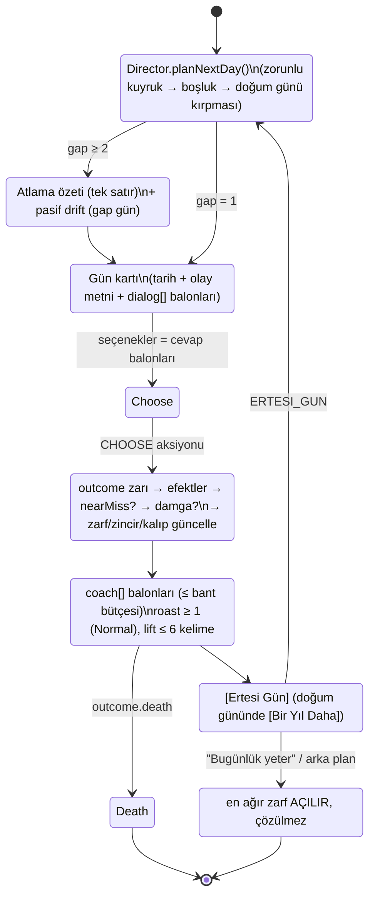

# 03 — Olay Motoru, İçerik Şeması, Gün Director'ü ve Dopamin Algoritmaları (GÜN tabanlı)

> **Belge türü:** Ayrıntılı tasarım dokümanı (00 §5 satır 03). Bu belge olay motorunu (storylet + salience + director), olay JSON şemasını (`dialog[]`, `pattern`, `wager`, `document`, `universality`, `intent/tr/en/review`), **Gün Director'ünü** (D-061), İddia servisini, pity / near-miss / zarf motorlarını, Kalıp Dedektörü'nün sayısal omurgasını, zincirleri, deterministik RNG'yi, içerik hacmi matematiğini ve 10.000 hayat harness'ını **sahiplenir**. Koç satırlarının metni 01'e, stat/hazard/ölüm formülleri 02'ye, NPC ses kuralları 04'e, bildirim kopyası 05'e, balon/damga/EFSANE/ANNE ARIYOR çizimi 07'ye, lint kodu 08'e, i18n hattı 09'a, motor paketi 10'a aittir.
> **Durum:** v1.0 · 2026-11-06 · Yazar: Olay motoru tasarımcısı · Hiyerarşi: 00 (§12 > §11) > T9 > T4/T11 > T7/T1 > konseptler (A4 çerçeve + A1 DNA).
> **Okuma kuralı:** Bu belge **00 §12'yi (D-061..D-065) uygular**: zaman birimi GÜN'dür, her gösterilen günde tam bir olay olur, karakterler diyalogda konuşur, koç diyalogdan sonra ayrı katmanda yorumlar. 00 §4.1'deki "yıl = 3–4 beat" ölçeği ve 02 §2.1'in beat bütçesi bu belgeyle **geçersizdir** (bkz. §7.3 çelişki listesi).

---

## 0. Künye — uygulanan D-kararları, bağımlı dokümanlar, sürüm

### 0.1 00 §5'in 03 satırı ve bu belgenin dokunduğu diğer kararlar → somut tasarım öğesi

| Karar | Bu belgede nerede | Nasıl (tek satır) |
|---|---|---|
| **D-009** İddia Defteri | §2.6 `WagerService` | Yalnızca `playerChose && 0,35 ≤ pEff ≤ 0,65`; koç **her zaman oyuncuya karşı** tahmin eder; `wager` kanalı `outcome` kanalından ayrı → sonucu asla etkilemez; 10 gösterilen günde ≤ 2, ardışık iddialar arası ≥ 3 gün, yılda ≤ 2; harness isabeti %50–62. |
| **D-011** Zarf | §2.8 `EnvelopeQueue` | Her doğum günü ve her oturum sonunda açık zarf ∈ [1, 2]; zarfın vadesi **takvim günü**; oturum sonu sezilince en ağır zarf `opened=true` olur, çözücü olay bir sonraki oturumun 1.–2. gününe zorunlu kuyrukla girer; bildirim `teaserKey`'den türer (05). |
| **D-013** Tercüme kartı | §2.2.6 `type:'document'` | `document.translate` iki locale'de dolu + `glossaryKey`; havuz payı lint ile ≤ %15; director aynı oturumda ≤ 3 evrak günü. |
| **D-024** Kalıp Dedektörü | §2.9 | Her seçenekte opsiyonel `pattern` (12 nötr `PatternId`); motor yalnızca **sayar**; Roast Raporu girdisi `{top3, positive, chronic}`; sıfat yok, sayı var. |
| **D-044** Determinizm + harness | §2.11, §6 | sfc32, seed = `cyrb128(lifeSeed:dayIndex:kanal)`; 9 kanal; aynı seed + aynı aksiyon dizisi = bit-bit aynı hayat; 10.000 hayat CI'da §6.2 eşikleriyle release'i bloklar. |
| **D-045** Olay başına tek JSON | §2.2 | `intent` + `tr` + `en` + `review` + `universality` + `pattern` + `wager?` + `document?` + **`dialog[]`** (D-062 ekidir); zod şeması tek doğruluk kaynağı (`packages/content/schema/event.ts`). |
| **D-061** Zaman birimi GÜN | §2.1, §2.3 | `dayIndex` (gösterilen gün sayacı) + `calendarDay` (takvim); yaş bandına göre gösterilen gün/yıl 12–18 / 8–12 / 5–8 / 3–5; atlanan günler tek satır özetle geçer; doğum günü = yıl sınırı = zorunlu `report_card`. |
| **D-062** Karakterler konuşur | §2.2.3 | `dialog[]` = `{speaker, avatar, tr, en}`; `speaker` 8 Tanıdık Yüz + durumsal NPC; oyuncunun seçeneği `you` balonu olarak akışa yazılır; koç `coach[]` ayrı katman, diyalog içinde **asla** konuşmaz. |
| **D-063** Şov standardı | §2.5, §2.7, §2.3.9 | Motor `effects` ile tetikler: `legendary` (altın çerçeve), `momCall` (ANNE ARIYOR baskını), `minigame` (göz teması), `stamp`; çizim 07'de. |
| **D-064** Roast dozu | §2.2.5, §5 | Normal/Acımasız'da her `outcome.coach[]` içinde ≥ 1 `roast:true` satır (lint BLOK); Nazik'te `gentle` varyantı; Düşük Keyif'te roast filtresi (D-052). |
| **D-065** Benchmark aktarımları | §2.2.4, §2.3.7 | 2 seçenekli günlerde `swipeable:true` (Reigns); **Günün Günü** tarih-seed'li paylaşılan olay (Wordle); Alter Ego "sen yokken" = atlama özeti dili. |
| D-017 / D-018 | §2.2.3, §2.2.2 | `speaker` referansları `npcs[].roleId`'ye bağlanır; `pre.meta.baggageEventId` ile Fazla Bagaj callback olayı; hafıza `metaLogRef` zorunlu (uydurma yok). |
| D-023 | §2.4 | Aktif Tek Hedef'in etiketini taşıyan olay ×1,5 salience; doğum gününde hedef iddiası kapanır. |
| D-027 / D-028 | §2.2.5 | `coach[]` satır bütçesi yaş bandına göre ≤ 2 / ≤ 2 / ≤ 2 (çoğu 1) / ≤ 1; lift ≤ 6 kelime (01 lint'i). |
| D-050 / D-012 | §2.3.7, §2.11 | Motor gerçek saati **okumaz**; Günün Günü için `RESUME.localDay` aksiyon yüküyle gelir. |
| D-033 / D-034 | §2.2.4 | Efektlerde para "Birim" (reel), yüzde yok; metinde makro rakam yok (08 lint). |
| D-039 | §2.2.4 | `choices[].tactic:true` = Taktik Değişikliği'nin 3. seçeneği; motor `ad-opportunity` yayar, UI süzer. |
| D-007 | §2.11 | `phase ∈ {dead, roast}` iken hiçbir `ad-opportunity`; ölüm günü zorunlu kuyruğu boşaltır. |

### 0.2 Bağımlı dokümanlar (arayüz sözleşmeleri)

- **Girdi aldığım:** 00 (tümü; §12 önceliklidir), T4 (storylet/salience/director/şema/RNG), T11 (3a pity, 3b near-miss, 3c eğri, 3h novelty, 3l pending-outcome, §4.3 harness), T7 ve T1 (TL;DR: zarf → bildirim, "bir tur daha" üçlü hedef), T9 (§5 ASLA/DİKKATLİ), 02 (stat/metre adları, hazard, ölüm akışı; **yıl/beat zaman modeli hariç**), 10 (`LifeState`, `step()`, `Effect`, `PatternId`, RNG kanalları), 12 (benchmark kararları).
- **Çıktı verdiğim:** 04 (`speaker`/`avatar` sözlüğü ve NPC ses kuralı lint kancası), 05 (zarf `teaserKey` → bildirim; Günün Günü paylaşım kartı), 07 (`Effect` → `JuiceEvent`: `stamp`, `legendary`, `momCall`, `minigame`, `skipDivider`, `birthday`), 08 (şema kaynaklı 14 lint kuralı, §2.2.9), 09 (`intent/tr/en/review` blok sözleşmesi), 10 (`engine/select`, `engine/director`, `engine/wager`, `engine/reward`, `engine/envelope`, `engine/pattern`, `engine/chain` modül sınırları; `LifeState` alan değişiklikleri §7.3), 11 (gün/oturum KPI'ları).

### 0.3 Sürüm

v1.0 — 2026-11-06. Değişiklik yalnızca 00'a yeni D-kaydı eklenerek yapılır; bu belgedeki D-ÖNERİ'ler (§7.3) onaylanana kadar "uygulanacak varsayım"dır.

---

## 1. Amaç ve kapsam — MVP (dikey kesit) / Soft launch / 1.0

**Amaç:** 18'den ölüme, her gösterilen günde tam bir olay oynatan; karakterleri konuşturan; koçu diyalogdan sonra konuşturan; sana karşı iddiaya giren; iyi sürprizi pity ile garanti eden; kaybı dürüst çerçeveleyen; her oturumu açık bir zarfla bitiren ve bunların hepsini 10.000 sentetik hayatla kanıtlayan **deterministik bir olay motoru**. Oyuncunun cümlesi: *"Bugün ne olacak?"* — her "Ertesi Gün" basışı bir merak boşluğudur (S3).

| Alt sistem | MVP (10 hafta) | Soft launch (+8 hafta) | 1.0 |
|---|---|---|---|
| Gün döngüsü + takvim | Tam (§2.1); FTUE ilk 3 gün elle yazılı; Hızlı Yaşa 36+ varsayılan açık | Hızlı Yaşa oyuncu ayarı | aynı |
| Şema + zod + build | Tam; `dialog[]`, `document`, `call`, `minigame`, `report_card` | + `shared` (Günün Günü) havuzu 30 | + Kader kişiliği `voicePool` anahtarı |
| Gün Director'ü | Bütçe, boşluk dağılımı, atlama özeti, valans koruması, doğum günü, zorunlu kuyruk, oturum eğrisi | + Günün Günü, mini-oyun günleri (2 tür), mom-call tam | + efsane kadans ayarı veriyle, sezon takvimi kancası (05) |
| Salience | Tam formül | aynı | aynı |
| WagerService | Tam (anlık + hedef iddiası) | + zincir iddiası (çözümü ileride) | aynı |
| Pity / near-miss / zarf | Pity + zarf tam; near-miss **iskelet** (metin varyantı olmadan `loss`) | near-miss tam | aynı |
| Kalıp Dedektörü | 12 kalıp sayacı + Roast girdisi + motto hücresi | + Kronik (3 hayat) | + ömürler arası kümülatif sayfa |
| Zincirler | 12 zincir (ortalama 3 düğüm) | 25 | 40 (ortalama 4 düğüm) |
| İçerik (locale başına) | 80 olay günü + 40 atlama satırı + 4 efsane + 3 anne araması + 2 mini-oyun | ≈ 500 olay günü | ≈ 900 olay günü + 40 zincir (≈ 160 düğüm) |
| Harness | 10.000 hayat, §6.2 eşiklerinin ilk 12'si | tüm eşikler + oturum simülasyonu | + persona-gerçek sapma raporu (11) |

**Kapsam dışı (yeniden açılmaz):** serbest aksiyon menüsü (T4 §3.1'deki "İş / İlişkiler / Sağlık" menüsü yoktur — gün = olay, olay = seçenekler), enerji, aylık alt-tur (günler zaten vardır; hastalık/askerlik arkları takvim günleriyle yazılır), Ink runtime (opsiyonel bile değil: diyalog `dialog[]` ile yeter), sunucu taraflı herhangi bir şey.

---

## 2. Tasarım

### 2.1 Gün döngüsü: tek gün = tek olay

Hayat Akışı bir takvimdir. Her kart tarihli bir gündür: *"Gün 112 · Çarşamba, 14 Ocak 2032"*. İki sayaç birlikte yürür: **`dayIndex`** (0'dan başlayan, yalnızca *gösterilen* günleri sayan monoton sayaç — seed, pity, cooldown, oturum ölçümü bunun üstünde çalışır) ve **`calendarDay`** (18. doğum gününden itibaren geçen takvim günü — tarih, mevsim, doğum günü, zarf vadesi, zincir gecikmesi bunun üstünde çalışır). Takvim kozmetiktir: oyuncunun gerçek tarihine, saatine, konumuna bağlanmaz (D-050); FTUE takvimi 2026'da başlar, karakterin doğum günü `names` kanalından çekilir.



Kurallar: (1) **Olaysız gün gösterilmez**; director her gösterilen güne bir olay bulamazsa (havuz tükendi) `sys_sessiz_gun` dolgu olayı değil, **daha uzun atlama** üretir — "11 gün geçti. Hiçbir şey olmadı; bu da bir olay." / "Eleven days. Nothing happened. Which counts." (2) Doğum günü günü her zaman gösterilir ve olayı `report_card`'dır. (3) Ölüm hangi gün gelirse o gün son gösterilen gündür; karne yok, Roast Raporu var (02 §2.5). (4) Oturum içi gün sayacı `sessionDayIndex` `RESUME` ile (≥ 30 dk ara) sıfırlanır.

### 2.2 İçerik şeması

#### 2.2.1 TypeScript sözleşmesi (zod'dan `z.infer` ile türetilir; burada okunabilir hâli)

```ts
// packages/content/schema/event.ts  — tek doğruluk kaynağı; motor ContentBundle olarak alır
export type EventType = 'event' | 'document' | 'call' | 'minigame' | 'report_card';
export type Rarity = 'common' | 'uncommon' | 'rare' | 'legendary';     // base weight 1 / 0.5 / 0.2 / (yalnızca efsane zarıyla)
export type Valence = -2 | -1 | 0 | 1 | 2;
export type Universality = 'universal' | 'localizedShell' | 'localeOnly';
export type SpeakerId =
  | 'mom' | 'roommate' | 'boss' | 'ex' | 'neighbor' | 'uncle' | 'cat' | 'cabbie'           // 8 Tanıdık Yüz (D-017)
  | `npc:${'courier'|'boilerTech'|'landlord'|'hr'|'doctor'|'clerk'|'stranger'}`         // durumsal NPC (04 sözlüğü)
  | 'you';                                                                                // yalnızca motor üretir (cevap balonu)
export type Avatar = 'neutral' | 'worried' | 'annoyed' | 'happy' | 'smug' | 'tired' | 'typing';
export type PatternId = 'procrastination'|'avoidance'|'impulseSpend'|'peoplePleasing'|'risk'|'selfCare'
  |'overwork'|'leanOnFamily'|'shortcut'|'pride'|'generosity'|'patience';                // 12 nötr kalıp (D-024; 10 ile aynı)

export interface L { tr: string; en: string }                                            // iki locale, ayrı yazılır (09)

export interface DialogLine {
  speaker: Exclude<SpeakerId, 'you'>;
  avatar?: Avatar;
  tr: string; en: string;                                                                // NPC ses kuralı 04 lint'i: mom ≤ 8 kelime + '?', roommate CAPS, ex ≤ 3 kelime, cat 1 kelime
  when?: Pre;                                                                            // koşullu satır (ör. momPressure ≥ 60 ise ek satır)
  alt?: L[];                                                                             // en az görülen alternatif gerçekleştirme (varyant)
  delayMs?: number;                                                                      // comic timing; UI "yazıyor…" (07)
}

export interface Choice {
  id: string;
  tr: string; en: string;                                                                // buton bütçesi TR 18 / EN 16 karakter (08)
  pattern?: PatternId;                                                                   // görünmez etiket (D-024)
  requires?: Pre;                                                                        // kilitli ama görünür (gri + hint)
  hint?: L;
  check?: { base: number; stat?: 'health'|'joy'|'brain'|'charm'|'ego'|'cringe'; goal?: string; skill?: boolean };
  // check = olasılıklı sonuç; base ∈ (0,1); stat ile gerilim normalizasyonu (§2.6.2); goal = near-miss/pendingBonus anahtarı; skill = mini-oyun (iddia dışı)
  tactic?: boolean;                                                                      // Taktik Değişikliği 3. seçenek (D-039); günde 2 → UI süzer
  swipe?: 'left' | 'right';                                                              // 2 seçenekli günde Reigns kaydırması (D-065)
}

export interface Outcome {
  p?: number;                                                                            // branch olasılığı; tek outcome → 1
  luckScaled?: boolean;                                                                  // Şans ±%10 (02)
  effects?: Effects;
  tr: string; en: string;                                                                // sonuç metni (sistem balonu, koç değil)
  nearMiss?: L;                                                                          // yalnızca check'li fail dalında; "gerçekten yakındı" metni (§2.7)
  coach: CoachLine[];                                                                    // ≥ 1 roast (Normal/Brutal) — lint D-064
}

export interface Effects {
  stats?: Partial<Record<'health'|'joy'|'brain'|'charm', number>>;
  meters?: Partial<Record<'ego'|'cringe'|'momPressure', number>>;
  hidden?: Partial<Record<'luck'|'stress', number>>;
  money?: number;                                                                        // Birim (reel; UI ×1.000 basar) — "+3", "-0.3"
  flags?: { add?: string[]; remove?: string[] };
  npc?: Array<{ role: Exclude<SpeakerId,'you'>; affinity?: number; memory?: string; create?: boolean; kill?: boolean }>;
  career?: { set?: string; rungDelta?: number; fire?: boolean };
  housing?: 'momsHouse'|'room'|'flat'|'wide'|'mortgage'|'owned';
  followUp?: Array<{ eventId: string; delayDays: [number, number]; chance?: number; forced?: boolean }>;   // takvim günü
  envelope?: { teaserKey: string; dueDays: [number, number]; weight: number; resolverEventId: string };     // D-011
  chainNext?: string;                                                                    // zincir düğümü geçişi (§2.10)
  diagnosis?: string;                                                                    // Teşhis anahtarı (05)
  glossary?: string;                                                                     // Sözlük anahtarı (D-013)
  death?: { cause: string };                                                             // senaryo ölümü (02 §2.5 kanalı)
  notebook?: { kind: 'note'; key: string };                                              // Koçun Defteri Not (hayat başına ≤ 12; 01)
}

export interface CoachLine {
  tr: string; en: string;
  roast: boolean;                                                                        // D-064 kotası bu bayraktan sayılır
  lift?: boolean;                                                                        // ≤ 6 kelime; yalnızca oyun içi seçim önerir (D-027)
  level?: Array<'gentle'|'normal'|'brutal'>;                                             // yoksa hepsi; brutal uzun varyant
  when?: Pre;
}

export interface GameEvent {
  id: string; v: number; type: EventType;
  tags: string[];                                                                        // 'para','aile','kariyer:kurye','kis','surprise.nice','wow','lol','relax'
  rarity: Rarity; weight?: number;
  valence: Valence; intensity: number;                                                   // 0..1 oturum eğrisi için
  isLOL?: boolean; wow?: boolean; relax?: boolean;
  universality: Universality; substituteFor?: string;                                   // localeOnly ikame çifti (D-048)
  shared?: boolean;                                                                      // Günün Günü havuzu (gevşek ön koşul şartı: lint)
  cooldownDays?: { self?: number; tags?: Record<string, number> };                      // gösterilen gün cinsinden
  maxPerLife?: number; exclusiveGroup?: string; salienceBonus?: number;
  pre: Pre;
  ageBand?: Array<'warmup'|'season'|'secondHalf'|'overtime'>;                            // tembel yükleme anahtarı (§4)
  chain?: { id: string; node: string; next?: Array<{ node: string; delayDays: [number, number]; when?: Pre }> };
  dialog?: DialogLine[];                                                                 // D-062; koç burada yoktur
  text?: Array<{ id: string; when?: Pre; tr: string; en: string }>;                     // anlatı metni varyantları (diyalogsuz veya ek)
  document?: { letterhead: L; body: L; translate: { tr: {from: string; to: string}; en: {from: string; to: string} }; glossaryKey: string };
  call?: { speaker: 'mom' | 'uncle' | 'boss' | 'ex'; takeover: boolean };               // ANNE ARIYOR (D-063) yalnızca mom + takeover:true
  minigame?: { kind: 'eyeContact' | 'timing'; green: number; bonus: number; check: string };   // check = choice.id; iddia dışı
  choices: Choice[];                                                                     // 2–4
  outcomes: Record<string, Outcome | Outcome[]>;                                         // choice.id → dal(lar); Σp = 1 ± 0,001
  wager?: { eligible: boolean; check?: string; slip?: L; reason?: string };             // slip yoksa 01 havuzu; eligible:false + reason = yazar notu
  intent: { setup: string; mechanism: string; punch: string; lift: string; target: 'decision'|'situation'|'coach'|'npc' };
  review: { status: 'draft'|'curated'|'linted'|'punched'|'approved'; funnyTr?: 1|2|3|4|5; funnyEn?: 1|2|3|4|5; legal: 'ok'|'review'; needsReview?: string[]; cultureNote?: string };
}

export type Pre = {                                                                      // tüm anahtarlar AND; all/any/none ile birleşim
  all?: Pre[]; any?: Pre[]; none?: Pre[];
  age?: { min?: number; max?: number };
  stats?: Partial<Record<'health'|'joy'|'brain'|'charm', { min?: number; max?: number }>>;
  meters?: Partial<Record<'ego'|'cringe'|'momPressure', { min?: number; max?: number }>>;
  hidden?: Partial<Record<'luck'|'stress', { min?: number; max?: number }>>;
  money?: { min?: number; max?: number };
  flags?: { all?: string[]; any?: string[]; none?: string[] };
  career?: { anyOf?: string[]; minRung?: number; employed?: boolean };
  housing?: string[];
  npc?: Partial<Record<Exclude<SpeakerId,'you'>, { alive?: boolean; exists?: boolean; minAffinity?: number; maxAffinity?: number; memoryHas?: string[]; memoryNone?: string[] }>>;
  goal?: { anyOf?: string[]; active?: boolean };
  season?: Array<'winter'|'spring'|'summer'|'autumn'>;                                   // calendarDay → mevsim
  chain?: { id: string; nodeDone?: string[]; nodeNotDone?: string[] };
  pattern?: Partial<Record<PatternId, { min?: number; max?: number }>>;                 // "Erteleme ≥ 40 ise bu olay"
  wagerOpen?: boolean; envelopeOpen?: boolean;
  meta?: { livesMin?: number; baggageEventId?: string; pastFlags?: string[]; familiarityMin?: number };
  expr?: string;                                                                         // jsep güvenli ifade; nadir; lint uyarır
};
```

**Zod notları:** her `L` için iki locale zorunlu (eksik → BLOK); `outcomes` anahtarları `choices[].id` ile bire bir; `check` olmayan seçeneğin `outcomes` dalı tek ve `p` yok; `nearMiss` yalnızca `check`'li seçeneğin `p < 1` dalında; `call.takeover` yalnızca `speaker:'mom'`; `minigame.check` bir `choice.id` ve o seçenekte `check.skill:true`; `shared:true` ise `pre` yalnızca `age` içerebilir; `rarity:'legendary'` ise `valence ≥ 0` ve `effects.death` yok; `type:'report_card'` yalnızca `sys_report_card` id'sinde.

#### 2.2.2 Ön koşul DSL'i ve spesifiklik

Spesifiklik = yaprak koşul sayısı (`all/any/none` düğümleri sayılmaz; `any` içindeki yapraklar 0,5 sayılır). Lint: `expr` kullanan olaylar `review.needsReview` alır; `meta.*` koşulları **yalnızca** `metaLog`'da gerçekten yazılabilecek anahtarlardan (08 sözlüğü) seçilir. Ölü-içerik testi (§6.2) hiç tetiklenmeyen `pre`'yi raporlar.

#### 2.2.3 `dialog[]` ve konuşmacı referansları (D-062)

- `speaker` 8 Tanıdık Yüz'den biriyse motor `npcs[]`'de o `roleId`'nin **var ve hayatta** olmasını ön koşul olarak otomatik ekler (yazar yazmaz, lint ekler; "ölmüş anne arıyor" sınıfı hata derleme düzeyinde yok).
- Her satırın `avatar`'ı 07'nin ifade setine eşlenir; yoksa `neutral`.
- Oyuncunun seçeneği `you` balonu olarak akışa yazılır: *"Sen: Yedim anne."* / *"You: I ate, Mom."* Buton metni = balon metni (tek kaynak).
- **Koç diyalogda yoktur.** `coach[]` outcome'dan sonra, ayrı görsel katmanda gelir (düdük ikonu + Fraunces italik; 07). NPC koça cevap vermez, koç NPC'ye hitap etmez; koç yalnızca oyuncuya ve kendine konuşur (S1).
- NPC ses kuralları (04 sahibi, 08 lint'i): Anne ≤ 8 kelime, soru işareti oranı ≥ %50; Barış/Jordan BÜYÜK HARF ve "KESİN/SURE THING" sözcüğü; Nevin Hanım/Ms. Carver İK sözlüğü ("hizalanma/alignment", "görünürlük/visibility"); Yağmur/Sam ≤ 3 kelime; Pamuk/Biscuit tek kelime; Şükran Teyze/Mrs. Dale "kızım/oğlum" yerine cinsiyetsiz "canım/dear" + komşu gözlemi; Dayı/uncle 2009 referansı; Taksici/cab driver trafik + hayat felsefesi.

#### 2.2.4 Seçenekler, `pattern`, swipe, tactic

2–4 seçenek; ≥ 1 seçenekte `pattern` zorunlu (lint UYARI: hiçbiri yoksa Kalıp Dedektörü o günü sayamaz); aynı olayda aynı `pattern` iki seçenekte olamaz. 2 seçenekli günlerde `swipe` zorunlu (sola/sağa kaydırma = cevap; buton da kalır). `tactic:true` seçenek yalnızca rewarded ile görünür; **önceden işaretli değildir**, gri değildir, "Üçüncü bir yol var" etiketiyle kapalı gelir (D-039/D-055).

#### 2.2.5 `coach[]` kotası (D-064, D-027, D-028)

| Yaş bandı | Balon tavanı | Roast zorunluluğu (Normal) | Lift |
|---|---|---|---|
| 18–25 | ≤ 2 | ≥ 1 `roast:true` | 3 günde ≥ 1 |
| 26–40 | ≤ 2 | ≥ 1 | 3 günde ≥ 1 |
| 41–60 | ≤ 2, medyan 1 | ≥ 1 (kısa) | 5 günde ≥ 1 |
| 60+ | ≤ 1 | ≥ 1 ya da `witness` | 5 günde ≥ 1 |

Nazik'te `level:['gentle']` varyantı seçilir; yoksa `roast:false` satır. Düşük Keyif (02: Keyif < 25) → tüm `roast:true` satırlar filtrelenir, `lift` ve `plain` kalır (D-052). Motor satır seçmez; `coach[]` adaylarını `textKey` listesi olarak döner, 01'in seçim fonksiyonu (least-recently-viewed + cooldown) uygular.

#### 2.2.6 `document` tipi (D-013)

Antetli kart; `translate.from` kurumsal cümle, `translate.to` "ne demek istiyor". İki locale'de `translate` dolu ve `glossaryKey` eşleşir (08 lint). `document` günleri `dialog[]` taşıyabilir (ör. evrakı getiren kurye) ama zorunlu değildir. Havuz payı ≤ %15; director aynı oturumda ≤ 3 evrak günü (`tags: ['evrak']` cooldown 4 gün).

#### 2.2.7 Metin varyantları ve novelty

`text[]` ve `dialog[].alt[]` en az görülen gerçekleştirme ile seçilir (Yarn RBLRV). Sık olaylarda (common) `text` ≥ 3, uncommon ≥ 2, rare/legendary ≥ 1 (lint). Varyant sayacı `reward.seenCount[textVariantId]` hayat içi, `legacy.seenLives[textVariantId]` hayatlar arası.

#### 2.2.8 `intent` / `tr` / `en` / `review` blokları (D-045, 09)

`intent` dilden bağımsız şaka spesifikasyonudur (setup / mekanizma / punch / lift / hedef); TR ve EN **ayrı** yazılır, EN yazarı TR'yi görmez (süreç 09'da). `review.status < 'linted'` olan olay build'e girmez; `legal:'review'` release'i bloklar (D-047). `cultureNote` `localizedShell` ve `localeOnly` olaylarda zorunlu.

#### 2.2.9 Şemadan türeyen lint kuralları (08'e devredilir)

| # | Kural | Seviye |
|---|---|---|
| L03-01 | Her `Outcome.coach[]` içinde Normal/Brutal için ≥ 1 `roast:true` | BLOK |
| L03-02 | `coach[]` içinde `speaker` alanı yok; `dialog[]` içinde `speaker:'you'` yok | BLOK |
| L03-03 | `document` payı havuzun ≤ %15'i (locale başına) | BLOK |
| L03-04 | `check.base` ∈ [0,05, 0,95]; `wager.eligible:true` ise `check` var ve `skill` yok | BLOK |
| L03-05 | `nearMiss` yalnızca fail dalında; `check.goal` zorunlu | BLOK |
| L03-06 | `rarity:'legendary'` → `valence ≥ 0`, `wow:true`, `death` yok | BLOK |
| L03-07 | `shared:true` → `pre` yalnızca `age`; `universality:'universal'` | BLOK |
| L03-08 | `call.takeover` yalnızca `mom`; `momPressure` etkisi ≤ 0 olan ≥ 1 seçenek | BLOK |
| L03-09 | `pattern` aynı olayda tekrar etmez; ≥ 1 seçenekte var | BLOK / UYARI |
| L03-10 | `followUp.delayDays[1] ≤ 1500`; hedef `eventId` sözlükte | BLOK |
| L03-11 | `envelope.resolverEventId` var ve `pre`'si zarfın açılma koşulunu içerir (`envelopeOpen:true`) | BLOK |
| L03-12 | `valence ≤ -1` olayda ≥ 1 seçenek `joy ≥ 0` veya `diagnosis`/`glossary` üretir (umut kapısı) | BLOK |
| L03-13 | Tek outcome |stat delta| ≤ 25; money ∈ [−10, +10] Birim (legendary ≤ +25) | BLOK |
| L03-14 | 3-gram benzerliği > 0,6 iki olay metni | UYARI |

### 2.3 Gün Director'ü

#### 2.3.1 Yıllık gösterilen gün bütçesi (D-061)

Bütçe doğum gününde (`AGE` reducer'ı) `director` kanalıyla çekilir; doğum günü kartı bütçeye **dahildir** (yılın son gösterilen günü).

| Yaş bandı (koç adı) | Gösterilen gün / yıl | Ortalama takvim boşluğu | Yıl sayısı (medyan ömür 74) | Gösterilen gün toplamı |
|---|---|---|---|---|
| 18–25 "Isınma" | 12–18 (medyan 15) | ~24 gün | 8 | 120 |
| 26–40 "Sezon" | 8–12 (10) | ~36 gün | 15 | 150 |
| 41–60 "İkinci devre" | 5–8 (6,5) | ~56 gün | 20 | 130 |
| 61+ "Uzatmalar" | 3–5 (4) | ~91 gün | 14 | 56 |
| **Toplam** | | | **57** | **≈ 456 (+ MVP dışı düzeltmelerle 450–600)** |

Düzeltmeler (toplam tavan bant maksimumu + 2): Stres > 70 → +1; aktif zincir (açık düğümü olan) → +1; `fastLife` (36+ MVP varsayılan; oyuncu ayarı) → bant minimumu ve atlama özeti otomatik 1,2 sn; Anne Baskısı ≥ 75 iken bir mom-call günü bütçe dışı eklenir (bkz. §2.3.8). 12 sn/gün çapasıyla 456–560 gün ≈ 91–112 dk; harness hedefi 450–600 gün ve 90–120 dk (§6.2).

#### 2.3.2 Boşluk (gap) dağılımı ve kendini düzelten takvim

Director tarihleri önceden planlamaz; her gösterilen günün sonunda **bir sonraki gösterilen güne kaç takvim günü** olduğunu çeker:

```ts
function drawGap(st: LifeState, rng: RNG): number {
  const daysToBirthday = st.calendar.birthdayDay - st.calendar.day;         // ≥ 1
  const remaining = Math.max(1, st.director.yearBudget - st.director.shownThisYear);  // doğum günü dahil
  const mean = Math.max(1, daysToBirthday / remaining);
  const noise = Math.exp(gauss(rng) * 0.45);                                 // log-normal, σ = 0,45 → boşluklar "hayat gibi" düzensiz
  let gap = Math.round(mean * noise);
  gap = clamp(gap, 1, daysToBirthday);
  const due = earliestDue(st);                                               // zorunlu kuyruk (§2.3.5)
  if (due && due.day - st.calendar.day < gap) gap = Math.max(1, due.day - st.calendar.day);
  if (st.director.momCallPending) gap = 1;                                   // ANNE ARIYOR ertesi gün gelir
  return gap;
}
```

`mean` her adımda kalan gün / kalan bütçe olduğundan yıl sonunda bütçe tutturulur; zorunlu kuyruk boşluğu kısaltır ama bütçeyi aşmaz (forced olaylar bütçeden düşer; bütçe biterse kalan forced olaylar doğum gününden sonraki ilk günlere kayar — doğum günü asla ötelenmez).

#### 2.3.3 Atlama özeti üretimi

`gap ≥ 2` ise akışa ince bir ayraç yazılır: **tek satır, ≤ 14 kelime, en fazla bir sayı, roast yok, kimlik yok.** Seçim: kova × bağlam etiketi × en az görülen.

| Kova (takvim günü) | Bağlam etiketleri (önceliğe göre ilk eşleşen) | TR örnek | EN örnek |
|---|---|---|---|
| 2–3 | `default` | "İki gün geçti. Fark eden olmadı." | "Two days passed. Nobody noticed." |
| 4–10 | `employed`, `unemployed`, `momHigh`, `goalActive`, `default` | "Bir hafta. Mesai, uyku, mesai. Anne 2 kez aradı." | "A week. Work, sleep, work. Mom called twice." |
| 11–30 | aynı + `winter`, `summer`, `envelopeOpen` | "11 gün geçti. Hiçbir şey olmadı; bu da bir olay." | "Eleven days. Nothing happened. Which counts." |
| 31–90 | `secondHalf`, `overtime`, `retired` | "Bir mevsim. Aynı yol, aynı dönüş. Kedi bir kilo aldı." | "A season. Same road, same turn. The cat gained a pound." |
| 91+ | `overtime` | "Üç ay. Günler kısaldı; sen değil." | "Three months. The days got shorter. You didn't." |

Pasif güncellemeler atlanan gün sayısıyla orantılı uygulanır (02 §2.1'in yıllık pulse'ı günlük orana bölünür: gelir–gider, stat drift, Stres decay, Anne Baskısı artışı, Cringe decay); hazard zarı yalnızca **doğum gününde** atılır (02 kuralı: hazard karneden önce). Atlama satırında NPC adı geçebilir ama diyalog yoktur; sayı varsa gerçektir (`momCalls` sayacından gelir). Havuz: MVP 40 satır, 1.0 200 satır (locale başına); kova başına ≥ 8 varyant (lint).

#### 2.3.4 Oturum yoğunluk eğrisi (15–25 gün)

`expectedSessionDays` = son 5 oturumun medyanı (ilk oturumda 20). Hedef yoğunluk T11 3c eğrisi, `t = sessionDayIndex / expectedSessionDays`:

```
target(t) = t < 0.15 ? 0.25 + 2t : t < 0.75 ? 0.55 + 0.6(t − 0.15) : t < 0.85 ? 0.95 : 0.45
```

Adaylar `curveFit = max(0.2, 1 − 0.8·|intensity − target|)` çarpanı alır. Her 10. gösterilen gün `relax` etiketli aday ×1,5, `intensity > 0,4` adaylar ×0,5 (Royal Match nefesi). LOL aralığı: `beatsSinceLol ≥ 6` → `isLOL` ×1,5; `≥ 10` ve havuzda LOL varsa LOL olmayan ×0,7 (hedef medyan LOL aralığı 6–10 gün ≈ 1,5–2 dk). Oturum sonu sezgisi: `t ≥ 0,85` **veya** son 3 günün ortalama süresi ×1,8 yavaşladı **veya** `SESSION_END` aksiyonu → en ağır zarf açılır (§2.8). `wow` bütçesi oturum başına 3 (efsane + LOL + twist).

#### 2.3.5 Zorunlu kuyruk ve öncelik

`dueQueue` öğeleri (takvim günü vadeli): (1) ölüm sonrası akış (02), (2) `report_card` (doğum günü), (3) mom-call, (4) zarf çözücü olay (`opened` olanlar önce), (5) zincir düğümü (`chain.next.delayDays` vadesi), (6) `followUp.forced`, (7) bailout / Fizyoterapi teklifi (02 kancaları), (8) Günün Günü, (9) `followUp` şanslı. Aynı güne iki öğe düşerse öncelik sırası; kaybeden ertesi gösterilen güne kayar. **Valans koruması forced öğeyi de bağlar:** `negStreak ≥ 2` iken vadesi gelen `valence < 0` forced olay 1 gösterilen gün ötelenir ve araya `valence ≥ 0` serbest gün girer (en fazla 1 öteleme; ikinci kez ötelenmez — Valve dersi: scripted track sonsuza kadar bastırılmaz).

#### 2.3.6 Valans koruması ve Düşük Keyif

`negStreak ≥ 2` → serbest adaylardan `valence < 0` olanlar elenir (harness: maks. negatif seri ≤ 2). `negStreak == 1` → `valence < 0` ×0,45. Keyif < 25 (02 "Düşük") → `valence ≤ -1` ×0,5, `tags: selfCare|relax|wholesome` ×1,5, roast filtresi (D-052), "Gerçek hayatta yardım" ekranı 08'in kuralıyla ayrı. Ölüm, hastalık, ayrılık günlerinde (`tags: silence`) koç `silence` kuralını uygular (01).

#### 2.3.7 Günün Günü (D-065, Wordle)

Gerçek takvim günü başına bir kez, aynı locale'deki herkes aynı olayı aynı zarla yaşar. `RESUME.localDay` ile gelen tarihten seed: `cyrb128('day:' + localDay + ':' + locale + ':' + contentHash)`; havuz `shared:true` (MVP 10, soft 30, 1.0 60). Yerleşim: o günkü ilk oturumun **ikinci** gösterilen günü (ilk gün zarf/forced içindir); forced çakışırsa sonraki serbest slot; oturum 2 günü geçmezse ertesi güne devretmez (o günün günü kaçar, ceza yok). Sonuç zarı `daily` kanalından (tarih seed'li) → aynı seçenek = aynı sonuç → paylaşım kartı "GÜNÜN GÜNÜ · 14 Ocak" + emoji sonuç satırı + seçenek harfi (spoiler yok). Kural: `shared` olaylar gerçek tarih/bayram/anma içeriği taşımaz; tarih yalnızca seed'dir (§5). Günün Günü iddia açabilir (herkes aynı oranı görür — kart "Koç herkese karşı: %45" satırı taşır).

#### 2.3.8 ANNE ARIYOR baskını (D-063)

Tetik (kenar tetiklemeli): `momPressure` ≥ 75'e **yukarı** geçiş **veya** 20 gösterilen gündür ≥ 75 ve son aramadan ≥ 40 gösterilen gün geçti; anne hayatta; cooldown 40 gösterilen gün; hayat başına ≤ 6; ilk 10 gösterilen günde (FTUE) yok. Ertesi takvim günü (`gap = 1`) `type:'call'` olay gelir; UI tam ekran çağrı baskını (07; asla OS çağrı arayüzünü taklit etmez — §4). Her mom-call'da `momPressure`'ı düşüren ≥ 1 seçenek vardır (L03-08); "Açma" seçeneği `momPressure +10`, Teşhis yolu "Okundu Bırakan" (05).

#### 2.3.9 Mini-oyun günleri (D-063)

`type:'minigame'`; oturum başına ≤ 1, aralarında ≥ 15 gösterilen gün, yalnızca `check`'li bir seçenek varsa. Mini-oyun (göz teması: iğne yeşil bölgeye girerse) sonucu **belirlemez**, olasılığı `+bonus` (varsayılan +0,15) kaydırır; ekran bunu önceden yazar ("Yeşilde bırakırsan +%15"). Beceri payı olduğundan `WagerService` bu günleri dışlar (koç "beceriye karşı iddiaya girmem; şansa girerim" — 01). Reduced-motion / erişilebilirlik modunda mini-oyun atlanır ve `base + bonus/2` uygulanır (cezasız).

#### 2.3.10 Doğum günü = `report_card` (zorunlu, yılın son günü)

`sys_report_card` üretilmiş olaydır: girdileri 02 (6 not), 03 (hedef damgası TAMAM/YARIM/ERTELENDİ, Yılın Mottosu hücresi, iddia skoru, zarf satırı, Onyıl Karnesi kancası 30/40/50/60 → 05), metni 01/09. Sırası sabit: hedef iddiası kapanır (damga) → notlar → motto → koç notu (1) → zarf satırı → **Tek Hedef** (3 öneri + Hedefsiz + "Aynı hedef") → yeni hedef iddiası açılır → **[Bir Yıl Daha]**. Zarf sayısı < 1 ise doğum günü bir zarf açar (§2.8). Doğum gününde başka olay oynanmaz; mom-call ve zincir vadesi ertesi güne kayar.

#### 2.3.11 `planNextDay` (bütün hâliyle)

```
function planNextDay(st, content):
  rngD = rng('director'), rngB = rng('beats'), rngS = rng('surprise')
  gap = drawGap(st, rngD)                                   // §2.3.2 (forced/birthday/momCall kırpması dahil)
  applySkip(st, gap)                                         // pasif drift + atlama özeti (gap ≥ 2)
  st.calendar.day += gap; st.dayIndex += 1; st.sessionDayIndex += 1
  if st.calendar.day == st.calendar.birthdayDay: return play('sys_report_card')
  forced = dueQueue(st).filter(d => d.day <= st.calendar.day).sortBy(priority)
  if forced.nonEmpty and not (negStreak >= 2 and forced[0].valence < 0 and !forced[0].deferredOnce): return play(forced[0])
  if dailyPending(st) and st.sessionDayIndex >= 2: return play(dailyEvent(st))          // §2.3.7
  if rollLegendary(st, rngS): return play(pickLegendary(st, rngB))                     // §2.5.2
  tier = rollSurprise(st, rngS)                                                          // §2.5.1 pity
  pool = tier ? candidates(st).filter(e => e.tags.has('surprise.'+tier)) : candidates(st)
  if pool.empty: pool = candidates(st)                                                   // sürpriz havuzu boşsa normal gün (pity sayacı sıfırlanmaz)
  return play(weightedPick(pool, salience, rngB))                                        // §2.4
```

### 2.4 Salience skorlaması

```
score(e) = rarityW(e) × (1 + 0,35 · specificity(e)) × novelty(e) × recency(e) × curveFit(e)
         × goalBoost(e) × arcBoost(e) × valenceMult(e) × moodMult(e) × lolMult(e) × relaxMult(e) × wowBudget(e)

rarityW     = {common 1, uncommon 0,5, rare 0,2} × (weight ?? 1)      // legendary bu yoldan gelmez
specificity = yaprak koşul sayısı + salienceBonus
novelty     = seen==0 ? 1,6 : 0,55^seen ; son 2 hayatta görüldüyse ×0,3 ; taban 0,02
recency     = Π_tags ( daysSince(tag) < cooldownDays(tag) ? 0 : min(1, daysSince(tag)/40) )   // self cooldown → 0
curveFit    = max(0,2, 1 − 0,8·|intensity − target(t)|)
goalBoost   = e.tags ∩ activeGoal.tags ≠ ∅ ? 1,5 : 1                   // D-023
arcBoost    = e.chain && chainActive(e.chain.id) ? 1,3 : 1              // zincirin serbest (vadesiz) düğümleri
valenceMult = negStreak>=2 && valence<0 ? 0 : negStreak==1 && valence<0 ? 0,45 : 1
moodMult    = joy<25 ? (valence<=-1 ? 0,5 : selfCareTag ? 1,5 : 1) : 1
lolMult     = beatsSinceLol>=6 && isLOL ? 1,5 : beatsSinceLol>=10 && !isLOL && lolAvailable ? 0,7 : 1
relaxMult   = dayIndex%10==0 ? (relax ? 1,5 : intensity>0,4 ? 0,5 : 1) : 1
wowBudget   = wow && wowCount>=3 ? 0 : 1
```

**İşlenmiş örnek.** Gün 112, yaş 24, kariyer kurye (rung 1), kira (`housing:'flat'`), Anne Baskısı 62, Keyif 48, aktif hedef "5.000 biriktir" (`tags: para`), son iki gün valans −1, −1 (`negStreak = 2`), mevsim kış, oturumun 9. günü (`t = 0,45 → target = 0,73`), `beatsSinceLol = 7`, `wowCount = 1`.

| Aday | spec | rarity | valence | intensity | novelty | curveFit | diğer çarpanlar | **skor** |
|---|---|---|---|---|---|---|---|---|
| `evt_kira_zammi` (kiracı + yaş≥19) | 2 | 1 | −1 | 0,5 | 1,6 | 0,82 | valenceMult **0** | **0** (elendi) |
| `evt_baris_kesin_plan_01` (ev arkadaşı var + para≥1 + yaş≤30) | 3 | 1 | 0 | 0,6 | 1,6 | 0,90 | goalBoost 1,5 (para), lolMult 1,5 | 1×2,05×1,6×0,90×1,5×1,5 = **6,64** |
| `evt_kombi_ustasi_kis` (kış + kiracı) | 2 | 0,5 | −1 | 0,7 | 1,6 | 0,98 | valenceMult **0** | **0** |
| `evt_sukran_teyze_borek` (komşu var) | 1 | 1 | +1 | 0,2 | 0,55 (1 kez görüldü) | 0,58 | relax değil (gün 112 ≠ %10) | 1×1,35×0,55×0,58 = **0,43** |
| `evt_kurye_yanlis_adres` (kariyer kurye + rung≤2 + kış) | 3 | 1 | 0 | 0,5 | 1,6 | 0,82 | goalBoost 1 | 1×2,05×1,6×0,82 = **2,69** |

Ağırlıklı örnekleme: Barış %68, kurye %28, börek %4. İki negatif günden sonra sistem "nefes" veriyor; aktif hedefe bağlı olay öne çıkıyor; görülmüş börek geride. Kira zammı ve kombi yarın yine adaydır (cooldown değil, koruma). "Oyun beni tanıyor" hissi: spesifiklik 3 olan kurye olayı, jenerik börek olayını 6 katla geçti.

### 2.5 İyi sürpriz (pity) ve efsane gün

#### 2.5.1 Pity'li iyi sürpriz (T11 3a; birim = gösterilen gün)

| Sabit | Değer | Not |
|---|---|---|
| `SURPRISE_BASE_P` | 0,08 / gün | |
| `SOFT_PITY` / `HARD_PITY` | 8 / 14 gün | 14 gün ≈ 3 dk; oturum başına ≥ 1 sürpriz garantisi |
| `RAMP_STEP` | 0,12 | 9. gün 0,20, 12. gün 0,56, 14. gün 1 |
| `MIN_GAP` / `SESSION_CAP` | 3 / 6 | enflasyon freni |
| `TIME_GUARANTEE` | 6 dk gerçek süre | `clock.playTimeMs` farkından; motor duvar saatini okumaz |
| tier dağılımı | nice %75 / great %25 ± Şans ×0,3 | Şans **sıklığı değil büyüklüğü** etkiler |

Sürpriz = `tags: surprise.nice|great` havuzundan salience ile seçilen gün (para olmak zorunda değil: eski dost, viral an, koçun "lehine" notu). Juice 07'de (nice: pop; great: renk dalgası). İlk hayatın ilk 3 günü elle yazılı FTUE'dir; pity sayacı 4. günde başlar, ilk sürpriz ≤ 14. günde ≤ 3 dk içinde gelir.

#### 2.5.2 Efsane gün kadansı (D-063 EFSANE OLAY)

`LEGENDARY_BASE_P` 0,004/gün, soft pity 90, hard pity 140 gösterilen gün, rampa 0,02, oturum başına ≤ 1, hayatın ilk 10 gününde yok. Beklenen: ≈ 4 efsane gün / 500 günlük hayat (≈ 25 dk'da bir), en geç 140 günde bir. Havuz `rarity:'legendary'`: valans ≥ 0 ya da net kazanımlı absürt; ölüm yok; `wow:true`; altın çerçeve + konfeti + koç avatarı "shock" (07). Efsane günler Şans'tan etkilenmez (adalet: herkes aynı kadansı görür). Efsane gün iddia açabilir (nadir; "Koç şaşkın" fişi).

#### 2.5.3 Sürpriz bütçesi

`wow` etiketi (efsane, LOL-twist, "sistem lehine hata") oturumda ≤ 3; aşım → `wowBudget = 0`. Harness: p95 sürpriz aralığı ≤ 14 gün, medyan 6–9; efsane/hayat 2–6.

### 2.6 `WagerService` — İddia Defteri (D-009)

#### 2.6.1 Yaşam döngüsü

```mermaid
stateDiagram-v2
    [*] --> Screen: gün planlandı, event.wager.eligible
    Screen --> Skip: playerChose yok ∨ skill ∨ pEff ∉ [0,35; 0,65]\n∨ gap<3 gün ∨ 10 günde 2 ∨ yılda 2 ∨ Nazik'te yılda 1
    Screen --> Open: koşullar sağlandı
    Open: Sarı fiş iğnelenir\n"İDDİA: {prediction}. — M."  pOdds gizli, [Oranı göster] ile görünür
    Open --> Resolved: CHOOSE → outcome zarı (outcome kanalı)
    Resolved --> CalledIt: tahmin tuttu → İSABET damgası + gerçek oran
    Resolved --> IWasWrong: tahmin tutmadı → HAKSIZ ÇIKTIM (Heavy + mürekkep) + damga varyantı 0..11
    CalledIt --> Notebook
    IWasWrong --> Notebook
    Notebook: Defter İddia girdisi + sayaçlar (wagersTotal, coachHits)\nkarne "Koçun isabeti: %"
    Notebook --> [*]
    Skip --> [*]
```



#### 2.6.2 Uygunluk, gerilim normalizasyonu, tahmin

```ts
const C_W = { P_MIN: 0.35, P_MAX: 0.65, MIN_GAP_DAYS: 3, PER_10_DAYS: 2, PER_YEAR: 2, PER_YEAR_GENTLE: 1, K_STAT: 0.15 };

function pEff(check: Check, st: LifeState): number {                 // T11 3d gerilim normalizasyonu
  const s = check.stat ? st.stats[check.stat] ?? st.meters[check.stat] : 50;
  let p = check.base + C_W.K_STAT * (s - 50) / 50;                   // stat 80 → +0,09; stat 20 → −0,09
  p += st.reward.pendingBonus[check.goal ?? ''] ?? 0;                 // near-miss sözü (§2.7)
  return clamp(p, 0.05, 0.95);
}

function screen(ev: GameEvent, ch: Choice, st: LifeState): WagerOffer | null {
  if (!ev.wager?.eligible || !ch.check || ch.check.skill) return null;
  if (ev.type === 'document' || ev.type === 'call') return null;      // evrak kartında Tercüme flip'i, çağrıda tam ekran var: iki kâğıt nesnesi çakışmaz (07); D-ÖNERİ-03-05
  const p = pEff(ch.check, st);
  if (p < C_W.P_MIN || p > C_W.P_MAX) return null;
  const w = st.wagerLog;
  if (st.dayIndex - w.lastDay < C_W.MIN_GAP_DAYS) return null;
  if (w.last10Days >= C_W.PER_10_DAYS) return null;
  if (w.thisYear >= (st.voice === 'gentle' ? C_W.PER_YEAR_GENTLE : C_W.PER_YEAR)) return null;
  return { eventId: ev.id, choiceId: ch.id, prediction: 'fail', pOdds: p };   // koç DAİMA oyuncuya karşı
}
// Çözüm: outcome zarı rng('outcome'); iddia kararı rng('wager') — iki akış birbirini okumaz.
// Değişmez (10 §2.3.3): WagerService kapalı ikiz hayat, stat yolunda bit-bit eşit.
```

**Neden daima "karşı":** marka vaadi "sana karşı iddiaya girer, yanılırsa damga basar"dır (00 §0.3). İsabet oranı = E[1 − pEff]. Yazarlık kuralı: iddiaya uygun `check.base` değerleri medyanı **0,45** olacak şekilde yazılır (lint raporu havuz medyanını basar) → beklenen isabet ≈ %55; harness kabulü %50–62. Oran dışına kayarsa önce havuz medyanı, sonra `K_STAT` ayarlanır; koç **asla** zara dokunmaz.

#### 2.6.3 İddia türleri

| Tür | Açılış | Çözüm | Örnek fiş TR / EN |
|---|---|---|---|
| Anlık | `check`'li seçenekli gün | Aynı gün, outcome zarıyla | "İDDİA: Bu para Mart'ı görmez. — M." / "WAGER: This money doesn't see March. — M." |
| Hedef | Doğum günü, Tek Hedef seçilince (D-023); `goalTracker` (04) hedefin TAMAM olasılığını tahmin eder, 0,35–0,65'e normalize edilemiyorsa (ör. "Hedefsiz yaşa") hedef iddiası açılmaz; açılırsa oran karnede görünür | Sonraki doğum günü (damga TAMAM→HAKSIZ ÇIKTIM; YARIM/ERTELENDİ→İSABET) | "Deftere niyet yazdın. İddia: tutmaz. Kalemle." / "You wrote an intention. Wager: it won't hold. In pen." |
| Zincir | Zincir düğümünde `check` (soft launch) | Düğümün çözüldüğü gün | "İddia: listede adın olmaz." / "Wager: your name's not on the list." |
| Günün Günü | `shared` olayda | Aynı gün, `daily` kanalı | "Koç herkese karşı: %45." / "Coach vs. everyone: 45%." |

Tek Hedef iddiası yılda ≤ 2 kotasına **dahil değildir** (ayrı sayaç; yılda tam 1). "Oranı göster" dokunuşu `cosmetic` kanalı değil, `pEff`'in kendisini gösterir (dürüstlük: gösterilen oran = atılan zar eşiği).

### 2.7 Dürüst near-miss (T11 3b)

```ts
const C_NM = { WINDOW: 0.15, MAX_RATE: 0.30, SESSION_CAP: 2, GOAL_COOLDOWN_DAYS: 40, BONUS: 0.10 };
function frame(r: {success: boolean; margin: number; goal?: string; playerChose: boolean}, st): 'win'|'nearMiss'|'loss' {
  if (r.success) return 'win';
  const nm = st.reward.nearMiss;
  const ok = r.playerChose && r.goal && Math.abs(r.margin) <= C_NM.WINDOW && nm.sessionCount < C_NM.SESSION_CAP
          && st.dayIndex - (nm.lastDayByGoal[r.goal] ?? -999) >= C_NM.GOAL_COOLDOWN_DAYS
          && nm.count / Math.max(1, nm.failCount) < C_NM.MAX_RATE;
  if (!ok) return 'loss';
  nm.count++; nm.sessionCount++; nm.lastDayByGoal[r.goal] = st.dayIndex;
  st.reward.pendingBonus[r.goal] = C_NM.BONUS;             // bir sonraki aynı-goal check'te gerçekten uygulanır, sonra silinir
  return 'nearMiss';
}
```

Near-miss `outcome.nearMiss` metnini gösterir (yoksa `loss` metni, çerçeve yine `nearMiss` sayılmaz). Koç satırı dürüst ipucu taşır ve ipucu doğrudur: *"Gelecek sefer aynı kapı; ben not ettim: +%10."* / *"Same door next time; I wrote it down: +10%."* Near-miss'e bağlı hiçbir reklam/ödeme seçeneği yoktur (D-039, D-055); Taktik Değişikliği near-miss gününde **gösterilmez**.

### 2.8 Zarf kuyruğu (D-011, T11 3l)

```ts
interface Envelope { id: string; createdDay: number; dueDay: number /*takvim*/; teaserKey: string; weight: number; sourceEventId: string; resolverEventId: string; opened: boolean; resolved: boolean }
const C_E = { MIN_OPEN: 1, MAX_OPEN: 2, DUE_DAYS: [7, 45], TEASER_SHOWN: 1 };

function onBirthdayOrSessionEnd(st, rng, reason) {
  let open = st.envelopes.filter(e => !e.resolved);
  while (open.length < C_E.MIN_OPEN) open.push(spawnOpener(st, rng));          // sys zarf havuzu: 'patron_oda', 'tahlil', 'eski_mesaj', 'gizemli_mektup' (çözücüleri yazılı)
  if (open.length > C_E.MAX_OPEN) open.sort((a,b)=>b.weight-a.weight).slice(C_E.MAX_OPEN).forEach(e => e.resolved = true);  // sessizce düşer, teaser'ı hiç gösterilmediyse
  if (reason === 'sessionEnd') { const heavy = open.sort((a,b)=>b.weight-a.weight)[0]; heavy.opened = true; enqueueForced(heavy.resolverEventId, nextSessionSlot(1..2)); }
  st.ui.teaser = open.slice(0, C_E.TEASER_SHOWN).map(e => e.teaserKey);
}
```

Zarf **olay efektiyle** doğar (`effects.envelope`); vadesi takvim günüyle (7–45) yazılır ve director boşluğu kırpar, böylece zarf ≤ 6 gösterilen günde çözülür. Teaser kısmidir (Loewenstein): *"Zarf: Nevin Hanım seni odasına çağıracak."* / *"Envelope: Ms. Carver wants you in her office."* — ne için, belirsiz. Oturum sonunda açılan zarf ikinci teaser satırını gösterir (*"Konu: 'kadro'."* / *"Subject: 'headcount.'"*) ama çözücü olay bir sonraki oturumda oynanır. Bildirim kopyası `teaserKey`'den türer (05); zarf yoksa bildirim yoktur (sahte aciliyet yok).

### 2.9 Kalıp Dedektörü → Roast Raporu (D-024)

Motor her `CHOOSE`'da `patterns[choice.pattern] += 1` yapar; başka hiçbir şey yapmaz (yargı yok, stat etkisi yok). Türevler:

```ts
interface PatternReport {
  lifeChoices: number;                                          // kalıp taşıyan seçim sayısı
  top3: Array<{ id: PatternId; count: number; share: number }>; // share = count / lifeChoices
  positive: { id: 'generosity'|'patience'|'selfCare'; count: number };   // Koçun Son Sözü için en yüksek
  yearCell: { dominant: PatternId; netValence: -1|0|1 };        // Yılın Mottosu 36 hücre (12 × 3) — metin 01/09
  chronic?: PatternId;                                          // 3 hayatta aynı #1 (legacy.patternRanks)
  cumulative: Record<PatternId, number>;                        // ömürler arası toplam (Kronik sayfası; "1.204" buradan)
}
```

Sayılar **hayat başına** okunur (Roast Raporu: "Erteleme: 142 seçim (%31)"); ömürler arası toplam yalnızca Kronik sayfasında ("Üç hayatta 1.204 kez"). `netValence` = yılın gösterilen günlerinde `valence` toplamının işareti. Nazik'te `top3 → top2`. Hiçbir kalıp adı klinik terimle örtüşmez (08 sözlüğü); köprü cümlesi tek kez (01). Teşhis bağlantısı: 05 `patterns` sayaçlarını okur, 03 yazmaz.

### 2.10 Zincirler (günler ve yıllar boyunca)

Zincir = `chain.id` paylaşan düğümler; geçiş `effects.chainNext` ya da `chain.next[].delayDays` (takvim) ile; düğümler forced kuyrukla gelir; zincir durumu `chains[id] = {node, startedDay, done[]}`. Aynı gün iki zincir başlamaz (`exclusiveGroup`). Aktif zincir yıllık bütçeye +1 verir (§2.3.1). Üç tam ark:

**Ark A — "Terfi Listesi / The Promotion List" (kariyer, ~14 ay, 4 düğüm, iddia + near-miss + evrak):**

```mermaid
stateDiagram-v2
    [*] --> A1
    A1: A1 Nevin Hanım "hizalanma"\n(dialog; seçenek: görünür ol / zam iste / iş ara)
    A1 --> A2: 60–120 gün
    A2: A2 Evrak: "Yetenek Havuzu Bilgilendirmesi"\n(document + Tercüme: "Listedesin. Liste uzun.")
    A2 --> A3: 90–200 gün
    A3: A3 Liste açıklandı (check 0,45; iddia uygun;\nfail → near-miss "ikinciydin")
    A3 --> A4: 180–365 gün
    A3 --> A4b: success
    A4: A4 "Öncelikli etiket" yılı: tekrar check (+0,10 pendingBonus)
    A4b: A4b Terfi: unvan değişti, iş aynı → Ego +10, maaş +
    A4 --> [*]
    A4b --> [*]
```

**Ark B — "Rehberdeki İsim / The Name in Your Contacts" (Yağmur/Sam, 3–9 yıl, 5 düğüm, hayatlar arası):** B1 ayrılık (silence günü; Keyif −20; zarf: "bir mesaj gelecek") → B2 mesaj "Düğün var. Cumartesi." (365–1.100 gün sonra; 3 kelime kuralı) → B3 düğün günü (Cringe check; Fazla Bagaj adayı) → B4 "LinkedIn'de gördün" (18 ay; `pre.meta` yok) → B5 **sonraki hayatta** `pre.meta.pastFlags:['yagmur_terk_edildi']` ise ilk replik değişir: *"Rehberde bir isim var. Sen eklememiştin."* / *"There's a name in your contacts. You didn't add it."* (D-017; `metaLogRef` zorunlu).

**Ark C — "Kesin / Sure Thing" (Barış/Jordan, ~2 yıl, 4 düğüm, para + anne + efsane olasılığı):** C1 "KESİN" teklif (örnek gün §3.2) → C2 60–90 gün: ilk sipariş geldi/gelmedi (check 0,40) → C3 Anne öğrendi (`momPressure ≥ 50` ise call, değilse dialog) → C4 kapanış: battı (Cringe +, Teşhis "Ortak") **veya** `rarity:'legendary'` dal: viral oldu (efsane zarıyla değil, C2 success ∧ Şans > 0,7 ∧ efsane bütçesi varsa; ≈ %8) → Barış: "DEMİŞTİM." Zincir sonunda Barış hafızası `memory:'kesin_plan_{sonuç}'` → 2. hayatta "bu sefer dropshipping değil, SAUNA" callback'i.

### 2.11 RNG kanalları ve determinizm (D-044)

```ts
export type RngChannel = 'beats'|'outcome'|'hazard'|'names'|'wager'|'director'|'surprise'|'cosmetic'|'cohort'|'daily';
export function seedFor(lifeSeed: string, dayIndex: number, ch: RngChannel): RngChannelState {
  return cyrb128(`${lifeSeed}:${dayIndex}:${ch}`);      // HER gösterilen günün başında her kanal yeniden türetilir
}
// daily kanalı tek istisna: cyrb128('day:'+localDay+':'+locale+':'+contentHash) — herkes aynı zar
```

Kurallar: (1) `Math.random` motorda lint hatası; `cosmetic` yalnızca UI'da (konfeti açısı) ve testte sabit. (2) `beats` olay seçer, `outcome` zar atar, `wager` iddia kararını verir, `director` boşluk/bütçe, `surprise` pity/efsane, `hazard` yalnızca doğum günü, `names` doğum günü tarihi + NPC adları, `cohort` 40 hayali kohort (05), `daily` Günün Günü. Bir kanalın tüketimi diğerini kaydırmaz → "Oranı göster", "Taktik Değişikliği" ve geri dönülemez UI kararları sonuçları değiştirmez. (3) Save = `{ lifeSeed, dayIndex, calendar, rng[ch], state }`; gün ortasında kesinti → aynı gün aynı olay, aynı zar (snapshot testi). (4) `contentHash` seed'e girer: içerik güncellemesi eski Kamp skorlarını "v{N}" rozetiyle işaretler (10). (5) Tüm aritmetik 32-bit tam sayı ve `>>> 0`; float yalnızca `[0,1)` bölmede; platform farkı yok (§4). (6) Harness replay: `MTT-XXXX-XXXX` kodu + aksiyon dizisi = aynı hayat.

### 2.12 İçerik hacmi (gün tabanlı) ve tekrar matematiği

| İçerik (locale başına) | MVP | Soft launch | 1.0 |
|---|---|---|---|
| Olay günü (standalone; × text varyantı 3/2/1) | 80 | 500 | 900 |
| Zincir / düğüm | 12 / ~36 (80'e dahil) | 25 / ~90 | 40 / ~160 (900'e ek) |
| Diyaloglu gün payı | ≥ %50 | ≥ %60 | ≥ %60 |
| `document` | ≤ 12 (%15) | ≤ 75 | ≤ 135 |
| `call` (anne + dayı/patron/eski) | 3 + 0 | 8 + 4 | 12 + 8 |
| `minigame` | 2 | 6 | 10 |
| `legendary` | 4 | 12 | 24 |
| `shared` (Günün Günü) | 10 | 30 | 60 |
| Atlama özeti satırı | 40 | 120 | 200 |
| Zarf açıcı / çözücü çifti (sys) | 6 | 12 | 20 |
| Sürpriz havuzu (nice/great) | 12 / 6 | 50 / 20 | 90 / 36 |

**Tekrar matematiği.** Hayat başına gösterilen gün D ≈ 500 (doğum günü 57 ve forced'lar hariç serbest gün ≈ 400). Düzgün rastgele seçimde görülen farklı olay ≈ N·(1 − e^(−D/N)):

| Havuz N (olay) | Varyantlı N' (×2,5) | 1 hayatta farklı olay | Tekrar (olay düzeyi, 1 hayat) | 3 hayatta tekrar (varyant düzeyi, düzgün) | Novelty ağırlıklı (sim tahmini) |
|---|---|---|---|---|---|
| 80 (MVP; MVP hayatı ≈ 300 gün, 36+ Hızlı Yaşa) | 200 | 78 | %74 → **MVP'de tekrar bilinçli kabul**, metrik koç satırı tekrarı | — | %45 (varyant) |
| 500 | 1.250 | 276 | %31 | %39 | %14 |
| 900 (+160 düğüm) | 2.650 | 349 | %13 | %27 | **%9** |
| 1.500 | 3.750 | 378 | %5 | %18 | %5 |

Üç düzeltme: yaş bandı havuzları efektif N'i küçültür (kötüleştirir), `novelty` (görülmemiş ×1,6, görülmüş 0,55^n, hayatlar arası ×0,3) ve `cooldownDays.self` tek hayat tekrarını neredeyse sıfırlar (iyileştirir), varyant rotasyonu tekrarı "farklı" hissettirir. **Metrik tanımı (D-ÖNERİ-03-10):** tekrar = aynı `textVariantId`'nin ilk 3 hayatta ikinci kez görülmesi / toplam gösterilen gün; hedef 1.0'da < %15 (D-044), soft launch'ta < %25, MVP'de koç satırı "3+ kez" < %2 (00 KPI) tek bağlayıcı eşik. Bant başına havuz dağılımı 1.0'da: 18–25 %38, 26–40 %32, 41–60 %20, 61+ %10 (gün bütçesiyle orantılı).


---

## 3. Örnek içerik — 12 tam gün (final şema, TR + EN)

Notasyon: `L` alanları `{tr, en}`; `coach[]` satırlarında `R` = `roast:true`, `P` = `roast:false` (plain), `↑` = `lift:true`; `{name}`, `{n}`, `{brain}` ICU placeholder'larıdır (09). `review` blokları kısaltıldı (`status`, `legal`). Para Birim'dir (UI ×1.000).

### 3.1 ANNE ARIYOR — `call_anne_hafta_sonu` (D-063 baskını; D-014 "Görüldü, cevap yok")

```jsonc
{ "id": "call_anne_hafta_sonu", "v": 1, "type": "call", "tags": ["aile","anne","call"], "rarity": "common",
  "valence": -1, "intensity": 0.7, "universality": "universal", "cooldownDays": { "self": 40 }, "maxPerLife": 6,
  "pre": { "meters": { "momPressure": { "min": 75 } }, "npc": { "mom": { "alive": true } }, "flags": { "none": ["ftue"] } },
  "call": { "speaker": "mom", "takeover": true },
  "dialog": [
    { "speaker": "mom", "avatar": "worried", "tr": "Neredesin?", "en": "Where are you?" },
    { "speaker": "mom", "avatar": "worried", "tr": "Yemek yedin mi?", "en": "Did you eat?", "delayMs": 600 },
    { "speaker": "mom", "avatar": "neutral", "tr": "Şükran Teyze'nin oğlu ev almış. Sen?", "en": "Mrs. Dale's son bought a house. You?" },
    { "speaker": "mom", "avatar": "worried", "tr": "Soru değil. Merak ettim.", "en": "Not a question. Just wondering.", "when": { "meters": { "momPressure": { "min": 85 } } } }
  ],
  "choices": [
    { "id": "yedim", "tr": "Yedim anne", "en": "I ate, Mom", "pattern": "peoplePleasing" },
    { "id": "kira", "tr": "Kira ödüyorum, o da bir şey", "en": "I pay rent. That counts", "pattern": "pride" },
    { "id": "cekmiyor", "tr": "Çekmiyor, kapanıyor", "en": "Bad signal, it's cutting", "pattern": "avoidance" }
  ],
  "outcomes": {
    "yedim": { "effects": { "meters": { "momPressure": -20 }, "stats": { "joy": 2 }, "hidden": { "stress": 2 }, "npc": [ { "role": "mom", "memory": "yalan_yemek" } ] },
      "tr": "Kapattın. Buzdolabı: yarım limon, bir pil.", "en": "You hung up. Fridge inventory: half a lemon, one battery.",
      "coach": [ { "tr": "Yemedin. Annen biliyor. Sen biliyorsun. Defter de biliyor: 'yedim' {n}. kez.", "en": "You didn't eat. Mom knows. You know. The notebook knows: that's 'I ate' number {n}.", "roast": true },
                 { "tr": "Bir tabak; gerçek olsun.", "en": "One real plate. Today.", "roast": false, "lift": true } ] },
    "kira": { "effects": { "meters": { "momPressure": -8, "ego": 4 } },
      "tr": "Sessizlik. Sonra: 'Tamam.' Bir 'tamam' bu kadar ağır gelmemişti.", "en": "Silence. Then: 'Okay.' One 'okay' has never weighed this much.",
      "coach": [ { "tr": "Kira ödemek bir şey, evet. Ev sahibinin bir şeyi.", "en": "Paying rent is something, sure. It's your landlord's something.", "roast": true } ] },
    "cekmiyor": { "effects": { "meters": { "momPressure": 12, "cringe": 4 }, "npc": [ { "role": "mom", "memory": "kapatti" } ] },
      "tr": "Kapattın. Üç saniye sonra mesaj: 'Çekmiyor mu? Tamam.'", "en": "You hung up. Three seconds later: 'Bad signal? Okay.'",
      "coach": [ { "tr": "Wi-Fi'daydın. Kaçırılan arama: {n}. Annen saymıyor; ben sayıyorum.", "en": "You were on Wi-Fi. Dodged calls: {n}. Mom doesn't keep count. I do.", "roast": true } ] }
  },
  "wager": { "eligible": false, "reason": "check yok; çağrı günü" },
  "intent": { "setup": "tam ekran arama, üç kısa soru", "mechanism": "hiçbir soru soru değil; komşu oğlu kıyası", "punch": "buzdolabı envanteri / bir 'tamam'ın ağırlığı", "lift": "bir gerçek tabak", "target": "decision" },
  "review": { "status": "curated", "legal": "ok", "funnyTr": 4, "funnyEn": 4 } }
```

### 3.2 Barış / Jordan — `evt_baris_kesin_plan_01` (zincir C, düğüm c1; band dışı oran → iddia yok)

```jsonc
{ "id": "evt_baris_kesin_plan_01", "v": 1, "type": "event", "tags": ["para","evArkadasi","risk","lol"], "rarity": "common",
  "valence": 0, "intensity": 0.6, "isLOL": true, "universality": "universal", "maxPerLife": 1, "exclusiveGroup": "zincirBaslat",
  "pre": { "npc": { "roommate": { "exists": true, "alive": true } }, "age": { "max": 32 }, "money": { "min": 1 } },
  "chain": { "id": "kesin", "node": "c1", "next": [ { "node": "c2", "delayDays": [60, 90] } ] },
  "dialog": [
    { "speaker": "roommate", "avatar": "smug", "tr": "KESİN.", "en": "SURE THING." },
    { "speaker": "roommate", "avatar": "happy", "tr": "BU SEFER KESİN. KATLANIR SU ŞİŞESİ. HERKES SUSUYOR, KİMSE KATLAMIYOR.", "en": "THIS TIME IT'S A SURE THING. COLLAPSIBLE WATER BOTTLES. EVERYBODY'S THIRSTY, NOBODY'S FOLDING.", "delayMs": 500 },
    { "speaker": "roommate", "avatar": "smug", "tr": "SENDEN SADECE 2.000 VE SESSİZLİĞİN.", "en": "ALL I NEED IS 2,000 AND YOUR SILENCE." },
    { "speaker": "roommate", "avatar": "worried", "tr": "ANNEME SÖYLEME.", "en": "DON'T TELL MY MOM." }
  ],
  "choices": [
    { "id": "ver", "tr": "Ver. Kesinmiş.", "en": "Pay up. It's sure.", "pattern": "risk", "check": { "base": 0.25, "goal": "kesin_plan" } },
    { "id": "yarim", "tr": "Yarısını veririm", "en": "I'll do half", "pattern": "shortcut" },
    { "id": "hayir", "tr": "Hayır. Yüksek sesle.", "en": "No. Out loud.", "pattern": "patience" }
  ],
  "outcomes": {
    "ver": [
      { "p": 0.25, "luckScaled": true, "effects": { "money": 4, "meters": { "ego": 6 }, "chainNext": "c2_geldi", "npc": [ { "role": "roommate", "memory": "kesin_tuttu" } ] },
        "tr": "İlk 40 şişe satıldı. Barış 'DEMİŞTİM' tişörtü bastırdı.", "en": "First forty bottles sold. Jordan had 'TOLD YOU' shirts made.",
        "coach": [ { "tr": "Oran %25'ti. İddiaya girmedim; iddia 0,35'ten başlar, kural. Şimdi pişmanım; o da defterde.", "en": "Odds were 25 percent. No wager; wagers start at 35, house rule. Now I'm annoyed. That's in the notebook too.", "roast": true } ] },
      { "p": 0.75, "effects": { "money": -2, "meters": { "cringe": 6 }, "chainNext": "c2_gelmedi", "npc": [ { "role": "roommate", "memory": "kesin_batti" } ] },
        "tr": "Şişeler geldi. 400 tane. Katlanıyorlar; satılmıyorlar.", "en": "The bottles arrived. Four hundred. They fold; they don't sell.",
        "coach": [ { "tr": "2.000 gitti. Karşılığı: 400 şişe ve bir kelime, 'kesin'. Birim fiyat 5. Ucuz sayılır.", "en": "Two thousand gone. In return: four hundred bottles and one word, 'sure.' Five a bottle; honestly, not bad.", "roast": true },
                   { "tr": "Şişeleri sat; yarısı yeter.", "en": "Sell the bottles. Half is plenty.", "roast": false, "lift": true } ] } ],
    "yarim": { "effects": { "money": -1, "hidden": { "stress": 3 }, "chainNext": "c2_gelmedi", "npc": [ { "role": "roommate", "affinity": 5, "memory": "yarim_ortak" } ] },
      "tr": "1.000 verdin. Barış 'ORTAK' dedi. Yüzde: belirsiz.", "en": "You gave 1,000. Jordan said 'PARTNER.' Equity: unspecified.",
      "coach": [ { "tr": "Yarım ortak. Yarım şişe gibi: ne dolu ne boş, sadece ıslak.", "en": "Half a partner. Like half a bottle: not full, not empty, just damp.", "roast": true } ] },
    "hayir": { "effects": { "meters": { "ego": 3 }, "npc": [ { "role": "roommate", "affinity": -8, "memory": "reddetti" } ], "notebook": { "kind": "note", "key": "note.ilk_hayir" } },
      "tr": "'TAMAM.' Üç gün konuşmadı. Dördüncü gün: 'SAUNA.'", "en": "'FINE.' Three days of silence. Day four: 'SAUNA.'",
      "coach": [ { "tr": "Hayır dedin. İlk 'hayır'. Defterde kutladım; sessizce, Barış duvardan duyar.", "en": "You said no. Your first one. I celebrated in the notebook. Quietly; Jordan hears through walls.", "roast": true } ] }
  },
  "wager": { "eligible": true, "check": "ver", "reason": "base 0,25 → yalnızca Şans/stat ile banda girerse fiş iğnelenir (nadir)" },
  "intent": { "setup": "ev arkadaşının 'kesin' planı, büyük harf", "mechanism": "oran bandın altında, koç iddiaya bile girmiyor", "punch": "400 şişe katlanıyor, satılmıyor", "lift": "yarısını sat", "target": "decision" },
  "review": { "status": "curated", "legal": "ok", "funnyTr": 4, "funnyEn": 5 } }
```

### 3.3 Nevin Hanım / Ms. Carver — `evt_nevin_hizalanma_01` (zincir A, a1; gerilim normalizasyonu örneği)

```jsonc
{ "id": "evt_nevin_hizalanma_01", "v": 1, "type": "event", "tags": ["kariyer","patron","ik"], "rarity": "common",
  "valence": 0, "intensity": 0.5, "universality": "universal", "maxPerLife": 1, "exclusiveGroup": "zincirBaslat",
  "pre": { "career": { "employed": true, "minRung": 1 }, "npc": { "boss": { "exists": true } } },
  "chain": { "id": "terfi", "node": "a1", "next": [ { "node": "a2", "delayDays": [60, 120] } ] },
  "dialog": [
    { "speaker": "boss", "avatar": "neutral", "tr": "{name}, kısa bir hizalanma yapalım.", "en": "{name}, quick alignment." },
    { "speaker": "boss", "avatar": "neutral", "tr": "Performansın 'beklentileri karşılıyor' bandında. Beklentileri biz belirliyoruz; bu iyi bir şey.", "en": "You're tracking at 'meets expectations.' We set the expectations, so that's a win." },
    { "speaker": "boss", "avatar": "smug", "tr": "Gelişim alanı: görünürlük. Toplantılarda daha çok 'orada' ol.", "en": "Growth area: visibility. Be more 'present' in meetings." },
    { "speaker": "boss", "avatar": "neutral", "tr": "Zam bütçesi bu çeyrek dinamik.", "en": "The raise budget this quarter is dynamic." }
  ],
  "choices": [
    { "id": "gorunur", "tr": "Daha görünür olurum", "en": "I'll be more visible", "pattern": "peoplePleasing" },
    { "id": "dinamik", "tr": "'Dinamik' ne demek?", "en": "Meaning what, exactly?", "pattern": "risk", "check": { "base": 0.70, "stat": "ego", "goal": "zam" } },
    { "id": "ararim", "tr": "Dinamikse ben de dinamiğim", "en": "Dynamic? So am I", "pattern": "pride" }
  ],
  "outcomes": {
    "gorunur": { "effects": { "hidden": { "stress": 4 }, "meters": { "ego": -2 }, "flags": { "add": ["kamera_acik"] } },
      "tr": "Kamerayı açtın. Dört toplantı. 'Katılıyorum' ×11.", "en": "Camera on. Four meetings. 'Agreed,' times eleven.",
      "coach": [ { "tr": "Görünürlük: 11 'katılıyorum'. Nevin Hanım seni gördü. Ne gördü, belli değil.", "en": "Visibility achieved: eleven 'agreed's. Ms. Carver saw you. What she saw is unclear.", "roast": true } ] },
    "dinamik": [
      { "p": 0.70, "effects": { "money": 0.5, "meters": { "ego": 5 } },
        "tr": "'Dinamik' demek, soranlara var demek. Yüzde on.", "en": "'Dynamic' means it exists for whoever asks. Ten percent.",
        "coach": [ { "tr": "Sordun, aldın. 2.400 seminerde anlatamadığımı iki kelime yaptı: 'ne demek?'", "en": "You asked, you got. Two words did what 2,400 seminars couldn't: 'meaning what?'", "roast": true } ] },
      { "p": 0.30, "effects": { "meters": { "ego": -4 }, "npc": [ { "role": "boss", "memory": "zam_sordu" } ] },
        "tr": "'Dinamik' demek, 'bu çeyrek değil' demek.", "en": "'Dynamic' means 'not this quarter.'",
        "nearMiss": { "tr": "Nevin Hanım 'not aldım' dedi. Gerçekten aldı: ajanda, sayfa 3.", "en": "Ms. Carver said 'noted.' She actually did: planner, page three." },
        "coach": [ { "tr": "'Not aldım' duydun. Ben de not aldım. Fark: benimki gerçek.", "en": "You heard 'noted.' I noted it too. Difference: mine's real.", "roast": true },
                   { "tr": "Üç ay; aynı soru.", "en": "Three months. Same question.", "roast": false, "lift": true } ] } ],
    "ararim": { "effects": { "flags": { "add": ["is_ariyor"] }, "envelope": { "teaserKey": "env.is_teklifi", "dueDays": [14, 30], "weight": 3, "resolverEventId": "evt_is_teklifi_rakip" } },
      "tr": "Akşam üç ilana başvurdun. Birinin ilanı iki yıl önce kapanmış.", "en": "You applied to three jobs that night. One listing closed two years ago.",
      "coach": [ { "tr": "Üç başvuru, biri fosil. Zarf açtım; cevap gelirse ben de şaşırırım.", "en": "Three applications, one of them a fossil. I opened an envelope. If anyone replies, I'll be surprised too.", "roast": true } ] }
  },
  "wager": { "eligible": true, "check": "dinamik", "reason": "base 0,70; Ego ≤ 35 ise pEff ≤ 0,65 → fiş açılır (normalizasyon örneği)" },
  "intent": { "setup": "İK dili performans görüşmesi", "mechanism": "her İK kelimesinin tercümesi seçeneklerde", "punch": "'dinamik' = soranlara var", "lift": "üç ay sonra aynı soru", "target": "situation" },
  "review": { "status": "curated", "legal": "ok", "cultureNote": "İK jargonu iki dilde de yerli; 'hizalanma/alignment' birebir." } }
```

### 3.4 Yağmur / Sam — `evt_yagmur_dugun_mesaji` (zincir B, b2; üç kelime kuralı)

```jsonc
{ "id": "evt_yagmur_dugun_mesaji", "v": 1, "type": "event", "tags": ["iliski","eski","mesaj"], "rarity": "uncommon",
  "valence": -1, "intensity": 0.8, "universality": "universal", "maxPerLife": 1,
  "pre": { "age": { "min": 23 }, "npc": { "ex": { "exists": true, "alive": true, "memoryHas": ["ayrildi"] } }, "chain": { "id": "yagmur", "nodeDone": ["b1"] } },
  "chain": { "id": "yagmur", "node": "b2" },
  "dialog": [
    { "speaker": "ex", "avatar": "neutral", "tr": "Düğün var. Cumartesi.", "en": "Wedding. Saturday." },
    { "speaker": "ex", "avatar": "neutral", "tr": "Geliyor musun?", "en": "You coming?", "delayMs": 900 },
    { "speaker": "ex", "avatar": "smug", "tr": "Gelme. Şaka. Gel.", "en": "Don't. Kidding. Come." },
    { "speaker": "ex", "avatar": "neutral", "tr": "Dans etme.", "en": "No dancing.", "when": { "meters": { "cringe": { "min": 50 } } } }
  ],
  "choices": [
    { "id": "gelirim", "tr": "Gelirim", "en": "I'll be there", "pattern": "risk" },
    { "id": "isim", "tr": "Gelemem, işim var", "en": "Can't. Work.", "pattern": "avoidance" },
    { "id": "kimin", "tr": "Kimin düğünü?", "en": "Whose wedding?", "pattern": "patience" }
  ],
  "outcomes": {
    "gelirim": { "effects": { "stats": { "joy": 2 }, "hidden": { "stress": 5 }, "followUp": [ { "eventId": "chain_yagmur_b3_dugun", "delayDays": [5, 9], "forced": true } ] },
      "tr": "'tamam' yazdın. Sildin. 'Tamam.' yazdın. Nokta önemli.", "en": "You typed 'ok.' Deleted it. Typed 'Ok.' The capital matters.",
      "coach": [ { "tr": "Noktayı dört dakika düşündün. Düğüne altı gün var. Buna tempo denmez, hobi denir.", "en": "Four minutes on that period. Six days to the wedding. That's not pace. That's a hobby.", "roast": true } ] },
    "isim": { "effects": { "meters": { "cringe": 3 }, "npc": [ { "role": "ex", "memory": "dugune_gelmedi" } ] },
      "tr": "Cumartesi işin yoktu. Yağmur biliyor: 'Tamam.' Nokta.", "en": "You had no work Saturday. Sam knows: 'Ok.' Period.",
      "coach": [ { "tr": "Üç kelimeyle yalan söyledin. Yağmur iki kelimeyle yakaladı.", "en": "You lied in three words. Sam caught it in two.", "roast": true } ] },
    "kimin": { "effects": { "stats": { "joy": -6 }, "hidden": { "stress": 4 }, "followUp": [ { "eventId": "chain_yagmur_b3_dugun", "delayDays": [5, 9], "chance": 0.5 } ] },
      "tr": "'Benim.' Tek kelime. Ekrana kırk saniye baktın.", "en": "'Mine.' One word. You stared at the screen for forty seconds.",
      "coach": [ { "tr": "Kırk saniye. Defterde 'Keyif −6' yazıyor; nedenini yazmıyorum. Biliyorsun.", "en": "Forty seconds. Notebook says 'Joy −6.' I'm not writing why. You know.", "roast": true },
                 { "tr": "Git ya da gitme; bugün karar.", "en": "Go or don't. Decide today.", "roast": false, "lift": true } ] }
  },
  "wager": { "eligible": false, "reason": "check yok; duygusal gün — fiş yerine zarf" },
  "intent": { "setup": "eski sevgiliden üç kelimelik mesaj", "mechanism": "'kimin düğünü' sorusunun tek kelimelik cevabı", "punch": "büyük harf 'Tamam.'", "lift": "bugün karar", "target": "decision" },
  "review": { "status": "curated", "legal": "ok", "needsReview": ["EN 'Ok.' büyük harf şakası 5 native playtest"] } }
```

### 3.5 Kurye — `evt_kurye_yanlis_adres` (durumsal NPC; `shared:true` Günün Günü adayı; 2 seçenek = swipe)

```jsonc
{ "id": "evt_kurye_yanlis_adres", "v": 1, "type": "event", "tags": ["gundelik","kurye","komsu","lol"], "rarity": "common",
  "valence": 0, "intensity": 0.3, "isLOL": true, "relax": true, "universality": "universal", "shared": true, "cooldownDays": { "self": 120 },
  "pre": { "age": { "min": 18 } },
  "dialog": [
    { "speaker": "npc:courier", "avatar": "tired", "tr": "Paket. Kapıdaki isim sen misin?", "en": "Package. You the name on the door?" },
    { "speaker": "npc:courier", "avatar": "tired", "tr": "Değilsin. Ama alsan?", "en": "You're not. But you could be.", "delayMs": 400 },
    { "speaker": "npc:courier", "avatar": "neutral", "tr": "Dördüncü kata çıkmam; beş yıldız verirsen gerek de kalmaz.", "en": "I don't do the fourth floor. Five stars and I won't have to." }
  ],
  "choices": [
    { "id": "al", "tr": "Al, komşuya verirsin", "en": "Take it for them", "pattern": "generosity", "swipe": "right" },
    { "id": "alma", "tr": "Alma. Kural kural.", "en": "Rules are rules", "pattern": "patience", "swipe": "left" }
  ],
  "outcomes": {
    "al": [
      { "p": 0.8, "effects": { "stats": { "joy": 3 }, "flags": { "add": ["komsu_paketi"] } },
        "tr": "Aldın. Komşu üç gün gelmedi. Kutu mırıldanıyor. Kedi maması.", "en": "You took it. The neighbor's gone three days. The box is purring. Cat food.",
        "coach": [ { "tr": "Kurye dört kat çıkmadı, sen iki kat indin. Antrenmanda buna 'başkasının setini kaldırmak' deriz.", "en": "He wouldn't climb four floors; you walked down two. In training we call that spotting someone else's set.", "roast": true } ] },
      { "p": 0.2, "effects": { "meters": { "cringe": 5 } },
        "tr": "Aldın. Komşu geldi: 'Açılmış.' Açmamıştın.", "en": "You took it. Neighbor showed up: 'It's been opened.' It hadn't.",
        "coach": [ { "tr": "İyilik yaptın, şüpheli oldun. Sayaç: cömertlik +1, cringe +5. Kur geçerli.", "en": "You did a favor and became a suspect. Generosity +1, cringe +5. That's the exchange rate.", "roast": true } ] } ],
    "alma": { "effects": { "meters": { "ego": 2 }, "hidden": { "stress": -1 } },
      "tr": "'Peki.' Kapıyı kapattın. Kutu merdivende iki gün bekledi, sonra yok oldu.", "en": "'Fine.' You shut the door. The box sat on the stairs two days, then vanished.",
      "coach": [ { "tr": "Kural kural. Kapı kapalı, vicdan açık. Dengeli.", "en": "Rules are rules. Door closed, conscience open. Balanced.", "roast": true } ] }
  },
  "wager": { "eligible": false, "reason": "check yok" },
  "intent": { "setup": "yanlış adrese paket, yorgun kurye", "mechanism": "iyilik = sorumluluk; kural = vicdan", "punch": "kutu mırıldanıyor", "lift": "yok (relax günü)", "target": "situation" },
  "review": { "status": "curated", "legal": "ok", "cultureNote": "Kargo şirketi adı yok; 'beş yıldız' jenerik." } }
```

### 3.6 Kombi ustası — `evt_kombi_ustasi_kis` (mevsim ön koşulu; Dayı callback satırı)

```jsonc
{ "id": "evt_kombi_ustasi_kis", "v": 1, "type": "event", "tags": ["ev","kis","para","saglik"], "rarity": "uncommon",
  "valence": -1, "intensity": 0.7, "universality": "localizedShell", "cooldownDays": { "self": 300, "tags": { "ev": 10 } },
  "pre": { "season": ["winter"], "housing": ["room","flat","wide","mortgage","owned"] },
  "dialog": [
    { "speaker": "npc:boilerTech", "avatar": "tired", "tr": "Kombi değil bu; anı.", "en": "This isn't a boiler. It's a memory." },
    { "speaker": "npc:boilerTech", "avatar": "neutral", "tr": "Parça yok. Olsa da yok.", "en": "No part for it. Even if there was, there isn't." },
    { "speaker": "npc:boilerTech", "avatar": "smug", "tr": "Üç bin. Yarın da gelirim; yarın beş.", "en": "Three thousand. I can come tomorrow too. Tomorrow it's five." },
    { "speaker": "npc:boilerTech", "avatar": "neutral", "tr": "Dayın mı? Tanırım. Ona da beş.", "en": "Your uncle? I know him. Five for him too.", "when": { "npc": { "uncle": { "exists": true } } } }
  ],
  "choices": [
    { "id": "ode", "tr": "Öde, ısın", "en": "Pay. Be warm.", "pattern": "selfCare" },
    { "id": "battaniye", "tr": "Battaniye. Bahar gelir.", "en": "Blankets. Spring comes.", "pattern": "avoidance" },
    { "id": "dayi", "tr": "Dayı'yı ara", "en": "Call your uncle", "pattern": "leanOnFamily", "requires": { "npc": { "uncle": { "exists": true, "alive": true } } }, "hint": { "tr": "Dayı gerekir", "en": "Needs an uncle" } }
  ],
  "outcomes": {
    "ode": { "effects": { "money": -3, "stats": { "health": 3, "joy": 4 } },
      "tr": "Ödedin. Kombi çalıştı. Usta 'anı olarak sakla' dedi. Evi kastetti.", "en": "You paid. The boiler lives. The tech said 'keep it as a memory.' He meant the apartment.",
      "coach": [ { "tr": "Üç Birim gitti, sıcak geldi. 'Para ısıtmaz' derler. Çok şey derler.", "en": "Three units out, heat in. They say money can't keep you warm. They say a lot of things.", "roast": true },
                 { "tr": "Kışa bir kez yatırım.", "en": "One winter investment. Done.", "roast": false, "lift": true } ] },
    "battaniye": { "effects": { "stats": { "health": -6, "joy": -3 }, "hidden": { "stress": 5 }, "flags": { "add": ["kombi_bozuk"] }, "followUp": [ { "eventId": "evt_kombi_ustasi_kis", "delayDays": [20, 40], "chance": 0.6 } ] },
      "tr": "İki battaniye, bir hırka, bir kedi. Oda: 14 derece. Ruh hâli: 11.", "en": "Two blankets, one cardigan, one cat. Room: 14 degrees. Mood: 11.",
      "coach": [ { "tr": "Bahar 71 gün sonra. Battaniye matematiğini yaptım; tutmuyor.", "en": "Spring is 71 days out. I ran the blanket math. It doesn't close.", "roast": true } ] },
    "dayi": { "effects": { "money": -1.5, "meters": { "momPressure": 3 }, "npc": [ { "role": "uncle", "memory": "kombi_tanidik" } ] },
      "tr": "Dayın 'tanıdığım var' dedi. Tanıdığı aynı usta. Bin beş yüz; 'dayın için'.", "en": "Your uncle 'knows a guy.' Same guy. Fifteen hundred, 'for your uncle.'",
      "coach": [ { "tr": "Dayın 2009'da yaşıyor; indirim 2032'de geçerli. Aileye yaslanma +1. Sıcaklık +1.", "en": "Your uncle lives in 2009, but the discount works in 2032. Leaning on family +1. Warmth +1.", "roast": true } ] }
  },
  "wager": { "eligible": false, "reason": "check yok; pazarlık seçeneği soft launch'ta eklenir (check 0,5)" },
  "intent": { "setup": "kış, kombi, usta", "mechanism": "fiyat zamanla artar; aile indirimi aynı adam", "punch": "'anı olarak sakla' = ev", "lift": "bir kez yatırım", "target": "situation" },
  "review": { "status": "curated", "legal": "ok", "cultureNote": "EN kabuk: 'boiler' ↔ 'furnace/HVAC guy'; mekanik aynı. Nakit/fiş vurgusu bilinçli yok (vergi iması yok)." } }
```

### 3.7 Evrak günü — `doc_ev_sahibi_yenileme` (D-013 Tercüme + Sözlük; zarf açılışı)

```jsonc
{ "id": "doc_ev_sahibi_yenileme", "v": 1, "type": "document", "tags": ["ev","para","evrak"], "rarity": "common",
  "valence": -1, "intensity": 0.5, "universality": "universal", "cooldownDays": { "self": 330, "tags": { "evrak": 4 } },
  "pre": { "housing": ["room","flat","wide"], "age": { "min": 19 } },
  "document": {
    "letterhead": { "tr": "ÖZEL MÜLK YÖNETİMİ (kurgusal)", "en": "PRIVATE PROPERTY MANAGEMENT (fictional)" },
    "body": { "tr": "Sayın kiracımız, sözleşmenizin yenilenmesi aşamasında güncel piyasa koşulları ve taşınmaz değer artışları dikkate alınarak yeni dönem bedeli ekte sunulmuştur. Size verdiğimiz değer bakidir.",
              "en": "Dear tenant, as part of your lease renewal and in light of current market conditions and asset appreciation, the new-term rate is attached. Our appreciation for you remains unchanged." },
    "translate": { "tr": { "from": "Size verdiğimiz değer bakidir.", "to": "Zam geliyor. Sevgi aynı, fiyat değil." },
                   "en": { "from": "Our appreciation for you remains unchanged.", "to": "Rent's going up. The affection is flat. The price isn't." } },
    "glossaryKey": "evsahibi.deger_bakidir" },
  "choices": [
    { "id": "imzala", "tr": "İmzala", "en": "Sign it", "pattern": "avoidance" },
    { "id": "karsi", "tr": "Karşı teklif yaz", "en": "Counteroffer", "pattern": "risk", "check": { "base": 0.40, "stat": "brain", "goal": "kira" } },
    { "id": "tasin", "tr": "Taşınmayı düşün", "en": "Think about moving", "pattern": "procrastination" }
  ],
  "outcomes": {
    "imzala": { "effects": { "money": -0.4, "stats": { "joy": -3 }, "hidden": { "stress": 4 }, "glossary": "evsahibi.deger_bakidir" },
      "tr": "İmzaladın. Kalem ev sahibinindi; geri aldı.", "en": "You signed. The pen was his. He took it back.",
      "coach": [ { "tr": "İmza dört saniye sürdü. Zam on iki ay sürecek. Saniyesi üç ay.", "en": "The signature took four seconds. The raise lasts twelve months. One second per quarter.", "roast": true } ] },
    "karsi": [
      { "p": 0.40, "luckScaled": true, "effects": { "money": -0.2, "meters": { "ego": 4 }, "glossary": "evsahibi.deger_bakidir" },
        "tr": "Yarıya indi. 'Evladım gibisin' tekrar edildi; bu kez daha ucuz.", "en": "Halved. 'You're like family' again, cheaper this time.",
        "coach": [ { "tr": "Karşı teklif tuttu. Kafa {brain}; demek ki bir işe yarıyor: kira.", "en": "Counteroffer landed. Brain {brain}. Turns out it's good for something: rent.", "roast": true } ] },
      { "p": 0.60, "effects": { "money": -0.4, "meters": { "cringe": 4 }, "glossary": "evsahibi.deger_bakidir" },
        "tr": "'Piyasa böyle' dedi. Piyasa o.", "en": "'That's the market,' he said. He is the market.",
        "nearMiss": { "tr": "'Düşünürüm' dedi. İki gün düşündü. Hayır. Ama düşündü.", "en": "'Let me think,' he said. He thought for two days. No. But he thought." },
        "coach": [ { "tr": "Piyasa seni yendi; piyasa bir kişi. Skor 1–0.", "en": "The market beat you. The market is one guy. One–nil.", "roast": true },
                   { "tr": "Seneye aynı mektup; hazır ol.", "en": "Same letter next year. Be ready.", "roast": false, "lift": true } ] } ],
    "tasin": { "effects": { "hidden": { "stress": 2 }, "envelope": { "teaserKey": "env.ilan", "dueDays": [10, 25], "weight": 2, "resolverEventId": "evt_ilan_gezmesi" }, "glossary": "evsahibi.deger_bakidir" },
      "tr": "İlan sitesine girdin. Kırk dakika. Favori: 3. Arama: 0.", "en": "Forty minutes on listings. Favorites: three. Calls: zero.",
      "coach": [ { "tr": "Düşündün. 'Düşünmek' bu yıl dokuzuncu kez. Zarf açtım; belki bu sefer.", "en": "You thought about it. That's 'thinking about it' number nine this year. Envelope opened. Maybe this time.", "roast": true } ] }
  },
  "wager": { "eligible": false, "reason": "evrak gününde fiş yok (D-ÖNERİ-03-05); karşı teklif check'i near-miss için var" },
  "intent": { "setup": "antetli kira yenileme mektubu", "mechanism": "kurumsal sevgi cümlesinin tercümesi", "punch": "piyasa = bir kişi", "lift": "seneye hazır ol", "target": "situation" },
  "review": { "status": "curated", "legal": "ok", "cultureNote": "Yüzde yok, mutlak Birim (D-034); 'evladım gibisin' ↔ 'like family' birebir." } }
```

### 3.8 İddia günü — `evt_is_gorusmesi_ik` (fiş + damga; `when:{wagerOpen}` koç varyantı)

```jsonc
{ "id": "evt_is_gorusmesi_ik", "v": 1, "type": "event", "tags": ["kariyer","ik","is"], "rarity": "common",
  "valence": 0, "intensity": 0.8, "universality": "universal", "cooldownDays": { "self": 30 },
  "pre": { "any": [ { "flags": { "all": ["is_ariyor"] } }, { "career": { "employed": false } } ], "age": { "min": 18 } },
  "dialog": [
    { "speaker": "npc:hr", "avatar": "neutral", "tr": "Hoş geldiniz. Kendinizden bahseder misiniz? Kısaca.", "en": "Welcome. Tell us about yourself. Briefly." },
    { "speaker": "npc:hr", "avatar": "neutral", "tr": "Beş yıl sonra kendinizi nerede görüyorsunuz?", "en": "Where do you see yourself in five years?" },
    { "speaker": "npc:hr", "avatar": "smug", "tr": "Maaş beklentiniz? Sayı söylemeyin; aralık söyleyin; aralık da söylemeyin.", "en": "Salary expectations? Don't say a number. Give a range. Don't give a range." }
  ],
  "choices": [
    { "id": "durust", "tr": "Dürüst cevap", "en": "Be honest", "pattern": "patience", "check": { "base": 0.45, "stat": "brain", "goal": "is" } },
    { "id": "ezber", "tr": "Ezber cevaplar", "en": "The script", "pattern": "peoplePleasing", "check": { "base": 0.50, "stat": "charm", "goal": "is" } },
    { "id": "maas", "tr": "Yüksek sayı söyle", "en": "Say a big number", "pattern": "risk", "check": { "base": 0.30, "stat": "ego", "goal": "is" } }
  ],
  "outcomes": {
    "durust": [
      { "p": 0.45, "luckScaled": true, "effects": { "career": { "set": "ofis", "rungDelta": 1 }, "stats": { "joy": 8 }, "flags": { "add": ["calisiyor"], "remove": ["is_ariyor"] } },
        "tr": "'Pazartesi başlayabilir misiniz?' Pazartesi.", "en": "'Can you start Monday?' Monday.",
        "coach": [ { "tr": "İşe alındın. 'Beş yıl sonra' sorusuna 'burada değil' dedin; yine aldılar. Dürüstlük işe yarıyor. Nadiren, ama yarıyor.", "en": "Hired. You answered 'five years' with 'not here.' They took you anyway. Honesty works. Rarely. But it works.", "roast": true } ] },
      { "p": 0.55, "effects": { "meters": { "ego": -3 }, "hidden": { "stress": 3 } },
        "tr": "'Size döneceğiz.' Dönmediler.", "en": "'We'll get back to you.' They didn't get back.",
        "nearMiss": { "tr": "İkinci tura kaldın. Üçüncü tur yoktu; bütçe vardı. Bütçe kesildi.", "en": "You made round two. There was no round three; there was a budget. The budget got cut." },
        "coach": [ { "tr": "Ret. Sayaç: {n}. 'Döneceğiz' hayatın en uzun zarfı.", "en": "Rejected. Count: {n}. 'We'll get back to you' is life's longest envelope.", "roast": true },
                   { "tr": "Aynı kapı, +%10; yazdım.", "en": "Same door, +10 percent. Noted.", "roast": false, "lift": true } ] } ],
    "ezber": [
      { "p": 0.50, "luckScaled": true, "effects": { "career": { "set": "ofis", "rungDelta": 1 }, "flags": { "add": ["calisiyor"], "remove": ["is_ariyor"] } },
        "tr": "'Takım oyuncusuyum' dedin. Takım yok; sen varsın. Pazartesi.", "en": "'I'm a team player,' you said. There's no team. There's you. Monday.",
        "coach": [ { "tr": "Ezber tuttu. Benim seminer ezberim de tutuyordu; sonra kurum kapandı. Not.", "en": "The script worked. My seminar script worked too, right up until the institute closed. Noted.", "roast": true } ] },
      { "p": 0.50, "effects": { "meters": { "cringe": 5 } },
        "tr": "Ezber bitti, sorular bitmedi.", "en": "The script ran out before the questions did.",
        "nearMiss": { "tr": "'Çok hazırlıklıydınız' dediler. İltifat değildi.", "en": "'You were very prepared,' they said. It wasn't a compliment." },
        "coach": [ { "tr": "Cringe +5. Ezber bir kez biter; cringe birikir.", "en": "Cringe +5. A script ends once. Cringe compounds.", "roast": true },
                   { "tr": "Bir soruya kendi cümlen.", "en": "One answer, your own words.", "roast": false, "lift": true } ] } ],
    "maas": [
      { "p": 0.30, "luckScaled": true, "effects": { "career": { "set": "ofis", "rungDelta": 1 }, "money": 1, "meters": { "ego": 10 }, "flags": { "add": ["calisiyor"], "remove": ["is_ariyor"] } },
        "tr": "Sayı söyledin. Kimse gülmedi. Kabul ettiler. Sen güldün; sonra.", "en": "You said a number. Nobody laughed. They accepted. You laughed, later.",
        "coach": [ { "tr": "Yüksek dedin, aldın. Ego {ego}. Bu sayı odayı tek başına doldurur; dikkat.", "en": "You went high; they paid. Ego {ego}. That number fills a room by itself. Careful.", "roast": true } ] },
      { "p": 0.70, "effects": { "meters": { "ego": -6 } },
        "tr": "Sayı söyledin. Gülmediler; nezaketten değil, şaşkınlıktan.", "en": "You said a number. They didn't laugh. Not politeness. Shock.",
        "coach": [ { "tr": "Oran %30'du; iddia açmadım, kural. Yine de 'olmaz' diye düşündüm; sessizce.", "en": "Thirty percent. No wager; rule's a rule. I still thought 'no.' Quietly.", "roast": true, "when": { "wagerOpen": false } },
                   { "tr": "Sayı büyüktü, oda küçüktü. Gerisi fişte yazıyor.", "en": "Big number, small room. The rest is on the slip.", "roast": true, "when": { "wagerOpen": true } } ] } ]
  },
  "wager": { "eligible": true, "slip": { "tr": "İDDİA: Bu kapı açılmaz. — M.", "en": "WAGER: This door stays shut. — M." } },
  "intent": { "setup": "İK mülakatı, üç klasik soru", "mechanism": "üç strateji, üç olasılık; koç kapıya karşı", "punch": "'döneceğiz' = en uzun zarf", "lift": "aynı kapı +%10", "target": "decision" },
  "review": { "status": "punched", "legal": "ok", "funnyTr": 4, "funnyEn": 4 } }
```

Akış: fiş `screen()` ile seçenek düzeyinde hesaplanır; oyuncu "Oranı göster"e dokunursa üç seçeneğin `pEff`'i görünür (örn. %49 / %52 / %28 — üçüncüde fiş yoktur, kart bunu yazar: "iddia 0,35'ten başlar"). Çözümde damga (01 havuzu: "Hm. Haksız çıktım…" / "CALLED IT. Oran %49'du…"), ardından yukarıdaki `coach[]`.

### 3.9 Zincir düğümü — `chain_terfi_a3` (Ark A, a3; near-miss + iddia; `chain.next` koşullu)

```jsonc
{ "id": "chain_terfi_a3", "v": 1, "type": "event", "tags": ["kariyer","patron","zincir"], "rarity": "common",
  "valence": 0, "intensity": 0.9, "universality": "universal", "maxPerLife": 1,
  "pre": { "chain": { "id": "terfi", "nodeDone": ["a1","a2"] }, "career": { "employed": true }, "npc": { "boss": { "exists": true } } },
  "chain": { "id": "terfi", "node": "a3", "next": [ { "node": "a4", "delayDays": [180, 365], "when": { "flags": { "none": ["terfi_aldi"] } } }, { "node": "a4b", "delayDays": [1, 1], "when": { "flags": { "all": ["terfi_aldi"] } } } ] },
  "dialog": [
    { "speaker": "boss", "avatar": "neutral", "tr": "Liste açıklandı.", "en": "The list is out." },
    { "speaker": "boss", "avatar": "neutral", "tr": "Toplantı odası. Beş dakika.", "en": "Meeting room. Five minutes.", "delayMs": 700 }
  ],
  "choices": [
    { "id": "sor", "tr": "Gir, sor", "en": "Go in. Ask.", "pattern": "risk", "check": { "base": 0.45, "stat": "brain", "goal": "terfi" } },
    { "id": "sus", "tr": "Gir, sus, bekle", "en": "Go in. Wait.", "pattern": "patience", "check": { "base": 0.45, "stat": "charm", "goal": "terfi" } },
    { "id": "bekle", "tr": "Girme; e-posta gelir", "en": "Skip it. Email's coming.", "pattern": "avoidance" }
  ],
  "outcomes": {
    "sor": [
      { "p": 0.45, "luckScaled": true, "effects": { "career": { "rungDelta": 1 }, "money": 0.8, "meters": { "ego": 10 }, "flags": { "add": ["terfi_aldi"] }, "npc": [ { "role": "boss", "memory": "terfi_verdi" } ] },
        "tr": "Nevin Hanım: 'Tebrikler. Unvanın değişti.' İş aynı. Ama unvan!", "en": "Ms. Carver: 'Congratulations. New title.' Same job. But the title!",
        "coach": [ { "tr": "Terfi. Sorumluluk %140, maaş %12. Bu iki sayı aynı odada durmaz; ikisi de senin odanda.", "en": "Promoted. Responsibility up 140, pay up 12. Those two shouldn't share a room. They're both in yours.", "roast": true } ] },
      { "p": 0.55, "effects": { "meters": { "ego": -4 }, "npc": [ { "role": "boss", "memory": "liste_ikinci" } ] },
        "tr": "Listede değildin. 'Gelecek dönem' dendi. Dönem altı ay.", "en": "You weren't on the list. 'Next cycle,' she said. A cycle is six months.",
        "nearMiss": { "tr": "Listede ikinciydin. Birinci, Nevin Hanım'ın yeğeniydi. 'Çok yaklaştın. Gerçekten.' Sonra: 'Seni öncelikli işaretledim. Bu bir söz değil, bir etiket.'", "en": "You were second on the list. First was Ms. Carver's nephew. 'You came very close. Genuinely.' Then: 'I've flagged you as priority. Not a promise. A label.'" },
        "coach": [ { "tr": "İkinci. Antrenmanda ikinci 'ilk kaybeden' değildir; 'bir sonraki'dir.", "en": "Second. In training, second isn't first loser. It's next.", "roast": true },
                   { "tr": "Aynı kapı, +%10; yazdım.", "en": "Same door, +10 percent. Noted.", "roast": false, "lift": true } ] } ],
    "sus": [
      { "p": 0.45, "luckScaled": true, "effects": { "career": { "rungDelta": 1 }, "money": 0.8, "meters": { "ego": 6 }, "flags": { "add": ["terfi_aldi"] } },
        "tr": "Sustun. Nevin Hanım konuştu: 'Listedesin.' Sessizlik işe yaradı; kimseye söyleme.", "en": "You said nothing. Ms. Carver did: 'You're on it.' Silence worked. Tell no one.",
        "coach": [ { "tr": "Sessiz terfi. 2.400 seminerde 'konuş' dedim; yanılmışım, bir kez daha.", "en": "A silent promotion. I spent 2,400 seminars saying 'speak up.' Wrong again.", "roast": true } ] },
      { "p": 0.55, "effects": { "meters": { "ego": -2 } },
        "tr": "Sustun. Liste de sustu.", "en": "You stayed quiet. So did the list.",
        "nearMiss": { "tr": "Nevin Hanım kapıda: 'Az kaldı. İki puan.' İki.", "en": "Ms. Carver at the door: 'Nearly. Two points.' Two." },
        "coach": [ { "tr": "İki puan. Sayı Nevin Hanım'ın; ben doğruladım: iki. Saatte bir yıl var.", "en": "Two points. Her number; I verified it: two. One year on the clock.", "roast": true },
                   { "tr": "Aynı kapı; yazdım.", "en": "Same door. Noted.", "roast": false, "lift": true } ] } ],
    "bekle": { "effects": { "meters": { "ego": -2 }, "hidden": { "stress": 2 } },
      "tr": "E-posta: 'Bu dönem değil.' Liste iki kişi; sen üçüncü. Kapıyı çalmadın; e-posta çaldı.", "en": "Email: 'Not this cycle.' Two names; you were the third. You didn't knock. The email did.",
      "coach": [ { "tr": "Kapıyı çalmadın. İstatistik kapıyı çalmayanı saymaz; ben sayarım: 1.", "en": "You didn't knock. Statistics don't count non-knockers. I do: one.", "roast": true } ] }
  },
  "wager": { "eligible": true, "slip": { "tr": "İDDİA: Listede adın olmaz. — M.", "en": "WAGER: Your name's not on that list. — M." } },
  "intent": { "setup": "terfi listesi açıklandı, odaya çağrı", "mechanism": "sor/sus aynı oran, farklı stat; near-miss 'yeğen'", "punch": "'bu bir söz değil, bir etiket'", "lift": "aynı kapı +%10", "target": "decision" },
  "review": { "status": "curated", "legal": "ok", "cultureNote": "'Yeğen' kurgusal kayırma; 'torpil' sözcüğü bilinçli yok (IAP adı)." } }
```

### 3.10 Efsane gün — `leg_pamuk_viral` (D-063 altın çerçeve; Pamuk tek kelime)

```jsonc
{ "id": "leg_pamuk_viral", "v": 1, "type": "event", "tags": ["evcil","para","absurt","wow"], "rarity": "legendary", "wow": true,
  "valence": 2, "intensity": 0.9, "universality": "universal", "maxPerLife": 1,
  "pre": { "npc": { "cat": { "exists": true, "alive": true } } },
  "text": [ { "id": "t1", "tr": "Pamuk'un buzdolabını açtığı video bir video uygulamasında dört milyon izlendi. Pamuk'un haberi yok. Pamuk'un umurunda değil.",
              "en": "The clip of Biscuit opening the fridge hit four million views on a video app. Biscuit doesn't know. Biscuit doesn't care." } ],
  "dialog": [
    { "speaker": "cat", "avatar": "neutral", "tr": "Mır.", "en": "Mrr." },
    { "speaker": "cat", "avatar": "annoyed", "tr": "Mama.", "en": "Food.", "delayMs": 800 }
  ],
  "choices": [
    { "id": "teklif", "tr": "Reklam teklifini kabul et", "en": "Take the sponsor deal", "pattern": "shortcut" },
    { "id": "hesap", "tr": "Pamuk'a hesap aç", "en": "Make Biscuit an account", "pattern": "risk" },
    { "id": "hicbir", "tr": "Hiçbir şey yapma. Kedi kedidir.", "en": "Do nothing. Cat's a cat.", "pattern": "patience" }
  ],
  "outcomes": {
    "teklif": { "effects": { "money": 12, "meters": { "ego": 8, "cringe": 6 }, "flags": { "add": ["kedi_reklami"] }, "npc": [ { "role": "cat", "memory": "viral_satildi" } ] },
      "tr": "Bir mama şirketi ödedi. Pamuk çekimde uyudu. Profesyonel.", "en": "A pet-food company paid. Biscuit slept through the shoot. Professional.",
      "coach": [ { "tr": "On iki Birim. Kedi kazandı, sen harcayacaksın. Ego +8; kedininki zaten 100'dü.", "en": "Twelve units. The cat earned it; you'll spend it. Ego +8. The cat's was already at 100.", "roast": true } ] },
    "hesap": { "effects": { "money": 3, "meters": { "cringe": 10 }, "hidden": { "stress": 4 }, "followUp": [ { "eventId": "evt_kedi_hesabi_dusus", "delayDays": [60, 120] } ] },
      "tr": "Hesap: 200 bin takipçi, bir kedi, bir personel. Personel sensin.", "en": "Account stats: 200k followers, one cat, one staff member. You're staff.",
      "coach": [ { "tr": "İki yüz bin kişi kedini takip ediyor. Seni takip eden: annen, o da mecburen.", "en": "Two hundred thousand people follow your cat. Your followers: your mom, under protest.", "roast": true } ] },
    "hicbir": { "effects": { "stats": { "joy": 10 }, "diagnosis": "kedinin_insani" },
      "tr": "Hiçbir şey yapmadın. İnternet iki haftada unuttu. Pamuk unutmadı; zaten bilmiyordu.", "en": "You did nothing. The internet forgot in two weeks. Biscuit never knew to begin with.",
      "coach": [ { "tr": "Keyif +10, kedi sayesinde. Bu yıl kendi başına kaç puan kazandın, bakayım… bakmayayım.", "en": "Joy +10, courtesy of the cat. How many points did you earn on your own this year? Let me check. Let me not.", "roast": true },
                 { "tr": "Bir şey oldu, sen bir şey yapmadın. Defterdeki en nadir satır: 'Doğru.' Mürekkep koluma sıçradı.", "en": "Something happened and you did nothing. Rarest line in the notebook: 'Correct.' I got ink on my sleeve.", "roast": false } ] }
  },
  "wager": { "eligible": false, "reason": "efsane gün; check yok" },
  "intent": { "setup": "kedi viral oldu, kedinin umurunda değil", "mechanism": "üç tepki, üç kalıp; en iyi seçenek 'hiçbir şey'", "punch": "personel sensin", "lift": "yok (efsane gün kutlamadır)", "target": "situation" },
  "review": { "status": "curated", "legal": "ok", "cultureNote": "Platform adı yok ('bir video uygulaması'); mama markası yok." } }
```

### 3.11 Doğum günü — `sys_report_card` (üretilmiş olay; yaş 24, Gün 118 örneği)

```jsonc
{ "id": "sys_report_card", "type": "report_card", "generated": true,
  "input": { "age": 24, "grades": { "health": "B", "money": "D", "relationships": "C", "brain": "B", "courage": "A", "conduct": "C" },   // 02 üretir
             "goal": { "id": "save_5000", "stamp": "HALFWAY", "progress": 3412, "target": 5000 },
             "goalWager": { "prediction": "fail", "pOdds": 0.48, "outcome": "calledIt" },                                          // YARIM → İSABET
             "coachAccuracyYear": { "hits": 3, "total": 5 },
             "mottoCell": { "dominant": "procrastination", "netValence": 0 },                                                       // 36 hücreden biri → 01/09 metni
             "envelopeTeaser": "env.patron_oda",
             "decadeReview": false } }
```

Render (07 Kısa Karne):

> **TR** — 24 oldun. KARNE 2032: Sağlık **İyi** · Para **Geçer** · İlişkiler **Orta** · Kafa **İyi** · Cesaret **Pekiyi** · Davranış **Orta**. HEDEF: "5.000 biriktir" → **YARIM** (3.412). İddia "tutmaz" → **İSABET** (%48). Koçun isabeti bu yıl: 3/5. **YILIN MOTTOSU: "Niyet tam, bakiye yarım."** Koç notu: *"3.412. Az kaldı; gerçekten az. Sayı benim değil, senin."* Zarf: *"Nevin Hanım seni odasına çağıracak."* → [Tek Hedef] → **[Bir Yıl Daha]**
>
> **EN** — Twenty-four. REPORT CARD 2032: Health **B** · Money **D** · Relationships **C** · Brain **B** · Courage **A** · Conduct **C**. GOAL: "Save 5,000" → **HALFWAY** (3,412). Wager "won't hold" → **CALLED IT** (48%). Coach accuracy this year: 3 of 5. **MOTTO OF THE YEAR: "Full intent, half a balance."** Coach's note: *"3,412. Close. Genuinely close. The number's yours, not mine."* Envelope: *"Ms. Carver wants you in her office."* → [One Goal] → **[One More Year]**

### 3.12 Atlama özeti — havuz kaydı ve dört render

```jsonc
{ "id": "skip_4_10_employed_momhigh_02", "bucket": [4, 10], "ctx": ["employed", "momHigh"], "number": "momCallsSinceLast",
  "tr": "Bir hafta. Mesai, uyku, mesai. Anne {n} kez aradı.", "en": "A week. Work, sleep, work. Mom called {n} times." }
```

| gap | ctx | TR | EN |
|---|---|---|---|
| 2 | default | İki gün. Fark eden olmadı. | Two days. Nobody noticed. |
| 7 | employed, momHigh (n=2) | Bir hafta. Mesai, uyku, mesai. Anne 2 kez aradı. | A week. Work, sleep, work. Mom called twice. |
| 23 | winter, kombi_bozuk | 23 gün. Kar yağdı, kalktı gitmedi. Kombi de. | Twenty-three days. Snow fell and stayed. So did the boiler. |
| 95 | overtime | Üç ay. Günler kısaldı; sen değil. | Three months. The days got shorter. You didn't. |

---

## 4. Platform notları (iOS / Android)

Motor saf TS'dir ve her iki platformda Hermes'te aynı sayıları üretir; farklar motorun **çevresinde**dir. Her fark için karar:

| Konu | iOS | Android | Kararımız |
|---|---|---|---|
| Determinizm (sfc32, cyrb128) | Hermes, 32-bit tamsayı ops | Hermes, aynı | Tüm RNG aritmetiği `>>> 0`/`| 0` ile 32-bit; float yalnızca `[0,1)` bölmesinde; CI'da iki platform + Node snapshot'ı bit-bit karşılaştırılır (AC-03-18). `Intl`/locale'e bağlı hiçbir hesap motorda yok. |
| Süreç ölümü gün ortasında | Arka planda ~30 sn sonra askıya alma; nadiren öldürme | Düşük bellekte süreç öldürülür, aktivite yeniden yaratılır | Her `CHOOSE` ve her `planNextDay` sonrası `persist:'now'` (10); gün ortası durum `{dayIndex, rng[ch], pendingDayPlan}` ile kaydedilir; yeniden açılışta aynı gün aynı olay, balonlar tekrar "yazıyor…" oynatmaz. |
| Takvim günü (Günün Günü) | `expo-localization` + cihaz saat dilimi | aynı; kullanıcı tarih değiştirebilir | `RESUME.localDay` yerel tarihtir; gün sınırı 00:00 yerel; ileri alınmış tarih 10'un monoton saat `tamperFlags`'ine takılırsa Günün Günü o gün **üretilmez** (ceza yok, kart yok). Saat dilimi değişince yeni gün sayılabilir; kabul (günde ≤ 1 kuralı `localDay` anahtarıyla korunur). |
| ANNE ARIYOR baskını | OS çağrı arayüzü taklidi Apple 4.0/5.1.1 riski; CallKit **kullanılmaz** | Android 14+ tam ekran bildirim (FSI) izni gerekir; **kullanılmaz** | Baskın yalnızca uygulama ön plandayken, uygulama içi tam ekran, **stilize** ("Resmî Evrak" dili, OS çağrı ekranına benzemez: kabul/ret yeşil-kırmızı daire **yok**, buton metinleri cevap balonu); bildirimle tetiklenmez (D-030 kopyası "Annen aradı" olabilir, baskın değil). |
| Geri tuşu / geri kaydırma | Kenar kaydırmayla geri | Donanım/jest geri; Android 14+ predictive back | Gün kartında geri = hiçbir şey (seçim atlanmaz, diyalog geri sarılmaz); `enableOnBackInvokedCallback` ile predictive back kapatılır; iOS kenar jesti gün kartında devre dışı. Reigns kaydırması için yatay eşik 56 dp + 20 dp kenar dışlama (iOS kenar jestiyle çakışmasın). |
| Haptik (damga, HAKSIZ ÇIKTIM) | Core Haptics; `impact.heavy` | `Vibrator`; amplitude kontrolü API 26+, minSdk 24'te yok | `Effect.haptic` soyut; 07 iOS'ta Heavy, Android 26+'da amplitude 255/80 ms, 24–25'te düz 60 ms pattern; motor bilmez. |
| Reduced motion | `isReduceMotionEnabled` | `ANIMATOR_DURATION_SCALE = 0` / "Remove animations" | Motor `minigame` günlerinde `RESUME.reducedMotion` bayrağıyla mini-oyunu **atlar** (`base + bonus/2`); efsane/damga animasyonları 07'de kısa versiyon; sonuç aynı. |
| Yazı ölçeği | Dynamic Type (AX5'e kadar) | Font scale 2.0'a kadar | Diyalog balonu ≤ 4 satır, buton bütçesi TR 18 / EN 16 karakter %130'da test; `dialog[]` satır uzunluğu lint'i (≤ 110 karakter) buradan gelir. |
| Mini-oyun zamanlaması | 60/120 Hz ProMotion | 60–144 Hz değişken | İğne konumu `performance.now()` zaman damgasıyla hesaplanır, kare sayısıyla değil; yeşil bölge 250 ms; girdi gecikmesi için ±40 ms tolerans. |
| İçerik paketi boyutu | EAS Update varlık sınırı; bellek jetsam | Aynı; düşük RAM cihazlar (2 GB) | 1.0'da ≈ 1.060 olay × 2 dil ≈ 5 MB JSON (gz ≈ 1 MB); `ageBand` anahtarıyla bant başına tembel yükleme; motor `ContentBundle.slice(band)` alır; tam havuz asla belleğe tek parça yüklenmez. |
| Yerel bildirim (zarf teaser'ı) | Bekleyen ≤ 64 | Exact alarm izni Android 14+ varsayılan kapalı; Doze; hibernation | 05 uygular: motor yalnızca `notification-plan` efektini zarf `teaserKey` ile yayar; 7 gün ileri, `cancelAll + yeniden kur`. |
| Mağaza sınıflandırması (iddia) | "Simüle kumar" 17+'ya iter (Apple yaş anketi) | Google "gerçek para/kumar" politikası | İddia **bahis değildir**: ödül/risk yok, para yok, oran gösterilir, koç kaybedince damga basılır; derecelendirme anketinde "kumar simülasyonu: hayır"; "bahis/bet" sözcüğü koç satırlarında yasak (D-047). Hukuk avukat teyidi §7.1. |
| Erişilebilirlik (VoiceOver / TalkBack) | VoiceOver | TalkBack | Diyalog balonu `accessibilityLabel` = "{speaker}: {line}"; koç katmanı ayrı başlık; fiş "İddia: … oran gizli, göstermek için çift dokun". |

---

## 5. Hukuk ve politika kontrolü

### 5.1 Kırmızı çizgi eşlemesi (T9 §5 + 00 §1.2 → bu belgedeki mekanizma)

| Çizgi | Mekanizma |
|---|---|
| Gerçek kişi / marka / kurum (T9 a-1, a-2, a-14) | `speaker` sözlüğü kapalı küme (8 Tanıdık Yüz + 7 durumsal rol); `document.letterhead` "(kurgusal)/(fictional)" eki zorunlu (08 lint); efsane olaylarda platform/marka adı yok ("bir video uygulaması"). |
| Din, etnisite, bölge, siyaset (a-2, a-3, a-4) | Günün Günü takvim seed'i **içeriksizdir**: dinî/ulusal gün içeriği yok; `season` yalnızca mevsim; `shared` havuzu 08'in yasak sözlüğünden ek geçiş. |
| Kumar simülasyonu (a-10) | İddia: para yok, ödül yok, oran açık, koç kaybeder; mini-oyun: beceri sonucu belirlemez; Şans gizli ve satılmaz; "kumarhane" olayları 02/04 havuzunda daima negatif beklenen değer. |
| İntihar / kendine zarar (a-8, D-052) | Keyif < 25 → valans ağırlığı, roast filtresi, `selfCare` ×1,5; hiçbir `effects.death` oyuncu seçimine bağlı "kendine zarar" olamaz (08 kural 7 + zod: `death.cause` kapalı sözlük). |
| Askerlik (a-13) | `localeOnly` askerlik zinciri 04'te; bu belgede `substituteFor` ile EN ikamesi; "kaç/sakatlan" seçeneği şemada üretilemez (08 sözlüğü). |
| Gerçek hayata roast / creepy (Apple 1.1, D-050) | Motor duvar saatini okumaz; `localDay` yalnızca seed; atlama özeti ve koç satırı yalnızca karakter/koç hakkında; `pre` DSL'inde gerçek zaman/konum alanı **yok**. |
| Karanlık tasarım (T9 §2.3, D-055) | `tactic` seçeneği önceden işaretli değil; near-miss gününde reklam yok; zarf yoksa bildirim yok; "sahte kıtlık" üretecek alan şemada yok. |
| Rüşvet sözcüğü (D-005) | `coach[]`, `dialog[]`, `text[]` için 08 yasak sözlüğü; "torpil" yalnızca IAP adı, memory tag'lerinde `kombi_tanidik` gibi nötr. |
| Yaş kuralı (T9 c-8) | Karakter ≥ 18 başlar; `pre.age.min` < 18 olan olay zod'da reddedilir. |

### 5.2 Bilinçli olarak tasarımdan çıkarılan en cazip 5 ihlal

1. **"Bahis" çerçevesi ve puanlı iddia.** Koçla "puan" karşılığı bahse girmek (kaybedersen Keyif −5) dopamin açısından güçlüdür; kumar simülasyonu okuması, Apple 17+ ve TCK 228 komşuluğu yüzünden iddia **gözlemcidir**: hiçbir stat etkisi yok, "bahis/bet" sözcüğü yok, yalnızca damga ve defter.
2. **Gerçek tarihli Günün Günü.** "Bugün 29 Ekim / Sevgililer Günü / seçim günü" içerikli ortak olay paylaşım için altın; gerçek dünya tarihine bağlı içerik siyasi/dinî okuma kapısıdır. Tarih yalnızca seed; takvim temaları 05'in sezon paketi kapsamında ve T9'un "bayram = aile yemeği" nötr çerçevesiyle.
3. **OS çağrı ekranını taklit eden ANNE ARIYOR.** Yeşil/kırmızı daireli, kilit ekranı bildirimli gerçek çağrı taklidi "en viral" ekran görüntüsü olurdu; Apple 4.0/5.1.1 ("yanıltıcı arayüz"), Android FSI izni ve "annem aradı sandım" şikâyeti yüzünden stilize, uygulama içi, bildirimsiz.
4. **Near-miss'i reklamla tamamlama ("Az kaldı: 30 sn izle, +%15").** Candy Crush'ın modeli, en yüksek eCPM'li yerleşim olurdu; T11 ret listesi, Reklam Kurulu "karar yetisini bozan tasarım" tanımı ve D-039 gereği near-miss gününde `tactic` dahil hiçbir reklam yoktur; `pendingBonus` bedavadır.
5. **Gerçek zamandan türeyen salience ("gece 02:00'de oynuyorsun → uykusuzluk olayı").** Carrot'ın en sevilen numarası; Apple "creepy", KVKK ek veri ve D-050 yüzünden `pre` DSL'inde saat/konum/dil alanı yoktur; tek istisna 01'in 03:12 satırıdır ve hedefi koçun kendisidir.

---

## 6. Ölçüm ve kabul kriterleri

### 6.1 KPI'lar (00 §2.2 ile hizalı; 11 ölçer)

| KPI | Hedef | Kaynak |
|---|---|---|
| Gün başına süre (medyan) | 10–14 sn (diyaloglu gün ≤ 20 sn) | yerel `msSincePrev` |
| "Ertesi Gün" basma oranı (gün kartından sonra devam) | ≥ %85 | yerel |
| Oturum başına gösterilen gün | 15–25 (medyan 20) | yerel |
| Oturum başına doğum günü | ≥ 1 (18–40 bandında ≥ 1,5) | yerel |
| İlk iyi sürpriz | ≤ 14. gün ve ≤ 3 dk | yerel |
| Koçun isabeti (ömür) | %50–62 | motor sayacı |
| "Oranı göster" kullanımı | ≥ %25 iddia günü (dürüstlük sinyali) | yerel |
| Near-miss / başarısızlık | ≤ %30 | motor |
| Oturum sonunda açık zarf | %100 | motor |
| Günün Günü paylaşımı | ≥ %4 Günün Günü oynayan | share intent |
| Aynı metin varyantını 2. kez görme (ilk 3 hayat) | < %15 (1.0) | yerel |
| Aynı koç satırı 3+ kez | < %2 | yerel |

### 6.2 Harness / simülasyon testleri (`packages/engine/sim`, 10.000 hayat, 5 persona, Node < 60 sn, her tuning PR'ında)

Personalar: `safe` (en düşük varyans), `risky` (en yüksek varyans), `chaotic` (rastgele), `speedrunner` (ilk seçenek), `completionist` (hedef etiketli seçenek). Oturum simülasyonu: oturum = 20 ± 5 gün, 30 dk ara; 12 sn/gün çapası.

```ts
assert(median(shownDays) in [450, 600] && p10(shownDays) >= 380 && p90(shownDays) <= 680);
assert(median(minutes @12s) in [90, 120]);
assert(median(deathAge) in [72, 78] && p05(deathAge) >= 42);                     // 02 ile ortak
assert(coachHitRate in [0.50, 0.62] && wagersPerLife in [20, 45]);
assert(max(negStreak) <= 2);
assert(p95(surpriseGapDays) <= 14 && median(surpriseGapDays) in [6, 9]);
assert(legendaryPerLife in [2, 6] && max(legendaryGapDays) <= 140);
assert(nearMissRate <= 0.30 && pendingBonusApplied == nearMissCount);           // söz tutuldu
assert(all(birthdays, b => b.event == 'sys_report_card') && openEnvelopes@birthday in [1, 2] && openEnvelopes@sessionEnd in [1, 2]);
assert(momCallsPerLife <= 6 && min(momCallGapDays) >= 40 && all(momCalls, c => c.day == prev.day + 1));
assert(documentShare <= 0.15 && documentPerSession <= 3);
assert(daysPerYear within band ranges for 100% of years; forced deferral ≤ 1 per item);
assert(repeatRate(textVariant, lives 1..3) < 0.15 /*1.0*/ ; < 0.25 /*soft*/);
assert(deadContent == [] /* 10k hayatta 0 kez tetiklenen olay listesi raporlanır; MVP'de uyarı, 1.0'da BLOK */);
assert(determinism: replay(seed, actions) === original, bit-for-bit; mid-day save/load identical);
assert(twinLife(wagerOff).stats === twinLife(wagerOn).stats);                     // iddia gözlemcidir
assert(no 'ad-opportunity' effect while phase ∈ {dead, roast}; none on nearMiss days);
assert(skipLines: maxWords <= 14, numbers only from counters, no roast tags);
```

Ek çıktılar: `sim-report.html` (gün/yıl dağılımı, boşluk histogramı, valans şeridi, LOL aralığı, iddia isabet histogramı persona başına, zarf çözüm gecikmesi), `dead-content.json`, `wager-pool-median.json` (havuz `check.base` medyanı; hedef 0,45 ± 0,03).

### 6.3 Numaralı kabul kriterleri (sprint planı için)

| # | Kriter | Doğrulama |
|---|---|---|
| AC-03-01 | Her gösterilen günde tam bir olay oynanır; olaysız gösterilen gün sıfırdır. | Harness: `shownDays == events` |
| AC-03-02 | Yıllık gösterilen gün sayısı yaş bandı aralığında (12–18 / 8–12 / 5–8 / 3–5, +tavan 2 düzeltme); 10k hayatta %100. | Harness |
| AC-03-03 | Doğum günü her yıl gösterilir, olayı `sys_report_card`'dır ve yılın son günüdür; ölü karakter karne almaz. | Harness + snapshot |
| AC-03-04 | `gap ≥ 2` her atlamada tek satır özet üretilir; ≤ 14 kelime; sayı varsa sayaçtan gelir. | Lint + harness |
| AC-03-05 | Medyan ömür 450–600 gösterilen gün ve 12 sn/gün ile 90–120 dk. | Harness |
| AC-03-06 | Oturum simülasyonunda (20 ± 5 gün) yoğunluk eğrisi: son %15'te medyan intensity ≤ 0,5 ve en az bir zarf `opened` olur. | Harness |
| AC-03-07 | Ardışık negatif valans serisi ≤ 2; forced olay en fazla 1 gün ötelenir. | Harness |
| AC-03-08 | Keyif < 25 iken `roast:true` koç satırı render edilmez; `lift`/`plain` kalır. | Birim test |
| AC-03-09 | İddia yalnızca `playerChose ∧ !skill ∧ type∉{document,call} ∧ 0,35 ≤ pEff ≤ 0,65`; 10 günde ≤ 2, ardışık ≥ 3 gün, yılda ≤ 2 (Nazik 1). | Property test |
| AC-03-10 | Koç tahmini daima `fail`; ömür isabeti harness'ta %50–62; "Oranı göster" `pEff`'i gösterir. | Harness + UI test |
| AC-03-11 | İddia modülü kapalı ikiz hayat stat yolunda bit-bit eşittir. | Twin test |
| AC-03-12 | Near-miss yalnızca `|margin| ≤ 0,15`, oturumda ≤ 2, aynı `goal` için ≥ 40 gün arayla, başarısızlıkların ≤ %30'u; `pendingBonus` bir sonraki aynı-goal check'te uygulanıp silinir. | Harness |
| AC-03-13 | Pity: p95 sürpriz aralığı ≤ 14 gün, medyan 6–9, oturum tavanı 6, min aralık 3. | Harness |
| AC-03-14 | Efsane gün: hayat başına 2–6, en geç 140 günde, oturumda ≤ 1, ilk 10 günde 0, valans ≥ 0. | Harness + lint L03-06 |
| AC-03-15 | Açık zarf sayısı her doğum günü ve oturum sonunda [1, 2]; zarf ≤ 6 gösterilen günde çözülür; oturum sonunda açılan zarfın çözücüsü sonraki oturumun 1.–2. gününde gelir. | Harness |
| AC-03-16 | ANNE ARIYOR: `momPressure` ≥ 75 kenar tetiği, ertesi takvim günü, cooldown 40 gün, hayat başına ≤ 6, her çağrıda ≥ 1 düşürücü seçenek. | Harness + lint L03-08 |
| AC-03-17 | Günün Günü: aynı `localDay`+locale+contentHash için 100 cihaz simülasyonunda aynı olay ve aynı seçenek → aynı sonuç; günde ≤ 1; tarih manipülasyonunda üretilmez. | Birim test |
| AC-03-18 | Determinizm: aynı `lifeSeed` + aksiyon dizisi iOS, Android ve Node'da bit-bit aynı `LifeState`; gün ortası save/load aynı sonucu verir. | CI üç hedef |
| AC-03-19 | `salience` işlenmiş örneği (§2.4) birim testte aynı skorları üretir (±0,01). | Birim test |
| AC-03-20 | Kalıp sayaçları yalnızca `CHOOSE` ile artar; stat/olay seçimine etkisi yoktur; Roast girdisi `top3` paylarının toplamı ≤ 1. | Property test |
| AC-03-21 | Zincir düğümleri `delayDays` vadesinde (± boşluk kırpması) gelir; aynı gün iki zincir başlamaz; 40 zincirin hepsi 10k hayatta ≥ 1 kez tamamlanır. | Harness |
| AC-03-22 | Şema lint'i L03-01..14 CI'da çalışır; BLOK seviyesi merge'i engeller; `document` payı ≤ %15. | CI |
| AC-03-23 | Tekrar: 1.0 havuzunda ilk 3 hayatta aynı metin varyantı < %15; soft launch < %25; MVP'de koç satırı 3+ kez < %2. | Harness |
| AC-03-24 | 10.000 hayat harness'ı Node'da < 60 sn; `dead-content.json` MVP'de uyarı, 1.0'da boş. | CI |
| AC-03-25 | `phase ∈ {dead, roast}` ve near-miss günlerinde `ad-opportunity` efekti üretilmez. | Property test |

---

## 7. Açık sorular, riskler ve D-ÖNERİ listesi

### 7.1 Açık sorular

1. **12 sn/gün çapası gerçek mi?** Diyaloglu günler (4 balon + 3 seçenek) 18–25 sn sürebilir; ilk playtest medyan gün süresini ölçmeden bütçe tabloları (§2.3.1) kesinleşmez. Yedek plan: 18–25 bandı 12–15'e çekilir.
2. **İddia "bahis" okur mu?** Apple yaş anketi ve TR hukuku için avukat teyidi (00 açık soru 2 ile birlikte): para/ödül yok, oran açık, koç kaybeder.
3. **Koçun daima "karşı" olması uzun vadede yorar mı?** Alternatif: Tanışıklık ≥ 3'te yılda 1 "sana güvendim" iddiası (prediction:'succeed'). Soft launch verisiyle; D-ÖNERİ olarak önerilmedi, kayıt için.
4. **Günün Günü'nde herkes aynı zar: "seçenek A kazandırıyor" sızıntısı** sosyal medyada paylaşılınca kart spoiler olur mu? Kart seçenek harfini göstermeyebilir (yalnızca emoji sonuç).
5. **Hızlı Yaşa'nın gün modelindeki hissi:** bant minimumu yeterli mi, yoksa 41+ için "yıl özeti kartı" (3 günü tek kartta) gerekir mi? MVP playtest.
6. **Mini-oyun erişilebilirlik modunda `base + bonus/2`:** adalet algısı; alternatif tam bonus.

### 7.2 Riskler

| Risk | Belirti | Azaltma |
|---|---|---|
| Gün bütçesi ile içerik havuzu uyumsuz (MVP 80 olay, 300 günlük hayat) | Aynı olay 4. kez | MVP tekrar kabulü bilinçli; metrik koç satırı; 36+ Hızlı Yaşa; varyant ×3 |
| Boşluk dağılımı "yapay" hissettirir (hep 24 gün) | Playtest yorumu "takvim sahte" | log-normal σ=0,45; zincir vadeleri doğal kırpma; atlama satırı sayıları gerçek |
| Forced kuyruk yığılması (zarf + zincir + anne aynı gün) | Oyuncu 5 gün üst üste forced görür | Öncelik sırası + günde 1 forced; harness `forcedShare ≤ %35` raporu (eşik S2'de karar) |
| İsabet %50–62 dışına kayar | Harness kırmızı | Havuz `check.base` medyanı raporu; `K_STAT` ayarı; son çare prediction kuralı (açık soru 3) |
| Efsane gün "kayıp gibi" hissedilir (absürt dal) | "Efsane olay bana zarar verdi" | L03-06: valans ≥ 0, net kazanım; absürt dal yalnızca net pozitif |
| ANNE ARIYOR sıkıcılaşır | Aynı 3 soru | 1.0'da 12 çağrı varyantı + anne hafıza satırları (04) |

### 7.3 D-ÖNERİ listesi (00'a eklenmek üzere) ve çelişkiler

| ID | Öneri | Gerekçe |
|---|---|---|
| **D-ÖNERİ-03-01** | Seed = `cyrb128(lifeSeed:dayIndex:kanal)`; her gösterilen günün başında tüm kanallar yeniden türetilir; `daily` kanalı eklenir. D-044'ün "yıl" ifadesi "gün" olur. | D-061; gün ortası save/load determinizmi |
| **D-ÖNERİ-03-02** | Koç iddiada **daima** oyuncuya karşı tahmin eder; iddiaya uygun `check.base` havuz medyanı 0,45 ± 0,03 (lint raporu); `K_STAT` 0,15. | D-009 isabet bandı %50–62'yi "koç yanılır" markasıyla birlikte tutmanın tek yolu |
| **D-ÖNERİ-03-03** | Efsane gün kadansı: base 0,004/gün, soft 90, hard 140, oturumda ≤ 1, ilk 10 günde yok; havuz valans ≥ 0. | D-063 EFSANE OLAY'ın nadir kalması; T11 legendary sabitleri beat içindi |
| **D-ÖNERİ-03-04** | ANNE ARIYOR tetiği: `momPressure ≥ 75` kenar tetiği ∨ 20 gün ≥ 75; ertesi takvim günü; cooldown 40; ≤ 6/hayat; her çağrıda ≥ 1 düşürücü seçenek; uygulama içi, bildirimsiz, OS taklidi yok. | D-063 "≥ 75" eşiğini mekaniğe çevirir |
| **D-ÖNERİ-03-05** | Mini-oyun günleri, evrak günleri ve çağrı günleri iddia dışıdır; mini-oyun sonucu belirlemez, olasılığı +0,15 kaydırır; reduced-motion'da atlanır (`base + bonus/2`). | Beceriye karşı iddia dürüst değil; iki kâğıt nesnesi çakışır (07) |
| **D-ÖNERİ-03-06** | Kalıp sayıları Roast Raporu'nda hayat başına okunur; ömürler arası toplam yalnızca Kronik sayfasında. 00 §6 #3'teki "1.204" örneği üç hayatın toplamı olarak yeniden etiketlenir. | 500 günlük hayatta 1.204 seçim imkânsız |
| **D-ÖNERİ-03-07** | Günün Günü: `shared:true` havuzu (MVP 10 / soft 30 / 1.0 60), `pre` yalnızca yaş, seed `day:localDay:locale:contentHash`, günde ≤ 1, ilk oturumun 2. günü, `daily` kanalı herkese aynı zar, tarih manipülasyonunda üretilmez, gerçek tarih içeriği yok. | D-065 Wordle aktarımı |
| **D-ÖNERİ-03-08** | Atlama özeti kuralları: ≤ 14 kelime, ≤ 1 sayı (sayaçtan), roast yok, kova × bağlam havuzu, kova başına ≥ 8 varyant; pasif drift gün oranıyla, hazard yalnızca doğum gününde. | D-061 "tek satır özet"in şartnamesi |
| **D-ÖNERİ-03-09** | Yıllık gün bütçesi doğum günü dahil, bant aralığından `director` kanalıyla; +1 Stres > 70, +1 aktif zincir, tavan bant maks + 2; `fastLife` bant minimumu; boşluk `mean = kalanGün / kalanBütçe × lognormal(0,45)`. | D-061 sayılarının motor hâli |
| **D-ÖNERİ-03-10** | Tekrar metriği: aynı `textVariantId`'nin ilk 3 hayatta 2. kez görülmesi / gösterilen gün; 1.0 < %15, soft < %25, MVP'de yalnızca koç satırı 3+ < %2 bağlayıcı. | D-044'ün beat-tabanlı eşiğini gün modeline çevirir |
| **D-ÖNERİ-03-11** | Oturum modeli: `sessionDayIndex` 30 dk arayla sıfırlanır; `expectedSessionDays` son 5 oturum medyanı (varsayılan 20); eğri T11 3c; LOL aralığı 6–10 gün; relax her 10 gün; `wow` ≤ 3/oturum. | T11 beat sabitlerinin gün karşılığı |
| **D-ÖNERİ-03-12** | Zarf vadesi takvim günü (7–45), çözüm ≤ 6 gösterilen gün; oturum sonunda en ağır zarf açılır, çözücü sonraki oturumun 1.–2. günü; zarf yoksa bildirim yok. | D-011 gün modeli |
| **D-ÖNERİ-03-13** | Harness eşikleri gün modeline göre (§6.2): gösterilen gün 450–600, dakika 90–120, medyan ölüm 72–78, sürpriz p95 ≤ 14 gün, efsane 2–6/hayat, anne ≤ 6/hayat; D-044'teki "p95 sürpriz ≤ 14 beat" "≤ 14 gün" olur. | D-061 |
| **D-ÖNERİ-03-14** | Zincir gecikmeleri takvim günüyle (`delayDays` ≤ 1.500); 1.0'da 40 zincir ≈ 160 düğüm, 900 standalone olaya **ek**. | 00 §7 "700 olay + 40 zincir" satırının gün modeli sayısı |
| **D-ÖNERİ-03-15** | D-064 şemada: `coach[].roast` bayrağı; Normal/Brutal'da her outcome ≥ 1 roast (L03-01 BLOK); 60+ bandında `witness` roast yerine sayılır. | D-064'ün lint'e girmiş hâli |

**Diğer dokümanlarla çelişkiler (sahipleri günceller):**
- **00 §4.1 ölçek tablosu ve D-020** ("yıl = 3–4 beat, 90 sn") §12 ile geçersiz; bu belge gün ölçeğini tanımlar. 00 §6 #3 "1.204" örneği (D-ÖNERİ-03-06).
- **02 §2.1 zaman modeli ve §2.1.2 beat bütçesi** (`beatBudget`, `GameClock.month`) D-061 öncesi yazıldı; 02 `calendarDay`/`dayIndex` ve günlük drift oranına revize edilir; hazard zarı "doğum gününde" kuralı korunur.
- **10 §2.3.2 `LifeState`** (`year`, `beatIndex`, `phase:'beat'|'yearEnd'`) → `dayIndex`, `calendar{day, birthdayDay}`, `sessionDayIndex`, `phase:'day'|'birthday'|…`; `seedFor(lifeSeed, year, ch)` → `dayIndex`; `RngChannel`'a `daily` eklenir; `Action`'a `ERTESI_GUN` (eski `AGE` yalnızca doğum gününde), `RESUME`'a `reducedMotion`.
- **07 §2.2–2.5** `dialog[]` balonları, `you` cevap balonu, swipe seçim, ANNE ARIYOR, EFSANE çerçeve, mini-oyun ve atlama ayracı D-062/D-063 sonrası eklenmeli.
- **01 §2.12** cooldown ve LOL/aside sabitleri beat cinsindendir; gün cinsine çevrilir (LOL 6–10 gün; aside p=0,04/gün, ömürde 1).
- **08** L03-01..14 kurallarını ve `speaker` ses kuralı lint'ini (04 ile) devralır; "torpil/bahis/rüşvet" sözlükleri `dialog[]` alanını da tarar.
