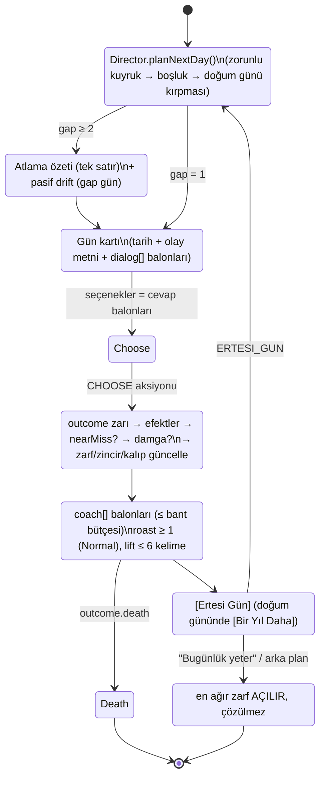

# 03 — Olay Motoru, İçerik Şeması, Gün Director'ü ve Dopamin Algoritmaları (GÜN tabanlı)

> **Belge türü:** Ayrıntılı tasarım dokümanı (00 §5 satır 03). Bu belge olay motorunu (storylet + salience + director), olay JSON şemasını (`dialog[]`, `pattern`, `wager`, `document`, `universality`, `intent/tr/en/review`), **Gün Director'ünü** (D-061), İddia servisini, pity / near-miss / zarf motorlarını, Kalıp Dedektörü'nün sayısal omurgasını, zincirleri, deterministik RNG'yi, içerik hacmi matematiğini ve 10.000 hayat harness'ını **sahiplenir**. Koç satırlarının metni 01'e, stat/hazard/ölüm formülleri 02'ye, NPC ses kuralları 04'e, bildirim kopyası 05'e, balon/damga/EFSANE/ANNE ARIYOR çizimi 07'ye, lint kodu 08'e, i18n hattı 09'a, motor paketi 10'a aittir.
> **Durum:** v1.0 · 2026-11-06 · Yazar: Olay motoru tasarımcısı · Hiyerarşi: 00 (§12 > §11) > T9 > T4/T11 > T7/T1 > konseptler (A4 çerçeve + A1 DNA).
> **Okuma kuralı:** Bu belge **00 §12'yi (D-061..D-065) uygular**: zaman birimi GÜN'dür, her gösterilen günde tam bir olay olur, karakterler diyalogda konuşur, koç diyalogdan sonra ayrı katmanda yorumlar. 00 §4.1'deki "yıl = 3–4 beat" ölçeği ve 02 §2.1'in beat bütçesi bu belgeyle **geçersizdir** (bkz. §7.3 çelişki listesi).

---

## 0. Künye — uygulanan D-kararları, bağımlı dokümanlar, sürüm

### 0.1 00 §5'in 03 satırı ve bu belgenin dokunduğu diğer kararlar → somut tasarım öğesi

| Karar | Bu belgede nerede | Nasıl (tek satır) |
|---|---|---|
| **D-009** İddia Defteri | §2.6 `WagerService` | Yalnızca `playerChose && 0,35 ≤ pEff ≤ 0,65`; koç **her zaman oyuncuya karşı** tahmin eder; `wager` kanalı `outcome` kanalından ayrı → sonucu asla etkilemez; 10 gösterilen günde ≤ 2, ardışık iddialar arası ≥ 3 gün, yılda ≤ 2; harness isabeti %50–62. |
| **D-011** Zarf | §2.8 `EnvelopeQueue` | Her doğum günü ve her oturum sonunda açık zarf ∈ [1, 2]; zarfın vadesi **takvim günü**; oturum sonu sezilince en ağır zarf `opened=true` olur, çözücü olay bir sonraki oturumun 1.–2. gününe zorunlu kuyrukla girer; bildirim `teaserKey`'den türer (05). |
| **D-013** Tercüme kartı | §2.2.6 `type:'document'` | `document.translate` iki locale'de dolu + `glossaryKey`; havuz payı lint ile ≤ %15; director aynı oturumda ≤ 3 evrak günü. |
| **D-024** Kalıp Dedektörü | §2.9 | Her seçenekte opsiyonel `pattern` (12 nötr `PatternId`); motor yalnızca **sayar**; Roast Raporu girdisi `{top3, positive, chronic}`; sıfat yok, sayı var. |
| **D-044** Determinizm + harness | §2.11, §6 | sfc32, seed = `cyrb128(lifeSeed:dayIndex:kanal)`; 9 kanal; aynı seed + aynı aksiyon dizisi = bit-bit aynı hayat; 10.000 hayat CI'da §6.2 eşikleriyle release'i bloklar. |
| **D-045** Olay başına tek JSON | §2.2 | `intent` + `tr` + `en` + `review` + `universality` + `pattern` + `wager?` + `document?` + **`dialog[]`** (D-062 ekidir); zod şeması tek doğruluk kaynağı (`packages/content/schema/event.ts`). |
| **D-061** Zaman birimi GÜN | §2.1, §2.3 | `dayIndex` (gösterilen gün sayacı) + `calendarDay` (takvim); yaş bandına göre gösterilen gün/yıl 12–18 / 8–12 / 5–8 / 3–5; atlanan günler tek satır özetle geçer; doğum günü = yıl sınırı = zorunlu `report_card`. |
| **D-062** Karakterler konuşur | §2.2.3 | `dialog[]` = `{speaker, avatar, tr, en}`; `speaker` 8 Tanıdık Yüz + durumsal NPC; oyuncunun seçeneği `you` balonu olarak akışa yazılır; koç `coach[]` ayrı katman, diyalog içinde **asla** konuşmaz. |
| **D-063** Şov standardı | §2.5, §2.7, §2.3.9 | Motor `effects` ile tetikler: `legendary` (altın çerçeve), `momCall` (ANNE ARIYOR baskını), `minigame` (göz teması), `stamp`; çizim 07'de. |
| **D-064** Roast dozu | §2.2.5, §5 | Normal/Acımasız'da her `outcome.coach[]` içinde ≥ 1 `roast:true` satır (lint BLOK); Nazik'te `gentle` varyantı; Düşük Keyif'te roast filtresi (D-052). |
| **D-065** Benchmark aktarımları | §2.2.4, §2.3.7 | 2 seçenekli günlerde `swipeable:true` (Reigns); **Günün Günü** tarih-seed'li paylaşılan olay (Wordle); Alter Ego "sen yokken" = atlama özeti dili. |
| D-017 / D-018 | §2.2.3, §2.2.2 | `speaker` referansları `npcs[].roleId`'ye bağlanır; `pre.meta.baggageEventId` ile Fazla Bagaj callback olayı; hafıza `metaLogRef` zorunlu (uydurma yok). |
| D-023 | §2.4 | Aktif Tek Hedef'in etiketini taşıyan olay ×1,5 salience; doğum gününde hedef iddiası kapanır. |
| D-027 / D-028 | §2.2.5 | `coach[]` satır bütçesi yaş bandına göre ≤ 2 / ≤ 2 / ≤ 2 (çoğu 1) / ≤ 1; lift ≤ 6 kelime (01 lint'i). |
| D-050 / D-012 | §2.3.7, §2.11 | Motor gerçek saati **okumaz**; Günün Günü için `RESUME.localDay` aksiyon yüküyle gelir. |
| D-033 / D-034 | §2.2.4 | Efektlerde para "Birim" (reel), yüzde yok; metinde makro rakam yok (08 lint). |
| D-039 | §2.2.4 | `choices[].tactic:true` = Taktik Değişikliği'nin 3. seçeneği; motor `ad-opportunity` yayar, UI süzer. |
| D-007 | §2.11 | `phase ∈ {dead, roast}` iken hiçbir `ad-opportunity`; ölüm günü zorunlu kuyruğu boşaltır. |

### 0.2 Bağımlı dokümanlar (arayüz sözleşmeleri)

- **Girdi aldığım:** 00 (tümü; §12 önceliklidir), T4 (storylet/salience/director/şema/RNG), T11 (3a pity, 3b near-miss, 3c eğri, 3h novelty, 3l pending-outcome, §4.3 harness), T7 ve T1 (TL;DR: zarf → bildirim, "bir tur daha" üçlü hedef), T9 (§5 ASLA/DİKKATLİ), 02 (stat/metre adları, hazard, ölüm akışı; **yıl/beat zaman modeli hariç**), 10 (`LifeState`, `step()`, `Effect`, `PatternId`, RNG kanalları), 12 (benchmark kararları).
- **Çıktı verdiğim:** 04 (`speaker`/`avatar` sözlüğü ve NPC ses kuralı lint kancası), 05 (zarf `teaserKey` → bildirim; Günün Günü paylaşım kartı), 07 (`Effect` → `JuiceEvent`: `stamp`, `legendary`, `momCall`, `minigame`, `skipDivider`, `birthday`), 08 (şema kaynaklı 14 lint kuralı, §2.2.9), 09 (`intent/tr/en/review` blok sözleşmesi), 10 (`engine/select`, `engine/director`, `engine/wager`, `engine/reward`, `engine/envelope`, `engine/pattern`, `engine/chain` modül sınırları; `LifeState` alan değişiklikleri §7.3), 11 (gün/oturum KPI'ları).

### 0.3 Sürüm

v1.0 — 2026-11-06. Değişiklik yalnızca 00'a yeni D-kaydı eklenerek yapılır; bu belgedeki D-ÖNERİ'ler (§7.3) onaylanana kadar "uygulanacak varsayım"dır.

---

## 1. Amaç ve kapsam — MVP (dikey kesit) / Soft launch / 1.0

**Amaç:** 18'den ölüme, her gösterilen günde tam bir olay oynatan; karakterleri konuşturan; koçu diyalogdan sonra konuşturan; sana karşı iddiaya giren; iyi sürprizi pity ile garanti eden; kaybı dürüst çerçeveleyen; her oturumu açık bir zarfla bitiren ve bunların hepsini 10.000 sentetik hayatla kanıtlayan **deterministik bir olay motoru**. Oyuncunun cümlesi: *"Bugün ne olacak?"* — her "Ertesi Gün" basışı bir merak boşluğudur (S3).

| Alt sistem | MVP (10 hafta) | Soft launch (+8 hafta) | 1.0 |
|---|---|---|---|
| Gün döngüsü + takvim | Tam (§2.1); FTUE ilk 3 gün elle yazılı; Hızlı Yaşa 36+ varsayılan açık | Hızlı Yaşa oyuncu ayarı | aynı |
| Şema + zod + build | Tam; `dialog[]`, `document`, `call`, `minigame`, `report_card` | + `shared` (Günün Günü) havuzu 30 | + Kader kişiliği `voicePool` anahtarı |
| Gün Director'ü | Bütçe, boşluk dağılımı, atlama özeti, valans koruması, doğum günü, zorunlu kuyruk, oturum eğrisi | + Günün Günü, mini-oyun günleri (2 tür), mom-call tam | + efsane kadans ayarı veriyle, sezon takvimi kancası (05) |
| Salience | Tam formül | aynı | aynı |
| WagerService | Tam (anlık + hedef iddiası) | + zincir iddiası (çözümü ileride) | aynı |
| Pity / near-miss / zarf | Pity + zarf tam; near-miss **iskelet** (metin varyantı olmadan `loss`) | near-miss tam | aynı |
| Kalıp Dedektörü | 12 kalıp sayacı + Roast girdisi + motto hücresi | + Kronik (3 hayat) | + ömürler arası kümülatif sayfa |
| Zincirler | 12 zincir (ortalama 3 düğüm) | 25 | 40 (ortalama 4 düğüm) |
| İçerik (locale başına) | 80 olay günü + 40 atlama satırı + 4 efsane + 3 anne araması + 2 mini-oyun | ≈ 500 olay günü | ≈ 900 olay günü + 40 zincir (≈ 160 düğüm) |
| Harness | 10.000 hayat, §6.2 eşiklerinin ilk 12'si | tüm eşikler + oturum simülasyonu | + persona-gerçek sapma raporu (11) |

**Kapsam dışı (yeniden açılmaz):** serbest aksiyon menüsü (T4 §3.1'deki "İş / İlişkiler / Sağlık" menüsü yoktur — gün = olay, olay = seçenekler), enerji, aylık alt-tur (günler zaten vardır; hastalık/askerlik arkları takvim günleriyle yazılır), Ink runtime (opsiyonel bile değil: diyalog `dialog[]` ile yeter), sunucu taraflı herhangi bir şey.

---

## 2. Tasarım

### 2.1 Gün döngüsü: tek gün = tek olay

Hayat Akışı bir takvimdir. Her kart tarihli bir gündür: *"Gün 112 · Çarşamba, 14 Ocak 2032"*. İki sayaç birlikte yürür: **`dayIndex`** (0'dan başlayan, yalnızca *gösterilen* günleri sayan monoton sayaç — seed, pity, cooldown, oturum ölçümü bunun üstünde çalışır) ve **`calendarDay`** (18. doğum gününden itibaren geçen takvim günü — tarih, mevsim, doğum günü, zarf vadesi, zincir gecikmesi bunun üstünde çalışır). Takvim kozmetiktir: oyuncunun gerçek tarihine, saatine, konumuna bağlanmaz (D-050); FTUE takvimi 2026'da başlar, karakterin doğum günü `names` kanalından çekilir.



Kurallar: (1) **Olaysız gün gösterilmez**; director her gösterilen güne bir olay bulamazsa (havuz tükendi) `sys_sessiz_gun` dolgu olayı değil, **daha uzun atlama** üretir — "11 gün geçti. Hiçbir şey olmadı; bu da bir olay." / "Eleven days. Nothing happened. Which counts." (2) Doğum günü günü her zaman gösterilir ve olayı `report_card`'dır. (3) Ölüm hangi gün gelirse o gün son gösterilen gündür; karne yok, Roast Raporu var (02 §2.5). (4) Oturum içi gün sayacı `sessionDayIndex` `RESUME` ile (≥ 30 dk ara) sıfırlanır.

### 2.2 İçerik şeması

#### 2.2.1 TypeScript sözleşmesi (zod'dan `z.infer` ile türetilir; burada okunabilir hâli)

```ts
// packages/content/schema/event.ts  — tek doğruluk kaynağı; motor ContentBundle olarak alır
export type EventType = 'event' | 'document' | 'call' | 'minigame' | 'report_card';
export type Rarity = 'common' | 'uncommon' | 'rare' | 'legendary';     // base weight 1 / 0.5 / 0.2 / (yalnızca efsane zarıyla)
export type Valence = -2 | -1 | 0 | 1 | 2;
export type Universality = 'universal' | 'localizedShell' | 'localeOnly';
export type SpeakerId =
  | 'mom' | 'roommate' | 'boss' | 'ex' | 'neighbor' | 'uncle' | 'cat' | 'cabbie'           // 8 Tanıdık Yüz (D-017)
  | `npc:${'courier'|'boilerTech'|'landlord'|'hr'|'doctor'|'clerk'|'stranger'}`         // durumsal NPC (04 sözlüğü)
  | 'you';                                                                                // yalnızca motor üretir (cevap balonu)
export type Avatar = 'neutral' | 'worried' | 'annoyed' | 'happy' | 'smug' | 'tired' | 'typing';
export type PatternId = 'procrastination'|'avoidance'|'impulseSpend'|'peoplePleasing'|'risk'|'selfCare'
  |'overwork'|'leanOnFamily'|'shortcut'|'pride'|'generosity'|'patience';                // 12 nötr kalıp (D-024; 10 ile aynı)

export interface L { tr: string; en: string }                                            // iki locale, ayrı yazılır (09)

export interface DialogLine {
  speaker: Exclude<SpeakerId, 'you'>;
  avatar?: Avatar;
  tr: string; en: string;                                                                // NPC ses kuralı 04 lint'i: mom ≤ 8 kelime + '?', roommate CAPS, ex ≤ 3 kelime, cat 1 kelime
  when?: Pre;                                                                            // koşullu satır (ör. momPressure ≥ 60 ise ek satır)
  alt?: L[];                                                                             // en az görülen alternatif gerçekleştirme (varyant)
  delayMs?: number;                                                                      // comic timing; UI "yazıyor…" (07)
}

export interface Choice {
  id: string;
  tr: string; en: string;                                                                // buton bütçesi TR 18 / EN 16 karakter (08)
  pattern?: PatternId;                                                                   // görünmez etiket (D-024)
  requires?: Pre;                                                                        // kilitli ama görünür (gri + hint)
  hint?: L;
  check?: { base: number; stat?: 'health'|'joy'|'brain'|'charm'|'ego'|'cringe'; goal?: string; skill?: boolean };
  // check = olasılıklı sonuç; base ∈ (0,1); stat ile gerilim normalizasyonu (§2.6.2); goal = near-miss/pendingBonus anahtarı; skill = mini-oyun (iddia dışı)
  tactic?: boolean;                                                                      // Taktik Değişikliği 3. seçenek (D-039); günde 2 → UI süzer
  swipe?: 'left' | 'right';                                                              // 2 seçenekli günde Reigns kaydırması (D-065)
}

export interface Outcome {
  p?: number;                                                                            // branch olasılığı; tek outcome → 1
  luckScaled?: boolean;                                                                  // Şans ±%10 (02)
  effects?: Effects;
  tr: string; en: string;                                                                // sonuç metni (sistem balonu, koç değil)
  nearMiss?: L;                                                                          // yalnızca check'li fail dalında; "gerçekten yakındı" metni (§2.7)
  coach: CoachLine[];                                                                    // ≥ 1 roast (Normal/Brutal) — lint D-064
}

export interface Effects {
  stats?: Partial<Record<'health'|'joy'|'brain'|'charm', number>>;
  meters?: Partial<Record<'ego'|'cringe'|'momPressure', number>>;
  hidden?: Partial<Record<'luck'|'stress', number>>;
  money?: number;                                                                        // Birim (reel; UI ×1.000 basar) — "+3", "-0.3"
  flags?: { add?: string[]; remove?: string[] };
  npc?: Array<{ role: Exclude<SpeakerId,'you'>; affinity?: number; memory?: string; create?: boolean; kill?: boolean }>;
  career?: { set?: string; rungDelta?: number; fire?: boolean };
  housing?: 'momsHouse'|'room'|'flat'|'wide'|'mortgage'|'owned';
  followUp?: Array<{ eventId: string; delayDays: [number, number]; chance?: number; forced?: boolean }>;   // takvim günü
  envelope?: { teaserKey: string; dueDays: [number, number]; weight: number; resolverEventId: string };     // D-011
  chainNext?: string;                                                                    // zincir düğümü geçişi (§2.10)
  diagnosis?: string;                                                                    // Teşhis anahtarı (05)
  glossary?: string;                                                                     // Sözlük anahtarı (D-013)
  death?: { cause: string };                                                             // senaryo ölümü (02 §2.5 kanalı)
  notebook?: { kind: 'note'; key: string };                                              // Koçun Defteri Not (hayat başına ≤ 12; 01)
}

export interface CoachLine {
  tr: string; en: string;
  roast: boolean;                                                                        // D-064 kotası bu bayraktan sayılır
  lift?: boolean;                                                                        // ≤ 6 kelime; yalnızca oyun içi seçim önerir (D-027)
  level?: Array<'gentle'|'normal'|'brutal'>;                                             // yoksa hepsi; brutal uzun varyant
  when?: Pre;
}

export interface GameEvent {
  id: string; v: number; type: EventType;
  tags: string[];                                                                        // 'para','aile','kariyer:kurye','kis','surprise.nice','wow','lol','relax'
  rarity: Rarity; weight?: number;
  valence: Valence; intensity: number;                                                   // 0..1 oturum eğrisi için
  isLOL?: boolean; wow?: boolean; relax?: boolean;
  universality: Universality; substituteFor?: string;                                   // localeOnly ikame çifti (D-048)
  shared?: boolean;                                                                      // Günün Günü havuzu (gevşek ön koşul şartı: lint)
  cooldownDays?: { self?: number; tags?: Record<string, number> };                      // gösterilen gün cinsinden
  maxPerLife?: number; exclusiveGroup?: string; salienceBonus?: number;
  pre: Pre;
  ageBand?: Array<'warmup'|'season'|'secondHalf'|'overtime'>;                            // tembel yükleme anahtarı (§4)
  chain?: { id: string; node: string; next?: Array<{ node: string; delayDays: [number, number]; when?: Pre }> };
  dialog?: DialogLine[];                                                                 // D-062; koç burada yoktur
  text?: Array<{ id: string; when?: Pre; tr: string; en: string }>;                     // anlatı metni varyantları (diyalogsuz veya ek)
  document?: { letterhead: L; body: L; translate: { tr: {from: string; to: string}; en: {from: string; to: string} }; glossaryKey: string };
  call?: { speaker: 'mom' | 'uncle' | 'boss' | 'ex'; takeover: boolean };               // ANNE ARIYOR (D-063) yalnızca mom + takeover:true
  minigame?: { kind: 'eyeContact' | 'timing'; green: number; bonus: number; check: string };   // check = choice.id; iddia dışı
  choices: Choice[];                                                                     // 2–4
  outcomes: Record<string, Outcome | Outcome[]>;                                         // choice.id → dal(lar); Σp = 1 ± 0,001
  wager?: { eligible: boolean; check?: string; slip?: L; reason?: string };             // slip yoksa 01 havuzu; eligible:false + reason = yazar notu
  intent: { setup: string; mechanism: string; punch: string; lift: string; target: 'decision'|'situation'|'coach'|'npc' };
  review: { status: 'draft'|'curated'|'linted'|'punched'|'approved'; funnyTr?: 1|2|3|4|5; funnyEn?: 1|2|3|4|5; legal: 'ok'|'review'; needsReview?: string[]; cultureNote?: string };
}

export type Pre = {                                                                      // tüm anahtarlar AND; all/any/none ile birleşim
  all?: Pre[]; any?: Pre[]; none?: Pre[];
  age?: { min?: number; max?: number };
  stats?: Partial<Record<'health'|'joy'|'brain'|'charm', { min?: number; max?: number }>>;
  meters?: Partial<Record<'ego'|'cringe'|'momPressure', { min?: number; max?: number }>>;
  hidden?: Partial<Record<'luck'|'stress', { min?: number; max?: number }>>;
  money?: { min?: number; max?: number };
  flags?: { all?: string[]; any?: string[]; none?: string[] };
  career?: { anyOf?: string[]; minRung?: number; employed?: boolean };
  housing?: string[];
  npc?: Partial<Record<Exclude<SpeakerId,'you'>, { alive?: boolean; exists?: boolean; minAffinity?: number; maxAffinity?: number; memoryHas?: string[]; memoryNone?: string[] }>>;
  goal?: { anyOf?: string[]; active?: boolean };
  season?: Array<'winter'|'spring'|'summer'|'autumn'>;                                   // calendarDay → mevsim
  chain?: { id: string; nodeDone?: string[]; nodeNotDone?: string[] };
  pattern?: Partial<Record<PatternId, { min?: number; max?: number }>>;                 // "Erteleme ≥ 40 ise bu olay"
  wagerOpen?: boolean; envelopeOpen?: boolean;
  meta?: { livesMin?: number; baggageEventId?: string; pastFlags?: string[]; familiarityMin?: number };
  expr?: string;                                                                         // jsep güvenli ifade; nadir; lint uyarır
};
```

**Zod notları:** her `L` için iki locale zorunlu (eksik → BLOK); `outcomes` anahtarları `choices[].id` ile bire bir; `check` olmayan seçeneğin `outcomes` dalı tek ve `p` yok; `nearMiss` yalnızca `check`'li seçeneğin `p < 1` dalında; `call.takeover` yalnızca `speaker:'mom'`; `minigame.check` bir `choice.id` ve o seçenekte `check.skill:true`; `shared:true` ise `pre` yalnızca `age` içerebilir; `rarity:'legendary'` ise `valence ≥ 0` ve `effects.death` yok; `type:'report_card'` yalnızca `sys_report_card` id'sinde.

#### 2.2.2 Ön koşul DSL'i ve spesifiklik

Spesifiklik = yaprak koşul sayısı (`all/any/none` düğümleri sayılmaz; `any` içindeki yapraklar 0,5 sayılır). Lint: `expr` kullanan olaylar `review.needsReview` alır; `meta.*` koşulları **yalnızca** `metaLog`'da gerçekten yazılabilecek anahtarlardan (08 sözlüğü) seçilir. Ölü-içerik testi (§6.2) hiç tetiklenmeyen `pre`'yi raporlar.

#### 2.2.3 `dialog[]` ve konuşmacı referansları (D-062)

- `speaker` 8 Tanıdık Yüz'den biriyse motor `npcs[]`'de o `roleId`'nin **var ve hayatta** olmasını ön koşul olarak otomatik ekler (yazar yazmaz, lint ekler; "ölmüş anne arıyor" sınıfı hata derleme düzeyinde yok).
- Her satırın `avatar`'ı 07'nin ifade setine eşlenir; yoksa `neutral`.
- Oyuncunun seçeneği `you` balonu olarak akışa yazılır: *"Sen: Yedim anne."* / *"You: I ate, Mom."* Buton metni = balon metni (tek kaynak).
- **Koç diyalogda yoktur.** `coach[]` outcome'dan sonra, ayrı görsel katmanda gelir (düdük ikonu + Fraunces italik; 07). NPC koça cevap vermez, koç NPC'ye hitap etmez; koç yalnızca oyuncuya ve kendine konuşur (S1).
- NPC ses kuralları (04 sahibi, 08 lint'i): Anne ≤ 8 kelime, soru işareti oranı ≥ %50; Barış/Jordan BÜYÜK HARF ve "KESİN/SURE THING" sözcüğü; Nevin Hanım/Ms. Carver İK sözlüğü ("hizalanma/alignment", "görünürlük/visibility"); Yağmur/Sam ≤ 3 kelime; Pamuk/Biscuit tek kelime; Şükran Teyze/Mrs. Dale "kızım/oğlum" yerine cinsiyetsiz "canım/dear" + komşu gözlemi; Dayı/uncle 2009 referansı; Taksici/cab driver trafik + hayat felsefesi.

#### 2.2.4 Seçenekler, `pattern`, swipe, tactic

2–4 seçenek; ≥ 1 seçenekte `pattern` zorunlu (lint UYARI: hiçbiri yoksa Kalıp Dedektörü o günü sayamaz); aynı olayda aynı `pattern` iki seçenekte olamaz. 2 seçenekli günlerde `swipe` zorunlu (sola/sağa kaydırma = cevap; buton da kalır). `tactic:true` seçenek yalnızca rewarded ile görünür; **önceden işaretli değildir**, gri değildir, "Üçüncü bir yol var" etiketiyle kapalı gelir (D-039/D-055).

#### 2.2.5 `coach[]` kotası (D-064, D-027, D-028)

| Yaş bandı | Balon tavanı | Roast zorunluluğu (Normal) | Lift |
|---|---|---|---|
| 18–25 | ≤ 2 | ≥ 1 `roast:true` | 3 günde ≥ 1 |
| 26–40 | ≤ 2 | ≥ 1 | 3 günde ≥ 1 |
| 41–60 | ≤ 2, medyan 1 | ≥ 1 (kısa) | 5 günde ≥ 1 |
| 60+ | ≤ 1 | ≥ 1 ya da `witness` | 5 günde ≥ 1 |

Nazik'te `level:['gentle']` varyantı seçilir; yoksa `roast:false` satır. Düşük Keyif (02: Keyif < 25) → tüm `roast:true` satırlar filtrelenir, `lift` ve `plain` kalır (D-052). Motor satır seçmez; `coach[]` adaylarını `textKey` listesi olarak döner, 01'in seçim fonksiyonu (least-recently-viewed + cooldown) uygular.

#### 2.2.6 `document` tipi (D-013)

Antetli kart; `translate.from` kurumsal cümle, `translate.to` "ne demek istiyor". İki locale'de `translate` dolu ve `glossaryKey` eşleşir (08 lint). `document` günleri `dialog[]` taşıyabilir (ör. evrakı getiren kurye) ama zorunlu değildir. Havuz payı ≤ %15; director aynı oturumda ≤ 3 evrak günü (`tags: ['evrak']` cooldown 4 gün).

#### 2.2.7 Metin varyantları ve novelty

`text[]` ve `dialog[].alt[]` en az görülen gerçekleştirme ile seçilir (Yarn RBLRV). Sık olaylarda (common) `text` ≥ 3, uncommon ≥ 2, rare/legendary ≥ 1 (lint). Varyant sayacı `reward.seenCount[textVariantId]` hayat içi, `legacy.seenLives[textVariantId]` hayatlar arası.

#### 2.2.8 `intent` / `tr` / `en` / `review` blokları (D-045, 09)

`intent` dilden bağımsız şaka spesifikasyonudur (setup / mekanizma / punch / lift / hedef); TR ve EN **ayrı** yazılır, EN yazarı TR'yi görmez (süreç 09'da). `review.status < 'linted'` olan olay build'e girmez; `legal:'review'` release'i bloklar (D-047). `cultureNote` `localizedShell` ve `localeOnly` olaylarda zorunlu.

#### 2.2.9 Şemadan türeyen lint kuralları (08'e devredilir)

| # | Kural | Seviye |
|---|---|---|
| L03-01 | Her `Outcome.coach[]` içinde Normal/Brutal için ≥ 1 `roast:true` | BLOK |
| L03-02 | `coach[]` içinde `speaker` alanı yok; `dialog[]` içinde `speaker:'you'` yok | BLOK |
| L03-03 | `document` payı havuzun ≤ %15'i (locale başına) | BLOK |
| L03-04 | `check.base` ∈ [0,05, 0,95]; `wager.eligible:true` ise `check` var ve `skill` yok | BLOK |
| L03-05 | `nearMiss` yalnızca fail dalında; `check.goal` zorunlu | BLOK |
| L03-06 | `rarity:'legendary'` → `valence ≥ 0`, `wow:true`, `death` yok | BLOK |
| L03-07 | `shared:true` → `pre` yalnızca `age`; `universality:'universal'` | BLOK |
| L03-08 | `call.takeover` yalnızca `mom`; `momPressure` etkisi ≤ 0 olan ≥ 1 seçenek | BLOK |
| L03-09 | `pattern` aynı olayda tekrar etmez; ≥ 1 seçenekte var | BLOK / UYARI |
| L03-10 | `followUp.delayDays[1] ≤ 1500`; hedef `eventId` sözlükte | BLOK |
| L03-11 | `envelope.resolverEventId` var ve `pre`'si zarfın açılma koşulunu içerir (`envelopeOpen:true`) | BLOK |
| L03-12 | `valence ≤ -1` olayda ≥ 1 seçenek `joy ≥ 0` veya `diagnosis`/`glossary` üretir (umut kapısı) | BLOK |
| L03-13 | Tek outcome |stat delta| ≤ 25; money ∈ [−10, +10] Birim (legendary ≤ +25) | BLOK |
| L03-14 | 3-gram benzerliği > 0,6 iki olay metni | UYARI |

### 2.3 Gün Director'ü

#### 2.3.1 Yıllık gösterilen gün bütçesi (D-061)

Bütçe doğum gününde (`AGE` reducer'ı) `director` kanalıyla çekilir; doğum günü kartı bütçeye **dahildir** (yılın son gösterilen günü).

| Yaş bandı (koç adı) | Gösterilen gün / yıl | Ortalama takvim boşluğu | Yıl sayısı (medyan ömür 74) | Gösterilen gün toplamı |
|---|---|---|---|---|
| 18–25 "Isınma" | 12–18 (medyan 15) | ~24 gün | 8 | 120 |
| 26–40 "Sezon" | 8–12 (10) | ~36 gün | 15 | 150 |
| 41–60 "İkinci devre" | 5–8 (6,5) | ~56 gün | 20 | 130 |
| 61+ "Uzatmalar" | 3–5 (4) | ~91 gün | 14 | 56 |
| **Toplam** | | | **57** | **≈ 456 (+ MVP dışı düzeltmelerle 450–600)** |

Düzeltmeler (toplam tavan bant maksimumu + 2): Stres > 70 → +1; aktif zincir (açık düğümü olan) → +1; `fastLife` (36+ MVP varsayılan; oyuncu ayarı) → bant minimumu ve atlama özeti otomatik 1,2 sn; Anne Baskısı ≥ 75 iken bir mom-call günü bütçe dışı eklenir (bkz. §2.3.8). 12 sn/gün çapasıyla 456–560 gün ≈ 91–112 dk; harness hedefi 450–600 gün ve 90–120 dk (§6.2).

#### 2.3.2 Boşluk (gap) dağılımı ve kendini düzelten takvim

Director tarihleri önceden planlamaz; her gösterilen günün sonunda **bir sonraki gösterilen güne kaç takvim günü** olduğunu çeker:

```ts
function drawGap(st: LifeState, rng: RNG): number {
  const daysToBirthday = st.calendar.birthdayDay - st.calendar.day;         // ≥ 1
  const remaining = Math.max(1, st.director.yearBudget - st.director.shownThisYear);  // doğum günü dahil
  const mean = Math.max(1, daysToBirthday / remaining);
  const noise = Math.exp(gauss(rng) * 0.45);                                 // log-normal, σ = 0,45 → boşluklar "hayat gibi" düzensiz
  let gap = Math.round(mean * noise);
  gap = clamp(gap, 1, daysToBirthday);
  const due = earliestDue(st);                                               // zorunlu kuyruk (§2.3.5)
  if (due && due.day - st.calendar.day < gap) gap = Math.max(1, due.day - st.calendar.day);
  if (st.director.momCallPending) gap = 1;                                   // ANNE ARIYOR ertesi gün gelir
  return gap;
}
```

`mean` her adımda kalan gün / kalan bütçe olduğundan yıl sonunda bütçe tutturulur; zorunlu kuyruk boşluğu kısaltır ama bütçeyi aşmaz (forced olaylar bütçeden düşer; bütçe biterse kalan forced olaylar doğum gününden sonraki ilk günlere kayar — doğum günü asla ötelenmez).

#### 2.3.3 Atlama özeti üretimi

`gap ≥ 2` ise akışa ince bir ayraç yazılır: **tek satır, ≤ 14 kelime, en fazla bir sayı, roast yok, kimlik yok.** Seçim: kova × bağlam etiketi × en az görülen.

| Kova (takvim günü) | Bağlam etiketleri (önceliğe göre ilk eşleşen) | TR örnek | EN örnek |
|---|---|---|---|
| 2–3 | `default` | "İki gün geçti. Fark eden olmadı." | "Two days passed. Nobody noticed." |
| 4–10 | `employed`, `unemployed`, `momHigh`, `goalActive`, `default` | "Bir hafta. Mesai, uyku, mesai. Anne 2 kez aradı." | "A week. Work, sleep, work. Mom called twice." |
| 11–30 | aynı + `winter`, `summer`, `envelopeOpen` | "11 gün geçti. Hiçbir şey olmadı; bu da bir olay." | "Eleven days. Nothing happened. Which counts." |
| 31–90 | `secondHalf`, `overtime`, `retired` | "Bir mevsim. Aynı yol, aynı dönüş. Kedi bir kilo aldı." | "A season. Same road, same turn. The cat gained a pound." |
| 91+ | `overtime` | "Üç ay. Günler kısaldı; sen değil." | "Three months. The days got shorter. You didn't." |

Pasif güncellemeler atlanan gün sayısıyla orantılı uygulanır (02 §2.1'in yıllık pulse'ı günlük orana bölünür: gelir–gider, stat drift, Stres decay, Anne Baskısı artışı, Cringe decay); hazard zarı yalnızca **doğum gününde** atılır (02 kuralı: hazard karneden önce). Atlama satırında NPC adı geçebilir ama diyalog yoktur; sayı varsa gerçektir (`momCalls` sayacından gelir). Havuz: MVP 40 satır, 1.0 200 satır (locale başına); kova başına ≥ 8 varyant (lint).

#### 2.3.4 Oturum yoğunluk eğrisi (15–25 gün)

`expectedSessionDays` = son 5 oturumun medyanı (ilk oturumda 20). Hedef yoğunluk T11 3c eğrisi, `t = sessionDayIndex / expectedSessionDays`:

```
target(t) = t < 0.15 ? 0.25 + 2t : t < 0.75 ? 0.55 + 0.6(t − 0.15) : t < 0.85 ? 0.95 : 0.45
```

Adaylar `curveFit = max(0.2, 1 − 0.8·|intensity − target|)` çarpanı alır. Her 10. gösterilen gün `relax` etiketli aday ×1,5, `intensity > 0,4` adaylar ×0,5 (Royal Match nefesi). LOL aralığı: `beatsSinceLol ≥ 6` → `isLOL` ×1,5; `≥ 10` ve havuzda LOL varsa LOL olmayan ×0,7 (hedef medyan LOL aralığı 6–10 gün ≈ 1,5–2 dk). Oturum sonu sezgisi: `t ≥ 0,85` **veya** son 3 günün ortalama süresi ×1,8 yavaşladı **veya** `SESSION_END` aksiyonu → en ağır zarf açılır (§2.8). `wow` bütçesi oturum başına 3 (efsane + LOL + twist).

#### 2.3.5 Zorunlu kuyruk ve öncelik

`dueQueue` öğeleri (takvim günü vadeli): (1) ölüm sonrası akış (02), (2) `report_card` (doğum günü), (3) mom-call, (4) zarf çözücü olay (`opened` olanlar önce), (5) zincir düğümü (`chain.next.delayDays` vadesi), (6) `followUp.forced`, (7) bailout / Fizyoterapi teklifi (02 kancaları), (8) Günün Günü, (9) `followUp` şanslı. Aynı güne iki öğe düşerse öncelik sırası; kaybeden ertesi gösterilen güne kayar. **Valans koruması forced öğeyi de bağlar:** `negStreak ≥ 2` iken vadesi gelen `valence < 0` forced olay 1 gösterilen gün ötelenir ve araya `valence ≥ 0` serbest gün girer (en fazla 1 öteleme; ikinci kez ötelenmez — Valve dersi: scripted track sonsuza kadar bastırılmaz).

#### 2.3.6 Valans koruması ve Düşük Keyif

`negStreak ≥ 2` → serbest adaylardan `valence < 0` olanlar elenir (harness: maks. negatif seri ≤ 2). `negStreak == 1` → `valence < 0` ×0,45. Keyif < 25 (02 "Düşük") → `valence ≤ -1` ×0,5, `tags: selfCare|relax|wholesome` ×1,5, roast filtresi (D-052), "Gerçek hayatta yardım" ekranı 08'in kuralıyla ayrı. Ölüm, hastalık, ayrılık günlerinde (`tags: silence`) koç `silence` kuralını uygular (01).

#### 2.3.7 Günün Günü (D-065, Wordle)

Gerçek takvim günü başına bir kez, aynı locale'deki herkes aynı olayı aynı zarla yaşar. `RESUME.localDay` ile gelen tarihten seed: `cyrb128('day:' + localDay + ':' + locale + ':' + contentHash)`; havuz `shared:true` (MVP 10, soft 30, 1.0 60). Yerleşim: o günkü ilk oturumun **ikinci** gösterilen günü (ilk gün zarf/forced içindir); forced çakışırsa sonraki serbest slot; oturum 2 günü geçmezse ertesi güne devretmez (o günün günü kaçar, ceza yok). Sonuç zarı `daily` kanalından (tarih seed'li) → aynı seçenek = aynı sonuç → paylaşım kartı "GÜNÜN GÜNÜ · 14 Ocak" + emoji sonuç satırı + seçenek harfi (spoiler yok). Kural: `shared` olaylar gerçek tarih/bayram/anma içeriği taşımaz; tarih yalnızca seed'dir (§5). Günün Günü iddia açabilir (herkes aynı oranı görür — kart "Koç herkese karşı: %45" satırı taşır).

#### 2.3.8 ANNE ARIYOR baskını (D-063)

Tetik (kenar tetiklemeli): `momPressure` ≥ 75'e **yukarı** geçiş **veya** 20 gösterilen gündür ≥ 75 ve son aramadan ≥ 40 gösterilen gün geçti; anne hayatta; cooldown 40 gösterilen gün; hayat başına ≤ 6; ilk 10 gösterilen günde (FTUE) yok. Ertesi takvim günü (`gap = 1`) `type:'call'` olay gelir; UI tam ekran çağrı baskını (07; asla OS çağrı arayüzünü taklit etmez — §4). Her mom-call'da `momPressure`'ı düşüren ≥ 1 seçenek vardır (L03-08); "Açma" seçeneği `momPressure +10`, Teşhis yolu "Okundu Bırakan" (05).

#### 2.3.9 Mini-oyun günleri (D-063)

`type:'minigame'`; oturum başına ≤ 1, aralarında ≥ 15 gösterilen gün, yalnızca `check`'li bir seçenek varsa. Mini-oyun (göz teması: iğne yeşil bölgeye girerse) sonucu **belirlemez**, olasılığı `+bonus` (varsayılan +0,15) kaydırır; ekran bunu önceden yazar ("Yeşilde bırakırsan +%15"). Beceri payı olduğundan `WagerService` bu günleri dışlar (koç "beceriye karşı iddiaya girmem; şansa girerim" — 01). Reduced-motion / erişilebilirlik modunda mini-oyun atlanır ve `base + bonus/2` uygulanır (cezasız).

#### 2.3.10 Doğum günü = `report_card` (zorunlu, yılın son günü)

`sys_report_card` üretilmiş olaydır: girdileri 02 (6 not), 03 (hedef damgası TAMAM/YARIM/ERTELENDİ, Yılın Mottosu hücresi, iddia skoru, zarf satırı, Onyıl Karnesi kancası 30/40/50/60 → 05), metni 01/09. Sırası sabit: hedef iddiası kapanır (damga) → notlar → motto → koç notu (1) → zarf satırı → **Tek Hedef** (3 öneri + Hedefsiz + "Aynı hedef") → yeni hedef iddiası açılır → **[Bir Yıl Daha]**. Zarf sayısı < 1 ise doğum günü bir zarf açar (§2.8). Doğum gününde başka olay oynanmaz; mom-call ve zincir vadesi ertesi güne kayar.

#### 2.3.11 `planNextDay` (bütün hâliyle)

```
function planNextDay(st, content):
  rngD = rng('director'), rngB = rng('beats'), rngS = rng('surprise')
  gap = drawGap(st, rngD)                                   // §2.3.2 (forced/birthday/momCall kırpması dahil)
  applySkip(st, gap)                                         // pasif drift + atlama özeti (gap ≥ 2)
  st.calendar.day += gap; st.dayIndex += 1; st.sessionDayIndex += 1
  if st.calendar.day == st.calendar.birthdayDay: return play('sys_report_card')
  forced = dueQueue(st).filter(d => d.day <= st.calendar.day).sortBy(priority)
  if forced.nonEmpty and not (negStreak >= 2 and forced[0].valence < 0 and !forced[0].deferredOnce): return play(forced[0])
  if dailyPending(st) and st.sessionDayIndex >= 2: return play(dailyEvent(st))          // §2.3.7
  if rollLegendary(st, rngS): return play(pickLegendary(st, rngB))                     // §2.5.2
  tier = rollSurprise(st, rngS)                                                          // §2.5.1 pity
  pool = tier ? candidates(st).filter(e => e.tags.has('surprise.'+tier)) : candidates(st)
  if pool.empty: pool = candidates(st)                                                   // sürpriz havuzu boşsa normal gün (pity sayacı sıfırlanmaz)
  return play(weightedPick(pool, salience, rngB))                                        // §2.4
```

### 2.4 Salience skorlaması

```
score(e) = rarityW(e) × (1 + 0,35 · specificity(e)) × novelty(e) × recency(e) × curveFit(e)
         × goalBoost(e) × arcBoost(e) × valenceMult(e) × moodMult(e) × lolMult(e) × relaxMult(e) × wowBudget(e)

rarityW     = {common 1, uncommon 0,5, rare 0,2} × (weight ?? 1)      // legendary bu yoldan gelmez
specificity = yaprak koşul sayısı + salienceBonus
novelty     = seen==0 ? 1,6 : 0,55^seen ; son 2 hayatta görüldüyse ×0,3 ; taban 0,02
recency     = Π_tags ( daysSince(tag) < cooldownDays(tag) ? 0 : min(1, daysSince(tag)/40) )   // self cooldown → 0
curveFit    = max(0,2, 1 − 0,8·|intensity − target(t)|)
goalBoost   = e.tags ∩ activeGoal.tags ≠ ∅ ? 1,5 : 1                   // D-023
arcBoost    = e.chain && chainActive(e.chain.id) ? 1,3 : 1              // zincirin serbest (vadesiz) düğümleri
valenceMult = negStreak>=2 && valence<0 ? 0 : negStreak==1 && valence<0 ? 0,45 : 1
moodMult    = joy<25 ? (valence<=-1 ? 0,5 : selfCareTag ? 1,5 : 1) : 1
lolMult     = beatsSinceLol>=6 && isLOL ? 1,5 : beatsSinceLol>=10 && !isLOL && lolAvailable ? 0,7 : 1
relaxMult   = dayIndex%10==0 ? (relax ? 1,5 : intensity>0,4 ? 0,5 : 1) : 1
wowBudget   = wow && wowCount>=3 ? 0 : 1
```

**İşlenmiş örnek.** Gün 112, yaş 24, kariyer kurye (rung 1), kira (`housing:'flat'`), Anne Baskısı 62, Keyif 48, aktif hedef "5.000 biriktir" (`tags: para`), son iki gün valans −1, −1 (`negStreak = 2`), mevsim kış, oturumun 9. günü (`t = 0,45 → target = 0,73`), `beatsSinceLol = 7`, `wowCount = 1`.

| Aday | spec | rarity | valence | intensity | novelty | curveFit | diğer çarpanlar | **skor** |
|---|---|---|---|---|---|---|---|---|
| `evt_kira_zammi` (kiracı + yaş≥19) | 2 | 1 | −1 | 0,5 | 1,6 | 0,82 | valenceMult **0** | **0** (elendi) |
| `evt_baris_kesin_plan_01` (ev arkadaşı var + para≥1 + yaş≤30) | 3 | 1 | 0 | 0,6 | 1,6 | 0,90 | goalBoost 1,5 (para), lolMult 1,5 | 1×2,05×1,6×0,90×1,5×1,5 = **6,64** |
| `evt_kombi_ustasi_kis` (kış + kiracı) | 2 | 0,5 | −1 | 0,7 | 1,6 | 0,98 | valenceMult **0** | **0** |
| `evt_sukran_teyze_borek` (komşu var) | 1 | 1 | +1 | 0,2 | 0,55 (1 kez görüldü) | 0,58 | relax değil (gün 112 ≠ %10) | 1×1,35×0,55×0,58 = **0,43** |
| `evt_kurye_yanlis_adres` (kariyer kurye + rung≤2 + kış) | 3 | 1 | 0 | 0,5 | 1,6 | 0,82 | goalBoost 1 | 1×2,05×1,6×0,82 = **2,69** |

Ağırlıklı örnekleme: Barış %68, kurye %28, börek %4. İki negatif günden sonra sistem "nefes" veriyor; aktif hedefe bağlı olay öne çıkıyor; görülmüş börek geride. Kira zammı ve kombi yarın yine adaydır (cooldown değil, koruma). "Oyun beni tanıyor" hissi: spesifiklik 3 olan kurye olayı, jenerik börek olayını 6 katla geçti.

### 2.5 İyi sürpriz (pity) ve efsane gün

#### 2.5.1 Pity'li iyi sürpriz (T11 3a; birim = gösterilen gün)

| Sabit | Değer | Not |
|---|---|---|
| `SURPRISE_BASE_P` | 0,08 / gün | |
| `SOFT_PITY` / `HARD_PITY` | 8 / 14 gün | 14 gün ≈ 3 dk; oturum başına ≥ 1 sürpriz garantisi |
| `RAMP_STEP` | 0,12 | 9. gün 0,20, 12. gün 0,56, 14. gün 1 |
| `MIN_GAP` / `SESSION_CAP` | 3 / 6 | enflasyon freni |
| `TIME_GUARANTEE` | 6 dk gerçek süre | `clock.playTimeMs` farkından; motor duvar saatini okumaz |
| tier dağılımı | nice %75 / great %25 ± Şans ×0,3 | Şans **sıklığı değil büyüklüğü** etkiler |

Sürpriz = `tags: surprise.nice|great` havuzundan salience ile seçilen gün (para olmak zorunda değil: eski dost, viral an, koçun "lehine" notu). Juice 07'de (nice: pop; great: renk dalgası). İlk hayatın ilk 3 günü elle yazılı FTUE'dir; pity sayacı 4. günde başlar, ilk sürpriz ≤ 14. günde ≤ 3 dk içinde gelir.

#### 2.5.2 Efsane gün kadansı (D-063 EFSANE OLAY)

`LEGENDARY_BASE_P` 0,004/gün, soft pity 90, hard pity 140 gösterilen gün, rampa 0,02, oturum başına ≤ 1, hayatın ilk 10 gününde yok. Beklenen: ≈ 4 efsane gün / 500 günlük hayat (≈ 25 dk'da bir), en geç 140 günde bir. Havuz `rarity:'legendary'`: valans ≥ 0 ya da net kazanımlı absürt; ölüm yok; `wow:true`; altın çerçeve + konfeti + koç avatarı "shock" (07). Efsane günler Şans'tan etkilenmez (adalet: herkes aynı kadansı görür). Efsane gün iddia açabilir (nadir; "Koç şaşkın" fişi).

#### 2.5.3 Sürpriz bütçesi

`wow` etiketi (efsane, LOL-twist, "sistem lehine hata") oturumda ≤ 3; aşım → `wowBudget = 0`. Harness: p95 sürpriz aralığı ≤ 14 gün, medyan 6–9; efsane/hayat 2–6.

### 2.6 `WagerService` — İddia Defteri (D-009)

#### 2.6.1 Yaşam döngüsü

```mermaid
stateDiagram-v2
    [*] --> Screen: gün planlandı, event.wager.eligible
    Screen --> Skip: playerChose yok ∨ skill ∨ pEff ∉ [0,35; 0,65]\n∨ gap<3 gün ∨ 10 günde 2 ∨ yılda 2 ∨ Nazik'te yılda 1
    Screen --> Open: koşullar sağlandı
    Open: Sarı fiş iğnelenir\n"İDDİA: {prediction}. — M."  pOdds gizli, [Oranı göster] ile görünür
    Open --> Resolved: CHOOSE → outcome zarı (outcome kanalı)
    Resolved --> CalledIt: tahmin tuttu → İSABET damgası + gerçek oran
    Resolved --> IWasWrong: tahmin tutmadı → HAKSIZ ÇIKTIM (Heavy + mürekkep) + damga varyantı 0..11
    CalledIt --> Notebook
    IWasWrong --> Notebook
    Notebook: Defter İddia girdisi + sayaçlar (wagersTotal, coachHits)\nkarne "Koçun isabeti: %"
    Notebook --> [*]
    Skip --> [*]
```



#### 2.6.2 Uygunluk, gerilim normalizasyonu, tahmin

```ts
const C_W = { P_MIN: 0.35, P_MAX: 0.65, MIN_GAP_DAYS: 3, PER_10_DAYS: 2, PER_YEAR: 2, PER_YEAR_GENTLE: 1, K_STAT: 0.15 };

function pEff(check: Check, st: LifeState): number {                 // T11 3d gerilim normalizasyonu
  const s = check.stat ? st.stats[check.stat] ?? st.meters[check.stat] : 50;
  let p = check.base + C_W.K_STAT * (s - 50) / 50;                   // stat 80 → +0,09; stat 20 → −0,09
  p += st.reward.pendingBonus[check.goal ?? ''] ?? 0;                 // near-miss sözü (§2.7)
  return clamp(p, 0.05, 0.95);
}

function screen(ev: GameEvent, ch: Choice, st: LifeState): WagerOffer | null {
  if (!ev.wager?.eligible || !ch.check || ch.check.skill) return null;
  const p = pEff(ch.check, st);
  if (p < C_W.P_MIN || p > C_W.P_MAX) return null;
  const w = st.wagerLog;
  if (st.dayIndex - w.lastDay < C_W.MIN_GAP_DAYS) return null;
  if (w.last10Days >= C_W.PER_10_DAYS) return null;
  if (w.thisYear >= (st.voice === 'gentle' ? C_W.PER_YEAR_GENTLE : C_W.PER_YEAR)) return null;
  return { eventId: ev.id, choiceId: ch.id, prediction: 'fail', pOdds: p };   // koç DAİMA oyuncuya karşı
}
// Çözüm: outcome zarı rng('outcome'); iddia kararı rng('wager') — iki akış birbirini okumaz.
// Değişmez (10 §2.3.3): WagerService kapalı ikiz hayat, stat yolunda bit-bit eşit.
```

**Neden daima "karşı":** marka vaadi "sana karşı iddiaya girer, yanılırsa damga basar"dır (00 §0.3). İsabet oranı = E[1 − pEff]. Yazarlık kuralı: iddiaya uygun `check.base` değerleri medyanı **0,45** olacak şekilde yazılır (lint raporu havuz medyanını basar) → beklenen isabet ≈ %55; harness kabulü %50–62. Oran dışına kayarsa önce havuz medyanı, sonra `K_STAT` ayarlanır; koç **asla** zara dokunmaz.

#### 2.6.3 İddia türleri

| Tür | Açılış | Çözüm | Örnek fiş TR / EN |
|---|---|---|---|
| Anlık | `check`'li seçenekli gün | Aynı gün, outcome zarıyla | "İDDİA: Bu para Mart'ı görmez. — M." / "WAGER: This money doesn't see March. — M." |
| Hedef | Doğum günü, Tek Hedef seçilince (D-023); band dışıysa bile açılır ama **oran yazılmaz** ("tutmaz", oran yerine "ben bilirim") — hayır: yazılır; hedef olasılığı `goalTracker` tahmini 0,35–0,65'e normalize edilmezse iddia açılmaz | Sonraki doğum günü (damga TAMAM→HAKSIZ ÇIKTIM; YARIM/ERTELENDİ→İSABET) | "Deftere niyet yazdın. İddia: tutmaz. Kalemle." / "You wrote an intention. Wager: it won't hold. In pen." |
| Zincir | Zincir düğümünde `check` (soft launch) | Düğümün çözüldüğü gün | "İddia: listede adın olmaz." / "Wager: your name's not on the list." |
| Günün Günü | `shared` olayda | Aynı gün, `daily` kanalı | "Koç herkese karşı: %45." / "Coach vs. everyone: 45%." |

Tek Hedef iddiası yılda ≤ 2 kotasına **dahil değildir** (ayrı sayaç; yılda tam 1). "Oranı göster" dokunuşu `cosmetic` kanalı değil, `pEff`'in kendisini gösterir (dürüstlük: gösterilen oran = atılan zar eşiği).

### 2.7 Dürüst near-miss (T11 3b)

```ts
const C_NM = { WINDOW: 0.15, MAX_RATE: 0.30, SESSION_CAP: 2, GOAL_COOLDOWN_DAYS: 40, BONUS: 0.10 };
function frame(r: {success: boolean; margin: number; goal?: string; playerChose: boolean}, st): 'win'|'nearMiss'|'loss' {
  if (r.success) return 'win';
  const nm = st.reward.nearMiss;
  const ok = r.playerChose && r.goal && Math.abs(r.margin) <= C_NM.WINDOW && nm.sessionCount < C_NM.SESSION_CAP
          && st.dayIndex - (nm.lastDayByGoal[r.goal] ?? -999) >= C_NM.GOAL_COOLDOWN_DAYS
          && nm.count / Math.max(1, nm.failCount) < C_NM.MAX_RATE;
  if (!ok) return 'loss';
  nm.count++; nm.sessionCount++; nm.lastDayByGoal[r.goal] = st.dayIndex;
  st.reward.pendingBonus[r.goal] = C_NM.BONUS;             // bir sonraki aynı-goal check'te gerçekten uygulanır, sonra silinir
  return 'nearMiss';
}
```

Near-miss `outcome.nearMiss` metnini gösterir (yoksa `loss` metni, çerçeve yine `nearMiss` sayılmaz). Koç satırı dürüst ipucu taşır ve ipucu doğrudur: *"Gelecek sefer aynı kapı; ben not ettim: +%10."* / *"Same door next time; I wrote it down: +10%."* Near-miss'e bağlı hiçbir reklam/ödeme seçeneği yoktur (D-039, D-055); Taktik Değişikliği near-miss gününde **gösterilmez**.

### 2.8 Zarf kuyruğu (D-011, T11 3l)

```ts
interface Envelope { id: string; createdDay: number; dueDay: number /*takvim*/; teaserKey: string; weight: number; sourceEventId: string; resolverEventId: string; opened: boolean; resolved: boolean }
const C_E = { MIN_OPEN: 1, MAX_OPEN: 2, DUE_DAYS: [7, 45], TEASER_SHOWN: 1 };

function onBirthdayOrSessionEnd(st, rng, reason) {
  let open = st.envelopes.filter(e => !e.resolved);
  while (open.length < C_E.MIN_OPEN) open.push(spawnOpener(st, rng));          // sys zarf havuzu: 'patron_oda', 'tahlil', 'eski_mesaj', 'gizemli_mektup' (çözücüleri yazılı)
  if (open.length > C_E.MAX_OPEN) open.sort((a,b)=>b.weight-a.weight).slice(C_E.MAX_OPEN).forEach(e => e.resolved = true);  // sessizce düşer, teaser'ı hiç gösterilmediyse
  if (reason === 'sessionEnd') { const heavy = open.sort((a,b)=>b.weight-a.weight)[0]; heavy.opened = true; enqueueForced(heavy.resolverEventId, nextSessionSlot(1..2)); }
  st.ui.teaser = open.slice(0, C_E.TEASER_SHOWN).map(e => e.teaserKey);
}
```

Zarf **olay efektiyle** doğar (`effects.envelope`); vadesi takvim günüyle (7–45) yazılır ve director boşluğu kırpar, böylece zarf ≤ 6 gösterilen günde çözülür. Teaser kısmidir (Loewenstein): *"Zarf: Nevin Hanım seni odasına çağıracak."* / *"Envelope: Ms. Carver wants you in her office."* — ne için, belirsiz. Oturum sonunda açılan zarf ikinci teaser satırını gösterir (*"Konu: 'kadro'."* / *"Subject: 'headcount.'"*) ama çözücü olay bir sonraki oturumda oynanır. Bildirim kopyası `teaserKey`'den türer (05); zarf yoksa bildirim yoktur (sahte aciliyet yok).

### 2.9 Kalıp Dedektörü → Roast Raporu (D-024)

Motor her `CHOOSE`'da `patterns[choice.pattern] += 1` yapar; başka hiçbir şey yapmaz (yargı yok, stat etkisi yok). Türevler:

```ts
interface PatternReport {
  lifeChoices: number;                                          // kalıp taşıyan seçim sayısı
  top3: Array<{ id: PatternId; count: number; share: number }>; // share = count / lifeChoices
  positive: { id: 'generosity'|'patience'|'selfCare'; count: number };   // Koçun Son Sözü için en yüksek
  yearCell: { dominant: PatternId; netValence: -1|0|1 };        // Yılın Mottosu 36 hücre (12 × 3) — metin 01/09
  chronic?: PatternId;                                          // 3 hayatta aynı #1 (legacy.patternRanks)
  cumulative: Record<PatternId, number>;                        // ömürler arası toplam (Kronik sayfası; "1.204" buradan)
}
```

Sayılar **hayat başına** okunur (Roast Raporu: "Erteleme: 142 seçim (%31)"); ömürler arası toplam yalnızca Kronik sayfasında ("Üç hayatta 1.204 kez"). `netValence` = yılın gösterilen günlerinde `valence` toplamının işareti. Nazik'te `top3 → top2`. Hiçbir kalıp adı klinik terimle örtüşmez (08 sözlüğü); köprü cümlesi tek kez (01). Teşhis bağlantısı: 05 `patterns` sayaçlarını okur, 03 yazmaz.

### 2.10 Zincirler (günler ve yıllar boyunca)

Zincir = `chain.id` paylaşan düğümler; geçiş `effects.chainNext` ya da `chain.next[].delayDays` (takvim) ile; düğümler forced kuyrukla gelir; zincir durumu `chains[id] = {node, startedDay, done[]}`. Aynı gün iki zincir başlamaz (`exclusiveGroup`). Aktif zincir yıllık bütçeye +1 verir (§2.3.1). Üç tam ark:

**Ark A — "Terfi Listesi / The Promotion List" (kariyer, ~14 ay, 4 düğüm, iddia + near-miss + evrak):**

```mermaid
stateDiagram-v2
    [*] --> A1
    A1: A1 Nevin Hanım "hizalanma"\n(dialog; seçenek: görünür ol / zam iste / iş ara)
    A1 --> A2: 60–120 gün
    A2: A2 Evrak: "Yetenek Havuzu Bilgilendirmesi"\n(document + Tercüme: "Listedesin. Liste uzun.")
    A2 --> A3: 90–200 gün
    A3: A3 Liste açıklandı (check 0,45; iddia uygun;\nfail → near-miss "ikinciydin")
    A3 --> A4: 180–365 gün
    A3 --> A4b: success
    A4: A4 "Öncelikli etiket" yılı: tekrar check (+0,10 pendingBonus)
    A4b: A4b Terfi: unvan değişti, iş aynı → Ego +10, maaş +
    A4 --> [*]
    A4b --> [*]
```

**Ark B — "Rehberdeki İsim / The Name in Your Contacts" (Yağmur/Sam, 3–9 yıl, 5 düğüm, hayatlar arası):** B1 ayrılık (silence günü; Keyif −20; zarf: "bir mesaj gelecek") → B2 mesaj "Düğün var. Cumartesi." (365–1.100 gün sonra; 3 kelime kuralı) → B3 düğün günü (Cringe check; Fazla Bagaj adayı) → B4 "LinkedIn'de gördün" (18 ay; `pre.meta` yok) → B5 **sonraki hayatta** `pre.meta.pastFlags:['yagmur_terk_edildi']` ise ilk replik değişir: *"Rehberde bir isim var. Sen eklememiştin."* / *"There's a name in your contacts. You didn't add it."* (D-017; `metaLogRef` zorunlu).

**Ark C — "Kesin / Sure Thing" (Barış/Jordan, ~2 yıl, 4 düğüm, para + anne + efsane olasılığı):** C1 "KESİN" teklif (örnek gün §3.2) → C2 60–90 gün: ilk sipariş geldi/gelmedi (check 0,40) → C3 Anne öğrendi (`momPressure ≥ 50` ise call, değilse dialog) → C4 kapanış: battı (Cringe +, Teşhis "Ortak") **veya** `rarity:'legendary'` dal: viral oldu (efsane zarıyla değil, C2 success ∧ Şans > 0,7 ∧ efsane bütçesi varsa; ≈ %8) → Barış: "DEMİŞTİM." Zincir sonunda Barış hafızası `memory:'kesin_plan_{sonuç}'` → 2. hayatta "bu sefer dropshipping değil, SAUNA" callback'i.

### 2.11 RNG kanalları ve determinizm (D-044)

```ts
export type RngChannel = 'beats'|'outcome'|'hazard'|'names'|'wager'|'director'|'surprise'|'cosmetic'|'cohort'|'daily';
export function seedFor(lifeSeed: string, dayIndex: number, ch: RngChannel): RngChannelState {
  return cyrb128(`${lifeSeed}:${dayIndex}:${ch}`);      // HER gösterilen günün başında her kanal yeniden türetilir
}
// daily kanalı tek istisna: cyrb128('day:'+localDay+':'+locale+':'+contentHash) — herkes aynı zar
```

Kurallar: (1) `Math.random` motorda lint hatası; `cosmetic` yalnızca UI'da (konfeti açısı) ve testte sabit. (2) `beats` olay seçer, `outcome` zar atar, `wager` iddia kararını verir, `director` boşluk/bütçe, `surprise` pity/efsane, `hazard` yalnızca doğum günü, `names` doğum günü tarihi + NPC adları, `cohort` 40 hayali kohort (05), `daily` Günün Günü. Bir kanalın tüketimi diğerini kaydırmaz → "Oranı göster", "Taktik Değişikliği" ve geri dönülemez UI kararları sonuçları değiştirmez. (3) Save = `{ lifeSeed, dayIndex, calendar, rng[ch], state }`; gün ortasında kesinti → aynı gün aynı olay, aynı zar (snapshot testi). (4) `contentHash` seed'e girer: içerik güncellemesi eski Kamp skorlarını "v{N}" rozetiyle işaretler (10). (5) Tüm aritmetik 32-bit tam sayı ve `>>> 0`; float yalnızca `[0,1)` bölmede; platform farkı yok (§4). (6) Harness replay: `MTT-XXXX-XXXX` kodu + aksiyon dizisi = aynı hayat.

### 2.12 İçerik hacmi (gün tabanlı) ve tekrar matematiği

| İçerik (locale başına) | MVP | Soft launch | 1.0 |
|---|---|---|---|
| Olay günü (standalone; × text varyantı 3/2/1) | 80 | 500 | 900 |
| Zincir / düğüm | 12 / ~36 (80'e dahil) | 25 / ~90 | 40 / ~160 (900'e ek) |
| Diyaloglu gün payı | ≥ %50 | ≥ %60 | ≥ %60 |
| `document` | ≤ 12 (%15) | ≤ 75 | ≤ 135 |
| `call` (anne + dayı/patron/eski) | 3 + 0 | 8 + 4 | 12 + 8 |
| `minigame` | 2 | 6 | 10 |
| `legendary` | 4 | 12 | 24 |
| `shared` (Günün Günü) | 10 | 30 | 60 |
| Atlama özeti satırı | 40 | 120 | 200 |
| Zarf açıcı / çözücü çifti (sys) | 6 | 12 | 20 |
| Sürpriz havuzu (nice/great) | 12 / 6 | 50 / 20 | 90 / 36 |

**Tekrar matematiği.** Hayat başına gösterilen gün D ≈ 500 (doğum günü 57 ve forced'lar hariç serbest gün ≈ 400). Düzgün rastgele seçimde görülen farklı olay ≈ N·(1 − e^(−D/N)):

| Havuz N (olay) | Varyantlı N' (×2,5) | 1 hayatta farklı olay | Tekrar (olay düzeyi, 1 hayat) | 3 hayatta tekrar (varyant düzeyi, düzgün) | Novelty ağırlıklı (sim tahmini) |
|---|---|---|---|---|---|
| 80 (MVP; MVP hayatı ≈ 300 gün, 36+ Hızlı Yaşa) | 200 | 78 | %74 → **MVP'de tekrar bilinçli kabul**, metrik koç satırı tekrarı | — | %45 (varyant) |
| 500 | 1.250 | 276 | %31 | %39 | %14 |
| 900 (+160 düğüm) | 2.650 | 349 | %13 | %27 | **%9** |
| 1.500 | 3.750 | 378 | %5 | %18 | %5 |

Üç düzeltme: yaş bandı havuzları efektif N'i küçültür (kötüleştirir), `novelty` (görülmemiş ×1,6, görülmüş 0,55^n, hayatlar arası ×0,3) ve `cooldownDays.self` tek hayat tekrarını neredeyse sıfırlar (iyileştirir), varyant rotasyonu tekrarı "farklı" hissettirir. **Metrik tanımı (D-ÖNERİ-03-10):** tekrar = aynı `textVariantId`'nin ilk 3 hayatta ikinci kez görülmesi / toplam gösterilen gün; hedef 1.0'da < %15 (D-044), soft launch'ta < %25, MVP'de koç satırı "3+ kez" < %2 (00 KPI) tek bağlayıcı eşik. Bant başına havuz dağılımı 1.0'da: 18–25 %38, 26–40 %32, 41–60 %20, 61+ %10 (gün bütçesiyle orantılı).

