# 04 — Kariyer, Eğitim, İlişkiler, Tanıdık Yüzler (sesleriyle) ve Varlıklar

> **Belge türü:** Ayrıntılı tasarım dokümanı (00 §5 satır 04). Bu belge **durum modelini** (D-067: İş / Ev / İlişki / Varlıklar şeridi ve nakit akışı takvimi), **eğitim yollarını**, **24 kariyeri** (basamak, Para bandı, terfi kuralı, olay kancaları; 1/3 absürt, "Hayat Koçu" dahil), **NPC hafıza modelini** (`memories`, `metaMemories`, `{mem:…}` yer tutucuları), **8 Tanıdık Yüz'ü** (biyografi + ses kitabı + örnek replik + hayatlar arası hafıza), **durumsal NPC kadrosunu**, **flört / evlilik / çocuk modelini**, **Aile Grubu okunmamış sayacını**, **varlık merdivenini** (kira, ev sahibi, satın alma, araç, borç, evcil hayvan) ve **Tek Hedef kütüphanesini** (40 hedef) **sahiplenir**. Koç satırlarının metni 01'e, stat/Birim/hazard formülleri 02'ye, olay şeması ve director 03'e, Kondisyon/Teşhis/bildirim 05'e, balon çizimi 07'ye, lint kodu 08'e, i18n hattı 09'a, motor tipleri 10'a aittir.
> **Durum:** v1.0 · 2026-11-06 · Yazar: Kariyer/İlişki sistem tasarımcısı · Girdi: 00 (tümü; §12 önceliklidir), T4 (tam), T3/T9/T10 (TL;DR), A1–A4 konseptleri (Tanıdık Yüzler, Aile Grubu, Tek Hedef örnekleri), 02/03/05/10 dokümanlarının arayüz satırları.
> **Hiyerarşi:** 00 > T9 > T-dokümanları > konseptler. Bu belge D-kararlarını yeniden tartışmaz, uygular; eksik kaldığı yerde **D-ÖNERİ-04-xx** ile karar verir (§7).

---

## 0. Künye — uygulanan D-kararları, bağımlı dokümanlar, sürüm

### 0.1 Uygulanan D-kararları (00 §5 satır 04 + §12)

| Karar | Nerede | Bu belgede nasıl uygulandı |
|---|---|---|
| **D-014** Aile Grubu sohbet ekranı yok; "Okunmamış" sayacı + yılların ~%40'ında 1 kart + "Görüldü, cevap yok" | §2.8 | `family.unread` monoton sayaç (hiç sıfırlanmaz; formül §2.8.1), yılda 1 `tags:['aile_grubu']` kartı (director kotası ~%40 yıl), her kartta sabit üçüncü seçenek **"Görüldü, cevap yok"** → Anne Baskısı +2, Teşhis "Okundu Bırakan" sayacı +1 |
| **D-017** Tanıdık Yüzler: 8 kalıcı NPC `metaMemories` taşır; hafıza yalnızca `metaLog`'dan; MVP 8 × 3, 1.0 8 × 6 | §2.4, §2.5 | `metaMemories[]` yalnızca `legacy.unlockMeta()` ile ve `metaLogRef` zorunlu alanla yazılır; her Tanıdık Yüz için 3 (MVP) / 6 (1.0) `lineKey` tablosu §2.5; uydurma hafıza tip düzeyinde imkânsız |
| **D-023** Tek Hedef: 3 öneri + "Hedefsiz yaşa"; hedef olayları ×1,5; TAMAM/YARIM/ERTELENDİ; ceza yok; koç iddia açar | §2.10 | 40 hedeflik kütüphane: `tracker` yüklemi (0/1/2 → ERTELENDİ/YARIM/TAMAM), `tags` (03 salience), yaş bandı, öneri filtresi `suggest()`; "Aynı hedef" tek dokunuş (Sabır +1) |
| **D-036** FTUE adları Deniz Ertelemez / Alex Tomorrow; Eski Sevgili **Yağmur ↔ Sam** | §2.5.4 | Yağmur/Sam sabit ad, cinsiyetsiz; oyuncu adı havuzu "Deniz"i FTUE dışında da üretebilir ama Eski Sevgili asla "Deniz" değildir (çakışma lint'i) |
| **D-062** Karakterler konuşur; NPC'lerin kendi ses kuralları; koç diyalogdan sonra, karakterlerle konuşmaz | §2.5, §2.6, §2.11 | 8 ses kitabı + 7 durumsal NPC ses notu; her ses kuralı 08 için **lint yüklemi** olarak yazıldı (§2.11); koç `coach[]` katmanında, `dialog[]`'da **asla** |
| **D-067** Hayat kalıcı durumdur; Durum şeridi; Para akışla değişir | §2.1 | `LifeStatus` tipi (iş, ev, ilişki, varlıklar, eğitim) + **nakit akışı takvimi** (ayın 1'i maaş, 5'i kira, günlük küçük gider, kedi aylık); her olay `effects.status` ile kalıcı iz bırakır |
| **D-061 / D-066** Zaman birimi gün; zaman kendi akar | §2.2, §2.3 | Eğitim süreleri ve terfi bekleme süreleri **takvim günü** ile yazıldı (`calendarDay`); gösterilen gün sıkıştırması director'ün işi (03) |
| **D-033 / D-034** Para soyut Birim; makro rakam ve yüzde yok | §2.3, §2.9 | Kariyer basamakları doc 02 **kademeleri** (T0–T6) ile; kira, taksit, zam mutlak Para; "enflasyon/asgari ücret/TL/$" sözcükleri bu belgede ve kancalarda yok |
| **D-035** İsim üreteci: yaygın ad + bileşik soyadı; blocklist (gerçek kişi, küfür, ikonik karakter) | §2.5.0 | Tanıdık Yüz adları sabit ve locale başına ayrı; durumsal NPC'ler adsız (rol adı); flört adayları locale havuzundan cinsiyetsiz ad + bileşik soyadı |
| **D-042** Kondisyon çeşitlilik verir: "Transfer Listesi" (başlangıç kariyer ailesi), "Kedi" | §2.3.6, §2.9.5 | `careerFamily` seçim kartı yalnızca K-06 perk'iyle; Pamuk/Biscuit K-01 ile hayata **başta** gelir, aksi hâlde "kapıda kedi" olayıyla; iki yolda da kedi statlara dokunmaz |
| **D-018** Fazla Bagaj → 1 callback olayı | §2.4.4 | NPC callback olayları `pre.meta.baggageEventId` ile; Tanıdık Yüz'ün bagajı hatırlaması `metaMemories` üzerinden değil, bagaj olayı üzerinden (iki kanal karışmaz) |
| **D-024** 12 nötr kalıp; seçeneklerde `pattern` | §2.10, §3 | Tek Hedef'lerin her biri bir kalıpla "akraba"; örnek günlerdeki her seçenek `pattern` taşır |
| **D-027 / D-064 / D-028** Lift ≤ 6 kelime; Normal'de ≥ 1 roast; 60+ ≤ 1 balon | §3 | Örnek günlerin koç satırları bu kotalara göre yazıldı |
| **D-048** Locale-only ikame: askerlik ↔ student loans, KPSS ↔ government job exam | §2.2.3, §2.3 | Eğitim ve kariyer kancalarında ikame çiftleri `substituteFor` ile; "Kahve Falcısı ↔ Horoscope Columnist" yeni ikame çifti (D-ÖNERİ-04-04) |
| **D-013** Tercüme kartı: ev sahibi, İK, banka evrakları | §2.6, §2.9 | Ev sahibi zammı, İK "hizalanma" maili, banka kredi evrakı `type:'document'`; Sözlük anahtarları listelendi |
| **D-050 / D-052 / D-037** Gerçek hayata roast yok; düşük Keyif protokolü; 16+ | §2.7, §5 | Flört "kapı kapalı"; ayrılık ve NPC ölümünde sessizlik kuralı (01 tetik listesi); NPC repliklerinde oyuncunun gerçek hayatına tek gönderme yok |
| **D-051** Onyıl Karnesi yalnızca karar kalemleri (ev, iş) | §2.1 | `LifeStatus.housing` ve `employment` doğrudan doc 02'nin `DecadeReview.home/work` alanlarına eşlenir; ilişki/çocuk alanı karneye **gitmez** |
| **D-056 / D-057** "Çocukla devam" 1.0 sonrası; roguelike eşya yığını yok | §2.7.4, §2.9 | Çocuk NPC'leri bu hayatın içindedir, miras/ devam mekaniği yok; varlıklar motor-etkili "eşya" değil, durum alanıdır |
| **D-021 / D-032** İlişkiler karnesi = affinity ortalaması deltası; Anne Baskısı girdileri | §2.4.2, §2.8 | `relationshipsAvg()` doc 02'ye yıllık delta verir; Anne Baskısı'nın "Görüldü, cevap yok +2", "ev −30", "evlilik −30" girdileri burada tanımlı |

### 0.2 Bağımlı dokümanlar (arayüz)

| Doküman | Bu belge ona ne verir | Ondan ne alır |
|---|---|---|
| **02** Zaman/ekonomi | Kariyer → kademe eşlemesi; barınma kademesi değişimleri; `relationshipsAvg` deltası; Anne Baskısı girdileri; NPC `alive` bayrakları; `DecadeReview.home/work` | Birim, T0–T6 kademeleri, barınma giderleri, borç türleri, hazard (NPC ölümü için anne yaş eğrisi) |
| **03** Olay motoru | `SpeakerId` sözlüğü, NPC ses lint yüklemleri, `effects.status` alanı (D-ÖNERİ-04-01), kariyer/eğitim/ilişki olay kancaları (`tags`), Tek Hedef `tags` | `dialog[]`, `Pre.npc`, `Pre.career`, `Pre.goal`, zincir, director kotaları (aile kartı ~%40 yıl) |
| **05** Retention/miras | Tanıdık Yüz bildirim metinleri için ses kuralı; Teşhis tetikleri ("Okundu Bırakan", "Kedi Sahibi", "Ortak") | K-01 Kedi, K-06 Transfer Listesi perk'leri; Onyıl Karnesi ekranı |
| **01** Anlatıcı | NPC adları (locale başına), kariyer adları, "Hayat Koçu" rakip havuzu tetikleyicisi | Koç satır havuzları, sessizlik kuralı tetikleri |
| **07** UX/UI | Durum şeridi alanları ve metin bütçeleri; ANNE ARIYOR baskını için `call` tetik eşiği (Anne Baskısı ≥ 75) | Balon/avatar ifade seti (`Avatar` tipi), buton bütçesi |
| **08** Lint | §2.11 ses kuralı regex'leri; NPC red-line sözlükleri; isim çakışma kuralı (Yağmur ≠ oyuncu adı) | Yasaklı kelime listeleri |
| **09** i18n | Locale başına NPC ad havuzları; `substituteFor` çiftleri | `trInflect()` (`{npc:ex:name_e}` gibi çekimli yer tutucular) |
| **10** Mimari | `LifeStatus`, `Memory`, `MetaMemory` tip önerileri (§2.1, §2.4) | `Npc`, `Legacy.metaLog/metaMemories`, SQLite şeması |

### 0.3 Sürüm

v1.0 · 2026-11-06. Değişiklik yalnızca yeni D-kaydı ya da bu belgenin §7'sine eklenen D-ÖNERİ ile.

---

## 1. Amaç ve kapsam — MVP / Soft launch / 1.0

**Amaç.** Oyuncunun "çocuğun hayatı gerçekten değişiyor" (00 §12) demesini sağlayan üç şeyi tasarlamak: (1) bir **durum** (iş, ev, ilişki, varlık) ve o durumu gün gün değiştiren kararlar; (2) **konuşan ve hatırlayan** insanlar — sekiz tanesi ölümden sonra bile; (3) oyuncunun kendi koyduğu **tek hedef**. Bu belge "sayı" değil "iz" tasarlar: her kariyer basamağı, her evlilik, her kedi, her kefalet bir sonraki olayın ön koşuludur.

**Kapsam dışı (yeniden açılmaz):** serbest aksiyon menüsü (T4 §3.1 — gün = olay), BitLife tipi ilişki etkileşim menüsü ("konuş / hediye / kavga" butonları yok; ilişki yalnızca olaylarla değişir), roguelike eşya/bagaj dükkânı (D-057), "Çocukla devam" (D-056), suç/hapis arkı (T4 #23 kaldırıldı, §7), siyaset kariyeri (T4 #22 kaldırıldı, §7), gerçek kurum/okul/marka adı (T9), evcil hayvan çeşitliliği (MVP'de yalnızca kedi).

| Sistem | **MVP (dikey kesit)** | **Soft launch** | **1.0** |
|---|---|---|---|
| Durum modeli (D-067) | Tam: iş, ev, ilişki, varlık, eğitim alanları; nakit akışı takvimi; Durum şeridi | + "sen yokken" durum özeti (05 ile) | + Onyıl Karnesi'ne tam akış |
| Eğitim | 4 yol (bölüm, kurs, kamu sınavı, ehliyet) | + önlisans, lisansüstü | 9 yol tam (tıp, hukuk, pilot dahil) |
| Kariyer | **6 tam** (Garson/Şef, Kurye, Yazılımcı, Öğretmen, Kombi Ustası, **Hayat Koçu**) + 18 iskelet (basamak + Para bandı + 2 jenerik olay) | 12 tam / 12 iskelet (+ Memur, Hemşire, Emlakçı, Influencer, Düğün DJ'i, Kripto Gurusu) | 24 tam (her biri 8–15 kanca) |
| NPC hafızası | `memories` + `{mem:…}` yer tutucu + 3 callback olayı | `metaMemories` 8 × 4 | 8 × 6; meta-callback 150 (03 ile) |
| Tanıdık Yüzler | 8 NPC, her biri ≥ 10 replik + 3 meta satır | ≥ 20 replik + 4 meta | ≥ 40 replik + 6 meta; ANNE ARIYOR tam |
| Durumsal NPC | kurye, ev sahibi, İK, doktor | + kombi ustası, garson, bankacı | 7 + Kader kişiliği için memur sesi (01) |
| Flört / evlilik / çocuk | Flört zinciri (3 düğüm) + bekâr/ilişkide durumu; evlilik yok | Evlilik + ayrılık + boşanma; sessizlik kuralı | + çocuk (0–3), "veli toplantısı" aile kancaları |
| Aile Grubu | Sayaç + 6 kart + "Görüldü, cevap yok" | 12 kart + bayram ↔ holidays ikamesi | 20 kart |
| Varlıklar | Barınma 3 kademe (anne evi, oda, 1+1), telefon, kedi | + geniş kiracı, kredili ev, araç 2 kademe | Tam merdiven + kefalet + evcil hayvan ölümü |
| Tek Hedef | 20 hedef | 30 | 40 |

---

## 2. Tasarım

### 2.1 Durum modeli (D-067): hayat bir şerit, para bir takvim

#### 2.1.1 `LifeStatus`

Doc 10'un `Player` tipine eklenen (D-ÖNERİ-04-01) kalıcı durum. Olaylar bunu **değiştirir**; HUD'daki Durum şeridi bunu **okur**; doc 02 nakit akışını bundan **hesaplar**.

```ts
// packages/engine/src/status.ts — D-067'nin tip hâli; doc 10 LifeState.player içine taşınır
export type CareerId = /* §2.3 tablosundaki 24 id */ string;
export type HousingTier = 'momsHouse' | 'room' | 'flat' | 'wide' | 'mortgage' | 'owned';   // doc 02 §2.3.3 ile birebir
export type RelationshipStatus =
  | { kind: 'single' }
  | { kind: 'dating';   partnerNpcId: string; sinceDay: number }
  | { kind: 'married';  partnerNpcId: string; sinceDay: number }
  | { kind: 'divorced'; exNpcId: string; sinceDay: number };          // 'ex' rolü Yağmur/Sam'e devreder (§2.5.4)

export interface Employment {
  careerId: CareerId; rung: number;                 // 0-tabanlı basamak
  startedDay: number; rungSinceDay: number;         // calendarDay
  performance: number;                              // 0..1; işle etiketli seçimlerden türer (§2.3.4)
  bossNpcId: 'boss';                                // her kariyerde Nevin Hanım / Ms. Carver; unvanı aileye göre (§2.3.5)
  tier: 'T0'|'T1'|'T2'|'T3'|'T4'|'T5'|'T6';         // doc 02 kademesi; aylık gelir buradan
  volatile?: boolean;                               // Influencer, Kripto, Falcı: doc 02 lognormal
}

export interface LifeStatus {
  employment?: Employment;                          // yoksa işsiz / öğrenci / atama bekleyen (education.phase'e bakılır)
  education: { completed: EducationId[]; active?: { id: EducationId; startedDay: number; endsDay: number; paidMonthly: number } };
  housing: { tier: HousingTier; rent: number; sinceDay: number; landlordMood: 0|1|2 };   // rent Birim/ay; landlordMood zam zincirinin durumu
  relationship: RelationshipStatus;
  children: Array<{ npcId: string; bornDay: number }>;                                   // ≤ 3; §2.7.4
  assets: Array<{ id: AssetId; acquiredDay: number; monthlyCost: number; resaleValue?: number }>;  // §2.9
  debts: Array<{ kind: 'card'|'mortgage'|'cosign'|'family'; principal: number; monthly: number; toNpc?: string }>;  // doc 02 §2.3.4 kuralları
  family: { unread: number; lastCardDay: number; leftOnReadCount: number };             // §2.8
  pets: Array<{ npcId: 'cat'; sinceDay: number }>;                                      // MVP: yalnızca kedi
}
```

**Durum şeridi (07 çizer, bu belge içeriği verir).** Dört hücre, her biri ≤ 24 karakter TR / ≤ 22 EN:

| Hücre | Kaynak | TR örnek | EN örnek |
|---|---|---|---|
| **İş** | `employment.careerId + rung` → unvan; `tier` → aylık | Kurye · 1.000/ay | Courier · 1,000/mo |
| **Ev** | `housing.tier + rent` | Kira 850 · 1+1 | Rent 850 · 1-bed |
| **İlişki** | `relationship` | Yağmur · 3. yıl | Sam · year 3 |
| **Varlıklar** | `assets + pets` (ikon sırası: kedi, telefon, araç, ev) | Pamuk · telefon · bisiklet | Biscuit · phone · bike |

Boş hâller koç ağzında değil **sistem ağzında** yazılır (roast değil, durum): "İşsiz" / "Unemployed", "Anne evi" / "Mom's place", "Bekâr" / "Single", "—". Şerit hiçbir zaman nasihat vermez.

#### 2.1.2 Nakit akışı takvimi

Doc 02 Birim'i ve kademeleri tanımlar; bu belge **ne zaman** aktığını tanımlar. Motor `calendarDay`'i ilerletirken şu takvimi uygular (gösterilmeyen günler de dahil; D-061 "11 gün geçti" özeti bu akışı toplu uygular):

| Gün | Akış | Kural |
|---|---|---|
| Ayın 1'i | **Maaş** girer: `12 × tier × performanceMult / 12` → aylık | `performanceMult` 0,9–1,1; volatil kariyerlerde yıl başında çekilen `lognormal` 12'ye bölünür |
| Ayın 5'i | **Kira / taksit** çıkar: `housing.rent` + `debts[].monthly` | Bakiye yetmezse kart borcu oluşur (doc 02 ×1,18) ve `landlordMood` +1 (zincir §2.9.2) |
| Her gün | **Küçük gider**: `(lifestylePct × gelir) / 30` | Kalıp sayacına göre %10/15/35 (doc 02) |
| Ayın 15'i | **Kedi** 0,05 Birim; **araç** `monthlyCost`; **telefon** 0,02 | Varlıklar §2.9 |
| Ayın 20'si | **Eğitim** `paidMonthly` | Burslu ise 0 |
| Doğum günü | **Yıllık sürpriz gider** |N(0, 0,8)| (doc 02) | Olay kartı olarak gelir ("diş", "düğün takısı ↔ wedding gift") |

Gündelik satırlar (D-067 "olaysız gün") bu akıştan türer ve **koç değil sistem** sesiyle yazılır: TR *"Maaş yattı. Kira çıktı. Aradaki fark: 150."* / EN *"Payday. Rent day. The difference: 150."* Koç bu satıra yorum yapmaz (gün = olay değil).

#### 2.1.3 Durum değişimi kuralı

Her olay `effects.status` (D-ÖNERİ-04-01; doc 03 `Effects`'e eklenir) ile en az bir alanı değiştirebilir. **"Gerçek hayat gibi" ölçütü**: lint, `valence ≠ 0` olan her olayın outcome'larından en az birinin `effects.status`, `effects.npc.memory`, `effects.flags` ya da `effects.money` taşımasını zorunlu kılar (iz bırakmayan olay yok; AC-04-02).

```ts
export interface StatusEffect {
  employment?: { set?: { careerId: CareerId; rung?: number } | null; rungDelta?: number; performance?: number; fire?: true };
  housing?: { tier?: HousingTier; rentDelta?: number; rentSet?: number; landlordMood?: 0|1|2 };
  relationship?: RelationshipStatus | { affinityDelta: number };
  education?: { enroll?: EducationId; drop?: true; complete?: true };
  assets?: { add?: AssetId; remove?: AssetId };
  debts?: { add?: LifeStatus['debts'][number]; payoff?: 'card'|'mortgage'|'cosign'|'family' };
  family?: { unreadDelta?: number; leftOnRead?: true };
  pets?: { add?: 'cat'; remove?: 'cat' };
  childBorn?: true;
}
```

### 2.2 Eğitim yolları (18'den itibaren)

#### 2.2.1 İlkeler

- **Gerçek kurum yok.** "Üniversite", "bir bölüm", "kurs", "kamu sınavı" jenerik; şehir adı eğitimle eşleşmez (Kadıköy'de yaşarsın, "X Üniversitesi" yoktur). Bölüm adları aile düzeyinde: Sayısal / Sözel / Sağlık / Sanat ↔ STEM / Humanities / Health / Arts.
- **Eğitim bir durumdur, tur değildir.** `education.active` doluyken director `tags:['egitim']` havuzunu açar (sınav, hoca, kantin, burs, kayıt yenileme); gün sıkıştırması aynen 03.
- **Bırakmak serbest ve cezasızdır** — ama iz bırakır: `flags:['dropout:{id}']` ve anne hafızası `memory:'okulu_birakti'`.
- **Maliyet Birim'le, süre takvim günüyle.** Burs = Kafa ≥ 70 ∧ zar 0,5 (yıllık).

#### 2.2.2 Yol tablosu

| id | TR / EN | Süre (takvim) | Aylık maliyet (Birim) | Giriş | Etkiler (bitince) | Açtığı kariyerler | Kancalar (örnek) |
|---|---|---|---|---|---|---|---|
| `hs` | Lise mezunu / High school grad | — (18'de hazır) | 0 | — | — | T1 girişli her kariyer | — |
| `degree` | Bir bölüm (4 yıl) / A four-year program | 1.460 gün | 0,15 (burslu 0) | Kafa ≥ 40 | Kafa +8, Anne Baskısı −10, `flags: grad` | Öğretmen, Yazılımcı (alt.), Avukat (hukuk ailesi), Akademisyen, Muhasebeci, Memur (şart değil) | "Final haftası", "Hoca yanlış kişiye not girdi", "Mezuniyet fotoğrafında annen ağladı", "Diploma kargoda kayboldu" |
| `assoc` | Önlisans (2 yıl) / Two-year program | 730 gün | 0,10 | — | Kafa +4 | Hemşire (sağlık ailesi), Muhasebeci (alt.) | "Staj dosyası", "Dikey geçiş hayali" |
| `bootcamp` | Kurs / bootcamp (6 ay) | 180 gün | 0,30 | — | Kafa +3; `flags: cert:{aile}` | Yazılımcı (junior), Kombi Ustası (çırak), Düğün DJ'i | "Sertifika PDF'i", "Kurs hocası LinkedIn'de seni etiketledi" |
| `govExam` | Kamu sınavı hazırlığı / Government job exam prep | 365 gün (TR `localeOnly`: "KPSS" sözcüğü serbest; EN ikame "the civil service exam") | 0,05 | Kafa ≥ 45 | Zar: Kafa'ya bağlı `check 0,45`; tutarsa Memur T2 girişi; tutmazsa `flags: examFailed` + Anne Baskısı +6 | Memur | "Atama bekleme", "Dershane kantini", "Tercih robotu" ↔ "the results portal crashed" |
| `grad` | Lisansüstü (2 yıl) / Grad school | 730 gün | 0,12 | `degree` ∧ Kafa ≥ 60 | Kafa +6; Stres +8 | Akademisyen, Yazılımcı senior kısa yol | "Tez danışmanı 3 aydır cevap vermiyor", "Hakem 2 yorumu" |
| `med` | Tıp (6 yıl) / Medical school | 2.190 gün | 0,20 | Kafa ≥ 75 ∧ Sağlık ≥ 50 | Kafa +12; Keyif −6; `flags: md` | Doktor | "Anatomi", "İlk nöbet", "Akraba bedava muayene (henüz öğrenciyken)" |
| `law` | Hukuk (4 yıl + 1 yıl staj) / Law school + clerkship | 1.825 gün | 0,15 | Kafa ≥ 65 | Kafa +9; `flags: bar` | Avukat | "Staj: fotokopi", "Komşu kavgasına çağrıldın" |
| `flight` | Pilot okulu (2 yıl) / Flight school | 730 gün | **1,20** (pahalı; kredi evrakı) | Kafa ≥ 70 ∧ Sağlık ≥ 80 ∧ (Para ≥ 24 ∨ kredi) | Sağlık kontrol zinciri açılır | Pilot | "Simülatör", "Sağlık raporu", "Jet lag henüz yok" |
| `license` | Ehliyet / Driver's license | 45 gün | 0,25 (tek ay) | Yaş ≥ 18 | `flags: license` | Dolmuş/Rideshare, Kurye (motor), araç satın alma | "Direksiyon sınavı 2. deneme", "Sağa park" |

**Askerlik (TR `localeOnly`) ↔ Student loans (EN ikame, D-048).** Eğitim değil ama eğitim takvimine bağlanır: TR'de `degree` tecil kapısı (T4 §4.1 şeması; "gitme/kaç/sakatlan" seçeneği **yok**, D-047 lint); EN'de `degree` bitince `debts.add {kind:'card', principal: 18, monthly: 0,20}` "student loan" evrak kartı (Tercüme: *"Your grace period has ended" → "We found you."*).

#### 2.2.3 Eğitim durum makinesi

```mermaid
stateDiagram-v2
    [*] --> HS: 18 yaş, lise mezunu
    HS --> Enrolled: kayıt olayı (choice: enroll)
    Enrolled --> Enrolled: yıl pulse: kayıt yenileme / burs zarı / sınav olayı
    Enrolled --> Dropped: "Bırak" seçeneği ∨ Para < −6 ∧ burs yok (zorunlu evrak kartı)
    Enrolled --> Graduated: calendarDay ≥ endsDay
    Dropped --> HS: flags dropout:id, anne hafızası okulu_birakti
    Graduated --> HS: completed[] += id; kariyer kapıları açılır
    HS --> Working: kariyer giriş olayı (§2.3.4)
    Working --> Enrolled: yaş ≤ 45 ise "geç öğrenci" olayı (Sabır kalıbı)
```



Koç eğitimi yargılamaz, sayar: TR *"Dört yıl. 1.460 gün. 9'unu hatırlayacaksın. Mezuniyet onlardan biri değil."* / EN *"Four years. 1,460 days. You'll remember nine of them. Graduation isn't one."*

### 2.3 Kariyer: 24 kariyer, 4–6 basamak, 1/3 absürt

#### 2.3.1 İlkeler

1. **Basamak = kademe.** Her basamak doc 02'nin T0–T6 kademelerinden birine eşlenir; Para bandı buradan gelir, bu belge rakam uydurmaz. Volatil kariyerler (★) kademe yerine lognormal çeker.
2. **Terfi bir olaydır, pop-up değil.** Her basamak geçişi bir `tags:['terfi']` olay kartıyla gelir; patron (Nevin Hanım / Ms. Carver) diyalogda konuşur.
3. **Her kariyerin 8–15 kancası** (`tags:['kariyer:{id}']`), 1 zirve (`peak`) ve 1 düşüş (`fall`) olayı vardır; düşüş hiçbir zaman ölüm değildir (ölüm 02'nin kanalı).
4. **1/3 absürt** = 8 kariyer; absürt kariyerler komik ama **dengede**: Para bandı aynı kademelerden, volatilite 02'nin kırpmasıyla.
5. **Patron tek kişidir.** Hangi kariyerde olursan ol patron rolü Nevin Hanım'dır; unvanı aileye göre değişir (§2.3.5). Bu, 8 Tanıdık Yüz'ü 24 kariyere yaymanın tek ucuz yoludur.
6. **"Hayat Koçu" absürttür ve Motto bunu fark eder** (§2.3.7).

#### 2.3.2 Aileler

| Aile | Kariyerler | Nevin Hanım'ın unvanı TR / EN | Ortak kanca havuzu |
|---|---|---|---|
| **Hizmet** | Garson/Şef, Kurye, Esnaf | İşletme sahibi / Owner | bahşiş, vardiya, müşteri, zabıta ↔ health inspector |
| **Saha** | Kombi Ustası, Dolmuş/Rideshare, Emlakçı | Usta / Dispatcher / Ofis sahibi | trafik, kış, yanlış adres, komisyon |
| **Kamu** | Memur, Öğretmen, Hemşire | Müdür Hanım / Director | tayin ↔ transfer, nöbet, veli, çay saati ↔ break room |
| **Beyaz yaka** | Yazılımcı, Avukat, Muhasebeci, Doktor, Akademisyen, Pilot | Direktör / Ortak / Başhekim / Dekan / Filo müdürü | İK maili, hizalanma, layoff, hakem yorumu |
| **Sahne** | Dizi Oyuncusu | Yapımcı / Producer | seçme, iptal, yaş |
| **Absürt** | Hayat Koçu, Influencer, Kripto Gurusu, Kahve Falcısı ↔ Horoscope Columnist, Düğün DJ'i, Site Yöneticisi ↔ HOA President, Kapıdan Satış Temsilcisi ↔ Door-to-door Rep, Müteahhit ↔ Developer | Menajer / Algoritma (adsız) / Yönetim kurulu | viral, iptal, "kesin", şikâyet dilekçesi |

#### 2.3.3 24 kariyer tablosu

Kademe kısaltmaları doc 02'den (T1 = 1,0 Birim/ay … T6 = 10–15). ★ = volatil. **A** = absürt (8).

| # | id | TR / EN | Giriş | Basamaklar (unvan → kademe) | Terfi min. bekleme | Kancalar (8–15; TR başlık · EN başlık) |
|---|---|---|---|---|---|---|
| 1 | `waiter` | Garson → Şef / Server → Chef | — | Garson T1 → Şef Yardımcısı T2 → Şef T3 → Restoran Sahibi T5 | 365 / 730 / 1.460 gün | Bahşiş kavanozu · Tip jar; Masa 7 şikâyeti · Table seven; "Menüye kendi adını yazdı" · Named a dish after yourself; Mutfak yangını (küçük) · Grease fire (small); Yılbaşı vardiyası ↔ Holiday shift; Eleştirmen geldi · The critic; Eski sevgili rezervasyon yaptı · Ex booked a table; Zabıta ↔ Inspector; Personel yemeği · Staff meal; Zirve: "Yerin doldu" · Full house; Düşüş: Kira iki katına çıktı · Lease doubled |
| 2 | `courier` | Kurye / Courier | — (motorla `license`) | Yaya kurye T1 → Motorlu T1(1,2) → Filo Şefi T2 → Lojistik Girişimci T4 | 180 / 365 / 1.095 | Yanlış adres · Wrong address; Yağmurda 11. paket · Eleventh package in the rain; Puan 4,7 · Rating 4.7; Asansör bozuk, 9. kat · Elevator out, ninth floor; Bahşiş yok, "teşekkürler" var · No tip, a thank-you; Müşteri Şükran Teyze çıktı · Delivery to Mrs. Dale; Motor kazası (02 kanalı) · Scooter spill; Zirve: Filo senin · Your own fleet; Düşüş: Uygulama komisyonu arttı · App took a bigger cut |
| 3 | `boilerTech` | Kombi Ustası / HVAC Tech | `bootcamp` | Çırak T1 → Kalfa T2 → Usta T3 → "Kış Kralı" T4 | 365 / 730 / 1.460 | Ocak'ta 40 çağrı · January, forty calls; "Dün çalışıyordu" · "It worked yesterday"; Yedek parça yok · No spare part; Çay ikramı · The customer's tea; Kendi kombin bozuldu · Your own unit died; Komşu ücretsiz istiyor · Neighbor wants it free; Zirve: Site sözleşmesi · The building contract; Düşüş: Çırak seni geçti · The apprentice passed you |
| 4 | `driver` | Dolmuş Şoförü / Rideshare Driver (ikame) | `license` | Şoför T1 → Hat Sahibi T3 → Kooperatif Başkanı ↔ Fleet Owner T4 | 730 / 1.825 | Para üstü · Making change ↔ Surge pricing; "Arkada bir kişilik yer var" · One more fits in back ↔ Five stars, no tip; Trafik felsefesi (Taksici kesişmesi) · Traffic philosophy; Yolcu unuttu · Left item; Zam zamanı ↔ Rate cut; Zirve: Hat senin · Your own route; Düşüş: Hat iptal · Route canceled |
| 5 | `clerk` | Memur / Civil Servant | `govExam` tuttu | Memur T2 → Şef T2(1,8) → Müdür T3 → Genel Müdür Yrd. T4 | 1.095 / 1.460 / 2.190 | Tayin · Transfer; Çay saati · Break room; Evrak kayboldu · The file vanished; Dilekçe 847 · Petition 847; "Yarın gel" · Come back tomorrow; Emeklilik hesabı · Pension math; Zirve: İmza yetkisi · Signing authority; Düşüş: Yeni yönetmelik · New regulation. **Lint:** hiçbir kanca "bütün memurlar" demez; roast hedefi karakterin masasıdır |
| 6 | `nurse` | Hemşire / Nurse | `assoc` sağlık ∨ `degree` sağlık | Hemşire T2 → Sorumlu T3 → Başhemşire T4 | 730 / 1.825 | Nöbet · Night shift; Hasta yakını · The patient's cousin; "Doktor sanıldın" · Mistaken for a doctor; Ayakta uyuma · Sleeping standing; Kahve makinesi · The coffee machine; Zirve: Servis senin · Your ward; Düşüş: Tükenmişlik izni · Burnout leave |
| 7 | `doctor` | Doktor / Doctor | `med` | Asistan T2 → Uzman T4 → Kıdemli T5 → Özel Hastane T6 | 1.460 / 2.190 / 2.190 | Akraba bedava muayene zinciri · The free-consult cousin chain; 36 saat nöbet · Thirty-six hours; "İnternette okudum" · "I read online"; Annen hastaneyi aradı · Mom called the hospital; Zirve: Hastane senin adını koridora yazdı · Your name on a corridor; Düşüş: Malpraktis evrakı (Tercüme) · The complaint letter |
| 8 | `lawyer` | Avukat / Lawyer | `law` | Stajyer T1 → Avukat T3 → Kıdemli T4 → Ortak T5 | 365 / 1.460 / 2.190 | Komşu kavgası · The neighbor feud; Fotokopi · The copier; "Bir sorum var" (bedava) · "Quick question"; Mahkeme koridoru · Courthouse hallway; Zirve: Adın tabelada · Name on the door; Düşüş: Büyük müvekkil gitti · The big client left |
| 9 | `dev` | Yazılımcı / Software Developer | `bootcamp` ∨ `degree` (Kafa ≥ 60) | Junior T2 → Mid T3 → Senior T4 → Lead T5 → "Yurt dışına gitti" ↔ "Remote for a company abroad" T6 | 365 / 730 / 1.095 / 1.460 | Layoff · Layoffs; Daily 45 dk · The 45-minute standup; "Yapay zekâ işimi aldı mı?" · "Did the AI take my job?"; Production düştü, Cuma · Prod down, Friday; İK "hizalanma" maili (Tercüme) · HR alignment email; Kripto arkadaşı · The crypto friend; Zirve: Sistem seninle ayakta · The system runs on you; Düşüş: Reorg · Reorg |
| 10 | `teacher` | Öğretmen / Teacher | `degree` | Ücretli T1 → Kadrolu ↔ Tenured T2 → Zümre Başkanı T2(2,0) → Müdür Yrd. T3 → Müdür T3(3,0) | 730 (atama zarı) / 1.460 / 1.825 | Atama bekleme (Anne Baskısı +) · Waiting for placement; Veli toplantısı · Parent night; Yazılı kâğıtları · Grading; "Öğretmenim, siz hiç" · "Miss, have you ever"; Mezun öğrenci teşekkür etti · A former student said thanks (surprise.great); Zirve: Adını okulun duvarına yazdılar · Your name on the wall; Düşüş: Tayin uzağa · Transferred far |
| 11 | `academic` | Akademisyen / Academic | `grad` ∧ Kafa ≥ 80 | Araştırma Görevlisi T1(1,6) → Dr. T2 → Doçent T3 → Prof. T4 → Emeritus (unvan) | 1.460 / 1.825 / 2.190 | Hakem 2 · Reviewer 2; 11 yıl tez · The eleven-year thesis; Kongre Antalya ↔ Conference Vegas (otel adı yok); Öğrenci ChatGPT yok — "yapay zekâ ödevi" · The AI essay; Zirve: Kitap basıldı (Motto'nun basılmadı; koç kıskanır) · Your book got published; Düşüş: Proje bütçesi kesildi · Grant cut |
| 12 | `realtor` | Emlakçı / Realtor | Çekicilik ≥ 40 | Danışman T1★ → Ofis Sahibi T3 → "Müteahhitle ortak" T5 | 730 / 1.825 | Zammı sen söylüyorsun · You deliver the rent hike (Şans −); "Deniz manzaralı" (3. kat, arka) · "Ocean view" (rear, third floor); Ego +; Kapora kaçtı · Deposit fell through; Zirve: Siteyi sen sattın · You sold the whole building; Düşüş: Piyasa durdu · Market froze |
| 13 | `actor` | Dizi Oyuncusu / TV Actor | Çekicilik ≥ 70 | Figüran T0(0,4) → Yan rol T3 → Başrol T6 → "Dizi iptal" T1 | 365 / 1.095 / 1.460 | Seçme · The audition; 14. bölümde öldürüldü · Killed off in episode 14; Marketten tanıdılar · Recognized at the store; Yaş: rol kesildi · The part went younger; Zirve: Başrol · Lead; Düşüş: İptal · Canceled |
| 14 | `shopkeeper` | Esnaf (lokanta/büfe) / Deli Owner | Para ≥ 8 | Tezgâh T1 → Dükkân T2 → Şube T4 → Franchise T6 | 730 / 1.825 / 2.190 | Zabıta ↔ Inspector; "Acı mı olsun" ↔ "Extra pickles?"; Kira zammı (sen kiracısın) · Rent hike (you're the tenant now); Çırak · The kid; Sabah 5 · 5 a.m.; Zirve: İkinci şube · Second location; Düşüş: Yan dükkân rakip açtı · A rival opened next door |
| 15 | `pilot` | Pilot / Pilot | `flight` | İkinci Pilot T4 → Kaptan T5 → Filo Eğitmeni T6 | 1.460 / 2.190 | Sağlık kontrolü · Medical check; Jet lag · Jet lag; Anons · The announcement; Annen her uçuşta arıyor · Mom calls every flight; Zirve: Kaptan · Captain; Düşüş: Sağlık raporu (ömürde 1) · Grounded |
| 16 | `accountant` | Muhasebeci / Accountant | `degree` ∨ `assoc` | Stajyer T1 → Muhasebeci T2 → Mali Müşavir ↔ CPA T3 → Ortak T4 | 365 / 1.095 / 1.825 | Mart ↔ April (tax season; ülke adı yok); "Bunu gider yazabilir miyiz" · "Can we expense this"; Excel'de 3 saat kaybolan satır · The row that vanished; Zirve: Kendi ofisin · Your own practice; Düşüş: Müşteri batırdı · The client went under |
| 17 **A** | `lifeCoach` | **Hayat Koçu / Life Coach** | Ego ≥ 50 ∨ Cringe ≥ 60 | Seminer Asistanı T0(0,6) → Sertifikasız Koç T1 → "Kitap yazdı (basılmadı)" T2 → Otel Balo Salonu T3★ → "2.400 seminer" T4 → İnancını Yitirdi T1 (son basamak zorunlu düşüş) | 365 / 730 / 1.095 / 1.460 / 2.190 | Soğuk börek · Cold pastries; Sertifika kurumu kapandı · The institute closed; "Başarının 7 Sırrı" · "7 Secrets of Success"; İlk müşteri sen gibi · First client looks like you; Yorum: 2 yıldız · Two-star review; Motto'yla karşılaşma (koç katmanı) · The coach notices; Zirve: Salon doldu · Full ballroom; Düşüş: Motivasyona inancını yitirdin · Lost faith in motivation |
| 18 **A** | `influencer` | Influencer / Influencer | Çekicilik ≥ 55 ∨ Cringe ≥ 70 | Mikro T0★ → Makro T3★ → Reklam Anlaşması T5★ → "İptal edildi" T0 | 365 / 730 / 1.095 | Algoritma değişti · The algorithm changed; Sponsor ürünü bozuk (marka yok) · The sponsor's product broke; Annen yorum yaptı · Mom commented; Yüzüne tanıdılar · Recognized; Zirve: Viral · Went viral; Düşüş: İptal · Canceled |
| 19 **A** | `crypto` | Kripto Gurusu / Crypto Guru | Para ≥ 5 ∧ Ego ≥ 60 | "Yatırımcı" T0★ → "Guru" T2★ → "Fon" T4★ → "Soruşturma (kurgusal)" T0 | 365 / 730 / 1.095 | Barış'ın coin'i · Jordan's coin; Grafik yeşil · Green candles; Grafik kırmızı · Red candles; "Uzun vade" · "Long term"; Zirve: Konferans · The conference; Düşüş: Cüzdan şifresi · The wallet password |
| 20 **A** | `fortune` | Kahve Falcısı / Horoscope Columnist (ikame, D-ÖNERİ-04-04) | Keyif ≥ 50 | Yolculuk Görünüyor T0(0,8) → Ünlü Falcı ↔ Syndicated T3 → TV Programı ↔ Morning Show T4 | 730 / 1.825 | "Yolculuk görünüyor" callback'i · "A journey awaits"; Rastgele doğru tahmin · Accidentally right; Müşteri eski sevgilini sordu · A client asked about your ex; Zirve: Program · The show; Düşüş: Fincanı yanlış okudun ↔ Mercury wasn't in retrograde |
| 21 **A** | `weddingDJ` | Düğün DJ'i / Wedding DJ | `bootcamp` ∨ Keyif ≥ 55 | Çırak T0(0,9) → DJ T2 → Organizasyon T4 | 365 / 1.460 | Halay başı ↔ Conga line; "Bir de şunu çal" · "Play the one"; Eski sevgilinin düğünü (callback) · Your ex's wedding; Elektrik kesildi · Power cut; Zirve: Yaz dolu · Summer booked; Düşüş: Sezon bitti · Off-season |
| 22 **A** | `hoa` | Site Yöneticisi / HOA President (D-ÖNERİ-04-02) | Ego ≥ 40 ∧ `housing ∈ {flat,wide,mortgage,owned}` | Gönüllü T0 → Yönetici T1 → "Üç site" T2 → Federasyon (kurgusal) T3 | 365 / 730 / 1.460 | Aidat toplantısı 6. saat · HOA meeting hour six; Otopark kavgası · Parking war; Asansör aidatı · Elevator fee; Şükran Teyze şikâyeti · Mrs. Dale's complaint; Zirve: Yeniden seçildin · Re-elected; Düşüş: Görevden alındın · Recalled |
| 23 **A** | `doorToDoor` | Kapıdan Satış Temsilcisi / Door-to-door Rep (D-ÖNERİ-04-02) | Çekicilik ≥ 35 | Temsilci T1★ → Bölge T2 → Eğitmen T3 | 365 / 1.095 | "Bir dakikanızı alacağım" · "Just a minute of your time"; Köpek · The dog; Kapıyı annen açtı · Your mom answered; Zirve: Ayın temsilcisi · Rep of the month; Düşüş: Ürün toplatıldı (marka yok) · Product recalled |
| 24 **A** | `developer` | Müteahhit / Property Developer | Para ≥ 50 ∨ `realtor` rung 2 | Küçük iş T4 → Blok T5 → "Kule dikti" T6 → İflas T0 (zorunlu düşüş zarı yılda 0,15) | 730 / 1.460 | İskân alamadı · No occupancy permit; "Bir kat daha" · One more floor; Belediye evrakı (Tercüme) · The permit letter; Zirve: Kule · The tower; Düşüş: İflas · Bankruptcy. **Lint:** deprem/afet sözcüğü bu kariyerin hiçbir kancasında yok (T9 güncel felaket) |

**Emekli** kariyer değil **durum**dur (D-ÖNERİ-04-03): 60–65 yaşında kariyer ailesine göre otomatik `employment = undefined` + `flags: retired`; gelir doc 02 (0,9 × son kademe). Emeklilik kancaları (`tags:['emekli']`: park, "torun bakıcılığı", bayram harçlığı ↔ birthday checks) kariyer kotasından değil yaş bandından gelir.

#### 2.3.4 Giriş, performans, terfi, kovulma

```ts
// packages/engine/src/career.ts
const C_CAREER = { PERF_START: 0.6, PERF_MIN_PROMO: 0.6, PERF_FIRE: 0.25, PERF_DECAY_PER_YEAR: 0.05,
                   WORK_CHOICE_DELTA: { overwork: +0.08, patience: +0.04, avoidance: -0.06, shortcut: -0.04, pride: -0.02 } };

function onWorkChoice(st, choice) {                         // 03: seçenek tags içinde 'is' ∧ pattern varsa
  const d = C_CAREER.WORK_CHOICE_DELTA[choice.pattern] ?? 0.02;
  st.status.employment.performance = clamp(perf + d, 0, 1);
}

function promotionEligible(st): boolean {                   // yıl pulse'ında (doğum günü) değerlendirilir
  const e = st.status.employment, c = CAREERS[e.careerId], r = c.rungs[e.rung];
  if (!c.rungs[e.rung + 1]) return false;                   // zirve
  const waited = st.calendarDay - e.rungSinceDay >= r.minDays;
  const gate   = r.statGate ? st.stats[r.statGate.stat] >= r.statGate.min : true;
  return waited && gate && (e.performance >= C_CAREER.PERF_MIN_PROMO || st.flags.has(`bossWin:${e.careerId}`));
}
// Uygunsa director 'terfi' olayını dueQueue'ya koyar (03 §2.4); olayın kendisi check taşır (base 0,55, stat kariyere göre) → iddia adayı (0,35–0,65 bandı).
// Başarısız → "patron olayı" zinciri açılır (bossWin bayrağı kazanılabilir); 2 ardışık başarısızlık → performans +0,1 (pity; sonsuza kadar kapı kapanmaz).
// Kovulma: performance < PERF_FIRE ∧ zar 0,5 (yıllık) ∨ 'fall' olayı; koruma penceresinde (18–28) kovulma yerine "sözleşme yenilenmedi" (aynı sonuç, daha yumuşak metin; 02 hasar çarpanı).
// İşsizlik: 90 takvim günü sonra 'is_arama' havuzu açılır; Dayı'nın "tanıdık" teklifi yalnızca koruma penceresinde (02 bailout).
```

**Kariyer değiştirme:** `tags:['transfer']` olayları (yılda ≤ 1 aday); yeni kariyere giriş basamağından (kademe düşer, Keyif +4 "yeni başlangıç", Anne Baskısı +3 "yine mi"). Koç antrenman sözlüğüyle: TR *"Transfer. Yeni takım, eski sen. Isınma baştan."* / EN *"Transfer window. New team, same you. Warm-up starts over."*

#### 2.3.5 Patron NPC'nin kariyer başına unvanı

`npcs['boss'].titleKey = CAREERS[id].bossTitleKey` — Nevin Hanım'ın adı değişmez, unvanı değişir; 01'deki koç yorumları ve §2.5.3 ses kitabı her unvanda aynı İK dilini konuşur (kurye filosunda bile "görünürlük" der; bu şakanın kendisidir).

#### 2.3.6 Transfer Listesi (K-06) ve başlangıç kariyer seçimi

Perk yoksa Müşteri Dosyası'nda kariyer seçilmez; ilk iş olaylarla gelir (18–23 çoğunluk T0/T1; doc 02 hayat payı). Perk varsa Müşteri Dosyası'na bir satır eklenir: **"Aile: Hizmet / Saha / Kamu / Beyaz yaka / Sahne / Absürt"**; seçilen ailenin giriş olayları ilk 60 gösterilen günde salience ×1,5 alır. Kademe, Para, hazard değişmez (05 güç testi).

#### 2.3.7 "Hayat Koçu" kariyeri ve Motto

Oyuncu bu kariyere girince koç satır havuzu `careerRival` etiketini açar (01'e verilen tetik). Kurallar: koç **asla** "yapma" demez; roast hedefi kariyer ve karakterin seçimi; Motto'nun kendi geçmişi tek kıyas noktası; her basamakta ≤ 1 rakip satırı; "İnancını yitirdi" basamağında sessizlik kuralı **yok** ama roast kapanır (duygusal beat: Motto kendini görür).

| Basamak | TR | EN |
|---|---|---|
| Giriş | Hayat koçu. Sertifika sordular mı? Sormazlar. Bana da sormadılar. Not: rakip. | Life coach. Did they ask for a certificate? They don't. They didn't ask me either. Note to self: competition. |
| Kitap (basılmadı) | Kitap yazdın. Basılmadı. Benimki de. Aynı çekmecede duruyor olabilirler. | You wrote a book. Unpublished. So is mine. They might share a drawer. |
| 2.400 seminer | 2.400. Sayıyı tanıyorum. Soğuk börek nasıldı? Sormuyorum, biliyorum. | Two thousand four hundred. I know that number. How were the cold pastries? Not asking. I know. |
| İnancını yitirdi | Bıraktın. Doğru karar; ben de verdim. Fark: sen oyundasın, ben defterdeyim. Bugün not yok. | You quit. Correct call; I made it too. Difference: you're in the game, I'm in the notebook. No notes today. |
| İtiraf (ömürde 1, hayat koçuysa) | Yalan: 2.400 seminer dedim. 2.390. On tanesi iptal oldu, kimse gelmedi. Yuvarladım. Sen yuvarlama. | A lie: I said 2,400 seminars. It was 2,390. Ten got canceled; nobody came. I rounded up. Don't. |
