# 04 — Kariyer, Eğitim, İlişkiler, Tanıdık Yüzler (sesleriyle) ve Varlıklar

> **Belge türü:** Ayrıntılı tasarım dokümanı (00 §5 satır 04). Bu belge **durum modelini** (D-067: İş / Ev / İlişki / Varlıklar şeridi ve nakit akışı takvimi), **eğitim yollarını**, **24 kariyeri** (basamak, Para bandı, terfi kuralı, olay kancaları; 1/3 absürt, "Hayat Koçu" dahil), **NPC hafıza modelini** (`memories`, `metaMemories`, `{mem:…}` yer tutucuları), **8 Tanıdık Yüz'ü** (biyografi + ses kitabı + örnek replik + hayatlar arası hafıza), **durumsal NPC kadrosunu**, **flört / evlilik / çocuk modelini**, **Aile Grubu okunmamış sayacını**, **varlık merdivenini** (kira, ev sahibi, satın alma, araç, borç, evcil hayvan) ve **Tek Hedef kütüphanesini** (40 hedef) **sahiplenir**. Koç satırlarının metni 01'e, stat/Birim/hazard formülleri 02'ye, olay şeması ve director 03'e, Kondisyon/Teşhis/bildirim 05'e, balon çizimi 07'ye, lint kodu 08'e, i18n hattı 09'a, motor tipleri 10'a aittir.
> **Durum:** v1.1 (tam) · 2026-11-07 · Yazar: Kariyer/İlişki sistem tasarımcısı · Girdi: 00 (tümü; §12 önceliklidir), T4 (tam), T3/T9/T10 (TL;DR), A1–A4 konseptleri (Tanıdık Yüzler, Aile Grubu, Tek Hedef örnekleri), 02/03/05/10 dokümanlarının arayüz satırları.
> **Hiyerarşi:** 00 > T9 > T-dokümanları > konseptler. Bu belge D-kararlarını yeniden tartışmaz, uygular; eksik kaldığı yerde **D-ÖNERİ-04-xx** ile karar verir (§7).

---

## 0. Künye — uygulanan D-kararları, bağımlı dokümanlar, sürüm

### 0.1 Uygulanan D-kararları (00 §5 satır 04 + §12)

| Karar | Nerede | Bu belgede nasıl uygulandı |
|---|---|---|
| **D-014** Aile Grubu sohbet ekranı yok; "Okunmamış" sayacı + yılların ~%40'ında 1 kart + "Görüldü, cevap yok" | §2.8 | `family.unread` monoton sayaç (hiç sıfırlanmaz; formül §2.8.1), yılda 1 `tags:['aile_grubu']` kartı (director kotası ~%40 yıl), her kartta sabit üçüncü seçenek **"Görüldü, cevap yok"** → Anne Baskısı +2, Teşhis "Okundu Bırakan" sayacı +1 |
| **D-017** Tanıdık Yüzler: 8 kalıcı NPC `metaMemories` taşır; hafıza yalnızca `metaLog`'dan; MVP 8 × 3, 1.0 8 × 6 | §2.4, §2.5 | `metaMemories[]` yalnızca `legacy.unlockMeta()` ile ve `metaLogRef` zorunlu alanla yazılır; her Tanıdık Yüz için 3 (MVP) / 6 (1.0) `lineKey` tablosu §2.5; uydurma hafıza tip düzeyinde imkânsız |
| **D-023** Tek Hedef: 3 öneri + "Hedefsiz yaşa"; hedef olayları ×1,5; TAMAM/YARIM/ERTELENDİ; ceza yok; koç iddia açar | §2.10 | 40 hedeflik kütüphane: `tracker` yüklemi (0/1/2 → ERTELENDİ/YARIM/TAMAM), `tags` (03 salience), yaş bandı, öneri filtresi `suggest()`; "Aynı hedef" tek dokunuş (Sabır +1) |
| **D-036** FTUE adları Deniz Ertelemez / Alex Tomorrow; Eski Sevgili **Yağmur ↔ Sam** | §2.5.4 | Yağmur/Sam sabit ad, cinsiyetsiz; oyuncu adı havuzu "Deniz"i FTUE dışında da üretebilir ama Eski Sevgili asla "Deniz" değildir (çakışma lint'i) |
| **D-062** Karakterler konuşur; NPC'lerin kendi ses kuralları; koç diyalogdan sonra, karakterlerle konuşmaz | §2.5, §2.6, §2.11 | 8 ses kitabı + 7 durumsal NPC ses notu; her ses kuralı 08 için **lint yüklemi** olarak yazıldı (§2.11); koç `coach[]` katmanında, `dialog[]`'da **asla** |
| **D-067** Hayat kalıcı durumdur; Durum şeridi; Para akışla değişir | §2.1 | `LifeStatus` tipi (iş, ev, ilişki, varlıklar, eğitim) + **nakit akışı takvimi** (ayın 1'i maaş, 5'i kira, günlük küçük gider, kedi aylık); her olay `effects.status` ile kalıcı iz bırakır |
| **D-061 / D-066** Zaman birimi gün; zaman kendi akar | §2.2, §2.3 | Eğitim süreleri ve terfi bekleme süreleri **takvim günü** ile yazıldı (`calendarDay`); gösterilen gün sıkıştırması director'ün işi (03) |
| **D-033 / D-034** Para soyut Birim; makro rakam ve yüzde yok | §2.3, §2.9 | Kariyer basamakları doc 02 **kademeleri** (T0–T6) ile; kira, taksit, zam mutlak Para; "enflasyon/asgari ücret/TL/$" sözcükleri bu belgede ve kancalarda yok |
| **D-035** İsim üreteci: yaygın ad + bileşik soyadı; blocklist (gerçek kişi, küfür, ikonik karakter) | §2.5.0 | Tanıdık Yüz adları sabit ve locale başına ayrı; durumsal NPC'ler adsız (rol adı); flört adayları locale havuzundan cinsiyetsiz ad + bileşik soyadı |
| **D-042** Kondisyon çeşitlilik verir: "Transfer Listesi" (başlangıç kariyer ailesi), "Kedi" | §2.3.6, §2.9.5 | `careerFamily` seçim kartı yalnızca K-06 perk'iyle; Pamuk/Biscuit K-01 ile hayata **başta** gelir, aksi hâlde "kapıda kedi" olayıyla; iki yolda da kedi statlara dokunmaz |
| **D-018** Fazla Bagaj → 1 callback olayı | §2.4.4 | NPC callback olayları `pre.meta.baggageEventId` ile; Tanıdık Yüz'ün bagajı hatırlaması `metaMemories` üzerinden değil, bagaj olayı üzerinden (iki kanal karışmaz) |
| **D-024** 12 nötr kalıp; seçeneklerde `pattern` | §2.10, §3 | Tek Hedef'lerin her biri bir kalıpla "akraba"; örnek günlerdeki her seçenek `pattern` taşır |
| **D-027 / D-064 / D-028** Lift ≤ 6 kelime; Normal'de ≥ 1 roast; 60+ ≤ 1 balon | §3 | Örnek günlerin koç satırları bu kotalara göre yazıldı |
| **D-048** Locale-only ikame: askerlik ↔ student loans, KPSS ↔ government job exam | §2.2.3, §2.3 | Eğitim ve kariyer kancalarında ikame çiftleri `substituteFor` ile; "Kahve Falcısı ↔ Horoscope Columnist" yeni ikame çifti (D-ÖNERİ-04-04) |
| **D-013** Tercüme kartı: ev sahibi, İK, banka evrakları | §2.6, §2.9 | Ev sahibi zammı, İK "hizalanma" maili, banka kredi evrakı `type:'document'`; Sözlük anahtarları listelendi |
| **D-050 / D-052 / D-037** Gerçek hayata roast yok; düşük Keyif protokolü; 16+ | §2.7, §5 | Flört "kapı kapalı"; ayrılık ve NPC ölümünde sessizlik kuralı (01 tetik listesi); NPC repliklerinde oyuncunun gerçek hayatına tek gönderme yok |
| **D-051** Onyıl Karnesi yalnızca karar kalemleri (ev, iş) | §2.1 | `LifeStatus.housing` ve `employment` doğrudan doc 02'nin `DecadeReview.home/work` alanlarına eşlenir; ilişki/çocuk alanı karneye **gitmez** |
| **D-056 / D-057** "Çocukla devam" 1.0 sonrası; roguelike eşya yığını yok | §2.7.4, §2.9 | Çocuk NPC'leri bu hayatın içindedir, miras/ devam mekaniği yok; varlıklar motor-etkili "eşya" değil, durum alanıdır |
| **D-021 / D-032** İlişkiler karnesi = affinity ortalaması deltası; Anne Baskısı girdileri | §2.4.2, §2.8 | `relationshipsAvg()` doc 02'ye yıllık delta verir; Anne Baskısı'nın "Görüldü, cevap yok +2", "ev −30", "evlilik −30" girdileri burada tanımlı |

### 0.2 Bağımlı dokümanlar (arayüz)

| Doküman | Bu belge ona ne verir | Ondan ne alır |
|---|---|---|
| **02** Zaman/ekonomi | Kariyer → kademe eşlemesi; barınma kademesi değişimleri; `relationshipsAvg` deltası; Anne Baskısı girdileri; NPC `alive` bayrakları; `DecadeReview.home/work` | Birim, T0–T6 kademeleri, barınma giderleri, borç türleri, hazard (NPC ölümü için anne yaş eğrisi) |
| **03** Olay motoru | `SpeakerId` sözlüğü, NPC ses lint yüklemleri, `effects.status` alanı (D-ÖNERİ-04-01), kariyer/eğitim/ilişki olay kancaları (`tags`), Tek Hedef `tags` | `dialog[]`, `Pre.npc`, `Pre.career`, `Pre.goal`, zincir, director kotaları (aile kartı ~%40 yıl) |
| **05** Retention/miras | Tanıdık Yüz bildirim metinleri için ses kuralı; Teşhis tetikleri ("Okundu Bırakan", "Kedi Sahibi", "Ortak") | K-01 Kedi, K-06 Transfer Listesi perk'leri; Onyıl Karnesi ekranı |
| **01** Anlatıcı | NPC adları (locale başına), kariyer adları, "Hayat Koçu" rakip havuzu tetikleyicisi | Koç satır havuzları, sessizlik kuralı tetikleri |
| **07** UX/UI | Durum şeridi alanları ve metin bütçeleri; ANNE ARIYOR baskını için `call` tetik eşiği (Anne Baskısı ≥ 75) | Balon/avatar ifade seti (`Avatar` tipi), buton bütçesi |
| **08** Lint | §2.11 ses kuralı regex'leri; NPC red-line sözlükleri; isim çakışma kuralı (Yağmur ≠ oyuncu adı) | Yasaklı kelime listeleri |
| **09** i18n | Locale başına NPC ad havuzları; `substituteFor` çiftleri | `trInflect()` (`{npc:ex:name_e}` gibi çekimli yer tutucular) |
| **10** Mimari | `LifeStatus`, `Memory`, `MetaMemory` tip önerileri (§2.1, §2.4) | `Npc`, `Legacy.metaLog/metaMemories`, SQLite şeması |

### 0.3 Sürüm

v1.1 · 2026-11-07 (v1.0 taslağı 2026-11-06 §2.3.7'de bitiyordu; §2.4–§7 bu sürümde tamamlandı; kedi gideri ayın 10'una hizalandı). Değişiklik yalnızca yeni D-kaydı ya da bu belgenin §7'sine eklenen D-ÖNERİ ile.

---

## 1. Amaç ve kapsam — MVP / Soft launch / 1.0

**Amaç.** Oyuncunun "çocuğun hayatı gerçekten değişiyor" (00 §12) demesini sağlayan üç şeyi tasarlamak: (1) bir **durum** (iş, ev, ilişki, varlık) ve o durumu gün gün değiştiren kararlar; (2) **konuşan ve hatırlayan** insanlar — sekiz tanesi ölümden sonra bile; (3) oyuncunun kendi koyduğu **tek hedef**. Bu belge "sayı" değil "iz" tasarlar: her kariyer basamağı, her evlilik, her kedi, her kefalet bir sonraki olayın ön koşuludur.

**Kapsam dışı (yeniden açılmaz):** serbest aksiyon menüsü (T4 §3.1 — gün = olay), BitLife tipi ilişki etkileşim menüsü ("konuş / hediye / kavga" butonları yok; ilişki yalnızca olaylarla değişir), roguelike eşya/bagaj dükkânı (D-057), "Çocukla devam" (D-056), suç/hapis arkı (T4 #23 kaldırıldı, §7), siyaset kariyeri (T4 #22 kaldırıldı, §7), gerçek kurum/okul/marka adı (T9), evcil hayvan çeşitliliği (MVP'de yalnızca kedi).

| Sistem | **MVP (dikey kesit)** | **Soft launch** | **1.0** |
|---|---|---|---|
| Durum modeli (D-067) | Tam: iş, ev, ilişki, varlık, eğitim alanları; nakit akışı takvimi; Durum şeridi | + "sen yokken" durum özeti (05 ile) | + Onyıl Karnesi'ne tam akış |
| Eğitim | 4 yol (bölüm, kurs, kamu sınavı, ehliyet) | + önlisans, lisansüstü | 9 yol tam (tıp, hukuk, pilot dahil) |
| Kariyer | **6 tam** (Garson/Şef, Kurye, Yazılımcı, Öğretmen, Kombi Ustası, **Hayat Koçu**) + 18 iskelet (basamak + Para bandı + 2 jenerik olay) | 12 tam / 12 iskelet (+ Memur, Hemşire, Emlakçı, Influencer, Düğün DJ'i, Kripto Gurusu) | 24 tam (her biri 8–15 kanca) |
| NPC hafızası | `memories` + `{mem:…}` yer tutucu + 3 callback olayı | `metaMemories` 8 × 4 | 8 × 6; meta-callback 150 (03 ile) |
| Tanıdık Yüzler | 8 NPC, her biri ≥ 10 replik + 3 meta satır | ≥ 20 replik + 4 meta | ≥ 40 replik + 6 meta; ANNE ARIYOR tam |
| Durumsal NPC | kurye, ev sahibi, İK, doktor | + kombi ustası, garson, bankacı | 7 + Kader kişiliği için memur sesi (01) |
| Flört / evlilik / çocuk | Flört zinciri (3 düğüm) + bekâr/ilişkide durumu; evlilik yok | Evlilik + ayrılık + boşanma; sessizlik kuralı | + çocuk (0–3), "veli toplantısı" aile kancaları |
| Aile Grubu | Sayaç + 6 kart + "Görüldü, cevap yok" | 12 kart + bayram ↔ holidays ikamesi | 20 kart |
| Varlıklar | Barınma 3 kademe (anne evi, oda, 1+1), telefon, kedi | + geniş kiracı, kredili ev, araç 2 kademe | Tam merdiven + kefalet + evcil hayvan ölümü |
| Tek Hedef | 20 hedef | 30 | 40 |

---

## 2. Tasarım

### 2.1 Durum modeli (D-067): hayat bir şerit, para bir takvim

#### 2.1.1 `LifeStatus`

Doc 10'un `Player` tipine eklenen (D-ÖNERİ-04-01) kalıcı durum. Olaylar bunu **değiştirir**; HUD'daki Durum şeridi bunu **okur**; doc 02 nakit akışını bundan **hesaplar**.

```ts
// packages/engine/src/status.ts — D-067'nin tip hâli; doc 10 LifeState.player içine taşınır
export type CareerId = /* §2.3 tablosundaki 24 id */ string;
export type HousingTier = 'momsHouse' | 'room' | 'flat' | 'wide' | 'mortgage' | 'owned';   // doc 02 §2.3.3 ile birebir
export type RelationshipStatus =
  | { kind: 'single' }
  | { kind: 'dating';   partnerNpcId: string; sinceDay: number }
  | { kind: 'married';  partnerNpcId: string; sinceDay: number }
  | { kind: 'divorced'; exNpcId: string; sinceDay: number };          // 'ex' rolü Yağmur/Sam'e devreder (§2.5.4)

export interface Employment {
  careerId: CareerId; rung: number;                 // 0-tabanlı basamak
  startedDay: number; rungSinceDay: number;         // calendarDay
  performance: number;                              // 0..1; işle etiketli seçimlerden türer (§2.3.4)
  bossNpcId: 'boss';                                // her kariyerde Nevin Hanım / Ms. Carver; unvanı aileye göre (§2.3.5)
  tier: 'T0'|'T1'|'T2'|'T3'|'T4'|'T5'|'T6';         // doc 02 kademesi; aylık gelir buradan
  volatile?: boolean;                               // Influencer, Kripto, Falcı: doc 02 lognormal
}

export interface LifeStatus {
  employment?: Employment;                          // yoksa işsiz / öğrenci / atama bekleyen (education.phase'e bakılır)
  education: { completed: EducationId[]; active?: { id: EducationId; startedDay: number; endsDay: number; paidMonthly: number } };
  housing: { tier: HousingTier; rent: number; sinceDay: number; landlordMood: 0|1|2 };   // rent Birim/ay; landlordMood zam zincirinin durumu
  relationship: RelationshipStatus;
  children: Array<{ npcId: string; bornDay: number }>;                                   // ≤ 3; §2.7.4
  assets: Array<{ id: AssetId; acquiredDay: number; monthlyCost: number; resaleValue?: number }>;  // §2.9
  debts: Array<{ kind: 'card'|'mortgage'|'cosign'|'family'; principal: number; monthly: number; toNpc?: string }>;  // doc 02 §2.3.4 kuralları
  family: { unread: number; lastCardDay: number; leftOnReadCount: number };             // §2.8
  pets: Array<{ npcId: 'cat'; sinceDay: number }>;                                      // MVP: yalnızca kedi
}
```

**Durum şeridi (07 çizer, bu belge içeriği verir).** Dört hücre, her biri ≤ 24 karakter TR / ≤ 22 EN:

| Hücre | Kaynak | TR örnek | EN örnek |
|---|---|---|---|
| **İş** | `employment.careerId + rung` → unvan; `tier` → aylık | Kurye · 1.000/ay | Courier · 1,000/mo |
| **Ev** | `housing.tier + rent` | Kira 850 · 1+1 | Rent 850 · 1-bed |
| **İlişki** | `relationship` | Yağmur · 3. yıl | Sam · year 3 |
| **Varlıklar** | `assets + pets` (ikon sırası: kedi, telefon, araç, ev) | Pamuk · telefon · bisiklet | Biscuit · phone · bike |

Boş hâller koç ağzında değil **sistem ağzında** yazılır (roast değil, durum): "İşsiz" / "Unemployed", "Anne evi" / "Mom's place", "Bekâr" / "Single", "—". Şerit hiçbir zaman nasihat vermez.

#### 2.1.2 Nakit akışı takvimi

Doc 02 Birim'i ve kademeleri tanımlar; bu belge **ne zaman** aktığını tanımlar. Motor `calendarDay`'i ilerletirken şu takvimi uygular (gösterilmeyen günler de dahil; D-061 "11 gün geçti" özeti bu akışı toplu uygular):

| Gün | Akış | Kural |
|---|---|---|
| Ayın 1'i | **Maaş** girer: `12 × tier × performanceMult / 12` → aylık | `performanceMult` 0,9–1,1; volatil kariyerlerde yıl başında çekilen `lognormal` 12'ye bölünür |
| Ayın 5'i | **Kira / taksit** çıkar: `housing.rent` + `debts[].monthly` | Bakiye yetmezse kart borcu oluşur (doc 02 ×1,18) ve `landlordMood` +1 (zincir §2.9.2) |
| Her gün | **Küçük gider**: `(lifestylePct × gelir) / 30` | Kalıp sayacına göre %10/15/35 (doc 02) |
| Ayın 10'u | **Kedi** 0,05 Birim; **araç** `monthlyCost`; **telefon** 0,02 | Varlıklar §2.9 (doc 02 §2.3.3 ile aynı gün) |
| Ayın 20'si | **Eğitim** `paidMonthly` | Burslu ise 0 |
| Doğum günü | **Yıllık sürpriz gider** |N(0, 0,8)| (doc 02) | Olay kartı olarak gelir ("diş", "düğün takısı ↔ wedding gift") |

Gündelik satırlar (D-067 "olaysız gün") bu akıştan türer ve **koç değil sistem** sesiyle yazılır: TR *"Maaş yattı. Kira çıktı. Aradaki fark: 150."* / EN *"Payday. Rent day. The difference: 150."* Koç bu satıra yorum yapmaz (gün = olay değil).

#### 2.1.3 Durum değişimi kuralı

Her olay `effects.status` (D-ÖNERİ-04-01; doc 03 `Effects`'e eklenir) ile en az bir alanı değiştirebilir. **"Gerçek hayat gibi" ölçütü**: lint, `valence ≠ 0` olan her olayın outcome'larından en az birinin `effects.status`, `effects.npc.memory`, `effects.flags` ya da `effects.money` taşımasını zorunlu kılar (iz bırakmayan olay yok; AC-04-02).

```ts
export interface StatusEffect {
  employment?: { set?: { careerId: CareerId; rung?: number } | null; rungDelta?: number; performance?: number; fire?: true };
  housing?: { tier?: HousingTier; rentDelta?: number; rentSet?: number; landlordMood?: 0|1|2 };
  relationship?: RelationshipStatus | { affinityDelta: number };
  education?: { enroll?: EducationId; drop?: true; complete?: true };
  assets?: { add?: AssetId; remove?: AssetId };
  debts?: { add?: LifeStatus['debts'][number]; payoff?: 'card'|'mortgage'|'cosign'|'family' };
  family?: { unreadDelta?: number; leftOnRead?: true };
  pets?: { add?: 'cat'; remove?: 'cat' };
  childBorn?: true;
}
```

### 2.2 Eğitim yolları (18'den itibaren)

#### 2.2.1 İlkeler

- **Gerçek kurum yok.** "Üniversite", "bir bölüm", "kurs", "kamu sınavı" jenerik; şehir adı eğitimle eşleşmez (Kadıköy'de yaşarsın, "X Üniversitesi" yoktur). Bölüm adları aile düzeyinde: Sayısal / Sözel / Sağlık / Sanat ↔ STEM / Humanities / Health / Arts.
- **Eğitim bir durumdur, tur değildir.** `education.active` doluyken director `tags:['egitim']` havuzunu açar (sınav, hoca, kantin, burs, kayıt yenileme); gün sıkıştırması aynen 03.
- **Bırakmak serbest ve cezasızdır** — ama iz bırakır: `flags:['dropout:{id}']` ve anne hafızası `memory:'okulu_birakti'`.
- **Maliyet Birim'le, süre takvim günüyle.** Burs = Kafa ≥ 70 ∧ zar 0,5 (yıllık).

#### 2.2.2 Yol tablosu

| id | TR / EN | Süre (takvim) | Aylık maliyet (Birim) | Giriş | Etkiler (bitince) | Açtığı kariyerler | Kancalar (örnek) |
|---|---|---|---|---|---|---|---|
| `hs` | Lise mezunu / High school grad | — (18'de hazır) | 0 | — | — | T1 girişli her kariyer | — |
| `degree` | Bir bölüm (4 yıl) / A four-year program | 1.460 gün | 0,15 (burslu 0) | Kafa ≥ 40 | Kafa +8, Anne Baskısı −10, `flags: grad` | Öğretmen, Yazılımcı (alt.), Avukat (hukuk ailesi), Akademisyen, Muhasebeci, Memur (şart değil) | "Final haftası", "Hoca yanlış kişiye not girdi", "Mezuniyet fotoğrafında annen ağladı", "Diploma kargoda kayboldu" |
| `assoc` | Önlisans (2 yıl) / Two-year program | 730 gün | 0,10 | — | Kafa +4 | Hemşire (sağlık ailesi), Muhasebeci (alt.) | "Staj dosyası", "Dikey geçiş hayali" |
| `bootcamp` | Kurs / bootcamp (6 ay) | 180 gün | 0,30 | — | Kafa +3; `flags: cert:{aile}` | Yazılımcı (junior), Kombi Ustası (çırak), Düğün DJ'i | "Sertifika PDF'i", "Kurs hocası LinkedIn'de seni etiketledi" |
| `govExam` | Kamu sınavı hazırlığı / Government job exam prep | 365 gün (TR `localeOnly`: "KPSS" sözcüğü serbest; EN ikame "the civil service exam") | 0,05 | Kafa ≥ 45 | Zar: Kafa'ya bağlı `check 0,45`; tutarsa Memur T2 girişi; tutmazsa `flags: examFailed` + Anne Baskısı +6 | Memur | "Atama bekleme", "Dershane kantini", "Tercih robotu" ↔ "the results portal crashed" |
| `grad` | Lisansüstü (2 yıl) / Grad school | 730 gün | 0,12 | `degree` ∧ Kafa ≥ 60 | Kafa +6; Stres +8 | Akademisyen, Yazılımcı senior kısa yol | "Tez danışmanı 3 aydır cevap vermiyor", "Hakem 2 yorumu" |
| `med` | Tıp (6 yıl) / Medical school | 2.190 gün | 0,20 | Kafa ≥ 75 ∧ Sağlık ≥ 50 | Kafa +12; Keyif −6; `flags: md` | Doktor | "Anatomi", "İlk nöbet", "Akraba bedava muayene (henüz öğrenciyken)" |
| `law` | Hukuk (4 yıl + 1 yıl staj) / Law school + clerkship | 1.825 gün | 0,15 | Kafa ≥ 65 | Kafa +9; `flags: bar` | Avukat | "Staj: fotokopi", "Komşu kavgasına çağrıldın" |
| `flight` | Pilot okulu (2 yıl) / Flight school | 730 gün | **1,20** (pahalı; kredi evrakı) | Kafa ≥ 70 ∧ Sağlık ≥ 80 ∧ (Para ≥ 24 ∨ kredi) | Sağlık kontrol zinciri açılır | Pilot | "Simülatör", "Sağlık raporu", "Jet lag henüz yok" |
| `license` | Ehliyet / Driver's license | 45 gün | 0,25 (tek ay) | Yaş ≥ 18 | `flags: license` | Dolmuş/Rideshare, Kurye (motor), araç satın alma | "Direksiyon sınavı 2. deneme", "Sağa park" |

**Askerlik (TR `localeOnly`) ↔ Student loans (EN ikame, D-048).** Eğitim değil ama eğitim takvimine bağlanır: TR'de `degree` tecil kapısı (T4 §4.1 şeması; "gitme/kaç/sakatlan" seçeneği **yok**, D-047 lint); EN'de `degree` bitince `debts.add {kind:'card', principal: 18, monthly: 0,20}` "student loan" evrak kartı (Tercüme: *"Your grace period has ended" → "We found you."*).

#### 2.2.3 Eğitim durum makinesi

```mermaid
stateDiagram-v2
    [*] --> HS: 18 yaş, lise mezunu
    HS --> Enrolled: kayıt olayı (choice: enroll)
    Enrolled --> Enrolled: yıl pulse: kayıt yenileme / burs zarı / sınav olayı
    Enrolled --> Dropped: "Bırak" seçeneği ∨ Para < −6 ∧ burs yok (zorunlu evrak kartı)
    Enrolled --> Graduated: calendarDay ≥ endsDay
    Dropped --> HS: flags dropout:id, anne hafızası okulu_birakti
    Graduated --> HS: completed[] += id; kariyer kapıları açılır
    HS --> Working: kariyer giriş olayı (§2.3.4)
    Working --> Enrolled: yaş ≤ 45 ise "geç öğrenci" olayı (Sabır kalıbı)
```



Koç eğitimi yargılamaz, sayar: TR *"Dört yıl. 1.460 gün. 9'unu hatırlayacaksın. Mezuniyet onlardan biri değil."* / EN *"Four years. 1,460 days. You'll remember nine of them. Graduation isn't one."*

### 2.3 Kariyer: 24 kariyer, 4–6 basamak, 1/3 absürt

#### 2.3.1 İlkeler

1. **Basamak = kademe.** Her basamak doc 02'nin T0–T6 kademelerinden birine eşlenir; Para bandı buradan gelir, bu belge rakam uydurmaz. Volatil kariyerler (★) kademe yerine lognormal çeker.
2. **Terfi bir olaydır, pop-up değil.** Her basamak geçişi bir `tags:['terfi']` olay kartıyla gelir; patron (Nevin Hanım / Ms. Carver) diyalogda konuşur.
3. **Her kariyerin 8–15 kancası** (`tags:['kariyer:{id}']`), 1 zirve (`peak`) ve 1 düşüş (`fall`) olayı vardır; düşüş hiçbir zaman ölüm değildir (ölüm 02'nin kanalı).
4. **1/3 absürt** = 8 kariyer; absürt kariyerler komik ama **dengede**: Para bandı aynı kademelerden, volatilite 02'nin kırpmasıyla.
5. **Patron tek kişidir.** Hangi kariyerde olursan ol patron rolü Nevin Hanım'dır; unvanı aileye göre değişir (§2.3.5). Bu, 8 Tanıdık Yüz'ü 24 kariyere yaymanın tek ucuz yoludur.
6. **"Hayat Koçu" absürttür ve Motto bunu fark eder** (§2.3.7).

#### 2.3.2 Aileler

| Aile | Kariyerler | Nevin Hanım'ın unvanı TR / EN | Ortak kanca havuzu |
|---|---|---|---|
| **Hizmet** | Garson/Şef, Kurye, Esnaf | İşletme sahibi / Owner | bahşiş, vardiya, müşteri, zabıta ↔ health inspector |
| **Saha** | Kombi Ustası, Dolmuş/Rideshare, Emlakçı | Usta / Dispatcher / Ofis sahibi | trafik, kış, yanlış adres, komisyon |
| **Kamu** | Memur, Öğretmen, Hemşire | Müdür Hanım / Director | tayin ↔ transfer, nöbet, veli, çay saati ↔ break room |
| **Beyaz yaka** | Yazılımcı, Avukat, Muhasebeci, Doktor, Akademisyen, Pilot | Direktör / Ortak / Başhekim / Dekan / Filo müdürü | İK maili, hizalanma, layoff, hakem yorumu |
| **Sahne** | Dizi Oyuncusu | Yapımcı / Producer | seçme, iptal, yaş |
| **Absürt** | Hayat Koçu, Influencer, Kripto Gurusu, Kahve Falcısı ↔ Horoscope Columnist, Düğün DJ'i, Site Yöneticisi ↔ HOA President, Kapıdan Satış Temsilcisi ↔ Door-to-door Rep, Müteahhit ↔ Developer | Menajer / Algoritma (adsız) / Yönetim kurulu | viral, iptal, "kesin", şikâyet dilekçesi |

#### 2.3.3 24 kariyer tablosu

Kademe kısaltmaları doc 02'den (T1 = 1,0 Birim/ay … T6 = 10–15). ★ = volatil. **A** = absürt (8).

| # | id | TR / EN | Giriş | Basamaklar (unvan → kademe) | Terfi min. bekleme | Kancalar (8–15; TR başlık · EN başlık) |
|---|---|---|---|---|---|---|
| 1 | `waiter` | Garson → Şef / Server → Chef | — | Garson T1 → Şef Yardımcısı T2 → Şef T3 → Restoran Sahibi T5 | 365 / 730 / 1.460 gün | Bahşiş kavanozu · Tip jar; Masa 7 şikâyeti · Table seven; "Menüye kendi adını yazdı" · Named a dish after yourself; Mutfak yangını (küçük) · Grease fire (small); Yılbaşı vardiyası ↔ Holiday shift; Eleştirmen geldi · The critic; Eski sevgili rezervasyon yaptı · Ex booked a table; Zabıta ↔ Inspector; Personel yemeği · Staff meal; Zirve: "Yerin doldu" · Full house; Düşüş: Kira iki katına çıktı · Lease doubled |
| 2 | `courier` | Kurye / Courier | — (motorla `license`) | Yaya kurye T1 → Motorlu T1(1,2) → Filo Şefi T2 → Lojistik Girişimci T4 | 180 / 365 / 1.095 | Yanlış adres · Wrong address; Yağmurda 11. paket · Eleventh package in the rain; Puan 4,7 · Rating 4.7; Asansör bozuk, 9. kat · Elevator out, ninth floor; Bahşiş yok, "teşekkürler" var · No tip, a thank-you; Müşteri Şükran Teyze çıktı · Delivery to Mrs. Dale; Motor kazası (02 kanalı) · Scooter spill; Zirve: Filo senin · Your own fleet; Düşüş: Uygulama komisyonu arttı · App took a bigger cut |
| 3 | `boilerTech` | Kombi Ustası / HVAC Tech | `bootcamp` | Çırak T1 → Kalfa T2 → Usta T3 → "Kış Kralı" T4 | 365 / 730 / 1.460 | Ocak'ta 40 çağrı · January, forty calls; "Dün çalışıyordu" · "It worked yesterday"; Yedek parça yok · No spare part; Çay ikramı · The customer's tea; Kendi kombin bozuldu · Your own unit died; Komşu ücretsiz istiyor · Neighbor wants it free; Zirve: Site sözleşmesi · The building contract; Düşüş: Çırak seni geçti · The apprentice passed you |
| 4 | `driver` | Dolmuş Şoförü / Rideshare Driver (ikame) | `license` | Şoför T1 → Hat Sahibi T3 → Kooperatif Başkanı ↔ Fleet Owner T4 | 730 / 1.825 | Para üstü · Making change ↔ Surge pricing; "Arkada bir kişilik yer var" · One more fits in back ↔ Five stars, no tip; Trafik felsefesi (Taksici kesişmesi) · Traffic philosophy; Yolcu unuttu · Left item; Zam zamanı ↔ Rate cut; Zirve: Hat senin · Your own route; Düşüş: Hat iptal · Route canceled |
| 5 | `clerk` | Memur / Civil Servant | `govExam` tuttu | Memur T2 → Şef T2(1,8) → Müdür T3 → Genel Müdür Yrd. T4 | 1.095 / 1.460 / 2.190 | Tayin · Transfer; Çay saati · Break room; Evrak kayboldu · The file vanished; Dilekçe 847 · Petition 847; "Yarın gel" · Come back tomorrow; Emeklilik hesabı · Pension math; Zirve: İmza yetkisi · Signing authority; Düşüş: Yeni yönetmelik · New regulation. **Lint:** hiçbir kanca "bütün memurlar" demez; roast hedefi karakterin masasıdır |
| 6 | `nurse` | Hemşire / Nurse | `assoc` sağlık ∨ `degree` sağlık | Hemşire T2 → Sorumlu T3 → Başhemşire T4 | 730 / 1.825 | Nöbet · Night shift; Hasta yakını · The patient's cousin; "Doktor sanıldın" · Mistaken for a doctor; Ayakta uyuma · Sleeping standing; Kahve makinesi · The coffee machine; Zirve: Servis senin · Your ward; Düşüş: Tükenmişlik izni · Burnout leave |
| 7 | `doctor` | Doktor / Doctor | `med` | Asistan T2 → Uzman T4 → Kıdemli T5 → Özel Hastane T6 | 1.460 / 2.190 / 2.190 | Akraba bedava muayene zinciri · The free-consult cousin chain; 36 saat nöbet · Thirty-six hours; "İnternette okudum" · "I read online"; Annen hastaneyi aradı · Mom called the hospital; Zirve: Hastane senin adını koridora yazdı · Your name on a corridor; Düşüş: Malpraktis evrakı (Tercüme) · The complaint letter |
| 8 | `lawyer` | Avukat / Lawyer | `law` | Stajyer T1 → Avukat T3 → Kıdemli T4 → Ortak T5 | 365 / 1.460 / 2.190 | Komşu kavgası · The neighbor feud; Fotokopi · The copier; "Bir sorum var" (bedava) · "Quick question"; Mahkeme koridoru · Courthouse hallway; Zirve: Adın tabelada · Name on the door; Düşüş: Büyük müvekkil gitti · The big client left |
| 9 | `dev` | Yazılımcı / Software Developer | `bootcamp` ∨ `degree` (Kafa ≥ 60) | Junior T2 → Mid T3 → Senior T4 → Lead T5 → "Yurt dışına gitti" ↔ "Remote for a company abroad" T6 | 365 / 730 / 1.095 / 1.460 | Layoff · Layoffs; Daily 45 dk · The 45-minute standup; "Yapay zekâ işimi aldı mı?" · "Did the AI take my job?"; Production düştü, Cuma · Prod down, Friday; İK "hizalanma" maili (Tercüme) · HR alignment email; Kripto arkadaşı · The crypto friend; Zirve: Sistem seninle ayakta · The system runs on you; Düşüş: Reorg · Reorg |
| 10 | `teacher` | Öğretmen / Teacher | `degree` | Ücretli T1 → Kadrolu ↔ Tenured T2 → Zümre Başkanı T2(2,0) → Müdür Yrd. T3 → Müdür T3(3,0) | 730 (atama zarı) / 1.460 / 1.825 | Atama bekleme (Anne Baskısı +) · Waiting for placement; Veli toplantısı · Parent night; Yazılı kâğıtları · Grading; "Öğretmenim, siz hiç" · "Miss, have you ever"; Mezun öğrenci teşekkür etti · A former student said thanks (surprise.great); Zirve: Adını okulun duvarına yazdılar · Your name on the wall; Düşüş: Tayin uzağa · Transferred far |
| 11 | `academic` | Akademisyen / Academic | `grad` ∧ Kafa ≥ 80 | Araştırma Görevlisi T1(1,6) → Dr. T2 → Doçent T3 → Prof. T4 → Emeritus (unvan) | 1.460 / 1.825 / 2.190 | Hakem 2 · Reviewer 2; 11 yıl tez · The eleven-year thesis; Kongre Antalya ↔ Conference Vegas (otel adı yok); Öğrenci ChatGPT yok — "yapay zekâ ödevi" · The AI essay; Zirve: Kitap basıldı (Motto'nun basılmadı; koç kıskanır) · Your book got published; Düşüş: Proje bütçesi kesildi · Grant cut |
| 12 | `realtor` | Emlakçı / Realtor | Çekicilik ≥ 40 | Danışman T1★ → Ofis Sahibi T3 → "Müteahhitle ortak" T5 | 730 / 1.825 | Zammı sen söylüyorsun · You deliver the rent hike (Şans −); "Deniz manzaralı" (3. kat, arka) · "Ocean view" (rear, third floor); Ego +; Kapora kaçtı · Deposit fell through; Zirve: Siteyi sen sattın · You sold the whole building; Düşüş: Piyasa durdu · Market froze |
| 13 | `actor` | Dizi Oyuncusu / TV Actor | Çekicilik ≥ 70 | Figüran T0(0,4) → Yan rol T3 → Başrol T6 → "Dizi iptal" T1 | 365 / 1.095 / 1.460 | Seçme · The audition; 14. bölümde öldürüldü · Killed off in episode 14; Marketten tanıdılar · Recognized at the store; Yaş: rol kesildi · The part went younger; Zirve: Başrol · Lead; Düşüş: İptal · Canceled |
| 14 | `shopkeeper` | Esnaf (lokanta/büfe) / Deli Owner | Para ≥ 8 | Tezgâh T1 → Dükkân T2 → Şube T4 → Franchise T6 | 730 / 1.825 / 2.190 | Zabıta ↔ Inspector; "Acı mı olsun" ↔ "Extra pickles?"; Kira zammı (sen kiracısın) · Rent hike (you're the tenant now); Çırak · The kid; Sabah 5 · 5 a.m.; Zirve: İkinci şube · Second location; Düşüş: Yan dükkân rakip açtı · A rival opened next door |
| 15 | `pilot` | Pilot / Pilot | `flight` | İkinci Pilot T4 → Kaptan T5 → Filo Eğitmeni T6 | 1.460 / 2.190 | Sağlık kontrolü · Medical check; Jet lag · Jet lag; Anons · The announcement; Annen her uçuşta arıyor · Mom calls every flight; Zirve: Kaptan · Captain; Düşüş: Sağlık raporu (ömürde 1) · Grounded |
| 16 | `accountant` | Muhasebeci / Accountant | `degree` ∨ `assoc` | Stajyer T1 → Muhasebeci T2 → Mali Müşavir ↔ CPA T3 → Ortak T4 | 365 / 1.095 / 1.825 | Mart ↔ April (tax season; ülke adı yok); "Bunu gider yazabilir miyiz" · "Can we expense this"; Excel'de 3 saat kaybolan satır · The row that vanished; Zirve: Kendi ofisin · Your own practice; Düşüş: Müşteri batırdı · The client went under |
| 17 **A** | `lifeCoach` | **Hayat Koçu / Life Coach** | Ego ≥ 50 ∨ Cringe ≥ 60 | Seminer Asistanı T0(0,6) → Sertifikasız Koç T1 → "Kitap yazdı (basılmadı)" T2 → Otel Balo Salonu T3★ → "2.400 seminer" T4 → İnancını Yitirdi T1 (son basamak zorunlu düşüş) | 365 / 730 / 1.095 / 1.460 / 2.190 | Soğuk börek · Cold pastries; Sertifika kurumu kapandı · The institute closed; "Başarının 7 Sırrı" · "7 Secrets of Success"; İlk müşteri sen gibi · First client looks like you; Yorum: 2 yıldız · Two-star review; Motto'yla karşılaşma (koç katmanı) · The coach notices; Zirve: Salon doldu · Full ballroom; Düşüş: Motivasyona inancını yitirdin · Lost faith in motivation |
| 18 **A** | `influencer` | Influencer / Influencer | Çekicilik ≥ 55 ∨ Cringe ≥ 70 | Mikro T0★ → Makro T3★ → Reklam Anlaşması T5★ → "İptal edildi" T0 | 365 / 730 / 1.095 | Algoritma değişti · The algorithm changed; Sponsor ürünü bozuk (marka yok) · The sponsor's product broke; Annen yorum yaptı · Mom commented; Yüzüne tanıdılar · Recognized; Zirve: Viral · Went viral; Düşüş: İptal · Canceled |
| 19 **A** | `crypto` | Kripto Gurusu / Crypto Guru | Para ≥ 5 ∧ Ego ≥ 60 | "Yatırımcı" T0★ → "Guru" T2★ → "Fon" T4★ → "Soruşturma (kurgusal)" T0 | 365 / 730 / 1.095 | Barış'ın coin'i · Jordan's coin; Grafik yeşil · Green candles; Grafik kırmızı · Red candles; "Uzun vade" · "Long term"; Zirve: Konferans · The conference; Düşüş: Cüzdan şifresi · The wallet password |
| 20 **A** | `fortune` | Kahve Falcısı / Horoscope Columnist (ikame, D-ÖNERİ-04-04) | Keyif ≥ 50 | Yolculuk Görünüyor T0(0,8) → Ünlü Falcı ↔ Syndicated T3 → TV Programı ↔ Morning Show T4 | 730 / 1.825 | "Yolculuk görünüyor" callback'i · "A journey awaits"; Rastgele doğru tahmin · Accidentally right; Müşteri eski sevgilini sordu · A client asked about your ex; Zirve: Program · The show; Düşüş: Fincanı yanlış okudun ↔ Mercury wasn't in retrograde |
| 21 **A** | `weddingDJ` | Düğün DJ'i / Wedding DJ | `bootcamp` ∨ Keyif ≥ 55 | Çırak T0(0,9) → DJ T2 → Organizasyon T4 | 365 / 1.460 | Halay başı ↔ Conga line; "Bir de şunu çal" · "Play the one"; Eski sevgilinin düğünü (callback) · Your ex's wedding; Elektrik kesildi · Power cut; Zirve: Yaz dolu · Summer booked; Düşüş: Sezon bitti · Off-season |
| 22 **A** | `hoa` | Site Yöneticisi / HOA President (D-ÖNERİ-04-02) | Ego ≥ 40 ∧ `housing ∈ {flat,wide,mortgage,owned}` | Gönüllü T0 → Yönetici T1 → "Üç site" T2 → Federasyon (kurgusal) T3 | 365 / 730 / 1.460 | Aidat toplantısı 6. saat · HOA meeting hour six; Otopark kavgası · Parking war; Asansör aidatı · Elevator fee; Şükran Teyze şikâyeti · Mrs. Dale's complaint; Zirve: Yeniden seçildin · Re-elected; Düşüş: Görevden alındın · Recalled |
| 23 **A** | `doorToDoor` | Kapıdan Satış Temsilcisi / Door-to-door Rep (D-ÖNERİ-04-02) | Çekicilik ≥ 35 | Temsilci T1★ → Bölge T2 → Eğitmen T3 | 365 / 1.095 | "Bir dakikanızı alacağım" · "Just a minute of your time"; Köpek · The dog; Kapıyı annen açtı · Your mom answered; Zirve: Ayın temsilcisi · Rep of the month; Düşüş: Ürün toplatıldı (marka yok) · Product recalled |
| 24 **A** | `developer` | Müteahhit / Property Developer | Para ≥ 50 ∨ `realtor` rung 2 | Küçük iş T4 → Blok T5 → "Kule dikti" T6 → İflas T0 (zorunlu düşüş zarı yılda 0,15) | 730 / 1.460 | İskân alamadı · No occupancy permit; "Bir kat daha" · One more floor; Belediye evrakı (Tercüme) · The permit letter; Zirve: Kule · The tower; Düşüş: İflas · Bankruptcy. **Lint:** deprem/afet sözcüğü bu kariyerin hiçbir kancasında yok (T9 güncel felaket) |

**Emekli** kariyer değil **durum**dur (D-ÖNERİ-04-03): 60–65 yaşında kariyer ailesine göre otomatik `employment = undefined` + `flags: retired`; gelir doc 02 (0,9 × son kademe). Emeklilik kancaları (`tags:['emekli']`: park, "torun bakıcılığı", bayram harçlığı ↔ birthday checks) kariyer kotasından değil yaş bandından gelir.

#### 2.3.4 Giriş, performans, terfi, kovulma

```ts
// packages/engine/src/career.ts
const C_CAREER = { PERF_START: 0.6, PERF_MIN_PROMO: 0.6, PERF_FIRE: 0.25, PERF_DECAY_PER_YEAR: 0.05,
                   WORK_CHOICE_DELTA: { overwork: +0.08, patience: +0.04, avoidance: -0.06, shortcut: -0.04, pride: -0.02 } };

function onWorkChoice(st, choice) {                         // 03: seçenek tags içinde 'is' ∧ pattern varsa
  const d = C_CAREER.WORK_CHOICE_DELTA[choice.pattern] ?? 0.02;
  st.status.employment.performance = clamp(perf + d, 0, 1);
}

function promotionEligible(st): boolean {                   // yıl pulse'ında (doğum günü) değerlendirilir
  const e = st.status.employment, c = CAREERS[e.careerId], r = c.rungs[e.rung];
  if (!c.rungs[e.rung + 1]) return false;                   // zirve
  const waited = st.calendarDay - e.rungSinceDay >= r.minDays;
  const gate   = r.statGate ? st.stats[r.statGate.stat] >= r.statGate.min : true;
  return waited && gate && (e.performance >= C_CAREER.PERF_MIN_PROMO || st.flags.has(`bossWin:${e.careerId}`));
}
// Uygunsa director 'terfi' olayını dueQueue'ya koyar (03 §2.4); olayın kendisi check taşır (base 0,55, stat kariyere göre) → iddia adayı (0,35–0,65 bandı).
// Başarısız → "patron olayı" zinciri açılır (bossWin bayrağı kazanılabilir); 2 ardışık başarısızlık → performans +0,1 (pity; sonsuza kadar kapı kapanmaz).
// Kovulma: performance < PERF_FIRE ∧ zar 0,5 (yıllık) ∨ 'fall' olayı; koruma penceresinde (18–28) kovulma yerine "sözleşme yenilenmedi" (aynı sonuç, daha yumuşak metin; 02 hasar çarpanı).
// İşsizlik: 90 takvim günü sonra 'is_arama' havuzu açılır; Dayı'nın "tanıdık" teklifi yalnızca koruma penceresinde (02 bailout).
```

**Kariyer değiştirme:** `tags:['transfer']` olayları (yılda ≤ 1 aday); yeni kariyere giriş basamağından (kademe düşer, Keyif +4 "yeni başlangıç", Anne Baskısı +3 "yine mi"). Koç antrenman sözlüğüyle: TR *"Transfer. Yeni takım, eski sen. Isınma baştan."* / EN *"Transfer window. New team, same you. Warm-up starts over."*

#### 2.3.5 Patron NPC'nin kariyer başına unvanı

`npcs['boss'].titleKey = CAREERS[id].bossTitleKey` — Nevin Hanım'ın adı değişmez, unvanı değişir; 01'deki koç yorumları ve §2.5.3 ses kitabı her unvanda aynı İK dilini konuşur (kurye filosunda bile "görünürlük" der; bu şakanın kendisidir).

#### 2.3.6 Transfer Listesi (K-06) ve başlangıç kariyer seçimi

Perk yoksa Müşteri Dosyası'nda kariyer seçilmez; ilk iş olaylarla gelir (18–23 çoğunluk T0/T1; doc 02 hayat payı). Perk varsa Müşteri Dosyası'na bir satır eklenir: **"Aile: Hizmet / Saha / Kamu / Beyaz yaka / Sahne / Absürt"**; seçilen ailenin giriş olayları ilk 60 gösterilen günde salience ×1,5 alır. Kademe, Para, hazard değişmez (05 güç testi).

#### 2.3.7 "Hayat Koçu" kariyeri ve Motto

Oyuncu bu kariyere girince koç satır havuzu `careerRival` etiketini açar (01'e verilen tetik). Kurallar: koç **asla** "yapma" demez; roast hedefi kariyer ve karakterin seçimi; Motto'nun kendi geçmişi tek kıyas noktası; her basamakta ≤ 1 rakip satırı; "İnancını yitirdi" basamağında sessizlik kuralı **yok** ama roast kapanır (duygusal beat: Motto kendini görür).

| Basamak | TR | EN |
|---|---|---|
| Giriş | Hayat koçu. Sertifika sordular mı? Sormazlar. Bana da sormadılar. Not: rakip. | Life coach. Did they ask for a certificate? They don't. They didn't ask me either. Note to self: competition. |
| Kitap (basılmadı) | Kitap yazdın. Basılmadı. Benimki de. Aynı çekmecede duruyor olabilirler. | You wrote a book. Unpublished. So is mine. They might share a drawer. |
| 2.400 seminer | 2.400. Sayıyı tanıyorum. Soğuk börek nasıldı? Sormuyorum, biliyorum. | Two thousand four hundred. I know that number. How were the cold pastries? Not asking. I know. |
| İnancını yitirdi | Bıraktın. Doğru karar; ben de verdim. Fark: sen oyundasın, ben defterdeyim. Bugün not yok. | You quit. Correct call; I made it too. Difference: you're in the game, I'm in the notebook. No notes today. |
| İtiraf (ömürde 1, hayat koçuysa) | Yalan: 2.400 seminer dedim. 2.390. On tanesi iptal oldu, kimse gelmedi. Yuvarladım. Sen yuvarlama. | A lie: I said 2,400 seminars. It was 2,390. Ten got canceled; nobody came. I rounded up. Don't. |

### 2.4 NPC hafıza modeli: `memories`, `metaMemories`, yer tutucular, sınırlar

#### 2.4.1 `Npc` tipi (doc 10 §2.3'ün genişletilmiş hâli)

```ts
// packages/engine/src/npc.ts
export type NpcRoleId = 'mom'|'roommate'|'boss'|'ex'|'neighbor'|'uncle'|'cat'|'cabbie'      // 8 Tanıdık Yüz (sabit id, sabit ad)
                      | 'partner'|'spouse'|`child${1|2|3}`|`npc:${string}`;               // bu hayata özgü NPC'ler (üretilmiş ad / adsız rol)

export interface Memory { tag: string; year: number; calendarDay: number; eventId: string; sentiment: -1|0|1; pinned?: boolean }

export interface Npc {
  id: NpcRoleId; roleId: NpcRoleId;
  name: { tr: string; en: string };            // Tanıdık Yüz: sabit (§2.5.0); üretilmiş: locale havuzu (09) — ikisi de cinsiyetsiz
  alive: boolean; bornYear?: number;           // anne/dayı/komşu/kedi ölümleri doc 02 yaş eğrisinden; ex/roommate/boss/cabbie ölmez (D-ÖNERİ-04-10)
  affinity: number;                            // −100..100; rol bazlı yıllık decay §2.4.2
  traits: string[];                            // ≤ 3; yalnızca 08 sözlüğündeki nötr etiketler ('erken_kalkar','dedikoducu','kripto_seven')
  memories: Memory[];                          // bu hayat; tavan 24 (§2.4.3)
  flags: Set<string>;                          // 'borc_verdi','teklif_reddetti'
  familiarFace: boolean;                       // true → metaMemories okunur, ad sabittir, ölümü sessizlik kuralı tetikler
}
```

#### 2.4.2 Affinity: decay, girdiler, karne

| Rol | Başlangıç | Yıllık decay (boşlukta `gap/365` ile) | Ana girdiler | Taban/tavan |
|---|---|---|---|---|
| `mom` | 60 | 0 (anne eksilmez) | "annenle konuş" +5..+10 · "Görüldü, cevap yok" −3 · ev/iş/evlilik +10 | −20 / 100 |
| `roommate` | 45 | −3 | kirayı ödedi +8 · "KESİN" planına para verdin +6 (Cringe +) · vermedin −4 · ev değiştirdin → donar | −40 / 90 |
| `boss` | 30 | −2 | performans ≥ 0,8 yılı +6 · zam istedin (ret) −3 · görünür oldun +4 | −30 / 80 |
| `ex` (Yağmur / Sam) | 50 (flört başında) | −5 ayrılık sonrası ilk 3 yıl, sonra 0 | düğüne gittin +6 · "Kimin düğünü?" −6 · dans etmedin +2 | −50 / 100 |
| `neighbor` | 35 | 0 | kediye baktı +10 · çöp günü −2 · aidat kavgası −8 | −30 / 90 |
| `uncle` | 50 | −1 | tavsiyesini dinledin +8 (para kaybettin −0, dayı umursamaz) · "iş buldu" +5 | 0 / 100 |
| `cat` | 20 ("tahammül") | 0 | kedi affinity **değişmez**; sadece `memories` yazılır (kedi seni yargılamaz, hatırlar) | 20 / 20 |
| `cabbie` | 0 | — | affinity **yok**; yalnızca `memories` ("dügün_günü_yolcu") | — |
| `partner`/`spouse` | 40 / 55 | −3 (eş), −6 (sevgili; "ilişki günü" olayları telafi eder) | §2.7 | −60 / 100 |
| `child*` | 70 | 0 | veli toplantısı +4 · "ödev" olayları ±3 | 30 / 100 |

`relationshipsAvg()` = hayattaki `familiarFace ∨ partner ∨ child` NPC'lerin affinity ortalaması (kedi ve taksici **hariç**: biri sabit, birinin değeri yok). Doc 02 İlişkiler karne notunu bu ortalamanın **yıllık deltasından** türetir; bu belge yalnızca sayıyı verir. Koç ortalamayı görmez, deltayı görür: TR *"İlişkiler: Orta. Geçen yıl da Orta. Kimse gitmedi, kimse gelmedi; buna istikrar diyorlar."* / EN *"Relationships: C. Same as last year. Nobody left, nobody arrived. They call that stability."*

#### 2.4.3 `memories`: yazım, taksonomi, sınırlar, yer tutucular

**Yazım.** Yalnızca `effects.npc[].memory` ile (doc 03 şeması). Yazar `tag` yazar; motor `year`, `calendarDay`, `eventId`, `sentiment` (outcome `valence`'ından) ekler. NPC ölü ise yazım **sessizce düşer** (lint uyarır, motor patlamaz).

**Taksonomi.** `snake_case`, fiil geçmiş zaman, rol başına ≤ 40 etiket (1.0), 08 sözlüğünde kayıtlı (kayıtsız etiket → BLOK). Örnek: `mom.okulu_birakti`, `mom.yalan_yemek`, `roommate.kesin_plan_batti`, `roommate.borc_verdi`, `boss.zam_istedi_ret`, `ex.ayrildi`, `ex.dugune_gelmedi`, `ex.teklif_reddetti`, `neighbor.kediye_bakti`, `uncle.tavsiye_dinledi`, `cat.kapida_bulundu`, `cabbie.cenaze_yolcusu`.

**Sınırlar.** NPC başına **24** anı; dolunca en eski **pinned olmayan** anı düşer. `pinned` etiketleri 08 sözlüğünde sabittir (ayrılık, teklif reddi, borç, okulu bırakma, kediye bakma, düğün günü): bunlar hayat boyu kalır. Callback olayı bir anıya `pre.npc[role].memoryHas` ile bakar; anı düşmüşse olay gelmez, **yalan söylenmez**.

**Yer tutucular (09 `trInflect()` ile çekimli).**

| Yer tutucu | Çözümü | Örnek TR → EN |
|---|---|---|
| `{mem:mom:borc_aldi:year}` | O etiketin **en yeni** anısının yılı | "2031'de aldığın borç hâlâ konuşuluyor." → "That loan from 2031 is still a topic." |
| `{mem:ex:ayrildi:yearsAgo}` | `currentYear − year` | "Üç yıl oldu." → "Three years." |
| `{mem:roommate:kesin_plan_batti:count}` | Aynı etiketten anı sayısı | "Dördüncü KESİN." → "Fourth SURE THING." |
| `{npc:ex:name}` / `{npc:ex:name_e}` | Ad / yönelme hâli (TR) | "Yağmur'a yazdın." → "You texted Sam." |
| `{npc:partner:name_in}` | İlgi hâli | "Partnerinin annesi" → "{name}'s mother" |

**Lint (08):** `{mem:R:T:*}` içeren her metin, aynı olayın `pre.npc[R].memoryHas`'ında `T`'yi taşımak **zorundadır**; aksi BLOK (AC-04-07). Böylece hafıza uydurulmaz: metin, var olmayan anıya referans veremez.

#### 2.4.4 `metaMemories`: hayatlar arası hafıza (D-017), uydurmasız

```ts
// packages/engine/src/legacy/metaMemories.ts
export interface MetaMemory { npcRoleId: NpcRoleId; lineKey: string; metaLogRef: number; lifeId: string; spokenInLife?: string }

export function unlockMeta(legacy: Legacy, life: LifeState): MetaMemory[] {
  const out: MetaMemory[] = [];
  for (const npc of life.npcs.filter(n => n.familiarFace)) {
    const cand = METAMEMORY_TABLE[npc.roleId]                      // §2.5.x "hayatlar arası" tabloları (lineKey → gereken metaLog.kind)
      .filter(row => row.when(life, npc))                           // ör. ex: memories.some(m => m.tag === 'ayrildi')
      .slice(0, 2);                                                 // hayat başına NPC başına ≤ 2 yeni anahtar
    for (const row of cand) {
      const ref = legacy.metaLog.push({ lifeId: life.id, year: life.year, kind: row.kind, npcId: npc.roleId, eventId: row.eventId(life, npc) }) - 1;
      out.push({ npcRoleId: npc.roleId, lineKey: row.lineKey, metaLogRef: ref, lifeId: life.id });
    }
  }
  return out;                                                       // legacy.metaMemories'e eklenir; Koçun Defteri KAPANDI sayfasına yazılır (01)
}
```

**Okuma kuralları.** (1) Yeni hayatta NPC'nin **ilk** diyalog balonu `metaMemories`'te o NPC için `spokenInLife` boş bir kayıt varsa o `lineKey` ile **değiştirilir** (ek balon değil, ilk balon; bütçe artmaz). (2) NPC başına hayatta ≤ 1 meta satır; ömür boyu bir `lineKey` ≤ 1 kez söylenir. (3) Her satır Koçun Defteri'nden doğrulanabilir: UI'da balona uzun basınca "Defter: 2. hayat, 2031 — ayrıldınız" satırı açılır (07). (4) Koç meta satırı **yorumlamaz**; yalnızca `witness` tipi tek satır atabilir (01): TR *"Hatırlıyor. Ben de."* / EN *"Sam remembers. So do I."* (5) Fazla Bagaj (D-018) ayrı kanaldır: bagaj olayı `pre.meta.baggageEventId` ile gelir, NPC o olayda `dialog[]`'da konuşabilir ama `metaMemories`'e yazılmaz; iki kanal birbirine referans vermez (AC-04-09).

```mermaid
stateDiagram-v2
    [*] --> Yazildi: effects.npc.memory (gösterilen gün)
    Yazildi --> Aktif: npc.memories[] (≤ 24, pinned korunur)
    Aktif --> Callback: pre.npc.memoryHas eşleşti → olay; metin {mem:…} okur
    Aktif --> Dustu: tavan aşıldı ∧ !pinned
    Aktif --> Olumde: oyuncu öldü
    Olumde --> MetaLog: unlockMeta → metaLog kaydı (kind, eventId, npcId)
    MetaLog --> MetaMemory: lineKey + metaLogRef (NPC başına ≤ 2 / hayat)
    MetaMemory --> Soylendi: sonraki hayat, NPC'nin ilk balonu (≤ 1 / hayat / NPC)
    Soylendi --> [*]: spokenInLife dolu; bir daha asla
```

### 2.5 Tanıdık Yüzler: 8 kalıcı NPC, biyografi + ses kitabı + 10 replik + kancalar + hayatlar arası hafıza + kırmızı çizgiler

#### 2.5.0 Adlar, roller, varoluş kuralları

| `roleId` | TR | EN | Yaş (oyuncu 18'ken) | Ölür mü | Ne zaman var |
|---|---|---|---|---|---|
| `mom` | Anne | Mom | 44–52 | Evet (doc 02 anne eğrisi; medyan oyuncu 52'si) | Her hayat, gün 1 |
| `roommate` | Barış | Jordan | 18–22 | Hayır (taşınır, kaybolur, döner) | Oda/ev arkadaşı kademesinde ya da "KESİN" zinciriyle |
| `boss` | Nevin Hanım | Ms. Carver | 38–48 | Hayır (emekli olur, "danışman" olarak döner) | İlk işle; her kariyerde aynı kişi, unvan değişir (§2.3.5) |
| `ex` | Yağmur | Sam | 18–21 | Hayır | Her hayatın **ilk** flört zinciri (§2.7.2; D-ÖNERİ-04-06) |
| `neighbor` | Şükran Teyze | Mrs. Dale | 60–70 | Evet (70+ eğrisi) | İlk kira kademesinden itibaren; anne evindeyken de "mahalle" olarak |
| `uncle` | Dayı | your uncle | 50–58 | Evet (60+ eğrisi) | Gün 1 (İlk Para); sonra yılda ≤ 1 |
| `cat` | Pamuk | Biscuit | 0–2 | Evet (12–18 yıl; §2.9.5) | K-01 ile gün 1, yoksa "kapıda kedi" olayı (Keyif ≤ 60) |
| `cabbie` | Taksici | the cab driver | 45–60 | Hayır | Yalnızca "yol günleri": iş görüşmesi, hastane, düğün, cenaze, taşınma, havalimanı |

Adlar **locale başına sabittir, çevrilmez**, isim üretecinden **çıkarılır** (oyuncu adı/partner adı "Yağmur", "Sam", "Barış", "Jordan", "Nevin", "Carver", "Dale", "Pamuk", "Biscuit" olamaz; 08 çakışma lint'i). "Dayı" ve "Taksici" **adsızdır**; adsızlık karakterdir. Cinsiyet: Anne, Dayı, Şükran Teyze, Nevin Hanım rol gereği belirli; Barış/Jordan, Yağmur/Sam **cinsiyetsiz** (EN zamir `they`; TR ek sorunu yok). Oyuncu ve Yağmur/Sam arasındaki ilişkinin cinsiyet kombinasyonu **hiçbir metinde geçmez** (D-ÖNERİ-04-07).

**Ortak kurallar (her Tanıdık Yüz için).** Balon ≤ 2 cümle; bir günde aynı NPC ≤ 4 balon; NPC koça hitap etmez, koçu bilmez; NPC oyuncunun gerçek hayatı hakkında tek kelime etmez; NPC'ler din/siyaset/etnisite/gerçek kişi/marka/felaket konuşmaz (08 sözlüğü NPC satırlarını da tarar); NPC ölümü → 01 sessizlik protokolü + o NPC'nin tüm olayları havuzdan düşer + Fazla Bagaj'a aday olmaz (ölüm bagaj değildir); NPC asla oyuncunun **kimliğini** yorumlamaz (yalnızca kararını ve durumunu: "iş buldun mu?" evet, "sen tembelsin" hayır).

#### 2.5.1 Anne / Mom

**Biyografi.** Oyuncunun annesi; eşinden söz edilmez (baba figürü oyunda **yoktur**, D-ÖNERİ-04-08: tek ebeveyn, açıklama yok — aile yapısı yorumu üretmemek için). Erken kalkar, haber izlemez (politika yok), komşuyla kıyaslar, sorularını cevap beklemeden sorar. Aile Grubu'nun tek sessiz üyesi; teyze yazar, anne arar.

**Ses kitabı (lint yüklemi §2.11).** ≤ 8 kelime; balonların ≥ %50'si soru işaretiyle biter; asla "yapmalısın" demez, **sorarak** söyler; kıyas nesnesi daima Şükran Teyze'nin çocuğu; tek bir sıfat kullanmaz; emoji yok; büyük harf yok. Avatar seti: `worried` varsayılan, `happy` yılda ≤ 2, `annoyed` yalnızca "Görüldü, cevap yok" ertesi.

| # | Durum | TR | EN |
|---|---|---|---|
| 1 | Gün 1, ilk kart | Kalktın mı? Yedin mi? | You up? Did you eat? |
| 2 | İşe girdi | Sigortan var mı? Sordun mu? | Do they give you insurance? Did you ask? |
| 3 | Kira tuttu | Kaç? O kadar mı? Komşu ne dedi? | How much? That much? What did the neighbor say? |
| 4 | Flört duydu | Adı ne? Ailesi? Ne iş yapıyorlar? | What's their name? Family? What do they do? |
| 5 | Okulu bıraktı (`mem`) | Bırakmasaydın ne olurdu? Sormuyorum. Merak. | What if you hadn't quit? Not asking. Wondering. |
| 6 | Görüldü, cevap yok ertesi | Mesajlar gidiyor mu? Telefon bozuk mu? | Are my texts going through? Phone broken? |
| 7 | Yağmur'la ayrıldı | İyi misin? Yemek yolluyorum. Tartışma. | You okay? I'm sending food. Don't argue. |
| 8 | 30 yaş | Otuz. Şükran'ın oğlu ev aldı. Sen? | Thirty. Mrs. Dale's son bought a house. You? |
| 9 | Evlilik | Geldim. Ağlamıyorum. Rüzgâr. | I'm here. I'm not crying. It's the wind. |
| 10 | 60+ (anne 90'a yakın; `alive`) | Kalktın mı? Yedin mi? — Aynı sorular. Aynı anne. | You up? Did you eat? Same questions. Same mom. |

**Kancalar.** ANNE ARIYOR baskını (Anne Baskısı ≥ 75; 07/03); Aile Grubu kartları (§2.8); "yemek yolladı" (Keyif +3, Sağlık +2; "bugün tek şey" havuzunda da var, roast kapalı); "annenin yanına taşın" (barınma kademesi); "anne hastanede" arkı (1.0; `mom.hastane` anısı; koç sessizlik protokolü); 30/40 Onyıl kartında **görünmez** (D-051 kimlik kalemi yok); anne ölümü (doc 02 eğrisi) → metre donar (D-ÖNERİ-02-04), Aile Grubu'nda teyze devam eder (§2.8).

**Hayatlar arası (`lineKey` → `metaLog.kind`).** MVP 3: `mom.meta.yalan_yemek` ("Geçen sefer de 'yedim' dedin. Yememiştin." / "Last time you said 'I ate.' You hadn't.") ← kind `lied_about_food` · `mom.meta.okulu_birakti` ("Bu sefer bitir. Sormuyorum." / "Finish it this time. Not asking.") ← `dropout` · `mom.meta.ev_aldi` ("O evi hatırlıyorum. Perdeler." / "I remember that house. The curtains.") ← `bought_home`. 1.0 +3: `mom.meta.dugun`, `mom.meta.torun`, `mom.meta.hastane_gelmedi`.

**Kırmızı çizgiler.** Anne ölümü şaka konusu değil; anne asla oyuncuyu kimliğiyle yargılamaz; "evlen artık" baskısı **soru** formunda kalır ve cinsiyet/yönelim imasından arınıktır; anne dindar/siyasi/bölgesel kimlik taşımaz; sağlık tavsiyesi "su iç, uyu" düzeyinde, tıbbi değil.

#### 2.5.2 Barış / Jordan — Ev Arkadaşı

**Biyografi.** Ev arkadaşı, girişimci, iyimser, borçlu. Her plan KESİN. Kirayı bazen öder, bazen "ödeyeceğim". Annesine söylemez. Oyuncunun ilk yatırımcısı, ilk alacaklısı, ilk kefili.

**Ses kitabı.** TÜM BÜYÜK HARF (`toLocaleUpperCase('tr')`: "İ" noktalı, "I" noktasız — §4); her diyalogda ≥ 1 kez "KESİN" / "SURE THING"; ünlem yok (büyük harf ünlemin kendisidir); sayı daima yuvarlak ("2.000"); planın adı somut ve marka-dışı (katlanır şişe, sauna, dropshipping genel ad); asla "yatırım tavsiyesi" sözcüğü. Avatar: `smug` varsayılan, `worried` yalnızca "ANNEME SÖYLEME".

| # | Durum | TR | EN |
|---|---|---|---|
| 1 | Tanışma | BEN BARIŞ. ODA SENİN. MUTFAK ORTAK. PLAN BENİM. | I'M JORDAN. ROOM'S YOURS. KITCHEN'S SHARED. THE PLAN IS MINE. |
| 2 | İlk plan | KESİN. KATLANIR SU ŞİŞESİ. HERKES SUSUYOR. | SURE THING. COLLAPSIBLE WATER BOTTLES. EVERYBODY'S THIRSTY. |
| 3 | Kira günü | KİRAYI CUMA. KESİN CUMA. HANGİ CUMA, SORMA. | RENT ON FRIDAY. SURE THING, FRIDAY. WHICH FRIDAY, DON'T ASK. |
| 4 | Plan battı | BATMADI. ERKEN GELDİK. PAZAR HAZIR DEĞİLDİ. | IT DIDN'T FAIL. WE WERE EARLY. THE MARKET WASN'T READY. |
| 5 | Yeni plan (`{mem:roommate:kesin_plan_batti:count}` ≥ 2) | BU SEFER FARKLI. SAUNA. EVDE SAUNA. KESİN. | THIS ONE'S DIFFERENT. SAUNA. HOME SAUNA. SURE THING. |
| 6 | Kefil istedi | SADECE İMZA. İMZA BEDAVA. KESİN. | JUST A SIGNATURE. SIGNATURES ARE FREE. SURE THING. |
| 7 | Oyuncu terfi aldı | BİLİYORDUM. SENİ BEN KEŞFETTİM. | I KNEW IT. I DISCOVERED YOU. |
| 8 | Oyuncu evlendi | DÜĞÜNDE KONUŞMA YAPACAĞIM. KISA. KESİN KISA. | I'M GIVING A SPEECH. SHORT. SURE THING, SHORT. |
| 9 | Taşınıyor | TAŞINIYORUM. BÜYÜK FIRSAT. ADRES YOK. | I'M MOVING OUT. HUGE OPPORTUNITY. NO ADDRESS. |
| 10 | 50 yaş, döndü | HÂLÂ BURADAYIM. HÂLÂ KESİN. BU SEFER ARSA. | STILL HERE. STILL A SURE THING. THIS TIME IT'S LAND. |

**Kancalar.** Ark C "KESİN" (doc 03 §2.10; 4 düğüm; efsane dal %8); "kirayı ödedi" bailout (doc 02 koruma penceresi; `borc_verdi`); kefalet borcu (doc 02 §2.3.4; `kefil_oldun` pinned; 2–6 yıl sonra 3–8 Birim); "Barış taşındı" (oda kademesinden 1+1'e zorunlu geçiş kartı); kripto kariyeri "Barış'ın coin'i"; 50+ yaşta "döndü" (yılda ≤ 1, Sabır kalıbı seçeneği: "Dinle" / "Kapıyı kapat").

**Hayatlar arası.** MVP 3: `roommate.meta.sauna` ("GEÇEN SEFER ŞİŞEYDİ. BU SEFER SAUNA. SENİ HATIRLIYORUM." / "LAST TIME IT WAS BOTTLES. THIS TIME, SAUNA. I REMEMBER YOU.") ← `kesin_plan_batti` · `roommate.meta.borc` ("2.000'İ HÂLÂ BORÇLUSUN. BAŞKA HAYATTAYDI. SAYILIR." / "YOU STILL OWE ME 2,000. DIFFERENT LIFE. STILL COUNTS.") ← `roommate_loan` · `roommate.meta.kefil` ("BU SEFER İMZA YOK. ÖĞRENDİM. KESİN." / "NO SIGNATURE THIS TIME. I LEARNED. SURE THING.") ← `cosigned`.

**Kırmızı çizgiler.** Plan hiçbir zaman gerçek bir şirket/ürün/kripto adı; "yatırım tavsiyesi" dili yok; Barış dolandırıcı **değildir** (saf; suç yok, T4 #23 kaldırıldı); "ANNEME SÖYLEME" aile sırrı komedisi, suç gizleme değil; Barış borçla asla tehdit etmez.

#### 2.5.3 Nevin Hanım / Ms. Carver — Patron

**Biyografi.** Her kariyerde patron (§2.3.5); unvanı değişir, dili değişmez. İK dilini anadil olarak konuşur; kötü değil, **çeviri gerektirir** (Tercüme kartlarının ana kaynağı). Gerçekten oyuncuyu sever; bunu bütçe sözcükleriyle söyler.

**Ses kitabı.** Her balonda ≥ 1 İK sözcüğü (08 sözlüğü: hizalanma/alignment, görünürlük/visibility, bant/band, dinamik/dynamic, çeyrek/quarter, sinerji/synergy, gelişim alanı/growth area, "proaktif"); hiç "hayır" demez ("şu an önceliklendirilmedi"); ikinci tekil + ad (`{name}`); sayı daima yüzde değil "bant"; sıcaklığı yalnızca son cümlede ve dolaylı. Avatar: `neutral` varsayılan; `smug` İK terimi ağırlaşınca; `happy` yılda ≤ 1.

| # | Durum | TR | EN |
|---|---|---|---|
| 1 | İlk gün | Hoş geldin {name}. Oryantasyon öz-yönlendirmeli. Yani yok. | Welcome, {name}. Onboarding is self-directed. Meaning there isn't one. |
| 2 | Hizalanma | Kısa bir hizalanma. Performansın "beklentileri karşılıyor" bandında. Beklentileri biz koyduk. | Quick alignment. You're tracking at "meets expectations." We set the expectations. |
| 3 | Zam istedi | Zam bütçesi bu çeyrek dinamik. Dinamik, "yok"un proaktif hâli. | The raise budget is dynamic this quarter. Dynamic is the proactive word for no. |
| 4 | Terfi | Terfi onaylandı. Unvan büyüdü, masa aynı. Masa stratejik. | Promotion approved. Bigger title, same desk. The desk is strategic. |
| 5 | Kurye filosu unvanıyla | Teslimat görünürlüğün düşük. Paketler görünür; sen değilsin. | Your delivery visibility is low. The packages are visible. You aren't. |
| 6 | Kovulma (koruma penceresi) | Sözleşmen yenilenmedi. Bu bir kapı; kapılar iki yöne açılır. | Your contract wasn't renewed. Think of it as a door. Doors open both ways. |
| 7 | Oyuncu istifa etti | Çıkış görüşmesi öz-değerlendirme içerir. Kendini değerlendir; biz dinliyoruz. | Exit interview includes a self-assessment. Assess yourself. We're listening. |
| 8 | Hayat Koçu kariyerinde | Sertifikan var mı? Yok. Sinerji var mı? O da yok. İşe alındın. | Do you have a certificate? No. Synergy? Also no. You're hired. |
| 9 | Emekli oldu, döndü | Danışman olarak döndüm. Danışman, emeklinin görünür hâli. | I'm back as a consultant. A consultant is a retiree with visibility. |
| 10 | Oyuncunun 50. yaşı (uzun süre aynı iş) | Yirmi yıl. Hizalandık. Bunu kimseye söyleme; bütçeye girer. | Twenty years. We're aligned. Don't tell anyone; it'll end up in the budget. |

**Kancalar.** Ark A "Hizalanma" (doc 03; terfi zinciri 3 düğüm); İK maili Tercüme kartları (D-013; Sözlük Kurumsal sekmesi: "hizalanma", "görünürlük", "dinamik bütçe", "öz-yönlendirmeli", "gelişim alanı", "yeniden yapılanma"); "patron olayı" (`bossWin` bayrağı; §2.3.4); layoff/reorg (`fall`); "Nevin Hanım emekli oldu" (oyuncu 45+; yeni patron **yok**, Nevin danışman olarak kalır); Hayat Koçu kariyerinde işe alan odur.

**Hayatlar arası.** MVP 3: `boss.meta.istifa` ("Geçen sefer çıkış görüşmesini yapmadın. Formu sakladım." / "Last time you skipped the exit interview. I kept the form.") ← `quit_without_exit` · `boss.meta.zam` ("Zam bütçesi hâlâ dinamik. Sen hâlâ soruyorsun. Tutarlılık, gelişim alanı değil." / "The raise budget is still dynamic. You still ask. Consistency isn't a growth area.") ← `asked_raise` · `boss.meta.terfi` ("Seni bir kere terfi ettirdim. Başka bir hayatta. Özgeçmişe yaz." / "I promoted you once. Different life. Put it on the résumé.") ← `promoted`.

**Kırmızı çizgiler.** Patron taciz/mobbing yapmaz, bağırmaz, tehdit etmez (İK dili komedinin tamamıdır); "bütün patronlar" genellemesi yok; kamu kariyerlerinde "Müdür Hanım" unvanı **kurum adı taşımaz**; Nevin Hanım'ın özel hayatı yok (yorum kapısı kapalı).

#### 2.5.4 Yağmur / Sam — İlk aşk, eski sevgili, bazen eş

**Biyografi.** Her hayatın ilk flört zinciri (D-ÖNERİ-04-06): oyuncu 19–26 arasında Yağmur'la tanışır; ilişki ayrılıkla biterse `ex`, evlilikle biterse `spouse` olur, hiç başlamazsa "mesaj atan" olarak kalır. Az yazar, çok hatırlar. Mesajları üç kelime, sessizlikleri uzun. Oyuncunun en çok ekran görüntüsü alınan NPC'si (00 §6 imza 4).

**Ses kitabı.** **≤ 3 kelime** balon (noktalama serbest; "Tamam." ayrı balon); `delayMs` ≥ 600 (yazıyor… ritmi karakterin kendisidir); soru işareti yılda ≤ 2 balon; asla sıfat; asla "seni seviyorum"/"I love you" (kapı kapalı: duygular eylemle); büyük harf yalnızca "Tamam." vurgusunda. Avatar: `neutral` varsayılan; `smug` nadir; `typing` balonu kullanılabilir (tek NPC).

| # | Durum | TR | EN |
|---|---|---|---|
| 1 | Tanışma | Sen misin? | That you? |
| 2 | İkinci buluşma | Aynı yer. Saat sekiz. | Same place. Eight. |
| 3 | İlişki başladı | Tamam. | Ok. |
| 4 | Oyuncu geç kaldı | Geldim. Gittim. | Came. Left. |
| 5 | Ayrılık | Olmuyor. Biliyorsun. | It's not working. You know. |
| 6 | Düğün daveti (eski) | Düğün var. Cumartesi. | Wedding. Saturday. |
| 7 | Oyuncu evlendi (eski) | Duydum. İyi. | Heard. Good. |
| 8 | Evli, 10. yıl | Hâlâ buradayım. | Still here. |
| 9 | Oyuncu hastanede (eski ya da eş) | Geldim. Dışarıdayım. | I'm here. Outside. |
| 10 | 60+ (eş) | Kalk. Yürüyüş. | Up. Walk. |

**Kancalar.** Ark B (doc 03 §2.10: b1 tanışma → b2 düğün mesajı → b3 düğün günü); flört zinciri §2.7.2 (göz teması mini oyunu b1'de; D-063); "Yağmur'la karşılaştın" (3–15 yıl sonra; `ex.ayrildi` pinned; Cringe ≥ 60 ise utanç callback'i: `{mem:ex:ayrildi:yearsAgo}`); Düğün DJ'i kariyeri "eski sevgilinin düğünü"; garson kariyeri "eski sevgili rezervasyon yaptı"; falcı kariyeri "müşteri eski sevgilini sordu"; eş olarak: "ilişki günü" olayları, Onyıl Karnesi'nde **yok** (D-051).

**Hayatlar arası.** MVP 3: `ex.meta.rehber` ("Rehberde bir isim var. Sen eklememiştin." / "There's a name in your contacts. You didn't add it.") ← `left_ex` · `ex.meta.dugun` ("Dans etmemiştin. Hatırlıyorum." / "You didn't dance. I remember.") ← `ex_wedding_attended` · `ex.meta.evli` ("Bir kere evlendik. Başka yerde." / "We were married once. Somewhere else.") ← `married_ex`. 1.0 +3: `ex.meta.teklif_red`, `ex.meta.hic_baslamadi` ("Yazmıştım. Okumadın." / "I texted. You didn't read it."), `ex.meta.hastane`.

**Kırmızı çizgiler.** Cinsiyet ve yönelim hiçbir metinde yok (ad cinsiyetsiz, EN `they`, TR ek sorunu yok); fiziksel yakınlık "kapı kapalı" (en ileri satır: "Kaldım." / "Stayed."); ayrılık sahnesi sessizlik protokolünde (koç roast'ı kapalı, Yağmur'un son balonu şakasız); Yağmur asla oyuncuya hakaret etmez; takip/ısrar imgesi yok (Yağmur yazar, oyuncu cevaplar; tersi değil — "stalker" okuması kapalı).

#### 2.5.5 Şükran Teyze / Mrs. Dale — Komşu

**Biyografi.** Apartmanın/sokağın istihbarat servisi. Her şeyi bilir, yarısını söyler, hepsini anneye söyler. Kediye bakar, aidat kavgasını başlatır, düğüne davetsiz gelir. Oğlu "ev aldı" (adı yok, yüzü yok; sadece kıyas nesnesi).

**Ses kitabı.** Hitap cinsiyetsiz: "canım" / "dear"; her balonda bir **mahalle gözlemi** (kim geldi, kaçta, ne taşıdı); "kızım/oğlum" **yasak**; sorular dolaylı ("Dün geç geldin, iyi misin?"); sayılar saat ve kat ("üçte", "dördüncü kat"); asla doğrudan tavsiye, daima rivayet ("diyorlar"). Avatar: `neutral`; `smug` istihbarat verirken; `worried` kedi konusunda.

| # | Durum | TR | EN |
|---|---|---|---|
| 1 | Taşındı | Hoş geldin canım. Dün üçte geldin; kutular ağırdı. | Welcome, dear. You got in at three; the boxes looked heavy. |
| 2 | Kurye geldi | Paket geldi, ben aldım. İçini açmadım; sallamadım bile. | A package came. I took it. Didn't open it. Didn't even shake it. |
| 3 | Flört | Dün biri çıktı senin kapıdan. Sormuyorum. Annen sordu. | Someone left your place yesterday. Not asking. Your mom asked. |
| 4 | Kediye baktı | Kedin bende. Alıştı. Ben de. | Your cat's with me. It's settled in. So have I. |
| 5 | Kira zammı | Ev sahibi aradı mı? Üst kata da aradı. Diyorlar, zam. | Did the landlord call? He called upstairs too. Word is, a raise. |
| 6 | Oğlunun evi | Oğlum ev aldı canım. Söylemedim mi? Söyledim. | My son bought a house, dear. Didn't I tell you? I did. |
| 7 | Oyuncu işsiz | Gündüz evdesin. Güzel. Perdeyi kapat, sorarlar. | You're home during the day. Nice. Close the curtains, people ask. |
| 8 | Aidat toplantısı | Toplantı yedide. Altıda gel; yedide bitiyor. | Meeting's at seven. Come at six; it's over by seven. |
| 9 | Oyuncu evlendi | Düğüne geldim canım. Davet gelmedi; ben geldim. | I came to the wedding, dear. No invitation came; I did. |
| 10 | 60+ (Şükran Teyze 100'e yakın, `alive`) | Dün geç geldin canım. Hâlâ sayıyorum. | You got in late yesterday, dear. I'm still counting. |

**Kancalar.** Kedi bakıcılığı (seyahat/hastane günleri; `kediye_bakti` pinned); "kedin benimle kaldı" (Fazla Bagaj kartı örneği, doc 05 §); site yöneticisi kariyeri "Şükran Teyze şikâyeti"; kurye kariyeri "müşteri Şükran Teyze çıktı"; Anne'nin kıyas kaynağı (Aile Grubu'nda "Şükran'ın oğlu"); komşu ölümü (70+ eğrisi; sessizlik; "kediye kim bakacak" olayı 1 yıl sonra).

**Hayatlar arası.** MVP 3: `neighbor.meta.kedi` ("Kedin geçen sefer bende kalmıştı. Bu sefer de kalır." / "Your cat stayed with me last time. It can again.") ← `cat_left_with_neighbor` · `neighbor.meta.saat` ("Üçte gelirdin. Yine üçte geldin." / "You used to get in at three. You still do.") ← `late_nights` · `neighbor.meta.dugun` ("Düğüne davet gelmemişti. Bu sefer bekliyorum." / "No invitation last time. This time I'm expecting one.") ← `neighbor_uninvited`.

**Kırmızı çizgiler.** Dedikodu yalnızca lojistik (saat, kat, kutu, kedi): etnik/dinî/siyasi/cinsel içerik **yok**; "kim kiminle" yalnızca "biri çıktı" düzeyinde; komşu asla oyuncunun bedenini/kıyafetini yorumlamaz; mahalle gerçek semt adı taşımaz (şehir adı Müşteri Dosyası'nda, mahalle adı yok).

#### 2.5.6 Dayı / your uncle

**Biyografi.** Annenin kardeşi; 2009'da bir şey oldu (ne olduğu hiç söylenmez) ve o yılda kaldı. Para verir, tavsiye verir, ikisini de geri istemez. "Tanıdığı" vardır; torpil değil, **tanıdık** (D-005: "rüşvet" ve "torpil" sözcükleri Dayı satırlarında yok; "Torpil" yalnızca ürün adı).

**Ses kitabı.** Her balonda bir **2009 referansı** ("o zaman", "2009'da", "eskiden"); tavsiye daima bir varlık sınıfı adı olmadan ("arsa", "dükkân", "bir şey al"), asla gerçek para birimi, hisse, kripto adı, faiz oranı (D-033/34); kısa emir kipi ama ardından "sen bilirsin" (SDT); yılda ≤ 1 görünür (bayram ↔ holidays, İlk Para, iş bulma, düğün). Avatar: `happy` varsayılan; `neutral` para verirken.

| # | Durum | TR | EN |
|---|---|---|---|
| 1 | İlk Para (gün 1) | Al bunu. Hayata atıl. 2009'da bu parayla dükkân açılırdı. | Take this. Go get started. In 2009 this opened a shop. |
| 2 | Tavsiye | Arsa al. Sen bilirsin. Ama arsa al. | Buy land. Your call. But buy land. |
| 3 | İş buldu (bailout) | Tanıdık var. Pazartesi git. 2009'da ben de öyle girdim. | I know a guy. Go Monday. That's how I got in, 2009. |
| 4 | Kripto duydu | Bilgisayardaki para mı? 2009'da da vardı. Almadım. Pişman mıyım? Soruyorum. | The computer money? That was around in 2009. I didn't buy. Do I regret it? I'm asking. |
| 5 | Bayram ↔ Holidays | Harçlık. Yaşın kaç? Fark etmez. Harçlık. | Here's some cash. How old are you? Doesn't matter. Cash. |
| 6 | Düğün | Takı taktım. Ağır. 2009'da bu takıyla ev alınırdı. | Pinned the gift on you. Heavy. In 2009 that bought a house. |
| 7 | Oyuncu terfi | Müdür mü oldun? 2009'da müdür demek araba demekti. Araba var mı? | You're a manager now? In 2009 manager meant a car. Got a car? |
| 8 | Oyuncu 40 | Kırk. 2009'da ben otuz üçtüm. En iyi yılımdı. Tek yılımdı. | Forty. In 2009 I was thirty-three. Best year of my life. Only year, really. |
| 9 | Dayı hastalandı | Doktor "dinlen" dedi. 2009'da da öyle dediler. Dinlenmedim; bak, buradayım. | Doctor said rest. They said that in 2009 too. I didn't. Look, still here. |
| 10 | Dayı 70+ | Arsayı aldın mı? Yok mu? 2009'da alsaydın… neyse. Sen bilirsin. | Did you buy the land? No? If you'd bought in 2009… anyway. Your call. |

**Kancalar.** İlk Para (FTUE; K-07 "Dayı 1999" varyantı); "dayı iş buldu" bailout (doc 02 koruma penceresi; T1 iş + Ego −5); bayram harçlığı (TR `localeOnly`) ↔ holiday check (EN ikame, D-048); düğün takısı; "dayının tavsiyesi" kart (arsa; sonuç: Para −, Şans +2 "dayı mutlu" — ekonomi değil, hafıza); dayı ölümü (60+ eğrisi; sessizlik; "dükkân" mirası 1.0: +1..+3 Birim "unutulmuş hesap" ile birleşik).

**Hayatlar arası.** MVP 3: `uncle.meta.arsa` ("Geçen sefer de almadın. 2009'da da böyleydin. Hangi sefer? Boş ver." / "Didn't buy last time either. You were like this in 2009. Which time? Forget it.") ← `ignored_uncle` · `uncle.meta.para` ("Bu parayı bir kere daha verdim. Hatırlamıyorsun. Ben de." / "I've handed you this money before. You don't remember. Neither do I.") ← `first_money_spent_fast` · `uncle.meta.is` ("Tanıdık hâlâ orada. Hâlâ Pazartesi." / "The guy's still there. Still Monday.") ← `uncle_job`.

**Kırmızı çizgiler.** "Torpil/rüşvet/kayırma" sözcükleri yok ("tanıdık" tek sözcük); 2009'un ne olduğu **asla** açıklanmaz (kriz/siyaset/felaket okuması kapalı; lint: Dayı satırında "kriz", "seçim", "deprem" BLOK); gerçek varlık sınıfı adı/para birimi/oran yok; alkol yok; dayı asla oyuncuyu "başarısız" diye nitelemez.

#### 2.5.7 Pamuk / Biscuit — Kedi

**Biyografi.** Kapıda bulundu ya da K-01 ile geldi. Oyuncuya tahammül eder; bu bir ilişkidir (A3). Affinity sabit 20; hafızası var (kapıda bulundu, isim değişti, komşuda kaldı). 12–18 yıl yaşar; ölümü sessizlik protokolüdür.

**Ses kitabı.** **Tek kelime** balon (noktalama serbest, büyük harf yok, "Miyav." yılda ≤ 1 — kedi kelimelerle konuşur, miyavlamaz); kelime daima somut isim ya da "hayır" ("mama", "kapı", "hayır", "benim", "uyku", "kutu"); asla fiil çekimi; asla soru. Avatar: `neutral` (kedi ifadesizdir), `annoyed` 05:00 uyandırmada. Koç kediye **yorum yapmaz**, kediyi sayar (Keyif +, Stres yönetimi).

| # | Durum | TR | EN |
|---|---|---|---|
| 1 | Kapıda | Benim. | Mine. |
| 2 | 05:00 | Mama. | Food. |
| 3 | İsim kondu | Hayır. | No. |
| 4 | Kutu geldi | Kutu. | Box. |
| 5 | Oyuncu ağlıyor (ayrılık; sessizlik) | Burada. | Here. |
| 6 | Flört evde | Kapı. | Door. |
| 7 | Taşınma | Kutu. | Box. |
| 8 | Veteriner | Hayır. | No. |
| 9 | Komşuda kaldı | Teyze. | Dale. |
| 10 | 16 yaş, son yıl | Uyku. | Sleep. |

**Kancalar.** "Kapıda kedi" (Keyif ≤ 60; `maxPerLife 1`); 05:00 gündelik satırı (D-067 olaysız gün: "Pamuk 05:00'te uyandırdı"); "Pamuk viral" efsane günü (doc 03 §3.10); veteriner (Para −0,5..−2; "Hayır."); kedi komşuda (seyahat/hastane); Koç Görevi #6/#16 (doc 05); Teşhis "Kedi Sahibi" (≥ 10 yıl); kedi ölümü §2.9.5 (sessizlik; koç `witness`: *"Kedini gömdün. Hâlâ ayaktasın. Bu bir şey."* / *"You buried the cat. You're still standing. That counts."*); K-01 ile sonraki hayatta gün 1'de gelir.

**Hayatlar arası.** MVP 3: `cat.meta.benim` ("Benim." — ilk balon aynıdır; **meta satır = aynı kelime, uzun basınca Defter "2. hayat: kapıda bulundu"**; kedi hatırladığını belli etmez, defter eder) ← `cat_found` · `cat.meta.isim` ("Hayır." ← önceki hayatta isim değiştirildi) ← `cat_renamed` · `cat.meta.teyze` ("Teyze." ← önceki hayatta komşuda kaldı) ← `cat_left_with_neighbor`. Kedinin meta satırları metin olarak sıradan satırla **aynıdır**; fark yalnızca Defter bağlantısındadır (D-ÖNERİ-04-11: "kedi hatırlar ama söylemez").

**Kırmızı çizgiler.** Kedi acı çekmez (hastalık arkı yok; ölüm "uyku" ile gelir, tek gün, ayrıntı yok); kedi asla şaka malzemesi olarak ölmez (%5 absürt kuyruk **kediyi kapsamaz**); kedi satılmaz/terk edilmez seçeneği **yoktur** ("Kapıyı kapat" yalnızca gelmeden önce); kedi roast'un hedefi değildir, aracı da değildir.

#### 2.5.8 Taksici / the cab driver

**Biyografi.** Her hayatın yol günlerinde aynı şoför. Affinity yok, ad yok, araç markası yok. Trafiği hayat sanır, hayatı trafik. Tek yolcusu oyuncudur; başka müşteri anlatmaz (gerçek kişi kapısı kapalı).

**Ses kitabı.** Her balonda bir **trafik imgesi** + bir **hayat genellemesi**, ikisi tek cümlede ("Yol kapalı; hayat da öyle, sağdan gidiyoruz"); ikinci tekil hitap yok ("abi/abla/hocam" yasak — cinsiyet ve hiyerarşi); fiyat söylemez (taksimetre 02'nin gideri: 0,02 Birim); şehir/semt/rota adı yok; siyaset/haber/radyo yok (radyo kapalıdır, bu söylenir). Avatar: `neutral`, `tired` gece.

| # | Durum | TR | EN |
|---|---|---|---|
| 1 | İlk yolculuk (iş görüşmesi) | Yol kapalı. Hayat da öyle; sağdan gidiyoruz. | Road's closed. So's life. We take the side streets. |
| 2 | Düğün günü | Düğüne mi? Herkes aynı yere gidiyor, kimse aynı saatte varmıyor. | Wedding? Everyone's headed to the same place. Nobody arrives at the same time. |
| 3 | Hastane | Hastane yolu hep boştur. Kimse hızlı gitmek istemez. | The road to the hospital is always clear. Nobody's in a hurry to get there. |
| 4 | Cenaze (sessizlik; şakasız) | Yavaş gideceğim. Yol öyle istiyor. | I'll drive slow. The road wants it that way. |
| 5 | Taşınma | Kutular arkada, hayat önde. Emniyet kemeri. | Boxes in the back, life up front. Seatbelt. |
| 6 | Gece 02:00 | Bu saatte yollar dürüst. Herkes nereye gittiğini biliyor. | Roads are honest at this hour. Everybody knows where they're going. |
| 7 | Havalimanı (dev T6 "yurt dışı") | Gidenler konuşmaz, dönenler susmaz. Hangisisin, soracağım dönüşte. | The ones leaving don't talk. The ones coming back won't stop. I'll ask which you are on the way back. |
| 8 | Radyo | Radyo kapalı. Trafik yeterince haber. | Radio's off. Traffic is enough news. |
| 9 | Oyuncu 50+ | Yirmi yıldır aynı yolcu. Yollar değişti; yolcu aynı. | Same passenger twenty years. Roads changed. Passenger didn't. |
| 10 | Son yolculuk (70+, hastane) | Kemer. Yavaş gideceğim. Acele eden yollara saygısızlık. | Seatbelt. I'll go slow. Rushing is rude to the road. |

**Kancalar.** Yol günleri: iş görüşmesi (İddia günü, doc 03 §3.8), düğün (b3), hastane (hastalık arkı), cenaze (anne/dayı/komşu ölümü; sessizlik protokolü; Taksici'nin satırı şakasızdır), taşınma (barınma kademesi değişimi), havalimanı (T6 dev), 02:00 (Yorgun ruh hâli + gece olayı); dolmuş kariyeri "trafik felsefesi" kesişmesi (oyuncu şoför olunca Taksici yolcu olur — tek sefer, `maxPerLife 1`).

**Hayatlar arası.** MVP 3: `cabbie.meta.yolcu` ("Seni bir yerden tanıyorum. Hastane yoluydu." / "I know you from somewhere. The hospital road.") ← `cab_hospital` · `cabbie.meta.dugun` ("Düğüne götürmüştüm. Dönüşte sessizdin." / "Drove you to a wedding once. Quiet on the way back.") ← `cab_wedding` · `cabbie.meta.havalimani` ("Gitmiştin. Dönmüşsün. Sormayacağım." / "You left once. You came back. I won't ask.") ← `cab_airport`.

**Kırmızı çizgiler.** Taksici "bütün taksiciler" genellemesine kapı açmaz (tek, adsız, kurgusal); fiyat/pazarlık/kaçak taksimetre şakası **yok** (meslek grubu itibarı; T9 kurum genellemesi); trafik kazası onun aracında olmaz (02 ölüm kanalı Taksici'yi kullanmaz); rota, semt, plaka, araç markası yok.

### 2.6 Durumsal NPC kadrosu (adsız roller, ses notları)

Durumsal NPC'ler `npc:*` konuşmacılarıdır: hafızası **yok** (anı yazmazlar; "kurye seni hatırlıyor" yoktur — rol başka kişidir), affinity yok, avatar seti kısıtlı (`neutral`, `tired`, `smug`). Doc 03 `SpeakerId`'ye `npc:waiter` ve `npc:banker` eklenir (D-ÖNERİ-04-05).

| `speaker` | TR / EN | Ses notu (lint yüklemi) | Örnek TR → EN | Kırmızı çizgi |
|---|---|---|---|---|
| `npc:courier` | Kurye / the courier | Yorgun, kat sayar, puan ister; ≤ 10 kelime; "beş yıldız" her diyalogda ≤ 1 | "Dördüncü kata çıkmam; beş yıldız verirsen gerek de kalmaz." → "I don't do the fourth floor. Five stars and I won't have to." | Uygulama/platform adı yok; kurye asla hakaret etmez; "bütün kuryeler" yok |
| `npc:boilerTech` | Kombi ustası / the HVAC guy | Teşhis koyar gibi konuşur; fiyat yarın artar; "parça yok" | "Kombi değil bu; anı." → "This isn't a boiler. It's a memory." | Marka yok; fiyatı Birim ile, pazarlık şakası var, dolandırıcılık iması yok |
| `npc:landlord` | Ev sahibi / the landlord | "Evladım gibisin" + zam; dolaylı, sıcak, acımasız; `document` kartı ana kaynağı | "Evladım gibisin. O yüzden söylüyorum: kira." → "You're like family. Which is why I'm telling you: rent." | Etnik/bölgesel/dini kimlik yok; tahliye tehdidi yalnızca evrak dilinde (Tercüme) |
| `npc:hr` | İK / HR | Nevin Hanım'ın sözlüğü, sıcaklığı yok; yalnızca `document` + ret | "Sürecin bu aşamasında ilerlemiyoruz." → "We're not moving forward at this stage of the process." | Ayrımcılık iması yok (yaş/cinsiyet/köken ret gerekçesi **asla**) |
| `npc:doctor` | Doktor / the doctor | Kısa, somut, "su iç, uyu"; tanı adı **yok** (doc 02 hastalık arkı adsız) | "Tahlil normal. Sen değilsin." → "Labs are normal. You aren't." | Gerçek hastalık adı, ilaç adı, tıbbi tavsiye yok; ölümcül tanı sahnesi sessizlik protokolünde ve şakasız |
| `npc:waiter` | Garson / the server | Menüyü ezbere sayar, hesabı bölmez; garson kariyerinde ayna karakter | "Hesap tek mi? — Hayat gibi: bölünmüyor." → "One check? — Like life: doesn't split." | Bahşiş baskısı şakası oyuncuya yönelik, meslek gruba değil |
| `npc:banker` | Bankacı / the banker | Her cümle "uygun" / "uygun değil"; kredi evrakı Tercüme; faiz **asla** oran olarak | "Uygunsunuz. Bu iyi haber. Ödeme planı da size uygun; o kötü haber." → "You're approved. Good news. The payment plan is approved too. That's the bad news." | Banka adı yok; oran yok (D-034); "kefil" yalnızca Barış olayında |
| `npc:clerk` | Memur (gişe) / the clerk | "Yarın gel" + evrak eksik; Kader kişiliğinin (01) sivil kuzeni | "Fotokopi eksik. Fotokopi makinesi karşıda. Karşı kapalı." → "Missing a copy. Copier's across the street. Across the street is closed." | Kurum adı yok; "bütün memurlar" yok; rüşvet/torpil sözcükleri yok |
| `npc:stranger` | Yabancı / a stranger | Tek satır, bağlam ne derse; "efsane gün" ve absürt kuyruk için | "Pardon, siz o kedinin sahibi misiniz?" → "Sorry, are you the one with the cat?" | Gerçek kişi benzerliği yok (tanınabilir özellik verilmez) |

### 2.7 Flört, evlilik, çocuk

#### 2.7.1 İlkeler

1. **Kapı kapalı.** Cinsellik yok; en ileri satır "Kaldım." (16+, Apple 1.1). Flört komedisi mesaj, bekleme, aile, hesap, taşınma üzerinedir.
2. **Cinsiyet ve yönelim sorulmaz, yazılmaz.** Partner adları locale havuzunun cinsiyetsiz alt kümesinden; EN zamir `they`; TR'de ek sorunu yoktur. Oyuncunun cinsiyeti de Müşteri Dosyası'nda **yoktur** (00 §4.2: ad + şehir). Dolayısıyla "kız arkadaş/erkek arkadaş" sözcükleri lint'te BLOK; "sevgili/partner" serbest (D-ÖNERİ-04-07).
3. **İlk aşk her zaman Yağmur/Sam** (D-ÖNERİ-04-06); sonraki partnerler üretilmiş NPC'dir (`partner`), evlenince `spouse`. Hayatta ≤ 3 partner (üretilmiş), ≤ 2 evlilik.
4. **İlişki olaylarla değişir**, menüyle değil (T4 §1.4 dersi, §1 kapsam dışı). "İlişki günü" olayları yılda 1–2 aday (director `tags:['iliski']`).
5. **Ayrılık ve boşanma ceza değil içeriktir**; her ikisi sessizlik protokolünü tetikler (01 D-ÖNERİ-12), Keyif −20 / −25, Fazla Bagaj adayı olabilir (ayrılık **şekli** Cringe üretirse: "mesajla ayrıldın").
6. **Anne Baskısı girdileri** doc 02'den: evlilik −30, çocuk −30; flört başlaması −0 (anne "adı ne?" sorar, baskı azalmaz — baskı yalnızca **durum** değişince düşer).

#### 2.7.2 Flört zinciri (Ark B tabanı; her partner için aynı 3 düğüm)

| Düğüm | Olay | Kontrol | Sonuç |
|---|---|---|---|
| f1 **Tanışma** | Yağmur: mesaj ("Sen misin?"); sonraki partnerler: arkadaş tanıştırdı / iş / komşu / "Eşleşme" evrakı (A2; `document`, Tercüme: "%93 uyum" → "İkiniz de kedi seviyorsunuz") | `check {base 0,5, stat 'charm'}` + **göz teması mini oyunu** (D-063; `minigame.kind:'eyeContact'`, yeşil bölge; iddia dışı) | Başarı: f2 zarfı (7–21 gün); başarısızlık: near-miss metni ("Numarayı yazdın; bir rakam eksik.") + `pendingBonus` |
| f2 **İkinci buluşma** | "Aynı yer. Saat sekiz." / hesap bölme / aile sorusu | `check {base 0,55, stat 'joy'}` → iddia adayı (0,35–0,65 bandı; koç: "İddia: ikinci buluşma olmaz. Kalemle.") | Başarı: `relationship = dating` (Durum şeridi değişir, Keyif +6, `partner` NPC yaratılır ya da `ex` rolü `partner`'a bağlanır); başarısızlık: `ex.hic_baslamadi` anısı (yalnızca Yağmur) |
| f3 **Üçüncü ay** | "Tanıştırma" (anne / Barış / Şükran Teyze konuşur — üçlü diyalog günü) | check yok; seçenekler `pattern` taşır (peoplePleasing / pride / patience) | affinity ±; "ilişkide" durumu kalıcı; 1–3 yıl sonra evlilik teklifi olayı aday |

Koç flört zincirinde **sayar, yorumlamaz**: TR *"Üç buluşma, iki hesap, bir 'Tamam.' Sayılar iyi; nokta endişe verici."* / EN *"Three dates, two checks, one 'Ok.' Good numbers. The period worries me."*

#### 2.7.3 İlişki, evlilik, ayrılık, boşanma

```mermaid
stateDiagram-v2
    [*] --> Single
    Single --> Dating: f2 başarı (Yağmur ilk; sonra partner)
    Dating --> Single: ayrılık olayı (affinity < 0 ∨ seçim) → ex rolü (Yağmur) ya da partner silinir (üretilmiş; anı Yağmur'a GEÇMEZ)
    Dating --> Married: teklif olayı (1–3 yıl; iki yön: oyuncu teklif eder / partner eder) → Düğün günü
    Married --> Married: yıllık "ilişki günü"; çocuk olayı (1.0); ortak kira
    Married --> Divorced: boşanma olayı (affinity < −20 iki yıl ∨ seçim); Para −2..−6; barınma düşebilir; sessizlik
    Divorced --> Single: 365 gün sonra flört havuzu yeniden açılır (Sabır)
    Married --> Widowed: eş ölümü (yalnızca 60+; doc 02 eğrisi; sessizlik; asla absürt kuyruk)
    Widowed --> Single: flört havuzu 70 yaş altında yeniden açılır (nadir; yılda 0,1)
```



**Düğün günü** (`type:'event'`, tam gün, `wow:true`): Dayı takı (+3..+8 Birim, doc 02 sürpriz gelir), Barış konuşma ("KISA. KESİN KISA."), Şükran Teyze davetsiz, Anne "Rüzgâr.", Taksici yolda; seçenekler: [Dans et] [Dans etme] [Konuşma yap] (`pattern`: risk / avoidance / pride). Düğün DJ'i kariyerindeysen DJ **sensin** (ikame varyant). Alkol: "kadeh kaldırıldı" tek cümle, marka yok, sonuçsuz değil (Sağlık −1 ertesi gün "baş ağrısı"; 16+ seyrek kuralı, D-037).

**Evlilik durumunun mekanik izi (D-067):** `housing.rent` ortak ödenir (gider ×0,6 oyuncu payı; eş geliri **modellenmez**, sadece pay düşer — ikinci bir kariyer motoru yok); Keyif hedefine `ilişkiOrt` girer (doc 02); Anne Baskısı −30; "düğün takısı" Para; Onyıl Karnesi'nde **görünmez** (D-051).

**Boşanma:** Para −2..−6 Birim (evrak kartı: "Anlaşmalı" / Tercüme: "Kedi bende kalıyor"); barınma `wide → flat` ya da `mortgage` kalır ama taksit payı ×1,0; kedi **oyuncuda kalır** (kedi hiçbir koşulda gitmez); sessizlik protokolü; koç: TR *"Boşandınız. Keyif −25. Sayılar üzülmez. Bugün defter kapalı."* / EN *"Divorced. Joy −25. Numbers don't grieve. Notebook's closed today."* (01 #11 şablonu).

#### 2.7.4 Çocuk (1.0; soft launch'ta yok)

- Yalnızca `married` ya da `dating ≥ 3 yıl` durumunda, 24–42 yaş, "Çocuk?" olayı (iki tarafın sorusu; seçenekler: [Evet] [Henüz değil] [Hayır] — "Hayır" kalıcı bayrak, bir daha sorulmaz; ceza yok).
- Hamilelik arkı takvim günüyle (270 gün; 3 gösterilen gün: haber / "ad seçimi" (üretilmiş cinsiyetsiz ad) / doğum). Hamile olan kim? **Yazılmaz** ("bebek geliyor" dili; D-ÖNERİ-04-07 ile tutarlı).
- `children[]` ≤ 3; her çocuk `child1..3` NPC'si; aylık gider 0,15 Birim/çocuk (ayın 5'i, kira ile); Anne Baskısı −30 (bir kez); Keyif +5 doğumda, sonra olaylarla.
- Çocuk olayları (`tags:['cocuk']`, yılda ≤ 1): "veli toplantısı" (öğretmen kariyerinde ironi: sen öğretmensin, veli sensin), "ödev", "'Ben büyüyünce hayat koçu olacağım'" (Motto rakip refleksi, koç katmanı), "18 oldu" (oyuncu 42–60; çocuk ayrılır; Anne Baskısı yerine **oyuncunun** sorusu: "Yedin mi?" — tek satır, kalıp tamamlanır, koç `witness`: TR *"Sordun. Annen gibi. Not: kalıp devrediyor."* / EN *"You asked. Like your mom. Note: the pattern has an heir."*).
- **Kırmızı çizgiler (tip düzeyinde):** çocuk NPC'si ölmez (`alive` alanı yok — D-ÖNERİ-04-08b), hastalanmaz, roast hedefi değildir, Fazla Bagaj'a girmez, "Çocukla devam" yok (D-056), Onyıl Karnesi'nde yok (D-051), çocuğun cinsiyeti/notu/bedeni yorumlanmaz.

### 2.8 Aile Grubu: "Okunmamış" sayacı ve kartlar (D-014)

#### 2.8.1 Sayaç

Sohbet ekranı **yoktur**. HUD'da tek sayı: *"Okunmamış: 847"* / *"Unread: 847"*. Monoton artar, hiç sıfırlanmaz, hiç gizlenmez, ölümde Roast Raporu'nun sayılar bloğuna girer (*"Okunmamış: 4.212. Annen 1'ini yazdı."*).

```ts
// packages/engine/src/family.ts — applyGap içinde (doc 02 §2.1.4), gösterilmeyen günler dahil
const C_FAMILY = { BASE_PER_DAY: 0.6, AUNT_MULT_HOLIDAY: 3.0, MOM_SHARE: 0.012, LEFT_ON_READ_BURST: 12, MOM_PRESSURE_PER_LEFT: 2 };
function accrueUnread(st, gap, rng) {
  const holiday = isHolidayWindow(st.clock);                    // TR bayram ↔ EN holidays (D-048; tarih kabuğu locale'den)
  let n = gap * C_FAMILY.BASE_PER_DAY * (holiday ? C_FAMILY.AUNT_MULT_HOLIDAY : 1);
  if (!st.npcs.mom.alive) n *= 0.9;                             // teyze devam eder; anne ölünce hafifçe düşer, DURMAZ (D-ÖNERİ-04-09)
  if (st.status.family.leftOnReadCount > 0) n += C_FAMILY.LEFT_ON_READ_BURST * Math.min(1, gap / 7);   // "görüldü" sonrası patlama
  st.status.family.unread += Math.round(n + rng('director')() * 2);
}
// Kaynak dağılımı (yalnızca metinde kullanılır; mesajların kendisi yoktur): teyze %93, kuzen %5, anne %1,2 ("Mesajları okuyor musun?"), dayı %0,8 (yalnızca bayram).
```

Yıllık beklenen artış ≈ 220–300; 70 yaşta ≈ 12–15 bin. Sayı ICU `number` ile basılır (TR "12.400", EN "12,400"). Koç sayacı yılda ≤ 1 yorumlar (00 §3.5 #10).

#### 2.8.2 Kartlar

Director yılların ~%40'ında 1 `tags:['aile_grubu']` kartı seçer (Anne Baskısı ≥ 50 ise salience ×1,5; doc 02). Kart = tek bir mesajın **özeti** (balon: `speaker:'mom'` ya da sistem metni "Teyzen 41 fotoğraf attı"), üç seçenek, üçüncüsü **daima** "Görüldü, cevap yok" / "Seen. No reply." Etkisi: Anne Baskısı +2, `leftOnReadCount` +1, Cringe +1, Teşhis "Okundu Bırakan" sayacı (≥ 10; doc 05), ertesi 7 gün sayaç patlaması. Cevap seçenekleri **hazır** ve kısa ("Yedim anne", "Bayramınız kutlu olsun", "Geliyorum"); Keyif ±2, Anne Baskısı −3..−8. İçerik yalnızca aile lojistiği, sağlık tavsiyesi, "ne zaman" soruları, fotoğraf sayısı; din/siyaset/haber/gerçek kişi **yok** (A2 §12 → 08 lint; bayram kartı dinî içerik taşımaz: yalnızca "ziyaret, harçlık, yemek, trafik").

| # | MVP kartı (TR) | EN | Seçenek 1 / 2 (3 = Görüldü, cevap yok) |
|---|---|---|---|
| 1 | Annen: "Mesajları okuyor musun?" (211 teyze, 1 anne) | Mom: "Are you reading these?" | "Okuyorum" (yalan; `mom.yalan_okudum`) / "Çok mesaj var anne" |
| 2 | Teyzen 41 fotoğraf attı. 39'u aynı. | Your aunt sent 41 photos. 39 are the same one. | "Çok güzel" / "Hangi düğün bu?" |
| 3 | Bayram ↔ Holidays: "Kaçta geliyorsun?" ×14 | "What time are you getting in?" ×14 | "Öğlen" (ziyaret olayı; Anne Baskısı −8, Para −0,3 yol) / "Bu sene gelemiyorum" (+6) |
| 4 | Kuzen: "Evde iş var mı sizin orada?" | Cousin: "Any jobs where you are?" | "Soruştururum" / "Yok" |
| 5 | Teyzen zincir mesaj attı: "10 kişiye yolla" | Your aunt forwarded a chain message: "Send to 10 people." | "Yolla" (Cringe +4, Keyif +1) / "Yollama" |
| 6 | Annen: "Şükran'ın oğlu ev almış." (başka bir şey yok) | Mom: "Mrs. Dale's son bought a house." (nothing else) | "Hayırlı olsun" / "Biliyorum anne" (Anne Baskısı +1) |

Soft launch +6 (ses kaydı 4 dk, "tahlil sonucum", "arabayı kim aldı", "düğün tarihi", "kedi fotoğrafı iste", "grup adı değişti"), 1.0 +8. Anne ölünce "anne" kartları havuzdan düşer, teyze/kuzen kartları kalır, sayaç yürür; koç bir kez: TR *"Grup devam ediyor. Teyzen yazıyor. Annenin satırı boş."* / EN *"The group chat goes on. Your aunt's typing. Your mom's line is empty."* (sessizlik penceresi dışında, bir kez).

### 2.9 Varlık merdiveni: barınma, ev sahibi, satın alma, araç, borç, evcil hayvan (marka yok)

#### 2.9.1 Barınma kademeleri (doc 02 §2.3.3 ile birebir; bu belge geçişleri ve kancaları verir)

| `HousingTier` | TR / EN | Giriş olayı | Çıkış | Kancalar |
|---|---|---|---|---|
| `momsHouse` | Anne evi / Mom's place | 18'de varsayılan; "Annenin yanına taşın" (geri dönüş; Ego −10) | Oda/1+1 olayı; Anne Baskısı +4/yıl | "Odan aynen duruyor. Posterler dahil." · "Annen kahvaltı hazırladı, 07:00" · 30+ yaşta "görücü" zinciri salience ×2 |
| `room` | Oda / A room (Barış ile) | "Barış'ın odası boşaldı" (18–26) | Barış taşınır (zorunlu 1+1 kartı) ∨ oyuncu taşınır | KESİN zinciri, kira Cuma, mutfak ortak, "misafir" |
| `flat` | 1+1 kira / 1-bed rental | Para ≥ 2 Birim ∧ iş; Anne Baskısı −30 | zam zinciri ∨ geniş ∨ kredili | Ev sahibi zinciri §2.9.2, kombi, kurye, komşu |
| `wide` | Geniş kira / Big rental | T3+ ∨ evlilik; Ego +3 | boşanma → flat | "Misafir odası boş", site aidatı ↔ HOA, Site Yöneticisi kariyeri açılır |
| `mortgage` | Kredili ev / Mortgaged home | Peşinat ≥ 24 Birim ∧ T2+; banka `document` (Tercüme: "Krediniz onaylandı" → "15 yıl bizimsin") | 15 yıl ∨ iflas (10 yıl kapanır) | "Taksit günü" (ayın 5'i, kira yerine), "kombi senin artık", Onyıl Karnesi "ev: var" |
| `owned` | Ev sahibi / Owner | Kredi bitti ∨ uzak akraba mirası (45–65) | — | "Kiracı sensin değil, kiracın var" (1.0; emlakçı kesişmesi), aidat toplantısı |

**Satın alma olayı** (`evt_ev_al`): yılda 1 aday (`money ≥ 24 ∧ tier ≥ T2 ∧ housing ∈ {flat, wide}`); `check {base 0,5, stat 'brain'}` → iddia adayı ("İddia: peşinat Mart'ı görmez"); near-miss: *"Peşinata 3.400 kaldı. Yuvarlamıyorum; yuvarlasam ev olurdu."* (A3 #6; `pendingBonus` → gelecek yıl aynı kapı +0,1). Başarı: `housing = mortgage`, Anne Baskısı −30, Keyif +8, Ego +4, Koçun Defteri Not.

#### 2.9.2 Ev sahibi zinciri (`landlordMood` 0 → 1 → 2)

| Mood | Tetik | Kart | Seçenekler (`pattern`) | Sonuç |
|---|---|---|---|---|
| 0 → 1 | Her yıl kira gününde zar 0,45 ∨ kira günü bakiye yetmedi | `document`: "Kira yenileme" (Tercüme: "Evladım gibisin, ama…" → "Zam geliyor." — Sözlük `ev_sahibi.evladim`) | [Kabul et] (patience) / [Pazarlık et] (pride; check 0,45 ego) / [Taşın] (avoidance) | kabul: `rentDelta +0,10..+0,25` (mutlak Para; yüzde yok D-034), Stres +4 · pazarlık başarı: `rentDelta` yarı, Ego +5 · başarısızlık: mood 2, Cringe +6 |
| 1 → 2 | Pazarlık başarısız ∨ 2. yıl bakiye yetmedi | Ev sahibi balonu: "Evladım gibisin. O yüzden söylüyorum: çık." | [Taşın] / [Son bir ay] (check 0,4) / [Annenin yanına] | taşınma kartı (Para −1,5 nakliye, Taksici "kutular arkada"), `momsHouse` → Anne Baskısı +25 |
| 2 → 0 | Yeni ev | — | — | yeni ev sahibi aynı `npc:landlord` sesi (adsız rol) |

#### 2.9.3 Araçlar

| `AssetId` | TR / EN | Giriş | Aylık gider (Birim) | Kancalar |
|---|---|---|---|---|
| `bike` | Bisiklet / Bike | Para ≥ 0,5 | 0,01 | "Çalındı" (Para −0,5, Şans −), "Yokuş" (Sağlık +1/yıl), kurye kariyeri hız |
| `scooter` | Motor / Scooter | `license` ∧ Para ≥ 2 | 0,06 | Kurye basamak 2 şartı; "yağmur"; kaza 02 kanalı (koruma penceresi hasar ×0,5) |
| `carUsed` | İkinci el araba / Used car | `license` ∧ Para ≥ 6 | 0,12 | "Muayene", "Dayı: 2009'da bu paraya sıfır alınırdı", "Park yeri savaşı" (HOA) |
| `carNew` | Sıfır araba / New car | `license` ∧ Para ≥ 18 ∧ T3+ | 0,25 (taksitliyse `debts.card` +) | Ego +6 girişte; "ilk çizik" (Cringe +3, Keyif −2); Onyıl Karnesi'nde **yok** (karar kalemi değil, gösteriş kalemi) |

Marka, model, plaka **yok**; araç rengi bile yok ("araba" / "the car"). Satış: `resaleValue` = alış × 0,6, yılda −%… hayır: **mutlak** −1 Birim/yıl (D-034 yüzde yasağı iç sabitlere de uygulanır: metinde oran yok, kodda çarpan serbest ama ekrana sayı iner).

#### 2.9.4 Borç (doc 02 §2.3.4'ün bu belgedeki olay kancaları)

| `debts[].kind` | Olay | Hafıza | Koç |
|---|---|---|---|
| `card` | Kira günü bakiye yetmedi (otomatik; doc 02 ×1,18) | — | "Borç 4.200. Büyüyen tek şeyin." (02) |
| `mortgage` | §2.9.1 | `mom.ev_aldi` | "On beş yıl. 5.475 gün. Taksit günü hepsinde var." / "Fifteen years. 5,475 days. Every one of them has a payment in it." |
| `cosign` | Barış "SADECE İMZA" (18–35; yılda 0,2) → 2–6 yıl sonra 3–8 Birim | `roommate.kefil_oldun` (pinned) | "İmza bedavaydı. Fatura değil. Not: imza bedava değildir." / "The signature was free. The bill isn't. Note: signatures aren't free." |
| `family` | Anne borç verdi (koruma penceresi bailout; doc 02) | `mom.borc_verdi` (pinned; 3 yıl sonra "Annen parayı sormadı. Bu daha kötü.") | Sessiz: koç aile borcunu roast'lamaz (D-ÖNERİ-04-12: Aileye Yaslanma kalıbı sayılır, satır düşülmez) |

#### 2.9.5 Evcil hayvan (MVP: yalnızca kedi)

- Giriş: K-01 ile gün 1 ∨ "kapıda kedi" (Keyif ≤ 60, `maxPerLife 1`, 18–70). "Kapıyı kapat" → Şans −5, Cringe +3, 1–2 yıl sonra 0,7 ile geri gelir (T4 örneği).
- Gider: 0,05 Birim ayın 10'u; veteriner olayı yılda 0,15 (Para −0,5..−2).
- Etki: Keyif hedefine +4 (doc 02 Sims terimi); Stres **yönetir** (düşürmez; 02); sosyal olay ağırlığı yok. Güç vermez (D-042 harness: kedi olaylarının net valansı 0).
- Hafıza: `cat.kapida_bulundu`, `cat.isim_degisti`, `cat.teyzede_kaldi` (pinned).
- Ömür: 12–18 yıl (`rng('names')` ile hayat başında çekilir, oyuncu görmez). Ölüm: tek gün, "Uyku." balonu, sessizlik protokolü (01), koç `witness` tek satır, Teşhis "Kedi Sahibi" (≥ 10 yıl) ölümden bağımsız. İkinci kedi: 1 yıl sonra "kapıda kedi" havuza döner (ad farklı: locale kedi adı havuzu 09; Pamuk/Biscuit **tek seferlik** addır — ikinci kedi Tanıdık Yüz değildir, `npc:cat2`, hafıza yok). Bu kural K-01'i korur: her hayatta tek Pamuk.
- Köpek, kuş, balık: 1.0 sonrası ayrı karar (§7).

### 2.10 Tek Hedef kütüphanesi (40 hedef; D-023)

#### 2.10.1 Kurallar

- Her doğum gününde (Karne'den sonra) 3 öneri + "Hedefsiz yaşa" + "Aynı hedef" (tek dokunuş; Sabır +1). K-09 ile 4. öneri slotu (doc 05).
- `tracker(st, startSnapshot) → 0 | 1 | 2` → damga ERTELENDİ / YARIM / TAMAM (D-023). Ceza yok; TAMAM → Keyif +4, Koçun Defteri Not adayı; koç her hedefe **iddia** açar (`WagerService`, p = hedefin harness tamamlanma oranı; 0,35–0,65 dışındaysa fiş yok, "Oranı göster"de görünür).
- Hedef etiketleri director'de ×1,5 salience (doc 03). Her hedef bir kalıpla akrabadır (`kin`): Roast Raporu "hedeflerinin %60'ı Sabır akrabasıydı" satırı için.
- `suggest()`: aktif durumdan **mümkün** olanlar (ön koşul), son 3 yılda seçilenler hariç, Kronik kalıbın **tersi** akrabalığa +1 ağırlık (3 hayat aynı #1 kalıp → ona karşı hedef önerilir; nasihat değil, seçenek), en az 1 "küçük" (günlük) hedef.
- Hedef metni ≤ 5 kelime TR / ≤ 5 EN; buton bütçesi 08.

| # | id | TR | EN | Yaş | `tracker` (2 = TAMAM) | tags | kin | Faz |
|---|---|---|---|---|---|---|---|---|
| 1 | `enroll` | Bir bölüme gir | Get into a program | 18–30 | education.active ∨ completed (2) / başvuru olayı (1) | egitim | patience | MVP |
| 2 | `save5` | 5.000 biriktir | Save 5,000 | 18+ | money ≥ start+5 (2) / +2,5 (1) | para | patience | MVP |
| 3 | `friend1` | Bir arkadaş edin | Make one friend | 18–40 | `npc:friend` yaratıldı (2) / sosyal olay ≥ 2 (1) | sosyal | selfCare | MVP |
| 4 | `job1` | Bir işe gir | Get a job | 18+ | employment set (2) / başvuru ≥ 3 (1) | is | overwork | MVP |
| 5 | `moveOut` | Evden çık | Move out | 18–35 | housing ≠ momsHouse (2) / ev bakma olayı (1) | ev | avoidance* | MVP |
| 6 | `promo` | Terfi al | Get promoted | 20+ | rungDelta ≥ 1 (2) / terfi olayı başarısız (1) | is,terfi | overwork | MVP |
| 7 | `raise` | Zam iste | Ask for a raise | 20+ | zam olayı seçildi (2; sonuçtan bağımsız) / — | is | pride | MVP |
| 8 | `date` | Biriyle çık | Go on a date | 18+ | f1 oynandı (2) / eşleşme evrakı (1) | iliski | risk | MVP |
| 9 | `replyMom` | Anneye cevap ver | Reply to Mom | 18+ | leftOnRead bu yıl 0 (2) / ≤ 1 (1) | aile | peoplePleasing* | MVP |
| 10 | `checkup` | Check-up yaptır | Get a check-up | 25+ | doktor olayı "git" (2) / ertelendi (1) | saglik | selfCare | MVP |
| 11 | `noCrypto` | Kripto alma | Don't buy crypto | 18+ | kripto seçeneği 0 (2) / 1 kez (1) | para | impulseSpend* | MVP |
| 12 | `cat` | Kediye bak | Take care of the cat | kedi var | veteriner + mama olayları ≥ 2 (2) / 1 (1) | evcil | selfCare | MVP |
| 13 | `sleep` | Erken yat | Go to bed early | 18+ | Stres ≤ başlangıç−5 (2) / ≤ (1) | saglik | selfCare | MVP |
| 14 | `noLoan` | Borçsuz bitir | End the year debt-free | 18+ | debts.card = 0 (2) / azaldı (1) | para | patience | MVP |
| 15 | `sayNo` | Bir kez hayır de | Say no once | 18+ | `pattern:peoplePleasing` seçimi yıl boyu 0 ∧ ≥ 1 ret seçeneği (2) / azaldı (1) | sosyal | peoplePleasing* | MVP |
| 16 | `visit` | Bayrama git ↔ Go home for the holidays | — | 18+ | bayram kartı "geliyorum" (2) / aradı (1) | aile | leanOnFamily | MVP |
| 17 | `noPlan` | Barış'a para verme | Don't fund Jordan | roommate var | KESİN'e 0 (2) / yarı (1) | para,roommate | impulseSpend* | MVP |
| 18 | `license` | Ehliyet al | Get a license | 18+ | flags license (2) / sınav 1 (1) | egitim | patience | MVP |
| 19 | `quit` | İstifa et | Quit the job | employed | employment=null by choice (2) / "düşündün" olayı (1) | is | risk | MVP |
| 20 | `samePlace` | Hiçbir şeyi değiştirme | Change nothing | 18+ | status alanları yıl sonunda aynı (2) / 1 değişti (1) — ironik hedef; Sabır | — | patience | MVP |
| 21 | `rent1` | Kendi evine çık (1+1) | Get a one-bed | 20+ | housing=flat+ (2) / bakma (1) | ev | patience | SL |
| 22 | `exReply` | Yağmur'a cevap verme | Don't text Sam back | ex var | ex olaylarında "cevap yok" (2) / 1 cevap (1) | iliski | avoidance* | SL |
| 23 | `exReplyYes` | Yağmur'a cevap ver | Text Sam back | ex var | tersi | iliski | risk | SL |
| 24 | `course` | Bir kurs bitir | Finish a course | 18+ | bootcamp complete (2) / enrolled (1) | egitim | patience | SL |
| 25 | `exam` | Sınava gir ↔ Take the exam | — | 18–40 | govExam tamam (2) / kayıt (1) | egitim | patience | SL |
| 26 | `propose` | Evlenme teklif et | Propose | dating | teklif olayı (2) / "düşündün" (1) | iliski | risk | SL |
| 27 | `saveDown` | Peşinat biriktir | Save a down payment | 25+ | money ≥ 24 (2) / ≥ 12 (1) | para,ev | patience | SL |
| 28 | `buyHome` | Ev al | Buy a home | money ≥ 18 | mortgage (2) / başvuru (1) | ev | risk | SL |
| 29 | `noOvertime` | Mesaiye kalma | No overtime | employed | overwork seçimi 0 (2) / ≤ 2 (1) | is | overwork* | SL |
| 30 | `gift` | Bir hediye ver | Give one gift | 18+ | generosity seçimi ≥ 1 (2) / — | sosyal | generosity | SL |
| 31 | `transfer` | Kariyer değiştir | Switch careers | employed 3+ yıl | transfer olayı (2) / görüşme (1) | is | risk | SL |
| 32 | `momHour` | Annenle bir saat konuş | Talk to Mom for an hour | 18+ | "annenle konuş" seçeneği ≥ 1 (2) | aile | leanOnFamily | SL |
| 33 | `neighbor` | Komşuya selam ver | Say hi to the neighbor | kira | neighbor olayında olumlu seçenek (2) | sosyal | generosity | SL |
| 34 | `child` | Çocuk | Have a kid | married | childBorn (2) / "Çocuk?" evet (1) | aile | risk | 1.0 |
| 35 | `payCosign` | Kefalet borcunu kapat | Pay off the co-sign | cosign var | payoff (2) / yarı (1) | para | patience | 1.0 |
| 36 | `retire` | Emekli ol | Retire | 58+ | flags retired (2) / "düşündün" (1) | is | selfCare | 1.0 |
| 37 | `walk` | Her gün yürü | Walk every day | 40+ | Sağlık ≥ başlangıç (2) / −3 içinde (1) | saglik | selfCare | 1.0 |
| 38 | `book` | Kitap yaz (basılsın) | Write a book (get it published) | 30+ | yayın olayı başarı (2; Motto kıskanır) / taslak (1) | kafa | pride | 1.0 |
| 39 | `forgive` | Barış'ı affet | Forgive Jordan | roommate affinity < 0 | affinity ≥ 0 (2) / olay (1) | sosyal | generosity | 1.0 |
| 40 | `stamp` | Koçu haksız çıkar | Prove the coach wrong | 18+ | bu yıl ≥ 1 HAKSIZ ÇIKTIM (2) / iddia açıldı (1) — meta hedef; koç: "Bu hedefe iddia açmıyorum. Prensip." | — | pride | 1.0 |

`*` = kalıbın **tersine** çalışan hedef (Kronik'e karşı önerilir). Yaş bandı dışında kalan hedefler önerilmez; "Hedefsiz yaşa" her zaman vardır ve K-03 ile kendi olaylarını açar.

```ts
function suggest(st: LifeState, legacy: Legacy, rng): GoalId[] {
  const pool = GOALS.filter(g => g.phase <= BUILD_PHASE && g.pre(st) && !st.goalHistory.slice(-3).includes(g.id));
  const chronic = legacy.chronicPattern;                                     // 3 hayat aynı #1 (doc 03/05)
  const w = (g) => 1 + (g.kinInverse && chronic === g.kin ? 1 : 0) + (st.activeArcTags.some(t => g.tags.includes(t)) ? 0.5 : 0);
  const picked = weightedSampleDistinct(pool, w, 3, rng('director'));
  if (!picked.some(g => g.small)) picked[2] = weightedSample(pool.filter(g => g.small), w, rng('director'));   // ≥ 1 küçük hedef
  return picked.map(g => g.id);
}
```

### 2.11 NPC ses kuralı lint yüklemleri (08'e teslim)

Her Tanıdık Yüz ve durumsal NPC satırı `dialog[]`'da derlenirken aşağıdaki yüklemlerden geçer; ihlal **BLOK** (`review.legal` değil, `review.voice` alanı; D-ÖNERİ-04-13). Yüklemler iki locale'e ayrı uygulanır.

| `speaker` | Yüklem (TR) | Yüklem (EN) | Ek |
|---|---|---|---|
| `mom` | `words ≤ 8`; havuz genelinde `endsWith('?') ≥ 50%`; sıfat listesi (08) ∅; `/yapmalısın|zorundasın/` ∅ | `words ≤ 8`; `'?' ≥ 50%`; `/should|must|have to/` ∅ | CAPS ∅; emoji ∅ |
| `roommate` | `text === text.toLocaleUpperCase('tr')`; diyalog başına `/KESİN/ ≥ 1`; `!` ∅ | `=== toUpperCase()`; `/SURE THING/ ≥ 1`; `!` ∅ | marka/kripto adı ∅ (08 sözlüğü) |
| `boss` | her balonda İK sözlüğünden ≥ 1 (`hizalanma|görünürlük|bant|dinamik|çeyrek|sinerji|gelişim alanı|proaktif|öz-yönlendirmeli`); `/\bhayır\b/` ∅; `%` ∅ | ≥ 1 of `alignment|visibility|band|dynamic|quarter|synergy|growth area|proactive|self-directed`; `/\bno\b/` ∅ (as answer); `%` ∅ | bağırma (CAPS) ∅ |
| `ex` | `words ≤ 3` (noktalama hariç); `delayMs ≥ 600` (ilk balon hariç); `/seviyorum/` ∅; sıfat ∅ | `words ≤ 3`; `/love/` ∅ | cinsiyetli sözcük sözlüğü ∅ (`kız|erkek|he|she`) |
| `neighbor` | `/canım/ ≥ 1` diyalog başına; `/kızım|oğlum/` ∅; mahalle gözlemi: `/saat|kat|kutu|kapı|paket|perde|komşu|üst|alt/ ≥ 1` | `/dear/ ≥ 1`; `/sweetie|son|girl/` ∅; `/floor|box|door|package|curtain|upstairs|downstairs|o'clock|at \d/ ≥ 1` | din/etnik/siyaset sözlüğü ∅ |
| `uncle` | `/2009|o zaman|eskiden/ ≥ 1` diyalog başına; `/torpil|rüşvet|kriz|seçim|deprem|dolar|euro|altın|faiz|%/` ∅ | `/2009|back then|used to/ ≥ 1`; `/bribe|crisis|election|dollar|gold|interest|%/` ∅ | |
| `cat` | `words === 1`; `/\?/` ∅; CAPS ∅; `/miyav/` havuzda ≤ 1 | `words === 1`; `/meow/` ≤ 1 | fiil çekimi ∅ (TR: `/-dı|-di|-yor/` kaba kontrol) |
| `cabbie` | trafik sözlüğü ≥ 1 (`yol|trafik|kemer|şerit|ışık|köprü|sağdan|yavaş`) ∧ genelleme fiili ≥ 1 (`hayat|herkes|kimse`); `/abi|abla|hocam|beyefendi|hanımefendi/` ∅; fiyat/semt ∅ | `road|traffic|seatbelt|lane|light|bridge|slow` ≥ 1 ∧ `life|everyone|nobody` ≥ 1; `/sir|ma'am|buddy/` ∅ | plaka/marka ∅ |
| `npc:*` | ≤ 12 kelime; kurum/marka/ürün adı ∅; meslek genellemesi (`bütün|hepsi|her .* (kurye|memur|doktor)`) ∅ | ≤ 12 words; `all (couriers|clerks|doctors)` ∅ | `npc:doctor`: hastalık/ilaç sözlüğü ∅ |
| hepsi | oyuncunun gerçek hayatına gönderme sözlüğü ∅ (`telefonun|saatin|bulunduğun|gerçekten`); `{mem:…}` → `pre.npc.memoryHas` eşleşmesi | `your phone|your actual|where you are|right now` ∅ | 08 T9 listeleri |

---

## 3. Örnek içerik — 10 gün diyalog formunda (doc 03 şeması; TR + EN ayrı yazıldı)

Gösterim: `jsonc`, doc 03 §2.2.1 tipleri; `coach[]` Normal ağız (D-064: her outcome'da ≥ 1 roast); `alt[]`/`text[]` varyantları yer tasarrufu için 1'e indirildi (üretimde common ≥ 3). Her seçenek `pattern` taşır; her outcome en az bir kalıcı iz (`effects.status`/`npc.memory`/`flags`/`money`) bırakır (§2.1.3).

### 3.1 Eğitim — `evt_kayit_gunu` (Gün 9, 18 yaş; Anne + Şükran Teyze; `status.education` değişir)

```jsonc
{ "id": "evt_kayit_gunu", "v": 1, "type": "event", "tags": ["egitim","aile"], "rarity": "common", "valence": 0, "intensity": 0.4,
  "universality": "universal", "maxPerLife": 1, "pre": { "age": { "min": 18, "max": 20 }, "flags": { "none": ["grad","dropout:degree"] } },
  "dialog": [
    { "speaker": "mom", "avatar": "worried", "tr": "Kayıt bugün mü? Gittin mi?", "en": "Registration's today? Did you go?" },
    { "speaker": "neighbor", "avatar": "smug", "tr": "Dün on birde kalktın canım. Kayıt dokuzdaydı.", "en": "You got up at eleven, dear. Registration was at nine.", "delayMs": 700 },
    { "speaker": "mom", "avatar": "worried", "tr": "Dokuzda mıydı?", "en": "It was at nine?" }
  ],
  "choices": [
    { "id": "git", "tr": "Şimdi gidiyorum", "en": "Going now", "pattern": "patience" },
    { "id": "kurs", "tr": "Kurs daha mantıklı", "en": "A course makes more sense", "pattern": "shortcut" },
    { "id": "sonra", "tr": "Seneye", "en": "Next year", "pattern": "procrastination" }
  ],
  "outcomes": {
    "git": { "effects": { "status": { "education": { "enroll": "degree" } }, "meters": { "momPressure": -4 }, "money": -0.15 },
      "tr": "Kuyruk üç saat. Kayıt oldun. Bölüm: Sayısal. Nedenini sormadılar.", "en": "Three-hour line. You're enrolled. Program: STEM. Nobody asked why.",
      "coach": [ { "tr": "1.460 gün. Dokuzunu hatırlayacaksın. Bugün onlardan biri değil; kuyruktu.", "en": "1,460 days. You'll remember nine. Today isn't one; it was a line.", "roast": true } ] },
    "kurs": { "effects": { "status": { "education": { "enroll": "bootcamp" } }, "money": -0.3, "npc": [ { "role": "mom", "memory": "kurs_secti" } ] },
      "tr": "Altı aylık kurs. Sertifika PDF. Annen 'üniversite değil mi?' dedi; soru değildi.", "en": "Six-month course. PDF certificate. Mom said 'not college?' It wasn't a question.",
      "coach": [ { "tr": "Kısa yol. Antrenmanda buna 'ısınmayı atla' deriz. Bazen işe yarar. Not aldım; sakatlık sayfasına.", "en": "Shortcut. In training we call that skipping the warm-up. Sometimes it works. Noted, on the injury page.", "roast": true } ] },
    "sonra": { "effects": { "flags": { "add": ["enroll_deferred"] }, "meters": { "momPressure": 5 }, "npc": [ { "role": "mom", "memory": "kaydi_erteledi" } ] },
      "tr": "'Seneye.' Şükran Teyze duydu. Yani annen duydu.", "en": "'Next year.' Mrs. Dale heard. So Mom heard.",
      "coach": [ { "tr": "Seneye. Deftere yazdım: tarih yok. Tarihsiz plan, plan değil; hava durumu.", "en": "Next year. Wrote it down: no date. A plan without a date is a weather forecast.", "roast": true },
                 { "tr": "Bir tarih seç; bugün.", "en": "Pick a date. Today.", "roast": false, "lift": true } ] }
  },
  "wager": { "eligible": false, "reason": "check yok" },
  "intent": { "setup": "kayıt günü, komşu saat bilir", "mechanism": "annenin sorusunu komşu cevaplar", "punch": "'soru değildi'", "lift": "tarih seç", "target": "decision" },
  "review": { "status": "curated", "legal": "ok" } }
```

### 3.2 Kariyer giriş — `evt_ilk_is_kurye` (Gün 31; Nevin Hanım "filo şefi" unvanıyla; `status.employment` set)

```jsonc
{ "id": "evt_ilk_is_kurye", "v": 1, "type": "event", "tags": ["is","kariyer:courier","giris"], "rarity": "common", "valence": 1, "intensity": 0.5,
  "universality": "localizedShell", "pre": { "age": { "min": 18, "max": 26 }, "career": { "employed": false }, "flags": { "none": ["refused:courier"] } },
  "dialog": [
    { "speaker": "boss", "avatar": "neutral", "tr": "Hoş geldin {name}. Oryantasyon öz-yönlendirmeli. Motor var mı?", "en": "Welcome, {name}. Onboarding is self-directed. Got a scooter?" },
    { "speaker": "boss", "avatar": "smug", "tr": "Yok. Yaya kurye bandındasın. Bant dinamik.", "en": "No. You're in the walking-courier band. The band is dynamic.", "delayMs": 600 }
  ],
  "choices": [
    { "id": "kabul", "tr": "Başlıyorum", "en": "I'll start", "pattern": "patience" },
    { "id": "motor", "tr": "Motor alıp gelirim", "en": "I'll get a scooter first", "pattern": "risk", "requires": { "money": { "min": 2 } }, "hint": { "tr": "Para ≥ 2.000", "en": "Cash ≥ 2,000" } },
    { "id": "red", "tr": "Başka iş bakarım", "en": "I'll keep looking", "pattern": "avoidance" }
  ],
  "outcomes": {
    "kabul": { "effects": { "status": { "employment": { "set": { "careerId": "courier", "rung": 0 } } }, "meters": { "momPressure": -10 }, "stats": { "joy": 3 } },
      "tr": "İş: Kurye · 1.000/ay. Durum şeridi ilk kez doldu. Annen 'sigorta?' diye yazdı.", "en": "Job: Courier · 1,000/mo. The status bar has a job in it. Mom texted 'insurance?'",
      "coach": [ { "tr": "İlk maaş ayın 1'inde. Kira 5'inde. Dört gün zenginsin. Planla.", "en": "First paycheck on the 1st. Rent on the 5th. You're rich for four days. Plan accordingly.", "roast": true } ] },
    "motor": { "effects": { "money": -2, "status": { "assets": { "add": "scooter" }, "employment": { "set": { "careerId": "courier", "rung": 1 } } }, "flags": { "add": ["license_pending"] } },
      "tr": "Motor aldın. Ehliyet yok. Nevin Hanım: 'Ehliyet görünürlüğün düşük.'", "en": "Bought a scooter. No license. Ms. Carver: 'Your license visibility is low.'",
      "coach": [ { "tr": "Parayı motora, ehliyeti sonraya. Sıra yanlış ama tempo iyi.", "en": "Money on the scooter, license later. Wrong order, decent tempo.", "roast": true } ] },
    "red": { "effects": { "flags": { "add": ["refused:courier"] }, "meters": { "momPressure": 3 }, "npc": [ { "role": "boss", "memory": "ilk_teklifi_reddetti" } ] },
      "tr": "Reddettin. Nevin Hanım 'kapılar iki yöne açılır' dedi. Kapı kapandı.", "en": "You passed. Ms. Carver said 'doors open both ways.' The door closed.",
      "coach": [ { "tr": "47. başvuru için 46 lazım. Bu birinciydi. Sayıyorum.", "en": "Application forty-seven needs forty-six before it. That was number one. Counting.", "roast": true } ] }
  },
  "wager": { "eligible": false, "reason": "check yok; giriş günü" },
  "intent": { "setup": "ilk iş teklifi, patron İK dili", "mechanism": "'bant dinamik' kuryeye uygulanır", "punch": "dört gün zenginsin", "lift": "planla", "target": "decision" },
  "review": { "status": "curated", "legal": "ok", "cultureNote": "EN'de 'walking courier' = bike/foot delivery; platform adı yok" } }
```

### 3.3 Terfi günü — `chain_terfi_kurye_a2` (Gün 410; check + iddia; near-miss)

```jsonc
{ "id": "chain_terfi_kurye_a2", "v": 1, "type": "event", "tags": ["is","terfi","kariyer:courier"], "rarity": "uncommon", "valence": 1, "intensity": 0.7,
  "universality": "universal", "pre": { "career": { "anyOf": ["courier"], "minRung": 1 }, "flags": { "all": ["promoEligible"] } },
  "chain": { "id": "terfi_courier", "node": "a2", "next": [ { "node": "a3", "delayDays": [30, 60], "when": { "flags": { "all": ["promo_failed_once"] } } } ] },
  "dialog": [
    { "speaker": "boss", "avatar": "neutral", "tr": "{name}, filo şefliği açıldı. Görünürlüğün arttı; paketler azaldı.", "en": "{name}, dispatcher's open. Your visibility went up; the packages went down." },
    { "speaker": "boss", "avatar": "smug", "tr": "Mülakat öz-yönlendirmeli. Kendini anlat; ben not alacağım.", "en": "The interview is self-directed. Tell me about you; I'll take notes.", "delayMs": 500 }
  ],
  "choices": [
    { "id": "anlat", "tr": "Sayılarla anlatırım", "en": "I'll use numbers", "pattern": "patience", "check": { "base": 0.55, "stat": "brain", "goal": "promo" } },
    { "id": "ego", "tr": "Filo zaten benim", "en": "The fleet's already mine", "pattern": "pride", "check": { "base": 0.45, "stat": "ego", "goal": "promo" } },
    { "id": "sus", "tr": "Şimdi değil", "en": "Not now", "pattern": "avoidance" }
  ],
  "outcomes": {
    "anlat": [
      { "p": 0.55, "effects": { "status": { "employment": { "rungDelta": 1 } }, "meters": { "ego": 6 }, "stats": { "joy": 5 }, "npc": [ { "role": "boss", "memory": "terfi_aldi" } ], "notebook": { "kind": "note", "key": "promo_courier" } },
        "tr": "Filo Şefi · 1.800/ay. Masa aynı; masa stratejik.", "en": "Dispatcher · 1,800/mo. Same desk. The desk is strategic.",
        "coach": [ { "tr": "Terfi. Maaş yukarı, paket sayısı aşağı, sorumluluk 11 kişi. Üçü aynı odada durmaz.", "en": "Promoted. Pay up, packages down, eleven people's problems in. Those three don't share a room.", "roast": true } ] },
      { "p": 0.45, "effects": { "flags": { "add": ["promo_failed_once"] }, "hidden": { "stress": 4 } }, "nearMiss": { "tr": "İki aday. Sen ikinciydin. Diğeri yedi yıldır burada; bu bir sayı.", "en": "Two candidates. You were second. The other's been here seven years; that's a number." },
        "tr": "Nevin Hanım: 'Bu çeyrek değil.' Çeyrek, 'hayır'ın takvimli hâli.", "en": "Ms. Carver: 'Not this quarter.' A quarter is a no with a calendar.",
        "coach": [ { "tr": "Yakındı. Gerçekten; oranı gösterdim. Otuz gün sonra aynı kapı.", "en": "Close. Genuinely; I showed you the odds. Same door in thirty days.", "roast": true } ] } ],
    "ego": [
      { "p": 0.45, "effects": { "status": { "employment": { "rungDelta": 1 } }, "meters": { "ego": 10 }, "npc": [ { "role": "boss", "memory": "terfi_aldi_egoyla" } ] },
        "tr": "Aldın. Nevin Hanım 'proaktif' dedi; iltifat sayıyoruz.", "en": "You got it. Ms. Carver said 'proactive.' We're counting that as a compliment.",
        "coach": [ { "tr": "Ego 71. Terfi 1. Oran tutmadı ama sonuç tuttu; istatistik kızgın.", "en": "Ego 71. Promotions 1. The odds didn't hold; the result did. Statistics is furious.", "roast": true } ] },
      { "p": 0.55, "effects": { "meters": { "ego": -6, "cringe": 8 }, "flags": { "add": ["promo_failed_once"] }, "npc": [ { "role": "boss", "memory": "filo_benim_dedi" } ] },
        "tr": "'Filo senin mi? Bordroda yazmıyor.' Not alındı. İki taraftan.", "en": "'Yours? Payroll disagrees.' Noted. By both of us.",
        "coach": [ { "tr": "'Filo benim.' Cringe +8. Ego −6. Net: −14 ve bir anı. Anılar pahalı.", "en": "'The fleet's mine.' Cringe +8. Ego −6. Net: −14 and a memory. Memories are expensive.", "roast": true } ] } ],
    "sus": { "effects": { "flags": { "add": ["promo_declined"] }, "hidden": { "stress": -2 } },
      "tr": "'Şimdi değil.' Nevin Hanım 'öz-farkındalık' dedi. Sözlüğe girdi.", "en": "'Not now.' Ms. Carver called it 'self-awareness.' Into the glossary it goes.",
      "coach": [ { "tr": "Kaçınma: 3. kez bu yıl. Sayıyorum; yargılamıyorum. Sayı yargılıyor.", "en": "Avoidance: third time this year. I count, I don't judge. The number judges.", "roast": true } ] }
  },
  "wager": { "eligible": true, "check": "anlat", "slip": { "tr": "İDDİA: Bu terfi gelmez. Yedi yıllık var. — M.", "en": "WAGER: No promotion. There's a seven-year guy. — M." } },
  "intent": { "setup": "terfi mülakatı İK dilinde", "mechanism": "'masa stratejik' + sayı üçlemesi", "punch": "istatistik kızgın", "lift": "aynı kapı otuz gün", "target": "decision" },
  "review": { "status": "linted", "legal": "ok" } }
```

### 3.4 Barış kefil — `evt_baris_kefil` (Gün 150; `debts.cosign`; pinned anı)

```jsonc
{ "id": "evt_baris_kefil", "v": 1, "type": "event", "tags": ["para","roommate","borc"], "rarity": "uncommon", "valence": -1, "intensity": 0.6,
  "universality": "universal", "maxPerLife": 1, "pre": { "age": { "min": 19, "max": 35 }, "npc": { "roommate": { "exists": true, "memoryNone": ["kefil_oldun"] } } },
  "dialog": [
    { "speaker": "roommate", "avatar": "smug", "tr": "SADECE İMZA. İMZA BEDAVA. KESİN.", "en": "JUST A SIGNATURE. SIGNATURES ARE FREE. SURE THING." },
    { "speaker": "roommate", "avatar": "worried", "tr": "ANNEME SÖYLEME.", "en": "DON'T TELL MY MOM.", "delayMs": 500 },
    { "speaker": "cat", "avatar": "neutral", "tr": "Hayır.", "en": "No.", "when": { "npc": { "cat": { "exists": true } } } }
  ],
  "choices": [
    { "id": "imza", "tr": "İmzalarım", "en": "I'll sign", "pattern": "peoplePleasing" },
    { "id": "oku", "tr": "Önce okurum", "en": "Let me read it", "pattern": "patience", "check": { "base": 0.5, "stat": "brain" } },
    { "id": "hayir", "tr": "Hayır", "en": "No", "pattern": "pride" }
  ],
  "outcomes": {
    "imza": { "effects": { "status": { "debts": { "add": { "kind": "cosign", "principal": 0, "monthly": 0, "toNpc": "roommate" } } }, "npc": [ { "role": "roommate", "affinity": 8, "memory": "kefil_oldun" } ], "envelope": { "teaserKey": "cosign_bill", "dueDays": [730, 2190], "weight": 3, "resolverEventId": "evt_kefalet_faturasi" } },
      "tr": "İmzaladın. Bir zarf deftere girdi. İki ila altı yıl.", "en": "Signed. An envelope went into the notebook. Two to six years.",
      "coach": [ { "tr": "İmza bedavaydı. Zarf değil. Açmadım; açacağım.", "en": "The signature was free. The envelope isn't. Haven't opened it. Will.", "roast": true } ] },
    "oku": [
      { "p": 0.5, "effects": { "meters": { "ego": 4 }, "npc": [ { "role": "roommate", "affinity": -4, "memory": "kefil_okudu" } ] },
        "tr": "Okudun. 'Müteselsil.' Barış: 'O KELİMEYİ BEN DE BİLMİYORUM.' İmzalamadın.", "en": "You read it. 'Jointly and severally.' Jordan: 'I DON'T KNOW THAT WORD EITHER.' You didn't sign.",
        "coach": [ { "tr": "Bir kelime seni 6.000'den kurtardı. Kelime başına en iyi getirin.", "en": "One word saved you 6,000. Best return per word you'll ever get.", "roast": true } ] },
      { "p": 0.5, "effects": { "status": { "debts": { "add": { "kind": "cosign", "principal": 0, "monthly": 0, "toNpc": "roommate" } } }, "npc": [ { "role": "roommate", "memory": "kefil_oldun" } ], "envelope": { "teaserKey": "cosign_bill", "dueDays": [730, 2190], "weight": 3, "resolverEventId": "evt_kefalet_faturasi" } },
        "tr": "Okudun. Anlamadın. İmzaladın. Sıra doğru, sonuç aynı.", "en": "Read it. Didn't get it. Signed it. Right order, same result.",
        "coach": [ { "tr": "Okumak iyi. Anlamak daha iyi. İkisini de deftere yazdım; biri tuttu.", "en": "Reading: good. Understanding: better. Wrote both down; one of them happened.", "roast": true } ] } ],
    "hayir": { "effects": { "npc": [ { "role": "roommate", "affinity": -6, "memory": "kefil_reddetti" } ], "meters": { "ego": 3 } },
      "tr": "'Hayır.' Barış üç gün konuşmadı. Dördüncü gün: 'YENİ PLAN.'", "en": "'No.' Jordan didn't speak for three days. Day four: 'NEW PLAN.'",
      "coach": [ { "tr": "Hayır dedin. Bu yıl ilk. Gurur +3, arkadaş −6. Kur dalgalı.", "en": "You said no. First one this year. Pride +3, friend −6. Exchange rate's rough.", "roast": true } ] }
  },
  "wager": { "eligible": true, "check": "oku", "slip": { "tr": "İDDİA: Okumazsın. Kimse okumaz. — M.", "en": "WAGER: You won't read it. Nobody does. — M." } },
  "intent": { "setup": "kefalet, caps lock", "mechanism": "kedi 'Hayır.' der, oyuncu demez", "punch": "kelime başına getiri", "lift": "—", "target": "decision" },
  "review": { "status": "curated", "legal": "ok", "needsReview": ["'müteselsil' hukuki terim; 08 kurum-genellemesi değil, onay"] } }
```

### 3.5 Ev sahibi evrakı — `doc_kira_zammi_evladim` (Gün 372; `document` + Tercüme + `landlordMood`)

```jsonc
{ "id": "doc_kira_zammi_evladim", "v": 1, "type": "document", "tags": ["ev","evrak","para"], "rarity": "common", "valence": -1, "intensity": 0.5,
  "universality": "universal", "cooldownDays": { "self": 300 }, "pre": { "housing": ["flat","wide"] },
  "document": { "letterhead": { "tr": "Kira Sözleşmesi Yenileme Bildirimi", "en": "Notice of Lease Renewal" },
    "body": { "tr": "Evladım gibisin. Bu yüzden önce sana söylüyorum: piyasa koşulları.", "en": "You've been like family to me. Which is why you're hearing it first: market conditions." },
    "translate": { "tr": { "from": "Evladım gibisin, ama…", "to": "Zam geliyor. 300." }, "en": { "from": "You've been like family, but…", "to": "Rent's going up. By 300." } }, "glossaryKey": "landlord.like_family" },
  "dialog": [ { "speaker": "npc:landlord", "avatar": "neutral", "tr": "Evladım gibisin. O yüzden söylüyorum: kira.", "en": "You're like family. Which is why I'm telling you: rent." } ],
  "choices": [
    { "id": "kabul", "tr": "Kabul", "en": "Fine", "pattern": "patience" },
    { "id": "pazarlik", "tr": "Pazarlık", "en": "Negotiate", "pattern": "pride", "check": { "base": 0.45, "stat": "ego" } },
    { "id": "anne", "tr": "Annenin yanına taşın", "en": "Move back to Mom's", "pattern": "leanOnFamily", "requires": { "npc": { "mom": { "alive": true } } } }
  ],
  "outcomes": {
    "kabul": { "effects": { "status": { "housing": { "rentDelta": 0.3, "landlordMood": 1 } }, "hidden": { "stress": 4 }, "glossary": "landlord.like_family" },
      "tr": "Kira: 850 → 1.150. Ev: aynı. Evlatlık: devam.", "en": "Rent: 850 → 1,150. Apartment: same. Family status: ongoing.",
      "coach": [ { "tr": "Kiran 300 arttı. Maaşın bir iltifat arttı. Sözlüğe yazdım.", "en": "Rent went up 300. Your pay went up a compliment. Added to the glossary.", "roast": true } ] },
    "pazarlik": [
      { "p": 0.45, "luckScaled": true, "effects": { "status": { "housing": { "rentDelta": 0.15 } }, "meters": { "ego": 5 }, "glossary": "landlord.like_family" },
        "tr": "Yarıya indirdin. Ev sahibi 'kurnaz' dedi; iltifat sayıyoruz.", "en": "Cut it in half. Landlord called you 'sharp.' We're taking it as a compliment.",
        "coach": [ { "tr": "150 kurtardın. Yılda 1.800. Bir kelimeyle: 'pazarlık'. Ucuz kelime.", "en": "Saved 150. That's 1,800 a year. One word: 'negotiate.' Cheap word.", "roast": true } ] },
      { "p": 0.55, "effects": { "status": { "housing": { "rentDelta": 0.3, "landlordMood": 2 } }, "meters": { "ego": -6, "cringe": 8 }, "npc": [ { "role": "neighbor", "memory": "pazarlik_duydu" } ] },
        "tr": "'O zaman çık.' Çıkmadın. Şükran Teyze duydu; üst kat duydu.", "en": "'Then leave.' You didn't. Mrs. Dale heard. Upstairs heard.",
        "coach": [ { "tr": "Pazarlık tutmadı, ses tuttu. Apartman biliyor. Ego −6, bilgi +1 bina.", "en": "The negotiation failed; the volume didn't. Ego −6, awareness +1 building.", "roast": true } ] } ],
    "anne": { "effects": { "status": { "housing": { "tier": "momsHouse", "rentSet": 0.1 } }, "meters": { "momPressure": 25, "ego": -10 }, "stats": { "joy": -2 }, "followUp": [ { "eventId": "evt_anne_evi_sabah", "delayDays": [3, 10], "forced": true } ] },
      "tr": "Odan aynen duruyor. Posterler dahil. 2009 posterleri; dayın beğenir.", "en": "Your room's exactly as you left it. Posters included. 2009 posters. Your uncle would approve.",
      "coach": [ { "tr": "Geri adım değil; stratejik geri çekilme. Not: stratejiler de deftere girer.", "en": "Not a retreat. A strategic withdrawal. Note: strategies go in the notebook too.", "roast": true } ] }
  },
  "wager": { "eligible": true, "check": "pazarlik", "slip": { "tr": "İDDİA: Pazarlık tutmaz. Evladı gibisin; evlatlar pazarlık yapmaz. — M.", "en": "WAGER: Negotiation fails. You're family; family doesn't haggle. — M." } },
  "intent": { "setup": "ev sahibi sıcaklığı = zam", "mechanism": "tercüme kartı", "punch": "maaş bir iltifat arttı", "lift": "—", "target": "situation" },
  "review": { "status": "punched", "legal": "ok", "funnyTr": 4, "funnyEn": 4 } }
```

### 3.6 Flört f2 — `evt_flort_ikinci_bulusma` (Gün 200; Yağmur; göz teması mini oyunu f1'deydi; `relationship` değişir)

```jsonc
{ "id": "evt_flort_ikinci_bulusma", "v": 1, "type": "event", "tags": ["iliski","flort"], "rarity": "uncommon", "valence": 1, "intensity": 0.6,
  "universality": "universal", "pre": { "age": { "min": 19, "max": 26 }, "chain": { "id": "yagmur", "nodeDone": ["f1"] } }, "chain": { "id": "yagmur", "node": "f2" },
  "dialog": [
    { "speaker": "ex", "avatar": "neutral", "tr": "Aynı yer.", "en": "Same place." },
    { "speaker": "ex", "avatar": "neutral", "tr": "Saat sekiz.", "en": "Eight.", "delayMs": 900 },
    { "speaker": "mom", "avatar": "worried", "tr": "Adı ne? Ailesi?", "en": "What's their name? Family?", "when": { "meters": { "momPressure": { "min": 40 } } } }
  ],
  "choices": [
    { "id": "git", "tr": "Sekizde oradayım", "en": "Eight it is", "pattern": "risk", "check": { "base": 0.55, "stat": "joy", "goal": "date2" } },
    { "id": "gec", "tr": "Dokuz olsa?", "en": "Nine instead?", "pattern": "avoidance", "check": { "base": 0.4, "stat": "charm", "goal": "date2" } },
    { "id": "yok", "tr": "Gelemem", "en": "Can't make it", "pattern": "avoidance" }
  ],
  "outcomes": {
    "git": [
      { "p": 0.55, "effects": { "status": { "relationship": { "kind": "dating", "partnerNpcId": "ex", "sinceDay": 200 } }, "stats": { "joy": 6 }, "npc": [ { "role": "ex", "affinity": 10, "memory": "ikinci_bulusma" } ] },
        "tr": "Hesap bölündü. Mesaj geldi: 'Tamam.' Durum: İlişkide · Yağmur.", "en": "Split the check. Text: 'Ok.' Status: Dating · Sam.",
        "coach": [ { "tr": "Üç kelime, bir nokta, bir ilişki. Verim yüksek. Noktayı izliyorum.", "en": "Three words, one period, one relationship. Efficient. I'm watching that period.", "roast": true } ] },
      { "p": 0.45, "effects": { "stats": { "joy": -3 }, "npc": [ { "role": "ex", "memory": "ikinci_olmadi" } ] }, "nearMiss": { "tr": "'Tamam' geldi. Noktasız. Noktasız 'tamam' bir sonraki sefer demek; ben öyle okuyorum.", "en": "'ok' came in. No period. No period means next time; that's my reading." },
        "tr": "Güzel geçti. Mesaj: 'tamam'. Küçük harf.", "en": "It went well. Text: 'ok.' Lowercase.",
        "coach": [ { "tr": "Küçük harf. Yakındı. Oran %55'ti; kaybeden taraf noktayı aldı.", "en": "Lowercase. Close. Odds were 55; the losing side got the period.", "roast": true } ] } ],
    "gec": [
      { "p": 0.4, "effects": { "status": { "relationship": { "kind": "dating", "partnerNpcId": "ex", "sinceDay": 200 } }, "npc": [ { "role": "ex", "affinity": 4, "memory": "saat_degistirdi" } ] },
        "tr": "'Dokuz.' Geldi. Durum: İlişkide. Not: saati sen değiştirdin; o hatırlar.", "en": "'Nine.' Sam showed. Status: Dating. Note: you moved the time; Sam remembers.",
        "coach": [ { "tr": "Bir saat kazandın, bir anı kaybettin. Takas kötü değil; dengesiz.", "en": "Gained an hour, lost a memory. Not a bad trade. An uneven one.", "roast": true } ] },
      { "p": 0.6, "effects": { "npc": [ { "role": "ex", "memory": "saat_degistirdi" } ], "meters": { "cringe": 3 } }, "nearMiss": { "tr": "'Dokuz' yazdı. Gelmedi. Dokuz on. Trafik; Taksici onaylar.", "en": "'Nine.' Didn't come. Nine-ten. Traffic; the cab driver would back that." },
        "tr": "Dokuzda yoktu. Sekizde vardı.", "en": "Wasn't there at nine. Was there at eight.",
        "coach": [ { "tr": "Saat sekizdi. Sen dokuz dedin. Matematik değil, flört; ama matematik de aynısını derdi.", "en": "It was eight. You said nine. That's dating, not math; math would've said the same thing.", "roast": true } ] } ],
    "yok": { "effects": { "npc": [ { "role": "ex", "memory": "hic_baslamadi", "affinity": -8 } ], "stats": { "joy": -2 } },
      "tr": "'Gelemem.' Cevap yok. Yağmur üç kelimeyle susar; bu sefer sıfırla sustu.", "en": "'Can't make it.' No reply. Sam goes quiet in three words; this time it was zero.",
      "coach": [ { "tr": "Kaçınma. Rehberde bir isim kaldı. Eklemedin; silmedin de. Not aldım.", "en": "Avoidance. A name stayed in your contacts. You didn't add it; you didn't delete it. Noted.", "roast": true },
                 { "tr": "Bir mesaj; bu hafta.", "en": "One text. This week.", "roast": false, "lift": true } ] }
  },
  "wager": { "eligible": true, "check": "git", "slip": { "tr": "İDDİA: İkinci buluşma olmaz. Kalemle. — M.", "en": "WAGER: No second date. In pen. — M." } },
  "intent": { "setup": "üç kelimelik davet, anne araya girer", "mechanism": "büyük/küçük harf 'tamam'", "punch": "kaybeden taraf noktayı aldı", "lift": "bir mesaj bu hafta", "target": "decision" },
  "review": { "status": "punched", "legal": "ok", "needsReview": ["EN 'ok' vs 'Ok.' şakası 5 native playtest (doc 03 §3.4 ile aynı)"] } }
```

### 3.7 Aile Grubu kartı — `fam_mesajlari_okuyor_musun` (Gün 240; D-014; "Görüldü, cevap yok")

```jsonc
{ "id": "fam_mesajlari_okuyor_musun", "v": 1, "type": "event", "tags": ["aile_grubu","aile"], "rarity": "common", "valence": 0, "intensity": 0.3,
  "universality": "universal", "cooldownDays": { "tags": { "aile_grubu": 200 } }, "pre": { "npc": { "mom": { "alive": true } }, "expr": "status.family.unread >= 200" },
  "text": [ { "id": "t1", "tr": "Okunmamış: {unread}. {unreadAunt}'i teyzenden. 1'i annenden:", "en": "Unread: {unread}. {unreadAunt} from your aunt. One from Mom:" } ],
  "dialog": [ { "speaker": "mom", "avatar": "worried", "tr": "Mesajları okuyor musun?", "en": "Are you reading these?" } ],
  "choices": [
    { "id": "okuyorum", "tr": "Okuyorum anne", "en": "I'm reading, Mom", "pattern": "peoplePleasing" },
    { "id": "cok", "tr": "Çok mesaj var", "en": "There's a lot", "pattern": "pride" },
    { "id": "goruldu", "tr": "Görüldü, cevap yok", "en": "Seen. No reply.", "pattern": "avoidance" }
  ],
  "outcomes": {
    "okuyorum": { "effects": { "meters": { "momPressure": -3 }, "npc": [ { "role": "mom", "memory": "yalan_okudum" } ], "status": { "family": { "unreadDelta": -0 } } },
      "tr": "Yalan. Küçük. Annen 'tamam' yazdı; noktasız.", "en": "A lie. Small. Mom wrote 'ok.' No period.",
      "coach": [ { "tr": "Okumuyorsun. Ben okudum; 211'i düğün fotoğrafı. Yalanın ucuz, fotoğraflar pahalı.", "en": "You're not reading them. I did; 211 are wedding photos. The lie was cheap. The photos cost me.", "roast": true } ] },
    "cok": { "effects": { "meters": { "momPressure": 1 } },
      "tr": "'Çok mesaj var.' Teyzen cevap verdi: 'Hangisi çok?'", "en": "'There's a lot.' Your aunt replied: 'Which one is a lot?'",
      "coach": [ { "tr": "Doğru söyledin. Grup bunu ödüllendirmez; grup sayar. Ben de.", "en": "You told the truth. The group doesn't reward that; the group counts. So do I.", "roast": true } ] },
    "goruldu": { "effects": { "meters": { "momPressure": 2, "cringe": 1 }, "status": { "family": { "leftOnRead": true } }, "diagnosis": "left_on_read_progress" },
      "tr": "Görüldü. Mavi tik. Annen gördü ki gördün.", "en": "Seen. Blue check. Mom saw that you saw.",
      "coach": [ { "tr": "Görüldü, cevap yok: 4. kez. Altıda Teşhis var. Sayıyorum; söyledim.", "en": "Left on read: fourth time. Six gets you a Diagnosis. I count; I told you.", "roast": true } ] }
  },
  "wager": { "eligible": false, "reason": "check yok" },
  "intent": { "setup": "sayaç + annenin tek mesajı", "mechanism": "yalanı koç doğrular (o okudu)", "punch": "fotoğraflar pahalı", "lift": "—", "target": "decision" },
  "review": { "status": "approved", "legal": "ok" } }
```

### 3.8 Dayı tavsiyesi — `evt_dayi_arsa` (Gün 610, bayram ↔ holidays; `localizedShell`; hafıza)

```jsonc
{ "id": "evt_dayi_arsa", "v": 1, "type": "event", "tags": ["aile","para","uncle","bayram"], "rarity": "uncommon", "valence": 0, "intensity": 0.4,
  "universality": "localizedShell", "substituteFor": "evt_uncle_holiday_land", "cooldownDays": { "self": 700 }, "pre": { "npc": { "uncle": { "alive": true } }, "money": { "min": 3 } },
  "dialog": [
    { "speaker": "uncle", "avatar": "happy", "tr": "Harçlık. Yaşın kaç? Fark etmez.", "en": "Here's some cash. How old are you? Doesn't matter." },
    { "speaker": "uncle", "avatar": "neutral", "tr": "Arsa al. 2009'da alsaydım… sen bilirsin. Ama arsa al.", "en": "Buy land. If I'd bought in 2009… your call. But buy land.", "delayMs": 600 },
    { "speaker": "mom", "avatar": "worried", "tr": "Dinleme. Dinliyor musun?", "en": "Don't listen. Are you listening?" }
  ],
  "choices": [
    { "id": "al", "tr": "Arsa alırım", "en": "Buy the land", "pattern": "risk", "requires": { "money": { "min": 6 } }, "hint": { "tr": "Para ≥ 6.000", "en": "Cash ≥ 6,000" } },
    { "id": "harclik", "tr": "Harçlık yeter", "en": "The cash is plenty", "pattern": "patience" },
    { "id": "sor", "tr": "2009'da ne oldu?", "en": "What happened in 2009?", "pattern": "patience" }
  ],
  "outcomes": {
    "al": { "effects": { "money": -6, "status": { "assets": { "add": "land" } }, "npc": [ { "role": "uncle", "affinity": 10, "memory": "tavsiye_dinledi" }, { "role": "mom", "memory": "dayiyi_dinledi" } ] },
      "tr": "Arsa. Nerede? Dayın biliyor. Tapu kargoda. Kurye dördüncü kata çıkmıyor.", "en": "Land. Where? Your uncle knows. Deed's in the mail. The courier doesn't do the fourth floor.",
      "coach": [ { "tr": "6.000 toprağa gitti. Toprak sabırlı; sen değilsin. Göreceğiz; 2009'da değiliz.", "en": "6,000 into dirt. Dirt is patient. You aren't. We'll see; it's not 2009.", "roast": true } ] },
    "harclik": { "effects": { "money": 0.3, "stats": { "joy": 2 }, "npc": [ { "role": "uncle", "memory": "harclik_aldi" } ] },
      "tr": "Harçlık +300. Dayın: 'Arsayı düşün.' Düşündün. Üç saniye.", "en": "Cash +300. Your uncle: 'Think about the land.' You did. Three seconds.",
      "coach": [ { "tr": "300 aldın, tavsiye almadın. İkisinden biri yarın bitmiş olacak.", "en": "Took the 300, left the advice. One of those is gone by tomorrow.", "roast": true } ] },
    "sor": { "effects": { "npc": [ { "role": "uncle", "affinity": 4, "memory": "2009_sordu" } ], "stats": { "brain": 1 } },
      "tr": "'Ne mi oldu? Hiçbir şey. İşte o.' Konu kapandı. Dayın gülümsedi.", "en": "'What happened? Nothing. That's what.' Subject closed. He smiled.",
      "coach": [ { "tr": "Sordun. Cevap yok. Bazı yıllar cevap değildir, adrestir. Not aldım; ben de sormayacağım.", "en": "You asked. No answer. Some years aren't answers; they're addresses. Noted. I won't ask either.", "roast": true } ] }
  },
  "wager": { "eligible": false, "reason": "check yok; aile günü" },
  "intent": { "setup": "bayram harçlığı + 2009 tavsiyesi", "mechanism": "anne 'dinleme' derken dinliyor musun sorar", "punch": "bazı yıllar adrestir", "lift": "—", "target": "situation" },
  "review": { "status": "curated", "legal": "ok", "cultureNote": "TR bayram kabuğu / EN 'the holidays'; 2009 asla açıklanmaz (08 Dayı lint)" } }
```

### 3.9 Hayat Koçu kariyeri — `evt_lifecoach_ilk_musteri` (Gün 1.900, 30 yaş; koç rakibi fark eder)

```jsonc
{ "id": "evt_lifecoach_ilk_musteri", "v": 1, "type": "event", "tags": ["is","kariyer:lifeCoach","careerRival"], "rarity": "uncommon", "valence": 0, "intensity": 0.6,
  "universality": "universal", "maxPerLife": 1, "pre": { "career": { "anyOf": ["lifeCoach"], "minRung": 1 } },
  "dialog": [
    { "speaker": "npc:stranger", "avatar": "tired", "tr": "Siz hayat koçu musunuz? Üç planım var, hiçbirine başlamadım.", "en": "Are you the life coach? I have three plans. Haven't started any." },
    { "speaker": "boss", "avatar": "smug", "tr": "Müşteri görünürlüğün arttı. Sertifika hâlâ yok; sinerjiyle idare ediyoruz.", "en": "Your client visibility is up. Still no certificate; we're running on synergy.", "delayMs": 500 }
  ],
  "choices": [
    { "id": "bir", "tr": "Birini seç. Benim bir kalemim var.", "en": "Pick one. I only own one pen.", "pattern": "pride" },
    { "id": "yedi", "tr": "Başarının 7 Sırrı'nı anlat", "en": "Teach the 7 Secrets of Success", "pattern": "shortcut" },
    { "id": "dinle", "tr": "Sadece dinle", "en": "Just listen", "pattern": "patience" }
  ],
  "outcomes": {
    "bir": { "effects": { "status": { "employment": { "performance": 0.08 } }, "meters": { "ego": 5 }, "flags": { "add": ["coach_quoted_motto"] } },
      "tr": "Müşteri birini seçti. Sana baktı: 'Bunu bir yerden duydum.' Duymuştur.", "en": "The client picked one. Looked at you: 'I've heard that somewhere.' They have.",
      "coach": [ { "tr": "Benim cümlem. Telif istemiyorum; sertifikam yok, mahkemeye gidemem. Not: rakip, çalışıyor.", "en": "That's my line. I'm not asking for royalties; no certificate, can't sue. Note: competition is working.", "roast": true } ] },
    "yedi": { "effects": { "meters": { "cringe": 6 }, "money": 0.2, "status": { "employment": { "performance": -0.02 } } },
      "tr": "Yedi sır. Yedisi de 'başla'. Müşteri ödedi; bir daha gelmedi.", "en": "Seven secrets. All seven are 'start.' The client paid. Didn't come back.",
      "coach": [ { "tr": "Yedi sırrı ben de sattım. 2.400 kez. Senin birincisi; bir daha satma. Sattım ama.", "en": "I sold the seven secrets too. 2,400 times. That was your first; don't sell it again. I did, though.", "roast": true } ] },
    "dinle": { "effects": { "status": { "employment": { "performance": 0.04 } }, "stats": { "joy": 3 }, "npc": [] },
      "tr": "Kırk dakika dinledin. Müşteri: 'Teşekkürler.' Para istemedin. Nevin Hanım 'gelir görünürlüğü' dedi.", "en": "You listened for forty minutes. Client: 'Thank you.' You didn't charge. Ms. Carver said 'revenue visibility.'",
      "coach": [ { "tr": "Dinledin. Ben 2.400 seminerde bunu bir kez yaptım; iptal olanıydı. Bugün not yok. Hayır, bir tane: iyiydi.", "en": "You listened. I did that once in 2,400 seminars; it was the canceled one. No notes today. One, actually: that was good.", "roast": false, "lift": true } ] }
  },
  "wager": { "eligible": false, "reason": "careerRival günü; iddia koçun kendisine açılmaz" },
  "intent": { "setup": "koçun kendi cümlesini müşteri rakipten duyar", "mechanism": "4. duvar değil, defter: koç kendi geçmişiyle kıyaslar", "punch": "sertifikam yok, mahkemeye gidemem", "lift": "iyiydi", "target": "coach" },
  "review": { "status": "curated", "legal": "ok", "needsReview": ["01 careerRival havuzu ile çift satır kontrolü"] } }
```

### 3.10 Kedi veda — `evt_pamuk_uyku` (Gün 4.400, 34 yaş; sessizlik protokolü; roast kapalı; her ağızda aynı)

```jsonc
{ "id": "evt_pamuk_uyku", "v": 1, "type": "event", "tags": ["evcil","kayip","sessizlik"], "rarity": "rare", "valence": -2, "intensity": 0.9,
  "universality": "universal", "maxPerLife": 1, "pre": { "npc": { "cat": { "exists": true, "alive": true } }, "expr": "npcs.cat.ageYears >= npcs.cat.lifespan" },
  "dialog": [
    { "speaker": "cat", "avatar": "neutral", "tr": "Uyku.", "en": "Sleep." },
    { "speaker": "neighbor", "avatar": "worried", "tr": "Canım, kapı açıktı. Geldim. Yanındayım.", "en": "Dear, the door was open. I came. I'm here.", "delayMs": 1500 },
    { "speaker": "ex", "avatar": "neutral", "tr": "Duydum. Geliyorum.", "en": "Heard. Coming.", "when": { "npc": { "ex": { "minAffinity": 0 } } }, "delayMs": 1200 }
  ],
  "choices": [
    { "id": "bahce", "tr": "Bahçeye", "en": "The garden", "pattern": "selfCare" },
    { "id": "sessiz", "tr": "Bugün hiçbir şey", "en": "Nothing today", "pattern": "selfCare" }
  ],
  "outcomes": {
    "bahce": { "effects": { "npc": [ { "role": "cat", "kill": true }, { "role": "neighbor", "affinity": 10, "memory": "pamuk_gunu" } ], "stats": { "joy": -12 }, "status": { "pets": { "remove": "cat" } }, "notebook": { "kind": "note", "key": "cat_buried" } },
      "tr": "Şükran Teyze'nin bahçesi. Kutu. Pamuk kutu severdi.", "en": "Mrs. Dale's garden. A box. Biscuit liked boxes.",
      "coach": [ { "tr": "Pamuk gitti. 14 yaşındaydı. Keyif −12.", "en": "Biscuit's gone. Fourteen. Joy −12.", "roast": false },
                 { "tr": "Kedini gömdün. Hâlâ ayaktasın. Bu bir şey.", "en": "You buried the cat. You're still standing. That counts.", "roast": false } ] },
    "sessiz": { "effects": { "npc": [ { "role": "cat", "kill": true } ], "stats": { "joy": -12 }, "status": { "pets": { "remove": "cat" } }, "flags": { "add": ["lowJoyDay"] } },
      "tr": "Hiçbir şey yapmadın. Şükran Teyze çay getirdi. Konuşmadı; ilk kez.", "en": "You did nothing. Mrs. Dale brought tea. Didn't talk; a first.",
      "coach": [ { "tr": "Bugün not yok. Yarın bakarız.", "en": "No notes today. Tomorrow.", "roast": false } ] }
  },
  "wager": { "eligible": false, "reason": "sessizlik protokolü" },
  "intent": { "setup": "kedi tek kelime: uyku", "mechanism": "sessizlik; komşu ilk kez susar", "punch": "yok (bilinçli)", "lift": "hâlâ ayaktasın", "target": "situation" },
  "review": { "status": "approved", "legal": "ok", "cultureNote": "Her ses ayarında aynı; 01 sessizlik protokolü; absürt kuyruk kediyi kapsamaz" } }
```

---

## 4. Platform notları (iOS / Android)

Bu belgenin sistemleri UI çizmez ama metin, izin ve mağaza kuralı üretir. Sahibin şartı: **iki platformda da kusursuz**; aşağıdaki farklar 07 ve 10'a teslim edilir.

| Konu | iOS | Android | Bizim kural |
|---|---|---|---|
| **ANNE ARIYOR baskını** (D-063) | Sistem arama ekranını (CallKit) **taklit etmek** 4.0 (tasarım taklidi) ve 2.5.x'e girer; CallKit kullanılmaz | Android 14+ `USE_FULL_SCREEN_INTENT` izni yalnızca arama/alarm uygulamalarına; bildirimle tam ekran **yasak** | Baskın yalnızca **uygulama içinde, oyun açıkken**, kendi görsel diliyle (07: evrak + lime); sistem arama UI'ına benzemez; hiçbir bildirim "arama" gibi görünmez; `call.takeover` yalnızca `mom` |
| **Aile Grubu sayacı** | Uygulama ikonu rozeti (badge) bildirim izni ister ve "okunmamış" ile karıştırılır; Apple 4.5.4 yanıltıcı rozet | Rozet (launcher) üretici bağımlı, tutarsız | Sayaç **yalnızca HUD'da**; ikon rozeti **asla**; bildirim metninde sayaç yok ("847 okunmamış mesajın var" gerçek mesaj uygulaması taklidi olur) |
| **Kişiler / telefon izinleri** | `NSContactsUsageDescription` gerekir; biz istemeyiz | `READ_CONTACTS`, `CALL_PHONE` manifest'te **yok** | NPC adları sabit/üretilmiş; cihaz rehberi hiç okunmaz (KVKK + "oyun eski sevgilimi hatırladı" videosunun gerçek rehberle ilgisi olmadığı mağaza açıklamasında) |
| **Büyük harf (Barış)** | `toLocaleUpperCase('tr')` JS Hermes'te ICU'lu; "i" → "İ" | Aynı; ancak bazı OEM fontlarında noktalı İ glifi eksik | Barış satırları **yazar tarafından büyük harfle yazılır**, runtime dönüşümü yok; lint eşitlik kontrolü (`=== toLocaleUpperCase('tr')`); font 07'nin paketlediği OFL font (sistem fontuna düşmez) |
| **Dinamik yazı boyutu** | Dynamic Type; AX5'te 3 kelimelik balon 2 satıra iner | `fontScale` 1,3+ yaygın | Balon bütçeleri (Anne 8 kelime, Yağmur 3) **kelime** bazlı; 07 balon genişliği `maxFontSizeMultiplier 1,4`; Barış CAPS satırı ≤ 60 karakter (lint) |
| **Geri gezinme** | Kenar kaydırma yok (tek ekran akış) | Donanım/gesture geri → "Bugünlük yeter" sorusu, **asla kararı geri almaz** | Diyalog günü ortasında geri = duraklat (D-066 ⏸), seçim geri alınmaz (iddia adaleti) |
| **Haptik** | Heavy/Medium/Light + `selection` ayrı | `Vibration` tek kanal; Expo Haptics bazı cihazlarda no-op | Durum şeridi değişimi (iş/ev/ilişki) **Medium** iOS, Android'de `impactAsync(Medium)` → no-op olursa görsel flaş yeter; hiçbir mekanik haptiğe bağlı değil |
| **Paylaşım** (Durum kartı 1.0) | `UIActivityViewController`; 9:16 PNG yerel | Share sheet; bazı OEM'ler PNG'yi sıkıştırır | Karne/Roast kartları 07'de; bu belge yalnızca **Durum şeridi** metnini verir; kartta NPC adı var, oyuncu gerçek adı yok (ad = üretilmiş) |
| **Metin girişi** | Ad yeniden karıştırma dışında klavye yok | IME yok → emoji klavye riski yok | NPC adları ve Tek Hedef metinleri **seçilir, yazılmaz** (küfür/gerçek kişi girişi imkânsız; 08) |
| **Depolama** | SQLite; `metaLog` ömür boyu büyür | Aynı | `metaLog` ≤ 2.000 kayıt (10 hayat × 200); eski hayatların `memories` dökülür, `metaMemories` ve KAPANDI defter özeti kalır (10 §SQLite); ücretsizde son 3 defter (D-038) |
| **Mağaza içerik** (flört, evlilik, alkol) | 16+: "seyrek olgun tema"; düğün "kadeh" tek cümle; cinsellik yok | IARC 16; "çocuklara yönelik değil" | Flört "kapı kapalı"; alkol markasız ve sonuçlu (Sağlık −1); ayrımcılık yok (cinsiyet/yönelim yazılmaz); derecelendirme anketinde "evlilik/aile teması: sık", "alkol: seyrek, sonuçlu" |
| **Yerelleştirme** | `expo-localization` bölge/dil ayrı | Aynı; bazı cihazlarda `tr-TR` yerine `tr` | NPC adı locale'e bağlıdır (Yağmur ↔ Sam): dil **oyun içi ayar**, cihaz dili yalnızca ilk varsayılan; hayat ortasında dil değişirse NPC adları değişir, hafıza etiketleri aynı (etiketler dil bağımsız) |
| **Reduced motion** | `prefers-reduced-motion` | `ANIMATOR_DURATION_SCALE = 0` | "Yazıyor…" gecikmeleri (`delayMs`) reduced-motion'da ×0,5 ama **kalkmaz** (Yağmur'un sessizliği karakterdir; 07 ile mutabık) |

---

## 5. Hukuk ve politika kontrolü

### 5.1 Kırmızı çizgi eşlemesi (T9 + 00 §1.2 → bu belgedeki mekanizma)

| Çizgi | Bu belgede nasıl kapalı |
|---|---|
| Gerçek kişi / tanınabilir parodi (TCK 125, TMK 24) | Tüm NPC'ler kurgusal arketip; adlar sabit ve 08 blocklist'inden geçer; Influencer/Dizi Oyuncusu/Kripto Gurusu kariyerlerinde **hiçbir gerçek isim, platform, program adı**; `npc:stranger` tanınabilir özellik taşımaz |
| Gerçek kurum / okul / marka / platform | Eğitim jenerik ("bir bölüm"); kariyerlerde şirket adı yok (Nevin Hanım'ın unvanı var, şirketi yok); kurye "uygulama", banka "banka", market "market"; araçlar markasız; kedi maması markasız |
| Din, mezhep, etnik köken, bölge | Bayram kartları yalnızca lojistik (ziyaret, harçlık, trafik); EN ikame "the holidays"; Şükran Teyze'nin dedikodusu saat/kat/kutu ile sınırlı (lint sözlüğü); Taksici radyoyu kapalı tutar; şehir adı var, semt/mahalle adı yok |
| Kurum genellemesi ("bütün memurlar/polisler/kuryeler") | Memur, kurye, doktor, taksici kancalarında genelleme lint'i (§2.11 `npc:*` satırı); roast hedefi daima karakterin masası/aracı/paketi |
| "Rüşvet/torpil" çerçevesi (D-005) | Dayı "tanıdık" der; Dayı/memur satırlarında `torpil|rüşvet|bribe` BLOK; "Torpil" yalnızca ürün adı olarak 06'da |
| Siyaset kariyeri, suç/hapis arkı (T4 #22, #23) | **Kaldırıldı**; yerine Site Yöneticisi ve Kapıdan Satış (D-ÖNERİ-04-02); Müteahhit'te "deprem/afet" sözcüğü BLOK, "ruhsat kuyruğu" ikamesi |
| Cinsel içerik / yönelim / cinsiyet | Kapı kapalı; partner adları cinsiyetsiz; "kız/erkek arkadaş" BLOK; hamile olan yazılmaz; oyuncu cinsiyeti yok |
| İntihar / kendine zarar (TCK 84, D-052) | Hiçbir NPC ya da seçenek; ayrılık/boşanma/NPC ölümü sessizlik protokolü; "bugün tek şey" havuzu; düşük Keyif'te flört/aile baskı olayları director'de ×0,6 |
| Alkol / sigara / uyuşturucu | Düğün "kadeh" tek cümle, markasız, Sağlık −1 ertesi gün; kariyerlerde bar/meyhane **yok** (Garson restoranı, DJ düğünü çalar) |
| Kumar | Kripto Gurusu bir **kariyer**dir, mini oyun değil; "yatırım tavsiyesi" dili yok; "bahis" sözcüğü koç satırlarında BLOK (iddia serbest) |
| Oyuncunun gerçek hayatı (D-050) | NPC'ler oyuncunun telefonu/rehberi/konumu/saati hakkında tek kelime etmez (lint sözlüğü §2.11 son satır); rehber izni istenmez |
| Askerlik (TCK 318) | Bu belgede yalnızca eğitim takvimine bağlı tecil kapısı; "gitme/kaç/sakatlan" seçeneği yok; 02/03 sahibi |
| Gerçek para birimi / makro rakam (D-033/34) | Tüm tablolar Birim; metinde mutlak Para; Dayı "altın/dolar/faiz/kriz" BLOK; kira zammı mutlak |
| Karanlık tasarım (Reklam Kurulu) | Bu belgede satın alma yok; Tek Hedef ve varlıklar satılmaz; "Aynı hedef" tek dokunuş ama önceden işaretli değil |
| KVKK | Hiçbir NPC verisi cihazdan türemez; `metaLog` yalnızca oyun durumu; analytics 11'in alanı |

### 5.2 Bilinçli olarak tasarımdan çıkarılan en cazip 5 ihlal

1. **"Torpil" ile iş bulma mekaniği.** Dayı'nın "tanıdık" olayı Türkiye'de en komik kariyer kısa yoludur; "torpil" sözcüğü ve "kimi tanıyorsun" mekaniği (yarı resmî rüşvet/kayırma çerçevesi) D-005 ile ölüdür. Çözüm: "tanıdık" tek sözcük, mekanik olarak doc 02'nin koruma penceresi bailout'u (T1 iş + Ego −5), yalnızca 18–28, yılda 1, ve iş yine olaylarla kazanılır.
2. **Gerçek influencer / dizi / kripto kişiliği parodisi.** Influencer kariyerinde "o tanıdık yüz" şakası çok cazip; bir tanınabilir avatar/lakap TCK 125 davasıdır. Çözüm: Influencer'ın içeriği hiç anlatılmaz (yalnızca "algoritma", "sponsor ürünü bozuk", "annen yorum yaptı"); platform adı yok; `npc:stranger` "yüzüne tanıdılar" satırı oyuncuyu tanır, gerçek kimseyi değil.
3. **Mahalle dedikodusunun kimlik ekseni.** Şükran Teyze'nin "kim kiminle" istihbaratı komedinin yarısıdır; etnik/dinî/cinsel ima tek satırla TCK 216 komşuluğuna girer. Çözüm: dedikodu sözlüğü **lojistik** sözcüklerle sınırlı (saat, kat, kutu, kapı, perde, paket), "biri çıktı" düzeyi, lint regex'i §2.11.
4. **Müteahhit kariyerinde deprem yönetmeliği şakası** (T4'te vardı, "Karma −30"). Güncel felaket (T9) ve Türkiye'de yas konusu. Çözüm: Müteahhit'in düşüşü "ruhsat kuyruğu / iskân alamadı / iflas"; `deprem|afet|yıkıldı` bu kariyerin tüm kancalarında BLOK.
5. **Aile Grubu'nun gerçek sohbet ekranı ve rehber eşleşmesi.** "Teyzenin gerçek adını yaz, mesajları o atsın" fikri UGC altınıdır; KVKK + rehber izni + gerçek kişi parodisi üçlüsüdür. Çözüm: D-014 (ekran yok, sayaç var), NPC adları sabit, rehber izni manifest'te yok, kartlar lojistik.

(Ayrıca kapatılanlar: Memur kariyerinde kurum adı ve "bütün memurlar"; Taksici'de "kaçak taksimetre" meslek itibarı şakası; romantik partnerde cinsiyet seçimi ekranı; Dayı'nın 2009'unun açıklanması; çocuk NPC'sinin ölebilmesi.)

---

## 6. Ölçüm ve kabul kriterleri

### 6.1 KPI'lar (00 §2.2 ile hizalı; doc 11 ölçer)

| KPI | Hedef | Bu belgenin kaldıracı |
|---|---|---|
| "Oyun eski sevgilimi hatırladı" paylaşımı (NPC meta satırı ekran görüntüsü) | Paylaşım/oturum ≥ %3'ün ≥ %15'i NPC balonu | `metaMemories` ilk balon kuralı; uzun bas → Defter doğrulaması |
| Durum şeridi değişimi / hayat | ≥ 25 (iş 3+, ev 3+, ilişki 2+, varlık 6+) | Her olayın `effects.status` zorunluluğu; harness #3 |
| Tek Hedef seçimi (hedefsiz hariç) | ≥ %70 yıl; "Aynı hedef" %15–35; TAMAM oranı %35–55 | `suggest()` ağırlıkları; tracker kalibrasyonu |
| Aile Grubu kartında "Görüldü, cevap yok" | %20–40 (çok düşük = seçenek görünmüyor; çok yüksek = Anne Baskısı spirali) | +2 maliyeti; patlama 7 gün |
| Kariyer çeşitliliği (10 hayat) | ≥ 8 farklı kariyer; absürt kariyer payı %20–35 | Giriş koşulları; K-06 |
| Terfi günü iddia isabeti | %50–62 (D-009) | `check.base` 0,45–0,55 bandı |
| NPC ölümünden sonra "Bugünlük yeter" | ≤ %30 (ölüm oturumu bitirmez) | Sessizlik protokolü + ertesi gün "bugün tek şey" |
| Flört zinciri tamamlanma (f1 → f2 → dating) | %45–60 ilk hayat | f2 check 0,55 + near-miss pendingBonus |

### 6.2 Harness / simülasyon testleri (`packages/engine/sim`, 10.000 hayat, doc 03 personaları, Node < 60 sn)

1. **Durum izi:** `valence ≠ 0` olan her outcome'da ≥ 1 kalıcı etki (status/npc.memory/flags/money) — ihlal 0.
2. **Kariyer dağılımı:** hayat başına ≥ 1 kariyer %97+; medyan 2; 24 kariyerin her biri 10.000 hayatta ≥ 50 kez; absürt payı %20–35; `lifeCoach` %3–8.
3. **Terfi:** medyan ilk terfi yaşı 23–27; zirve basamağa ulaşan %8–15; `promo_failed_once` sonrası pity ile 2. deneme ≥ %60 başarı.
4. **Kovulma:** hayat başına 0–2 (medyan 1); koruma penceresinde "sözleşme yenilenmedi" metni %100.
5. **Hafıza sınırları:** NPC başına `memories.length ≤ 24`; pinned anılar hiç düşmez; `{mem:…}` çözümsüz 0.
6. **metaMemories:** her kayıt `metaLogRef` geçerli; NPC başına hayatta ≤ 2 yeni; ≤ 1 söylenen; aynı `lineKey` ömürde ≤ 1; 3. hayatta ≥ 1 meta satır gören oyuncu %95+.
7. **Yağmur/Sam:** her hayatta f1 olayı %100 (19–26); dating %45–60; evlilik Yağmur'la %15–30; "hiç başlamadı" %20–35.
8. **Aile Grubu:** 70 yaşta `unread` 9–16 bin; yıllık kart payı %35–45; anne ölümünden sonra sayaç artmaya devam (test: delta > 0).
9. **Barınma:** 30 yaşta `momsHouse` %10–20; `mortgage/owned` 50 yaşta %25–40; ev sahibi zinciri mood 2'ye ulaşma hayat başına ≤ 1,5.
10. **Kefalet:** `cosign` %20–35 hayat; zarf 730–2.190 gün içinde %100 çözülür.
11. **Kedi:** sahiplik %55–75; kedi olayları net valans 0 ± 0,05 (D-042); kedi ölümü yaş 12–18; absürt kuyruk ölüm nedeni kediyi içermez.
12. **Çocuk (1.0):** `children.length ≤ 3`; çocuk NPC `alive` alanı yok (tip testi); çocuk olaylarında roast hedefi `npc` olamaz (lint).
13. **Tek Hedef:** `suggest()` daima 3 farklı, ≥ 1 küçük; son 3 yıl tekrarı 0; Kronik'e karşı hedef önerisi ≥ %30 (Kronik varsa).
14. **Ses lint:** 8 Tanıdık Yüz + 9 durumsal rol için §2.11 yüklemleri CI'da; her satır iki locale'de geçer; negatif test seti (10 bilinçli ihlal) bloklanır.
15. **NPC ölümü:** anne ölümü medyan oyuncu 50–56; dayı 42–50; komşu 48–58; ölüm günü roast=0 (sessizlik); o NPC'nin sonraki olayı 0.
16. **Partner cinsiyeti:** tüm `partner/spouse/child` adları cinsiyetsiz havuzdan; EN metinde `he/she` 0 (lint).

### 6.3 Numaralı kabul kriterleri (sprint planı için)

| AC | Kriter | Test |
|---|---|---|
| **AC-04-01** | `LifeStatus` tipi doc 10 `LifeState.player`'a eklenir; Durum şeridi 4 hücresi her gösterilen günde doğru değeri okur (iş/ev/ilişki/varlık) | birim + Playwright |
| **AC-04-02** | `valence ≠ 0` olan her olayın outcome'larından ≥ 1'i kalıcı iz taşır; lint BLOK | lint testi |
| **AC-04-03** | Nakit akışı takvimi: ayın 1'i maaş, 5'i kira+taksit+çocuk, 10'u kedi/araç/telefon, 20'si eğitim; boşlukta toplu uygulanır ve özet satırı sayıyı söyler | birim |
| **AC-04-04** | 9 eğitim yolu `calendarDay` süreleriyle; bırakma cezasız, `dropout:{id}` bayrağı + `mom.okulu_birakti` anısı yazılır | birim |
| **AC-04-05** | 24 kariyer veri dosyası: her biri 4–6 basamak, kademe eşlemesi, `minDays`, ≥ 8 kanca id'si (MVP'de 6 kariyer tam, 18 iskelet ≥ 2 kanca) | şema testi |
| **AC-04-06** | `promotionEligible()` bekleme + stat kapısı + performans/`bossWin`; 2 ardışık başarısızlıkta performans +0,1 pity | property |
| **AC-04-07** | `{mem:R:T:*}` içeren metin, `pre.npc[R].memoryHas` içinde `T` olmadan derlenmez | lint testi |
| **AC-04-08** | `memories` NPC başına ≤ 24; pinned etiketler (08 listesi) düşmez; ölü NPC'ye yazım sessizce düşer + lint uyarısı | property |
| **AC-04-09** | `unlockMeta()` yalnızca `metaLogRef`'li kayıt üretir; NPC başına hayatta ≤ 2; yeni hayatta ilk balon değiştirilir, bütçe artmaz; Fazla Bagaj kanalı `metaMemories`'e yazmaz | birim |
| **AC-04-10** | Meta balonuna uzun basınca Defter kaydı (hayat no + yıl + olay) açılır; kayıt yoksa balon meta değildir | Playwright |
| **AC-04-11** | 8 Tanıdık Yüz'ün adları locale başına sabit; isim üreteci bu adları ve oyuncu adı "Yağmur/Sam/Barış/Jordan"ı üretmez | lint + golden |
| **AC-04-12** | §2.11 ses yüklemleri 08 lint'inde; negatif test seti (Anne 9 kelime, Barış küçük harf, Yağmur 4 kelime, Pamuk 2 kelime, Dayı "faiz", Taksici "abi", Nevin Hanım "hayır") BLOK | lint testi |
| **AC-04-13** | NPC ölümü: 01 sessizlik protokolü tetiklenir, o NPC'nin tüm olayları havuzdan düşer, `momPressure` anne ölümünde `null` | birim |
| **AC-04-14** | Durumsal NPC'ler (`npc:*`) anı yazmaz, affinity taşımaz; `npc:waiter` ve `npc:banker` `SpeakerId`'ye eklenir | tip testi |
| **AC-04-15** | Flört zinciri f1/f2/f3 her partner için aynı; f1 göz teması mini oyunu iddia dışı; f2 iddia adayı; Yağmur her hayatta ilk f1 | harness #7 |
| **AC-04-16** | Partner/eş/çocuk adları cinsiyetsiz havuzdan; EN `he/she` ve TR `kız/erkek arkadaş` lint BLOK; hamile olan yazılmaz | lint |
| **AC-04-17** | Evlilik: `relationship.kind='married'`, Anne Baskısı −30, düğün takısı Para, kira payı ×0,6; boşanma: Para −2..−6, kedi oyuncuda, sessizlik | birim |
| **AC-04-18** | Çocuk NPC tipi `alive` alanı taşımaz; çocuk olaylarında `intent.target='npc'` BLOK; `children ≤ 3` | tip + lint |
| **AC-04-19** | `family.unread` monoton; HUD'da her zaman görünür; ikon rozeti ve bildirim metninde sayaç yok; anne ölünce artış devam | birim + manuel |
| **AC-04-20** | Aile Grubu kartı: 3. seçenek daima "Görüldü, cevap yok"; etkisi +2 Anne Baskısı, `leftOnReadCount` +1, 7 gün patlama; Teşhis sayacı 05'e | birim |
| **AC-04-21** | Barınma geçişleri doc 02 kademeleriyle birebir; ev sahibi zinciri mood 0→1→2→0; zam mutlak Para, yüzde metinde yok | birim + lint |
| **AC-04-22** | Satın alma olayı iddia adayı; near-miss `pendingBonus` gelecek yıl +0,1 uygulanır (gerçekten) | property |
| **AC-04-23** | Araç/evcil hayvan/arsa `AssetId` listesi; marka/model/plaka sözcükleri lint BLOK; satış değeri mutlak düşer | lint + birim |
| **AC-04-24** | Kefalet: Barış olayı → zarf 730–2.190 gün → 3–8 Birim; `kefil_oldun` pinned; ödeme ya da affinity −20 | harness #10 |
| **AC-04-25** | Kedi: K-01 ile gün 1, yoksa "kapıda kedi" (Keyif ≤ 60, ≤ 1/hayat); gider ayın 10'u; ölüm 12–18 yıl tek gün, sessizlik; ikinci kedi Tanıdık Yüz değil | birim + harness #11 |
| **AC-04-26** | Tek Hedef kütüphanesi 20/30/40; `tracker` 0/1/2 damgaya eşlenir; ceza yok; `suggest()` 3 farklı + ≥ 1 küçük + son 3 yıl hariç | birim |
| **AC-04-27** | Hedef iddiası: p = harness tamamlanma oranı; band dışıysa fiş yok ama "Oranı göster"de görünür; `stamp` hedefine iddia açılmaz | birim |
| **AC-04-28** | "Hayat Koçu" kariyeri: `careerRival` etiketi 01 havuzunu açar; basamak başına ≤ 1 rakip satırı; "İnancını yitirdi" basamağında roast kapalı; itiraf ömürde 1 | birim + lint |
| **AC-04-29** | Emekli = durum (60–65, aileye göre), `employment=undefined`, `retired` bayrağı; gelir doc 02 | birim |
| **AC-04-30** | Platform: `READ_CONTACTS/CALL_PHONE` manifest'te yok; `NSContactsUsageDescription` yok; ANNE ARIYOR yalnızca uygulama içi, sistem arama UI'ına benzemez (07 görsel incelemesi) | CI manifest testi + manuel |

---

## 7. Açık sorular, riskler ve D-ÖNERİ listesi

### 7.1 Açık sorular

1. **Yağmur/Sam "her hayatın ilk aşkı" kuralı** (D-ÖNERİ-04-06) üçüncü hayatta "yine mi Yağmur?" yorgunluğu üretir mi? Ölçüm: 3. hayatta f1 olayında "Gelemem" oranı > %50 ise f1'e meta varyant (Yağmur önce yazar: "Yine sen.").
2. **Partner cinsiyetinin yazılmaması** EN oyuncuda "oyun bana sormadı" olumlu mu, "belirsiz" olumsuz mu okunur? 5 native playtest; olumsuzsa yine değişmez (hukuk), metin "they" yerine ad tekrarıyla çözülür.
3. **Çocuk sistemi 1.0'a girsin mi** (00 açık soru #8 ile aynı): içerik maliyeti ~60 olay/locale; D30 kaldıracı veriyle.
4. **Patronun tek kişi olması** 24 kariyerde inandırıcılığı zorlar mı (kurye filosunda "görünürlük")? Playtest'te "aynı kadın her yerde" yorumu > %20 ise aile başına 2. patron sesi (aynı `boss` id, `voicePool` anahtarı 01).
5. **Aile Grubu sayacının 60+ yaşta anlamı:** oyuncu 70'inde "teyze" hâlâ yazıyor (teyze 90+); teyze de ölürse kuzen devralır mı? Karar 1.0'da: kuzen devralır, sayaç durmaz; metin "grup sessiz, 3 okunmamış" absürt kuyruğu.
6. **Emlakçı kariyerinde "zammı sen söylüyorsun"** oyuncunun kendi ev sahibi zinciriyle çakışınca (hem kiracı hem emlakçı) ikame metin gerekir; 03 `exclusiveGroup` ile çözülür mü, yoksa özel olay mı?
7. **`expr` kullanımı** (§3.7 `status.family.unread >= 200`, §3.10 kedi ömrü): 03 lint `expr`'i `needsReview` yapar; `Pre`'ye `family.unreadMin` ve `npc.cat.lifespanReached` yaprakları eklenmeli mi (D-ÖNERİ-04-14).

### 7.2 Riskler

| # | Risk | Belirti | Azaltma |
|---|---|---|---|
| 1 | NPC sesleri 3. hayatta tekdüzeleşir (Barış hep CAPS) | "aynı şakayı gördüm" > %2 | Kural sabit, **içerik** değişir: plan adı havuzu 30; meta satır ilk balonu değiştirir; 60+ yaşta Barış satırları ≤ 1/yıl |
| 2 | Patron tek kişi → "oyun küçük" hissi | Playtest yorumu | Unvan değişimi + kariyer kancaları; aile başına 2. ses yedekte (§7.1 #4) |
| 3 | Aile Grubu "Görüldü, cevap yok" spirali (Anne Baskısı ≥ 75 → ANNE ARIYOR her yıl) | ANNE ARIYOR > 1,5/yıl | +2 tavanı (doc 02 yıllık +12 tavanı Görüldü'yü de kapsar) ve kart kotası %40 |
| 4 | Yer tutucu çözümsüz ("{mem:…}" ekrana basılır) | Görsel bug | AC-04-07 lint + runtime fallback: çözümsüz metin **olayı iptal eder** (başka olay), asla ham yer tutucu basmaz |
| 5 | Flört "kapı kapalı" EN'de "çocuk oyunu" okunur | EN playtest "sanitized" yorumu | Komedi mesaj/bekleme/aile ekseninde yoğunlaştırılır; "Kaldım." satırı sınır; Apple 16+ korunur |
| 6 | "Hayat Koçu" kariyeri 4. duvarı yıkar, S1'i zedeler | Koç karakter dışına çıkar | Koç yalnızca defterdeki kendi geçmişiyle kıyaslar; oyuna/UI'a gönderme yok; satır sayısı basamak başına ≤ 1 |
| 7 | Kefalet/borç sistemi "ceza" hissi | Kefalet seçildikten sonra churn | Zarf (merak), mutlak küçük Para (3–8), ödeme seçeneği + arkadaş anısı; satın alma kurtuluşu yok |
| 8 | NPC ölümleri (anne/dayı/komşu/kedi) 50'lerde üst üste gelir | 3 ölüm/5 yıl | Doc 02 eğrileri + director `tags:['kayip']` cooldown 400 gün (03'e teslim) |

### 7.3 D-ÖNERİ listesi (00'a eklenmek üzere)

| ID | Karar | Gerekçe |
|---|---|---|
| **D-ÖNERİ-04-01** | Doc 03 `Effects`'e `status?: StatusEffect` alanı (§2.1.3); `career`/`housing` alanları `status.employment`/`status.housing` içine taşınır (geriye uyumlu alias 1 sürüm) | D-067 "her kararın kalıcı izi" tek alandan denetlenir |
| **D-ÖNERİ-04-02** | T4'ün **Milletvekili** ve **Profesyonel Dolandırıcı** kariyerleri çıkarıldı; yerine **Site Yöneticisi ↔ HOA President** ve **Kapıdan Satış ↔ Door-to-door Rep** | Siyaset ve suç/hapis T9 kırmızı çizgisi; absürt kotası (8) korunur |
| **D-ÖNERİ-04-03** | **Emekli** kariyer değil durumdur (60–65, `retired` bayrağı); emeklilik kancaları yaş bandından gelir | 24 kariyer listesinde yer açar; gelir 02'de zaten tanımlı |
| **D-ÖNERİ-04-04** | Locale-only ikame çifti: **Kahve Falcısı ↔ Horoscope Columnist** (aynı id `fortune`, aynı kademeler, ayrı kanca metinleri) | Kahve falı EN'de karşılıksız; "fal" dinî değil folklorik, T9'da sorun yok ama EN ikamesi daha komik |
| **D-ÖNERİ-04-05** | `SpeakerId`'ye `npc:waiter` ve `npc:banker` eklenir; durumsal NPC'ler anı yazmaz, affinity taşımaz | Garson ve banka evrakı kancaları için konuşmacı gerekir |
| **D-ÖNERİ-04-06** | **Yağmur/Sam her hayatın ilk flört zinciridir** (19–26); ayrılırsa `ex`, evlenirse `spouse`, başlamazsa "mesaj atan" | D-017 hayatlar arası hafızanın en güçlü satırları Yağmur'da; sabit kişi olmadan "rehberde bir isim" çalışmaz |
| **D-ÖNERİ-04-07** | Partner/eş/çocuk cinsiyeti ve oyuncunun cinsiyeti **hiçbir yerde yazılmaz, sorulmaz**; adlar cinsiyetsiz havuz; EN `they`; "kız/erkek arkadaş" BLOK; hamile olan yazılmaz | T9 cinsel kimlik çizgisi + Apple 1.1 + içerik hacmi (tek varyant) |
| **D-ÖNERİ-04-08** | Baba figürü oyunda yoktur (tek ebeveyn, açıklamasız); **çocuk NPC'leri ölmez, hastalanmaz, roast hedefi olmaz** (tip düzeyinde `alive` alanı yok) | Aile yapısı yorumu üretmemek; çocuk ölümü 16+ ve T9 dışı |
| **D-ÖNERİ-04-09** | Anne ölünce Aile Grubu sayacı **durmaz** (teyze/kuzen), ×0,9; anne kartları düşer; koç bir kez tanıklık eder | "Hayalet anne" okuması kapalı (02 D-ÖNERİ-02-04 ile tutarlı) ama grup gerçekçi olarak yaşar |
| **D-ÖNERİ-04-10** | Ölebilen Tanıdık Yüzler: Anne, Dayı, Şükran Teyze, Kedi (02 eğrileri); Barış, Nevin Hanım, Yağmur/Sam, Taksici **ölmez** | Meta hafıza taşıyıcıları hayat boyu erişilebilir kalır; ölüm kotası |
| **D-ÖNERİ-04-11** | Kedinin meta satırları metin olarak sıradan satırla **aynıdır**; fark yalnızca Defter bağlantısında ("kedi hatırlar, söylemez") | Tek kelime kuralı korunur; meta hissi Defter'den gelir |
| **D-ÖNERİ-04-12** | Aile borcu (`debts.family`) koç tarafından roast'lanmaz; yalnızca Aileye Yaslanma kalıbı sayılır | Koruma penceresi bailout'unun amacı; "anneden borç" utandırma değil |
| **D-ÖNERİ-04-13** | NPC ses kuralları `review.voice` alanıyla 08 lint'inde BLOK; yüklemler §2.11 | D-062 "kendi ses kuralları" mühendisliğe iner |
| **D-ÖNERİ-04-14** | `Pre`'ye `family?: { unreadMin?: number }` ve `npc.cat.lifespanReached?: boolean` yaprakları; `expr` bu iki durumda kullanılmaz | 03 lint `expr`'i `needsReview` yapar; sık kullanılan iki koşul tipli olmalı |

**Çelişki notları (sahip kararı bekler):** (a) Doc 03 §2.2.1 `SpeakerId` `npc:waiter/banker` içermez → D-ÖNERİ-04-05. (b) Doc 03 `Effects.career/housing` ile bu belgenin `effects.status` alanı → D-ÖNERİ-04-01 (alias ile geçiş). (c) Doc 02 kedi gideri ayın 10'u — bu belge 10'a hizalandı (v1.0 taslağındaki 15 düzeltildi). (d) Doc 05 Teşhis "Kedi Sahibi" ≥ 10 yıl, kedi ömrü 12–18 → tutarlı; ancak kedi 12'de ölürse 10 yıl sınırı sıkıdır, 05'e "≥ 8 yıl" önerisi iletildi. (e) 00 §5 satır 04 "Tek Hedef ~40" ile 00 §7 "MVP 20 hedef" → bu belge 20/30/40 fazlamasıyla ikisini de uygular.
