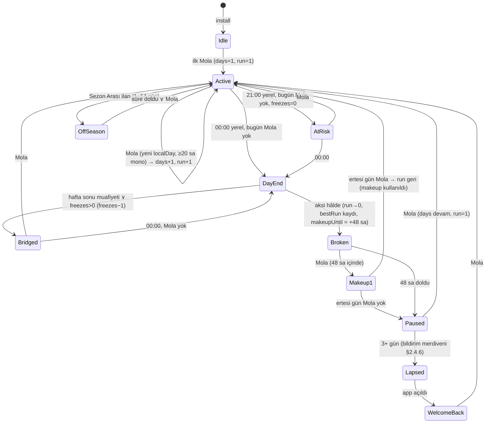

# 05 — Retention, Geri Dönüş, Miras ve Koleksiyon Sistemleri

> **Belge türü:** Ayrıntılı sistem tasarımı (Motto tasarım paketi, doküman 05/11). Üstünde `00-VIZYON-ve-KARARLAR.md` (D-001..D-065; §12 > §11) ve T9 (hukuk) vardır; bu belge D-kararlarını **uygular**, tartışmaz. 00'ın kapsamadığı yerde karar verir ve bunu **D-ÖNERİ-05-xx** olarak işaretler (§7.3).
> **Sahip olduğu sistemler:** Mola ritüeli / streak · Koç Görevleri · Antrenman Kampı + hayali kohort · bildirim spec'i · welcome-back ("Sakatlık Raporu") · Kondisyon (miras) perk'leri ve Yedek Kulübesi pity · Fazla Bagaj · Tanışıklık'ın kullanım yüzeyi · Teşhis koleksiyonu (30 → 60 → 120) · Sözlük koleksiyonu + Mottolar albümü · Onyıl Karnesi ekranı · paylaşım kartları (Kamp, Lally, Teşhis, Sözlük, Onyıl) ve HYT/KMP seed kodları.
> **Durum:** v1.0 · 2026-11-06 · Yazar: Retention/Meta sistem tasarımcısı · Girdi: 00 (tümü, §12 dahil), T7 (tam), T1 (tam), T11 ve T9 (TL;DR), A1–A4 konseptleri (Mola, Kamp, Kondisyon, Fazla Bagaj, Teşhis örnekleri), 01/02/07/10 dokümanlarının arayüz satırları.

---

## 0. Künye — uygulanan D-kararları, bağımlı dokümanlar, sürüm

### 0.1 00 §5'teki satırımız

| # | Dosya | Sahip olduğu sistemler | 00'daki ana karar |
|---|---|---|---|
| 05 | `docs/design/05-retention-geri-donus-miras-koleksiyon.md` | Mola ritüeli/streak, Koç Görevleri, Antrenman Kampı + hayali kohort, bildirim spec'i, welcome-back, Kondisyon (miras) perk'leri, Fazla Bagaj, Teşhis koleksiyonu (60 → 120), Sözlük koleksiyonu, Onyıl Karnesi | D-018, D-019, D-029–D-031, D-042, D-051, D-056, D-058 |

### 0.2 Uygulanan D-kararları (her biri → bu belgedeki somut tasarım öğesi)

| D | Karar (kısa) | Bu belgede nasıl uygulandı |
|---|---|---|
| **D-018** | Fazla Bagaj: önceki hayatın en yüksek Cringe olayı etiket olarak biner, 1 callback açar; atılamaz/satılamaz/cezasız; 3 hayat aynı → Kronik | §2.7: `Baggage` tipi, `pre.meta.baggage` kapısı, Müşteri Dosyası'nda "Fazla Bagaj: 1" satırı, callback olay sözleşmesi, 3-hayat kuralı Kronik hesaplayıcısına bağlandı |
| **D-019** | Antrenman Kampı `hash(YYYY-WW + locale + contentHash)`; 40 hayali kohort her kartta "hayali/fictional" etiketiyle; KMP-XXXX; Pazartesi 00:00 yerel | §2.3: seed formülü, 16 tema rotasyonu, kohort üretimi (headless motor, bot politikaları), skor formülü, kıyas kartı şablonu, etiket zorunluluğu lint'e |
| **D-029** | Streak = Mola ritüeli; karar bazlı; duraklar/sıfırlanmaz; 2 Sakatlık İzni (7 günde 1); 48 sa Telafi ücretsiz; hafta sonu opsiyonel; 3/7/14/21/30/66/100/365; 66 = Lally günü; asla satılmaz | §2.1: `StreakService` durum makinesi, iki sayaç (`days` toplam / `run` kesintisiz rekor), İzin otomatik, Telafi yalnızca `run`'ı korur, kilometre taşı kozmetikleri, Lally kartı |
| **D-030** | Bildirim ≤ 1/gün, ≤ 5/hafta, 22:30–09:00 sessiz, yalnızca yerel; kopya zarftan/koçtan; 3 yoksayma → 7 gün sessiz; lapsed'de Duolingo tersliği; "Beni rahat bırak"; soft-ask ilk "Bugünlük yeter" (≥ 8 dk); Android izni 2. oturumdan önce asla | §2.4: `NotificationPlanner.replan()` ritüeli, öncelik sırası, tavan filtresi, merdiven D0..D30 + lapsed, 40 satırlık kopya havuzu (karakter mesajı + koç), soft-ask akışı, platform kuralları §4 |
| **D-031** | Welcome-back = Sakatlık Raporu: gerçek yokluk → oyun zamanı, 40 sn, atlanabilir, büyük karar rafta, geri dönülemez kayıp yok, ödül sabit | §2.5: `AbsenceEngine.resolve()` çevrim tablosu (gün bazlı, D-061), 3–6 kart, 7 gün ödül tavanı, 14+ gün "büyük bekleyen karar", Atla her zaman görünür |
| **D-042** | Kondisyon çeşitlilik verir, güç vermez; şehir, karne teması, Hedefsiz bonus olay, Sessiz Sezon, başlangıç kariyer seçenekleri, kedi; log sıkıştırmalı eğri | §2.6: 10 perk'lik liste (MVP 3), puan formülü `6·ln(1 + yıl/12)`, eşik tablosu, "güç testi" (hiçbir perk stat/Para/hazard/oran değiştirmez) |
| **D-051** | Onyıl Karnesi yalnızca karar kalemleri; kimlik kalemi yok; zorunlu lift gerçek Kondisyon puanı; koç listeyi okur, savunmaz | §2.9: ekran sözleşmesi (doc 02 şemasını okur), "Onyılın Mottoları" şeridi, lift → `fitness.points`, paylaşım kartı |
| **D-056** | Ölüm = içerik: her ölüm ≥ 1 açılım + Teşhis + Defter sayfası + Fazla Bagaj | §2.6.4 Yedek Kulübesi pity, §2.8 ölümde Teşhis değerlendirmesi, §2.7 bagaj yazımı; hepsi `lifeEnded` efektinin tek işleyicisinde |
| **D-058** | Gizli Tanışıklık 0–5 yalnızca daha sıcak nadir satırları açar; güç vermez | §2.6.5: doc 01 §2.6 tanımını **okur**; bu belge yalnızca welcome-back ve kilometre taşı satırlarında hangi seviyenin hangi varyantı açtığını belirler |
| **D-061** (§12) | Zaman birimi GÜN; her gösterilen günde bir olay; doğum günü = karne | Mola = günün ilk gün kartı; welcome-back çevrimi **gün** cinsinden (§2.5.1); Kamp hayatı gün sıkıştırmasıyla; Koç Görevleri "bugün/bu yıl" dilinde |
| **D-062** (§12) | Karakterler konuşur; NPC balonları; koç ayrı katman | Bildirimler **karakter mesajı** biçiminde (başlık = NPC adı, gövde = balon); koç satırları ayrı havuz; Sakatlık Raporu kartları NPC balonu taşıyabilir |
| **D-063** (§12) | Teşhis etiketi çarpması, tam ekran damga, SFX | §2.8.6: Teşhis veriliş anı juice sözleşmesi (doc 07 sürelerine uyar; reduced-motion'da kapanır) |
| **D-064** (§12) | Roast dozu yükseldi; kimliğe değil karara vurur | Mola/kilometre taşı/Kamp satırlarında roast kotası Normal'de ≥ 1; Teşhis adları yine yargısız (ad ≠ roast; roast satırda) |
| D-010 / D-022 | 12 kozmetik damga varyantı; Yılın Mottosu 36 hücre | Kilometre taşı ödüllerinin bir kısmı damga varyantı; Mottolar albümü 36 hücrelik ızgara (§2.9.2) |
| D-011 | Zarf = pending-outcome nesnesi; bildirim zarftan türer | Bildirim öncelik 2 = "bekleyen zarf" karakter mesajı |
| D-014 | Okunmamış sayacı; "Görüldü, cevap yok"; Teşhis "Okundu Bırakan" | Teşhis #05 tetikleyicisi `seenNoReply ≥ 10`; bildirim N-09 |
| D-016 | Ölüm → yeni hayat ≤ 40 sn; ≥ 1 Kondisyon açılımı; "Aynı kondisyonla" | §2.6.4 pity; "Aynı kondisyonla" perk seçimini kopyalar |
| D-050 | Gerçek-zaman satırları oyuncunun gerçek davranışını yorumlamaz | Bildirim ve welcome-back satırlarında özne daima karakter/NPC/koç; "sen yokken" = "karakter sen yokken"; lint §5 |
| D-055 | Enerji yok, giriş ödülü yok, sahte sayaç yok, paralı streak yok | Koç Görevleri oynayınca açılır (giriş ödülü değil); Kamp geri sayımı takvimdir; hiçbir §2 öğesi satılmaz |
| D-060 | Hiyerarşi; D-kararları tartışılmaz | Çelişkiler §7.4'te kayıt altına alındı, çözüm 00 lehine |

### 0.3 Bağımlı dokümanlar (arayüz sözleşmeleri)

| Doküman | Bu belgeden ne alır | Bu belgeye ne verir |
|---|---|---|
| **01** Anlatıcı | Kilometre taşı / Kamp / welcome-back satır **bağlam etiketleri** (`ctx: 'mola.milestone.66'` vb.), bildirim kopyasının register'ı | Koç satır havuzu (P-01..P-30 bildirimleri §3.4), Tanışıklık seviyeleri (§2.6), sessizlik kuralı, ses ayarı varyant kuralı |
| **02** Zaman/stat | `advanceTime({ days })` aksiyonu (welcome-back), `fitness.points` yazımı (Onyıl lift), `lifeEnded` → bildirim iptali | `LifeRecord` (metaLog girdisi), `highestCringeEvent` (Fazla Bagaj), `DecadeReview` şeması, `pendingDeathRisk` kuralı |
| **03** Olay motoru | `pre.meta.baggage`, `pre.meta.campTheme`, `pre.meta.kondisyon[]` kapıları; Koç Görevi `questTag` etiketi seçeneklerde; Kamp tema kısıtı (seçenek kilidi / fiyat çarpanı) | `patterns` sayaçları (Teşhis tetikleri), `EnvelopeQueue` (bildirim kopyası), olay `rarity`, `wager` isabet sayıları |
| **04** Kariyer/NPC | Welcome-back kartlarında NPC balonu isteği (`npcLine(role, ctx)`), bildirim NPC ses kuralları, Fazla Bagaj callback olayının NPC'si | NPC ses kitabı (Anne kısa-soru işaretli, Barış BÜYÜK HARF, Nevin Hanım İK dili, Yağmur üç kelime, Pamuk tek kelime), `metaMemories`, Okunmamış sayacı |
| **06** Monetizasyon | "Satılmaz" listesi: streak, İzin, Telafi, Kondisyon, Teşhis, Kamp skoru | Torpil'in karne temaları (Kondisyon temasıyla çakışmaz: ayrı set), Sezon Paketi'nin +12 Kamp teması |
| **07** UX/UI | Mola ekranı, Kamp sekmesi, Teşhis duvarı, Sözlük/Mottolar, Onyıl Karnesi ekran **içerik sözleşmeleri**; 5 paylaşım kartının metin alanları | `ShareCard` şablon motoru (9:16 + 1:1), juice süreleri, Sakatlık Raporu ekran iskeleti (§3.5), Kamp kıyas kartı düzeni (§3.6) |
| **08** Lint | Yeni kurallar: "hayali/fictional" etiketi zorunlu, bildirimde gerçek-hayat yorumu BLOK, Teşhis adı yasak sözlüğü, Koç Görevi'nde gerçek dünya fiili BLOK | Yasaklı kelime listeleri, kurum-genellemesi dedektörü |
| **09** i18n | Teşhis adları, Koç Görevleri, bildirimler, Kamp tema adları **locale başına ayrı** havuz | ICU/`trInflect()`, buton bütçesi |
| **10** Teknik | `engine/streak`, `engine/legacy`, `services/notifications`, `clock/trusted`, `effects: notification-plan / notification-cancel-all / ask-consent` | Tipler (`Streak`, `Legacy`, `Collections`), `RESUME{nowWall, nowMono, localDay, isoWeek}`, güvenilir saat kuralları §2.4.13 |
| **11** KPI | §6.1 KPI satırları ve `AnalyticsPort` olay adları | KPI ağacı, soft launch kapıları |

### 0.4 Sürüm

v1.0 (2026-11-06). Değişiklik yalnızca bu dosyada ve yeni D-kaydıyla; §7.3'teki D-ÖNERİ'ler 00'a alınınca buradaki numaralar korunur, "D-ÖNERİ" etiketi düşer.

---

## 1. Amaç ve kapsam — MVP (vertical slice) / Soft launch / 1.0 kapsam farkları

**Amaç.** Bu belgenin işi, oyuncunun oyunu kapattığı andan tekrar açtığı ana kadar olan boşluğu ve bir hayatın bittiği andan sonrakinin başladığı ana kadar olan boşluğu doldurmaktır. İlkinin adı **geri dönüş** (Mola, bildirim, Sakatlık Raporu, Kamp), ikincisinin adı **miras** (Kondisyon, Fazla Bagaj, Tanışıklık, Teşhis, Sözlük, Onyıl Karnesi). İkisinin de tek ölçüsü vardır: oyuncu geri geldiğinde "beni bekleyen bir şey vardı" demeli, "beni cezalandıran bir şey vardı" değil. T1'in hiyerarşisi bağlayıcıdır: SDT (özerklik, yeterlik, ilişki) temel; kayıptan kaçınma yalnızca "duraklatılan" streak'te ve "içeriğe dönen" ölümde; sahte aciliyet, enerji, giriş ödülü, paralı streak hiçbir sürümde yok (D-055).

**Beş tasarım ilkesi (bu belgeye özgü, 00 §1.1 sütunlarının türevi):**

1. **Sayaç duraklar, utandırmaz.** Hiçbir streak sayısı sıfırlanmaz; hiçbir ekran kırmızı çarpı ile "kaybettin" demez (S2, S5).
2. **Dönüş hikâyedir, tazminat değil.** Yokluk olay üretir; ödül 7 günde tavana vurur ve yokluk süresiyle büyümez (D-031; saat hilesini değersizleştirir).
3. **Kıyas hayalidir ve öyle yazar.** Kampta 40 kişi vardır, hepsi kurgusaldır, her kartta "hayali/fictional" yazar; sahte sosyal kanıt yok (D-019, Google Play Deceptive Behavior).
4. **Miras çeşitlilik verir, güç vermez.** Hiçbir perk stat, Para, hazard, iddia oranı ya da olay şansını değiştirmez; "güç testi" §2.6.3 (D-042).
5. **Koleksiyon sayar, yargılamaz.** Teşhis adları antrenman tonludur, kimlik ya da klinik sözcük içermez; roast Teşhis'in satırında değil, koçun balonundadır (D-024, D-064).

**Kapsam farkları:**

| Sistem | MVP dikey kesit (10 hafta) | Soft launch (TR + CA/NZ) | 1.0 (global) | Lansman sonrası |
|---|---|---|---|---|
| Mola / streak | Tam: karar bazlı sayaç, duraklama, 2 İzin, 48 sa Telafi, hafta sonu muafiyeti (varsayılan açık), 8 kilometre taşı, 4 kozmetik | + Sezon Arası (tatil modu), aylık takvim görünümü, Lally kartı 1:1 | + 12 damga varyantının 6'sı kilometre taşından | — |
| Koç Görevleri | 3/gün deterministik, 60 görev/locale, 1'i absürt | 90 görev | 120 görev; Kamp haftasında 1 görev kamp temalı | 160 |
| Antrenman Kampı | 2 tema (Erteleme, Cesaret), 40 hayali kohort, kıyas kartı, KMP kodu | 8 tema, Pazartesi bildirimi, haftalık en iyi skor | 16 tema (12 kalıp + 4 sezonluk), Kamp Teşhisleri | Sezon Paketi +12 tema |
| Bildirim | Yalnızca yerel; replan ritüeli; tavanlar; soft-ask; D0–D7 merdiveni + zarf mesajı; 40 satır | Merdiven D0–D30 + lapsed tam; karakter mesajı kategorileri; histogram saati; 60 satır | 80 satır; sezonluk kopyalar; TrustedClock monoton modül | 100 |
| Welcome-back | Tam tablo (gün bazlı), 3–6 kart, Atla, +1 İzin, büyük bekleyen karar | Tanışıklık ≥ 3 sıcak varyantlar; "Neler yeni" kartı (30+ gün) | 40 welcome-back satırı | 50 |
| Kondisyon | 3 perk (Kedi, Yeni Şehir, Hedefsiz bonus); puan + pity | 6 perk | 10 perk; "Aynı kondisyonla" | +2/sezon |
| Fazla Bagaj | Tam (1 callback olayı × 3 varyant) | 6 varyant | 10 varyant; Kronik birleşmesi | — |
| Teşhis | 30 (3 otomatik, 5 gizli, 12 kalıp tabanlı) | 45 | 60; Kamp Teşhisleri | 120 (6. ay) |
| Sözlük + Mottolar | Sözlük 40 giriş, 5 sekme; Mottolar ızgarası 36 hücre | Sözlük 60; sayfa paylaşım kartı | Sözlük 120 | 180 |
| Onyıl Karnesi | **Yok** (doc 02 şeması hazır; ekran soft launch'ta) | 30/40 | 30/40/50/60; kart | — |
| Paylaşım kartları (bu belgenin) | Lally günü (1:1), Kamp kıyas (1:1) | + Teşhis kartı, Sözlük sayfası | + Onyıl Karnesi kartı | — |
| Seed kodları | HYT-XXXX-XXXX üretimi + içe aktarma (deep link) | KMP kodu içe aktarma (kampı sonradan oyna, karta girmez) | — | — |

**MVP'de bilinçli dışarıda:** Onyıl Karnesi ekranı, Sezon Arası modu, histogram tabanlı bildirim saati (MVP'de sabit 20:30 / streak-at-risk 21:00), provisional iOS bildirimi (hiçbir sürümde; §4), jenerasyon/"Çocukla devam" (00 §7, ayrı karar), gerçek hayat mikro-görevi (D-006; hiçbir sürümde bu belgede).

---

## 2. Tasarım

### 2.1 Mola ritüeli ve streak (D-029)

#### 2.1.1 Ne sayılır

Streak **günün ilk kararını** sayar; açılışı, oturumu, yılı değil. D-061 ile gün kartı oyunun doğal birimi olduğundan Mola = **günün ilk gün kartı**: uygulama açılır, Hayat Akışı'nda sıradaki tarihli gün gelir, oyuncu seçer, düdük ikonu dolar, koç bir satır söyler. Ritüelin maliyeti ≤ 90 sn (Fogg "tiny behavior"); devamı normal oturumdur, Mola ekranı diye ayrı bir ekran **yoktur** — Mola, Hayat Akışı'nın ilk kartının üstüne iğnelenen küçük bir "MOLA" etiketidir (doc 07 §2.2 Hayat ekranı, karar bölgesi).

Sayılmayanlar: Kamp hayatındaki kararlar **sayılır** (karar karardır); welcome-back kartları sayılmaz (karar yok); "Hızlı Yaşa" içinde otomatik çözülen beat'ler sayılmaz; iddia "Oranı göster" dokunuşu sayılmaz.

#### 2.1.2 İki sayaç, tek vaat

| Sayaç | Adı (ekran) | Ne yapar | Nerede görünür |
|---|---|---|---|
| `days` | **Antrenman günü / Practice days** | Her Mola'da +1; **asla azalmaz, asla sıfırlanmaz**; duraklatıldığında sabit kalır | Hayat Akışı üst şeridinde küçük (düdük + sayı); koçun ağzında büyük |
| `run` | **Kesintisiz / Unbroken** | Art arda Mola günleri (İzin ve hafta sonu muafiyeti günü "köprü" sayılır); kaçırılan gün Telafi edilmezse `run` 0'dan başlar ama `bestRun` rekoru kalır | Yalnızca Defter sekmesindeki aylık takvimde ve Lally kartında; HUD'da **yok** (T1 §2.1: streak HUD'da küçük) |

Vaat tek cümledir ve koç ilk duraklamada söyler: TR *"Sayaç sıfırlanmaz. Durur. Ben de dururum; gitmem."* · EN *"The count doesn't reset. It pauses. So do I. I don't leave."* Kilometre taşları `days` üzerinden verilir (sıfırlanmayan sayaç → her oyuncu eninde sonunda 66'ya ulaşır; Lally günü bir hak, bir imtiyaz değil). `run` yalnızca rekor ve takvim estetiğidir; kayıptan kaçınma burada "yumuşak" tutulur (T1 §1.5, Silverman & Barasch: kırık streak'i vurgulama).

#### 2.1.3 Gün sınırı ve güvenilir saat

- Gün = **yerel takvim günü** (`RESUME.localDay`, doc 10 §2.4.13). Gece 00:00'da döner; "04:00 kuralı" yok (Kamp'ın Pazartesi 00:00 kuralıyla aynı saat, tek zihinsel model).
- `days` monoton saatte son Mola'dan **≥ 20 saat** geçmeden artmaz (T7 §4.4; saat ileri alma streak'i uzatamaz).
- `tamperFlags > 0` olan günlerde Mola sayılır ama kart "doğrulanmamış" işareti taşır (küçük yıldız; yalnızca Lally/kilometre taşı kartlarında). Ceza yok; koç satırı defteri hedefler: TR *"Takvim ileri gitmiş. Defterim gitmemiş. İkisini de sayıyorum, birini küçük yazıyorum."* · EN *"The calendar jumped ahead. The notebook didn't. I'm counting both; one in smaller handwriting."*
- Saat dilimi değişimi (seyahat): `localDay` yeni dilimden gelir; aynı takvim günü iki kez görülürse ikinci Mola sayılmaz (idempotent anahtar `localDay`).

#### 2.1.4 Affetme mekanikleri

| Mekanik | Kural | Satılır mı | Kaynak |
|---|---|---|---|
| **Sakatlık İzni / Injury Leave** | 2 slot; kaçırılan gün sonunda (00:00) **otomatik** devreye girer, `run` köprülenir, `days` sabit; 7 günde 1 slot yenilenir (tavan 2); welcome-back +1 (tavan 2) | **Hayır** (D-029) | T7 §4.2, Duolingo freeze |
| **Hafta sonu muafiyeti** | Cmt + Paz opsiyonel: oynarsan `days` +1, oynamazsan İzin harcanmaz, `run` köprülenir; Ayarlar'da kapatılabilir; **varsayılan açık** (D-ÖNERİ-05-01) | — | Duolingo Weekend Amulet +%4 dönüş |
| **Telafi Antrenmanı / Make-up Practice** | Kaçırılan gün + İzin yoksa `run` kırılır; 48 saat içinde **iki ardışık gün** Mola yapılırsa `run` geri gelir ve takvimde boşluk kapanır; ücretsiz; 30 günde 1 (D-ÖNERİ-05-02) | **Hayır** | T7 §4.2 onarım penceresi |
| **Sezon Arası / Off-season** | 1–14 gün önceden ilan; `run` askıda, İzin harcanmaz, bildirim yok; yılda 2 kez; soft launch | — | T7 tatil modu |
| **Bilimsel af** | İlk `run` kırılmasında koç Lally'yi anlatır (tek kez): TR *"Bir gün kaçırdın. 2010'da 96 kişi üzerinde yapılmış bir çalışma var; bir gün fark etmiyor. Ben de fark etmiyorum."* · EN *"You missed a day. There's a 2010 study, ninety-six people: one day doesn't matter. Neither do I, apparently. Keep going."* | — | Lally et al. 2010 |

Streak'in motivasyon gücü kayıptan değil **varlıktan** gelir: `days` birikmiş bir varlıktır ve asla eksilmez; kilometre taşları goal-gradient'tir (T7 §4.2). Hiçbir ekranda "streak'ini kaybettin" cümlesi yoktur; lint `streak.*` satırlarında "kaybet/lost/kırıldı/broke" sözcüklerini BLOK'lar (§5).

#### 2.1.5 Durum makinesi



`days` hiçbir geçişte azalmaz (property-based test, §6.2). Kritik ayrıntı: **Paused** durumunda bile `days` ekranda "47 · duraklatıldı" olarak durur; "0" asla görünmez.

#### 2.1.6 Kilometre taşları ve kozmetik ödüller

Ödül daima kozmetiktir ve koçun bir satırıyla gelir; stat/Para/Kondisyon puanı **yok** (streak → güç köprüsü kurulmaz; T1 §5.3).

| Gün | Ad (TR / EN) | Kozmetik | Koç (TR) | Koç (EN) |
|---|---|---|---|---|
| 3 | Resmiyet / It's Official | Düdük ikonu renk 1 (lime) | Üç gün. Resmî oldu. Üç tesadüf değil; bir seri. Küçük bir seri. | Three days. It's official. Not three coincidences; a streak. A small one. |
| 7 | Hımm / Hm | Mola etiketi çerçevesi | Bir hafta. Hımm. Bunu not aldım; sayfanın köşesine, küçük. | One week. Hm. Noted. Corner of the page, small letters. |
| 14 | İki Hafta / Fortnight | Damga varyantı #3 (mürekkep: lacivert) | On dört gün. Ergen ilişkileri kadar uzun. Tebrikler, ciddi bir şeyin içindesin. | Fourteen days. Longer than most teenage relationships. Congratulations, this is serious now. |
| 21 | Mit Kırıcı / Myth Buster | Defter kapağı: "Antrenman Defteri" | Yirmi bir gün. "21 günde alışkanlık" bir mittir. Mite rağmen geldin; mitten iyi. | Twenty-one days. "Habits take 21 days" is a myth. You showed up anyway. Better than the myth. |
| 30 | Bir Ay / The Month | Damga varyantı #5 | Otuz. Karakterin bir yaş, sen bir ay büyüdün. Biriniz bir şey başardı; defterde yazıyor, kim. | Thirty. Your character aged a year; you aged a month. One of you accomplished something. The notebook says who. |
| **66** | **Lally günü / Lally Day** | **Lally kartı (1:1) + Teşhis #26** | Bilim 66 gün diyor. Sen 66 gün dedin. İlk kez aynı şeyi söylediniz. | Science says 66 days. You did 66 days. First time you two agreed on anything. |
| 100 | Yüz / The Hundred | Düdük rengi 2 (altın) + damga varyantı #8 | Yüz. Burada bir alkış olmalı. Ben alkışlamam; kalemimi bıraktım, bu kadar. | A hundred. There should be applause here. I don't clap. I put the pen down. That's the version. |
| 365 | Sezon / The Season | Defter kapağı "Tam Sezon" + damga #12 | Bir yıl. 2.400 seminerde kimse bir yıl yapmadı. Sen yaptın; seminer değildi, o yüzden. | A year. In 2,400 seminars, nobody did a year. You did. It wasn't a seminar; that's why. |

Lally kartı 1:1 (doc 07 `ShareCard`): antet "66. GÜN / DAY 66", karakter adı (ya da baş harfler), "66 antrenman günü · en uzun kesintisiz: 23", koçun satırı Fraunces italik, HYT kodu, wordmark. Gerçek tarih yok.

#### 2.1.7 Devre Arası ve streak-at-risk dürüstlüğü

- **Devre Arası** (oturum ≥ 25 dk, tek kez, kapatılabilir): koç satırı 00 §4.1'de; bu belge yalnızca zamanlayıcının `nowMono` ile ölçüldüğünü ve arka plana geçişte sıfırlanmadığını belirler.
- **Streak-at-risk bildirimi** yalnızca üçü aynı anda doğruysa planlanır: bugün Mola yok ∧ `freezes = 0` ∧ hafta sonu muafiyeti bugünü kapsamıyor. İzin varken risk **yoktur**, bu yüzden bildirim de yoktur; ertesi sabah bilgilendirme satırı (P-17) gelir. Sahte aciliyet sıfır (Reklam Kurulu, DMCC).

```ts
// packages/engine/src/streak/ritual.ts (saf; doc 10 Streak tipini genişletir)
export type Streak = Readonly<{
  days: number;                 // toplam antrenman günü; asla azalmaz
  run: number; bestRun: number; // kesintisiz seri ve rekor
  status: 'idle'|'active'|'bridged'|'broken'|'paused'|'offSeason';
  lastDecisionDay: string;      // 'YYYY-MM-DD' yerel
  lastDecisionMono: number;     // ms
  freezes: 0|1|2; freezeRefillDay: string;
  makeupUntil?: string; makeupUsedDay?: string;     // 48 sa; 30 günde 1
  weekendExempt: boolean;       // varsayılan true
  offSeasonUntil?: string;
  milestonesHit: ReadonlyArray<3|7|14|21|30|66|100|365>;
  unverifiedDays: ReadonlyArray<string>;            // tamperFlags ile sayılan günler
}>;

export function onDecision(s: Streak, localDay: string, nowMono: number, tamper: boolean): { s: Streak; effects: Effect[] } {
  if (s.lastDecisionDay === localDay) return { s, effects: [] };               // gün başına 1
  if (nowMono - s.lastDecisionMono < 20 * 3_600_000 && s.status !== 'idle') return { s, effects: [] };
  const gap = dayDiff(s.lastDecisionDay, localDay);                              // 1 = dün oynandı
  const bridged = s.status === 'bridged' || s.status === 'offSeason' || gap === 1;
  const makeupOk = s.status === 'broken' && s.makeupUntil && localDay <= s.makeupUntil;
  const run = bridged ? s.run + 1 : makeupOk ? s.run + 1 : 1;                   // makeup: ertesi gün de gelirse run korunur (onDayEnd kontrol eder)
  const days = s.days + 1;
  const hit = MILESTONES.filter(m => m === days && !s.milestonesHit.includes(m));
  const effects: Effect[] = [{ kind: 'whistle' }, ...hit.map(m => ({ kind: 'milestone', day: m }))];
  return { s: { ...s, days, run, bestRun: Math.max(s.bestRun, run), status: 'active', lastDecisionDay: localDay, lastDecisionMono: nowMono,
                 milestonesHit: [...s.milestonesHit, ...hit], unverifiedDays: tamper ? [...s.unverifiedDays, localDay] : s.unverifiedDays }, effects };
}
```

### 2.2 Koç Görevleri (günlük, deterministik)

#### 2.2.1 Kural

Her yerel gün için **3 görev**: 1 kolay (bir gün/yıl yaşamak ölçeğinde), 1 orta (bir Teşhis'e, Sözlük'e ya da Tek Hedef'e ilerleme), 1 **absürt** (hikâyeye bağlı saçma bir seçim; koçun gözde kategorisi). Görevler **oynayınca açılır**: ilk Mola'dan sonra listelenir, giriş ödülü değildir (D-055). Tamamlanan görev **Kondisyon puanı** verir (+1 / görev, 3'ü de biterse +1 bonus; §2.6.2) — çeşitlilik ekonomisine küçük, düzenli girdi; stat/Para asla.

Seed: `questSeed = fnv1a(installId + '|' + localDay + '|' + contentHash + '|' + locale)`; `installId` cihazda üretilen rastgele UUID'dir, reklam kimliği değil (KVKK, §5). Deterministik olduğundan uygulamayı kapatıp açmak görevleri değiştirmez; aynı gün aynı cihazda aynı üç görev.

Seçim algoritması (saf):

```
havuz = quests.filter(q => q.locale === locale && q.pre(state))        // hayata uygun (kedi yoksa kedi görevi yok)
kolay  = pickLRV(rng, havuz.filter(tier='easy'),   seenCount)          // least-recently-viewed ağırlıklı
orta   = pickLRV(rng, havuz.filter(tier='medium'), seenCount)
absürt = pickLRV(rng, havuz.filter(tier='absurd'), seenCount)
kural: aynı görev 14 gün içinde tekrar gelmez; Kamp haftasında 'orta' slotu %50 olasılıkla kamp temalı görevle değişir (1.0)
```

Tamamlama tespiti olay motorundan gelir: seçeneklerde görünmez `questTag[]` etiketi (`'talkMom'`, `'readTranslate'`, `'pickRisk'`…) ve motor `step` sonrası `QuestService.observe(effects)`; motorun `patterns` sayaçları ve `flags`'ı da okunur. Görev ekranı Hayat Akışı'nın üst şeridinde üç küçük onay kutusudur; tamamlanınca koç **tek** satır söyler (günde ≤ 3 görev satırı; aynı gün aynı satır yok).

#### 2.2.2 Şema

```ts
export interface CoachQuest {
  id: string; tier: 'easy'|'medium'|'absurd';
  locale: 'tr'|'en';
  pre?: (s: LifeState) => boolean;              // ör. s.flags.includes('hasCat')
  done: (s: LifeState, day: QuestDayLog) => boolean;  // gün içi gözlem
  text: string;                                 // ≤ 70 karakter (buton değil, satır)
  coachDone: string[];                          // ≥ 3 varyant, ≤ 110 karakter
  intent: string;                               // joke intent spec (doc 09)
}
```

Yasak sınıf (lint, §5): gerçek dünya fiilleri ("su iç", "birini ara", "yürü"), gerçek takvim/saat, oyuncunun cihazına/konumuna/gerçek hayatına gönderme. Koçun müşterisi **karakterdir** (A4 "oyun mu alışkanlık uygulaması mı" testi; D-006).

#### 2.2.3 20 örnek (TR / EN ayrı yazıldı; kolay K, orta O, absürt A)

| # | T | TR görev | TR koç (tamam) | EN görev | EN koç (done) |
|---|---|---|---|---|---|
| 1 | K | Bugün bir karar ver. Herhangi biri. | Bir karar. Yanlış da olsa malzeme. | Make one decision today. Any decision. | One decision. Even wrong, it's material. |
| 2 | K | Bir doğum gününe ulaş. | Karne geldi. Sen de geldin. İkisi de nadir. | Reach one birthday. | Report card showed up. So did you. Both rare. |
| 3 | K | Bir zarf aç. | Zarf açıldı. İçindekini sen seçmedin; cevabı sen seçeceksin. | Open one envelope. | Envelope's open. You didn't pick what's inside. You pick what's next. |
| 4 | K | Bir Tercüme oku. | Sözlük +1. Kurumsal dil bir kelime daha küçüldü. | Read one Translation. | Glossary +1. Corporate got one word shorter. |
| 5 | K | Aile Grubu'ndan bir mesajı oku. | Okunmamış: 846. Büyük hamle değil; hamle. | Read one message from the family group. | Unread: 846. Not a big move. A move. |
| 6 | K | Pamuk'la ilgili bir karar ver. *(kedi varsa)* | Kedi fark etmedi. Kediler fark etmez. Ben ettim. | Make one decision about Biscuit. *(if cat)* | The cat didn't notice. Cats don't. I did. |
| 7 | O | Bugün "Sabır" etiketli bir seçenek seç. | Sabır: +1. Defterde bu sütun boştu; artık değil. | Pick one option tagged Patience today. | Patience: +1. That column was empty. Was. |
| 8 | O | Tek Hedef'ine bir adım at. | Hedefe bir adım. Üç kişiden ikisi bunu yapmaz; 2.400 seminerin özeti. | Take one step toward your One Goal. | One step toward the goal. Two in three people never do. That's 2,400 seminars, summarized. |
| 9 | O | Bir risk seçeneği seç ve oranı gör. | Oran gördün, yine seçtin. Cesaret sütununa yazdım. | Pick a risk option and look at the odds. | You saw the odds and picked it anyway. Filed under Courage. |
| 10 | O | Annenle bir kez konuşmayı seç. | Anne Baskısı −5. Annen bunu bilmiyor; ben biliyorum. | Choose to talk to your mom once. | Mom Pressure −5. Your mom doesn't know that number. I do. |
| 11 | O | Bir Teşhis'e ilerle (herhangi biri). | Bir Teşhis'e yaklaştın. Hangisi, söylemem; sürprizi bozmam. | Progress any Diagnosis. | You're closer to a Diagnosis. Which one, I'm not saying. |
| 12 | O | Bir iddiayı kazan ya da kaybet; fark etmez, çöz. | İddia kapandı. Damga bastım; hangisi, defterde. | Settle one wager; win or lose, doesn't matter. | Wager closed. I stamped it. Which stamp is in the notebook. |
| 13 | O | Bir yıl "Hedefsiz yaşa" seç. | Hedefsiz bir yıl. Saygı duyuyorum. Not da aldım. | Pick "No goal, respect" for one year. | A year without a goal. Respect. Also noted. |
| 14 | O | Barış'ın bir "kesin" fikrini reddet. | Barış'a hayır dedin. Kesin bir şey bulmuştu. Yine bulur. | Turn down one of Jordan's "definitely" ideas. | You told Jordan no. He'd definitely found something. He will again. |
| 15 | A | Dayına "hayata atıldım" de. Atılmamış olsan da. | Dayın inandı. Dayılar inanır. Ben sayarım. | Tell your uncle you've "gotten started." Whether or not you have. | Your uncle believed you. Uncles do. I count. |
| 16 | A | Kediye yeni bir isim koy. Adı zaten var. Yine koy. | Kedi iki isimli oldu. Hiçbirine gelmiyor. Tutarlı. | Rename the cat. The cat has a name. Do it anyway. | The cat now has two names. Answers to neither. Consistent. |
| 17 | A | Bir evrakı Tercüme etmeden imzala. | Okumadan imzaladın. Antrenmanda buna "güven" deriz. Hayatta "sonuç". | Sign one document without Translating it. | Signed unread. In training we call that trust. In life, consequences. |
| 18 | A | Aile Grubu'na "Görüldü, cevap yok" de. Bugün. | Görüldü. Cevap yok. Teşhis'e bir adım; annen de bir adım attı, kapına doğru. | Leave the family group on read. Today. | Seen. No reply. One step toward a Diagnosis. Your mom also took a step. Toward your door. |
| 19 | A | Patronunun bir cümlesini Tercüme et, sonra yine de "tamam" de. | Tercüme okudun, "tamam" dedin. Bilerek. Bu bir seviye. | Translate one line from your boss, then say "sure" anyway. | You read the translation and said "sure." On purpose. That's a level. |
| 20 | A | Bugün hiçbir şey biriktirme. Hiç. | Sıfır birikim. Yuvarlamadım; sıfır yuvarlanmaz. Görev tamam. | Save nothing today. Nothing at all. | Zero saved. I didn't round that. Zero doesn't round. Task complete. |

Her görev satırı lint'ten geçer: gerçek dünya fiili yok, "yap/yapmalısın" yok (görev metni emir kipi taşır ama **oyun içi** eylemdir ve koç satırında değil görev kartındadır; D-027 koç balonu içindir — görev kartı sistem metnidir, bu ayrım doc 08'e kural olarak geçer: D-ÖNERİ-05-03).


### 2.3 Antrenman Kampı (haftalık, seed'li hayat, hayali kohort) — D-019

#### 2.3.1 Takvim ve seed

- Yeni kamp **Pazartesi 00:00 yerel** açılır, Pazar 23:59'da kapanır (geri sayım = gerçek takvim; sahte aciliyet yok).
- `campSeed = fnv1a(isoYearWeek + '|' + locale + '|' + contentHash)`; `isoYearWeek` uygulamadan `RESUME.isoWeek` ile gelir (yerel). `locale` seed'e girer: "herkes" = aynı dildeki herkes (00 §9). `contentHash` seed'e girer: OTA ile havuz büyüyünce eski haftaların kartları değişmez.
- Saat dilimi/saat hilesi: `tamperFlags` varsa Kamp haftası ilerlemez (doc 10 §2.4.13); aynı `isoWeek` bir kez tamamlanmışsa yeniden açılmaz; geriye alınan saat yeni kamp açmaz. Ceza yok; sadece "sürprizi kaybedersin".

#### 2.3.2 Tema rotasyonu (16 tema)

Havuz 12 **kalıp kampı** (her biri Kalıp Dedektörü'nün bir kalıbını "tek kas" olarak çalıştırır) + 4 **sezonluk** kamp. Rotasyon: ISO yılına seed'lenmiş bir permütasyon (`permute(12, fnv1a(isoYear))`) kalıp kamplarını sıralar; haftanın teması `perm[(isoWeek − 1) mod 12]`. Sezonluk 4 kamp sabit haftalara biner ve o hafta kalıp kampının yerini alır (Ocak 2. hafta, Temmuz 2. hafta, Eylül 2. hafta, Aralık 2. hafta). Sonuç: aynı tema 12 hafta içinde tekrar etmez; dinî/millî takvime bağlı tema **yok** (T9: din/etnik köken sıfır; D-048 ikamesi kampa taşınmaz).

| # | Tema TR / EN | Kas (kalıp) | Kısıt (olay motoruna `campRule`) | Koç açılış TR | EN |
|---|---|---|---|---|---|
| 1 | Erteleme Kampı / Procrastination Camp | Erteleme | "sonra/yarın" etiketli seçenekler kilitli; koç her kilidi sayar | Bu hafta "yarın" yok. Kelime olarak da yok; sildim. | No "tomorrow" this week. Not even the word. I deleted it. |
| 2 | Cesaret Kampı / Courage Camp | Risk | Yılda ≥ 1 risk seçimi yoksa o yılın karnesine "ISINMA" damgası | Her yıl bir risk. Küçük olabilir. Sıfır olamaz. | One risk a year. Small is fine. Zero isn't. |
| 3 | Tasarruf Kampı / Savings Camp | Dürtüsel Harcama | Dürtüsel harcama seçenekleri 2× pahalı görünür (ve öyledir) | Her şey iki katı. Fiyat etiketi değil, sonuç etiketi. | Everything costs double this week. Not the price tag. The consequence tag. |
| 4 | Hayır Kampı / The No Camp | Herkesi Memnun Etme | Her yıl ≥ 1 "hayır" seçeneği zorunlu, yoksa Cringe +5 | Bu hafta bir kelime çalışıyoruz: hayır. İki harf. Zor harfler. | One word this week: no. Two letters. Hard ones. |
| 5 | Yüzleşme Kampı / Face-It Camp | Kaçınma | "Görüldü, cevap yok" ve "sonra bakarım" kilitli | Kaçacak yer yok. Haritayı ben çizdim; çıkış koymadım. | Nowhere to hide. I drew the map. Left out the exits. |
| 6 | Bakım Kampı / Maintenance Camp | Kendine Bakım | Yılda ≥ 1 kendine bakım seçimi yoksa Sağlık drift ×1,5 | Buzdolabına yürümek sayılmıyor. Sordun diye söylüyorum. | Walking to the fridge doesn't count. You were going to ask. |
| 7 | Mesai Kampı / Overtime Camp | Aşırı Çalışma | Aşırı çalışma seçenekleri Keyif −2 ek | Mesai var. Sayıyorum; sen saymıyorsun, o yüzden ben. | Overtime's on. I'm counting it. You're not, so somebody has to. |
| 8 | Kendi Ayakları Kampı / Own Two Feet Camp | Aileye Yaslanma | Aile yardımı seçenekleri kilitli ("anne borç verdi" dahil) | Bu hafta annen arıyor ama para göndermiyor. Ben ayarladım. | Mom still calls this week. She just doesn't send money. I arranged that. |
| 9 | Uzun Yol Kampı / Long Way Camp | Kısa Yol | Kısa yol seçenekleri kilitli | Kestirme yok. Yol uzun; ayakkabı senin. | No shortcuts. The road's long. The shoes are yours. |
| 10 | Alçakgönüllülük Kampı / Humble Camp | Gurur | Gurur seçenekleri Ego +0 (ödül yok) | Bu hafta kimse alkışlamıyor. Ben de. Çalış. | Nobody claps this week. Me included. Train. |
| 11 | Cömertlik Kampı / Generosity Camp | Cömertlik | Her yıl ≥ 1 cömertlik seçimi; sayılır, ödül yok | Vermek sayılıyor. Alkış yok, sayı var. | Giving counts. No applause. Numbers. |
| 12 | Sabır Kampı / Patience Camp | Sabır | "Hemen" etiketli seçenekler 1 yıl gecikir | Her "hemen" bir yıl bekler. Hayat da öyle yapar; ben sadece dürüstüm. | Every "right now" waits a year. Life does that too. I just say it out loud. |
| 13 | Yeni Sezon / New Season (Ocak) | Erteleme + Sabır | Yılın ilk kararı Tek Hedef olmak zorunda | Yeni yıl, aynı sen. Yeni karne. Bir hedef. | New year, same you. New report card. One goal. |
| 14 | Tatil Sezonu / Off-Season (Temmuz) | Kendine Bakım + Dürtüsel Harcama | Tatil olayları ×2 salience; harcama 2× | Tatil. Dinlenmek para ister; dinlenmemek sağlık. Seç. | Vacation. Rest costs money. Not resting costs health. Pick. |
| 15 | Transfer Dönemi / Transfer Window (Eylül) | Risk + Kaçınma | İş değiştirme olayları zorunlu beat | Transfer penceresi açık. Kulübün seni istemiyor; sen de onu. Konuşalım. | Transfer window's open. Your club doesn't want you. Feeling's mutual. Let's talk. |
| 16 | Kapanış Sezonu / Closing Season (Aralık) | Gurur + Cömertlik | Her yıl 1 "hesaplaşma" kartı (eski NPC döner) | Sezon kapanıyor. Herkes geri geliyor; sen de burada kal. | Season's closing. Everyone comes back. Stay put. |

MVP: #1 ve #2. Soft launch: #1–#8. 1.0: 16. Sezon Paketi (doc 06): +12 tema, aynı şema.

#### 2.3.3 Kamp hayatı

Kamp, ayrı bir `LifeState`'tir (`mode: 'camp'`, `campId: isoYearWeek`): başlangıç adı/şehri/statları seed'den sabit, herkes aynı doğar. **Tam hayattır** (18 → ölüm), ama Kamp sıkıştırması açıktır: gösterilen gün/yıl D-061 bantlarının yarısı (18–25: 6–9 gün/yıl, 26–40: 4–6, 41–60: 3–4, 60+: 2) → hedef **35–50 dk**. Zarf, arc, Onyıl Karnesi oynanır; dolgu atlanır. Hafta içinde **sınırsız deneme**; en iyi skor karta girer; 2. ve sonraki denemeler "pratik" etiketi taşır (Spelunky). Kamp hayatı Koçun Defteri'ne **girmez** (KAPANDI defteri yok; Kamp sayfası ayrı), Tanıdık Yüzler hafızası taşımaz, Kondisyon puanı verir (tamamlama +2, ilk 10'da +1), Teşhis ilerletir (Kamp Teşhisleri yalnızca burada açılır). Ana hayat Kamp sırasında rafta bekler; sekmeler arası geçiş serbest.

#### 2.3.4 Skor

```
gradeIdx(not) = {Zayıf:0, Geçer:1, Orta:2, İyi:3, Pekiyi:4}         // EN F..A aynı indeks
avgGrade      = ortalama(gradeIdx) tüm karneler × 6 not            // 0..4
muscle        = clamp(patternShare(kampKası) / targetShare(tema), 0, 1)   // tema kasının seçim payı / hedef pay (tema başına tuning.json)
campScore     = round(100 × (0,6 × avgGrade/4 + 0,4 × muscle))     // 0..100
tie-break     = ölüm yaşı (yüksek önce), sonra Kondisyon puanı
```

`targetShare` tema başına harness'la kalibre edilir (ör. Erteleme Kampı'nda kilit sayılır: `muscle = 1 − lockedAttempts/attempts`). Skor **Para'ya bağlı değildir** (zengin ölmek Kamp'ı kazandırmaz; S2).

#### 2.3.5 Hayali kohort (40 kişi)

Kohort, aynı motorun **headless** çalıştırılmasıyla cihazda üretilir: `botSeed_i = fnv1a(campSeed + '|bot|' + i)`, `i ∈ 1..40`; her bot bir **politika** alır (`cautious`, `impulsive`, `balanced`, `goalChaser`, `familyLeaner`, `random`; 40 = 6 politika × 6–7 + 2 `random`). Politika, seçenekleri `pattern` etiketine göre ağırlıklandırır; bot kararları motorun `step`'inden geçer, dolayısıyla skorlar gerçek dağılımdır (sahte sayı yok). Üretim Pazartesi ilk açılışta arka planda, önce 10 bot (≤ 1,5 sn orta Android; harness 10.000 hayatı dakikalarda koşuyor, 40 hayat saniyeler), kalan 30 oturum içinde; sonuç `camps/<isoWeek>.json`'a yazılır.

Adlar locale isim havuzundan (doc 09; blocklist dahil), **daima** "hayali"/"fictional" ön ekiyle: "hayali Ayşe", "fictional Dana". Etiket zorunluluğu üç yerde: sıralama listesi başlığı ("40 hayali kişi / 40 fictional people"), her satırın adı, kıyas kartının alt satırı ("Kohort hayalidir. / Cohort is fictional."). Lint: `camp.*` kaynaklı her UI string'i etiketi içermiyorsa BLOK. Kohort "gerçek oyuncu" diye **hiçbir yerde** sunulmaz (Google Play Deceptive Behavior; UCPD "ortalama tüketici"; D-019).

Sıralama ekranı: sen + 40 bot, skor + ölüm yaşı + karne ortalaması; her botun yanında politika değil **tek cümle** (koç ağzı: "hayali Ayşe: her yıl 'sonra' dedi, 71 yaşadı"). Koç haftada ≤ 1 kıyas satırı (Normal): TR *"Hayali Ayşe senden önde. Hayali olması durumu değiştirmiyor."* · EN *"Fictional Dana is ahead of you. Being fictional hasn't slowed her down."*

#### 2.3.6 Kıyas kartı ve KMP kodu

Kart 1:1 (doc 07 §3.6 düzeni): tema + hafta, "Sen: Karne ort. Orta, 58 yaş · 14/41", en yakın hayali rakip, **"Kohort hayalidir."**, `KMP-XXXX`. KMP kodu = base32(`campSeed` ilk 20 bit) → 4 karakter; aynı hafta aynı dilde herkes aynı kodu görür (kod kimlik değil, hafta kimliğidir). Kodu giren arkadaş: aynı kampı (hafta bitmişse "arşiv kamp" olarak, karta girmez, sıralama yok) oynar → "Aynı hayat, farklı karne" ekran görüntüsü yan yana.

#### 2.3.7 Kamp ruh hâli

Soft launch'ta koçun 3. ruh hâli `camp` (00 açık soru #9'un cevabı bu belgede: **soft launch**; D-ÖNERİ-05-04): resmî, gergin, kısa; roast kotası Normal'le aynı; "koçum/champ" Kamp'ta hiç.

### 2.4 Bildirim spesifikasyonu (yalnızca yerel) — D-030, D-062

#### 2.4.1 İlkeler

1. **Uzak bildirim yoktur.** `expo-notifications` `enableRemoteNotifications: false`; iOS APNs entitlement'ı yok (doc 10 §2.4.5). Mağaza incelemecisine cümle: "Uygulama yalnızca yerel bildirim planlar."
2. **Her bildirim oyun dünyasından bir haberdir**, pazarlama değildir: ya bir **karakter mesajı** (D-062: başlık = NPC adı, gövde = balon; sohbet uygulaması görünümü) ya da **koçun bir satırı** (01 §3.4 P-01..P-30). IAP/indirim/sezon paketi bildirimi **yok** (ayrı toggle bile yok; en temiz hâl).
3. **Özne daima karakter/NPC/koç**; oyuncunun gerçek hayatı, saati, konumu, yokluğu yorumlanmaz (D-050). "Sen yokken" ifadesi yalnızca "karakter sen yokken" olarak ve oyun verisiyle kurulur.
4. **Aciliyet gerçektir**: streak-at-risk yalnızca gerçek riskte (§2.1.7); "son şans / son fırsat / kaçırma" sözcükleri BLOK.
5. Metin **OS yüzeyinde** görünür: küfür yok, hakaret yok, 4+ tolerans; ses ayarı Acımasız olsa bile bildirim havuzu **Normal** varyanttır (D-ÖNERİ-05-05: bildirim yüzeyi mağaza vitrini sayılır).

#### 2.4.2 Tavanlar (koda gömülü, `NotificationPolicy`)

| Kural | Değer |
|---|---|
| Günlük maksimum | 1 |
| Haftalık maksimum | 5 (kayan 7 gün) |
| Sessiz saat | 22:30–09:00 yerel (Ayarlar'da değiştirilebilir; sessiz saat büyütülebilir, küçültülemez — en erken 08:00, en geç 22:30) |
| İki bildirim arası | ≥ 20 saat |
| Yoksayma | Art arda 3 bildirim açılmadan geçerse 7 gün sessizlik; sonra kadans lapsed merdiveniyle devam |
| "Beni rahat bırak / Leave me alone" | Tek dokunuş (bildirim aksiyonu + Ayarlar): 7 gün / 30 gün / süresiz; koç: TR *"Tamam. Bildirimleri kesiyorum. Kapı açık, ışık yanıyor."* · EN *"Okay. Notifications off. Door's open, light's on."* |
| Planlı bildirim sayısı | ≤ 12 (iOS 64 tavanının çok altında; Android hibernation kaybı küçük) |
| Planlama ufku | ≤ 30 gün (Android 3 ay hibernation; D30 son) |
| Sessiz günler | `quietDays[locale]`: TR'de 10 Kasım'da bildirim planlanmaz (gerekçe içerikte yazmaz, gönderme yok); EN listesi boş (D-ÖNERİ-05-06) |
| Ölüm sonrası | `lifeEnded` → `notification-cancel-all`; ilk bildirim en erken yeni hayatın ilk oturumundan sonra (doc 02 §2.5.1) |

#### 2.4.3 Replan ritüeli ve öncelik

`NotificationPlanner.replan()` her `RESUME` ve `SUSPEND`'de (doc 10 §2.4.13) ve `lifeEnded`, `quietMode`, `streakStateChanged` olaylarında koşar:

```
replan(state, now):
  cancelAllScheduled()
  if (!permission.granted || quiet.active) return
  cands = []
  cands += streakAtRisk(state, now)        // P1: bugün Mola yok ∧ freezes=0 ∧ muafiyet yok → bugün 21:00
  cands += pendingEnvelope(state)          // P2: en ağır açık zarf → karakter mesajı (yarın, histogram saati)
  cands += pendingDecision(state)          // P2: karar ekranında çıkıldıysa (+6 sa, sessiz saat dışına kaydır)
  cands += newUserLadder(state, now)       // P3: install'dan itibaren D0..D30 (§2.4.5), yalnızca streak kırılmadıysa
  cands += campMonday(now)                 // P4: Pazartesi 09:05 (Kamp açık) ; Cuma 18:00 "kamp yarın biter" (yalnızca kamp başlandıysa)
  cands += milestoneEve(state)             // P5: days=65 → "66 yarın"
  cands += seasonal(now)                   // P6: sezonluk kamp haftası açılışı
  cands += lapsedLadder(state, now)        // P7: son Mola'dan L1,L3,L7,L14,L21,L30 (§2.4.6); Active durumda üretilmez
  cands = cands.filter(notInQuietHours ∘ notOnQuietDay ∘ withinHorizon(30d))
  plan  = greedyByPriority(cands, { perDay: 1, per7d: 5, minGapH: 20 })   // aynı gün çakışmada düşük öncelik düşer
  plan  = plan.slice(0, 12)
  schedule(plan)                            // her biri data: { pushId, deepLink, templateKey }
```

Aynı güne iki aday düşerse yüksek öncelik kalır; **streak-at-risk ladder'ı düşürür**, zarf mesajı ladder'ı düşürür. Saat: MVP sabit 20:30 (TR akşam dilimi; EN pazarlarında 19:30), streak-at-risk 21:00 (T7 açık soru #2: Android bestEffort gecikmesi 22:30'a kaymasın); soft launch'ta son 14 oturumun başlangıç histogramından en yoğun 2 saatlik pencerenin başı (hafta sonu ayrı histogram).

#### 2.4.4 Karakter mesajı biçimi

Başlık = NPC adı (locale), gövde ≤ 110 karakter, emoji yok, `threadIdentifier = npcRoleId` (iOS gruplama), Android kanal `defter`. NPC ses kuralları doc 04'ten: Anne kısa + soru işareti + kaygılı; Barış BÜYÜK HARF + "kesin"; Nevin Hanım İK dili; Yağmur üç kelime; Şükran Teyze "komşu" lojistiği; Dayı "hayata atıl"; Pamuk tek kelime; Taksici trafik. Her karakter mesajı **oyun verisine bağlıdır** (`pre`): Yağmur mesajı yalnızca Yağmur arc'ı açıksa; Pamuk yalnızca kedi varsa; Nevin Hanım yalnızca o iş yerindeyse. Uydurma haber yok; her mesajın deep link'i tam o zarfa/kart'a iner.

Aksiyon kategorileri: `ZARF` ("Aç / Open" · "Yarın / Tomorrow"), `MOLA` ("Bir karar / One decision" · "Bugün değil / Not today"), `LAPSED` ("Özeti gör / See the report" · "Beni rahat bırak 30 gün / Leave me alone, 30 days"). "Yarın" seçimi o adayı +1 gün kaydırır (tavanlar yine uygulanır).

#### 2.4.5 Yeni kullanıcı merdiveni (D0..D30)

Merdiven yalnızca **Active** streak'te üretilir; herhangi bir gün karakter mesajı (zarf) varsa o günün merdiven adımı düşer. Haftada 5 tavanı nedeniyle D0–D7'de en fazla 5 bildirim.

| Gün | Tetik | Tip | TR | EN |
|---|---|---|---|---|
| D0 | Karakter yaratıldı, oturum ≥ 8 dk, izin verildi; o akşam | Koç | Deniz 18. Bugün bir karar verdi. Yarın da verirse buna antrenman derim. | Alex is eighteen and made one decision today. One more tomorrow and I'll call it practice. |
| D1 | — | Karakter: Anne | Yemek yedin mi? *(Deniz'e soruyor. Sana değil. — M.)* | Did you eat? *(She's asking Alex. Not you. — M.)* |
| D2 | Zarf açık | Karakter: zarf sahibi | *(§3 N-serisi; ör. Nevin Hanım: "Yarın 09:00. Odamda. Konu: sen.")* | *(Ms. Carver: "Tomorrow, 9 a.m. My office. Subject: you.")* |
| D3 | days=3 | Koç | Üç gün. Resmî. Bilim 66 diyor; 63 kaldı, panik yok. | Three days. Official. Science says sixty-six. Sixty-three to go. No panic. |
| D5 | — | Karakter: Barış | KESİN BİR ŞEY BULDUM. YARIN ANLATIRIM. BUGÜN DE ANLATABİLİRİM. | I DEFINITELY FOUND SOMETHING. TELL YOU TOMORROW. OR NOW. |
| D7 | days=7 | Koç | Bir hafta. Hımm. Köşeye not aldım; küçük. Gel bak, ne yazdım. | A week. Hm. Corner note, small letters. Come see what it says. |
| D10 | — | Karakter: Pamuk *(kedi varsa)* / Dayı | Miyav. *(Tercüme: mama. — M.)* | Mrow. *(Translation: food. — M.)* |
| D14 | days=14 | Koç | İki hafta. Karne yaklaşıyor; motto'yu ben yazarım, sen yaşa. | Two weeks. Report card's close. I write the motto; you live it. |
| D21 | days=21 | Koç | Yirmi bir gün. Mit kırıldı. Defter kapağı değişti; gel gör. | Twenty-one days. Myth's broken. The notebook got a new cover. Come look. |
| D30 | days=30 | Koç | Otuz. Bir ay sen, bir yıl karakter. Kim ne başardı, defterde. | Thirty. A month for you, a year for the character. Who did what is in the notebook. |

#### 2.4.6 Lapsed merdiveni (son Mola'dan itibaren; azalan kadans; Duolingo tersliği)

| Gün | Tip | TR | EN |
|---|---|---|---|
| L1 (İzin devrede) | Koç, sabah | Sakatlık İzni devrede. Sayaç bekliyor, ben de. Panik yok. | Injury leave kicked in. The streak's waiting. So am I. No panic. |
| L3 | Karakter: Anne | Üç gündür ses yok. İyi misin? *(Deniz'e. Oyunda 3 hafta geçti. — M.)* | Three days, no word. Are you okay? *(To Alex. Three in-game weeks passed. — M.)* |
| L7 | Koç | Bir hafta. Defteri kapatmadım; açık bırakmak alışkanlık. Rafta bir zarf var. | A week. I haven't closed the notebook. Leaving it open is a habit. There's an envelope on the shelf. |
| L14 | Karakter: zarf sahibi | *(büyük bekleyen karar; ör. Yağmur: "Konuşmamız lazım.")* | *(Sam: "We should talk.")* |
| L21 | Koç (Duolingo tersliği) | Tamam, susuyorum. Hayatın bensiz de devam eder; benimki de sensiz. Kapı açık. | These reminders aren't working. I'll stop. Your life goes on without me; mine without you. Door's open. |
| L30 | Koç, `passive` | Son bildirim. Defter kapanmadı; KAPANDI damgasını yalnızca ölüme basarım. | Last notification. The notebook isn't closed. I only stamp CLOSED for a death. |

L30'dan sonra hiçbir şey planlanmaz (Android hibernation, iOS 64; T7). Geri dönen oyuncuya ertesi gün P-23 ("Dün döndün…") bir kez.

#### 2.4.7 Soft-ask ve izin akışı

- Tetik: motor `ask-consent{notifications}` efekti — **ilk "Bugünlük yeter"** ∧ oturum ≥ 8 dk ∧ **ilk karne görüldü** (D-030'un koşuluna D-061 ritmiyle eklenen üçüncü koşul: ilk doğum günü ≈ 12–18 gün kartı ≈ 8–12 dk, genelde aynı anda sağlanır; D-ÖNERİ-05-07). İlk 60 saniyede asla.
- Android ek kilidi: `sessionCount ≥ 2` değilse soft-ask da gösterilmez (evet denip sistem diyaloğu gösterilememesin diye). iOS'ta 1. oturumda olabilir.
- Soft-ask kartı koç ağzında, vaat yazılı: TR *"Deniz'in hayatı sen yokken de akar. Önemli bir şey olunca haber vereyim mi? Günde en fazla bir, gece yok. Söz; deftere yazdım."* [Haber ver] [Şimdi değil] · EN *"Alex's life keeps going while you're out. Want a heads-up when something matters? One a day at most, never at night. In the notebook, in pen."* [Keep me posted] [Not now]
- "Haber ver" → sistem izni (iOS `requestPermissionsAsync({ ios: { allowAlert, allowBadge: false, allowSound } })`; Android `POST_NOTIFICATIONS`, kanal önceden yaratılmış). "Şimdi değil" → D3'te bir kez daha (yalnızca soft-ask; sistem diyaloğu hâlâ gösterilmedi), sonra Ayarlar satırı. Sistem diyaloğunda **ret** → bir daha sorulmaz; Ayarlar'da "Bildirimler" sistem ayarına link. Provisional (iOS sessiz teslim) **kullanılmaz** (D-ÖNERİ-05-08: "bir kez sorarız" vaadini bozar, kilit ekranında görünmez, oyun için değersiz).
- 7 günlük rozet soft-ask'ı (T7 3. nokta) **yok**: iki soru yeter.

#### 2.4.8 Ölçüm kancaları

`addNotificationResponseReceivedListener` → `push_open{pushId, templateKey, delayMin}`; `getPresentedNotificationsAsync` teslim doğrulaması (soft launch); `session_start.source='push'`; uninstall proxy: push günü + 72 sa açılış yok.

### 2.5 Welcome-back: "Sakatlık Raporu" — D-031, D-061

#### 2.5.1 Yokluk → oyun zamanı (gün bazlı)

`AbsenceEngine.resolve(lastSeenWall, nowWall, state)`; deterministik (`seed = fnv1a(lifeId + lastSeenDay)`), aynı yokluk aynı raporu üretir (ekranı kapatıp açmak değiştirmez). Çıktı `advanceTime({ days })` aksiyonuna çevrilir; motor geçen takvim günlerini **gösterilen gün üretmeden** akıtır (D-061 "olaysız günler atlanır" kuralının aynısı), yıl pulse'ı varsa beat'siz koşar, hazard zarı `pendingDeathRisk` olarak rafa konur (doc 02 D-ÖNERİ-02-12: raporda ölüm **asla**).

| Gerçek yokluk | Geçen oyun günü | Rapor kartı | İçerik | Doğum günü geçerse |
|---|---|---|---|---|
| < 6 saat | 0 | 0 | Rapor yok; koç tek satır: TR *"Hemen döndün. Özlemişsin; ben de. Söylemem."* · EN *"Back already. You missed it. So did I. I won't say so."* | — |
| 6–24 saat | 1 | 0 | Yalnızca Hayat Akışı'nda tek satır özet ("1 gün geçti. Komşu selam verdi; bu da bir olay.") | — |
| 1–3 gün | 7–21 | 1–2 (1 küçük olay + 1 NPC balonu) | "Annen 3 kez aradı" sayacı; Okunmamış +N | Karne rafa (son kart) |
| 4–13 gün | 30–90 | 3 (1 orta olay: iş/para/ilişki hareketi) | Zarf kuyruğuna 1 yeni zarf; Anne Baskısı gerçek artış | Karne rafa |
| 14–29 gün | 180–270 | 4–5 (1 **büyük bekleyen karar**) | Büyük karar: iş teklifi, Yağmur'un mesajı, ev sahibi, sağlık evrakı — **çözülmez, rafa konur**, ilk gün kartı o karardır | Karne rafa; 2. doğum günü olmaz (tavan) |
| 30+ gün | **365 (tavan)** | 5–6 (1 büyük bekleyen + "Neler yeni") | Aynı; + OTA `whatsNew[]` kartı; Tanışıklık ≥ 3 ise sıcak varyant | 1 karne rafa (tavan: tek doğum günü; D-ÖNERİ-05-09) |

Kritik kurallar: (1) **Geri döndürülemez kayıp yok** — kovulma, ayrılık, hastalık "bekleyen karar" olarak gelir, oyuncu döndüğünde seçer. (2) **Ödül tavanı 7 gün**: 7+ gün yokluk daha çok hikâye üretir, daha çok ödül üretmez (ileri sarmanın kazancı sıfır). (3) Rapor **40 sn**: 3–6 kart × ≤ 7 sn, her kart olay + 1 NPC balonu + koç satırı; "Atla" sağ üstte **her zaman** görünür ve her kartta çalışır; atlanan rapor Koçun Defteri'nde "Sakatlık Raporu · 3 ay" satırı olarak kalır (içerik kaybolmaz). (4) Rapor streak'e dokunmaz: `days` duraklatılmış hâliyle durur, İzin +1 (tavan 2), Telafi penceresi hâlâ açıksa hatırlatılır. (5) 30+ günde ses ayarı yeniden **sorulmaz** (ayar kalıcıdır); D-026.

Ödül sabit: +1 Sakatlık İzni, **o kadar**. "Dönüş arc'ı" (T7: 3 günlük görev hattı) Koç Görevleri'ne `returning=true` bayrağıyla biner: 3 gün boyunca kolay slot "dönüş" görevidir ("Bir karar ver", "Bekleyen kararı çöz", "Bir doğum gününe ulaş"); tamamlayana kozmetik **"Sakatlıktan Döndü / Back From Injury"** Teşhisi (gizli, §2.8).

#### 2.5.2 Akış

```mermaid
stateDiagram-v2
    [*] --> Resume
    Resume --> NoReport: yokluk < 6 sa
    Resume --> OneLiner: 6–24 sa
    Resume --> Report: ≥ 1 gün
    Report --> Card1: olay + NPC balonu + koç
    Card1 --> CardN: dokunma (≤ 7 sn otomatik yok; oyuncu ilerletir)
    CardN --> Shelf: büyük bekleyen karar (14+ gün) ∨ karne rafa
    Shelf --> Flow: [Devam] → ilk gün kartı = bekleyen karar / karne
    Report --> Flow: [Atla] (her kartta)
    NoReport --> Flow
    OneLiner --> Flow
    Flow --> [*]
```



Ekran iskeleti doc 07 §3.5'tedir; bu belge kart sayısı, sıra ve içerik kaynağını belirler: Kart 1 = en yüksek `delta` olan olay (NPC balonu zorunlu), Kart 2 = sayaçlar ("Annen 14 kez aradı, patron 1. Sıralama doğru."), Kart 3+ = diğer olaylar, son kart = rafa konan büyük karar/karne. Her yokluk için en az 1 **olumlu** olay (sürpriz motoru pity'si burada da geçerli; "sen yokken her şey kötü gitti" yasak: suçluluk yok).


### 2.6 Kondisyon (miras) — D-042, D-016, D-056

#### 2.6.1 İlke: çeşitlilik, güç değil

Kondisyon, hayatlar arası tek ilerleme ekonomisidir (A3'ün MP/bagaj/güzergâh yığını D-057 ile yok). Her perk **yeni bir başlangıç koşulu, yeni bir içerik kapısı ya da bir kozmetik** açar; hiçbiri stat aralığını, Para'yı, hazard'ı, iddia oranını, pity sayaçlarını ya da olay olasılığını değiştirmez (doc 02 §2.5.3: "Kondisyon perk'leri bu aralıkları değiştirmez"). **Güç testi** (her yeni perk için, CI'da harness ile): 10.000 hayat perk'li vs perk'siz → medyan ölüm yaşı, Para persentilleri, koç isabeti, karne ortalaması **istatistiksel olarak aynı** (|Δ| ≤ harness gürültüsü); farklıysa perk reddedilir. Perk'ler Torpil'le de, parayla da, reklamla da alınamaz (00 §8 "Satılmayanlar").

#### 2.6.2 Puan ve eğri (log sıkıştırmalı)

```
lifePoints(yearsLived)  = round(6 × ln(1 + yearsLived / 12))      // 18→40: 6 · 18→74: 10 · 18→95: 12
decadePoints            = Σ DecadeReview.offList.kondisyonPoints   // doc 02: +1 / 8 "listede olmayan" seçim, tavan 5/onyıl (gerçekten yazılır; D-051)
questPoints             = +1 / görev, +1 / 3'ü tamam              // günlük tavan 4
campPoints              = +2 tamamlama, +1 ilk 10 (haftada 1 kez)
fitness.points          = kümülatif (asla düşmez)
```

Eğri kasıtlı yavaş ve logaritmiktir: uzun hayat ödüllendirilir ama "hızlı öl, puan topla" döngüsü kârlı değildir (A3 riski; 18→30'da ölmek 4 puan, 18→74 10 puan: 2,5× puan için 6× süre). Harness kabulü: ölüm yaşı ile `lifePoints` korelasyonu pozitif, `lives/week` medyanı 2–4.

#### 2.6.3 Perk listesi (1.0: 10; MVP: ilk 3)

| # | Perk TR / EN | Eşik (kümülatif puan) | Ne açar | Güç testi notu | Koç açılış TR | EN |
|---|---|---|---|---|---|---|
| K-01 | Kedi / The Cat | 6 | Yeni müşteri Pamuk/Biscuit ile başlar (`flags: hasCat`); kedi olayları havuza girer | Kedi olayları net valansı 0 (harness) | Açıldı: Kedi. Gelecek müşteri kediyle başlıyor. Kedi fikrini sormadım. | Unlocked: The Cat. Next client starts with a cat. I didn't ask the cat. |
| K-02 | Yeni Şehir / New City | 12 | Müşteri Dosyası'nda +3 başlangıç şehri (locale havuzu: TR İzmir/Eskişehir/Trabzon; EN Austin/Portland/Pittsburgh — kurgusal mahalle adları, gerçek kurum yok) | Şehir yalnızca kabuk/ikame olay seçer; ekonomi aynı | Üç şehir daha. Hepsinde kira var. Manzara değişir, bakiye değişmez. | Three more cities. All of them charge rent. The view changes; the balance doesn't. |
| K-03 | Serbest Antrenman / Free Practice | 18 | "Hedefsiz yaşa" seçilen yıllarda özel 3 olay havuzu (yalnızca hedefsizken) | Olaylar valans-nötr | Hedefsiz yaşayana özel olaylar. Planlamayan da bir şey yaşar; şimdi daha ilginç şeyler. | Events only for the goalless. People without plans still have lives; now more interesting ones. |
| K-04 | Karne Teması: Antrenman Defteri / Report Theme: Practice Log | 24 | Kozmetik karne teması (Torpil temalarından ayrı set) | — | Karnen yeni kâğıda basılıyor. Notlar aynı; kâğıt değil. | New paper for the report card. Same grades, better paper. |
| K-05 | Sessiz Sezon / Silent Season | 30 | İronik perk: koç yalnızca doğum gününde ve ölümde konuşur; Teşhis "Kulaklıklı" | Roast'un yokluğu mekanik değil | Sessiz Sezon. Konuşmayacağım. Not alacağım. Sayfalar dolacak; sen görmeyeceksin, sonra göreceksin. | Silent Season. I won't talk. I'll write. The pages fill up; you'll read them later. |
| K-06 | Transfer Listesi / Transfer List | 36 | Müşteri Dosyası'nda başlangıç kariyer ailesi seçimi (+2 aile açılış kartı; doc 04) | Kariyerler zaten dengeli; sadece sıra değişir | Kariyer seçebiliyorsun artık. Önce de seçebiliyordun; şimdi bir ekran var. | You can pick a career now. You could before, too. Now there's a screen for it. |
| K-07 | Dayı 1999 / Uncle, 1999 Edition | 44 | İlk Para olayının alternatif varyantı (dayı başka tavsiye, aynı miktar) | Aynı Birim, farklı metin | Dayın güncellendi. Hâlâ geçmişte yaşıyor; farklı bir geçmiş. | Your uncle got an update. Still lives in the past. A different past. |
| K-08 | Geç Transfer / Late Transfer | 52 | 25 yaşında başlama: ilk 7 yıl seed'den otomatik özetle gelir (karneler dolu, Tek Hedef geçmişi var) | Özet yıllar harness dağılımından; avantaj yok | Yirmi beşten başlıyorsun. İlk yedi yılı ben yazdım; sen yaşamış sayılıyorsun. Aynı şey. | You start at twenty-five. I wrote the first seven years. You're counted as having lived them. Same thing. |
| K-09 | İkinci Kalem / Second Pen | 60 | Tek Hedef'te 4. öneri slotu (daha fazla seçenek; hedefler cezasız, etki yalnızca seçim çeşitliliği) | Salience ×1,5 kuralı aynı | Bir kalem daha aldım. Dört öneri. Yine birini seçeceksin. | I bought a second pen. Four suggestions. You still pick one. |
| K-10 | Absürt Kuyruk / The Weird Tail | 70 | +12 absürt olay havuza (ölüm nedeni **değil**; D-ÖNERİ-02-10 listesi aynen) | Absürt olaylar valans-nötr etiketli | Absürt dosya açıldı. Hayat zaten saçmaydı; şimdi belgeli. | The weird file's open. Life was already absurd; now it's documented. |

Düdük renkleri, defter kapakları ve damga varyantları Kondisyon'dan değil kilometre taşlarından (§2.1.6) ve **Yedek Kulübesi** pity'sinden gelir.

#### 2.6.4 "Yedek Kulübesi" pity: her ölümde ≥ 1 açılım (D-016)

Ölümde `legacy.unlock(state)`: `fitness.points` yeni eşiği geçtiyse sıradaki perk açılır (birden fazla eşik geçildiyse hepsi, Roast Raporu'nda ilk gösterilir, diğerleri Defter'de). Eşik geçilmediyse **Yedek Kulübesi** listesinden sıradaki kozmetik verilir (deterministik sıra, rastgele değil): damga varyantı → düdük rengi → defter kapağı → Kamp forması → Roast Raporu çerçevesi (12 öğe; biterse koç bir **satır** açar: `once: 'ever'` havuzundan yeni bir koç anekdotu, Tanışıklık havuzunun dışından). Böylece her ölüm bir şey açar ve "Yedek Kulübesi" sözcüğü oyuncuya dürüstçe söylenir: TR *"Eşik geçilmedi. Yedek kulübesinden bir şey veriyorum: damga, lacivert mürekkep. Sahaya çıkmadın ama forman var."* · EN *"No threshold crossed. Something from the bench: a stamp, navy ink. You didn't make the field, but you've got the jersey."*

```ts
export function unlockOnDeath(leg: Legacy, rec: LifeRecord): { leg: Legacy; unlocks: UnlockId[] } {
  const pts = leg.fitness.points + lifePoints(rec.ageAtDeath - 18) + rec.decadeReviews.reduce((a, d) => a + d.offList.kondisyonPoints, 0);
  const newly = PERKS.filter(p => p.threshold <= pts && !leg.fitness.unlocked.includes(p.id)).map(p => p.id);
  const unlocks: UnlockId[] = newly.length ? newly : [nextBenchCosmetic(leg)];   // ≥ 1 garanti; bench boşsa 'line:*'
  return { leg: { ...leg, fitness: { points: pts, unlocked: [...leg.fitness.unlocked, ...unlocks] } }, unlocks };
}
```

"**Aynı kondisyonla / Same conditioning**": önceki hayatın aktif perk seçimini (şehir, kedi, kariyer ailesi, Sessiz Sezon açık/kapalı, Geç Transfer) kopyalar; Müşteri Dosyası kartı yine gelir (ad/şehir çekilir; kimlik tek ekran).

#### 2.6.5 Tanışıklık'ın bu belgedeki yüzeyi (D-058)

Tanımı doc 01 §2.6'dadır (hayat başına +1, tavan 5). Bu belge yalnızca **hangi seviyenin hangi yüzeyi** açtığını bağlar: seviye 1 → yeni defter açılış satırı (ölüm akışı 8. adımdan sonra); seviye 3 → Sakatlık Raporu sıcak varyantları ve kilometre taşı 100/365'te "koçum/champ"; seviye 4 → Onyıl Karnesi 60'ta koçun isteği satırı; seviye 5 → Lally kartına "kendi mottomu bulamadım" ek satırı. Güç yok, satır var.

### 2.7 Fazla Bagaj — D-018

- Ölümde `LifeRecord.highestCringeEvent` (doc 02) → `Legacy.baggage = { eventId, lifeId, cringe }`. Yeni hayatın Müşteri Dosyası kartında küçük bir satır: "Fazla Bagaj: 1 / Excess Baggage: 1" (dokununca koç: TR *"Geçen hayattan bir şey. Ne olduğunu söylemem; yüzün tanıdık geldiğinde anlarsın."* · EN *"Something from last life. I won't say what. You'll know when a face looks familiar."*).
- `pre.meta.baggage === eventId` kapılı **callback olayı** (doc 03/04 havuzu; MVP 3 varyant, 1.0 10): yeni hayatta 2–8. yıl arasında bir kez, Fazla Bagaj'ın bağlamını taşıyan bir NPC balonuyla: TR *"Yüzün tanıdık geliyor. Bir düğünde… yok, olamaz."* · EN *"You look familiar. A wedding… no. Couldn't be."* Seçenekler: kabul et (Cringe +5, Keyif +3, Teşhis "Fazla Bagajlı" ilerler), inkâr et (Cringe +0, Ego −3), yeniden yap (Cringe +15, koç defterde "Not: yine yaptı"). Hiçbir seçenek ceza sarmalı değildir; Fazla Bagaj **içeriktir**.
- Atılamaz, satılamaz, Torpil'le kaldırılamaz, Ayarlar'da gizlenemez (yalnızca ad baş harfleriyle paylaşım kartına girer).
- **Üç hayat aynı etiket** (aynı `eventId` ailesi) → Kronik hesaplayıcısına `baggageChronic` bayrağı: Kronik Teşhisi'nin Defter sayfasına ek satır ("Bagaj da aynı. Üç hayattır."). Kronik'in kendisi kalıp sırasıyla (3 hayat aynı #1 kalıp) tanımlıdır; bagaj onu **tetiklemez**, zenginleştirir (00 §4.1 "Kronik ile birleşir").

### 2.8 Teşhis koleksiyonu — T1 #8, D-014, D-024, D-063, D-064

#### 2.8.1 Kurallar

1. **Adlandırma:** antrenman/sezon sözlüğü; ≤ 3 kelime (TR) / ≤ 3 (EN); locale başına **ayrı** yazılır (çeviri değil); yargı sıfatı yok ("tembel", "başarısız", "toksik" BLOK); klinik/psikiyatrik sözcük yok (D-024: "depresif, anksiyeteli, OKB, bağımlı, narsist" BLOK — Ego eşiğinin motor adı "Narsist" UI'da görünmez); kimlik sözcüğü yok (cinsiyet, köken, din, bölge, yaş grubu); gerçek kişi/marka/karakter adı yok; "kronik" yalnızca Kronik Teşhisi'nde.
2. **Teşhis karaktere basılır**, oyuncuya değil: tetikleyiciler oyun verisidir (kalıp sayaçları, bayraklar, hayat sayısı). Oturum süresi, saat, cihaz, gerçek davranış **asla** tetik değildir. İki istisna pozitif ve ritüel kaynaklıdır (Lally günü, Sakatlıktan Döndü) ve roast satırı taşımaz.
3. **Roast satırda, adda değil.** Her Teşhis'in `coachLine[]` (≥ 3 varyant) vardır; Normal'de ≥ 1 roast, lift ≤ 6 kelime (D-027, D-064). Nazik'te kısa varyant.
4. **Kısmi ilerleme görünür** (endowed progress / Loewenstein): kilitli kartta eşik yerine ipucu ve çubuk ("7/10 — üç yıl daha erteleme yeter"); gizli (5) kartlarda yalnızca "???" ve bir cümlelik bilmece.
5. **Nadirlik harness'tan**: Yaygın ≥ %40 hayat, Seyrek %12–40, Nadir %3–12, Efsane < %3 (10.000 hayat, serbest mod). Ekranda "Oyuncuların %X'i" **yok** (sahte sosyal sayaç); yalnızca "Nadir" etiketi ve harness'tan gelen "10.000 simüle hayatın %2,1'i" cümlesi **simülasyon** ibaresiyle (T1 §1.1).
6. **3 otomatik** (ilk hayat; anlatısal gerekçeli; T1 §1.6), **5 gizli**.
7. Teşhis **anında** verilir (olay sonucunda), ölümde toplu değil; ölümde yalnızca ölüm tetikli olanlar. Hayatlar arası kalıcı (`Collections.diagnoses`), her hayatta yeniden kazanılabilir (sayaç: "×3").

#### 2.8.2 Veriliş anı (D-063 juice sözleşmesi)

Olay sonucu → stat uçuşları → **Teşhis etiketi** sağdan çarpar (120 ms spring), zemin 1 kare flaş (lime), `sfx_stamp` + Medium haptik, etiket 1,2 sn durur, Defter'e küçülerek uçar; koç satırı sonra. Tam ekran damga yalnızca Nadir/Efsane'de (doc 07 süreleri; reduced-motion'da fade). Oturumda ≥ 3 Teşhis geldiyse 4.'den itibaren yalnızca toast (yorgunluk).

#### 2.8.3 MVP 30 Teşhis

Kısaltmalar: Y yaygın, S seyrek, N nadir, E efsane; **O** otomatik, **G** gizli. Tetikler hayat içi sayaçlardır (aksi belirtilmedikçe).

| # | TR | EN | Tetik | Nad. | İpucu (kilitli kart) TR / EN |
|---|---|---|---|---|---|
| 1 **O** | İlk Antrenman | First Rep | İlk karar (FTUE 0:22) | Y | — (otomatik) |
| 2 **O** | Dosya Açıldı | File Opened | İlk karne | Y | — |
| 3 **O** | İlk Kapanış | First Close | İlk ölüm (ilk Roast Raporu) | Y | — |
| 4 | Yarıncı | Tomorrow Person | Erteleme ≥ 100 | Y | "Bir kelime: yarın." / "One word: tomorrow." |
| 5 | Okundu Bırakan | Left on Read | "Görüldü, cevap yok" ≥ 10 | Y | "Grup bekliyor." / "The group chat is waiting." |
| 6 | Cüzdan Açık | Open Wallet | Dürtüsel Harcama ≥ 60 | Y | "Kasada bir şey var, cüzdanda yok." / "Something in the cart, nothing in the wallet." |
| 7 | Herkesin Dostu | Everyone's Favorite | Herkesi Memnun Etme ≥ 80 | S | "Herkes memnun. Biri hariç." / "Everyone's happy. Except one." |
| 8 | Frensiz | No Brakes | Risk ≥ 50 | S | "Oran gördün, seçtin." / "You saw the odds. Picked it anyway." |
| 9 | Bakımlı | Well-Serviced | Kendine Bakım ≥ 40 | S | "Buzdolabı sayılmaz." / "The fridge doesn't count." |
| 10 | Mesai Hastası | Overtime Regular | Aşırı Çalışma ≥ 60 | Y | "Ofis ışığı." / "The office light." |
| 11 | Anne Hattı | Mom's Hotline | Aileye Yaslanma ≥ 30 | Y | "Numara ezbere." / "You know the number by heart." |
| 12 | Kestirmeci | Shortcut Artist | Kısa Yol ≥ 40 | S | "Yol kısa, hikâye uzun." / "Short road, long story." |
| 13 | Dik Duran | Stands Tall | Gurur ≥ 40 | S | "Özür yok." / "No apologies." |
| 14 | Bol Elli | Open-Handed | Cömertlik ≥ 40 | S | "Kimse saymaz. Biri sayar." / "Nobody counts it. Somebody does." |
| 15 | Uzun Soluklu | Long Game | Sabır ≥ 40 | S | "Hemen değil." / "Not right now." |
| 16 | Köşe Kapmaca | Duck and Cover | Kaçınma ≥ 60 | Y | "Kapı çaldı, açılmadı." / "Someone knocked. Nobody answered." |
| 17 | Koçu Yanıltan | Coach Was Wrong | Bir hayatta 5 HAKSIZ ÇIKTIM | S | "Damga: 3/5." / "Stamp count: 3 of 5." |
| 18 | İstatistik | Statistically Speaking | Bir hayatta 10 İSABET | S | "Koç haklı çıkıyor. Sık." / "The coach keeps calling it." |
| 19 | Tek Hedef, Tamam | One Goal, Done | Bir hayatta 3 hedef TAMAM | S | "TAMAM: 1/3." / "DONE: 1 of 3." |
| 20 | Hedefsiz, Saygı | Goalless, Respect | 5 yıl "Hedefsiz yaşa" | S | "Plansız yıllar: 2/5." / "Planless years: 2 of 5." |
| 21 | Okunmamış: 999 | Unread: 999 | Okunmamış ≥ 999 | N | "Sayaç 847'de." / "Counter's at 847." |
| 22 | Uzatmalar | Overtime | Ölüm yaşı ≥ 85 | N | "Sezon uzadı." / "The season ran long." |
| 23 **G** | Isınma Turunda Kaldı | Warm-Up Legend | Ölüm yaşı < 30 | E | ??? "Sezon başlamadan." / "Before the season started." |
| 24 | Kedi Sahibi | Cat Person | Pamuk ile ≥ 10 yıl | S | "Miyav: 6/10." / "Meow: 6 of 10." |
| 25 | Devre Arası Şampiyonu | Half-Time Hero | 40 Karnesi'nde hedefler ≥ 5 TAMAM | N | "Kırkta hesap var." / "There's a tally at forty." |
| 26 | Lally | Day 66 | Antrenman günü 66 (ritüel; roast yok) | S | "Bilim bir sayı söylüyor." / "Science has a number." |
| 27 | Kamp Mezunu | Camp Graduate | 1 Kamp tamamlandı | S | "Pazartesi açılır." / "Opens Monday." |
| 28 **G** | Sakatlıktan Döndü | Back From Injury | ≥ 30 gün yokluk sonrası 3 dönüş görevi tamam (ritüel; roast yok) | N | ??? "Sahaya dönüş." / "Back on the field." |
| 29 | Kronik | Chronic | 3 hayatta aynı #1 kalıp (00 §6.3) | N | "Üç defter, aynı sayfa: 2/3." / "Three notebooks, same page: 2 of 3." |
| 30 **G** | Fazla Bagajlı | Excess Baggage | Callback olayında "yeniden yap" | N | ??? "Bavul ağır." / "Heavy suitcase." |
| 31 **G** | Rakip | The Competition | "Hayat Koçu" kariyeri seçildi (doc 04 absürt liste; Motto fark eder) | N | ??? "Benim işim." / "That's my job." |
| 32 **G** | Aynı Font | Same Font | 3 yıl üst üste aynı Yılın Mottosu hücresi | N | ??? "Üç yıl, bir cümle." / "Three years, one sentence." |

MVP havuzu 30 = #1–#30; #31–#32 soft launch'ın ilk ikisi (listede, kodda bayraklı). Soft launch 45: + 8 Kamp Teşhisi (tema başına 1, "Erteleme Kampı Mezunu / Procrastination Camp Grad" biçiminde) + 7 olay tetikli. 1.0 60: + 8 Kamp + 7 NPC ilişki tetikli ("Yağmur'un Rehberinde / In Sam's Contacts"). 6. ay 120: Sezon Paketleri +10/paket, Sözlük tetikli, Onyıl tetikli.

#### 2.8.4 Veri

```ts
export interface Diagnosis {
  id: string; names: { tr: string; en: string };                // ayrı yazılır
  trigger: DiagnosisTrigger;                                     // { kind:'pattern', pattern:'procrastination', gte:100 } | { kind:'flag' ... } | { kind:'meta', ... }
  rarity: 'common'|'uncommon'|'rare'|'legendary';               // harness'tan; tuning.json'da override yok
  auto?: true; hidden?: true; ritual?: true;                    // ritual: roast satırı yok
  hint: { tr: string; en: string };                              // kilitli kart
  progress?: (s: LifeState, leg: Legacy) => { cur: number; max: number };   // kısmi çubuk; hidden'da yok
  coachLines: { tr: string[]; en: string[] };                    // ≥ 3 varyant; lint: roast ≥ 1 (Normal), lift ≤ 6
}
```

### 2.9 Sözlük koleksiyonu, Mottolar albümü ve Onyıl Karnesi — D-013, D-022, D-051

#### 2.9.1 Sözlük (Tercüme kartlarından)

- Kaynak: `document` tipi olaylardaki [Tercüme] dokunuşu (doc 03; havuzun ≤ %15'i). Her Tercüme `glossaryKey` ile Sözlük'e girer; aynı anahtar ikinci kez girmez (sayaç "×2").
- Sekmeler: Kurumsal / Ev Sahibi / Aile / Flört / Sağlık (00 §6.5); MVP 40, soft 60, 1.0 120, 6. ay 180. İlerleme sekme başına "12/24"; kilitli girişler yalnızca "— ? —" (merak boşluğu; "görmediğin 23 tercüme var" sayacı gerçek havuzdan).
- Sayfa = 1:1 paylaşım kartı: antet "SÖZLÜK / GLOSSARY", 3 giriş ("Son e-postama istinaden… → Kızgınım ve kanıtım var."), seed yok (hayata bağlı değil), wordmark. Kurum adı daima jenerik (Pelikan Bankası tipi kurgusal antet; gerçek marka BLOK).
- Tercüme **opsiyoneldir**; okumayan akışı yavaşlatmaz; Koç Görevi #4 iter, zorlamaz.

#### 2.9.2 Mottolar albümü (Yılın Mottosu koleksiyonu)

Yılın Mottosu 36 hücrelik bir matristir: **12 baskın kalıp × 3 net valans** (−/0/+), hücre başına ≥ 3 varyant (D-022). Albüm = Sözlük sekmesinin 6. sayfası "Mottolar / Mottos": 12 × 3 ızgara; görülen hücre dolu (motto metniyle), görülmeyen boş kâğıt. Bir hücrede ≥ 3 varyant görülmüşse küçük "tam" damgası. Bu, oyuncuya kendi örüntüsünü **gösterir**: Erteleme sütunu dolu, Cömertlik sütunu boş — yorum yok, sayım var (S2). Albüm sayfası 1:1 kart: 3 seçilmiş motto + "36'da 14 hücre" + HYT kodu **yok** (hayatlar arası).

#### 2.9.3 Onyıl Karnesi ekranı (30/40/50/60)

Girdi şeması doc 02 §2.6 (`DecadeReview`), puan kuralı orada; bu belge **ekranı ve bağlantıları** tanımlar:

1. Antetli evrak kartı "30 KARNESİ / AGE-30 REVIEW"; 5 satır yalnızca karar kalemleri (ev, iş, hedefler, para, kondisyon); kimlik kalemi **yok** (tip düzeyinde yok, lint'te BLOK).
2. Ayrı çizgi: **"Listede olmayan ama yaptığın şeyler: N. Puan: N."** — lift zorunlu; `kondisyonPoints` o anda `fitness.points`'e yazılır ve ekranda tik-up görünür (gerçek, D-051).
3. **Onyılın Mottoları** şeridi: o on yılın karnelerinden 10 motto (ya da kaç yıl yaşandıysa) yatay kaydırmalı; dokununca ilgili karne. Mottolar albümüne bağlanır.
4. Koç ≤ 1 balon; listeyi okur, savunmaz (00 §3.5 #19). Tanışıklık 4 ise 60 Karnesi'nde isteğini söyler.
5. Paylaşım kartı 9:16: antet, 5 satır, lift satırı, 3 motto, HYT; Fazla Bagaj ve Teşhis **yok** (kart dışarıda bağlamsız okunur).
6. Zamanlama: doğum günü kartından **önce** gelir (karne o yılın, Onyıl on yılın), toplam ≤ 12 sn, atlanabilir; Hızlı Yaşa'da otomatik 4 sn.

### 2.10 Paylaşım kartları ve seed kodları — S4

Bu belgenin kartları (şablon motoru doc 07 §2.6; ortak kurallar oradadır: yerel render, kişisel veri yok, gerçek tarih yok, sahte sayaç yok):

| Kart | Oran | Tetik | Zorunlu satır | Kod |
|---|---|---|---|---|
| Lally günü | 1:1 | days = 66 | "66 antrenman günü" + en uzun kesintisiz | HYT |
| Kamp kıyas | 1:1 | Kamp tamamlandı / hafta kapandı | **"Kohort hayalidir. / Cohort is fictional."** | KMP |
| Teşhis | 1:1 | Nadir/Efsane Teşhis verildi (ya da duvardan elle) | Teşhis adı + nadirlik + "10.000 simüle hayatın %X'i (simülasyon)" | HYT |
| Sözlük sayfası | 1:1 | Elle | 3 giriş | — |
| Onyıl Karnesi | 9:16 | Onyıl ekranı | 5 satır + lift | HYT |

**HYT kodu** (`HYT-XXXX-XXXX`): `base32( lifeSeed(32 bit) ‖ contentVersion(12 bit) ‖ crc(8 bit) )`, 10 karakter + tire; kişisel veri yok (seed = hash). İçe aktarma: Müşteri Dosyası kartında "Kod gir / Enter code" → aynı doğum koşulları, aynı olay çekilişleri (`rng` kanalları seed'den), kararlar farklı → "Aynı hayat, farklı sen / Same life, different you" (iki karne yan yana, elle ekran görüntüsü). `contentVersion` eşleşmiyorsa uyarı: TR *"Bu hayat eski bir sürümden. Oynanır; bazı günler farklı gelebilir."* · EN *"This life is from an older version. It'll play; some days may differ."* Deep link `motto://life/HYT-…` (`expo-linking`); universal link statik sayfa Sprint 0 alan adıyla (backend yok). **KMP kodu** §2.3.6.

Tek büyüme metriği çifti: `share_export`, `seed_import` (hedef §6.1).

