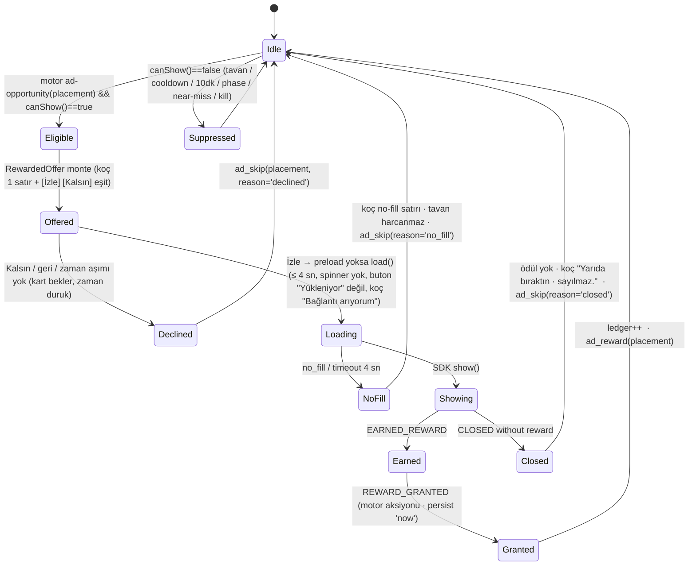
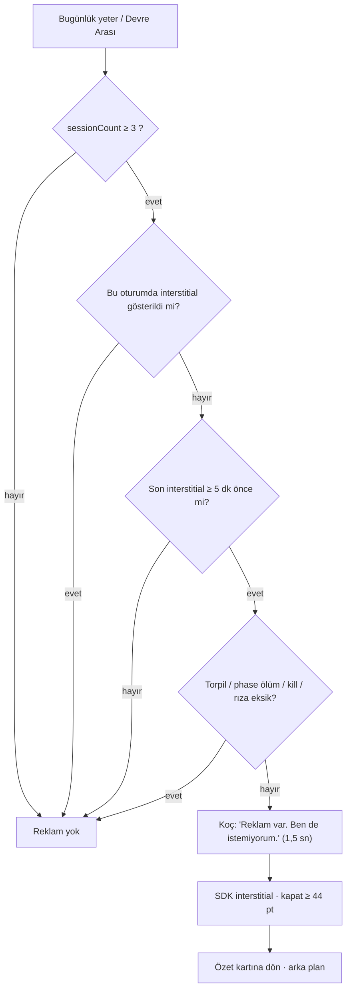
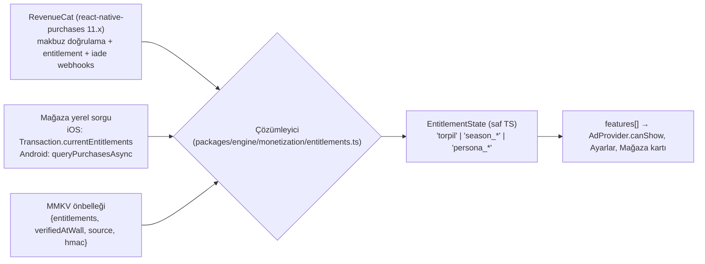

# 06 — Monetizasyon ve Mağaza Uyumu: Torpil, Rewarded Yerleşimleri, Interstitial Kuralı, Sezon Paketi, Entitlement, Rıza Akışları

> **Belge türü:** Ayrıntılı sistem tasarımı (Motto tasarım paketi, doküman 06/11). Üstünde `00-VIZYON-ve-KARARLAR.md` (D-001..D-067; **§12 > §11**) ve T9 (hukuk) vardır; bu belge D-kararlarını **uygular**, tartışmaz. 00'ın kapsamadığı yerde karar verir ve bunu `D-ÖNERİ-06-xx` olarak §7'de listeler.
> **Sürüm:** v1.0 · 2026-11-07 · Sahip: Monetizasyon ve mağaza uyumu tasarımcısı · Girdi: 00 (tümü, özellikle §8 ve §12), T6 (tümü), T9 (tümü), T5/T1 (TL;DR), konseptler A1–A4 (Torpil/rewarded örnekleri), kardeş dokümanlar 02 (`healthCritical`, `deathFlow`), 03 (`tactic:true`, near-miss), 05 ("satılmaz" listesi), 07 (Mağaza ekranı, `RewardedOffer`, `AdSlot`, rıza kartları), 08 (`ST-08`, `ST-09`, KVKK belgeleri), 10 (`IapProvider`, `AdProvider`, `ConsentGate`).
> **Tek cümlelik özet:** Rewarded-first + tek seferlik Torpil + sabit içerikli Sezon Paketi; interstitial yalnızca gönüllü oturum sonunda ve oturumda ≤ 1; ölüm akışında hiçbir ticari yüzey yok; her fiyat ekranı Reklam Kurulu'na, Apple 5.6'ya ve DMCC'ye aynı cümleyle anlatılabilir.

---

## 0. Künye — uygulanan D-kararları, bağımlı dokümanlar, sürüm

### 0.1 00 §5'teki satır

| # | Dosya | Sahip olduğu sistemler | 00'daki ana karar |
|---|---|---|---|
| 06 | `docs/design/06-monetizasyon-ve-magaza-uyumu.md` | Torpil, rewarded yerleşimleri (Ek Antrenman, Forma Sponsoru, Taktik Değişikliği, Fizyoterapi), interstitial kuralı, Sezon Paketi, fiyatlar, RevenueCat, Apple 3.1.1/2.5.18/Google Better Ads, UMP/ATT | §8; D-007, D-008, D-038–D-041 |

### 0.2 Uygulanan D-kararları (her biri bir somut tasarım ögesine bağlanır)

| Karar | Bu belgede nasıl uygulandı |
|---|---|
| **D-004** | Kader, Gişe 7 = `torpil` entitlement'ının açtığı ikinci kişilik; mağaza kartında adı geçer ama satırı geçmez; mağaza ekran görüntülerinde ve ilk 60 sn'de görünmez (§2.2.2, §3.1). |
| **D-005** | "rüşvet/bribe" hiçbir SKU adında, buton metninde, koç satırında, ürün kimliğinde (`productId`) ve analytics event adında yok; `ST-10` lint bu belgenin tüm metinlerini tarar (§5.1). |
| **D-007** | `deathFlow` ve Roast Raporu'nda `AdProvider.canShow` her yerleşim için derleme düzeyinde `false`; Fizyoterapi ölümden **önceki** sağlık-kritik yılın doğum gününde (02 §2.4.6); ölümden dönüş hiçbir biçimde satılmaz, bilet de geçmez (§2.3.4, §2.4). |
| **D-008** | Interstitial yalnızca `sessionEnd` ("Bugünlük yeter") ve `halfTime` (Devre Arası, 25. dk) bağlamlarında; oturumda ≤ 1; ilk 2 oturumda 0; ölüm → yeni hayat akışında asla. T6'nın ve brief'in "ölüm özeti sonrası / ≤ 3 oturum" kuralı **uygulanmaz** (§2.4). |
| **D-010** | 12 kozmetik damga varyantı **kazanılır**, satılmaz; Torpil'in "Mürekkep Seti" ayrı ve yalnızca renk (§2.2.2). |
| **D-029 / D-055** | Streak, Sakatlık İzni, Telafi, Kondisyon, Teşhis, Kamp skoru, stat editörü, rastgele kutu: katalogda yok; "Satılmayanlar" listesi `catalog.ts`'te negatif test olarak kodlanır (§2.2.5, AC-06-04). |
| **D-037** | AdMob `maxAdContentRating = 'T'`, `tagForChildDirectedTreatment = false`, `tagForUnderAgeOfConsent = false`; MA yalnızca Android TR soft launch'ında 14 günlük uzak-konfig A/B'si (§2.7.5). |
| **D-038** | Torpil tek seferlik non-consumable, 199,99 ₺ / 6,99 $; kapsam: interstitial yok, Kader + 1 ek kişilik, karne temaları, defter dışa aktarımı, sınırsız arşiv, 3 kayıt yeri; güç/stat/Kondisyon yok; Ayarlar'da her zaman, teklif 2. ölümden sonra bir kez (§2.2.2, §2.5). |
| **D-039** | Dört rewarded yerleşimi, tavanlar (günde 6, 120 sn cooldown, Ek Antrenman yılda 1, Taktik günde 2, Fizyoterapi ömürde 1), ilk 10 dk reklamsız, ödül yalnızca tamamlanınca ve daima, near-miss gününde hiçbir teklif (§2.3). |
| **D-040** | Sezon Paketi sabit içerikli non-consumable; içindekiler sayıyla yazılı; rastgelelik yok; "en popüler" rozeti yok; paket satıştan **kalkmaz** (§2.2.3). |
| **D-041** | Abonelik yok; `IapProvider` abonelik tipini kabul etmez (tip düzeyinde); 6. ay değerlendirmesi §7'de (§2.2.1). |
| **D-043** | RevenueCat `react-native-purchases` 11.x birincil, `expo-iap` 6.4.x yedek, aynı `IapProvider`; `react-native-google-mobile-ads` 17.x (16.5 pini); hepsi 10 §2.4.8–2.4.9 ile aynı arayüz (§2.6). |
| **D-054** | ATT ön-ekranı, KVKK aydınlatma + **ayrı** açık rıza, EEA/UK/CH'de UMP; rıza öncesi reklam/analitik SDK başlatılmaz; oyun hiçbir rızaya bağlı değil (§2.7). |
| **D-061 / D-066 / D-067** | Tavan birimleri yeniden tanımlandı: "yılda 1" = karakter yaşı (doğum günü sınırı), "günde 2/6" = cihazın yerel takvim günü; "yıl başı" = doğum günü kartı; Forma Sponsoru maaş **akışını** çarpar (D-067); zaman akarken (D-066) hiçbir reklam yüzeyi otomatik açılmaz, yalnızca durmuş anlarda (§2.3.1). |
| **D-060** | Bu belge D-kararlarını uygular; yeni kararlar §7.3'te D-ÖNERİ-06-xx. |

### 0.3 Bağımlı dokümanlar ve arayüzler

| Doküman | Bu belgeye verdiği | Bu belgeden aldığı |
|---|---|---|
| **02** | `healthCritical` tanımı (Sağlık < 15 ∨ hazard(yıl+1) ≥ 0,20; yaş ≥ 28), Fizyoterapi etkisi (Sağlık +15, o yılın hazard zarı atlanır), `DeathFlowContext` reklam API'siz | Fizyoterapi teklif kabul oranı hedefi (%25–45) |
| **03** | `choices[].tactic:true`, `ad-opportunity` efekti, `outcome` zar kanalı, near-miss işareti, `wager` çözüm bilgisi | `REROLL_OUTCOME` aksiyonu (Ek Antrenman) ve Taktik seçeneğinin görünürlük kuralı |
| **05** | "Satılmaz" listesi; Sezon Paketi'nin +12 Kamp teması; Kondisyon karne temaları (ayrı set) | Sezon Paketi'nin ücretsiz iz tanımı |
| **07** | `RewardedOffer`, `AdSlot`, `ConsentCard`, `PermissionPrePrompt` bileşenleri; Mağaza ekranı iskeleti | Mağaza kartı metinleri, buton eşitliği, rıza kart sırası |
| **08** | `ST-08` (rıza ekranı), `ST-09` (AdMob etiketleri), `ST-10` ("rüşvet"), KVKK belgeleri, `showcase` havuzu | Rıza zamanlaması (§2.7.1) — 08 §2.4 "ilk açılış" ile çelişir, §7'de |
| **10** | `IapProvider`, `AdProvider`, `ConsentGate`, HMAC önbellek, `AdLedger` | `playClockSinceInstall` düzeltmesi (sessionClock değil), `no_fill` davranışı, bilet defteri |
| **11** | KPI ağacı, soft launch kapıları | Monetizasyon KPI'ları ve event'leri (§2.10, §6.1) |

---

## 1. Amaç ve kapsam — MVP / Soft launch / 1.0

**Amaç:** Oyuncunun güvenini hiçbir anda bozmayan, publisher'ın bir bakışta anladığı, Türkiye'de kurulu şirket için şikâyet edilemez bir gelir modeli. İlke sırası: (1) güven (ölüm, near-miss, keder anları ticari değildir), (2) uyum (Apple/Google/Reklam Kurulu/KVKK aynı cümleyle), (3) gelir (rewarded-first, Torpil, Sezon Paketi). Sıra ters çevrilmez.

| Alan | **MVP (dikey kesit, 10 hafta)** | **Soft launch (TR + CA/NZ, 8 hafta)** | **1.0 (global)** |
|---|---|---|---|
| IAP | `torpil` canlı (RevenueCat sandbox + TestFlight/internal track), restore, HMAC önbellek; mağaza kartı tek ürün | + Kader kişiliği Torpil'de açılır; fiyat/paywall metni testi (storefront bazlı); `tickets_5` (Antrenman Bileti) | + `season_2701` (ilk Sezon Paketi) + 1 ek kişilik; persona paketi altyapısı hazır, satışta değil |
| Rewarded | Ek Antrenman + Forma Sponsoru (test kimlikleri); `AdLedger` tavanları; 10 dk kuralı | + Taktik Değişikliği + Fizyoterapi; gerçek kimlikler; mediation yok | + mediation değerlendirmesi (publisher şartıysa MAX) |
| Interstitial | `sessionEnd` yerleşimi iskelet (test kimliği) | `sessionEnd` + `halfTime` canlı | aynı |
| Rıza | `ConsentGate` tam sıra (KVKK kartları, ATT ön-ekranı, UMP debug coğrafyası) | avukat onaylı metinler; standart sözleşme bildirimi | aynı; Data safety/Privacy label güncel |
| Model | — | ARPDAU ölçümü, TR eCPM gerçeği (kill kuralı §2.9.4) | 3 senaryo gerçek veriyle güncellenir |
| Dışarıda | Sezon Paketi, bilet, persona paketi, MA A/B, mediation | persona paketi, abonelik | abonelik (6. ay kararı), banner (hiç), Saha (D-006) |

**MVP kapsam dışı ama iskeleti var:** ürün kimlikleri ve entitlement adları MVP'de sabitlenir (`torpil`, `season_*`, `tickets_5`, `persona_*`), çünkü App Store Connect / Play Console'da sonradan ad değiştirilemez.

---

## 2. Tasarım

### 2.1 Beş ilke (her yerleşim bu beşinden geçer)

1. **Reklam, koçun ağzından ama koçun yalanı değil.** Motto mekanik, para ve reklam hakkında asla yalan söylemez (00 §3.1 "Kusurları"); her teklif "ne verir, kaç saniye, kaç kez" diye açık söyler.
2. **Ticari yüzey yalnızca duran zamanda.** D-066'da zaman akar; hiçbir teklif akan zamanı kesmez. Teklifler yalnızca motorun zaten durduğu anlarda (karar bekleme, doğum günü kartı, "Bugünlük yeter", Devre Arası) ve her zaman oyuncunun bir eylemi bittikten, yenisi başlamadan önce (Google "beklenmedik" yasağı).
3. **Ölüm, near-miss, keder: sıfır ticaret.** `deathFlow`, Roast Raporu, Yeni Müşteri, near-miss günü, düşük Keyif protokolü (D-052), sessizlik kuralı: hiçbir teklif, hiçbir mağaza girişi, hiçbir "ödül" vaadi.
4. **Ödül daima, tam, hemen.** Reklam tamamlandıysa ödül verilir (ağ geri dönse bile); tamamlanmadıysa verilmez ve oyuncu "neden" görür. Hiçbir ödül mağaza stoğuna, zamana, kişiye bağlı değildir.
5. **Satın alma akışında roast kapalı.** Mağaza ve teklif kartlarında koç "Normal"in de altında, `slot: purchase` sesindedir: bilgi verir, iğnelemez, utandırmaz, "hayır"ı eşit boyutta kabul eder.

### 2.2 SKU kataloğu

#### 2.2.1 Katalog tablosu (fiyatlar KDV dahil, mağaza objesinden okunur; kodda fiyat yazısı yok)

| `productId` | Tür | ABD | TR (manuel storefront) | Kapsam | Faz |
|---|---|---|---|---|---|
| `torpil` | non-consumable | **6,99 $** | **199,99 ₺** | Tüm interstitial'lar kapalı (rewarded opsiyonel kalır, ödüller aynı); **Kader, Gişe 7** + 1 ek kişilik (1.0); 6 karne teması; Mürekkep Seti (4 damga mürekkebi); Koçun Defteri sınırsız arşiv (ücretsizde son 3 KAPANDI defter); defter dışa aktarımı (JSON/metin); 3 kayıt yeri (ücretsizde 1) | MVP |
| `tickets_5` | consumable | 0,99 $ | 29,99 ₺ | **Antrenman Bileti ×5**: reklam yerine bilet; Ek Antrenman, Taktik Değişikliği ve Forma Sponsoru için geçerli; **Fizyoterapi için geçersiz**; tavanlar reklamla aynı (bilet tavan açmaz); süresi dolmaz; cihazda kalır | Soft launch |
| `season_2701` (sezon başına yeni id: `season_YYQn`) | non-consumable | 3,99 $ | 119,99 ₺ | **Sezon Paketi**: 12 Kamp teması + 40 olay (2 locale, tam metin) + 1 koç kişiliği + 2 karne teması; içindekiler sayıyla yazılı; sezon bittikten sonra da satışta ("arşiv" etiketiyle) | 1.0 |
| `persona_<ad>` | non-consumable | 2,99 $ | 89,99 ₺ | Tek koç kişiliği (Sezon Paketi'nde çıkmış bir kişilik, sezonun ardından tek başına) | 1.0 sonrası |

**Kurallar:** hiçbir üründe rastgelelik (Apple 3.1.1 oran yükümlülüğü doğmaz; Belçika/Hollanda riski sıfır); hiçbir ürün abonelik değil (D-041; `IapProvider.purchase` yalnızca `'non_consumable' | 'consumable'` kabul eder, `'subscription'` tipi derlenmez); hiçbir üründe gerçek para karşılığı sanal para yok (CPC/DFA sanal para kuralları bize uygulanmaz; bilet bir "jeton" değil, belirli bir eylemin adıdır ve ekranda adet olarak görünür, "bakiye" olarak değil).

#### 2.2.2 Torpil — kapsam, dil, sınırlar

- **Adı iki dilde de "Torpil"** (00 §9). EN alt açıklama: *"the nepotism pass"*. Mağaza vitrininde (4+ havuz) EN alt açıklama *"the connections pass"* kullanılır; "nepotism" yalnızca uygulama içi kartta (D-ÖNERİ-06-01: vitrin sözcüğü ile uygulama içi sözcük ayrışır; 2.3.8 ve `showcase` havuzu).
- **Verdikleri bir menü değişikliğidir, hayat değişikliği değil** (00 §8 satırı). Torpil ile açılan hiçbir şey stat, Para, hazard, Kondisyon, Teşhis, Kamp skoru, iddia oranı etkilemez. Harness testi: Torpil açık/kapalı 10.000 hayat → ölüm yaşı, Para persentilleri, koç isabeti **istatistiksel olarak aynı** (AC-06-05).
- **Sürüm kapılı pazarlama:** mağaza kartı yalnızca o build'de **gerçekten açılan** ögeleri sayar. MVP kartı "reklam yok + sınırsız arşiv + 3 kayıt yeri + karne temaları + dışa aktarım" der; Kader satırı soft launch build'inde, "iki ek koç kişiliği" satırı yalnızca 1.0'da görünür. Olmayan şey vaat edilmez (Reklam Kurulu aldatıcı reklam; Apple 2.3.1). Kart metni `catalog.ts`'ten değil, entitlement'ın o build'de açtığı `features[]` listesinden üretilir.
- **Rewarded, Torpil'de de yerinde kalır** (D-038, T2'nin "aldım yine reklam görüyorum" şikâyeti tersine): Torpil sahibi için `RewardedOffer` aynı yerde, aynı ödülle görünür; isterse izler. İnterstitial `canShow` → `false`.
- **Fiyat politikası:** Apple otomatik dönüşümü 6,99 $ için ≈ 349,99 ₺ verir; 199,99 ₺ **baz fiyattır**, indirim değildir; hiçbir ekranda "indirim", "%43", üstü çizili fiyat yok (Reklam Kurulu "sahte indirim"). İki mağazada aynı ₺; kur güncellemesi yılda 2 kez elle, iki mağazada aynı gün (T6 D.3.5).
- **Teklif anları (yalnızca üç):** (a) Ayarlar › Torpil, her zaman; (b) Mağaza sekmesi ("Daha" menüsü), her zaman; (c) **2. ölümden sonra, Yeni Müşteri'ye basıldıktan ve yeni hayatın ilk kartı görüldükten sonra**, ömür boyu bir kez, inline kart (D-038). Ölüm/Roast akışının içinde değil, sonrasında ve yeni hayat başladıktan sonra (D-007/D-016). Arşiv sınırı toast'ı (07 §2.2.x: "Torpil'de raf sınırsız; satış değil, bilgi.") bir teklif sayılmaz, buton taşımaz.

#### 2.2.3 Sezon Paketi — offline sezon izi, ücretsiz + premium

Sezon = takvim çeyreği; `seasonId = 'YYQn'`, seed = `hash(seasonId + locale + contentHash)`. Backend yok: ücretsiz izin içeriği uygulama paketinde, premium içerik imzalı JSON paketinde (10 §EAS Update) ama **entitlement olmadan açılmaz**.

| | **Ücretsiz iz (herkes)** | **Premium (Sezon Paketi IAP)** |
|---|---|---|
| Kamp | Haftalık Kamp sezon temasından seçilir (05'in 16 temasından sezon alt kümesi) | +12 sezon teması (05 ile aynı şema) |
| Olay | 0 yeni olay (çekirdek havuz) | +40 olay, 2 locale, tam metin; 70/20/10 kuralı |
| Kişilik | — | +1 koç kişiliği |
| Karne | 1 sezon damgası (kazanılır: sezonda ≥ 1 Kamp tamamla) | +2 karne teması |
| Teşhis | 1 sezon Teşhisi (kazanılır) | aynı (Teşhis satılmaz) |
| Zaman mesajı | Yalnızca gerçek takvim: "Sezon 31 Mart'ta biter" (gerçek, sunucusuz) | aynı; **paket satıştan kalkmaz** |

**Karar: paket süresiz satışta kalır** (D-ÖNERİ-06-02). Böylece Apple 3.1.1 "süre dolmaz" tartışması, DMCC/Reklam Kurulu "sahte zaman sınırı" riski ve T6 açık soru 12 aynı anda kapanır. Sezonun bitmesi yalnızca ücretsiz izin temasını değiştirir; satın alınan içerik kalıcıdır ve sonraki sezonlarda da oynanır. Kart metninde "sınırlı süre" ifadesi lint BLOK (`ST-11`, §5.1).

#### 2.2.4 Antrenman Bileti (tek tüketilebilir)

- **Ne:** reklam izlemenin yerine geçen bilet. Teklif kartında üçüncü buton olarak **değil**, [İzle] butonunun altında küçük bir satır: *"Bilet: 3 · Bilet kullan"*. Bilet yoksa satır görünmez (mağaza linki de görünmez; bilet satın alma yalnızca Mağaza'dadır — teklif kartından mağazaya geçiş **yok**, aksi "reklam izle ya da öde" baskısına dönüşür).
- **Tavan açmaz:** Ek Antrenman yılda 1, Taktik günde 2, Forma doğum gününde 1 — bilet bu sayaçları paylaşır. Günlük rewarded tavanı 6 bilete uygulanmaz (reklam izlenmiyor), ama yerleşim tavanları uygulanır.
- **Fizyoterapi'de geçersiz:** ölüme yakın hiçbir şey parayla alınmaz, dolaylı olarak bile (D-007'nin ruhu; D-ÖNERİ-06-03).
- **Süresi dolmaz; cihazda kalır.** Mağaza kartında: *"Biletler bu cihazda saklanır."* (consumable'lar mağazalarda geri yüklenmez; dürüst beyan).

#### 2.2.5 Satılmayanlar (negatif katalog, kodda test)

Streak · Sakatlık İzni · Telafi · ölümden dönüş · ömür uzatma · Kondisyon · Teşhis · Kamp skoru · stat/Para düzenleme · iddia oranı · zarf açma · "hızlı yaşa" hızı · bildirim · rastgele kutu · abonelik · banner alanı · Fazla Bagaj'ı atma (D-018). `catalog.spec.ts` bu listedeki her kavram için "hiçbir `productId` ve hiçbir `features[]` girdisi bu etiketi taşımaz" testini koşar (AC-06-04).

#### 2.2.6 Veri modeli

```ts
// packages/engine/monetization/catalog.ts — saf TS, mağaza bağımsız
export type Sku = 'torpil' | 'tickets_5' | `season_${string}` | `persona_${string}`;
export type EntitlementId = 'torpil' | `season_${string}` | `persona_${string}`;
export type Feature =
  | 'ads.interstitial.off' | 'persona.kader' | 'persona.extra'
  | 'report.themes.torpil' | 'stamp.inks' | 'notebook.archive.unlimited'
  | 'notebook.export' | 'profiles.3'
  | `season.${string}.camps` | `season.${string}.events` | `season.${string}.persona` | `season.${string}.themes`;

export interface Product {
  id: Sku;
  kind: 'non_consumable' | 'consumable';          // 'subscription' yok (D-041)
  grants: ReadonlyArray<Feature>;                  // consumable için [] — bilet ayrı defterde
  availableFrom: 'mvp' | 'soft' | 'v1';           // kart metni bu build'de açılanları sayar
  randomness: false;                               // tip düzeyinde sabit (D-040)
}

export const NEVER_SOLD = ['streak','injuryLeave','makeup','deathReturn','lifeExtension',
  'kondisyon','diagnosis','campScore','statEdit','wagerOdds','envelope','speed',
  'notification','lootBox','subscription','banner','excessBaggage'] as const;
```

### 2.3 Rewarded yerleşimleri (koç ağzında)

#### 2.3.1 Birimler (D-061/D-066/D-067 sonrası)

| Terim | Anlamı |
|---|---|
| "günde" | Cihazın **yerel takvim günü** (00:00 sınırı); cihaz saati geri alınırsa sayaç **artmaz**, ileri alınırsa sıfırlanmaz (monotonik `dayKey` + `max(seen)`); kötüye kullanım cezasız, tavan korunur |
| "yılda" | **Karakter yılı**; sınır doğum günü kartı |
| "ömürde" | Bir hayat (`lifeId`) |
| "ilk 10 dakika" | Kurulumdan itibaren **toplam oyun süresi** (`playClockSinceInstall`, yalnızca ön planda ve bir hayat içinde sayılır) < 10 dk → hiçbir reklam yüzeyi (D-ÖNERİ-06-04; 10 §2.4.9'daki `sessionClock` bu alanla değiştirilir) |
| "cooldown 120 sn" | İki rewarded **gösterimi** arasında gerçek zaman ≥ 120 sn; teklif kartı cooldown içinde **monte edilmez** (gri buton yok) |
| Duran zaman | Teklif yalnızca motorun `paused` olduğu anlarda: karar bekleme (`awaitingChoice`), doğum günü kartı, oturum sonu, Devre Arası |

#### 2.3.2 Yerleşim tablosu

| # | Yerleşim | Tetik (motor `ad-opportunity`) | Ödül | Tavan | Asla |
|---|---|---|---|---|---|
| R1 | **Ek Antrenman / Extra Practice** | Olay sonucu `valence ≤ −1` ve `outcome.death` yok ve `nearMiss` değil ve o gün iddia **çözülmemiş** ve ilk yıl (elle yazılmış) değil | `REROLL_OUTCOME`: aynı olay, aynı seçim, `outcome` kanalı `attempt=2` ile yeniden atılır; sonuç daha kötü olabilir, koç bunu önceden söyler | Karakter yılında 1; günlük 6'ya dahil | `deathFlow`; near-miss günü; damga basılmış gün ("mürekkep kurudu"); senaryo ölümü olayı |
| R2 | **Forma Sponsoru / Jersey Sponsor** | Doğum günü kartı (Kısa Karne'den sonra, Tek Hedef'ten önce), karakter çalışıyor ve maaş akışı > 0 | Gelecek 12 ayın maaş akışı ×2 (D-067 akış modeli); Durum şeridinde "Forma: SPONSOR" rozeti | Doğum gününde 1; **2 karakter yılı arayla** (D-ÖNERİ-06-05); günlük 6'ya dahil | İşsizken; emeklilikte (emekli geliri çarpılmaz); 60+ yaşta |
| R3 | **Taktik Değişikliği / Tactical Change** | 2 seçenekli olayda `choices[].tactic:true` varsa | 3. seçenek açılır (aynı stil, önceden işaretli değil, "30 sn" etiketi) | Yerel günde 2; aynı olayda 1; günlük 6'ya dahil | Near-miss günü (03 §near-miss); ilk yıl; iddia fişli günde `tactic` seçeneği iddiayı **etkilemez** (iddia yalnızca ilk iki seçeneğe bağlıdır; 03) |
| R4 | **Fizyoterapi / Physio** | `healthCritical` (02 §2.4.6) hesaplandıktan sonra, **sonraki doğum günü kartında**, hazard zarından önce | Sağlık +15; o yılın hazard zarı atlanır (02) | Ömürde 1 | Ölüm akışında; Sağlık ≤ 0 "son evre" arkı başladıktan sonra (02 D-ÖNERİ-02-07: o noktada teklif geçmiştir); bilet geçersiz |

**Global:** günde ≤ 6 rewarded gösterimi (yerleşim fark etmez) · gösterimler arası ≥ 120 sn · `playClockSinceInstall` < 10 dk → yok · ödül yalnızca `EARNED_REWARD` olayında · `no_fill`/`error` → ödül yok, koç tek satır, tavan **harcanmaz** · Torpil sahibi için aynı ödüller, aynı tavanlar.

#### 2.3.3 Teklif durum makinesi



Kritik sıra: `Earned → Granted` **persist edilir**, sonra SDK kapanış animasyonu beklenir. Uygulama ödül anında ölürse açılışta `pendingGrants[]` tekrar oynatılır (idempotent, `rewardId = hash(lifeId, dayIndex, placement)`).

#### 2.3.4 Ek Antrenman'ın motor sözleşmesi

```ts
// engine aksiyonu; UI yalnızca AdProvider 'rewarded' döndürünce gönderir
type Action = { type: 'REROLL_OUTCOME'; eventId: string; choiceIdx: number; rewardId: string };

function rerollOutcome(st: State, a: Action): StepResult {
  const day = st.today;
  assert(day.eventId === a.eventId && day.resolved && !day.wagerResolved && !day.nearMiss && !day.outcome.death);
  assert(st.ledger.extraPractice.year !== st.character.ageYear);          // yılda 1
  const rng = rngOutcome(seed(st.lifeId, day.index), /*attempt*/ 2);     // deterministik, kayıtlı
  const outcome = resolveOutcome(day.event, a.choiceIdx, rng);           // daha kötü olabilir
  const undo = invert(day.appliedDeltas);                                 // D-067 durum değişiklikleri de geri alınır
  return apply(st, [...undo, ...outcome.deltas], { ledger: { extraPractice: { year: st.character.ageYear } } });
}
```

İddia çözümü **yeniden açılmaz**: damga basıldıysa Ek Antrenman o gün yok; bu, "koç sonucu asla etkilemez" (D-009) ve "damga ritüeli" (D-010) ile çelişmemek içindir. Kalıp Dedektörü ilk seçimi sayar (reroll bir seçim değildir).

#### 2.3.5 `AdLedger`

```ts
export interface AdLedger {
  dayKey: string;                       // yerel 'YYYY-MM-DD', monotonik
  shownToday: number;                   // ≤ 6
  lastShownAtWall: number;              // cooldown 120 s
  tacticToday: number;                  // ≤ 2
  extraPracticeYear?: number;           // karakter yaşı
  sponsorLastYear?: number;             // doğum günü yılı; ≥ +2
  physioUsed: boolean;                  // ömürde 1 (lifeId'ye bağlı)
  tickets: number;                      // Antrenman Bileti bakiyesi (cihaz)
  pendingGrants: ReadonlyArray<{ rewardId: string; placement: Placement }>;
}
```

Persist: MMKV (sıcak) + SQLite `ledger` (kalıcı), her değişimde `persist:'now'`.

### 2.4 Interstitial kuralı (00 ile tutarlı çözüm)

**Çatışma ve karar.** T6 §6.3 ve bu belgenin brief'i "yalnızca ölüm özeti sonrası, ≤ 3/oturum, ≥ 5 dk ara" der. 00 D-008 (bağlayıcı, §8'de gerekçeli sapma) interstitial'ı **gönüllü oturum sonuna** taşır: ölüm → yeni hayat akışında **asla**, oturumda **≤ 1**, ilk 2 oturumda **0**. Hiyerarşi gereği D-008 uygulanır; T6'nın kalan kuralları (5 sn kapatma, seçimden hemen sonra yok, gün/segment başında yok, ≥ 5 dk ara) D-008'in **altında** ek kısıt olarak korunur.

| Kural | Değer | Dayanak |
|---|---|---|
| Yerleşim | Yalnızca `interstitialSessionEnd` ("Bugünlük yeter" özet kartından **sonra**, paylaşım kartından sonra, uygulama arka plana gitmeden önce) ve `interstitialHalfTime` (25. dakikada tek seferlik Devre Arası, koç "Mesai bitti" satırından sonra) | D-008 |
| Oturumda | ≤ 1 (ikisinden biri) | D-008 |
| Oturum sayısı | `sessionCount ≥ 3` | D-008 |
| Ara | Son interstitial'dan ≥ 5 dk gerçek zaman (oturumlar arası da sayılır: kapat-aç ile ikinci reklam yok) | T6 |
| Ölüm | `phase ∈ {dying, dead, roast, newClient}` → `false`; ölümden sonraki ilk "Bugünlük yeter" de **reklamsız** (oyuncu ölümden sonra 1 gün bile oynamadıysa; D-ÖNERİ-06-06) | D-007 |
| Seçim / gün başı | Bir seçimin hemen ardından ve gün kartı açılırken asla (zaman akarken reklam yok; D-066) | Google Better Ads "segment başı" |
| Format | AdMob standart interstitial (görsel veya video); rewarded-interstitial formatı **kullanılmaz**; özel oynatıcı yok; kapatma butonu SDK'nın (≥ 44 pt); Google "15 sn'de kapatılabilir" şartı format gereği sağlanır; biz ek olarak **5 sn sonra kapatılamayan kreatif gelen ağları** mediation'dan çıkarırız (kontrol: haftalık "ads smoke" kaydı) | Apple 2.5.18, Google Ads policy |
| Duyuru | Reklamdan 1,5 sn önce koç satırı (*"Reklam var. Ben de istemiyorum. Maaşım buradan."*) — "beklenmedik" olmaz; **bu satır bir buton değildir**, oyuncu "Bugünlük yeter"i zaten seçmiştir | Google "beklenmedik tam ekran" |
| Torpil | `false` | D-038 |
| Kill-switch | `kill.placements` uzak konfig (imzalı JSON) ile anında kapanır | 10 |
| Bildirme | Ayarlar › "Son reklamı bildir": son 5 interstitial/rewarded'ın `responseInfo` kimliği ile e-posta şablonu | Apple 2.5.18 (uygunsuz reklam bildirme) |



Gelir notu: D-008, T6'nın 1,2–1,5 interstitial/DAU varsayımını ~0,9–1,1'e indirir; model §2.9'da buna göre düzeltilmiştir.

### 2.5 Satın alma UX (karanlık desensiz)

#### 2.5.1 Mağaza ekranı (07 §2.2.10 iskeleti üzerine)

Tek sütun, "Resmî Evrak" kartı. Sıra: (1) Torpil kartı (ad, 5 satırlık kapsam listesi — yalnızca bu build'de açılanlar —, fiyat `priceString`, "Tek seferlik · abonelik değil · KDV dahil", tek birincil buton [Satın al], hemen altında aynı boyutta ikincil [Şimdi değil]); (2) Antrenman Bileti kartı (soft launch); (3) Sezon Paketi kartı (1.0; içindekiler sayıyla); (4) **[Satın alımları geri yükle]** her zaman görünür, kartların altında ama katlanmamış; (5) iade satırı: *"İade için: App Store / Google Play."* + derin link; (6) hukuki satır: *"Fiyatlar KDV dahildir. Satın almalar mağaza hesabınıza bağlıdır; biletler bu cihazda saklanır."*

**Yasak** (lint `ST-08`, `ST-11`, 07 bileşen testi): geri sayım, "son X", "en popüler" (gerçek veri yoksa; v1'de hiç), üstü çizili fiyat, önceden seçili paket, "Hayır, reklam izlemeyi seviyorum" tipi utandırma, kapatma X'inin gecikmesi, satın alma kartının oyun akışını kesmesi, fiyatın kodda yazılması, "ücretsiz dene" (deneme yok), ödeme bilgisi kaydı (yok), çift onay yerine tek dokunuşla satın alma dışı "kaydırarak onayla" numarası.

#### 2.5.2 Koç sesi (`slot: purchase`)

Ses ayarından bağımsız; roast 0; lift yok; bilgi + bir parça kuru mizah; "yap" yok. Reddetmeye tepki **yok** (kart kapanır, koç susar). Satın alma sonrası tek satır; iade sonrası tek nazik satır (§3.3).

#### 2.5.3 İade

- İade kararı mağazanındır (T9 §2.2: cayma hakkı yok, mağaza iade politikası geçerli). Biz: (a) RevenueCat `REFUND`/`revocationDate` sinyali gelince entitlement'ı **sessizce** kapatırız, (b) kapanışta koç tek satır, (c) hiçbir "neden iade ettin" ekranı, hiçbir "geri al" teklifi, (d) Torpil'in açtığı kozmetikler kapanır, arşivdeki defterler **silinmez** (son 3 görünür, gerisi gizli, tekrar satın alınırsa geri gelir), (e) harcanmış biletler geri alınmaz, harcanmamışlar iade edilen paket kadar düşer, bakiye asla negatif olmaz (T9 §6 "kilitleme, negatif bakiye değil").
- **Bilgi:** Ayarlar › Yardım › "İade nasıl?" iki platform için iki satır (§4).

### 2.6 Entitlement mimarisi

#### 2.6.1 Kaynaklar ve çözümleme



**Kural (T6 §2.4 ile aynı, netleştirilmiş):**
1. Herhangi bir kaynak **doğruladı** → aç (en geniş küme).
2. Tüm erişilebilir kaynaklar **iptal/iade** diyor → kapat, önbelleği düşür, koç tek satır.
3. Hiçbir kaynak erişilemiyor (offline) → **önbellek** (HMAC doğruysa) geçerli; **süre sınırı yok** (non-consumable; D-ÖNERİ-06-07). RevenueCat Offline Entitlements tek seferlik ürünleri kapsamadığı için (T6 §2.4) bu önbellek bizim sorumluluğumuzdur.
4. HMAC bozuk → önbellek yok sayılır, çevrimiçi uzlaşma beklenir; o ana kadar ücretsiz davranış (reklam var); koç yorum yapmaz.

Her çevrimiçi açılışta (ve `AppState` → `active`) uzlaşma; 24 saatte en fazla 4 uzlaşma (pil/ağ). `onEntitlementsChanged` → `features[]` anında yeniden hesaplanır; oturum ortasında Torpil gelirse bir sonraki interstitial fırsatı sessizce `false`.

#### 2.6.2 Önbellek

`hmac = HMAC-SHA256(deviceKey, canonicalJson({entitlements, verifiedAtWall, source, appUserId}))`; `deviceKey` 32 bayt, `expo-crypto.getRandomBytes`, SecureStore (iOS Keychain `AfterFirstUnlock`, Android Keystore). Önbellek hiçbir zaman "kırılamaz" diye pazarlanmaz (10 §2.4.8 ile aynı). Cihaz yedeklerinde (iCloud/Google yedek) `deviceKey` taşınmaz → yeni cihazda önbellek geçersiz → `restore()` zorunlu ve kolay.

#### 2.6.3 Satın alma ve geri yükleme akışı

```
purchase(sku):
  r = provider.purchase(sku)                        # RC → StoreKit2 / PBL
  switch r.status:
    'ok'        → grant(r)                           # aşağıda
    'pending'   → ui.toast(T:"Ödeme bekliyor. Mağaza onaylayınca açılır.")  # Android PENDING; entitlement VERME
    'cancelled' → nothing (koç sessiz)
    'failed'    → ui.toast(T:"Mağaza cevap vermedi. Para çekilmediyse sorun yok; çekildiyse Geri Yükle.")

grant(r):
  if r.kind == 'non_consumable':
      ent = verifiedEntitlements(r)                  # RC doğruladı ya da yerel imza (expo-iap yolunda)
      cache.write(ent, hmac)                         # ÖNCE kalıcı
      provider.finish(r)                             # SONRA finish/acknowledge (≤ 60 sn; Android 3 gün kuralı)
  else: grantConsumable(r)                           # §2.6.4

restore():                                           # Apple 3.1.1; Android'de de buton var
  ents = provider.restore()                          # RC restorePurchases (anonim appUserID transfer)
  cache.write(ents, hmac); ui.toast(ents.size ? T:"Torpil geri yüklendi. Menü değişti." : T:"Bu mağaza hesabında satın alma bulunamadı.")
```

**Anonim kimlik:** RC `appUserID` = cihazda üretilen UUID (SecureStore); hesap yok, e-posta yok. Mağaza hesabı aynıysa yeni cihazda `restore()` entitlement'ı taşır (RC transfer davranışı: `TRANSFER_IF_EXISTING_SUBSCRIBER` yerine **`KEEP_WITH_ORIGINAL_APP_USER_ID` değil, `TRANSFER`** seçilir ki tek seferlik satın alma yeni cihaza geçsin; iki cihazda aynı anda açık kalması kabul edilen risk, §2.6.6).

#### 2.6.4 Tüketilebilir idempotensi (bilet)

```
grantConsumable(r):
  key = r.platform == 'ios' ? r.transactionId : r.purchaseToken      # mağaza birincil anahtarı
  if ledger.consumed.has(key): provider.finish(r); return               # tekrar işlem → sadece finish
  tx:
    ledger.tickets += 5
    ledger.consumed.add(key)                                            # aynı transaction'da
    persist 'now'
  provider.finish(r)                                                    # iOS finish / Android consumeAsync
  # çökme senaryoları:
  #  - persist'ten önce çökerse: mağaza işlemi 'unfinished' kalır → açılışta tekrar gelir → key yok → verilir (1 kez)
  #  - persist'ten sonra, finish'ten önce çökerse: açılışta tekrar gelir → key var → yalnızca finish
```

`consumed` kümesi 500 anahtarla sınırlı halka; ötesi SQLite'ta. Bilet harcama da idempotent: `spend(rewardId)` aynı `rewardId` ile ikinci kez çağrılırsa no-op.

#### 2.6.5 Play Billing sürüm kapısı (CI)

`./gradlew :app:dependencies --configuration releaseRuntimeClasspath | grep com.android.billingclient` çıktısı **≥ 8.0.0** değilse CI kırmızı; hedef **9.x** (T6: PBL 7 son tarihi geçti; PBL 8 son tarihi 31 Ağu 2027, PBL 9 31 Ağu 2028). Her yıl **Haziran** sprint'ine "PBL yükselt" görevi sabit. `react-native-purchases`/`expo-iap` güncellemelerinde PR şablonunda "billing changelog okundu" kutusu. Aynı test `react-native-google-mobile-ads` için GMA SDK sürümünü ve `maxAdContentRating` etiketini okur (`ST-09`).

#### 2.6.6 Dolandırıcılık riski beyanı (kabul edilen)

Korunacak sunucu ekonomisi yok. Tehditler: mod APK/IPA ile `torpil` açma, sahte makbuz araçları, iade sonrası içeriğin saatlerce açık kalması, iki cihazda aynı anda Torpil. Kayıp = o oyuncunun zaten ödemeyeceği Torpil. **Karar:** hafif koruma (StoreKit 2 JWS doğrulaması, Android RSA imza kontrolü `expo-iap` yolunda, RC doğrulaması, HMAC'li önbellek), sıfır sürtünme (root/jailbreak tespiti yok, lisans ping'i yok, çevrimdışı kilit yok). Ödeyen oyuncu hiçbir "doğrulama bekleniyor" ekranı görmez. Kalan risk publisher'a bir cümleyle anlatılır: *"Sunucu ekonomisi olmayan oyunda DRM, ödeyeni cezalandırır; biz cezalandırmıyoruz."*

### 2.7 Rıza akışları: KVKK + UMP + ATT

#### 2.7.1 Zamanlama kararı

08 §2.4 rıza kartlarını **ilk açılışa** (koçun ilk balonundan önce) koyar; 07 §2.3.4 **2. oturum başına, ilk `RewardedOffer`'dan önce**. 00 §4.2 (D-015: ilk kahkaha ≤ 4 sn; ilk 60 sn'de hiçbir izin sorusu yok) ikincisini zorunlu kılar. Hukuken mümkün çünkü rıza öncesi **hiçbir reklam/analitik SDK başlatılmaz, import bile edilmez** (10 §5.2): rıza istenmeden önce işlenen kişisel veri yoktur. **Karar (D-ÖNERİ-06-08):** `ConsentGate` = `playClockSinceInstall ≥ 10 dk` **veya** 2. oturum başı — hangisi önce — ve her durumda ilk reklam yüzeyinden önce; ilk 60 sn'de asla; bir karar kartı açıkken asla (zaman durmuşken ve kart kapanınca). Nötr yaş kapısı bu akışın parçası **değildir** (07 D-ÖNERİ-07-05: Müşteri Dosyası kartında; ayrı karar, 08/07/avukat). 08 §2.4'ün "ilk açılış" cümlesi §7'de çelişki olarak kaydedilir.

#### 2.7.2 Bölge matrisi

| Bölge (`expo-localization` + UMP coğrafya) | Kartlar (sıra) | SDK başlatma |
|---|---|---|
| **Türkiye** | (1) KVKK Aydınlatma kartı [Anladım] → (2) **ayrı** Açık Rıza kartı: iki anahtar, **kapalı** başlar: "Kişiselleştirilmiş reklam" ve "Yurt dışına aktarım (reklam/analitik sağlayıcıları)"; [Kaydet] ve [Reddet] eşit → (3) iOS: ATT ön-ekranı → sistem diyaloğu | Reklam SDK'sı her durumda **kişiselleştirilmemiş** modda başlar (`requestNonPersonalizedAdsOnly: true`); rıza varsa kişiselleştirilmiş; analitik yalnızca ayrı analitik anahtarı açıksa |
| **EEA / UK / CH** | (1) UMP formu (Google sertifikalı CMP, TCF) → (2) iOS: ATT ön-ekranı → sistem diyaloğu | `canRequestAds` true olmadan başlatılmaz; reddedilirse sınırlı reklam |
| **ABD ve diğer** | (1) Gizlilik bilgi kartı (tek buton) → (2) iOS: ATT ön-ekranı | Reklam SDK başlar; ATT reddi → kişiselleştirilmemiş; CCPA/CPRA için UMP'nin ABD eyalet mesajı açık (Privacy Options Ayarlar'da) |
| **Çin, Kore** | Storefront kapalı (T9) | — |

Rıza değişikliği: Ayarlar › Gizlilik: KVKK anahtarları, "Reklam tercihleri" (UMP `showPrivacyOptionsForm` / iOS Ayarlar derin linki), "Analitik paylaşımı" (ayrı). Oyun hiçbir rızaya bağlı değildir; reddeden oyuncu aynı oyunu oynar, reklamı kişiselleştirilmemiş görür.

#### 2.7.3 Ekranlar (düz UI, koç dışı; yalnızca giriş satırı koçun)

**Koç giriş satırı (tek, `slot: purchase` sesi):** TR *"Evrak var. Hukuk departmanım yok; bu yüzden kısa tuttum. Okuyup geç."* · EN *"Paperwork. I don't have a legal department, so I kept it short. Read it, move on."*

| Kart | TR | EN |
|---|---|---|
| **KVKK Aydınlatma** (bilgi) | **Kişisel verilerin hakkında bilgilendirme** · Motto cihazında çalışır; hesap açmaz, isim istemez. Reklam gösterdiğimizde reklam sağlayıcısı (Google AdMob) cihaz reklam kimliği ve IP adresi gibi verileri işleyebilir; bu veriler yurt dışına aktarılır. Analitik yalnızca sen izin verirsen çalışır. Ayrıntı: Aydınlatma Metni (bağlantı) · [Anladım] | **About your personal data** · Motto runs on your device; no account, no name. When we show ads, the ad provider (Google AdMob) may process data such as your device's advertising ID and IP address, and that data is transferred abroad. Analytics runs only if you allow it. Details: Privacy Notice (link) · [Got it] |
| **Açık Rıza** (ayrı kart, iki anahtar, kapalı) | **İzinlerin** · ☐ Kişiselleştirilmiş reklam (kapalıysa yine reklam görürsün; sana göre seçilmez) · ☐ Reklam ve analitik sağlayıcılarına yurt dışı aktarım · Bu izinler olmadan da oyun tamamen çalışır. Ayarlar'dan her zaman değiştirebilirsin. · [Kaydet] [Reddet] | **Your permissions** · ☐ Personalized ads (if off, you still see ads; they just aren't picked for you) · ☐ Transfer abroad to ad and analytics providers · The game works fully without these. Change anytime in Settings. · [Save] [Decline] |
| **ATT ön-ekranı** (iOS) | **Bir sonraki ekranda iOS bir izin soracak** · "İzin ver" dersen reklamlar diğer uygulamalardaki etkinliğine göre seçilir. "Uygulamadan izleme yapmamasını iste" dersen oyun aynı, reklamlar daha az isabetli. İki seçenek de tamam. · [Devam] | **iOS will ask a permission next** · "Allow" means ads are picked using your activity in other apps. "Ask app not to track" means the same game, less relevant ads. Either is fine. · [Continue] |
| **Analitik anahtarı** (Ayarlar; TR'de 2. kartta, diğer bölgelerde Ayarlar'da) | Anonim oyun istatistiklerini paylaş (kimlik yok, isim yok) · kapalı | Share anonymous play statistics (no identity, no name) · off |

`NSUserTrackingUsageDescription` (Info.plist, düz dil): TR *"Reklamları diğer uygulamalardaki etkinliğine göre seçmek için."* · EN *"To pick ads based on your activity in other apps."*

#### 2.7.4 AdMob konfigürasyonu (sabit)

`setRequestConfiguration({ maxAdContentRating: 'T', tagForChildDirectedTreatment: false, tagForUnderAgeOfConsent: false, testDeviceIdentifiers: [...] })`; `requestNonPersonalizedAdsOnly` rıza durumundan türetilir; iOS'ta `SKAdNetworkItems` AdMob listesi; Android `AD_ID` izni GMA SDK ile gelir ve Data safety'de beyan edilir; `app.json` etiketleri `ST-09` ile CI'da okunur.

#### 2.7.5 T → MA A/B'si (yalnızca Android, TR soft launch, 14 gün)

- **Varsayılan ve release:** `T` (D-037; `ST-09` build'i bunun dışında bloklar).
- **A/B:** uzak-konfig (imzalı JSON) `adRating: 'T'|'MA'`, yalnızca **Android** ve yalnızca **TR soft launch kohortu**, %50/50, 14 gün. iOS'ta **hiç**: Apple 2.5.18 "reklam, uygulamanın yaş derecesine uygun" ve 16+ beyanı MA'yı dışlar.
- **Kabul:** MA eCPM uplift > %10 **ve** 14 gün boyunca "uygunsuz reklam bildir" ≤ 2 **ve** avukat + içerik sahibi MA envanterinin PEGI 16/ESRB T ile uyumlu olduğuna imza atarsa → Android'de MA; aksi hâlde T. Google'ın "reklam derecesi uygulama derecesini aşamaz" riski ve 7578 belirsizliği nedeniyle **beklenen sonuç T'de kalmaktır**; A/B yalnızca ölçüm içindir ve §7'de açık sorudur.

### 2.8 Fiyatlandırma, kesinti ve vergi matrisi

| | Apple | Google Play |
|---|---|---|
| Kesinti | Small Business Program %15 (<1 M $/yıl; **başvuru** Sprint 0'da) | TR ve diğer: %15 kademesi (**kayıt** gerekir), üstü %30; ABD/UK/AEA 30 Haz 2026 sonrası: IAP %20 + %5 Play faturalama (yeni kurulumlar) |
| Fiyat girişi | Her storefront **manuel**; TR 199,99 ₺ / 29,99 ₺ / 119,99 ₺; otomatik kur güncellemesi kapalı | Aynı ₺; iki mağazada aynı gün güncelleme |
| Fiyat gösterimi | `displayPrice` (KDV dahil) | `formattedPrice` (KDV dahil) |
| Vergi (mali müşavir) | TR: KDV %20 fiyattan ayrışır; DHV %5 (2027: %2,5); yurt dışı satış "hizmet ihracı" değerlendirmesi | aynı |
| Modelde | IAP kesintisi TR %15, EN pazarında %15–25 duyarlılık | aynı |

### 2.9 Hedefler ve gelir modeli

#### 2.9.1 Hedef tablosu (11'in KPI ağacına girer)

| Metrik | Soft launch TR | Soft launch EN (CA/NZ) | Pitch eşiği |
|---|---|---|---|
| Rewarded opt-in (teklif gören DAU içinde izleyen) | ≥ %35 | ≥ %40 | ≥ %40 |
| Rewarded gösterim / DAU | ≥ 1,5 | ≥ 2,0 | ≥ 2,0 |
| Interstitial gösterim / DAU | 0,8–1,1 (tavan: D-008) | 0,9–1,2 | — |
| Rewarded tamamlama (`earned`/`shown`) | ≥ %90 | ≥ %90 | ≥ %90 |
| `no_fill` oranı | ≤ %8 | ≤ %5 | — |
| ARPDAU (reklam + IAP, net ağ) | ≥ 0,009 $ | ≥ 0,035 $ | ≥ 0,06 $ (Tier-1) |
| Torpil dönüşümü (D30, kurulum bazlı) | ≥ %0,8 | ≥ %1,5 | ≥ %2 |
| Torpil teklif kartı → satın alma (2. ölüm teklifi) | ≥ %4 | ≥ %6 | — |
| İade oranı (Torpil) | ≤ %3 | ≤ %3 | — |
| "Uygunsuz reklam bildir" / 1.000 gösterim | ≤ 0,5 | ≤ 0,5 | — |
| ATT opt-in (iOS) | ≥ %35 | ≥ %40 | — |
| KVKK kişiselleştirme rızası (TR) | ölçülür (hedef yok; rıza KPI değildir) | — | — |

#### 2.9.2 eCPM varsayımları (T6; 14 günlük AdMob ülke raporu bunları ezer)

| Pazar | Rewarded | Interstitial |
|---|---|---|
| Türkiye (veri yok; T2 tahmini; TopOn casual Android 3,02 $ üst sınır) | 2,5 $ | 1,5 $ |
| TR + EN karma (soft launch) | ~9 $ | ~6 $ |
| %80 Tier-1 (publisher UA) | ~14 $ | ~9 $ |

#### 2.9.3 Üç senaryo (T6 §6.8 ile aynı yapı; interstitial/DAU D-008'e göre düşürüldü; 1 $ = 45 ₺)

| | **Mahalle** (TR, self) | **Şehir** (TR+EN soft, self) | **Dünya** (publisher UA) |
|---|---|---|---|
| DAU | 3.000 | 15.000 | 60.000 |
| Rewarded/DAU × eCPM | 1,8 × 2,5 $ → 0,0045 $ | 2,2 × 9 $ → 0,0198 $ | 2,5 × 14 $ → 0,0350 $ |
| Interstitial/DAU × eCPM | **0,9** × 1,5 $ → 0,0014 $ | **1,0** × 6 $ → 0,0060 $ | **1,1** × 9 $ → 0,0099 $ |
| IAP ARPDAU (günlük ödeyen × ARPPU) | %0,08 × 4 $ → 0,0032 $ | %0,15 × 7 $ → 0,0105 $ | %0,25 × 8 $ → 0,0200 $ |
| **ARPDAU** | **≈ 0,0091 $** (T6: 0,0095) | **≈ 0,0363 $** (T6: 0,038) | **≈ 0,0649 $** (T6: 0,069) |
| Aylık brüt | ≈ 820 $ ≈ 37 bin ₺ | ≈ 16.300 $ ≈ 735 bin ₺ | ≈ 117.000 $ ≈ 5,3 M ₺ |
| Mağaza kesintisi (IAP) | −41 $ | −680 $ (%15) | −5.400 $ (%15) / −9.000 $ (%25) |
| RevenueCat (%1 MTR > 2.500 $) | 0 | ≈ −47 $ | ≈ −360 $ |
| Publisher payı | — | — | UA recoup + 50/50 → geliştiriciye ilk yıl ~%30–40 |
| **Geliştiriciye aylık net** | ≈ 780 $ | ≈ 15.600 $ | ≈ 33–45 bin $ |
| LTV90 (≈ 8,7 aktif gün × ARPDAU) | ≈ 0,08 $ | ≈ 0,32 $ | ≈ 0,56 $ |

Okuma T6 ile aynı: D-008'in gelir maliyeti senaryo başına **%4–6**; "ölüm anında reklam" şikâyetinin publisher ve mağaza maliyeti bundan büyüktür. Kaldıraçlar: rewarded/DAU 2,0 → 2,5 (+%10–15 ARPDAU), Torpil dönüşümü %1,5 → %2 (+%8–10), Sezon Paketi (Dünya'da IAP ARPDAU'yu 0,02 → 0,03 $'a taşıyabilir; ölçülmeden yazılmaz).

#### 2.9.4 Yazılı kill/iterate kuralları

- TR Android rewarded eCPM 14 günlük ölçümde **< 1,5 $** → Mahalle senaryosu gider eşiğinin altında; EN soft launch öne çekilir, TR ton/QA pazarı olarak kalır (T6 D.3.3).
- Rewarded opt-in **< %25** herhangi bir yerleşimde 14 gün → o yerleşimin kopyası/tetik anı revize edilir (yerleşim kapatılmaz; önce metin).
- "Uygunsuz reklam bildir" **> 1/1.000** → mediation/ağ filtresi; MA A/B derhal T'ye.
- Torpil 2. ölüm teklifi dönüşümü **< %2** → teklif anı/metni A/B (teklif sıklığı artırılmaz; D-038 "bir kez").

### 2.10 Monetizasyon event'leri (11 ile ortak allowlist)

`ad_opportunity{placement}` · `ad_offer_shown{placement}` · `ad_skip{placement, reason: declined|no_fill|closed|cooldown}` · `ad_shown{placement, network, ecpmCents?}` · `ad_reward{placement, viaTicket}` · `paywall_view{surface: settings|store|post_death_2}` · `purchase{sku, priceMicros, currency, surface}` · `purchase_pending` · `restore{result}` · `refund{sku}` · `consent_state{kvkkAds, kvkkTransfer, analytics, att, ump}` · `ad_report{placement}`. Hiçbirinde serbest metin, kimlik, konum yok; analitik rızası yoksa yalnızca yerel "Koçun Raporu"na yazılır.

---

## 3. Örnek içerik — TR + EN (EN ayrı yazıldı)

### 3.1 Torpil kartı (uygulama içi, `slot: purchase`; vitrin varyantı §3.6)

| Öge | TR | EN |
|---|---|---|
| Başlık | Torpil | Torpil — the nepotism pass |
| Koç satırı | Torpil. Koçun gözdesi olursun: geçiş reklamı yok, Gişe 7'den bir memur, karne temaları, defter dışa aktarımı, sınırsız arşiv, üç kayıt yeri. Hayatın değişmez; menü değişir. | Torpil. You become the coach's favorite: no interstitials, a clerk from Window 7, report-card themes, notebook export, unlimited archive, three save slots. Your life stays the same; the menu improves. |
| Kapsam satırları (build'e göre) | • Geçiş reklamı yok (ödüllü reklamlar istersen durur) • Koçun Defteri: sınırsız arşiv • 3 kayıt yeri • 6 karne teması + 4 mürekkep • Defter dışa aktarımı • *(soft launch+)* İkinci koç kişiliği: Kader, Gişe 7 • *(1.0+)* Üçüncü koç kişiliği | • No interstitials (rewarded ads stay optional) • Coach's Notebook: unlimited archive • 3 save slots • 6 report-card themes + 4 stamp inks • Notebook export • *(soft launch+)* Second coach personality: Destiny, Window 7 • *(1.0+)* Third coach personality |
| Hukuki satır | Tek seferlik · abonelik değil · KDV dahil · Stat, para, kondisyon vermez. | One-time · not a subscription · tax included · Gives no stats, money or conditioning. |
| Butonlar | [199,99 ₺ · Satın al] / [Şimdi değil] | [$6.99 · Buy] / [Not now] |
| Satın alma sonrası | Torpil tamam. Menü değişti. Hayatın aynı; haberin olsun. | Torpil's in. Menu upgraded. Your life's the same; just so you know. |
| 2. ölüm teklifi girişi (yeni hayatın ilk kartından sonra, bir kez) | İki hayat, iki defter. Bir not: Torpil diye bir şey var. Satış yapmam; bilgi veririm. Ayarlar'da. | Two lives, two notebooks. One note: there's a thing called Torpil. I don't sell; I inform. It's in Settings. |

### 3.2 Rewarded teklif kartları (koç 1 satır + [İzle] / [Kalsın] eşit)

| Yerleşim | TR | EN |
|---|---|---|
| Ek Antrenman | Bu sonuç hoşuna gitmedi mi? Ek antrenman: 30 saniye reklam, bir tekrar. Daha kötü de gelebilir; zar benim değil. Yılda bir. | Didn't like that? Extra practice: one 30-second ad, one do-over. It can come back worse; the dice aren't mine. Once a year. |
| Ek Antrenman — damga günü (teklif yok, Defter notu) | Mürekkep kurudu. Damgalı güne tekrar yok. | Ink's dry. No do-overs on a stamped day. |
| Forma Sponsoru (doğum günü) | Forma reklamı teklifi var. Bu yıl maaş iki kat. Reklam izle, reklam ol. | There's a jersey offer. Double salary this year. Watch an ad, become one. |
| Taktik Değişikliği (3. seçenek etiketi) | Üçüncü bir yol var. Koçluk ücreti: 30 saniye. | There's a third option. Coaching fee: thirty seconds. |
| Fizyoterapi (doğum günü, sağlık-kritik) | Sağlık kritik. Ölüm değil, henüz. Fizyoterapi: bir reklam, bir sezon daha kondisyon. Mucize değil; prosedür. | Health's critical. Not death; not yet. Physio: one ad, one more season of conditioning. Not a miracle; a procedure. |
| Bilet satırı (varsa) | Bilet: 3 · Bilet kullan | Tickets: 3 · Use a ticket |
| Reddetme (Kalsın) sonrası | *(koç susar; kart kapanır)* | *(silence; card closes)* |
| Yarıda kapatma | Yarıda bıraktın. Sayılmaz; reklamcı da saymıyor. | You bailed halfway. Doesn't count; neither does the advertiser. |
| No-fill / ağ yok | Reklam gelmedi. Bu seferlik bende değil; sayacına da yazmadım. | No ad came through. Not on you this time; I didn't count it against you. |
| Günlük tavan (kart monte edilmez; Defter notu) | Bugünlük reklam kotası doldu. Altı. Ben koydum; bana da kızabilirsin. | Today's ad quota is done. Six. I set it; you can be mad at me. |
| Forma Sponsoru ödül anı | Forma: SPONSOR. On iki ay. Göğsünde bir logo, hesabında iki maaş. | Jersey: SPONSORED. Twelve months. A logo on your chest, two salaries in your account. |
| Fizyoterapi ödül anı | Sağlık +15. Bu yıl zar atılmayacak. Gelecek yıl atılır; prosedür böyle. | Health +15. No dice this year. Next year, yes; that's the procedure. |

### 3.3 Interstitial, geri yükleme, iade, hata

| Durum | TR | EN |
|---|---|---|
| Interstitial duyurusu (1,5 sn önce) | Reklam var. Ben de istemiyorum. Maaşım buradan. | Ad incoming. I don't want it either. It pays my salary. |
| Devre Arası (25. dk) | Mesai bitti; devre arası. Reklam var, sonra devam. | Half-time. One ad, then we carry on. |
| Geri yükleme başarılı | Torpil geri yüklendi. Menü değişti. | Torpil restored. Menu upgraded. |
| Geri yükleme boş | Bu mağaza hesabında satın alma bulunamadı. Başka bir hesapla alındıysa o hesapla gir. | No purchases found on this store account. If you bought with another account, sign in with that one. |
| İade sonrası (tek satır, bir kez) | Torpil iptal olmuş. Defterler duruyor; raf küçüldü. | Torpil got cancelled. The notebooks are still here; the shelf's smaller. |
| Ödeme beklemede (Android PENDING) | Ödeme bekliyor. Mağaza onaylayınca açılır; ben de bekliyorum. | Payment's pending. Unlocks when the store confirms; I'm waiting too. |
| Mağaza hatası | Mağaza cevap vermedi. Para çekilmediyse sorun yok; çekildiyse "Geri Yükle". | The store didn't answer. If no money moved, fine; if it did, hit "Restore". |
| Arşiv sınırı toast'ı (teklif değil) | En eski defteri kaldırıyorum. Torpil'de raf sınırsız; satış değil, bilgi. | Removing the oldest notebook. Torpil has unlimited shelf space; not a pitch, a fact. |

### 3.4 Sezon Paketi kartı

| Öge | TR | EN |
|---|---|---|
| Koç satırı | Sezon Paketi 27-1: on iki yeni kamp, kırk olay, bir koç kişiliği, iki karne teması. İçindekiler yazılı; sürpriz yok. | Season Pack 27-1: twelve new camps, forty events, one coach persona, two report-card themes. Contents listed; no surprises. |
| Hukuki satır | Tek seferlik · kalıcı · süresi dolmaz · KDV dahil | One-time · permanent · never expires · tax included |
| Sezon bitince (ücretsiz iz) | Sezon bitti. Kamp teması değişti; paketler yerinde. | Season's over. The camp theme rolled; the packs stay. |

### 3.5 Antrenman Bileti kartı

TR: *"Antrenman Bileti ×5. Reklam yerine bilet; aynı kurallar, aynı sınırlar. Fizyoterapi'de geçmez; o bedava. Biletler bu cihazda saklanır."* · EN: *"Practice Tickets ×5. A ticket instead of an ad; same rules, same limits. Not valid for physio; that one's free. Tickets stay on this device."*

### 3.6 Vitrin (4+ `showcase` havuzu; iki mağazada aynı)

- Torpil IAP görünen adı: TR **"Torpil"** · EN **"Torpil (Connections Pass)"**; açıklama TR *"Geçiş reklamı yok, ek koç kişiliği, karne temaları, sınırsız defter arşivi. Tek seferlik."* · EN *"No interstitials, extra coach personality, report-card themes, unlimited notebook archive. One-time."*
- Sezon Paketi görünen adı: TR *"Sezon Paketi 27-1"* · EN *"Season Pack 27-1"*; Bilet: TR *"Antrenman Bileti ×5"* · EN *"Practice Tickets ×5"*.
- IAP ekran görüntülerinde Kader satırı **yok** (D-004); "nepotism" vitrinde yok (D-ÖNERİ-06-01); "reklamsız" yerine "geçiş reklamı yok" (dürüst: ödüllü reklamlar kalır).

---

## 4. Platform notları (iOS / Android)

| Konu | iOS | Android | Bizim çözüm |
|---|---|---|---|
| IAP altyapısı | StoreKit 2 (JWS imzalı işlem; `Transaction.currentEntitlements`, `AppStore.sync()`; `Transaction.updates` dinlenir) | Play Billing ≥ 8 (hedef 9.x); `queryPurchasesAsync` açılışta; `acknowledge` ≤ 3 gün yoksa otomatik iade; `consumeAsync` tüketilebilir | RevenueCat ikisini sarar; `expo-iap` yedek aynı arayüz; CI sürüm kapısı (§2.6.5) |
| Restore | **Zorunlu buton** (3.1.1); `AppStore.sync()` kullanıcı eylemiyle (Apple ID istemi açabilir) | Otomatik; yine de aynı buton (tutarlı UX, hesap değişimi) | Tek "Geri Yükle" butonu, iki platformda aynı yerde |
| Beklemede ödeme | "Ask to Buy" (Aile Paylaşımı onayı) → `pending`; `Transaction.updates` ile sonradan gelir | `PENDING` (nakit/banka ödemeleri) → entitlement verilmez; `onPurchasesUpdated` ile sonradan | Aynı `pending` toast; grant yalnızca `ok`; UI'da "bekleyen ödeme" satırı Ayarlar'da |
| Aile Paylaşımı | Non-consumable için opsiyonel; **kapalı** (hesap/cihaz modelimizle çelişir; iade/paylaşım sürtünmesi) | Yok | App Store Connect'te kapalı |
| İade | Kullanıcı `reportaproblem.apple.com`; `revocationDate`; `refundRequest` API uygulama içi | Play'de 48 saat self-servis, sonra geliştirici/Play desteği; Voided Purchases API backend ister (**kullanılmaz**) | RC webhooks/`customerInfo` ile kapatma; uygulama içi yönlendirme metni |
| Fiyatlandırma | Fiyat kademeleri + storefront bazlı manuel; `displayPrice` | Ülke bazlı manuel; `formattedPrice`; ₺ eşitliği elle | Yılda 2 kur güncellemesi, iki mağazada aynı gün |
| Reklam SDK | GMA iOS; `SKAdNetworkItems`; privacy manifest (SDK'ların kendi manifestleri + bizimki); ATT (5.1.2) | GMA Android; `AD_ID` izni (otomatik) → Data safety "Device or other IDs: Advertising" beyanı | `react-native-google-mobile-ads` 17.x, 16.5 pini; haftalık "ads smoke" iki pinle |
| Rıza | ATT ön-ekranı → sistem diyaloğu; UMP (EEA/UK/CH) ATT'den **önce** (Google tavsiyesi) | ATT yok; UMP aynı; CCPA mesajı | §2.7.2 sırası; TR'de KVKK kartları UMP yerine |
| Mağaza beyanı | App Privacy (Nutrition Label): "Identifiers (Device ID) · Usage data · Diagnostics", "used for tracking" yalnızca ATT verilirse; "App uses ads" | Data safety: reklam kimliği, kaba konum (IP), çökme; "Ads" beyanı; "Financial features" yok | 08 §2.8 listesine girer; her SDK güncellemesinde yeniden okunur |
| Derece / reklam | Apple 16+; 2.5.18 reklam derecesi ≤ uygulama | Play IARC PEGI 16/ESRB T; AdMob T; Families dışı; "çocuklara yönelik değil" | MA yalnızca Android A/B (§2.7.5) |
| Interstitial kapatma | SDK butonu; Apple "büyük, kolay görülür" | Google "15 sn'de kapatılabilir"; rewarded muaf | Özel oynatıcı yok; mediation ağları kapatma süresine göre filtrelenir |
| Test | StoreKit Testing (Xcode) + Sandbox hesapları; TestFlight | License testers; internal track; test kartı | Test matrisi: iade, pending, ağ kesik satın alma, yeniden kurulum, cihaz değişimi, saat ileri/geri |
| Alternatif ödeme | AB DMA dış bağlantı programı **kullanılmaz** | External offers programı **kullanılmaz** | Tek yol mağaza IAP (3.1.1) |
| Geri tuşu | Edge-swipe; reklam/mağaza tetiklemez | Donanım geri; reklam sırasında geri = SDK kapatma; mağaza kartında geri = "Şimdi değil" | 07 §geri tuşu tablosu |
| 16 KB sayfa / targetSdk | — | targetSdk 36; 16 KB (1 Şub 2027 sonrası güncellemeler) GMA/RC/PBL native kütüphaneleri uyumlu olmalı | CI'da `.so` hizalama kontrolü (10) |

---

## 5. Hukuk ve politika kontrolü

### 5.1 Uyum matrisi

| Kural | Gereklilik | Bu belgede | Doğrulama |
|---|---|---|---|
| Apple 3.1.1 | Unlock yalnızca IAP; restore; kredi süresiz; loot box oran | Tüm ürünler IAP; Geri Yükle görünür; bilet süresiz; rastgelelik yok (tip düzeyinde) | AC-06-02, AC-06-04 |
| Apple 3.1.2 | Abonelik şartları | Abonelik yok (D-041) | tip testi |
| Apple 2.5.18 | Reklam açıkça reklam; büyük kapatma; **uygunsuz reklam bildirme**; reklam derecesi ≤ uygulama | SDK formatı; koç duyurusu; Ayarlar "Son reklamı bildir"; T; iOS'ta MA yok | AC-06-10, AC-06-12 |
| Apple 2.3.8 / 2.3.1 | Metadata 4+; vaat edilen = teslim edilen | `showcase` vitrin; sürüm kapılı kart metni | AC-06-06 |
| Apple 5.1.1 / 5.1.2 | Gizlilik linki; ATT; ücretli işlev veri iznine bağlanamaz | Ayarlar + mağaza linki; ATT ön-ekranı; oyun rızaya bağlı değil | AC-06-13 |
| Apple 5.6 / 1.1 | Kandırma, istenmeyen satın alma, mean-spirited | Karanlık desen listesi; roast mağazada kapalı; reddetmeye tepki yok | AC-06-07 |
| Google Payments | Play Billing zorunlu; loot box oranı | PBL ≥ 8; rastgelelik yok | CI |
| Google Better Ads / Ads policy | Beklenmedik tam ekran yok; segment başı yok; 15 sn; rewarded opt-in; yanıltıcı kapatma yok | `sessionEnd`/`halfTime`; duyuru satırı; SDK kapatma; [Kalsın] eşit | AC-06-08, AC-06-09 |
| Google Families / Target audience | Çocuklara yönelik değil; nötr yaş | "Not designed for children"; AdMob etiketleri false; nötr yaş kapısı (07/08) | `ST-09` |
| Google Data safety / User Data | SDK verisi beyanı; belirgin açıklama | Beyan listesi §4; KVKK kartları | 08 §2.8 |
| TR Reklam Kurulu (6502 m.62, Yönetmelik Ek) | Önceden seçili ücretli seçenek, sahte stok/zaman, gizli maliyet, iptal zorlaştırma, utandırma yok; "indirim" dürüst | Hiçbiri yok; 199,99 ₺ baz fiyat; "sınırlı süre" lint BLOK | AC-06-07, `ST-11` |
| TR 7578 / BTK | Derecelendirme; MA riski | 16+ beyanı; MA yalnızca ölçüm | §7 |
| KVKK (6698; Kurul 2026/347; m.9 aktarım) | Aydınlatma ve açık rıza **ayrı**; rıza toggle kapalı; yurt dışı aktarım rızası/standart sözleşme | İki kart; iki anahtar kapalı; "Reddet" eşit; SDK rızasız başlamaz | `ST-08`, AC-06-13 |
| GDPR / UMP | EEA/UK/CH'de sertifikalı CMP | UMP form → `canRequestAds` | AC-06-14 |
| UK DMCC (Nisan 2025) | Sahte aciliyet, drip pricing yasak | Yok; fiyat tek ve tam | AC-06-07 |
| D-005 | "rüşvet/bribe" sıfır | Ürün adları, metinler, event adları | `ST-10` |

### 5.2 Bilinçli olarak tasarımdan çıkarılan 5 cazip ihlal

| # | Cazip ihlal | Neden cazip | Neden çıktı (hangi çizgi) | Yerine ne var |
|---|---|---|---|---|
| 1 | **Ölüm ekranında "Hayata dön — 30 sn reklam"** (BitLife'ın en kârlı anı) | Duygusal zirve; opt-in %60+; 2 satır kod | D-007/D-016; near-miss/kayıp-kovalama monetizasyonu yasağı (00 §1.2); Apple "manipülatif"; publisher'ın ilk şikâyet sorusu | Fizyoterapi ölümden **önce**, ömürde 1, koç ağzında dürüst prosedür |
| 2 | **"Son 24 saat: Sezon Paketi %40"** bildirimi ve mağaza geri sayımı | Açılış ve dönüşüm sıçrar | Reklam Kurulu sahte zaman sınırı; DMCC; Apple 4.5.4; D-030 (IAP bildirimi kategorisi yok) | Paket süresiz satışta; tek fiyat; sezon bitişi yalnızca ücretsiz izi değiştirir |
| 3 | **Ödüllü reklam sonrası ödülü "bazen" vermemek / küçültmek** (no-fill'de yarım ödül, kota dolunca "yine de izle") | Reklam gösterimi/DAU artar | Google "ödül gerçek"; T9 §6 aldatıcı uygulama; D-039 "ödül daima" | Ödül yalnızca `EARNED_REWARD`'da ve tam; no-fill'de tavan harcanmaz, koç açıklar |
| 4 | **Streak/İzin/Telafi satışı** ("streak'ini kurtar: 29,99 ₺") | Duolingo'nun en bilinen kaldıracı | D-029/D-055; kayıp korkusuyla satış (DMCC); 05 "satılmaz" | Streak duraklar, Telafi ücretsiz; katalogda negatif test |
| 5 | **Rıza kartını "Kabul" büyük, "Reddet" küçük yapmak / aydınlatma ile rızayı tek kutuda toplamak** | Rıza oranı +20–30 puan | KVKK Kurul 2026/347 (ayrı metin, tek kutu hukuka aykırı); Apple 5.1.2 "yanıltıcı ön-ekran" | İki kart, eşit butonlar, anahtarlar kapalı; `ST-08` lint BLOK |

(Altıncı, kayda değer: **MA reklam derecesi ile eCPM**; iOS'ta hiç, Android'de yalnızca ölçüm ve imzalı kabul.)

---

## 6. Ölçüm ve kabul kriterleri

### 6.1 KPI'lar (§2.9.1 tablosu 11'in ağacına girer); ek sağlık metrikleri

Günlük: `ad_reward/ad_shown` (≥ %90) · `no_fill` (≤ %5–8) · `ad_report`/1.000 (≤ 0,5) · interstitial/DAU (≤ 1,2; üstü kural ihlali alarmı) · `purchase_pending` → `ok` süresi (medyan ≤ 10 dk) · `restore` başarı (≥ %95 Torpil sahibinde) · iade oranı (≤ %3) · rıza dağılımı (rapor; hedef yok).

### 6.2 Harness ve simülasyon testleri

| Test | Yöntem | Kabul |
|---|---|---|
| H-06-1 Tavan motoru | 10.000 sentetik oturum, rastgele teklif basışı, saat ileri/geri | Günde > 6 gösterim 0; cooldown < 120 sn 0; 10 dk altı gösterim 0 |
| H-06-2 Ölüm akışı reklamsız | 10.000 hayat, `AdService` mock | `phase ∈ {dying, dead, roast, newClient}` içinde `canShow` true = 0; `show` çağrısı 0 |
| H-06-3 Torpil güç nötrlüğü | 10.000 hayat × {Torpil açık, kapalı} | Ölüm yaşı medyanı, Para p50/p90, koç isabeti farkı istatistiksel olarak anlamsız (p > 0,05) |
| H-06-4 Forma Sponsoru dengesi | 10.000 hayat, her uygun doğum gününde kabul | Ömür boyu Para p50 artışı ≤ +%20; emeklilik öncesi ×2 yılı ≤ 4 |
| H-06-5 Ek Antrenman | 10.000 hayat, her uygun günde reroll | Reroll sonucu "daha kötü" oranı %30–50 (dürüstlük görünür); damga gününde teklif 0; near-miss gününde 0 |
| H-06-6 Fizyoterapi | 02'nin harness'ı | Teklif hayatların %60–85'inde ≤ 1; "son evre" arkı başladıktan sonra teklif 0 |
| H-06-7 Bilet idempotensi | Çökme enjeksiyonu (persist öncesi/sonrası, finish öncesi) × 1.000 | Her `purchaseToken`/`transactionId` için tam 1 grant; bakiye asla negatif |
| H-06-8 Entitlement çözümleyici | Kaynak kombinasyonları (RC ✓/✗/yok × mağaza ✓/✗/yok × önbellek ✓/bozuk/yok) | Tablo §2.6.1 kuralı birebir; HMAC bozukta açılış yok |
| H-06-9 Rıza kapısı | Bölge × platform × rıza cevabı matrisi (UMP debug geography) | Rıza öncesi SDK import/initialize 0; TR'de kişiselleştirilmiş istek yalnızca rızayla; `maxAdContentRating` her istekte T (A/B dışında) |
| H-06-10 Lint | Tüm mağaza/teklif/rıza metinleri | `ST-08`, `ST-10`, `ST-11` 0 eşleşme; "rüşvet/bribe/bahis/bet/indirim/discount/son X/sınırlı süre" 0 |

### 6.3 Kabul kriterleri (sprint planı için; AC-06-nn)

| # | Kriter | Doğrulama |
|---|---|---|
| **AC-06-01** | `torpil` satın alımı iki platformda sandbox'ta tamamlanır; entitlement ≤ 2 sn içinde `features[]`'e yansır; interstitial `canShow` aynı oturumda `false` olur. | Cihaz testi (TestFlight + internal track) |
| **AC-06-02** | "Satın alımları geri yükle" butonu Mağaza ve Ayarlar'da **her zaman** görünür; yeniden kurulumda ve ikinci cihazda (aynı mağaza hesabı) Torpil geri gelir; boş sonuçta nötr mesaj. | Cihaz testi, iki cihaz |
| **AC-06-03** | Offline açılışta (uçak modu) HMAC'li önbellek geçerliyse Torpil anında aktif; `deviceKey` silinirse önbellek yok sayılır ve reklam döner, hata mesajı yok. | Cihaz testi |
| **AC-06-04** | `catalog.spec.ts`: hiçbir ürün `NEVER_SOLD` etiketi taşımaz; `kind: 'subscription'` derlenmez; `randomness: false` tip düzeyinde. | Vitest + `tsc` |
| **AC-06-05** | H-06-3: Torpil açık/kapalı 10.000 hayat sonuç dağılımları istatistiksel olarak aynı. | Harness |
| **AC-06-06** | Torpil kartı yalnızca o build'de açılan `features[]`'i listeler; MVP build'inde "Kader"/"iki kişilik" satırı yok; `showcase` havuzu dışı vitrin metni yok. | Snapshot testi (locale × build) |
| **AC-06-07** | Karanlık desen checklist'i (§6.4) 14/14 "yok"; [Şimdi değil]/[Kalsın]/[Reddet] butonları birincil butonla aynı boyut ve kontrast; mağazada geri sayım/stok/üstü çizili fiyat/önceden seçili seçenek `data-testid` taraması 0. | Playwright + RNTL |
| **AC-06-08** | Interstitial yalnızca `sessionEnd`/`halfTime`'da; `sessionCount ≤ 2` → 0; oturumda ≤ 1; ≥ 5 dk ara; ölüm akışında ve ölümden sonraki ilk oturum sonunda 0. | H-06-2 + Playwright senaryoları |
| **AC-06-09** | Rewarded tavanları: günde ≤ 6, 120 sn cooldown, Ek Antrenman yılda 1, Taktik günde 2, Forma 2 yıl ara, Fizyoterapi ömürde 1; saat manipülasyonu tavanı aşamaz. | H-06-1 |
| **AC-06-10** | Ödül yalnızca `EARNED_REWARD`'da verilir; `closed`/`no_fill`/`error`'da verilmez; no-fill'de tavan harcanmaz; ödül persist edildikten sonra uygulama öldürülürse açılışta `pendingGrants` tek kez oynatılır. | Mock SDK + çökme enjeksiyonu |
| **AC-06-11** | `playClockSinceInstall < 10 dk` iken hiçbir `RewardedOffer`/`AdSlot` monte edilmez; 10 §2.4.9'daki `sessionClock` bu alanla değiştirilmiştir. | Kod incelemesi + Playwright |
| **AC-06-12** | Ayarlar › "Son reklamı bildir" son 5 reklamın `responseInfo` kimliğini e-posta şablonuna koyar; Apple inceleme notunda özellik belirtilir. | Cihaz testi |
| **AC-06-13** | Rıza akışı: TR'de aydınlatma ve açık rıza **ayrı** kartlar, anahtarlar kapalı, [Reddet] eşit; rıza öncesi reklam/analitik SDK import edilmez (`import-graph` statik testi); reddeden oyuncu oyunu tam oynar ve kişiselleştirilmemiş reklam görür. | `ST-08` + statik test + cihaz |
| **AC-06-14** | EEA debug coğrafyasında UMP formu ATT'den önce gelir; `canRequestAds` false iken `initialize` çağrılmaz; iOS'ta ATT ön-ekranı düz dil, sistem diyaloğu bir kez. | Cihaz testi (UMP debug) |
| **AC-06-15** | AdMob `maxAdContentRating='T'`, `childDirected=false`, `underAgeOfConsent=false` release config'inde; `ST-09` CI'da; A/B yalnızca uzak-konfigle, yalnızca Android, yalnızca TR soft launch, varsayılan T. | CI + konfig şeması |
| **AC-06-16** | Bilet: aynı `transactionId`/`purchaseToken` ile 2. grant yok (H-06-7); bilet Fizyoterapi teklifinde görünmez; bilet tavanı açmaz. | Harness + RNTL |
| **AC-06-17** | Android `PENDING` satın almada entitlement verilmez, toast gösterilir, onaylanınca otomatik açılır; iOS "Ask to Buy" aynı akış. | Sandbox testi |
| **AC-06-18** | İade: RC iade sinyali → entitlement kapanır, tek koç satırı bir kez, arşiv defterleri silinmez (gizlenir), bilet bakiyesi negatif olmaz. | RC sandbox iade + birim test |
| **AC-06-19** | CI: `billingclient ≥ 8.0.0` (hedef 9.x) kontrolü kırmızı/yeşil; GMA sürümü ve etiketleri okunur. | CI log |
| **AC-06-20** | Fiyat hiçbir TS/JSON kaynakta yazılı değil; tüm ekranlar `priceString`; iki mağazada ₺ fiyat eşit (manuel kontrol listesi). | Grep testi + konsol ekran görüntüsü |
| **AC-06-21** | Lint: mağaza/teklif/rıza/bildirim metinlerinde "rüşvet/bribe", "bahis/bet", "indirim/discount/%", "son/last X", "sınırlı süre/limited time", "en popüler/most popular" 0. | `ST-10`, `ST-11` |
| **AC-06-22** | Monetizasyon event'leri allowlist'te; props'ta serbest metin/kimlik yok; analitik rızası yokken yalnızca yerel rapora yazılır. | Tip testi + sink testi |
| **AC-06-23** | 2. ölüm Torpil teklifi: yalnızca yeni hayatın ilk kartından **sonra**, ömür boyu bir kez; ölüm/Roast/Yeni Müşteri ekranlarında mağaza girişi `data-testid` 0 (07 AC-07-18 ile ortak). | Playwright |
| **AC-06-24** | Devre Arası ve "Bugünlük yeter" akışında interstitial öncesi koç duyuru satırı ≥ 1,2 sn görünür; reklam bir karar kartının üstüne asla binmez (zaman duruk). | Playwright zamanlama |

### 6.4 Karanlık desen checklist'i (her mağaza/teklif PR'ında 14 kutu)

1. Önceden seçili ücretli seçenek — **yok** · 2. Geri sayım/zaman sınırı — **yok** · 3. Stok/"son X" — **yok** · 4. Üstü çizili/sahte indirim — **yok** · 5. "En popüler/önerilen" rozeti — **yok** · 6. Utandırma reddi (confirmshaming) — **yok** · 7. Reddet/Kalsın küçük veya soluk — **yok** · 8. Gizli maliyet, damla fiyat — **yok** · 9. Kapatma gecikmesi/yanıltıcı X — **yok** · 10. Oyun akışını kesen teklif (nag) — **yok**; teklif yalnızca duran zamanda ve oturumda ≤ 1 Torpil kartı · 11. Rıza ile aydınlatma tek kutuda — **yok** · 12. Rıza anahtarı varsayılan açık — **yok** · 13. Ücretli işlevin veri iznine bağlanması — **yok** · 14. Reklam/ödül yalanı (vaat edilen ≠ verilen) — **yok**.

---

## 7. Açık sorular, riskler ve D-ÖNERİ listesi

### 7.1 Açık sorular (sahip; kapanış kapısı)

1. **RevenueCat ücretsiz eşik (2.500 $ MTR) ve Experiments kapsamı** — Sprint 0'da resmi fiyat sayfasından; Experiments ücretliyse fiyat testi storefront bazlı (00 açık soru 5).
2. **TR eCPM gerçeği** — soft launch ilk 14 gün AdMob ülke raporu; §2.9 güncellenir; kill kuralı §2.9.4.
3. **Google Play ücret yapısı 2026** — TR'de %15 kademesi kaydı; EN pazarında %20+%5; Play Console'dan teyit.
4. **MA A/B** — Android TR'de yapılır mı, yoksa 7578/BTK belirsizliği nedeniyle tamamen atlanır mı (avukat; beklenen: atlanmaz ama T'de kalınır).
5. **KVKK yurt dışı aktarım** — AdMob/RevenueCat/Firebase için standart sözleşme imzası ve 5 iş günü bildirimi; sağlayıcılar TR standart sözleşmesi sunuyor mu (avukat; T9 açık soru 2). Sunmuyorsa açık rıza anahtarı (§2.7.3) tek dayanak olur ve rıza vermeyene **reklam gösterilir mi** sorusu avukata gider (varsayılan: kişiselleştirilmemiş reklam yine gösterilir; IP işleme "teknik zorunluluk").
6. **Rıza zamanlaması** — D-ÖNERİ-06-08 (2. oturum / 10 dk) avukatça onaylanmalı; onaylanmazsa 08 §2.4'ün ilk açılış sırası uygulanır ve 00 §4.2'nin ilk 60 sn'si yeniden yazılır (üst belge kararı).
7. **İki cihazda aynı anda Torpil** (RC `TRANSFER` davranışı) — kabul edilen risk mi, "son cihaz kazanır" mı (varsayılan: kabul).
8. **Torpil'in 2. ek kişiliği** — adı ve havuzu 01'in kararı; 1.0 öncesi tanımlanmazsa Torpil kartı "iki kişilik" demez (sürüm kapısı), D-038'in vaadi 1.0 sonrasına kayar.
9. **Apple TR fiyat kademesi** — 199,99 ₺ / 29,99 ₺ / 119,99 ₺ kademelerinin App Store Connect'te mevcut olup olmadığı; yoksa en yakın kademe iki mağazada eşitlenir.
10. **Antrenman Bileti "sabırsızlık vergisi" algısı** — playtest'te "oyun bana reklam ya da para dedi" yorumu çıkarsa bilet soft launch'tan düşer (Torpil ve Sezon Paketi etkilenmez).

### 7.2 Riskler

| Risk | Belirti | Azaltma |
|---|---|---|
| D-008 gelir maliyeti publisher'a "az reklam" görünür | Hybrid-casual D0 8+ gösterim beklentisi | Pitch: "daha az ama %100 izlenen"; rewarded/DAU ≥ 2; playtime ≥ 20 dk; interstitial'ı artırmak **D-kaydı** ister |
| GMA 17.x stabilitesi | Çökme, no-fill artışı | 16.5 pini tek satır; haftalık ads smoke; kill-switch |
| RC kesintisi | Satın alma başarısız | `expo-iap` yedek aynı arayüz; önbellek; oyun RC'siz oynanır |
| Reklam Kurulu şikâyeti (fiyat/karanlık desen) | Şikâyet dosyası | Checklist 14/14; iki mağazada aynı ₺; "indirim" dili yok; avukat ekran örneklemesi |
| MA envanteri 16+ dışı kreatif | "Uygunsuz reklam bildir" artışı | A/B yalnızca Android/TR/14 gün; eşik aşımında anında T |
| Ek Antrenman "kararların sonucu var" tezini zayıflatır (T6 açık soru 9) | Playtest'te "reroll'a güvendim" | Yılda 1; damga/near-miss günü yok; "daha kötü gelebilir" dürüstlüğü; harness %30–50 kötüleşme |
| Rıza akışı 2. oturumda oyuncuyu kaçırır | 2. oturum ilk 2 dk çıkış | Kartlar ≤ 3, tek dokunuş; koç giriş satırı; ölçüm `consent_state` |

### 7.3 D-ÖNERİ listesi (00 §11'e eklenmek üzere; burada karar alınır, 00'da kayda geçer)

| ID | Karar | Gerekçe |
|---|---|---|
| **D-ÖNERİ-06-01** | Vitrinde (mağaza metadata, IAP görünen adı) Torpil'in EN alt açıklaması "Connections Pass"; uygulama içinde "the nepotism pass" | Apple 2.3.8 4+ vitrin ve `showcase` havuzu; 00 §9'un uygulama içi ifadesi korunur |
| **D-ÖNERİ-06-02** | Sezon Paketi **süresiz satışta kalır**; sezon bitişi yalnızca ücretsiz izi değiştirir; "sınırlı süre" lint BLOK (`ST-11`) | Apple 3.1.1, Reklam Kurulu/DMCC sahte zaman sınırı, T6 açık soru 12 tek hamlede kapanır |
| **D-ÖNERİ-06-03** | Tek tüketilebilir: **Antrenman Bileti ×5** (0,99 $ / 29,99 ₺); reklam yerine geçer, tavan açmaz, Fizyoterapi'de geçersiz, süresi dolmaz, cihazda kalır; teklif kartından mağazaya geçiş yok | "Ölüme yakın hiçbir şey satılmaz"; ödeme = reklam atlama, güç değil; sabırsızlık vergisi dürüstçe etiketli |
| **D-ÖNERİ-06-04** | "İlk 10 dakika" = kurulumdan itibaren **toplam oyun süresi** (`playClockSinceInstall`), oturum başına değil; 10 §2.4.9'daki `sessionClock` düzeltilir | Oturum başına 10 dk, 12 dk'lık medyan oturumda reklam penceresini 2 dk'ya indirirdi; T6'nın "ilk oturumun ilk 10 dakikası" niyeti budur |
| **D-ÖNERİ-06-05** | Forma Sponsoru: doğum gününde, çalışırken, maaş akışı > 0; **2 karakter yılı ara**; 60+ yaşta ve emeklilikte yok; harness: ömür Para p50 ≤ +%20 | D-039 sıklık vermez; D-067 akış modeliyle ×2'nin ekonomi etkisi sınırlanır |
| **D-ÖNERİ-06-06** | Ölümden sonraki ilk "Bugünlük yeter" (yeni hayatta < 1 gün oynandıysa) interstitial'sız | Ölüm akışının "sonrası" da ticari değildir; D-007'nin ruhu |
| **D-ÖNERİ-06-07** | Non-consumable entitlement önbelleğinin **offline süre sınırı yok**; her çevrimiçi açılışta uzlaşma, 24 saatte ≤ 4 | RC Offline Entitlements tek seferlik ürünleri kapsamaz; ödeyen oyuncu çevrimdışı cezalandırılmaz |
| **D-ÖNERİ-06-08** | `ConsentGate` zamanlaması: `playClockSinceInstall ≥ 10 dk` **veya** 2. oturum başı (hangisi önce) ve her durumda ilk reklam yüzeyinden önce; ilk 60 sn'de ve bir karar kartı açıkken asla; rıza öncesi SDK import yok | 00 §4.2/D-015 ile 08 §2.4 çelişkisini 07 §2.3.4 lehine çözer; hukuken mümkün çünkü rızasız veri işleme yok (avukat teyidi §7.1-6) |
| **D-ÖNERİ-06-09** | Interstitial formatı yalnızca AdMob standart interstitial; rewarded-interstitial ve özel oynatıcı yok; 5 sn altında kapatılamayan kreatif veren ağlar mediation'dan çıkarılır | Apple 2.5.18 / Google 15 sn kuralı SDK ile; "beklenmedik" olmaması için koç duyurusu |
| **D-ÖNERİ-06-10** | Ek Antrenman damga basılmış günde ve near-miss gününde **yok**; reroll Kalıp Dedektörü'nde sayılmaz; iddia yeniden açılmaz | D-009 ("koç sonucu etkilemez"), D-010 (damga ritüeli), D-039 (near-miss) |
| **D-ÖNERİ-06-11** | MA reklam derecesi A/B'si yalnızca Android × TR soft launch × 14 gün × uzak-konfig; iOS'ta asla; kabul üç koşullu (eCPM > %10, bildirim ≤ 2, avukat + içerik imzası); release varsayılanı T | D-037 ve Apple 2.5.18; `ST-09` build'i korur |
| **D-ÖNERİ-06-12** | Torpil mağaza kartı metni `features[]`'ten üretilir; o build'de açılmayan öge kartta yazmaz (Kader soft launch'ta, 3. kişilik 1.0'da) | Reklam Kurulu aldatıcı reklam; Apple 2.3.1 |
| **D-ÖNERİ-06-13** | Aile Paylaşımı (Apple) kapalı; alternatif ödeme/dış bağlantı programları (AB DMA, Play External offers) kullanılmaz | Hesapsız model; tek yol mağaza IAP |

### 7.4 Kardeş dokümanlarla çelişkiler (üst belgeye not)

- **08 §2.4 ↔ 07 §2.3.4 ↔ bu belge §2.7.1:** rıza kartlarının yeri (ilk açılış vs 2. oturum/10 dk). Bu belge 07'yi uygular (D-ÖNERİ-06-08); 08'in "ilk açılış akışı" paragrafı güncellenmeli ya da 00'da karar verilmeli.
- **10 §2.4.9 `sessionClock < 10 dk`** ↔ bu belge `playClockSinceInstall` (D-ÖNERİ-06-04).
- **T6 §6.3 / brief "ölüm özeti sonrası interstitial, ≤ 3/oturum"** ↔ D-008; D-008 uygulandı, T6 kuralı tarihsel.
- **D-038 "Kader + 1 ek kişilik"** ↔ 01 §1 kapsam tablosu "+1 ek kişilik (Sezon Paketi hazır)" — 2. Torpil kişiliğinin adı/havuzu 01'de yok; sürüm kapısı (D-ÖNERİ-06-12) vaadi metinden düşürür.
- **07 §2.2.10 "15 sn"** ↔ bu belge "SDK kapatma; 5 sn altı kapatılamayan ağlar filtrelenir" — çelişki değil, daraltma.

---

*Sonraki adım: 10'un `AdProvider.canShow` ve `ConsentGate` kodu bu belgenin §2.3.1/§2.7.1 alanlarıyla hizalanır; 08'e `ST-11` ("sınırlı süre/indirim/en popüler") kuralı eklenir; 11'in KPI ağacına §2.9.1 girer; Sprint 0 checklist'ine RevenueCat eşiği, Apple SBP başvurusu ve Play %15 kademesi kaydı eklenir.*
