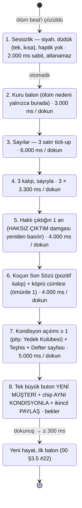

# 07 — UX/UI, Ekran Haritası, FTUE ve Juice Spesifikasyonu

> **Belge türü:** Ayrıntılı tasarım dokümanı (07/11). **Üst belge:** `00-VIZYON-ve-KARARLAR.md` (bağlayıcı); çelişkide sıra 00 → T9 → T-dokümanları → konseptler (D-060).
> **Sürüm:** v1.0 · 2026-11-06 · **Sahip:** UX/UI baş tasarımcısı · **Durum:** Sprint planına girmeye hazır.
> **Kapsadığı sistemler (00 §5, satır 07):** ekran haritası (Hayat Akışı, Defter, Karne, Sözlük, Kamp, Ayarlar, Yardım, Mağaza), FTUE senaryosu (00 §4.2'nin UI katmanı), "Resmî Evrak + antrenman" sanat yönü (acid-lime vurgu, Fraunces italik el yazısı), damga/zarf/fiş juice spec'i, paylaşım kartları (9:16 + 1:1), erişilebilirlik ve lokalizasyon yerleşimi, iki platformda kusursuz çalışma.
> **Bu belge ne yapmaz:** satır yazmaz (01), olay seçmez (03), fiyat koymaz (06), lint kuralı yazmaz (08). Bu sistemlerin **ekrandaki yüzünü** tasarlar ve o yüzün ms, dp, sp, karakter ve haptik cinsinden ölçülebilir kurallarını koyar.

---

## 0. Künye — uygulanan D-kararları, bağımlı dokümanlar, sürüm

### 0.1 Uygulanan D-kararları (her biri → bu belgedeki somut tasarım ögesi)

| D | Karar (kısa) | Bu belgede nasıl uygulandı |
|---|---|---|
| D-003 | Anlatıcı adı = marka = Motto | Logo yok; açılışta koçun ilk balonu markadır. Paylaşım kartlarında tek marka satırı "YILIN MOTTOSU" + küçük "Motto" wordmark (§2.6). |
| D-007 | Ölüm ekranında reklam yok | Roast Raporu → Yeni Müşteri akışında `AdSlot` bileşeni **monte edilmez**; ekran haritasında ölüm dalında reklam düğümü yoktur (§2.2.7, AC-07-18). |
| D-008 | Interstitial yalnızca gönüllü oturum sonunda | "Bugünlük yeter" ve Devre Arası ekranlarında, 3. oturumdan itibaren tek `AdSlot`; kapatma butonu ≥ 44 pt (§2.2.1, §4). |
| D-009 | İddia Defteri UI: sarı fiş, 0,35–0,65, koç sonucu etkilemez | `WagerSlip` bileşeni: olay kartının sağ üst köşesine iğnelenen sarı fiş; [Oranı göster] dokunuşu gerçek `pOdds`'u açar (§2.4.9, §2.5). |
| D-010 | HAKSIZ ÇIKTIM: Heavy + 400 ms mürekkep; 12 kozmetik varyant | `Stamp` bileşeninin `wrong` varyantı; Defter'de "Damga Koleksiyonu" rafı (§2.2.2, §2.5). |
| D-011 | Zarf = pending-outcome nesnesi; hışırtı, haptik yok | `Envelope` bileşeni Kısa Karne'nin alt satırı; oturum sonunda "açılır ama çözülmez" durumu (§2.4.9, §2.5). |
| D-012 | Ruh hâli: Normal / Yorgun (23:00–06:00) | UI'da ruh hâli **görselleştirilmez**; yalnızca koç balonunun glifi değişir (Noto Emoji monokrom); gerçek saat hakkında hiçbir HUD ögesi yok (§2.4.7). |
| D-013 | Tercüme kartı + Sözlük | `DocumentCard` (antetli evrak) + [Tercüme] 250 ms flip + kaşe sesi; Sözlük sekmesi 5 bölüm; 1:1 paylaşım kartı (§2.2.4, §2.5). |
| D-014 | Aile Grubu sohbet ekranı yok; "Okunmamış" HUD sayacı | `UnreadCounter` HUD'da, hiç sıfırlanmaz; yılların ~%40'ında 1 `BeatCard` + "Görüldü, cevap yok" seçeneği (§2.2.1). |
| D-015 | Açılış satırı; ilk kahkaha ≤ 4 sn | FTUE 0:01–0:04: ilk balon, siyah zemin, "yazıyor…" ≤ 1 sn (§2.3). |
| D-016 | Ölüm → yeni hayatın ilk kelimesi ≤ 40 sn | Rebirth akışı adım adım ms bütçesi (toplam otomatik 34 sn, her adım atlanabilir); tek büyük **Yeni Müşteri** + tek dokunuş **Aynı kondisyonla** (§2.2.7). |
| D-019 | Kamp: haftalık seed, 40 **hayali** kohort, KMP-XXXX | Kamp sekmesi; her kohort kartında zorunlu "hayali / fictional" etiketi; geri sayım gerçek Pazartesi 00:00 yerel (§2.2.6). |
| D-020 | Yıl medyanı 90 sn; Kısa Karne varsayılan | Kısa Karne tek ekran ≤ 8 sn okuma; "Tam Karne" dokunarak; "Aynı hedef" tek dokunuş (§2.2.3). |
| D-021 | 6 not; TR Pekiyi…Zayıf, EN A–F | `ReportCard` 6 satır; not sözcükleri locale havuzundan; renk tek anlam taşıyıcısı değil (§2.4.9). |
| D-022 | Yılın Mottosu ≤ 6 kelime | Karne ve paylaşım kartında Fraunces italik, en büyük tipografik öge (§2.6). |
| D-023 | Tek Hedef: 3 öneri + Hedefsiz + Aynı hedef | `GoalPicker` kartı; 4 buton + üstte "Aynı hedef" chip'i (§2.2.3). |
| D-025 | Roast Raporu sırası; ölüm nedeni yalnızca 2. balonda | Rebirth state machine aynen bu sırayla; adımlar atlanabilir, geri alınamaz (§2.2.7). |
| D-026 | Ses ayarı Nazik / Normal / Acımasız; ilk "Bugünlük yeter"den sonra tek soru | `VoiceKnob` 3 kademeli segment; ilk oturum sonu kartı; Ayarlar'da her zaman (§2.2.9). |
| D-028 | 60+ yaşta ≤ 1 balon | Feed yoğunluğu yaş bandına göre: `maxBubblesPerBeat` HUD'a değil feed'e yansır (§2.2.1). |
| D-029 | Streak = Mola ritüeli, duraklar, satılmaz | `MolaPill` + Mola sheet'i: 14 günlük şerit, "duraklatıldı" gri; Sakatlık İzni/Telafi görünür; satın alma düğmesi yok (§2.2.5). |
| D-030 | Bildirim ≤ 1/gün; soft-ask ilk "Bugünlük yeter"den sonra (oturum ≥ 8 dk); Android izni 2. oturumdan önce asla | İzin state machine'i (§2.3.4); `PermissionPrePrompt` koç ağzında; "Beni rahat bırak" tek dokunuş. |
| D-031 | Welcome-back = Sakatlık Raporu, 40 sn, atlanabilir | `InjuryReport` ekranı; büyük karar rafta bekler; ödül sabit (§2.2.5). |
| D-033 | Para soyut "Para/Cash" | HUD'da `◆ 4.250` biçimi; para birimi sembolü hiçbir bileşende yok (§2.4.9). |
| D-037 | 16+; mağaza metadata 4+ | Ekran görüntüsü üretim şablonu yalnızca 4+ vitrin havuzundan; ölüm/Roast kartı mağaza vitrininde yok (§5). |
| D-038 | Torpil tek seferlik; restore | Mağaza: tek kart, mağaza API fiyatı KDV dahil, **Geri Yükle** her zaman görünür (§2.2.10). |
| D-039 | Rewarded yerleşimleri; ilk 10 dk reklamsız; ödül daima | Bağlamsal `RewardedOffer` kartı; "Hayır" seçeneği eşit boyutta; ödül reklam kapanmadan da verilir (§2.2.1, §5). |
| D-043 | Expo SDK 58 / RN 0.88 / TS 6 | Bileşen kütüphanesi seçimleri bu yığına göre: Reanimated 4, FlashList 2, react-native-view-shot, expo-haptics, expo-audio (§2.4). |
| D-047 | Buton bütçesi TR 18 / EN 16 | `UiStrings` bütçe tablosu; yorum: tek satırlık sabit UI butonları için sert kural; olay seçenekleri 2 satıra sarar (§2.7.3). |
| D-050 | Gerçek-zaman satırları oyuncuyu yorumlamaz | HUD'da saat/konum/takvim ögesi yok; 03:12 satırı yalnızca feed'de ve hedefi koç (§5). |
| D-052 | Düşük Keyif: roast kapalı; "Gerçek hayatta yardım" ayrı ve şakasız | Oyundaki **tek koç-sessiz ekran**; acid-lime yok, Fraunces yok (§2.2.8). |
| D-054 | ATT ön-ekranı, KVKK aydınlatma + ayrı rıza, UMP | Rıza akışı 2. oturum başında, tek "Resmî Evrak" kartı dizisi; SDK'lar rıza öncesi başlatılmaz (§2.3.4, §4). |
| D-055 | Sahte aciliyet/stok/sayaç yok | Geri sayım yalnızca gerçek takvimden (Pazartesi 00:00, Telafi 48 sa); `Countdown` bileşeni yalnızca `source: 'calendar'` kabul eder (§5). |
| D-056 | Ölüm = içerik | Roast Raporu'nda her adım bir "kazanım" gösterir (Teşhis, Defter sayfası, Kondisyon) (§2.2.7). |
| D-059 | Juice spec sabit | §2.5 tablosu D-059'un değerlerini değiştirmeden genişletir; eksik tipleri tamamlar. |
| D-060 | Doküman hiyerarşisi | Bu belge D-kararlarını yeniden tartışmaz; boşlukları §7'de D-ÖNERİ olarak işaretler. |

### 0.2 Bağımlı dokümanlar

- **Okur ve uygular:** 00 (tümü), T8 (UX/UI/FTUE/sanat yönü), T11 (juice, pacing, pending queue), T7 TL;DR (bildirim, welcome-back), T3 TL;DR (ses kuralları UI metinlerine de uygulanır), T10 TL;DR (TR/EN uzunluk, buton bütçesi), T9 (rıza akışı, yardım ekranı, 4+ metadata).
- **Beslediği dokümanlar:** 01 (balon/glif kuralları, boş durum satırları buradan şablon alır), 03 (`effects` çıkışı → `JuiceEvent` eşlemesi §2.5), 05 (Mola/Kamp/Teşhis yüzeyleri), 06 (Mağaza ve `AdSlot` yerleşimleri), 08 (buton bütçesi lint'i, yardım ekranı metni), 09 (UI string anahtarları ve bütçeleri), 10 (bileşen kütüphanesi, Playwright hedefleri), 11 (UX KPI'ları).
- **Konseptlerden alınan somut örnekler:** A1 §7.1 (sarı fiş UI, damga koleksiyonu, 80 ms/400 ms juice), A4 §4.3/§7.1 (Koçun Defteri, Karne kartı, Kamp temaları), A2 §7.1 (250 ms flip + kaşe), A3 §7.1 (≤ 40 sn yeniden doğuş zaman bütçesi).

### 0.3 Sürüm

v1.0 — ilk tam sürüm. Değişiklik yalnızca yeni D-kaydı veya bu belgenin v1.x revizyonuyla; §7'deki D-ÖNERİ'ler 00'a alınırsa D-xxx numarası alır ve buradaki "D-ÖNERİ" etiketi düşer.

---

## 1. Amaç ve kapsam — MVP / Soft launch / 1.0

**Amaç:** Oyuncunun ilk 4 saniyede gülmesini, 22. saniyede karar vermesini, 56. saniyede paylaşılabilir bir karne görmesini ve ölünce 40 saniye içinde yeni bir hayata başlamasını **ekranda** mümkün kılan; her geri bildirimin üç kanalı (görsel + metin + haptik/ses) olan; iki dilde aynı ızgaraya oturan; iOS ve Android'de **birebir aynı hissi** veren bir arayüz. UX'in işi anlatıcıyı taşımaktır, gölgelemek değil: ekranın en pahalı pikseli koçun cümlesidir.

**Beş UX ilkesi (T8'in 12 maddesinin bu oyuna indirgenmiş hâli):**
1. **Karar başparmağın altında.** Tüm birincil kararlar ekranın alt üçte birinde; üst köşelerde geri dönülemez hiçbir eylem yok.
2. **Tek ses.** Boş durum, hata, ayar açıklaması, izin ön-ekranı: her metin koçun ağzından (istisna: §2.2.8 yardım ekranı ve hukuki metinler).
3. **Modal karar yok.** Olay ve seçim akışın içinde yaşar; sheet'ler yalnızca ikincil yüzeyler için.
4. **Sürtünme sıfır.** "Yükleniyor" yok, retry ekranı yok, "emin misin?" yalnızca veri silmede; dokunma her animasyonu keser.
5. **Kırpılan metin yok.** Konteyner büyür; Türkçe ek yığılması butonu 2 satıra sarar, kesmez.

| Kapsam ögesi | **MVP (dikey kesit, 10 hafta)** | **Soft launch (TR + CA/NZ)** | **1.0 (global)** |
|---|---|---|---|
| Ekranlar | Hayat Akışı, Defter, Karne (Kısa + Tam), Sözlük (Sözlük + Teşhis segmentleri), Kamp (2 tema), Mola sheet, Ölüm/Roast/Yeni Müşteri, Yardım, Ayarlar, Mağaza iskeleti | + Onyıl Karnesi (30/40), Sakatlık Raporu tam, Kamp 8 tema + arşiv, Mağaza tam (Torpil canlı), Kader kişiliği seçimi (Torpil) | + Onyıl 4 yaş, Kamp 16 tema, Sezon Paketi kartı, karne temaları, defter dışa aktarımı |
| FTUE | 00 §4.2 saniye saniye; sekme açılışları; bildirim soft-ask | + rıza akışı tam (ATT/UMP/KVKK) 2. oturumda; rating istemi kuralları | + A/B hazır varyantlar (buton sırası) |
| Tasarım sistemi | Token'lar, 3 font, 24 bileşen, koyu + açık tema, reduced motion, düşük performans modu | + karne temaları (Torpil), tablet ölçekleme | + ikinci kişilik teması (Kader: "Gişe 7" antet varyantı) |
| Juice | §2.5'in tüm satırları (18 olay tipi) | ses paketi final mix, haptik Android kalibrasyonu | — |
| Paylaşım kartları | Karne (9:16 + 1:1), Roast Raporu (9:16 + 1:1), Lally günü (1:1) | + Sözlük sayfası, Kamp kıyas kartı, HAKSIZ ÇIKTIM defter sayfası | + karne temaları kartlara yansır |
| Erişilebilirlik | Dynamic type, VoiceOver/TalkBack etiketleri, 4.5:1, reduced motion, tek el | + pseudo-localization CI ekran görüntüleri, XL metin regresyonu | + tablet ve katlanabilir düzen testleri |
| Platform | iOS 16.4+ / Android 24+; safe area, edge-to-edge, tahmini geri, 16 KB sayfa boyutu build'i | + Android 13+ bildirim izni akışı canlı; iOS Dynamic Island regresyonu | — |
| Playwright | 12 web-export testi (§6.3) | 20 | 25+ |

**MVP'de bilinçli dışarıda:** avatar/illüstrasyon (§7 D-ÖNERİ-07-06), müzik (D-ÖNERİ-07-07), swipe kart destesi (T8'in ikincil modeli; "bir yıl daha" ritmini kırar, 1.0 sonrası ayrı karar), tablet özel düzen (ölçeklenir, özelleşmez), açık tema paylaşım kartı varyantı (kartlar her zaman "Resmî Evrak" koyu kâğıt).

---

## 2. Tasarım

### 2.1 Navigasyon modeli ve ekran haritası

**Model:** T8'in "Akış + Kart" hibriti. Tek kök ekran (**Hayat Akışı**) + 4 yardımcı sekme + üstte "Daha" menüsü (Ayarlar, Mağaza, Yardım, Lisanslar). **Yaşlan** butonu bir FAB değildir: olay yokken karar bölgesinin kendisidir (feed footer'ı), böylece 5 sekmeli bir çubukla çakışmaz ve klavye/safe-area sorunları doğurmaz. Sekme çubuğu başta tek sekmeyle açılır; diğerleri **soluk + kilit ikonu** ile görünür, ilgili ilk olayla canlanır (progressive disclosure, §2.3.5).

```mermaid
flowchart TD
    A0[Soğuk açılış ≤ 2 sn<br/>siyah + 'yazıyor…'] --> A1{Kayıt var?}
    A1 -- hayır --> F[FTUE = ilk yıl<br/>Hayat Akışı içinde]
    A1 -- evet, hayat sürüyor --> M{Yokluk ≥ 3 gün?}
    A1 -- evet, hayat yok --> R7[Yeni Müşteri ekranı]
    M -- evet --> IR[Sakatlık Raporu 40 sn<br/>atlanabilir] --> H
    M -- hayır --> H[HAYAT AKIŞI<br/>HUD + feed + karar bölgesi]
    F --> H
    H --> D[DEFTER<br/>Not · İddia · İtiraf · KAPANDI · Damgalar]
    H --> K[KARNE<br/>Karne Dosyası · Tam Karne · Onyıl]
    H --> S[SÖZLÜK<br/>Sözlük · Teşhis · Mottolar]
    H --> C[KAMP<br/>haftanın teması · hayali kohort · KMP kodu]
    H -- MolaPill --> MO[(Mola sheet<br/>streak şeridi · Sakatlık İzni · Telafi)]
    H -- Daha --> MORE[(Daha sheet)]
    MORE --> SET[AYARLAR]
    MORE --> SHOP[MAĞAZA]
    MORE --> HELP[GERÇEK HAYATTA YARDIM<br/>koç sessiz]
    MORE --> LIC[Lisanslar & Teşekkürler]
    H -- yıl sonu --> KK[Kısa Karne kartı<br/>feed içinde] --> GP[Tek Hedef kartı] --> H
    KK -- 'Tam Karne' --> TK[Tam Karne sayfası] --> GP
    H -- ölüm --> RR[ROAST RAPORU<br/>7 adım, hepsi atlanabilir] --> R7
    R7 -- Yeni Müşteri / Aynı kondisyonla --> F2[Yeni hayat ilk balon ≤ 300 ms] --> H
    H -- 'Bugünlük yeter' --> SE[Oturum sonu özeti<br/>+ paylaşım + (3. oturumdan itibaren) AdSlot] --> EXIT((çıkış))
    C -- 'Kampa gir' --> H
    KK -- Paylaş --> SC[ShareCard 9:16 / 1:1<br/>react-native-view-shot]
    RR -- Paylaş --> SC
    S -- Paylaş --> SC
```

**Navigasyon kuralları:**
- Sekmeler durumunu korur (her sekme kendi scroll konumunu hatırlar); Hayat'a dönüş her zaman en alta (karar bölgesine) kaydırır.
- Sheet'ler (Mola, Daha) yarım ekran, sürükleyerek kapanır, arka plan %60 karartma; hiçbir sheet bir karar içermez.
- Tam ekran geçişler (Tam Karne, Roast Raporu, Ayarlar, Mağaza, Yardım) native stack; iOS'ta kenardan kaydırarak geri, Android'de tahmini geri jesti destekli (§4).
- "Yükleniyor" durumu **yoktur**: içerik paketi uygulamayla gemiye biner (≤ 2 MB gzip), on yıl dilimleri bellekte önden açılır; yeni EAS Update paketi bir sonraki soğuk açılışta devreye girer, oyun sırasında asla.

### 2.2 Ekranlar

Her ekran için aynı şablon: amaç → wireframe → bileşenler → durumlar (boş / çevrimdışı / özel) → etkileşimler → sabit UI metinleri (TR/EN, bütçe).

#### 2.2.1 Hayat Akışı (kök ekran)

**Amaç:** Oyunun %90'ı burada geçer: koç konuşur, olay kartı gelir, oyuncu seçer, yıl biter, karne düşer. Göz üstten tarar, el altta çalışır; en kritik okunacak şey (olay metni) karar bölgesine en yakın yerde durur.

```
┌──────────────────────────────────────────┐  ← status bar (light content)
│ ▣ Deniz Ertelemez · 19 · Kadıköy    ⋯    │  ← IdentityHeader (dosya sekmesi görünümü) + Daha
│ ◆ 4.250   Okunmamış: 23   ⟳ 3 gün        │  ← Para · UnreadCounter · MolaPill
│ Sağlık 70 ▲  Keyif 55 ▼  Kafa 60   Çek 50│  ← StatBar (4 pill, delta okları)
├──────────────────────────────────────────┤
│ ── 18 ──                                 │  ← YearDivider
│ ◐ 18 oldun. Tebrikler. Buradan sonrası   │  ← NarratorBubble (sol, glif + metin)
│   resmî olarak senin suçun.              │
│                   [Önce kahvaltı]  ▸     │  ← PlayerBubble (sağ, seçilen)
│ ◐ Keyif +4. Kafa −2. Kahvaltı böyle bir  │
│   şey.                                   │
│ ── 19 ──                                 │
│ ┌────────────── KARNE 2026 ────────────┐ │  ← ReportCard (kısa, feed içinde)
│ │ Sağlık İyi · Para Geçer · … · Dav. Orta│ │
│ │ HEDEF: Bir bölüme gir → [YARIM]      │ │
│ │ "Başladı. Teknik olarak."            │ │
│ │ ✉ Deftere bir zarf eklendi. Açmadım. │ │  ← Envelope satırı
│ └──────────────────────────────────────┘ │
├──────────────────────────────────────────┤
│ ┌ İLK PARA ───────────────────┐ ┌─────┐  │  ← BeatCard + WagerSlip (sağ üst köşe, iğneli)
│ │ Dayın "hayata atıl" diye    │ │İDDİA│  │
│ │ para verdi. Dayın 2009'da   │ │Mart'ı│ │
│ │ yaşıyor.                    │ │görmez│ │
│ └─────────────────────────────┘ │ — M.│  │
│ [ Biriktir                          ]    │  ← ChoiceButton ×3 (56 dp, tam genişlik)
│ [ Arkadaşlarla ye, hayat kısa       ]    │
│ [ Kripto                            ]    │
├──────────────────────────────────────────┤
│  Hayat   Defter   Karne   Sözlük   Kamp  │  ← TabBar (kilitliler soluk + 🔒 değil, Phosphor "lock")
└──────────────────────────────────────────┘
```

Olay yokken karar bölgesi tek ögeye iner: **Yaşlan** (72 dp yüksek, tam genişlik, pill) + üstünde koçun 1 satırı. İlk yılda spring ile yükselir ve 3 kez nabız atar; sonra sakin.

**Bileşenler:** `IdentityHeader`, `MoneyCounter`, `UnreadCounter`, `MolaPill`, `StatBar`/`StatPill`, `LifeFeed` (FlashList), `NarratorBubble`, `PlayerBubble`, `YearDivider`, `ReportCard(compact)`, `Envelope`, `BeatCard` / `DocumentCard`, `WagerSlip`, `ChoiceButton`, `AgeUpButton`, `RewardedOffer`, `Toast`, `TabBar`.

**Durumlar:**
- *İlk açılış:* HUD yok; stat çubuğu ilk sonuçla "doğar" (0:22–0:27). Sekme çubuğunda yalnızca Hayat aktif.
- *Çevrimdışı:* **birebir aynı.** Kritik yolda ağ çağrısı yok; `RewardedOffer` reklam yüklenemediyse hiç görünmez (hata metni yok).
- *Yıl sonu:* feed'e Kısa Karne kartı düşer, karar bölgesi `GoalPicker`'a döner.
- *Düşük Keyif (Keyif ≤ 15 iki yıl üst üste):* koç roast'u kapatır (01'in işi); UI tarafında **tek değişiklik** "Daha" menüsündeki "Gerçek hayatta yardım" satırının kısa süreli vurgulanması (acid-lime nokta) ve feed'e bir kez, şakasız, koç dışı sistem kartı: TR *"Bu bir oyun. Gerçek hayatta destek istersen: Daha → Gerçek hayatta yardım."* / EN *"This is a game. If you want real-life support: More → Real-life help."* Konfeti, haptik, ses yok.
- *60+ yaş:* beat başına ≤ 1 balon (D-028); feed görsel olarak seyrekleşir, yıl ayraçları arası kısalır — "sessizlik" tasarımın parçası.
- *Kamp modu:* HUD'ın altında ince acid-lime bant: TR *"ERTELEME KAMPI · 3. gün · hayali kohort 40"* / EN *"PROCRASTINATION CAMP · Day 3 · 40 fictional campers"*.
- *Oturum sonu sezildi (T11 3c):* director en ağır zarfı **açar ama çözmez**; feed'e `Envelope(open)` düşer; karar bölgesinde **[Bir Yıl Daha]** birincil, **[Bugünlük yeter]** ikincil.

**Etkileşimler:**
- `ChoiceButton` dokunuş: `selection` haptik, 80 ms scale 0,96→1; kart akışa katlanır (layout animation 220 ms); sonuç balonu ≤ 300 ms içinde.
- `WagerSlip` dokunuş: fiş 180° döner → arka yüzde gerçek oran (*"Oran: %55. Zar benim değil."* / *"Odds: 55%. Not my dice."*) + **[Oranı göster]** metni zaten görünür; oyuncu bakmayabilir.
- Uzun basma `AgeUpButton`: yok (T8'in "×3 hızlı yaşlan" kısayolu alınmadı; 90 sn'lik yıl zaten hızlı, "bir yıl daha" ritmi korunur).
- `UnreadCounter` dokunuş: hiçbir şey açılmaz; sayaç 1 kez titrer, koç 1 satır (yılda ≤ 1): TR *"Açmayacaksın. Ben de açmıyorum."* / EN *"You're not opening it. Neither am I."*
- Feed'de geriye kaydırma serbest; karar bölgesi sabit (footer), yeni balon gelince "↓ yeni" chip'i; otomatik kaydırma yalnızca oyuncu zaten en alttaysa.
- `RewardedOffer` (Ek Antrenman, Forma Sponsoru, Taktik Değişikliği, Fizyoterapi): koç ağzında 1 satır + iki **eşit boyutlu** buton [İzle] / [Kalsın]; ilk 10 dakikada bileşen hiç monte edilmez; 3. seçenek olarak gelen Taktik Değişikliği diğer seçeneklerle aynı stil + küçük "30 sn" etiketi, asla önceden seçili değil.

**Sabit UI metinleri (bütçe: CTA TR 18 / EN 16):**

| Anahtar | TR | EN | Not |
|---|---|---|---|
| `cta.ageUp` | Yaşlan | Age Up | 72 dp pill |
| `cta.oneMoreYear` | Bir Yıl Daha | One More Year | birincil |
| `cta.enoughToday` | Bugünlük yeter | Enough for today | ikincil (16/16) |
| `cta.share` | Paylaş | Share | |
| `cta.showOdds` | Oranı göster | Show the odds | WagerSlip |
| `cta.translate` | Tercüme | Translate | DocumentCard |
| `cta.seenNoReply` | Görüldü, cevap yok | Seen, no reply | Aile kartı seçeneği |
| `cta.watchAd` / `cta.noThanks` | İzle · 30 sn / Kalsın | Watch · 30 s / Pass | eşit boyut |
| `hud.unread` | Okunmamış: {n} | Unread: {n} | ICU number |
| `hud.money` | ◆ {n} | ◆ {n} | birim sembolü yok (D-033) |
| `tab.life/notebook/report/glossary/camp` | Hayat · Defter · Karne · Sözlük · Kamp | Life · Notebook · Report · Glossary · Camp | sekme bütçesi 8/8 |
| `feed.newBelow` | ↓ yeni | ↓ new | chip |

#### 2.2.2 Koçun Defteri

**Amaç:** Anlatıcı hafızasının okunabilir yüzü (00 §3.3). Oyuncu her göndermeyi buradan doğrular; **hafıza uydurulmaz** kuralının UI kanıtı. Ayrıca HAKSIZ ÇIKTIM koleksiyonu burada yaşar.

```
┌──────────────────────────────────────────┐
│ ‹ Defter                      Dışa aktar │  ← Torpil'de aktif; değilse kilit ikonu + "Torpil"
│ [ KAPANDI 1 ] [ KAPANDI 2 ] [ ● Açık ]   │  ← NotebookShelf (yatay; ücretsizde son 3)
│ (Hepsi) (Not) (İddia) (İtiraf)           │  ← filtre chip'leri
├──────────────────────────────────────────┤
│ 2029  "Bu sefer farklı" dedi.        ↗   │  ← NotebookEntry(note) · Fraunces italik · ↗ "Doğrula" → feed'e atlar
│ 2030  ┌─ İDDİA ───────────────┐          │  ← NotebookEntry(wager): sarı fiş
│       │ Bu para Mart'ı görmez │ ░İSABET░ │     damga + "Oran %55"
│       └───────────────────────┘          │
│ 2031  ┌─ İDDİA ───────────────┐          │
│       │ O işi alamaz. — M.    │ ▓HAKSIZ▓ │  ← HAKSIZ ÇIKTIM damgası (varyant #4)
│       └───────────────────────┘ ▓ÇIKTIM▓ │
│ 2033  İtiraf: Yalan söyledim, çalıştı.   │  ← NotebookEntry(confession) · nadir · [Paylaş]
├──────────────────────────────────────────┤
│ DAMGA KOLEKSİYONU  4 / 12                │  ← StampShelf: 12 yuva, açılmayanlar silüet
│ ▓ ▓ ▓ ▓ ░ ░ ░ ░ ░ ░ ░ ░                  │
└──────────────────────────────────────────┘
```

**Bileşenler:** `NotebookShelf`, `NotebookEntry` (3 varyant), `Stamp`, `StampShelf`, `FilterChips`, `ShareCard` (defter sayfası, 1:1; soft launch).

**Durumlar:**
- *Boş (ilk iddiadan önce sekme kilitli; kilidi açıldığı anda ≥ 1 girdi vardır).* Yine de teknik boş durum metni: TR *"Defter boş. Henüz bir şey söylemedin ki yazayım."* / EN *"Empty notebook. You haven't said anything worth writing down. Yet."*
- *KAPANDI defter açık:* salt okunur; sayfa kenarında "KAPANDI · 74 yaş" damgası; girdiler soluk.
- *Ücretsiz arşiv sınırı (3):* 4. hayatta en eski defter raftan düşer; düşmeden önce bir kez Toast: TR *"En eski defteri kaldırıyorum. Torpil'de raf sınırsız; satış değil, bilgi."* / EN *"Removing the oldest notebook. Torpil has unlimited shelf space; not a pitch, a fact."*
- *Çevrimdışı:* fark yok (tümü yerel SQLite).

**Etkileşimler:** girdiye dokunma → kaynak yıl vurgulanıp feed'e atlar (↗ "Doğrula" / "Verify"); fişe dokunma → oran arka yüzü; damgaya uzun basma → varyant adı ve nasıl kazanıldığı; İtiraf sayfasında [Paylaş].

**Sabit UI metinleri:** `nb.verify` Doğrula / Verify (7/6) · `nb.export` Dışa aktar / Export (10/6) · `nb.closed` KAPANDI / CLOSED · `nb.stamps` Damga Koleksiyonu / Stamp Collection · filtre: Hepsi·Not·İddia·İtiraf / All·Note·Wager·Confession.

#### 2.2.3 Karne — Kısa Karne, Tam Karne, Karne Dosyası, Onyıl Karnesi

**Amaç:** Yılın paylaşım birimi ve "bir yıl daha"nın kapısı. **Kısa Karne** feed içinde tek ekran (D-020, ≤ 8 sn okuma); **Tam Karne** dokunarak açılan tam sayfa; **Karne** sekmesi = Karne Dosyası (bu hayatın tüm yılları) + Onyıl Karneleri.

```
KISA KARNE (feed kartı, 328 dp)            TAM KARNE (tam sayfa)
┌────────── KARNE 2026 ──────────┐          ┌──────────────────────────────┐
│ Sağlık  İyi    Para     Geçer  │          │ ‹                     Paylaş │
│ İlişk.  Orta   Kafa     İyi    │          │ ░░ MOTTO · MÜŞTERİ DOSYASI ░░│ ← antet
│ Cesaret Geçer  Davranış Orta   │          │ KARNE 2026 · Deniz E. · 18   │
│ ─────────────────────────────  │          │ 6 not + koçun 1 cümlelik notu │
│ HEDEF: Bir bölüme gir  [YARIM] │          │ her satırda                  │
│ ❝ Başladı. Teknik olarak. ❞    │ ← Motto  │ HEDEF + damga (anim. tekrar)  │
│ ✉ Deftere bir zarf eklendi.    │          │ İDDİA: 1 isabet · 1 haksız    │
│   Açmadım. Hâlâ.               │          │ Koçun isabeti: %50            │
│ Tam Karne ›            Paylaş  │          │ ❝ Başladı. Teknik olarak. ❞   │
└────────────────────────────────┘          │ Koçun notu (Fraunces italik)  │
                                            │ seed: HYT-7K3Q                │
TEK HEDEF (karar bölgesi)                   └──────────────────────────────┘
┌────────────────────────────────┐
│ ◐ Bu yıl için tek hedef. Bir.  │
│ ( Aynı hedef: Bir bölüme gir ) │ ← chip, tek dokunuş (D-023)
│ [ 5.000 biriktir            ]  │
│ [ Bir arkadaş edin          ]  │
│ [ Bir bölüme gir (devam)    ]  │
│ [ Hedefsiz yaşa             ]  │ ← ikincil stil, aynı boyut
└────────────────────────────────┘
```

**Not sözcükleri:** TR Pekiyi / İyi / Orta / Geçer / Zayıf, EN A / B / C / D / F (D-021). Renk **ikincil** taşıyıcı: Pekiyi/A ve İyi/B kâğıt-krem, Orta/C mürekkep-gri, Geçer/D ve Zayıf/F kayıt-kırmızısı `#C9372C` **yalnızca harf/sözcük rengi**, çubuk yok (karne bir barem değil, bir evraktır).

**Hedef damgası:** TAMAM / YARIM / ERTELENDİ ↔ DONE / HALFWAY / POSTPONED; `Stamp` bileşeni 80 ms basış + "tak" + Medium (D-059). YARIM damgasında near-miss varsa fişte oran satırı: *"3.412 / 5.000. Az kaldı; gerçekten az."* / *"3,412 / 5,000. Close. Actually close."*

**Onyıl Karnesi (30/40/50/60):** Tam Karne şablonu + üstte "ONYIL" bandı; yalnızca karar kalemleri (D-051): "Ev", "İş", "Bir şeyler"; listede olmayan ama yapılan 3 madde; puan. Medeni durum/çocuk kalemi **yoktur**. Zorunlu lift satırı en altta, Fraunces italik.

**Durumlar:** *Kısa Karne ilk yıl:* konfeti (tek seferlik, ≤ 60 partikül, "kâğıt parçası" şekilli). *Karne Dosyası boş:* sekme kilitli (ilk karneyle açılır). *Onyıl Karnesi yok:* liste yalnızca yılları gösterir, boş yuva yok (sahte ilerleme yok).

**Sabit UI metinleri:** `rc.fullReport` Tam Karne / Full Report (10/11) · `rc.goal` HEDEF / GOAL · `rc.sameGoal` Aynı hedef / Same goal · `rc.noGoal` Hedefsiz yaşa / No goal, respect (13/16) · `rc.coachAccuracy` Koçun isabeti: {p} / Coach accuracy: {p} · `rc.decade` ONYIL KARNESİ / DECADE REVIEW · `rc.mottoLabel` YILIN MOTTOSU / MOTTO OF THE YEAR.

#### 2.2.4 Sözlük (koleksiyon sekmesi: Sözlük · Teşhis · Mottolar)

**Amaç:** İkinci koleksiyon (D-013) ve Teşhis koleksiyonunun yüzeyi; Reels formatına hazır 1:1 kart. Üç segment: **Sözlük** (Tercümeler; bölümler Kurumsal / Ev Sahibi / Aile / Flört / Sağlık), **Teşhis** (30 → 60 → 120), **Mottolar** (oyuncunun aldığı Yılın Mottosu geçmişi).

```
┌──────────────────────────────────────────┐
│ Sözlük            ( Sözlük | Teşhis | Mottolar ) │ ← SegmentedControl
│ Kurumsal 6/14 · Ev Sahibi 2/8 · Aile 3/8 · Flört 0/6 · Sağlık 1/4 │ ← yatay bölüm chip'leri + sayaç
├──────────────────────────────────────────┤
│ ┌───────────────┐ ┌───────────────┐      │
│ │ "Son e-posta- │ │ "Evladım gibi-│      │  ← GlossaryCard: antet kırpıntısı
│ │  ma istinaden"│ │  sin, ama…"   │      │
│ │ → Kızgınım ve │ │ → Zam geliyor │      │     Tercüme (Fraunces italik)
│ │   kanıtım var │ │               │      │
│ │ 2031 · Kurumsal│ │ 2029 · Ev Sh.│      │
│ └───────────────┘ └───────────────┘      │
│ ┌───────────────┐ ┌───────────────┐      │
│ │   ░░░░░░░░    │ │   ░░░░░░░░    │      │  ← kilitli: silüet, ipucu yok (p < 0,30)
│ │   ░░░░░░░░    │ │  Az kaldı: 1  │      │  ← p ≥ 0,80: "Az kaldı" (T11 3e)
│ └───────────────┘ └───────────────┘      │
└──────────────────────────────────────────┘
```

**Teşhis segmenti:** rozet değil **dosya damgası** estetiği (yuvarlak kaşe, Space Grotesk büyük harf): "OKUNDU BIRAKAN", "KRONİK". Her Teşhis kartında nasıl alındığı ("3 hayatta aynı #1 kalıp") ve tier etiketi (sim-kalibreli; T11 3e). **Mottolar segmenti:** yıl + motto + o yılın 6 notunun mini şeridi; her satır 1:1 kart olabilir.

**Durumlar:** *Boş (ilk Tercüme'den önce sekme kilitli).* Kilit açıldığı anda ilk kart vardır. *Teşhis boş (ilk ölümden önce yarısı kalıp bazlı olduğundan ilk Teşhis ömür içinde gelebilir):* TR *"Teşhis yok. Henüz tanı koyacak kadar tekrar yapmadın."* / EN *"No diagnosis. Not enough reps to call anything yet."* *Çevrimdışı:* fark yok.

**Etkileşimler:** karta dokunma → tam kart (orijinal evrak + Tercüme + "Şu olayda öğrendin: 2031 ↗") + [Paylaş] 1:1; kilitli karta dokunma → hiçbir ipucu (Loewenstein eşiği), yalnızca selection haptik ve chip sayacı titrer.

**Sabit UI metinleri:** segment: Sözlük · Teşhis · Mottolar / Glossary · Diagnoses · Mottos (8/9 — segment bütçesi 10/10) · `gl.learnedAt` Şu olayda: {year} / Learned in: {year} · `gl.almost` Az kaldı: {n} / Almost: {n} · `gl.locked` (metin yok; silüet).

#### 2.2.5 Mola / streak yüzeyi ve Sakatlık Raporu

**Amaç:** Günün ilk kararı (Mola, 90 sn ritüel) ve karar bazlı streak'in **duraklayan, utandırmayan** yüzeyi (D-029). Streak bir sekme değildir; HUD'daki `MolaPill` ve ondan açılan sheet.

```
MolaPill (HUD):  ⟳ 47 gün          ⟳ 47 · duraklatıldı          ⟳ Telafi 31 sa
                 (aktif, lime)      (gri; kırmızı yok)           (gerçek geri sayım)

MOLA SHEET
┌──────────────────────────────────────────┐
│ ◐ 3 gün yoktun. Antrenman kaçırdın.      │
│   Ceza yok; gıcıklık için varım, ceza    │
│   için değil. Sayaç: 47 gün, duraklatıldı│
│ ● ● ● ● ○ ○ ○ ● ● ● ● ● ● ●              │  ← 14 günlük şerit (dolu = karar verildi)
│ Sakatlık İzni: ■ ■  (7 günde 1 yenilenir)│
│ Telafi: 31 sa kaldı · 3 karar yeter      │  ← gerçek pencere (48 sa), oyunla onarım
│ Kilometre taşları: 3 7 14 21 30 ●66 100 365│
│ [ Bugünün ilk kararı › ]                 │  ← sheet'i kapatır, feed'e döner
└──────────────────────────────────────────┘
```

**Kurallar (UI):** kırmızı renk hiçbir streak durumunda kullanılmaz; "kaybettin / bozuldu / sıfırlandı" sözcükleri UI'da **yok** (lint, 08); satın alma butonu **yok**; alev/ateş ikonu yok (düdük ikonu `whistle`, Phosphor özel SVG). 66. gün kartı (Lally günü) 1:1 paylaşım kartıdır (05'in içeriği, bu belgenin `ShareCard` şablonu).

**Sakatlık Raporu (welcome-back, D-031):** ≥ 3 gün yokluk → tam sayfa, 40 sn, her satır dokunarak geçilir, [Atla] sağ üstte: başlık "SAKATLIK RAPORU / INJURY REPORT", 3–5 satır (gerçek yokluk → oyun zamanı), "rafta bekleyen karar" satırı, sabit küçük ödül (1 Sakatlık İzni, cap içinde). Haptik: açılışta `impact.soft` + düdük (kısa, Mola düdüğü). Hiçbir satır oyuncunun gerçek hayatını yorumlamaz (D-050): *"Annen 14 kez aradı, patron 1."* karakter hakkındadır.

**Sabit UI metinleri:** `mola.paused` duraklatıldı / paused · `mola.repair` Telafi: {h} sa / Repair: {h} h · `mola.leave` Sakatlık İzni / Injury Leave · `mola.firstDecision` Bugünün ilk kararı / Today's first call (18/18 → EN 16'ya sığsın: "First call today" 16) · `ir.title` SAKATLIK RAPORU / INJURY REPORT · `ir.skip` Atla / Skip.

#### 2.2.6 Kamp (Antrenman Kampı)

**Amaç:** Haftalık seed'li hayat + **hayali** kohort kıyası (D-019); fresh-start etkisi; paylaşım kodu.

```
┌──────────────────────────────────────────┐
│ Kamp                                     │
│ ┌──────────────────────────────────────┐ │
│ │ ERTELEME KAMPI · 2026-W45            │ │  ← CampCard: tema + kısıt
│ │ "sonra/yarın" seçenekleri kilitli;   │ │
│ │ koç her kilidi sayar.                │ │
│ │ Bitiş: Pzt 00:00 · 3 gün 4 sa        │ │  ← gerçek takvim geri sayımı
│ │ Kod: KMP-7K3Q        [ Kampa gir ]   │ │
│ └──────────────────────────────────────┘ │
│ HAYALİ KOHORT (40) — hayali, kurgusal    │  ← zorunlu etiket, her kartta
│ 1. hayali Ayşe   Karne ort. İyi   71 yaş │
│ 2. hayali Jordan Karne ort. İyi   68 yaş │
│ … sen: 14. · Karne ort. Orta · 58 yaş    │
│ [ Kıyas kartını paylaş ]                 │
│ Geçen haftalar ›                         │  ← arşiv (soft launch)
└──────────────────────────────────────────┘
```

**Durumlar:** *İlk oturum:* sekme kilitli; 2. oturum başında canlanır (koç 1 balon: TR *"Yeni sekme: Kamp. Pazartesi herkes aynı hayatı yaşar; sonuçlar farklı. Hayali herkes, not düşeyim."* / EN *"New tab: Camp. Mondays, everyone lives the same life; results differ. Everyone's fictional, for the record."*). *Kamp sürüyor:* kart "SÜRÜYOR" damgalı, Hayat'ta bant. *Tamamlandı:* Kamp Teşhisi damgası + kıyas kartı. *Hafta değişti, kamp bitmedi:* "ISINMA SAYILDI" damgası (ceza yok), yeni tema. *Çevrimdışı:* seed yerel (`hash(YYYY-WW + locale + contentHash)`), fark yok.

**Sabit UI metinleri:** `camp.enter` Kampa gir / Enter camp (9/10) · `camp.endsIn` Bitiş: {dt} / Ends: {dt} · `camp.fictional` hayali / fictional · `camp.cohort` HAYALİ KOHORT / FICTIONAL COHORT · `camp.you` sen / you · `camp.shareCompare` Kıyas kartı / Compare card.

#### 2.2.7 Ölüm → Roast Raporu → Yeni Müşteri (≤ 40 sn)

**Amaç:** Ölüm içeriktir (D-056); Roast Raporu güldürür ve sayar; yeni hayatın ilk kelimesi ≤ 40 sn (D-016); **reklam yok** (D-007).



Zaman bütçesi: otomatik ilerlemede 2 + 3 + 6 + 9,9 + 4 + 4 + 5 = **33,9 sn** + dokunuş + 0,3 sn = ≤ 35 sn; hedef ≤ 40 sn'in altında 5 sn pay. Oyuncu her adımı dokunarak hızlandırabilir (minimum: 2 sn sessizlik + 7 dokunuş ≈ 6 sn). **Geri alınamaz**: Android geri jesti ve iOS kenar kaydırması bu akışta "bir sonraki adım" demektir (çıkış değil). `AdSlot`, `RewardedOffer`, `Countdown`, Mağaza girişi bu akışta **derleme zamanında** yoktur (AC-07-18).

Ekran dili: "Resmî Evrak" koyu kâğıt, ROAST RAPORU antedi, kalıp satırları Space Grotesk tabular rakamla, Koçun Son Sözü Fraunces italik; "KAPANDI" damgası 7. adımda deftere basılır (Medium + "tak"). Adım 5'teki damga `wrong` varyantıdır (Heavy + 400 ms mürekkep): ömrün duygusal zirvesi, oyuncunun koçu yanılttığı an.

**Yeni Müşteri ekranı:** tek birincil buton 72 dp **[Yeni Müşteri]**; altında chip **[Aynı kondisyonla]** (önceki hayatın Kondisyon seçimini kopyalar, Müşteri Dosyası'nı atlamaz — isim yine karışır); sağ üstte **[Paylaş]** (Roast Raporu kartı). Hiçbir "ölümden dönüş" seçeneği yoktur.

**Sabit UI metinleri:** `death.report` ROAST RAPORU / ROAST REPORT · `death.newClient` Yeni Müşteri / New Client (12/10) · `death.sameConditioning` Aynı kondisyonla / Run it back (16/11) · `death.closed` KAPANDI / CLOSED · `death.bench` Yedek Kulübesi / The Bench (pity açılımı başlığı).

#### 2.2.8 Yardım / "Gerçek hayatta yardım"

**Amaç:** D-052'nin ekranı. Oyundaki **tek koç-sessiz** yüzey: acid-lime yok, Fraunces yok, damga yok, haptik yok, ses yok. Düz Inter, kâğıt-krem metin, bol boşluk.

```
┌──────────────────────────────────────────┐
│ ‹ Gerçek hayatta yardım                  │
│                                          │
│ Motto bir oyundur ve koçu kurgusaldır.   │
│ Zor bir dönemdeysen gerçek biriyle       │
│ konuşmak işe yarar.                      │
│                                          │
│ Türkiye · Acil: 112                      │
│ Türkiye · Destek hatları: findahelpline.com/tr │
│ ABD · 988 Suicide & Crisis Lifeline      │
│ Birleşik Krallık · Samaritans 116 123    │
│ Diğer ülkeler · findahelpline.com        │
│                                          │
│ Bu sayfa her zaman Daha menüsünde.       │
└──────────────────────────────────────────┘
```

Kurallar: liste cihaz bölgesine göre sıralanır (yalnızca `expo-localization` bölge kodu; konum izni istenmez); linkler `Linking.openURL`; metin 08'in onayından geçer (hukuk); "intihar" sözcüğü TR başlıkta **yok** (kurum adı olan "988 Suicide & Crisis Lifeline" özel ad olarak kalır); oyuncu buradan feed'e döndüğünde koç **o beat'te konuşmaz** (01'e kural: `helpScreenVisitedThisSession → suppressRoastOnce`).

#### 2.2.9 Ayarlar

Tek liste, gruplu; her satır `SettingsRow`. Açıklama metinleri koç ağzında, kısa (≤ 60 karakter), hukuki satırlar hariç.

| Grup | Satır | Kontrol | Varsayılan | Koç açıklaması TR / EN |
|---|---|---|---|---|
| Koç | Ses ayarı | 3'lü segment: Nazik / Normal / Acımasız (Gentle / Normal / Brutal) | Normal (D-026) | "Adalet değişmez; sadece ağız." / "Fairness stays. Only the mouth changes." |
| Koç | Koç kişiliği | seçim listesi; Kader yalnızca Torpil'de | Motto | "Gişe 7'den biri var. Torpil'de." / "There's a clerk from Window 7. Torpil only." |
| Dil | Dil | TR / EN segment | sistem (tr→TR, aksi EN) | "Aynı şaka, farklı kas." / "Same joke, different muscle." |
| Görünüm | Metin boyutu | S / M / L / XL + "Sistemi takip et" | Sistem | "Büyüt. Kimse bakmıyor." / "Go bigger. Nobody's watching." |
| Görünüm | Tema | Koyu / Açık / Sistem | **Koyu** (D-ÖNERİ-07-01) | — |
| Görünüm | Hareketi azalt | anahtar + "Sistem" | Sistem | "Damga yine iner; yavaş değil, sessiz." / "The stamp still lands. Quieter, not slower." |
| Geri bildirim | Ses efektleri | anahtar | Açık | "Düdük yalnızca Mola ve ölümde. Söz." / "Whistle only at Mola and at death. Promise." |
| Geri bildirim | Titreşim | anahtar | Açık | — |
| Bildirim | Mola hatırlatıcı | anahtar (sistem izni gerektirir) | Kapalı (soft-ask'a kadar) | "Günde en fazla bir. Üç kez yok sayarsan susarım." / "One a day, max. Ignore three and I go quiet." |
| Bildirim | Beni rahat bırak | tek dokunuş buton | — | "Tamam. Defter açık." / "Fine. Notebook stays open." |
| Torpil | Torpil | durum + [Mağaza] | — | fiyat Mağaza'da |
| Torpil | Satın alımları geri yükle | buton **her zaman görünür** | — | hukuki metin (Apple 3.1.1) |
| Gizlilik | Analitik paylaşımı (açık rıza) | anahtar, **ayrı** | Kapalı | KVKK açık rıza metni (08) |
| Gizlilik | Reklam tercihleri | buton → UMP formu / iOS Ayarlar derin linki | — | — |
| Gizlilik | Aydınlatma metni · Gizlilik politikası · Kullanım koşulları | linkler | — | — |
| Veri | Koçun Raporu'nu dışa aktar | buton → JSON paylaş | — | "Kişisel veri yok; beat sayıları var." / "No personal data. Just beat counts." |
| Veri | Veriyi sıfırla | 2 adımlı onay (tek "emin misin?" yeri) | — | "Defterleri yakıyorum. Geri gelmez." / "Burning the notebooks. No undo." |
| Destek | Gerçek hayatta yardım | satır → §2.2.8 | — | **koç sessiz** |
| Destek | Destek e-postası · Lisanslar & Teşekkürler · Sürüm | — | — | Sürüm'e 7 dokunuş: dev build tuning paneli |

#### 2.2.10 Mağaza

**Amaç:** Torpil (tek seferlik), Sezon Paketi (1.0), geri yükleme. Roast tonu **kapalı** (00 §8): koç konuşur ama iğnelemez.

```
┌──────────────────────────────────────────┐
│ ‹ Mağaza                                 │
│ ┌──────────────────────────────────────┐ │
│ │ TORPİL — koçun gözdesi               │ │
│ │ • Reklam yok  • 2 ek koç kişiliği    │ │
│ │ • Karne temaları  • Defter dışa akt. │ │
│ │ • Sınırsız arşiv  • 3 kayıt yeri     │ │
│ │ Hayatın değişmez; menü değişir.      │ │
│ │ [ 199,99 ₺ · tek seferlik ]          │ │ ← fiyat StoreKit/Play API'den, KDV dahil
│ └──────────────────────────────────────┘ │
│ (1.0) SEZON PAKETİ — içindekiler yazılı  │
│ [ Satın alımları geri yükle ]            │ ← her zaman
│ Kullanım koşulları · Gizlilik            │
└──────────────────────────────────────────┘
```

Kurallar: hiçbir seçenek önceden işaretli değil; geri sayım, "en popüler", "X kişi aldı" yok (D-040, D-055); fiyat metni yalnızca mağaza API'sinden (`displayPrice` / `formattedPrice`); satın alma hatası koç ağzında tek satır, suçlamasız: TR *"Olmadı. Mağaza, ben değil. Tekrar dene ya da deneme."* / EN *"Didn't go through. The store, not me. Try again, or don't."*

**Sabit UI metinleri:** `shop.restore` Geri Yükle / Restore (10/7; satır başlığı "Satın alımları geri yükle" 25 karakter, satır bütçesi 28) · `shop.oneTime` tek seferlik / one-time · `shop.contents` İçindekiler / Contents.

### 2.3 FTUE — ilk 90 saniyenin UI katmanı

#### 2.3.1 İlkeler (T8 §3 + 00 §4.2)

Logo yok, onboarding yok, tutorial yok, tooltip turu yok. FTUE = elle yazılmış ilk yıl + sekme açılış kuralları + izin zamanlayıcısı. Hedefler bağlayıcıdır: ilk kahkaha ≤ 4 sn (üst sınır 10), ilk karar ≤ 22 sn (üst sınır 25), ilk iddia ≤ 34 sn, ilk damga ≤ 41 sn, ilk karne + motto ≤ 56 sn, zarf 60. sn. Satırlar 00 §4.2'den **aynen** alınır (01 sahibidir); bu belge her satırın ekran durumunu, animasyon bütçesini ve haptiğini ekler.

#### 2.3.2 Saniye saniye senaryo (0:00–1:30)

| Sn | Ekran durumu | Koç / olay (TR) | (EN) | UI, animasyon, haptik |
|---|---|---|---|---|
| 0:00–0:01 | Siyah `#0E0F12`, ortada "yazıyor…" üç nokta | — | — | Soğuk açılış hedefi ≤ 2,0 sn düşük segmentte (bu 1 sn JS yüklemesini gizler); `selection` haptik tek kez; status bar gizli |
| 0:01–0:04 | **İlk balon**, ekran ortasında (henüz feed yok) | 18 oldun. Tebrikler. Buradan sonrası resmî olarak senin suçun. | Eighteen. Congratulations. From here on, everything is officially your fault. | Fade-in 120 ms + 4 px yukarı; LOL beat kuralı: 1. cümle → 350 ms → kalan iki cümle (comic timing). HUD yok, sekme yok. `ftue_first_line_shown` |
| 0:04–0:08 | 2. balon altına eklenir | Ben Motto. Hayat koçun. Sertifikam yok; 2.400 seminer verdim, hiçbiri işe yaramadı. Sen son müşterimsin. Baskı yok. | I'm Motto, your life coach. No certificate; 2,400 seminars, none of them worked. You're my last client. No pressure. | Balonlar yukarı kayar, feed oluşur (YearDivider "— 18 —" üstte doğar) |
| 0:08–0:12 | **Müşteri Dosyası** kartı karar bölgesinde | **Deniz Ertelemez** · 18 · Kadıköy | **Alex Tomorrow** · 18 · Cleveland | Tek kart, 3 alan dolu; + nötr **doğum yılı** tekerleği (D-ÖNERİ-07-05, §2.3.6); [Karıştır] [Bu olsun]; TTFD sayacı başlar; `Karıştır` = `selection` + isim 120 ms slide |
| 0:12–0:15 | Koç yorumu (kahkaha 2) | Deniz Ertelemez. Soyadın bir vaat. Tutmayacaksın. | Alex Tomorrow. Named after the day you'll start. | Kart akışa katlanır (220 ms); `IdentityHeader` doğar (ad · 18 · şehir), para henüz yok |
| 0:15–0:22 | **Olay kartı #1 — İLK GÜN**; 3 ChoiceButton başparmak bölgesinde; HUD'da **Okunmamış: 9** doğar | Saat 11:40. Uyandın. Telefonda 14 bildirim; 9'u aile grubundan. — [Kayda çık] [Önce kahvaltı] [Okumadan sil] | 11:40 a.m. You're up. Fourteen notifications; nine from the family group chat. — [Go register] [Breakfast first] [Delete unread] | Kart 25–45 kelime; butonlar alttan yukarı 60 ms kademeli girer; `UnreadCounter` sağdan slide; `ftue_first_choice_shown` |
| **0:22** | **İlk karar** | — | — | `selection`; buton 80 ms; kart katlanır; `ftue_first_choice` |
| 0:22–0:27 | Sonuç balonu; **StatBar doğar** | Keyif +4. Kafa −2. Kahvaltı böyle bir şey. | Joy +4. Brain −2. That's breakfast. | StatBar üstten 220 ms iner; 4 pill (Sağlık 70 · Keyif 55 · Kafa 60 · Çekicilik 50); delta oku + tik-up 400 ms; `impact.light` ×2 (Keyif, Kafa); `ftue_stat_bar_revealed` |
| 0:27–0:34 | **Olay kartı #2 — İLK PARA** + **WagerSlip** köşeye iğnelenir | Dayın "hayata atıl" diye para verdi. Dayın 2009'da yaşıyor. — **İDDİA: Bu para Mart'ı görmez. — M.** — [Biriktir] [Arkadaşlarla ye, hayat kısa] [Kripto] | Your uncle handed you cash to "get started." Your uncle lives in 2009. — **WAGER: This money doesn't see March. — M.** — [Save it] [Dinner with friends, life's short] [Crypto] | `MoneyCounter` HUD'da doğar (◆ 2.000 tik-up); fiş 300 ms sonra gelir: rotate −6°→−3°, scale 1,2→1, kâğıt sesi, haptik yok; **Defter sekmesi canlanır** (soluk→dolu 300 ms, 1 balon yok — fiş kendini anlatır) |
| 0:34–0:41 | Çözüm (ilk yıl elle yazılmış; iddia anında çözülür) | *Biriktir:* Hm. Haksız çıktım. Damga: HAKSIZ ÇIKTIM. Keyfini çıkar; nadir olur. · *Arkadaşlar:* İSABET. Oran %55'ti. Tebrikler, istatistik. · *Kripto:* Hayır. Henüz değil. Belki hiç. Not aldım. | *Save:* Huh. I was wrong. Stamp: I WAS WRONG. Enjoy it; it's rare. · *Friends:* CALLED IT. Odds were 55 percent. Congratulations, statistics. · *Crypto:* No. Not yet. Possibly never. Noted. | *Biriktir:* `Stamp(wrong)` fişin üstüne: 80 ms basış, "tak", **`impact.heavy`**, 400 ms mürekkep yayılması. *Arkadaşlar:* `Stamp(hit)` Medium. *Kripto:* `notification.error` + kırmızı vinyet 300 ms; para − tik-down; Keyif +2 "ders". `ftue_first_stamp` |
| 0:41–0:48 | **Tek Hedef** kartı (GoalPicker) | Bu yıl için tek hedef. Bir. Üç seçen hiçbirini yapmaz; 2.400 seminerden kalan tek bilgi. — [Bir bölüme gir] [5.000 biriktir] [Bir arkadaş edin] [Hedefsiz yaşa] | One goal for the year. One. People who pick three finish none; that's all 2,400 seminars taught me. — [Get into a program] [Save 5,000] [Make one friend] [No goal, respect] | 4 buton aynı boyut; "Hedefsiz" ikincil stil (çerçeve), aynı yükseklik; `ftue_goal_picked` |
| 0:48–0:50 | **Yaşlan** butonu | Yıl bitiyor. Karne geliyor. | Year's ending. Report card incoming. | 72 dp pill spring (damping 15, stiffness 150) alttan; 3 nabız (scale 1→1,04), sonra sakin — **yalnızca bu kez** |
| 0:50–0:56 | Yaşlan → **Karne 2026** | Sağlık İyi · Para Geçer · İlişkiler Orta · Kafa İyi · Cesaret Geçer · Davranış Orta / HEDEF: "Bir bölüme gir" → YARIM / **YILIN MOTTOSU: "Başladı. Teknik olarak."** | Health B · Money D · Relationships C · Brain B · Courage D · Conduct C / GOAL: "Get into a program" → HALFWAY / **MOTTO OF THE YEAR: "Started. Technically."** | ≤ 400 ms: YearDivider "— 19 —" + ReportCard(compact) feed'e düşer; 6 not 60 ms kademeli; YARIM damgası 300 ms + Medium; motto Fraunces italik 28 sp fade 220 ms; **konfeti** (kâğıt parçaları, ≤ 60, 1,2 sn, yalnızca ilk yıl); **Karne sekmesi canlanır**; `ftue_year1_card` = FTUE tamamlandı |
| 0:56–1:00 | Karne alt satırı = **zarf** | Gelecek yıl: deftere bir zarf eklendi. Açmadım. Hâlâ. — **[Bir Yıl Daha]** · [Bugünlük yeter] · [Paylaş] | Next year: an envelope got added to the notebook. I haven't opened it. Still. — **[One More Year]** · [Enough for today] · [Share] | `Envelope(sealed)` 220 ms slide + kâğıt hışırtısı, **haptik yok**; birincil buton lime dolu, ikincil çerçeveli; [Paylaş] metin butonu |
| 1:00–1:04 | **Bir Yıl Daha** → 19 yaş ilk beat | Yeni sayfa. Zarf duruyor; bakmıyorum. | New page. Envelope's still there. Not looking. | ≤ 300 ms ilk metin (AC-07-05); Envelope HUD'a küçülerek yerleşmez — zarf **feed'de kalır**, "açılmamış iplik" karar bölgesinin üstünde sabit ince satır olur (D-011) |
| 1:04–1:14 | **Olay kartı #3 — İLK EVRAK** (`DocumentCard`, kurgusal "Öğrenci İşleri" anteti) | "Kaydınız şartlı olarak işleme alınmıştır." — köşede [Tercüme] → Tercüme: Bir belge eksik. Hangisi, biz de bilmiyoruz. — [Belgeyi ara] [Dayıya sor] [Sonra] | "Your registration has been provisionally processed." — [Translate] → Translation: One document is missing. Which one, we also don't know. — [Hunt the document] [Ask your uncle] [Later] | Antetli kart; [Tercüme] 250 ms Y-ekseni flip + kaşe sesi + Medium; **Sözlük sekmesi canlanır** + Toast "Sözlük +1 · Kurumsal"; Tercüme opsiyonel — [Tercüme]'ye basmayan oyuncuda sekme sonraki evrakta açılır |
| 1:14–1:22 | Sonuç + stat deltası | ("Sonra" seçildiyse) Sonra. Deftere yazdım: 1. Sayıyorum. | ("Later") Later. Noted: one. I'm counting. | `impact.light`; Kalıp Dedektörü görünmez — yalnızca koçun "sayıyorum" satırı; **03'ün `pattern` etiketi** burada ilk kez işler |
| 1:22–1:30 | **Olay kartı #4** (aktif arc açılışı; kart metni 03'ten) | — | — | Normal akış başlar; FTUE kuralları biter; director devralır |

**Skip kuralları:** FTUE'de "Atla" **yoktur** (atlanacak bir şey yok; ilk yıl oyunun kendisidir). Tek istisna: oyuncu uygulamayı 0:00–0:56 arasında kapatıp açarsa oyun **kaldığı beat'ten** devam eder (balonlar yeniden oynatılmaz, "yazıyor…" yok). Müşteri Dosyası'nda ad alanına dokunup kendi adını yazmak isteğe bağlıdır; klavye kuralları §4.

#### 2.3.3 Progressive disclosure — sekmelerin ve HUD'ın açılış takvimi

| Öge | Açılış tetikleyicisi | Nasıl | Koç balonu? |
|---|---|---|---|
| Hayat sekmesi | 0:00 | tek aktif sekme | — |
| `UnreadCounter` | 0:15 (ilk olay kartı) | sağdan slide | hayır (kart metni açıklar) |
| `StatBar` | 0:22 ilk sonuç | üstten iner | hayır (sonuç satırı açıklar) |
| `MoneyCounter` | 0:27 ilk para | tik-up | hayır |
| **Defter** | 0:27 ilk `WagerSlip` | sekme soluk→dolu 300 ms | hayır |
| **Karne** | 0:50 ilk Kısa Karne | sekme canlanır | hayır |
| **Sözlük** | ilk [Tercüme] dokunuşu (≈ 1:10) ya da 3. evrak kartı (dokunmayan oyuncu) | Toast "Sözlük +1" | hayır |
| `MolaPill` | 2. oturumun ilk kararı | pill fade-in | evet, 1 satır: TR *"Antrenman günü 2. Sayıyorum; ceza yok."* / EN *"Practice day two. Counting; no fines."* |
| **Kamp** | 2. oturum başı | sekme canlanır | evet (§2.2.6) |
| Ses ayarı sorusu | ilk "Bugünlük yeter" sonrası (D-026) | tam kart, 3 buton | evet (01'in satırı) |
| Bildirim soft-ask | ses ayarı kartından hemen sonra, **oturum ≥ 8 dk ise** (D-030) | `PermissionPrePrompt` | evet |
| Rıza akışı (KVKK + ATT/UMP) | 2. oturum başı, ilk reklam fırsatından önce | 1–3 "Resmî Evrak" kartı | hayır (hukuki metin koç dışı; koç yalnızca giriş satırı) |
| Torpil teklifi | 2. ölümden sonra, bir kez (D-038) | Mağaza kartı inline | evet, roast kapalı |
| Mağaza değerlendirme istemi | ilk "iyi ölüm" ∧ ≥ 3 oturum ∧ ≥ 7. gün ∧ sürüm başına ≤ 1 | sistem API, butona bağlı değil | hayır |

#### 2.3.4 İzin ve istek zamanlaması — state machine

```mermaid
stateDiagram-v2
    [*] --> NeverAsked
    NeverAsked --> SoftAskShown: ilk "Bugünlük yeter" ∧ session ≥ 8 dk ∧ ses ayarı seçildi
    SoftAskShown --> SystemPrompt: [Haber ver] dokunuldu
    SoftAskShown --> Deferred: [Sonra] dokunuldu
    Deferred --> SoftAskShown2: 3. oturum sonu (bir kez daha)
    SoftAskShown2 --> SystemPrompt: [Haber ver]
    SoftAskShown2 --> Quiet: [Sonra] → bir daha sorulmaz; Ayarlar'da anahtar kalır
    SystemPrompt --> Granted: iOS izin / Android 13+ POST_NOTIFICATIONS izin
    SystemPrompt --> Denied: reddedildi → sistem istemi harcandı; Ayarlar'a derin link
    Granted --> Scheduled: 7 gün ileri, ≤ 1/gün, alışkanlık saati −30 dk
    Scheduled --> Silent7: 3 yoksayma
    Silent7 --> Scheduled: oyuncu döndü
    Granted --> Quiet: "Beni rahat bırak"
```



Ön-ekran metni (koç ağzında, promosyon yok — Apple 4.5.4): TR *"Zarf duruyor. Açılınca haber vereyim mi? Günde en fazla bir kez; üç kez yok sayarsan susarım."* / EN *"The envelope's still sealed. Want a heads-up when it opens? One a day, tops; ignore three and I go quiet."* Butonlar: **[Haber ver]** / **[Sonra]** ↔ **[Yes, tell me]** / **[Later]** — eşit boyut, hiçbiri önceden vurgulu değil.

**ATT / UMP / KVKK (D-054):** 2. oturumun başında, ilk `RewardedOffer` monte edilmeden önce, bölgeye göre dizi: (1) KVKK aydınlatma kartı (bilgi; buton [Okudum]) → (2) **ayrı** açık rıza kartı (analitik; anahtar, varsayılan kapalı) → (3) EEA/UK/CH ise UMP formu (Google CMP) → (4) iOS ise ATT ön-ekranı (koç dışı, düz dil: "Reklamların sana göre seçilmesine izin verir misin? Hayır dersen reklam yine var, kişisel değil.") → sistem ATT diyaloğu. Tümü ≤ 45 sn; hiçbiri FTUE'de değil; kabul/ret oyunu değiştirmez. Reddedenlere kişiselleştirilmemiş reklam (`npa=1`).

**Mağaza değerlendirmesi:** `expo-store-review` (iOS `SKStoreReviewController`, Android In-App Review); koşul: ilk "iyi ölüm" (yaşam skoru harness medyanının üstünde) ∧ oturum sayısı ≥ 3 ∧ kurulumdan ≥ 7 gün ∧ bu sürümde istenmemiş ∧ Roast Raporu bitmiş ve Yeni Müşteri'ye basılmış (**ölüm ekranında değil**, yeni hayatın 2. yılı sonunda). Puana hiçbir içerik kilitlenmez (Apple 1.1.7); butona bağlanmaz; koç yorum yapmaz.

#### 2.3.5 Müşteri Dosyası ve nötr yaş kapısı (D-ÖNERİ-07-05)

00 §2.3 "Google Play 'çocuklara yönelik değil' beyanı + nötr yaş ekranı" der; §4.2 FTUE'de ayrı bir yaş ekranı yoktur. Çözüm: ayrı ekran **yok**; Müşteri Dosyası kartına (0:08) nötr bir **"Doğum yılın"** tekerleği eklenir (karakterin değil, oyuncunun; etiket nötr, eşik ima edilmez, varsayılan boş). 16 altı → oyun durur, tek nötr satır: TR *"Bu dosya 16 yaşından itibaren açılıyor."* / EN *"This file opens at sixteen."*; geri gidip değiştirme yolu yok (nötr kapı ilkesi). Cihazda yalnızca `ageGatePassed: boolean` saklanır; doğum yılı **saklanmaz, gönderilmez**. Maliyet ≈ 2 sn; §4.2 sayaçları yaş kapısı geçildikten sonra başlar. Avukat teyidi 00 açık soru #2 ile birlikte (§7).

### 2.4 Tasarım sistemi

#### 2.4.1 Sanat yönü: "Resmî Evrak + antrenman defteri"

T8'in A moodboard'u (bürokratik deadpan) + A4'ün antrenman dokusu. Üç malzeme: **koyu kâğıt** (zemin, ince grain), **mürekkep** (metin, damgalar), **tek vurgu** (acid-lime: koçun kalemi, aktif durum, birincil CTA). Kırmızı yalnızca kayıt/damga anlamında (`stamp` ve `danger`), asla "kaybettin" anlamında. Fotoğraf, stok illüstrasyon, renkli emoji **yok**. Mizah tipografiden gelir: Fraunces'in WONK ekseni koçun el yazısına "biraz yamuk" bir karakter verir.

#### 2.4.2 Token'lar

```ts
// packages/ui/tokens.ts — tek gerçek kaynak; Figma değişkenleriyle isim bire bir
export const color = {
  dark: {
    bg: '#0E0F12', surface: '#16181D', surface2: '#1E2127', border: '#2A2E36',
    text: '#ECE8DF',      // kâğıt-krem; bg üzerinde 14,9:1
    text2: '#9AA0A8',     // ikincil; bg üzerinde 7,4:1 (T8'in #8A8F98'i 5,4:1 → sınıra yakın, kaldırıldı)
    accent: '#C8FF3D',    // acid-lime; üstünde yalnızca koyu metin (#0E0F12 → 16,6:1)
    accentInk: '#0E0F12',
    danger: '#FF4D5E',    // bg üzerinde 5,2:1; yalnızca büyük metin/ikon + ikinci taşıyıcı (ok, metin)
    stamp: '#D9433A',     // damga kırmızısı (T8'in #C9372C'si bg'de 3,9:1 → 4,6:1'e açıldı)
    stampInk: '#C8FF3D',  // İSABET damgası lime (haklı çıkan koç), HAKSIZ ÇIKTIM kırmızı
    slip: '#F2D96B',      // sarı fiş; üstünde koyu metin 13,2:1
    paperGrain: 0.04,     // overlay opaklığı; düşük performans modunda 0
  },
  light: {
    bg: '#F4EBDD', surface: '#FFFFFF', surface2: '#F7F2E8', border: '#D9D2C5',
    text: '#1A1A1A', text2: '#5C5C5C', accent: '#7AA300' /* lime, açıkta koyultulur: 4,6:1 */,
    accentInk: '#FFFFFF', danger: '#B3261E', stamp: '#B3261E', stampInk: '#7AA300', slip: '#F2D96B', paperGrain: 0.03,
  },
} as const;

export const space = { xs: 4, s: 8, m: 12, l: 16, xl: 20, xxl: 24, xxxl: 32, huge: 40, giant: 48 } as const;
export const radius = { card: 8, button: 12, slip: 2, stamp: 4, pill: 999 } as const;
export const elevation = { none: 0 } as const; // düz: ayrım border + surface tonu; iOS gölge yok, Android elevation 0
export const motion = {
  fast: 120, base: 220, slow: 400,
  firstTextAfterAgeUp: 300, yearTransition: 400,            // D-059 sert tavanlar
  stampPress: 80, stampInk: 400, flip: 250, envelopeSlide: 220, confetti: 1200,
  spring: { damping: 15, stiffness: 150, mass: 1 },
  typingDots: { min: 120, max: 400 },                        // balon öncesi "yazıyor…"
  lolPause: 350,                                             // setup → punchline
} as const;
export const touch = { min: 48, choice: 56, ageUp: 72, gap: 12, adClose: 44 } as const;   // dp
export const budget = { hapticsPerMinute: 20, impactPerBeatAvg: 1, confettiParticles: 60, shakePx: 4 } as const;
```

Kontrast tablosu (hesaplanmış, yuvarlanmamış; WCAG "4,499 geçmez"): text/bg 14,9 · text2/bg 7,4 · accentInk/accent 16,6 · danger/bg 5,2 · stamp/bg 4,6 · text/surface 13,1 · text2/surface2 5,9. Lime zemin üzerinde **beyaz metin yasak** (2,1:1).

#### 2.4.3 Tipografi

| Rol | Font | Boyut / satır | Ağırlık, eksen | Not |
|---|---|---|---|---|
| Koç balonu (feed) | **Inter** | 17 / 26 sp | Regular | Türkçe diakritik tam; `locl` ile i→İ; iki yana yaslama yok |
| Balon vurgu (punchline) | Inter | 18 / 27 | Medium | italik yok; vurgu kelime seçimiyle |
| Olay kartı başlığı ("İLK PARA") | **Space Grotesk** | 13 / 18 | Medium, büyük harf, tracking 0,08em | evrak başlığı hissi |
| Olay kartı metni | Inter | 17 / 26 | Regular | ≤ 45 kelime |
| Seçim butonu | Inter | 16 / 22 | SemiBold | 2 satıra sarar |
| **Koç el yazısı** (defter notu, karne notu, Yılın Mottosu, iddia fişi metni, Son Söz) | **Fraunces** | motto 28 / 34; not 18 / 26; fiş 15 / 20 | **İtalik**, wght 500, opsz otomatik, SOFT 50, WONK 1 | tek "sıcak" tipografi; koç dışı hiçbir metin Fraunces kullanmaz |
| Damga metni | Space Grotesk | 14–22 / tek satır | Bold, büyük harf, tracking 0,12em, −4°…−8° rotasyon | HAKSIZ ÇIKTIM 2 satır, İSABET 1 satır |
| Stat etiketi / sayı | Space Grotesk / Inter `tnum` | 13 / 18 · 15 / 18 | Medium | tabular rakam zorunlu |
| Yıl ayracı | Fraunces | 28 / 34 | Regular, WONK 0 | "— 19 —" |
| Antet (ROAST RAPORU, KARNE 2026) | Space Grotesk | 12 / 16 | Bold, tracking 0,16em | |

Büyük harf dönüşümü **yalnızca** `toLocaleUpperCase(locale)` ile; `textTransform` kullanılmaz (İ/ı). Android: `android_hyphenationFrequency="full"`, `textBreakStrategy="highQuality"`. Font paketi: Inter 2 ağırlık + Space Grotesk 2 + Fraunces 1 değişken (italik) + Noto Emoji monokrom alt küme (~120 glif) ≤ 700 KB. Fraunces Türkçe glyph kapsamı Sprint 0 testinde doğrulanır; eksikse ş/ğ/İ için fallback Inter Italic **değil**, Fraunces'e glyph eklenir (OFL izin verir).

#### 2.4.4 Boşluk, yarıçap, yükselti, ızgara

4 dp taban; yan boşluk 16 dp (360 dp → 328 dp içerik; 17 sp Inter'de ~36–40 karakter/satır). Kart iç boşluğu 16; buton dikey boşluğu 12; balonlar arası 8; yıl ayracı üst/alt 24. Yarıçap: kart 8, buton 12, fiş 2 (kâğıt), damga 4, pill 999. Yükselti **yok**: iOS gölge ve Android `elevation` kullanılmaz; katman ayrımı `surface`/`surface2` + 1 px `border`. Tablet (≥ 600 dp): içerik sütunu 480 dp'ye kadar büyür, ortalanır; iki sütun yok.

#### 2.4.5 Hareket

İki kural (T11 3i, Material): **100 ms sınıfı** (küçük bileşen: buton basışı 80, balon fade 120) ve **300 ms sınıfı** (tam ekran/sayfa: flip 250, kart katlanma 220, yıl geçişi ≤ 400). Hiçbir animasyon girişi bloke etmez; dokunma animasyonu keser ve hedef duruma atlar. Reduced motion (sistem veya ayar): spring → 150 ms fade, konfeti → statik kâğıt parçası rozeti, damga rotasyonu kalır ama basış animasyonu yok, mürekkep yayılması anlık; **süreler değişmez** (zamanlama hissi korunur, hareket miktarı düşer). Düşük performans modu (RAM < 4 GB ∨ reduceMotion): grain kapalı, konfeti kapalı, sarsıntı kapalı.

#### 2.4.6 Haptik sözlüğü

| Anlam | expo-haptics | Nerede | Sıklık tavanı |
|---|---|---|---|
| Seçim / dokunma teyidi | `selectionAsync()` | her buton, chip, Karıştır | sınırsız (bütçeye sayılmaz) |
| Küçük sonuç | `impactAsync(Light)` | stat deltası (sonuç başına ≤ 2), para ± | ≤ 1 / beat ort. |
| Damga (genel) | `impactAsync(Medium)` | İSABET, karne damgası, TAMAM/YARIM/ERTELENDİ, KAPANDI, Teşhis kaşesi, Tercüme kaşesi | olay başına 1 |
| **HAKSIZ ÇIKTIM** | `impactAsync(Heavy)` | yalnızca bu damga (D-010) ve Roast Raporu 5. adım | yılda ≤ 2 (iddia tavanı) |
| Near-miss / YARIM "az kaldı" | `impactAsync(Rigid)` | hedef damgası near-miss'li | yılda ≤ 1 |
| Mola düdüğü | `impactAsync(Soft)` | Mola sheet açılışı, Sakatlık Raporu | günde 1 |
| Kötü büyük an | `notificationAsync(Error)` | Kripto tipi "ders", iflas | director sınırı (neg ≤ 2) |
| İyi büyük an | `notificationAsync(Success)` | Teşhis açıldı, streak kilometre taşı, Kondisyon açılımı, 'great' sürpriz | oturumda ≤ 6 (pity tavanı) |
| Ölüm düdüğü | `notificationAsync(Warning)` | sessizlik bittiğinde, tek | ömürde 1 |
| Zarf | **yok** (D-011) | — | — |

Bütçe: dakikada ≤ 20 haptik (selection dahil), impact/notification ≤ 12/dk; iOS Düşük Güç Modu/Taptic kapalı ve Android haptik desteksiz cihazlarda **görsel + ses aynı bilgiyi taşır** (haptik asla tek kanal değil).

#### 2.4.7 İkonografi ve emoji politikası

- **İkon kütüphanesi:** Phosphor (MIT), tek kütüphane; `regular` pasif, `fill` aktif sekme; 24 dp ızgara; özel SVG yalnızca **düdük** (koç ikonu) ve **damga** silüetleri.
- **Emoji:** anlatıcı metninde **sıfır** (00 §1.2). UI'da yalnızca koç balonunun başındaki **ruh hâli glifi**: monokrom Noto Emoji (OFL) alt kümesi, 4 glif: nötr ◐ (Normal), yorgun (Yorgun ruh hâli), kuru (roast), sessiz (sessizlik kuralı; glif yok, boş daire). Glif renkli değil, 20 dp, `text2` rengi.
- **Avatar:** v1'de yok (D-ÖNERİ-07-06); kimlik tipografiktir ("dosya sekmesi").
- **Lisans kapısı:** her varlık `assets/LICENSES.md`'ye girmeden merge yok; Lisanslar ekranı bu dosyadan otomatik üretilir; LottieFiles ve ürün içi AI görsel **yasak** (T8 §4).

#### 2.4.8 Bileşen envanteri

| Bileşen | Sorumluluk | Kritik prop'lar / durumlar | Sahip ekran |
|---|---|---|---|
| `AppShell` | safe area, tema, font yükleme, düşük performans modu, edge-to-edge | `theme`, `reduceMotion`, `lowPerf` | kök |
| `IdentityHeader` | ad · yaş · şehir "dosya sekmesi"; Daha menüsü | `nameSource: 'generated'|'custom'` | Hayat |
| `StatBar` / `StatPill` | 4 stat, delta oku + tik-up, a11y değer ("Keyif 55 / 100, +4") | `reveal` (ilk sonuç) | Hayat |
| `MoneyCounter` | ◆ + tabular sayı; 400/650 ms tik | `abstractUnit` (sembol yok) | Hayat |
| `UnreadCounter` | hiç sıfırlanmaz; dokunuşta titrer | `count` | Hayat |
| `MolaPill` | streak durumu 3 hâl | `state: 'active'|'paused'|'repair'` | Hayat |
| `LifeFeed` | FlashList, auto-scroll kuralı, "↓ yeni" | `items`, `stickToBottom` | Hayat |
| `NarratorBubble` | glif + metin + "yazıyor…" + LOL gecikmesi; `accessibilityLiveRegion="polite"` | `mood`, `isLOL`, `silent` | Hayat, Roast |
| `PlayerBubble` | seçilen seçenek, sağ hizalı | | Hayat |
| `YearDivider` | "— 19 —"; onyılda antet | `age`, `decade` | Hayat |
| `BeatCard` | olay kartı (başlık + ≤ 45 kelime) | `title`, `body` | Hayat |
| `DocumentCard` | antetli evrak + [Tercüme] 250 ms flip + kaşe | `letterhead`, `translate` | Hayat |
| `WagerSlip` | sarı fiş, iğne, ters yüzde oran; damga yuvası | `prediction`, `pOdds`, `result?` | Hayat, Defter |
| `ChoiceButton` | 56 dp, tam genişlik, 2 satır, basılı durum, `selection` | `label`, `pattern?` (görünmez), `rewarded?` | Hayat |
| `AgeUpButton` | 72 dp pill; spring + 3 nabız (ilk yıl) | `firstYear` | Hayat |
| `GoalPicker` | 3 öneri + Hedefsiz + "Aynı hedef" chip | | Hayat |
| `Stamp` | damga animasyonu + varyant + a11y etiketi | `kind: 'wrong'|'hit'|'done'|'half'|'postponed'|'closed'|'diagnosis'|'processed'`, `variantId` | her yer |
| `Envelope` | mühürlü / açık-çözülmemiş / çözüldü; hışırtı; haptik yok | `state` | Hayat, Karne |
| `NotebookEntry` | Not / İddia / İtiraf; ↗ Doğrula | `kind`, `sourceYear` | Defter |
| `NotebookShelf` / `StampShelf` | KAPANDI defterler; 12 damga yuvası | | Defter |
| `ReportCard` | compact / full / decade | `variant`, `grades[6]`, `goal`, `motto`, `coachNote`, `seed` | Hayat, Karne |
| `GlossaryCard` / `DiagnosisStamp` | koleksiyon kartları, kilitli silüet, "Az kaldı" | `progressHint` | Sözlük |
| `CampCard` / `CohortTable` | tema + gerçek geri sayım + hayali etiket | `seed`, `endsAt` | Kamp |
| `InjuryReport` | welcome-back 40 sn | `lines[]`, `shelvedDecision` | kök |
| `RoastReport` | 8 adımlı state machine | `steps[]` | Ölüm |
| `RewardedOffer` | koç satırı + [İzle]/[Kalsın] eşit; ilk 10 dk monte edilmez | `placement` | Hayat |
| `AdSlot` | yalnızca oturum sonu interstitial; kapatma ≥ 44 pt | `placement: 'sessionEnd'|'halftime'` | Oturum sonu |
| `PermissionPrePrompt` | bildirim/ATT ön-ekranı; eşit butonlar | `kind` | kök |
| `ConsentCard` | KVKK aydınlatma / açık rıza / UMP köprüsü | `kind` | kök |
| `ShareCard` | 1080×1920 / 1080×1080 offscreen render + `captureRef` | `template`, `payload` | Karne, Roast, Sözlük, Mola |
| `Toast` | 1 satır, koç ağzında, 2,4 sn, alttan (karar bölgesinin üstünde) | `text` | kök |
| `Sheet` | yarım ekran, sürükle-kapat | | Mola, Daha |
| `TabBar` | 5 sekme + kilit durumu (soluk + `lock` ikonu) | `unlocked: Set<Tab>` | kök |
| `SettingsRow` | başlık + koç açıklaması + kontrol | | Ayarlar |
| `HelpScreen` | koç-sessiz yardım | | Yardım |
| `Countdown` | yalnızca `source: 'calendar'` kabul eder (tip düzeyinde) | `endsAt`, `source` | Kamp, Mola |

```ts
// Progressive disclosure tek yerden
export type Tab = 'life' | 'notebook' | 'report' | 'glossary' | 'camp';
export function unlockedTabs(s: UiState): Set<Tab> {
  const t = new Set<Tab>(['life']);
  if (s.firstWagerShown) t.add('notebook');
  if (s.reportCards >= 1) t.add('report');
  if (s.glossaryEntries >= 1 || s.documentCardsSeen >= 3) t.add('glossary');
  if (s.sessionIndex >= 2) t.add('camp');
  return t;
}
```

### 2.5 Juice spesifikasyonu — ödül/geri bildirim tipi başına

D-059'un sabitleri değiştirilmez; eksik tipler T11 3(i) tablosundan türetilerek tamamlanır. Kural seti: (1) hiçbir animasyon girişi bloke etmez; (2) kayıplar sade, kazanımlar parlak (LDW'nin tersi — kayıp kazanç gibi gösterilmez, kaybın yanındaki gerçek kazanım parlar); (3) ses kapalıysa haptik + görsel aynı bilgiyi taşır; (4) her uzun animasyon (ölüm, Roast adımları, Kondisyon) dokunuşla atlanır; (5) negatif olayda juice **daha az**.

SFX adlandırması `sfx_<olay>.wav`, 48 kHz mono, ≤ 60 KB; tüm kaynaklar **CC0** (Kenney UI Audio / Interface Sounds / Impact Sounds paketleri; freesound.org yalnızca CC0 filtresiyle, dosya adı + yazar `LICENSES.md`'ye). Müzik yok (D-ÖNERİ-07-07). Oynatıcı: `expo-audio`, ön yüklenmiş 18'lik havuz; iOS ses kategorisi `ambient` (sessiz anahtar saygı), Android `shouldDuckAndroid: false`, ses odağı istenmez.

| # | Olay (`JuiceEvent`) | Görsel | Süre | SFX (CC0 aday) | Haptik | Kopya şablonu TR / EN |
|---|---|---|---|---|---|---|
| 1 | `beat.text` beat metni geldi | fade-in + 4 px yukarı | 120 ms (LOL: setup → 350 ms → punch) | yok | yok | — |
| 2 | `choice.tap` seçenek dokunuldu | buton scale 0,96→1; kart katlanır 220 ms | 80 + 220 ms | `sfx_tick` (Kenney UI "click_001") | `selection` | — |
| 3 | `money.gain` Para +N | tik-up ease-out; "+N" lime etiket 12 px yukarı uçar | 400 ms (N < 1k) / 650 ms | `sfx_coins_3` (Kenney Interface "confirmation_001" ×3 kademeli) | `impact.light` | "+{n}. Harcayacaksın, biliyorum." / "+{n}. You'll spend it. I know." |
| 4 | `money.loss` Para −N | tik-down; etiket `text2` (kırmızı değil); 2 px aşağı | 300 ms | `sfx_thud_low` (Kenney Impact "impactSoft_medium_000") | `impact.light` | "−{n}. {neden}. Not aldım." / "−{n}. {reason}. Noted." |
| 5 | `stat.delta` stat ± | pill'de ok + sayı tik; pill 1 kez pulse | 250 ms | `sfx_ping` / `sfx_pong` (yumuşak) | yok (sonuç başına `impact.light` ≤ 2, stat başına değil) | ikon + sayı |
| 6 | `wager.placed` iddia açıldı | fiş sağ üst köşeye iğnelenir: rotate −6°→−3°, scale 1,2→1 | 300 ms | `sfx_paper_pin` (kâğıt + iğne) | **yok** (merak sessiz) | "İDDİA: {tahmin} — M." / "WAGER: {prediction} — M." |
| 7 | `stamp.hit` İSABET | damga scale 1,4→1, 80 ms basış; lime mürekkep | 80 + 120 ms | `sfx_stamp_tak` (Kenney Impact "impactWood_medium_000") | `impact.medium` | "İSABET. Oran %{p}'ydi. Tebrikler, istatistik." / "CALLED IT. Odds were {p} percent. Congratulations, statistics." |
| 8 | `stamp.wrong` **HAKSIZ ÇIKTIM** | damga 80 ms basış + **400 ms mürekkep yayılması** (radial mask), kâğıt 2 px sarsıntı | 80 + 400 ms | `sfx_stamp_tak` + `sfx_ink_bleed` (düşük hışırtı) | **`impact.heavy`** | "Hm. Haksız çıktım. Damga: HAKSIZ ÇIKTIM." / "Huh. I was wrong. Stamp: I WAS WRONG." |
| 9 | `envelope.added` zarf eklendi | satır 220 ms slide-in; mühür kırmızı değil, `text2` | 220 ms | `sfx_paper_rustle` | **yok** (D-011) | "Deftere bir zarf eklendi. Açmadım. Hâlâ." / "An envelope got added to the notebook. I haven't opened it. Still." |
| 10 | `envelope.opened` zarf açıldı (çözülmedi) | zarf kapağı 250 ms kalkar, içerik satırı kısmi (teaser) | 250 ms | `sfx_paper_tear` | yok | "Zarf açık. İçinde: {teaser}. Devamı gelecek yıl." / "Envelope's open. Inside: {teaser}. Rest comes next year." |
| 11 | `document.translate` Tercüme | kart Y-ekseni 180° flip; arka yüzde kaşe iner | 250 + 80 ms | `sfx_stamp_small` | `impact.medium` | "→ Tercüme: {çeviri}. Sözlüğe yazdım." / "→ Translation: {translation}. Added to the glossary." |
| 12 | `diagnosis.unlocked` Teşhis | kaşe sağdan girer, 1 kez parlar; "N/M" etiketi | 800 ms | `sfx_ding_medal` (Kenney Interface "confirmation_002") | `notification.success` | "Teşhis: {ad}. {antrenman tonlu tanım}." / "Diagnosis: {name}. {gym-toned definition}." |
| 13 | `report.card` Kısa Karne | kart düşer; 6 not 60 ms kademeli; hedef damgası 300 ms + motto fade | ≤ 400 ms + 300 + 220 | `sfx_paper_drop` + `sfx_stamp_tak` | `impact.medium` (damga) | 00 §3.5 #15–16 |
| 14 | `confetti.firstYear` | ≤ 60 kâğıt parçası, 1,2 sn, yalnızca ilk yıl | 1.200 ms | yok | yok | — |
| 15 | `nearMiss.half` YARIM "az kaldı" | çubuk 0,9'a dolar, 150 ms durur, 0,85'e çekilir; damga Rigid | 700 ms | `sfx_rise_cut` | `impact.rigid` | "{hedef}: {marj}. Az kaldı; gerçekten az." / "{goal}: {margin}. Close. Actually close." |
| 16 | `death` ölüm | siyah kesit 2.000 ms (atlanamaz), ardından kuru balon | 2.000 ms | `sfx_whistle_short` (düdük, ömürde 1; sessizliğin sonunda) | `notification.warning` (düdükle eş zamanlı) | 00 §3.5 #21 |
| 17 | `rebirth` Yeni Müşteri | buton basışı → siyah 150 ms → ilk balon ≤ 300 ms | ≤ 300 ms | `sfx_page_turn` | `selection` | 00 §3.5 #22 |
| 18 | `streak.paused` / `streak.resumed` | pill lime→gri 220 ms (kırmızı yok) / gri→lime + düdük kısa | 220 ms | yok / `sfx_whistle_tap` | yok / `impact.soft` | "Sayaç: {n} gün, duraklatıldı." / "Streak: {n} days, paused." · "Devam. {n}. Ceza yok." / "Back on. {n}. No fines." |
| 19 | `streak.milestone` 3/7/14/21/30/66/100/365 | sayı ters döner; 66'da Lally kartı | 500 ms | `sfx_whoosh_soft` | `notification.success` | "{n} gün. {roast}." / "{n} days. {roast}." |
| 20 | `perk.unlocked` Kondisyon açılımı | kart alttan; "Yedek Kulübesi" pity'de aynı animasyon (ayrım yok) | 600 ms | `sfx_ding_medal` | `notification.success` | "Kondisyon: {perk}. Güç değil; menü." / "Conditioning: {perk}. Not power; menu." |
| 21 | `bigBad` kötü büyük an (Kripto, iflas) | kırmızı vinyet 300 ms, 2 px aşağı; **konfeti/sarsıntı yok** | 300 ms | `sfx_thud_low` | `notification.error` | "Hayır. Henüz değil. Belki hiç. Not aldım." / "No. Not yet. Possibly never. Noted." |
| 22 | `surprise.great` iyi sürpriz | kart pop 1→1,06→1 + lime arka plan dalgası + 2 px sarsıntı | 600 ms | `sfx_fanfare_3note` | `impact.medium` ×2 (90 ms) | "Bu normalde olmaz. {olay}. Tadını çıkar." / "This doesn't normally happen. {event}. Enjoy it." |

```ts
// packages/ui/juice.ts — motorun effects[] çıkışı (03) → UI
export type JuiceEvent = 'beat.text'|'choice.tap'|'money.gain'|'money.loss'|'stat.delta'|'wager.placed'|'stamp.hit'|'stamp.wrong'
  |'envelope.added'|'envelope.opened'|'document.translate'|'diagnosis.unlocked'|'report.card'|'confetti.firstYear'|'nearMiss.half'
  |'death'|'rebirth'|'streak.paused'|'streak.resumed'|'streak.milestone'|'perk.unlocked'|'bigBad'|'surprise.great';
export interface JuiceSpec { anim: string; ms: number; sfx?: string; haptic?: Haptic; skippable: boolean; negative?: boolean }
export const JUICE: Record<JuiceEvent, JuiceSpec> = { /* yukarıdaki tablo; CI testi tabloyla eş */ } as any;

export function playJuice(e: JuiceEvent, ctx: UiCtx) {
  const s = JUICE[e];
  if (ctx.lowPerf || ctx.reduceMotion) ctx.anim.reduced(s); else ctx.anim.run(s);     // süre aynı, hareket az
  if (s.sfx && ctx.sfxOn) ctx.audio.play(s.sfx);
  if (s.haptic && ctx.hapticsOn && ctx.hapticBudget.allow(s.haptic)) ctx.haptics.fire(s.haptic); // ≤ 20/dk; selection sayılmaz
  if (!s.sfx && !s.haptic) return;                                                     // zarf: sessiz
  if (!ctx.sfxOn && !ctx.hapticsOn) ctx.anim.emphasize(s);                              // iki kanal kapalıysa görsel vurgu +%20 süre
}
```

Ölçüm (AC-07-05/06): "Yaşlan" dokunuşundan yeni yılın ilk balon metninin layout'una ≤ 300 ms (p95, Galaxy A1x sınıfı); yıl geçişinin tamamı (ayraç + Kısa Karne iskeleti) ≤ 400 ms.

### 2.6 Paylaşım kartları

**Ortak kurallar (S4):** yerel render (`react-native-view-shot` `captureRef`, `format: 'png'`, `quality: 1`, offscreen `View` 1080×1920 ve 1080×1080 mantıksal px'e `pixelRatio` ile ölçeklenir), sunucu yok, sahte sayaç yok, spoiler yok (hikâye var), **kişisel veri yok**: karakter adı üretilmişse olduğu gibi; oyuncu kendi adını yazdıysa (`nameSource === 'custom'`) kartta **baş harfler** (D-ÖNERİ-07-08; paylaşım sayfasında "Adı göster" chip'i ile açılabilir). Gerçek tarih yok (oyun yılı var), konum yok, cihaz bilgisi yok. Her kartta tek marka satırı: üstte antet rolünde "**YILIN MOTTOSU**" (Karne) ya da "**ROAST RAPORU / ROAST REPORT**", sağ altta 32 px "Motto" wordmark + "motto.game" **yok** (alan adı Sprint 0'da; şimdilik yalnızca wordmark). Mağaza linki kartta yok (Apple 2.3.8 vitrin kuralından bağımsız, ama kart Reels'te "reklam" gibi okunmasın).

**Yıl Sonu Karnesi — 9:16 (1080×1920)**

```
┌──────────────────────────────┐
│  ░ MOTTO · MÜŞTERİ DOSYASI ░ │  ← antet, Space Grotesk 28 px, tracking 0,16em
│                              │
│  KARNE 2026                  │  ← 64 px Space Grotesk Bold
│  Deniz E. · 18               │  ← ad (veya baş harfler) · yaş; şehir YOK
│                              │
│  Sağlık ........... İyi      │  ← 6 satır, 44 px, nokta kılavuzlu (evrak)
│  Para ............. Geçer    │
│  İlişkiler ........ Orta     │
│  Kafa ............. İyi      │
│  Cesaret .......... Geçer    │
│  Davranış ......... Orta     │
│                              │
│  HEDEF: Bir bölüme gir       │
│                 ▓ YARIM ▓    │  ← damga −6°, kırmızı
│                              │
│  YILIN MOTTOSU               │  ← etiket 28 px
│  ❝ Başladı.                  │  ← Fraunces italik 96 px, ≤ 6 kelime, 2–3 satır
│    Teknik olarak. ❞          │
│                              │
│  ✎ Koçun notu: Hedef on      │  ← Fraunces italik 40 px, 1 satır, nadir havuz
│    saniyede yarım kaldı.     │
│  İddia: 1 isabet · 1 haksız  │  ← 32 px
│                              │
│  HYT-7K3Q            Motto   │  ← seed kodu (aynı hayatı yaşa) · wordmark
└──────────────────────────────┘
```

**1:1 (1080×1080):** aynı hiyerarşi, 6 not iki sütun (3+3), motto 80 px, koç notu düşer (alan yok), seed + wordmark kalır. Arka plan daima koyu kâğıt (`#0E0F12` + grain %6, kartta grain her zaman açık — statik PNG, performans etkisi yok); açık tema kullanıcısında da kart koyu (marka tutarlılığı).

**Roast Raporu / ölüm ilanı — 9:16**

```
┌──────────────────────────────┐
│  ░ ROAST RAPORU ░            │
│  Deniz E. · 18–74            │  ← yaş aralığı; ölüm nedeni YOK (kartta; D-025 nedeni yalnızca 2. balonda, kartta hiç)
│                              │
│  51 yıl çalıştın.            │  ← 3 sayı satırı, 48 px, tabular
│  3 kez sevdin.               │
│  Beni 11 kez haksız çıkardın.│
│                              │
│  KALIPLAR                    │
│  Erteleme ......... 1.204 (%31)│ ← 3 kalıp, nötr adlar (D-024), yargı sıfatı yok
│  Aileye Yaslanma ..   388 (%10)│
│  Cömertlik ........   203 (%5) │
│                              │
│  ▓ HAKSIZ ÇIKTIM ▓ ×11       │  ← damga + sayı
│                              │
│  ❝ Cömertlik: 203.           │  ← Koçun Son Sözü, Fraunces italik 64 px (pozitif kalıp)
│    Bunu kimse saymaz.        │
│    Ben saydım. ❞             │
│                              │
│  Teşhis: OKUNDU BIRAKAN      │  ← varsa 1 kaşe
│  HYT-7K3Q            Motto   │
└──────────────────────────────┘
```

Köprü cümlesi ("Bu kalıp tanıdık geldiyse…") kartta **yok** (ekranda bir kez; kart dışarıya gider, bağlamsız okunur). EN kartta "I WAS WRONG ×11" ve "CALLED IT" sözcükleri; "Death notice/obituary" sözcüğü kullanılmaz — başlık "ROAST REPORT". Kartlar locale'e göre ayrı şablon değil, aynı şablon + locale string'leri; EN metin TR'den kısa olduğu için layout TR'ye göre ölçülür.

**Paylaşım akışı:** [Paylaş] → alt sheet: önizleme (9:16 | 1:1 segment) + "Adı göster" chip (yalnızca custom ad) + [Paylaş] (`expo-sharing`, sistem sheet'i) + [Kaydet] (`expo-media-library`, yalnızca dokunulduğunda izin istenir; iOS "add only" izni). Render ≤ 400 ms; başarısızsa Toast koç ağzında: TR *"Kart çıkmadı. Kâğıt sıkıştı. Bir daha."* / EN *"Card didn't print. Paper jam. Once more."* Diğer kartlar (Lally günü 1:1, Sözlük sayfası 1:1, Kamp kıyas 1:1, HAKSIZ ÇIKTIM defter sayfası 1:1) aynı `ShareCard` şablon motoruyla; içerikleri 05/13'ün sahipliğinde.

### 2.7 Erişilebilirlik ve lokalizasyon yerleşimi

#### 2.7.1 Dinamik metin
RN `allowFontScaling` açık kalır; bileşen bazında `maxFontSizeMultiplier`: gövde 1,6 · başlık 1,3 · buton 1,3 · stat sayıları 1,2 · damga 1,0 (damga grafiktir, a11y etiketi okur). Uygulama içi S/M/L/XL çarpanları 0,9 / 1,0 / 1,15 / 1,3 sistem çarpanıyla **çarpılır** (toplam tavan bileşen tavanı). XL + sistem en büyükte: ChoiceButton 3 satıra kadar büyür (yükseklik 56 → 96 dp), feed footer'ı büyür, `LifeFeed` küçülür; hiçbir metin kırpılmaz (AC-07-24).

#### 2.7.2 Ekran okuyucu (VoiceOver / TalkBack)
- Her etkileşimli bileşen `accessibilityRole` + `accessibilityLabel`; ChoiceButton etiketi = metnin kendisi, `accessibilityHint` **yok** (sürpriz mekanik korunur; etki ima edilmez).
- `NarratorBubble`: `accessibilityLiveRegion="polite"` (Android) / `AccessibilityInfo.announceForAccessibility` (iOS) yeni balonu okur; LOL gecikmesi okuyucuda da korunur (setup, 350 ms, punch).
- `Stamp`: `accessibilityLabel` "Damga: HAKSIZ ÇIKTIM" / "Stamp: I WAS WRONG"; `WagerSlip`: "İddia fişi: {tahmin}. Oranı göstermek için dokun."
- `StatBar`: `accessibilityValue={{ text: 'Keyif 55 / 100, artı 4' }}`.
- Odak sırası: HUD → feed son balon → karar bölgesi; Roast Raporu'nda her adım tek odak ögesi, "sonraki adım" hint'i.
- Renk tek taşıyıcı değil: not harfi + sözcük, stat oku + işaret, damga renk + metin + rotasyon; danger yalnızca ikon/büyük metin.
- `reduceMotion` sistemden okunur (`AccessibilityInfo.isReduceMotionEnabled` + Reanimated `useReducedMotion`); ayarda manuel anahtar.

#### 2.7.3 Türkçe genişleme ve buton bütçeleri (D-047 yorumu)
Ölçülen TR genişleme %5–20, tek kelime riski yüksek (ek yığılması). Kurallar: (1) **Sabit UI butonları** (CTA, sekme, sheet, ayar) tek satır, bütçe **TR 18 / EN 16** karakter — lint **BLOK**. (2) **Olay seçenekleri** (`ChoiceButton`, içerik) 2 satıra sarar; lint, 328 dp × 16 sp SemiBold için glyph-genişlik tablosuyla sözde-render yapar ve 2 satırı aşanı **BLOK**lar (pratikte TR ≈ 44 / EN ≈ 40 karakter); 18/16 aşımı **UYARI** (yazar tek satıra indirmeyi dener). (3) Sekme etiketi 8/8; segment 10/10; ayar satırı başlığı 28/24; Toast 60/56; damga sözcüğü 14/12 (HAKSIZ ÇIKTIM 13 ✓, POSTPONED 9 ✓). (4) `adjustsFontSizeToFit` **yasak** (boyut tutarsızlığı); `numberOfLines` yalnızca açıkça 2/3 satır izniyle. (5) Pseudo-localization: CI'da tüm string'ler +%30 doldurulup XL çarpanıyla ekran görüntüsü; taşma = kırmızı. (6) RTL yok; `I18nManager` dokunulmaz.

#### 2.7.4 Tek el ve başparmak bölgesi
Tüm birincil kararlar alt üçte birde: ChoiceButton'lar 56 dp, 12 dp aralık, en fazla 4 → 56×4 + 12×3 = 260 dp karar bölgesi (360×800 ekranda alt %32). Yaşlan 72 dp. Üst köşelerde yalnızca Daha (sağ) ve geri (sol). Sheet kapatma: aşağı sürükleme + arka plana dokunma + sol üst ‹.

#### 2.7.5 Dil değiştirme
Ayarlar → Dil: `i18next.changeLanguage` anlık; yeniden başlatma yok; feed'deki **geçmiş** balonlar yeniden çevrilmez (hafıza = yazılan metin; geçmiş dilinde kalır), yeni balonlar yeni dilde; HUD/sekme/butonlar anında. Koç 1 satır: TR→EN *"Switching muscles. Same notebook."* / EN→TR *"Kas değiştiriyoruz. Defter aynı."* Sayı biçimi `Intl.NumberFormat(locale)` (1.204 ↔ 1,204).

### 2.8 Düşük segment Android ve performans bütçesi

| Metrik | Hedef | Ölçüm |
|---|---|---|
| Android indirme (AAB, arm64) | ≤ 35 MB (stretch 25) | Play Console |
| iOS indirme | ≤ 45 MB | App Store Connect |
| Soğuk açılış → ilk balon | ≤ 2,0 sn (Galaxy A1x / Redmi 9 sınıfı, 3 GB RAM, Android 10) · ≤ 1,2 sn orta segment | kendi timer'ı (`performance.now` → `ftue_first_line_shown`) |
| Yaşlan → ilk metin | ≤ 300 ms p95 | aynı |
| Feed kaydırma | 60 fps; JS thread < %50 | Perf monitor |
| Bellek | ≤ 180 MB RSS | Android Studio profiler |
| Crash-free oturum / ANR | ≥ %99,5 / < %0,3 (Android vitals eşiği %1,09 / %0,47) | Sentry/Crashlytics (opsiyonel) |
| Font + ses paketi | ≤ 700 KB + ≤ 1 MB | build raporu |
| İçerik paketi | ≤ 2 MB gzip; on yıl dilimleri lazy | build raporu |

Uygulama: Hermes; FlashList 2 + memoize balonlar; `react-native-svg` yalnızca damga/düdük; grain overlay tek 256×256 PNG tile; Skia yok (konfeti Reanimated partikül ≤ 60); düşük performans modu otomatik (RAM < 4 GB ∨ Android API < 29 ∨ reduceMotion): grain 0, konfeti statik, sarsıntı 0, LOL gecikmesi korunur (zamanlama mizahın parçası, performans değil).

---

## 3. Örnek içerik — TR + EN

Bu bölümdeki satırlar **UI'nın kendi sesi** içindir (boş durum, toast, izin, hata); olay/koç satırları 01 ve 03'ün havuzundandır. Tümü T3 YAPMA listesine ve 08 lint'ine tabidir.

### 3.1 Boş durumlar (koç ağzında; her biri bir aksiyon içerir)

| Yer | TR | EN | Aksiyon |
|---|---|---|---|
| Defter (teknik boş) | Defter boş. Henüz bir şey söylemedin ki yazayım. | Empty notebook. You haven't said anything worth writing down. Yet. | [Hayata dön] / [Back to life] |
| Karne Dosyası (ilk yıl bitmeden) | Karne yok. Yıl bitmedi; ben de not vermem, prensip. | No report card. Year's not over; I don't grade early. Principle. | [Yaşlan] / [Age Up] |
| Sözlük › Flört (0/6) | Flört sözlüğü boş. Kimse sana "görüşürüz" demedi ki tercüme edeyim. | Dating glossary's empty. Nobody's told you "let's keep in touch" yet. Nothing to translate. | — (kilitli silüetler) |
| Teşhis (0) | Teşhis yok. Henüz tanı koyacak kadar tekrar yapmadın. | No diagnosis. Not enough reps to call anything yet. | [Hayata dön] |
| Kamp (hafta bitti, girilmedi) | Bu hafta kampa gelmedin. Isınma sayıyorum; ceza yok. Pazartesi yeni tema. | You skipped camp this week. Counting it as a warm-up; no fines. New theme Monday. | [Geçen haftalar] / [Past weeks] |
| Mola (ilk gün) | Antrenman günü 1. Sayaç karar sayar, gün değil. Bugün bir karar ver; yeter. | Practice day one. The streak counts decisions, not days. Make one call today; that's enough. | [Bugünün ilk kararı] / [First call today] |
| Damga Koleksiyonu (0/12) | Mürekkep kurumuş. Beni bir kez haksız çıkar, açılır. | Ink's dry. Prove me wrong once; it opens. | — |

### 3.2 Toast'lar (≤ 60 / 56 karakter, 2,4 sn)

| Tetik | TR | EN |
|---|---|---|
| Sözlük +1 | Sözlük +1 · Kurumsal | Glossary +1 · Corporate |
| Damga varyantı açıldı | Yeni damga: Eğik Mürekkep (4/12) | New stamp: Slanted Ink (4/12) |
| Sakatlık İzni kullanıldı | Sakatlık İzni kullanıldı. 1 kaldı. | Injury Leave used. One left. |
| Telafi tamamlandı | Telafi tamam. Sayaç devam: 48. | Repair done. Streak resumes: 48. |
| Kart kaydedildi | Kart kaydedildi. Çerçevelet. | Card saved. Frame it. |
| Reklam yüklenemedi | (toast yok; buton görünmez) | (no toast; button hidden) |
| Satın alma geri yüklendi | Torpil geri yüklendi. Menü değişti. | Torpil restored. Menu upgraded. |

### 3.3 Ses ayarı kartı (ilk "Bugünlük yeter" sonrası; D-026)

TR: *"Mesai bitti. Bir soru: ağzımı nasıl istersin? Adalet değişmez; sadece ağız."* — **[Nazik]** **[Normal]** **[Acımasız]** · altında küçük: "Ayarlar'dan her zaman değişir."
EN: *"Clocking out. One question: how do you want my mouth? Fairness stays; only the mouth changes."* — **[Gentle]** **[Normal]** **[Brutal]** · "Change it any time in Settings."
Üç buton eşit; Normal varsayılan **görsel olarak vurgulanmaz** (önceden seçili yok); seçim yapılmadan kapatılırsa Normal kalır.

### 3.4 Oturum sonu özeti ("Bugünlük yeter")

```
┌──────────────────────────────┐
│ ◐ Mesai bitti. 11 yıl, 34    │  TR
│   karar, 2 iddia (1–1).      │
│   Zarf açık; çözülmedi.      │
│ [ Karneyi paylaş ]           │
│ [ Kapat ]                    │
│ (3. oturumdan itibaren: AdSlot, 15 sn'de kapanır, ≥ 44 pt ×)
└──────────────────────────────┘
EN: "Clocking out. Eleven years, thirty-four calls, two wagers (1–1). Envelope's open; unresolved." [Share report card] [Close]
```

### 3.5 Sakatlık Raporu (3 ay yokluk; D-031)

TR: **SAKATLIK RAPORU** · *"3 ay yoktun. Karakter döndü."* · *"Annen 14 kez aradı, patron 1. Sıralama doğru."* · *"Rafta bekleyen: zarf (patron). Açmadım."* · *"Sakatlık İzni +1."* · **[Devam]** · sağ üst [Atla]
EN: **INJURY REPORT** · *"Three months out. Your character's back."* · *"Mom called fourteen times, your boss once. Correct order."* · *"On the shelf: an envelope (boss). Unopened."* · *"Injury Leave +1."* · **[Continue]** · [Skip]

### 3.6 Kamp kıyas kartı metni (1:1)

TR: **ERTELEME KAMPI · W45** · "Sen: Karne ort. Orta, 58 yaş · 14/41" · "hayali Ayşe: İyi, 71 yaş" · altında zorunlu: **"Kohort hayalidir."** · KMP-7K3Q
EN: **PROCRASTINATION CAMP · W45** · "You: avg. grade C, age 58 · 14/41" · "fictional Ayşe: B, age 71" · **"Cohort is fictional."** · KMP-7K3Q

---

## 4. Platform notları (iOS / Android)

Sahibin kuralı: oyun **iki platformda kusursuz** çalışır. Tek kod tabanı (Expo SDK 58 / RN 0.88), platform farkları bu tabloda kapatılır; her satırın bir AC'si veya CI kontrolü vardır.

| Konu | iOS (16.4+) | Android (minSdk 24, target 36) | Nasıl ele alıyoruz |
|---|---|---|---|
| **Safe area / çentik / Dynamic Island** | Üst inset 47–59 pt; Dynamic Island HUD'ı kapatabilir | Kesik ekran (`displayCutout`), gesture bar 24–48 dp | `react-native-safe-area-context`; HUD `paddingTop = inset.top + 8`; karar bölgesi `paddingBottom = max(inset.bottom, 16)`; Yaşlan asla gesture bar'ın altına girmez (AC-07-26) |
| **Edge-to-edge** | varsayılan | Android 15+ zorunlu; SDK 58 `react-native-edge-to-edge` ile şeffaf sistem çubukları | Status bar `light-content` koyu temada, `dark-content` açıkta; navigation bar şeffaf, ikon rengi temaya göre |
| **Geri jesti** | kenardan kaydırma (native stack); kök ekranda yok | Sistem geri + **tahmini geri** (Android 14+, `android:enableOnBackInvokedCallback=true`) | Hayat kökünde geri = uygulamayı arka plana al (çıkış dialog'u **yok**); sheet açıksa kapatır; Roast Raporu'nda = sonraki adım; Mağaza/Ayarlar'da = geri; `BackHandler` tek yerden (AC-07-27) |
| **Haptik** | Taptic Engine; Light/Medium/Heavy/Rigid/Soft ayrı hissedilir; Düşük Güç Modu'nda sessiz | `Vibrator`: API 29+ `EFFECT_CLICK/TICK/HEAVY_CLICK`; eski cihazlarda sabit süre; çoğu A-serisinde Light≈Medium | Görsel ayrım haptiğe bağlı değil (HAKSIZ ÇIKTIM 400 ms mürekkep her yerde); Android'de `impact.heavy` için `EFFECT_HEAVY_CLICK` yoksa 2× tick fallback; Sprint 0'da 3 cihazda kalibrasyon |
| **Ses** | sessiz anahtar → SFX susar (`ambient`); kulaklık/AirPods ok | medya sesi; bazı OEM'lerde ilk sesin 100–200 ms gecikmesi | `expo-audio` ön yükleme + ilk dokunuşta sessiz "warm-up" oynatma; SFX hiçbir bilginin tek taşıyıcısı değil |
| **Bildirim izni** | `requestPermissionsAsync` tek atımlık sistem istemi; provisional **kullanılmaz** (sessiz teslimat Mola ritüelini zayıflatır) | Android 13+ `POST_NOTIFICATIONS` runtime izni; < 13 otomatik; **kanal** zorunlu (`mola`, önem DEFAULT, ses yok) | Soft-ask her iki platformda aynı (D-030); Android < 13'te sistem istemi yoktur ama soft-ask yine gösterilir (tutarlılık + rıza); Android'de izin reddi 2 kez → kalıcı ret, Ayarlar derin linki |
| **Yerel bildirim planlama** | bekleyen istek tavanı **64** | Doze/App Standby inexact erteleme; Android 14'te `SCHEDULE_EXACT_ALARM` varsayılan kapalı; 3 ay dokunulmayan uygulama hibernation | 7 gün ileri planla (≤ 7 istek); exact alarm **istenmez** (±dakika sapma kabul); her açılış/kapanışta `cancelAll + yeniden kur` |
| **ATT / UMP / KVKK** | ATT 5.1.2 ön-ekranı; Info.plist `NSUserTrackingUsageDescription` düz dil | ATT yok; UMP (EEA/UK/CH) aynı SDK; Play Data safety formu | §2.3.4 dizisi; rıza öncesi reklam/analitik SDK **init edilmez** (lazy init); TR'de KVKK kartları, EEA'da UMP, iOS'ta ATT — bölge `expo-localization` |
| **Mağaza değerlendirme** | `SKStoreReviewController` 365 günde ≤ 3; gösterilmeyebilir | In-App Review API kotası açıklanmaz; gösterilmeyebilir | `expo-store-review` tek çağrı; koşullar §2.3.4; sonucu beklenmez, kutlanmaz |
| **IAP / restore** | StoreKit 2 via RevenueCat; **Restore** zorunlu (3.1.1); fiyat `displayPrice` | Play Billing via RevenueCat; `formattedPrice`; "satın alımlar otomatik geri gelir" ama buton yine gösterilir | Tek `Geri Yükle` butonu iki platformda aynı yerde (Mağaza + Ayarlar) |
| **Klavye / IME (ad girişi)** | TR klavye İ/ı; `autoCorrect` kapalı; `textContentType="name"` **değil** (otomatik doldurma gerçek ad önerir → kapalı) | GBoard/Samsung IME; `KeyboardAvoidingView` yetersiz → `react-native-keyboard-controller` | Ad alanı yalnızca dokunuldukça düzenlenir; max 24 karakter; blocklist (08) anlık; `returnKeyType="done"`; klavye açıkken karar bölgesi yukarı kayar, HUD kalır |
| **Status bar** | `light-content`; FTUE ilk 1 sn gizli | aynı; Android 15'te `setStatusBarStyle` + edge-to-edge | `expo-status-bar`, temaya bağlı |
| **Metin ölçekleme** | Dynamic Type 7 kademe + 5 a11y kademe | Yazı tipi boyutu + ekran yakınlaştırma (`fontScale` × `density`) | `maxFontSizeMultiplier` bileşen bazında; Android ekran yakınlaştırmada 328 dp içerik 300 dp'ye düşer → ChoiceButton bütçesi yakınlaştırma dahil hesaplanır |
| **Tireleme / kırılma** | sistem tireleme zayıf → kısa cümle editoryal kural | `android_hyphenationFrequency="full"`, `textBreakStrategy="highQuality"` | iki platformda aynı satır sayısı garanti edilmez; **kırpma** garanti edilmez-değil, yasaktır |
| **Paylaşım** | `UIActivityViewController`; "Fotoğraflara kaydet" izin "add only" | `Intent.ACTION_SEND`; kaydetme için Android 10+ scoped storage (izin yok) / 9 için `WRITE_EXTERNAL_STORAGE` | `expo-sharing` + `expo-media-library` yalnızca [Kaydet] dokunuşunda izin |
| **Performans** | A12+ rahat | A1x/Redmi 9 sınıfı hedef cihaz; 60 Hz; ANR < 5 sn kuralı | §2.8 bütçeleri; JS thread'de senkron render ≤ 16 ms; motor adımı (`step`) 10.000 hayatta ≤ 2 ms/beat |
| **16 KB sayfa boyutu** | — | Play, 1 Kas 2025'ten itibaren Android 15+ hedefleyen yeni uygulamalarda 16 KB uyumlu native kütüphane ister | UX'e etkisi yok; build notu: NDK r28+, tüm `.so` (Reanimated, MMKV, SQLite, view-shot, AdMob) 16 KB hizalı; CI `check-elf-alignment` kontrolü (AC-07-30) |
| **Katlanabilir / tablet** | iPad ölçeklenir; Stage Manager | Fold/Flip ekran değişimi | Tek sütun, maks 480 dp; `useWindowDimensions` ile yeniden yerleşim; durum kaybı yok |
| **Web (yalnızca test)** | — | — | Expo web export Playwright hedefi; `react-native-view-shot` yerine `html-to-image` shim (kart DOM'da 1080 px render); haptik/ses no-op; testler §6.3 |

---

## 5. Hukuk ve politika kontrolü

Bu belgedeki her yüzey 00 §1.2 ASLA listesi ve T9 kırmızı çizgileriyle karşılaştırıldı. UX'in hukuk için yaptığı şey "savunulabilir" değil **"şikâyet edilemez"** ekranlar: ekran görüntüsü alınıp bağlamından koparıldığında bile tek bir karede gerçek kişi, din, siyaset, marka, gerçek para, sahte aciliyet ve utandırma bulunmaz.

**Uyum haritası (kısa):** ölüm akışında reklam/satış yok (D-007, Apple 2.5.18 ruhu) · interstitial yalnızca gönüllü oturum sonu, kapatma ≥ 44 pt, 15 sn (Google Better Ads, Apple 2.5.18) · rewarded teklifte "Hayır" eşit boyutta, ödül daima (Google Better Ads, D-039) · hiçbir seçenek önceden işaretli değil, geri sayım yalnızca takvimden (Reklam Kurulu karanlık tasarım listesi, DMCC, D-055) · Torpil fiyatı mağaza API'den KDV dahil, Restore her zaman (Apple 3.1.1, tüketici mevzuatı) · bildirim opt-in, promosyonsuz, ≤ 1/gün, tek dokunuş sustur (Apple 4.5.4, Play) · soft-ask yanıltıcı değil, ATT ön-ekranı düz dil (Apple 5.1.2) · KVKK aydınlatma ve açık rıza **ayrı kartlar** (Kurul 2026/347), varsayılan kapalı · HUD'da gerçek saat/konum yok, gerçek-zaman satırları yalnızca koça yönelik (D-050; Apple "creepy") · "Gerçek hayatta yardım" ayrı, şakasız, her zaman erişilebilir (D-052; TCK 84, Play self-harm) · paylaşım kartında kişisel veri yok, custom ad baş harf (KVKK veri minimizasyonu) · Kamp kohortu her kartta "hayali" (sahte sosyal kanıt yasağı) · para soyut, sembol yok (D-033) · mağaza ekran görüntüleri yalnızca 4+ vitrin: Karne, Defter, Sözlük, Kamp; **Roast Raporu, ölüm, Acımasız ağız vitrine girmez** (Apple 2.3.8, D-037) · yaş kapısı nötr, veri saklamaz (Play "çocuklara yönelik değil", 7578 takibi) · tüm varlıklar CC0/OFL/MIT, Lisanslar ekranı otomatik (T9 #13) · "rüşvet/bribe" ve "bahis/bet" hiçbir UI string'inde yok (D-005; lint).

**Bilerek tasarım dışı bırakılan 5 cazip ihlal:**

| # | Cazip fikir | Neden cazip | Neden yok (kaynak) | Yerine |
|---|---|---|---|---|
| 1 | **Ölüm ekranında "Hayata dön — 30 sn reklam"** | BitLife'ın en yüksek gelirli anı; teknik olarak 2 satır | D-007/D-016; ölüm = içerik; near-miss'e bağlı reklam yasağı; Apple "manipülatif" okuması; publisher'ın en çok sorduğu şikâyet | Fizyoterapi **ölümden önce**, ömürde 1, koç ağzında dürüst; Roast Raporu reklamsız |
| 2 | **Streak kırıldığında kırmızı "47 gün kaybettin!" + "Kurtar 49 ₺"** | Duolingo kanıtlı kayıp aversiyonu | D-029/D-055; streak satışı ve utandırma ASLA; Reklam Kurulu "karar verme yetisini bozan tasarım" | Gri "duraklatıldı", Sakatlık İzni, 48 sa Telafi **oyunla** |
| 3 | **Kamp tablosunda "şu an 3.412 kişi kampta" canlı sayacı** | Sosyal kanıt dopamini bedava | Backend yok → sayı sahte olur; sahte sayaç ASLA (D-019/D-055); DMCC banned practice | 40 **hayali** kohort, her kartta etiket; gerçek seed, gerçek takvim |
| 4 | **Gerçek saate göre HUD rozeti ("03:12 — uyumuyor musun?") ve doğum günü opt-in'i** | Carrot/Reigns tarzı "oyun beni görüyor" viralliği | D-050/D-012; gerçek hayata roast yok; KVKK ek veri; Apple "mean-spirited"; 03:12 satırı yalnızca koçun kendisi hakkında ve ömürde 1 | Ruh hâli yalnızca koç glifi; HUD'da saat yok; gerçek-zaman satırları koça dönük |
| 5 | **Mağaza vitrininde HAKSIZ ÇIKTIM damgalı Roast Raporu ekran görüntüsü** | En paylaşılabilir, en komik kare | Apple 2.3.8 metadata 4+ (ölüm, "roast"); D-037 | Vitrin: Karne + Yılın Mottosu, Defter sayfası (İSABET/HAKSIZ ÇIKTIM damgası **karne bağlamında**), Sözlük, Kamp; Roast kartı yalnızca oyuncu paylaşımında |

Ek dört tuzak kapatıldı: (a) FTUE'ye "ad + cinsiyet + avatar" ekranı (T8'in önerisi) → kimlik tipografik, cinsiyet alanı **yok** (TR'de ek gerektirmez, EN'de 1. tekil; veri minimizasyonu); (b) "Aile Grubu" gerçek sohbet görünümü (WhatsApp benzeri yeşil balonlar) → marka benzerliği riski + D-014; yalnızca sayaç + kart; (c) Yardım ekranında koç esprisi ("Terapi pahalı, ben bedavayım") → D-052 şakasız kuralı; (d) damgalarda "REDDEDİLDİ/ONAYLANDI" (T8 örneği) → "oyun seni yargılıyor" okuması; damgalar yalnızca İSABET/HAKSIZ ÇIKTIM/TAMAM/YARIM/ERTELENDİ/KAPANDI/İŞLENDİ.

---

## 6. Ölçüm ve kabul kriterleri

### 6.1 UX KPI'ları (00 §2.2 ile hizalı; 11'in KPI ağacına girer)

| KPI | Tanım | MVP kapısı | Soft launch hedefi | Alarm |
|---|---|---|---|---|
| TTFL — ilk kahkaha | ilk balon → ilk pozitif tepki (playtest kronometre; proxy: ≤ 3 sn'de karar) | ≤ 10 sn (5/8 oyuncu), ekranda ≤ 4 sn | ≤ 4 sn medyan | > 20 sn |
| TTFD — ilk karar | açılış → ilk ChoiceButton dokunuşu | ≤ 25 sn medyan | ≤ 22 sn | > 30 sn |
| FTUE tamamlama | `ftue_year1_card` / açılış | ≥ %80 | ≥ %85 | < %65 |
| İlk oturum medyanı | | ≥ 8 dk | ≥ 12 dk | < 4 dk |
| Bir Yıl Daha oranı | Kısa Karne'de [Bir Yıl Daha] / Kısa Karne | ≥ %70 | ≥ %75 | < %55 |
| Ölüm → yeni hayat | Yeni Müşteri'ye ≤ 2 dk içinde basan / ölüm | ≥ %60 | ≥ %65 | < %45 |
| Ölüm → ilk kelime süresi | p95 | ≤ 40 sn | ≤ 35 sn | > 45 sn |
| Paylaşım / oturum | share intent / oturum | ≥ %2 | ≥ %3 | < %1 |
| Bildirim opt-in (istem gösterilenlerde) | | iOS ≥ %40 / Android ≥ %55 | ≥ %45 / ≥ %60 | < %30 |
| Soft-ask → sistem istemi | [Haber ver] / soft-ask | ≥ %55 | ≥ %60 | — |
| ATT opt-in | | ≥ %35 | ≥ %40 | — |
| Yaşlan → ilk metin p95 | düşük segment | ≤ 300 ms | ≤ 300 ms | > 400 ms |
| Soğuk açılış p75 (düşük segment) | | ≤ 2,5 sn | ≤ 2,0 sn | > 4 sn |
| Crash-free oturum / ANR | | ≥ %99,5 / < %0,3 | aynı | %1,09 / %0,47 |
| XL metin kullanımı | ayar payı | izleme | izleme | — |
| Reduced motion payı | | izleme | izleme | — |
| "Aynı satırı 3+ kez gördü" (UI string'leri dahil) | | < %2 | < %2 | > %5 |

### 6.2 Harness / simülasyon ve CI testleri

- **Juice tablosu testi:** `JUICE` sabiti §2.5 tablosundan üretilen fixture ile eşit olmalı (ms, haptik, skippable); D-059 değerleri **değiştirilemez** (snapshot).
- **Zaman bütçesi testi (jest-expo + fake timers):** Yaşlan → ilk `NarratorBubble` layout ≤ 300 ms; yıl geçişi ≤ 400 ms; Roast Raporu otomatik toplam ≤ 40 sn; rebirth dokunuş → ilk balon ≤ 300 ms.
- **Haptik bütçe testi:** 10.000 hayat harness'ının (03) `effects[]` çıkışı `playJuice`'tan geçirilir; dakikada > 20 haptik üreten beat dizisi yok; Heavy yalnızca `stamp.wrong`.
- **Sekme açılış testi:** `unlockedTabs` fonksiyonu için property test: Defter ⇔ ilk fiş, Karne ⇔ ilk karne, Kamp ⇔ 2. oturum.
- **Buton bütçesi lint'i (08 ile ortak):** tüm `UiStrings` TR ≤ 18 / EN ≤ 16; olay seçenekleri sözde-render ≤ 2 satır.
- **Pseudo-localization ekran görüntüleri:** +%30 doldurma × XL çarpanı × {iOS 16.4 / Android 10} → taşma dedektörü.
- **Kontrast testi:** token çiftleri programatik WCAG hesabı ≥ 4,5 (normal), ≥ 3 (büyük); yuvarlama yok.
- **Reklam-yok testi:** ekran haritası grafında `death → newClient` yolu `AdSlot`/`RewardedOffer`/`Countdown`/`Shop` düğümü içermez (statik analiz, import grafı).
- **Kahkaha günlüğü (RITE, 5–8 kişi, iki dil ayrı):** TTFL kronometre; FTUE'de ilk 56 sn'de ≥ 1 sesli gülme 5/8.

### 6.3 Kabul kriterleri (AC-07-nn; sprint planına doğrudan girer)

Playwright'lı olanlar web export'ta (`pnpm e2e:web`) koşar; cihaz ölçümleri Detox/Maestro veya elle (işaretli).

| AC | Kriter | Doğrulama |
|---|---|---|
| AC-07-01 | Soğuk açılışta logo/splash ekranı yok; ilk görünen öge siyah zemin + "yazıyor…", ≤ 1 sn sonra ilk koç balonu. | Playwright: `[data-testid=typing-dots]` görünür, `[data-testid=bubble-0]` ≤ 1.500 ms içinde görünür. |
| AC-07-02 | İlk balon metni TR'de "18 oldun. Tebrikler. Buradan sonrası resmî olarak senin suçun.", EN'de "Eighteen. Congratulations. From here on, everything is officially your fault." (D-015). | Playwright `?lang=tr|en`, `toHaveText`. |
| AC-07-03 | FTUE'de herhangi bir ekranda "Yükleniyor"/"Loading" metni veya spinner yok. | Playwright: `getByText(/yükleniyor|loading/i)` count 0; `[role=progressbar]` 0. |
| AC-07-04 | İlk ChoiceButton, uygulama yükünden ≤ 15 sn (bekleme olmadan ilerleyen bot) sonra etkileşime açık; ilk 3 buton başparmak bölgesinde (viewport alt %35'i). | Playwright: boundingBox.y ≥ 0,65 × viewport.height. |
| AC-07-05 | "Yaşlan" dokunuşundan yeni yılın ilk balon metninin DOM'a girişine ≤ 300 ms (web, p95 / 20 koşu); cihazda ≤ 300 ms p95 Galaxy A1x. | Playwright `performance.now()` farkı; cihazda Maestro + timer log. |
| AC-07-06 | Yıl geçişinin tamamı (YearDivider + Kısa Karne iskeleti) ≤ 400 ms. | aynı yöntem. |
| AC-07-07 | FTUE 0:27'de WagerSlip görünür; dokununca gerçek oran (`pOdds`) metni açılır; 0:34–0:41'de üç seçeneğin üçü de doğru damgayı üretir (Biriktir → HAKSIZ ÇIKTIM, Arkadaşlar → İSABET, Kripto → kırmızı vinyet, damga yok). | Playwright 3 senaryo; `[data-testid=stamp]` `data-kind`. |
| AC-07-08 | HAKSIZ ÇIKTIM damgası `impact.heavy` + 400 ms mürekkep; diğer damgalar `impact.medium` + 80 ms basış (D-059/D-010). | jest-expo haptics mock çağrı listesi; anim süresi snapshot. |
| AC-07-09 | Zarf hiçbir durumda haptik tetiklemez; kâğıt hışırtısı SFX çalar (D-011). | jest-expo: `Haptics.*` çağrı yok, `audio.play('sfx_paper_rustle')` var. |
| AC-07-10 | İlk Kısa Karne ≤ 56 sn'de (bot akışında) görünür; 6 not, hedef damgası, Yılın Mottosu ve zarf satırı aynı kartta; konfeti yalnızca ilk yılda (2. yılda partikül yok). | Playwright: `[data-testid=report-card]` içinde 6 `grade`, 1 `motto`, 1 `envelope`; `[data-testid=confetti]` 2. yılda 0. |
| AC-07-11 | Sekme çubuğu açılışta yalnızca Hayat aktif; Defter ilk fişle, Karne ilk karneyle, Sözlük ilk Tercüme ile (ya da 3. evrakta), Kamp 2. oturumda açılır; kilitli sekmeye dokunma koç balonu üretmez, sekme değiştirmez. | Playwright: `[data-testid=tab-notebook][aria-disabled]` durum geçişleri. |
| AC-07-12 | Bildirim soft-ask'ı ilk oturumun ilk 60 sn'sinde ve oturum < 8 dk ise **asla** görünmez; görünürse iki buton eşit boyutta ve hiçbiri önceden vurgulu değil. | Playwright: kısa oturum → `permission-preprompt` yok; uzun oturum simülasyonu (saat mock) → var, buton boyutları eşit (±2 px). |
| AC-07-13 | Ses ayarı kartı ilk "Bugünlük yeter"den sonra bir kez görünür; Normal varsayılan ama görsel vurgu yok; Ayarlar'da üç kademe her zaman değiştirilebilir. | Playwright + jest. |
| AC-07-14 | Dil TR↔EN anlık değişir; yeniden başlatma yok; HUD/sekme/CTA string'leri yeni dilde; geçmiş balonlar değişmez. | Playwright: `[data-testid=cta-one-more-year]` "Bir Yıl Daha" → "One More Year". |
| AC-07-15 | Tüm sabit UI butonları TR ≤ 18 / EN ≤ 16 karakter; olay seçenekleri 328 dp'de ≤ 2 satır; hiçbir metin kırpılmaz (`text-overflow: ellipsis` yok). | lint + Playwright `scrollWidth ≤ clientWidth`. |
| AC-07-16 | Token çiftleri WCAG: text/bg ≥ 4,5; danger ve stamp yalnızca büyük metin/ikonda ≥ 3; axe-core "color-contrast" ihlali 0. | `@axe-core/playwright`; birim test. |
| AC-07-17 | Reduced motion açıkken tüm spring'ler fade'e düşer, konfeti statik, süreler (300/400 ms tavanları) değişmez; damga yine iner. | jest-expo `useReducedMotion` mock; Playwright `prefers-reduced-motion: reduce` emulation. |
| AC-07-18 | Ölüm → Yeni Müşteri akışında `AdSlot`, `RewardedOffer`, Mağaza girişi ve geri sayım yok; interstitial yalnızca "Bugünlük yeter"/Devre Arası'nda ve 3. oturumdan itibaren. | import-grafı statik testi + Playwright ölüm senaryosu (`[data-testid=ad-slot]` 0). |
| AC-07-19 | Roast Raporu adımları D-025 sırasında; otomatik toplam ≤ 40 sn; her adım dokunuşla geçilir; sessizlik 2 sn atlanamaz; ölüm nedeni yalnızca 2. adımda; Android geri = sonraki adım. | Playwright zaman ölçümü + sıra assert; Maestro Android geri. |
| AC-07-20 | Yeni Müşteri dokunuşundan yeni hayatın ilk balonuna ≤ 300 ms; "Aynı kondisyonla" chip'i tek dokunuşla aynı akışı başlatır. | Playwright. |
| AC-07-21 | Paylaşım kartı 1080×1920 ve 1080×1080 render edilir; içinde "YILIN MOTTOSU"/"MOTTO OF THE YEAR" etiketi, 6 not, motto, seed kodu `HYT-[A-Z0-9]{4}`, wordmark; gerçek tarih, şehir, para birimi sembolü, mağaza linki **yok**; custom ad baş harf. | Playwright DOM kart ölçüleri + regex; cihazda `captureRef` çıktısı piksel boyutu. |
| AC-07-22 | Kamp ekranındaki her kohort satırı ve kıyas kartı "hayali/fictional" etiketini içerir; geri sayım `source: 'calendar'` ve gerçek Pazartesi 00:00 yerel saate eşit. | Playwright metin + saat mock. |
| AC-07-23 | Mola yüzeyinde kırmızı renk yok; "kaybettin/bozuldu/sıfırlandı/lost/broken/reset" sözcükleri yok; satın alma düğmesi yok; duraklatılmış durum gri. | lint + Playwright computed style. |
| AC-07-24 | XL metin + sistem en büyük ölçekte ChoiceButton 3 satıra kadar büyür, kırpma yok, karar bölgesi ekranın altında kalır, feed hâlâ ≥ 1 balon gösterir. | Playwright `font-size` scale emülasyonu (CSS `zoom`) + layout assert; cihazda Dynamic Type AX3. |
| AC-07-25 | Her etkileşimli bileşen `accessibilityRole` + label; ChoiceButton hint yok; Stamp label "Damga: …"; axe "button-name"/"label" ihlali 0. | axe-core + jest a11y snapshot. |
| AC-07-26 | iPhone 15 Pro (Dynamic Island) ve Pixel 8 (gesture bar) üzerinde HUD ve Yaşlan butonu sistem alanlarıyla çakışmaz (inset'ler uygulanır). | Maestro ekran görüntüsü + ölçüm; manuel. |
| AC-07-27 | Android: kök ekranda geri = arka plan (dialog yok); sheet açıkken = kapat; Roast'ta = sonraki adım; tahmini geri animasyonu aktif (`enableOnBackInvokedCallback`). | Maestro + manifest lint. |
| AC-07-28 | Çevrimdışı modda (uçak modu) FTUE'den ölüme kadar hiçbir hata metni/boş durum farkı yok; reklam butonları görünmez. | Maestro airplane-mode senaryosu; Playwright `offline: true`. |
| AC-07-29 | Mağaza: fiyat yalnızca mağaza API'sinden, "Geri Yükle" görünür, önceden seçili seçenek ve geri sayım yok; satın alma akışında roast satırı yok. | jest + Playwright metin/durum. |
| AC-07-30 | Android build: tüm native `.so` dosyaları 16 KB sayfa hizalı; AAB ≤ 35 MB; iOS ≤ 45 MB. | CI `check-elf-alignment.sh` + boyut raporu. |
| AC-07-31 | Haptik bütçesi: 10.000 hayat harness'ında herhangi bir 60 sn penceresinde ≤ 20 haptik, Heavy yalnızca `stamp.wrong`. | harness + jest. |
| AC-07-32 | "Gerçek hayatta yardım" ekranı Daha menüsünden her zaman erişilir; koç balonu, acid-lime, Fraunces, haptik ve SFX içermez; düşük Keyif tetikleyicisinde sistem kartı bir kez görünür. | Playwright computed style (font-family Inter, renk tokenları) + senaryo. |
| AC-07-33 | FTUE'de bot akışı: ilk kahkaha satırı ≤ 4 sn, ilk karar fırsatı ≤ 22 sn, fiş ≤ 34 sn, damga ≤ 41 sn, Kısa Karne ≤ 56 sn, zarf ≤ 60 sn (okuma süresi mock'lanmış "ideal oyuncu"). | Playwright zaman damgaları (`ftue_*` olayları). |

---

## 7. Açık sorular, riskler ve D-ÖNERİ listesi

### 7.1 D-ÖNERİ'ler (00'ın karar vermediği yerler; gerekçeli; 00'a alınırsa D-061+)

| ID | Öneri | Gerekçe |
|---|---|---|
| **D-ÖNERİ-07-01** | **Koyu tema varsayılan**; Açık ve Sistem seçenekleri MVP Ayarlar'ında; paylaşım kartları her zaman koyu kâğıt. | "Resmî Evrak" kimliği, gece oynanış (Yorgun ruh hâli 23:00–06:00), kara mizah tonu; T8 §1.5. Publisher öne çıkarma HIG beklentisi doğarsa "Sistem"e dönüş tek satır. |
| **D-ÖNERİ-07-02** | Sekme çubuğu **5 sabit sekme** (Hayat · Defter · Karne · Sözlük · Kamp) + üst "Daha"; **Yaşlan FAB değil**, karar bölgesi ögesi; swipe kart destesi v1'de yok. | FAB 5 sekmeyle çakışır; klavye/safe-area; "bir yıl daha" ritmi tek modelle korunur (T8 §2.2'nin ikincil modeli ertelendi). |
| **D-ÖNERİ-07-03** | Tipografi üçlüsü sabit: **Inter** gövde, **Space Grotesk** etiket/sayı/damga, **Fraunces italik** yalnızca koçun el yazısı. Koç dışı hiçbir metin Fraunces kullanmaz. | 00 yalnızca Fraunces'i adlandırır; tek sıcak font kuralı koç sesini görsel olarak tekilleştirir (S1). |
| **D-ÖNERİ-07-04** | İkon kütüphanesi **Phosphor** (MIT), tek kütüphane; özel SVG yalnızca düdük ve damga. | T8 lisans doğrulaması; fill/regular aktif-pasif ayrımı. |
| **D-ÖNERİ-07-05** | **Nötr yaş kapısı** ayrı ekran değil, Müşteri Dosyası kartında doğum yılı tekerleği; yalnızca `ageGatePassed` saklanır; §4.2 sayaçları kapıdan sonra başlar. | 00 §2.3 ile §4.2 arasındaki boşluk; FTUE'ye ekran eklemeden Play "nötr yaş ekranı" niyeti karşılanır; veri minimizasyonu. **Avukat teyidi gerekir** (7578/BTK). |
| **D-ÖNERİ-07-06** | **Avatar yok** (v1): kimlik tipografik "dosya sekmesi"; cinsiyet alanı yok. | Sıfır varlık/lisans yükü, "gerçek kişi benzerliği" riski sıfır, TR'de ek gerektirmez / EN 1. tekil; T8'in DiceBear önerisi 1.0 sonrası Kondisyon kozmetiği olarak değerlendirilir. |
| **D-ÖNERİ-07-07** | **Müzik yok**; yalnızca SFX (18 dosya, CC0, ≤ 1 MB); iOS sessiz anahtara saygı. | Boyut, lisans hijyeni, "yatakta sessiz oynama" bağlamı; T9 "royalty-free ≠ bedava". |
| **D-ÖNERİ-07-08** | Paylaşım kartında **custom (oyuncunun yazdığı) ad baş harflere iner**, "Adı göster" chip'iyle açılır; üretilmiş ad olduğu gibi. | KVKK veri minimizasyonu; S4 "kişisel veri yok"; oyuncu yine de isterse açar (rıza). |
| **D-ÖNERİ-07-09** | Kamp sekmesi **2. oturum başında** açılır (ilk oturumda görünmez); Mola pill'i 2. oturumun ilk kararında. | İlk oturum kutsal (T8): tek model, tek hedef; Kamp "fresh start" etkisini 2. günde verir. |
| **D-ÖNERİ-07-10** | Rıza akışı (KVKK aydınlatma → ayrı açık rıza → UMP → ATT) **2. oturum başında**, ilk reklam fırsatından önce; reklam/analitik SDK'ları rıza öncesi init edilmez. | D-039 ilk 10 dk reklamsız + D-054; FTUE'ye hukuki kart sokmamak; T9 §2.1 sırası. |
| **D-ÖNERİ-07-11** | Mağaza değerlendirme istemi: ilk "iyi ölüm" ∧ ≥ 3 oturum ∧ ≥ 7. gün ∧ sürüm başına 1 ∧ **yeni hayatın 2. yılı sonunda** (ölüm ekranında değil). | Apple 1.1.7/SKStoreReview kuralları; D-007 ruhu (ölüm anı rahatsız edilmez). |
| **D-ÖNERİ-07-12** | Tipografik "ölüm ilanı" adı kullanılmaz; kart adı **Roast Raporu / Roast Report**; ölüm nedeni kartta yok. | 00 D-049'un "Son Durak" dersi (ölüm çağrışımı metadata/paylaşımda), D-025 (neden yalnızca 2. balonda). |

### 7.2 Riskler

| # | Risk | Belirti | Azaltma |
|---|---|---|---|
| 1 | **5 sekme + HUD + karar bölgesi 360×640 cihazda sığmaz** | Feed 1 balona düşer | HUD tek satıra katlanır (< 700 dp yükseklikte stat pill'leri kısaltılır "S70 K55 Kf60 Ç50"); karar bölgesi önceliklidir |
| 2 | **Fraunces Türkçe glyph eksikliği** (İ, ş, ğ) | Fallback font karışımı, "bozuk" el yazısı | Sprint 0 glyph testi; eksikse Fraunces'e glyph eklenir (OFL) |
| 3 | **Android haptik ayrımsızlığı** (Light=Medium=Heavy) | HAKSIZ ÇIKTIM "özel" hissettirmez | Görsel farkı taşır (400 ms mürekkep + sarsıntı); Sprint 0 kalibrasyon 3 cihaz |
| 4 | **300 ms kuralı düşük segmentte tutmaz** | p95 > 400 ms | Yeni yılın ilk balonu motor adımından **önce** iskelet olarak çizilir (metin 300 ms içinde dolar); motor `step` ≤ 2 ms/beat; içerik dilimleri önden açılır |
| 5 | **Progressive disclosure oyuncuyu yolda bırakır** ("Defter nerede?") | Playtest'te sekme arama | Kilitli sekmeler **görünür** (soluk + kilit); açılışta sekme 300 ms canlanır; FTUE'de 3 sekme 60 sn'de açılır |
| 6 | **Soft-ask ≥ 8 dk şartı opt-in hacmini düşürür** | İstem gösterilen oyuncu payı < %40 | 3. oturum sonunda ikinci ve son soft-ask; Ayarlar'da anahtar; D-030 değişmez |
| 7 | **Paylaşım kartı Reels'te "reklam" gibi okunur** | Paylaşım oranı düşük | Mağaza linki yok, tek wordmark, kartın %70'i oyuncunun hikâyesi (motto, notlar) |
| 8 | **Web export ile native davranış ayrışır** (view-shot, haptik, geri jesti) | Playwright yeşil, cihaz kırmızı | Playwright yalnızca zaman/metin/erişilebilirlik; platform davranışları Maestro + manuel liste (AC-07-26/27/28) |
| 9 | **Yaş kapısı (D-ÖNERİ-07-05) hukuken yetmez** (BTK yönetmeliği 18+ beyan isterse) | Lansman öncesi değişiklik | Kapı eşiği config'de; 18'e çekmek tek sabit; avukat takvimi 00 açık soru #2 |
| 10 | **Tek ses kuralı Ayarlar'ı "cici"leştirir** | Playtest'te ayar açıklamaları nasihat okunur | Açıklamalar ≤ 60 karakter, 01'in lint'inden geçer; hukuki satırlar koç dışı |

### 7.3 Açık sorular (sahip: lansman öncesi kapanır)

1. Seçenek sırası: "en güvenli seçenek en üstte mi, en altta mı?" — başparmak erişimi vs. okuma sırası; soft launch'ta A/B (2 build), MVP'de yazar sırası.
2. Doğum yılı tekerleğinin (D-ÖNERİ-07-05) 7578/BTK karşısında yeterliliği; alternatif: TR mağazasında 18+ beyanı ve kapının 18'e çekilmesi (avukat).
3. Android'de `EFFECT_HEAVY_CLICK` desteği olmayan cihaz payı (TR satış verisi yok); kalibrasyon cihaz listesi Sprint 0.
4. Kâğıt grain overlay'in OLED'de "banding" yapması; %4 → %3 testi.
5. Reanimated 4 `useReducedMotion` + Android "Animasyonları kaldır" geliştirici ayarı etkileşimi (sistem animasyon ölçeği 0 iken süre tavanları).
6. Expo web export'ta `react-native-view-shot` shim'inin kart piksel eşitliğini (native vs web) ne kadar temsil ettiği; görsel regresyonu cihazda mı web'de mi?
7. 60+ yaş feed seyrekliğinin "oyun bozuldu" hissi vermesi; playtest'te "koç neden sustu?" sorusu çıkarsa YearDivider'a tek kelimelik işaret ("—").
8. Tablet için 480 dp sütun yeterli mi, yoksa Defter/Karne iki sütuna açılsın mı (1.0 sonrası).
9. Kamp kıyas kartında "hayali" etiketinin EN'de "fictional" mı "simulated" mı okunması gerektiği (T10 funny-check + hukuk).
10. Ses efektlerinin Kenney paketlerinden mi yoksa tek seferlik CC0 kayıt mı (düdük özel kayıt; lisans belgesi).
