# 07 — UX/UI, Ekran Haritası, FTUE ve Juice Spesifikasyonu

> **Belge türü:** Ayrıntılı tasarım dokümanı (07/11). **Üst belge:** `00-VIZYON-ve-KARARLAR.md` (bağlayıcı); çelişkide sıra 00 → T9 → T-dokümanları → konseptler (D-060).
> **Sürüm:** v1.1 · 2026-11-07 · **Sahip:** UX/UI baş tasarımcısı · **Durum:** Sprint planına girmeye hazır (gün tabanlı akış revizyonu uygulandı).
> **Kapsadığı sistemler (00 §5, satır 07):** ekran haritası (Hayat Akışı, Defter, Karne, Sözlük, Kamp, Ayarlar, Yardım, Mağaza), FTUE senaryosu (00 §4.2'nin UI katmanı), "Resmî Evrak + antrenman" sanat yönü (acid-lime vurgu, Fraunces italik el yazısı), damga/zarf/fiş juice spec'i, paylaşım kartları (9:16 + 1:1), erişilebilirlik ve lokalizasyon yerleşimi, iki platformda kusursuz çalışma.
> **Bu belge ne yapmaz:** satır yazmaz (01), olay seçmez (03), fiyat koymaz (06), lint kuralı yazmaz (08). Bu sistemlerin **ekrandaki yüzünü** tasarlar ve o yüzün ms, dp, sp, karakter ve haptik cinsinden ölçülebilir kurallarını koyar.
> **Görsel taban:** `docs/mock/motto-demo.html` (maket v2). Token adları, bileşen sınıfları (`.dateline`, `.skip`, `.card`, `.npc`, `.me`, `.coach`, `.stamp`, `.bigstamp`, `.sticker`, `.ageup`, `.call`, `.mini`, `.death`, `.grave`, `.roast`) ve süreler bu belgede maketle **birebir** adlandırılır; web export'taki Playwright testleri aynı sınıf adlarını hedefler (§6.3).

> ### Değişiklik günlüğü
> - **v1.1 — gün tabanlı akış, NPC diyalogları, D-061..D-063** (2026-11-07). 00 §12 uygulandı: **D-061** (zaman birimi GÜN; Hayat Akışı tarihli gün akışı; atlama özeti satırı; doğum günü = yıl sınırı = Karne), **D-062** (NPC diyalog balonları: avatar + ad + balon solda; oyuncunun cevabı sağda lime balon; koç satırı diyalogdan *sonra*, ayrı sol-çizgili italik blok), **D-063** (şov standardı: daktilo metin, damga çarpması + mürekkep sıçraması + ekran sarsıntısı + tam ekran damga, kırmızı/lime/altın flaş, uçan stat sayıları, YAŞLANIYORSUN geçişi, EFSANE OLAY altın çerçeve, ANNE ARIYOR baskını, göz teması mini oyunu, Teşhis etiketi çarpması, EKG → düz çizgi → mezar taşı → sayaçlı Roast Raporu, koç avatarı ifadeleri, sentez SFX), **D-064** (roast dozu; UI'da `.coach.roast` kırmızı kenar), **D-066** (zaman kendi kendine akar: `GameClock` + ⏸ ▶ ▶▶; "Ertesi Gün" yalnızca ⏸/Manuel modda görünür), **D-067** (`StatusStrip`: İş · Ev · İlişki · Varlıklar; maaş/kira/mama satırları). §2.2.1 Hayat Akışı yeniden yazıldı; §2.2.7 ölüm dizisi EKG ile başlıyor; §2.3 FTUE gün yapısına geçti (Gün 1 "İlk Gün" Anne balonu, Gün 2 "İlk Para" Dayı balonu + fiş, Tek Hedef, "340 gün hızlı geçti" atlaması, ilk doğum günü Karnesi); §2.4.8 envantere 18 bileşen, §2.5'e 14 juice satırı ve §2.5.1 şov kartları eklendi; §6.3'e AC-07-34..AC-07-52 eklendi (`.npc`, `.me`, `.dateline`, yatay taşma yok); §7'ye D-ÖNERİ-07-13..18. **v1.0'ın doğru içeriği silinmedi**; "Yaşlan"/"Bir Yıl Daha" ölçümleri gün akışına çevrildi (AC numaraları korundu).
> - **v1.0** (2026-11-06) — ilk tam sürüm.

---

## 0. Künye — uygulanan D-kararları, bağımlı dokümanlar, sürüm

### 0.1 Uygulanan D-kararları (her biri → bu belgedeki somut tasarım ögesi)

| D | Karar (kısa) | Bu belgede nasıl uygulandı |
|---|---|---|
| D-003 | Anlatıcı adı = marka = Motto | Logo yok; açılışta koçun ilk balonu markadır. Paylaşım kartlarında tek marka satırı "YILIN MOTTOSU" + küçük "Motto" wordmark (§2.6). |
| D-007 | Ölüm ekranında reklam yok | Roast Raporu → Yeni Müşteri akışında `AdSlot` bileşeni **monte edilmez**; ekran haritasında ölüm dalında reklam düğümü yoktur (§2.2.7, AC-07-18). |
| D-008 | Interstitial yalnızca gönüllü oturum sonunda | "Bugünlük yeter" ve Devre Arası ekranlarında, 3. oturumdan itibaren tek `AdSlot`; kapatma butonu ≥ 44 pt (§2.2.1, §4). |
| D-009 | İddia Defteri UI: sarı fiş, 0,35–0,65, koç sonucu etkilemez | `WagerSlip` bileşeni: olay kartının sağ üst köşesine iğnelenen sarı fiş; [Oranı göster] dokunuşu gerçek `pOdds`'u açar (§2.4.9, §2.5). |
| D-010 | HAKSIZ ÇIKTIM: Heavy + 400 ms mürekkep; 12 kozmetik varyant | `Stamp` bileşeninin `wrong` varyantı; Defter'de "Damga Koleksiyonu" rafı (§2.2.2, §2.5). |
| D-011 | Zarf = pending-outcome nesnesi; hışırtı, haptik yok | `Envelope` bileşeni Kısa Karne'nin alt satırı; oturum sonunda "açılır ama çözülmez" durumu (§2.4.9, §2.5). |
| D-012 | Ruh hâli: Normal / Yorgun (23:00–06:00) | UI'da ruh hâli **görselleştirilmez**; yalnızca koç balonunun glifi değişir (Noto Emoji monokrom); gerçek saat hakkında hiçbir HUD ögesi yok (§2.4.7). |
| D-013 | Tercüme kartı + Sözlük | `DocumentCard` (antetli evrak) + [Tercüme] 250 ms flip + kaşe sesi; Sözlük sekmesi 5 bölüm; 1:1 paylaşım kartı (§2.2.4, §2.5). |
| D-014 | Aile Grubu sohbet ekranı yok; "Okunmamış" HUD sayacı | `UnreadCounter` HUD'da, hiç sıfırlanmaz; yılların ~%40'ında 1 `BeatCard` + "Görüldü, cevap yok" seçeneği (§2.2.1). |
| D-015 | Açılış satırı; ilk kahkaha ≤ 4 sn | FTUE 0:01–0:04: ilk balon, siyah zemin, "yazıyor…" ≤ 1 sn (§2.3). |
| D-016 | Ölüm → yeni hayatın ilk kelimesi ≤ 40 sn | Rebirth akışı adım adım ms bütçesi (toplam otomatik 34 sn, her adım atlanabilir); tek büyük **Yeni Müşteri** + tek dokunuş **Aynı kondisyonla** (§2.2.7). |
| D-019 | Kamp: haftalık seed, 40 **hayali** kohort, KMP-XXXX | Kamp sekmesi; her kohort kartında zorunlu "hayali / fictional" etiketi; geri sayım gerçek Pazartesi 00:00 yerel (§2.2.6). |
| D-020 | Yıl medyanı 90 sn; Kısa Karne varsayılan | Kısa Karne tek ekran ≤ 8 sn okuma; "Tam Karne" dokunarak; "Aynı hedef" tek dokunuş (§2.2.3). **v1.1:** "yıl = tur" kısmı D-061 ile geçersiz; yıl = iki doğum günü arasındaki gösterilen günler, Kısa Karne **doğum günü kartının** parçası. |
| D-021 | 6 not; TR Pekiyi…Zayıf, EN A–F | `ReportCard` 6 satır; not sözcükleri locale havuzundan; renk tek anlam taşıyıcısı değil (§2.4.9). |
| D-022 | Yılın Mottosu ≤ 6 kelime | Karne ve paylaşım kartında Fraunces italik, en büyük tipografik öge (§2.6). |
| D-023 | Tek Hedef: 3 öneri + Hedefsiz + Aynı hedef | `GoalPicker` kartı; 4 buton + üstte "Aynı hedef" chip'i (§2.2.3). |
| D-025 | Roast Raporu sırası; ölüm nedeni yalnızca 2. balonda | Rebirth state machine aynen bu sırayla; adımlar atlanabilir, geri alınamaz (§2.2.7). |
| D-026 | Ses ayarı Nazik / Normal / Acımasız; ilk "Bugünlük yeter"den sonra tek soru | `VoiceKnob` 3 kademeli segment; ilk oturum sonu kartı; Ayarlar'da her zaman (§2.2.9). |
| D-028 | 60+ yaşta ≤ 1 balon | Feed yoğunluğu yaş bandına göre: `maxCoachLinesPerDay` HUD'a değil feed'e yansır; 60+ yaşta gün başına ≤ 1 `CoachLine`, NPC balonları sayılmaz (§2.2.1). |
| D-029 | Streak = Mola ritüeli, duraklar, satılmaz | `MolaPill` + Mola sheet'i: 14 günlük şerit, "duraklatıldı" gri; Sakatlık İzni/Telafi görünür; satın alma düğmesi yok (§2.2.5). |
| D-030 | Bildirim ≤ 1/gün; soft-ask ilk "Bugünlük yeter"den sonra (oturum ≥ 8 dk); Android izni 2. oturumdan önce asla | İzin state machine'i (§2.3.4); `PermissionPrePrompt` koç ağzında; "Beni rahat bırak" tek dokunuş. |
| D-031 | Welcome-back = Sakatlık Raporu, 40 sn, atlanabilir | `InjuryReport` ekranı; büyük karar rafta bekler; ödül sabit (§2.2.5). |
| D-033 | Para soyut "Para/Cash" | HUD'da `◆ 4.250` biçimi; para birimi sembolü hiçbir bileşende yok (§2.4.9). |
| D-037 | 16+; mağaza metadata 4+ | Ekran görüntüsü üretim şablonu yalnızca 4+ vitrin havuzundan; ölüm/Roast kartı mağaza vitrininde yok (§5). |
| D-038 | Torpil tek seferlik; restore | Mağaza: tek kart, mağaza API fiyatı KDV dahil, **Geri Yükle** her zaman görünür (§2.2.10). |
| D-039 | Rewarded yerleşimleri; ilk 10 dk reklamsız; ödül daima | Bağlamsal `RewardedOffer` kartı; "Hayır" seçeneği eşit boyutta; ödül reklam kapanmadan da verilir (§2.2.1, §5). |
| D-043 | Expo SDK 58 / RN 0.88 / TS 6 | Bileşen kütüphanesi seçimleri bu yığına göre: Reanimated 4, FlashList 2, react-native-view-shot, expo-haptics, expo-audio (§2.4). |
| D-047 | Buton bütçesi TR 18 / EN 16 | `UiStrings` bütçe tablosu; yorum: tek satırlık sabit UI butonları için sert kural; olay seçenekleri 2 satıra sarar (§2.7.3). |
| D-050 | Gerçek-zaman satırları oyuncuyu yorumlamaz | HUD'da saat/konum/takvim ögesi yok; 03:12 satırı yalnızca feed'de ve hedefi koç (§5). |
| D-052 | Düşük Keyif: roast kapalı; "Gerçek hayatta yardım" ayrı ve şakasız | Oyundaki **tek koç-sessiz ekran**; acid-lime yok, Fraunces yok (§2.2.8). |
| D-054 | ATT ön-ekranı, KVKK aydınlatma + ayrı rıza, UMP | Rıza akışı 2. oturum başında, tek "Resmî Evrak" kartı dizisi; SDK'lar rıza öncesi başlatılmaz (§2.3.4, §4). |
| D-055 | Sahte aciliyet/stok/sayaç yok | Geri sayım yalnızca gerçek takvimden (Pazartesi 00:00, Telafi 48 sa); `Countdown` bileşeni yalnızca `source: 'calendar'` kabul eder (§5). |
| D-056 | Ölüm = içerik | Roast Raporu'nda her adım bir "kazanım" gösterir (Teşhis, Defter sayfası, Kondisyon) (§2.2.7). |
| D-059 | Juice spec sabit | §2.5 tablosu D-059'un değerlerini değiştirmeden genişletir; eksik tipleri tamamlar. |
| D-060 | Doküman hiyerarşisi | Bu belge D-kararlarını yeniden tartışmaz; boşlukları §7'de D-ÖNERİ olarak işaretler. |
| **D-061** | Zaman birimi GÜN; her gösterilen günde tam bir olay; atlanan günler tek satır özet; doğum günü = yıl sınırı = Karne | Hayat Akışı = **tarihli gün akışı**: `DateLine` pill'i ("Gün 112 · Çarşamba, 14 Ocak 2032"), `SkipSummary` satırı, `DayCard`; yıl ayracı yerine **doğum günü kartı** + `AgeUpOverlay` + Kısa Karne (§2.2.1, §2.2.3). FTUE gün yapısında (§2.3). |
| **D-062** | Karakterler konuşur: NPC balonu (avatar + ad), oyuncunun cevabı balon olarak akışa yazılır, koç diyalogdan sonra ayrı katman | `NpcBubble` (sol; 34 dp baş harf avatarı + ad + balon), `PlayerBubble` (sağ; lime), `CoachLine` (sol kenar çizgili italik blok, diyalogdan **sonra**, NPC ile asla aynı balon tipinde değil). Web export sınıfları `.npc` / `.me` / `.coach` (§2.2.1, §2.4.8, AC-07-34..36). |
| **D-063** | Şov standardı maket v2 ile sabit; D-059 sürelerine uyar; reduced-motion'da kapanır | §2.5.1 şov kartları: `TypewriterText`, `StampOverlay` + `InkSplatter` + `ScreenShake` + `BigStampOverlay`, `FlashLayer` (kırmızı/lime/altın), `FloatingNumber`, `AgeUpOverlay` ("YAŞLANIYORSUN"), `LegendaryFrame` + konfeti, `MomCallOverlay` ("ANNE ARIYOR"; AÇ / REDDET / SESSİZE AL), `EyeContactMiniGame` (iğne + yeşil bölge, "ŞİMDİ!"), `DiagnosisSticker`, `DeathSequence` (EKG → düz çizgi → mezar taşı) + sayaçlı `RoastReport`, `CoachAvatar` (smirk/shock/sad), sentez SFX seti. Her birinin ms, haptik, SFX ve reduced-motion fallback'i tabloda. |
| **D-064** | Roast dozu yükseltildi; Normal'de her sonuçta ≥ 1 roast satırı | `CoachLine` üç kenar rengi: nötr lime, **roast kırmızı** (`.coach.roast`), lift yeşil (`.coach.lift`); UI yalnızca işaretler, satırı 01 yazar. Düşük Keyif'te roast kenarı hiç çizilmez (D-052). |
| **D-065** | Benchmark özellik kararları (12) | Reigns swipe: 2 seçenekli günlerde `ChoiceButton`'lara ek **kaydırma** (sol/sağ) aynı seçimi yapar, sonuç yine koç tarafından açıklanır (§2.2.1 etkileşimler); Monopoly Go "her an 3 çubuk": HUD'da Tek Hedef + açık zarf + Teşhis ilerlemesi (`MetaRow`); Lifeline chat-UI: `NpcBubble`; Alter Ego idle dönüş: Sakatlık Raporu (§2.2.5). |
| **D-066** | Zaman kendi kendine akar; "Ertesi Gün" düğmesi yoktur; üstte canlı saat + tarih + gün ilerleme çubuğu; ⏸ / ▶ / ▶▶; Otomatik mod | `GameClock` (tarih + saat + `DayProgress`) HUD'ın son satırı; `SpeedControl` 3 segment; zaman yalnızca karar beklerken, tam ekran anlarda ve "Bugünlük yeter"de durur. **"Ertesi Gün / Next Day"** butonu yalnızca **⏸ (Manuel) modunda** ve ekran okuyucu / reduced-motion "Manuel akış" ayarında karar bölgesinde görünür; doğum gününde etiketi **"Yaşlan / Age Up"** olur (§2.2.1, D-ÖNERİ-07-13). |
| **D-067** | Hayat kalıcı durumdur; Para akışla değişir | `StatusStrip` (İş · Ev · İlişki · Varlıklar) HUD'da, değişen alan 500 ms lime jiggle; maaş/kira/mama/günlük gider feed'de `MundaneLine` olarak (§2.2.1); `FloatingNumber` para akışını gösterir. |

### 0.2 Bağımlı dokümanlar

- **Okur ve uygular:** 00 (tümü), T8 (UX/UI/FTUE/sanat yönü), T11 (juice, pacing, pending queue), T7 TL;DR (bildirim, welcome-back), T3 TL;DR (ses kuralları UI metinlerine de uygulanır), T10 TL;DR (TR/EN uzunluk, buton bütçesi), T9 (rıza akışı, yardım ekranı, 4+ metadata).
- **Beslediği dokümanlar:** 01 (balon/glif kuralları, boş durum satırları buradan şablon alır), 03 (`effects` çıkışı → `JuiceEvent` eşlemesi §2.5), 05 (Mola/Kamp/Teşhis yüzeyleri), 06 (Mağaza ve `AdSlot` yerleşimleri), 08 (buton bütçesi lint'i, yardım ekranı metni), 09 (UI string anahtarları ve bütçeleri), 10 (bileşen kütüphanesi, Playwright hedefleri), 11 (UX KPI'ları).
- **Konseptlerden alınan somut örnekler:** A1 §7.1 (sarı fiş UI, damga koleksiyonu, 80 ms/400 ms juice), A4 §4.3/§7.1 (Koçun Defteri, Karne kartı, Kamp temaları), A2 §7.1 (250 ms flip + kaşe), A3 §7.1 (≤ 40 sn yeniden doğuş zaman bütçesi).

### 0.3 Sürüm

v1.0 — ilk tam sürüm. Değişiklik yalnızca yeni D-kaydı veya bu belgenin v1.x revizyonuyla; §7'deki D-ÖNERİ'ler 00'a alınırsa D-xxx numarası alır ve buradaki "D-ÖNERİ" etiketi düşer.

v1.1 — gün tabanlı akış revizyonu (D-061..D-067). v1.0'daki D-ÖNERİ-07-01..12 numaraları korundu (07-06 "avatar yok" D-063 ile **kısmen geçersiz**: koç avatarı ve NPC baş-harf avatarı var, illüstrasyon yok; bkz. §7.1). "Beat" sözcüğü bu belgede yalnızca "gün kartı içindeki karar anı" anlamında kalır.

---

## 1. Amaç ve kapsam — MVP / Soft launch / 1.0

**Amaç:** Oyuncunun ilk 4 saniyede gülmesini, 22. saniyede karar vermesini, 56. saniyede paylaşılabilir bir karne görmesini ve ölünce 40 saniye içinde yeni bir hayata başlamasını **ekranda** mümkün kılan; her geri bildirimin üç kanalı (görsel + metin + haptik/ses) olan; iki dilde aynı ızgaraya oturan; iOS ve Android'de **birebir aynı hissi** veren bir arayüz. UX'in işi anlatıcıyı taşımaktır, gölgelemek değil: ekranın en pahalı pikseli koçun cümlesidir. **v1.1 eki:** hayat bir **takvimdir** (D-061) — ekran, tarihli günlerin aktığı, karakterlerin sohbet balonlarıyla konuştuğu (D-062), koçun diyalogdan sonra kendi satırıyla yorum yaptığı ve her sonucun "şov" standardında (D-063) hissedildiği bir akıştır; zaman üstteki saatle kendiliğinden ilerler (D-066), karakterin hayatı HUD'daki Durum şeridinde kalıcı olarak değişir (D-067).

**Beş UX ilkesi (T8'in 12 maddesinin bu oyuna indirgenmiş hâli):**
1. **Karar başparmağın altında.** Tüm birincil kararlar ekranın alt üçte birinde; üst köşelerde geri dönülemez hiçbir eylem yok.
2. **Tek ses.** Boş durum, hata, ayar açıklaması, izin ön-ekranı: her metin koçun ağzından (istisna: §2.2.8 yardım ekranı ve hukuki metinler).
3. **Modal karar yok.** Olay ve seçim akışın içinde yaşar; sheet'ler yalnızca ikincil yüzeyler için.
4. **Sürtünme sıfır.** "Yükleniyor" yok, retry ekranı yok, "emin misin?" yalnızca veri silmede; dokunma her animasyonu keser.
5. **Kırpılan metin yok.** Konteyner büyür; Türkçe ek yığılması butonu 2 satıra sarar, kesmez.

| Kapsam ögesi | **MVP (dikey kesit, 10 hafta)** | **Soft launch (TR + CA/NZ)** | **1.0 (global)** |
|---|---|---|---|
| Ekranlar | Hayat Akışı (**gün akışı**: DateLine, SkipSummary, DayCard, NpcBubble, PlayerBubble, CoachLine, GameClock, StatusStrip), Defter, Karne (Kısa + Tam), Sözlük (Sözlük + Teşhis segmentleri), Kamp (2 tema), Mola sheet, Ölüm (EKG → mezar taşı)/Roast/Yeni Müşteri, Yardım, Ayarlar, Mağaza iskeleti; tam ekran baskınlar: AgeUpOverlay, MomCallOverlay, BigStampOverlay | + Onyıl Karnesi (30/40), Sakatlık Raporu tam, Kamp 8 tema + arşiv, Mağaza tam (Torpil canlı), Kader kişiliği seçimi (Torpil) | + Onyıl 4 yaş, Kamp 16 tema, Sezon Paketi kartı, karne temaları, defter dışa aktarımı |
| FTUE | 00 §4.2 saniye saniye; sekme açılışları; bildirim soft-ask | + rıza akışı tam (ATT/UMP/KVKK) 2. oturumda; rating istemi kuralları | + A/B hazır varyantlar (buton sırası) |
| Tasarım sistemi | Token'lar (maket v2 ile hizalı: lime/not/wrong/called/gold + 3 flaş), 3 font, **42 bileşen** (24 + D-061/062/063 ekleri), koyu + açık tema, reduced motion, düşük performans modu | + karne temaları (Torpil), tablet ölçekleme | + ikinci kişilik teması (Kader: "Gişe 7" antet varyantı) |
| Juice | §2.5'in tüm satırları (22 + 14 = **36 olay tipi**) + §2.5.1 şov kartlarının tamamı (daktilo, sarsıntı 2 seviye, flaş 3 renk, uçan sayı, BigStamp, AgeUp, MomCall, göz teması, Teşhis etiketi, EFSANE çerçeve, EKG ölüm, sayaçlı Roast) | ses paketi final mix (sentez → CC0 wav), haptik Android kalibrasyonu, koç avatarı ifade seti final | — |
| Paylaşım kartları | Karne (9:16 + 1:1), Roast Raporu (9:16 + 1:1), Lally günü (1:1) | + Sözlük sayfası, Kamp kıyas kartı, HAKSIZ ÇIKTIM defter sayfası | + karne temaları kartlara yansır |
| Erişilebilirlik | Dynamic type, VoiceOver/TalkBack etiketleri, 4.5:1, reduced motion, tek el | + pseudo-localization CI ekran görüntüleri, XL metin regresyonu | + tablet ve katlanabilir düzen testleri |
| Platform | iOS 16.4+ / Android 24+; safe area, edge-to-edge, tahmini geri, 16 KB sayfa boyutu build'i | + Android 13+ bildirim izni akışı canlı; iOS Dynamic Island regresyonu | — |
| Playwright | **24** web-export testi (§6.3; gün akışı sınıfları `.dateline/.npc/.me/.coach`, yatay taşma, D-063 bileşenlerinin reduced-motion fallback'i) | 32 | 40+ |

**MVP'de bilinçli dışarıda:** NPC **illüstrasyon** avatarı (baş-harf daireleri var, çizim yok; §7 D-ÖNERİ-07-06 v1.1), müzik (D-ÖNERİ-07-07), **swipe kart destesi** (T8'in ikincil modeli; D-065 ile yalnızca 2 seçenekli günlerde kaydırma = cevap, deste yok), tablet özel düzen (ölçeklenir, özelleşmez), açık tema paylaşım kartı varyantı (kartlar her zaman "Resmî Evrak" koyu kâğıt), D-066 "Otomatik" modu (koçun karar vermesi; 02 ile birlikte soft launch).

---

## 2. Tasarım

### 2.1 Navigasyon modeli ve ekran haritası

**Model:** T8'in "Akış + Kart" hibriti, v1.1'de **sohbet uygulaması görünümlü takvim** (D-061/D-062): tek kök ekran (**Hayat Akışı**) + 4 yardımcı sekme + üstte "Daha" menüsü (Ayarlar, Mağaza, Yardım, Lisanslar). Zaman üstteki `GameClock` ile kendiliğinden akar (D-066); bir FAB yoktur. Olay yokken karar bölgesi "sessiz" durumdadır (ghost butonlar: Otomatik · Bugünlük yeter · Paylaş); yalnızca ⏸/Manuel modda **Ertesi Gün** (doğum gününde **Yaşlan**) birincil butonu karar bölgesinin kendisidir (feed footer'ı), böylece 5 sekmeli bir çubukla çakışmaz ve klavye/safe-area sorunları doğurmaz. Sekme çubuğu başta tek sekmeyle açılır; diğerleri **soluk + kilit ikonu** ile görünür, ilgili ilk olayla canlanır (progressive disclosure, §2.3.3).

```mermaid
flowchart TD
    A0[Soğuk açılış ≤ 2 sn<br/>siyah + 'yazıyor…'] --> A1{Kayıt var?}
    A1 -- hayır --> F[FTUE = ilk yıl<br/>Hayat Akışı içinde]
    A1 -- evet, hayat sürüyor --> M{Yokluk ≥ 3 gün?}
    A1 -- evet, hayat yok --> R7[Yeni Müşteri ekranı]
    M -- evet --> IR[Sakatlık Raporu 40 sn<br/>atlanabilir] --> H
    M -- hayır --> H[HAYAT AKIŞI<br/>HUD + GameClock + StatusStrip<br/>gün akışı: DateLine · DayCard · NPC/oyuncu balonları · CoachLine<br/>karar bölgesi]
    F --> H
    H --> D[DEFTER<br/>Not · İddia · İtiraf · KAPANDI · Damgalar]
    H --> K[KARNE<br/>Karne Dosyası · Tam Karne · Onyıl]
    H --> S[SÖZLÜK<br/>Sözlük · Teşhis · Mottolar]
    H --> C[KAMP<br/>haftanın teması · hayali kohort · KMP kodu]
    H -- MolaPill --> MO[(Mola sheet<br/>streak şeridi · Sakatlık İzni · Telafi)]
    H -- Daha --> MORE[(Daha sheet)]
    MORE --> SET[AYARLAR]
    MORE --> SHOP[MAĞAZA]
    MORE --> HELP[GERÇEK HAYATTA YARDIM<br/>koç sessiz]
    MORE --> LIC[Lisanslar & Teşekkürler]
    H -- doğum günü --> AU[AgeUpOverlay<br/>'YAŞLANIYORSUN' 1.100 ms] --> KK[Kısa Karne kartı<br/>feed içinde] --> GP[Tek Hedef kartı] --> H
    KK -- 'Tam Karne' --> TK[Tam Karne sayfası] --> GP
    H -- Anne Baskısı ≥ 75 --> MC[MomCallOverlay<br/>ANNE ARIYOR · AÇ / REDDET / SESSİZE AL] --> H
    H -- minigame günü --> EC[EyeContactMiniGame<br/>feed içinde, 'ŞİMDİ!'] --> H
    H -- ölüm --> DS[DeathSequence<br/>EKG → düz çizgi → mezar taşı] --> RR[ROAST RAPORU<br/>sayaçlı, 7 adım, hepsi atlanabilir] --> R7
    R7 -- Yeni Müşteri / Aynı kondisyonla --> F2[Yeni hayat ilk balon ≤ 300 ms] --> H
    H -- 'Bugünlük yeter' --> SE[Oturum sonu özeti<br/>+ paylaşım + (3. oturumdan itibaren) AdSlot] --> EXIT((çıkış))
    C -- 'Kampa gir' --> H
    KK -- Paylaş --> SC[ShareCard 9:16 / 1:1<br/>react-native-view-shot]
    RR -- Paylaş --> SC
    S -- Paylaş --> SC
```

**Navigasyon kuralları:**
- Sekmeler durumunu korur (her sekme kendi scroll konumunu hatırlar); Hayat'a dönüş her zaman en alta (karar bölgesine) kaydırır. Sekme değişince `GameClock` **durur** (zaman yalnızca Hayat sekmesi görünürken akar; D-066).
- Tam ekran baskınlar (`AgeUpOverlay`, `MomCallOverlay`, `BigStampOverlay`, `DeathSequence`) navigasyon düğümü değildir: kök ekranın üstünde `fxHost`/`overlayHost` katmanında yaşar, geri jesti onları kapatmaz (MomCall'da geri = "Sessize al"; AgeUp/BigStamp zaten ≤ 1,7 sn).
- Sheet'ler (Mola, Daha) yarım ekran, sürükleyerek kapanır, arka plan %60 karartma; hiçbir sheet bir karar içermez.
- Tam ekran geçişler (Tam Karne, Roast Raporu, Ayarlar, Mağaza, Yardım) native stack; iOS'ta kenardan kaydırarak geri, Android'de tahmini geri jesti destekli (§4).
- "Yükleniyor" durumu **yoktur**: içerik paketi uygulamayla gemiye biner (≤ 2 MB gzip), on yıl dilimleri bellekte önden açılır; yeni EAS Update paketi bir sonraki soğuk açılışta devreye girer, oyun sırasında asla.

### 2.2 Ekranlar

Her ekran için aynı şablon: amaç → wireframe → bileşenler → durumlar (boş / çevrimdışı / özel) → etkileşimler → sabit UI metinleri (TR/EN, bütçe).

#### 2.2.1 Hayat Akışı (kök ekran) — tarihli gün akışı (v1.1, D-061/D-062/D-063/D-066/D-067)

**Amaç:** Oyunun %90'ı burada geçer: takvim ilerler, bir gün gelir, karakterler konuşur, oyuncu cevap verir, koç yorumlar, damga iner, doğum gününde karne düşer. Göz üstten tarar, el altta çalışır; en kritik okunacak şey (günün olayı ve NPC balonu) karar bölgesine en yakın yerde durur. Ekran bir **sohbet uygulaması + takvim** gibi okunur, bir form gibi değil.

```
┌──────────────────────────────────────────────┐  ← status bar (light content)
│ (◐)  19 YAŞ · 2027     Deniz Ertelemez    ⋯  │  ← CoachAvatar (52 dp, nötr/smirk/shock/sad) · AgeBadge · IdentityHeader · Daha
│ Sağlık 70 ▲ ▬▬▬▬▬▬▬░░░  Keyif 55 ▼ ▬▬▬▬▬░░░░░ │  ← StatBar: 4 StatPill (sayı + 5 dp çubuk + delta oku; FloatingNumber çapası)
│ Kafa 60   ▬▬▬▬▬▬░░░░  Çek. 50   ▬▬▬▬▬░░░░░ │
│ ◆ 4.250 · Okunmamış: 23 · Anne Baskısı 62 · ⟳ 3 gün │  ← MetaRow: MoneyCounter · UnreadCounter · MomPressureChip (≥ 75: kırmızı nabız) · MolaPill
│ PERŞEMBE, 17 MART 2027  14:00  ▓▓▓▓▓▓░░░░  ⏸ ▶ ▶▶ │  ← GameClock + DayProgress + SpeedControl (D-066)
│ İş: Belirsiz Uzman · 1.200/ay   Ev: Kira 600/ay │  ← StatusStrip (D-067): İş · Ev · İlişki · Varlıklar
│ İlişki: Bekâr                   Kedi: Pamuk   │
├──────────────────────────────────────────────┤
│            ( GÜN 112 · ÇARŞAMBA, 14 OCAK 2032 ) │  ← DateLine  (.dateline; pill, kesik çerçeve, "Gün N" lime)
│      11 gün geçti. Hiçbir şey olmadı; bu da bir olay. │  ← SkipSummary (.skip; Fraunces italik, ortalı, yalnızca gap > 3)
│   · İşe gittin. Masa aynı, sen aynı.          │  ← MundaneLine (.mundane; olaysız gün satırı, D-067; p = 0,18)
│ ┌ OLAY ─────────────────────────── 19 YAŞ ┐   │  ← DayCard (.card; başlık = tür etiketi; EFSANE: .card.legend altın çerçeve)
│ │ Dayın "hayata atıl" diye para verdi.    │   │
│ │ Dayın 2009'da yaşıyor.                  │   │
│ │ ▟ İDDİA: Bu para Mart'ı görmez. — M. ▙  │   │  ← WagerSlip (.slip; sarı, −1,5°, kırmızı iğne; kartın alt kenarına iğneli)
│ └──────────────────────────── ▓HAKSIZ ÇIKTIM▓ ┘ │  ← StampOverlay (.stamp; sağ üst, −12°; çözümde iner, mürekkep sıçrar)
│ (D) DAYI                                      │  ← NpcBubble (.npc; 34 dp baş-harf avatar + AD + balon; sol; 14/14/14/4 dp yarıçap)
│     Al şunu. Hayata atıl.                     │
│ (D) DAYI                                      │
│     Bankaya koyma, banka yer.                 │
│                                   SEN          │  ← PlayerBubble (.me; sağ; lime zemin; 14/14/4/14 dp)
│                      Biriktir. Mart'ta görüşürüz│
│ Para +2.000  Keyif −1                         │  ← ResultLine (.result; delta etiketleri, tabular)
│ ▌MOTTO                                        │  ← CoachLine (.coach; sol kenar 3 dp lime | roast kırmızı | lift yeşil; Fraunces italik; daktilo)
│ ▌Hm. Haksız çıktım. Damga: HAKSIZ ÇIKTIM.     │
│ ▌Mürekkebi az; kimse kullanmıyor.             │
│ Defter · 2027: "Biriktirdi." —M.              │  ← NotebookNote (.note; nokta kenar)
├──────────────────────────────────────────────┤
│ [ Biriktir                                ]   │  ← ChoiceButton ×2–4 (56 dp, tam genişlik; 2 seçenekte sol/sağ kaydırma da seçer, D-065)
│ [ Arkadaşlarla ye, hayat kısa             ]   │
│ [ Kripto                                  ]   │
├──────────────────────────────────────────────┤
│  Hayat    Defter    Karne    Sözlük    Kamp   │  ← TabBar (kilitliler soluk + Phosphor "lock")
└──────────────────────────────────────────────┘
```

**Feed'deki öge sırası (bir gösterilen gün):** `DateLine` → (gap > 3 ise) `SkipSummary` → (olaysız takvim günlerinde, akış sırasında) `MundaneLine` → `DayCard` (`WagerSlip` iğneli; evrak günlerinde `DocumentCard`; efsane günde `LegendaryFrame`) → `NpcBubble` ×0–4 (`dialog[]`, her biri 240 ms arayla) → **karar bölgesinde seçenekler, zaman durur** → `PlayerBubble` (seçilen seçeneğin metni, "SEN / YOU" etiketi) → `ResultLine` + `FloatingNumber`'lar → `StampOverlay` (iddia/evrak/efsane çözümünde) → `CoachLine` ×1–2 (daktilo; 60+ yaşta ≤ 1) → `NotebookNote` (varsa) → `DiagnosisSticker` (varsa) → zaman **600 ms sonra** yeniden akar. Koç **hiçbir zaman** `NpcBubble` içinde konuşmaz ve NPC'lerle konuşmaz; `CoachLine` ayrı katmandır (D-062).

**Karar bölgesi durumları:**

| Durum | Ne görünür | Zaman |
|---|---|---|
| `choices` (karar bekleniyor) | 2–4 `ChoiceButton`; mini-oyun gününde `EyeContactMiniGame` + tek kırmızı **[ŞİMDİ!]** | **durur** |
| `flowing` (▶ / ▶▶; olay yok) | 3 ghost buton: **[Otomatik]** · **[Bugünlük yeter]** · **[Paylaş]**; feed'de saat ilerler, `MundaneLine`'lar düşer | akar: ▶ 1 gün ≈ 6 sn, ▶▶ ≈ 2 sn; olaysız günlerde ×4 hızlı (çubuk altın renk) |
| `manual` (⏸ seçildi **veya** Ayarlar → "Manuel akış" **veya** ekran okuyucu açık) | 60 dp birincil **[Ertesi Gün]** (`cta.nextDay`); doğum gününde **[Yaşlan]** (`cta.ageUp`); altında aynı 3 ghost | yalnızca butonla ilerler |
| `birthday` (doğum günü kartı okundu) | ▶ modunda `AgeUpOverlay` 800 ms sonra otomatik; ⏸ modunda **[Yaşlan]** | durur |
| `reportCard` (Kısa Karne feed'de) | `GoalPicker` → **[Bir Yıl Daha]** birincil · [Bugünlük yeter] · [Paylaş] | durur |
| `takeover` (ANNE ARIYOR, EKG) | karar bölgesi boş; butonlar overlay'in içinde | durur |

**Zaman kuralları (D-066, UI katmanı):** `GameClock` oyun saatidir, cihaz saatine hiçbir şekilde bağlanmaz (D-050). Saat 24 oyun saatini ▶'de 6 sn'de, ▶▶'de 2 sn'de dolaşır (`DayProgress` çubuğu); gün dolunca motor `NEXT_DAY` alır (02/03). Zaman **durur**: karar beklerken, tam ekran anlarda (AgeUp, Karne, MomCall, ölüm), "Bugünlük yeter"de, sekme değişince, uygulama arka plana geçince. Zaman **kendiliğinden devam eder**: `CoachLine` daktilosu bittikten 600 ms sonra. ⏸ seçildiğinde `manual` durumuna geçilir ve Ayarlar'da "Manuel akış" anahtarı yanmaz (geçicidir); anahtar kalıcı tercihtir. "Otomatik" modda koç kararları verir (02; soft launch), UI'da buton etiketi "Otomatik: açık / Auto: on" olur ve her otomatik kararın `PlayerBubble`'ı "SEN (otomatik) / YOU (auto)" etiketi taşır.

**Bileşenler:** `CoachAvatar`, `AgeBadge`, `IdentityHeader`, `StatBar`/`StatPill`, `MetaRow` (`MoneyCounter`, `UnreadCounter`, `MomPressureChip`, `MolaPill`, `GoalChip`, `EnvelopeChip`, `DiagnosisProgressChip`), `GameClock` + `DayProgress` + `SpeedControl`, `StatusStrip`, `LifeFeed` (FlashList), `DateLine`, `SkipSummary`, `MundaneLine`, `DayCard` / `DocumentCard` / `LegendaryFrame`, `WagerSlip`, `StampOverlay` + `InkSplatter`, `NpcBubble`, `PlayerBubble`, `ResultLine`, `FloatingNumber`, `CoachLine` (`TypewriterText`), `NotebookNote`, `DiagnosisSticker`, `EyeContactMiniGame`, `ReportCard(compact)`, `Envelope`, `ChoiceButton`, `NextDayButton` (manual), `RewardedOffer`, `Toast`, `TabBar`; katman: `FlashLayer`, `ScreenShake`, `ConfettiLayer`, `BigStampOverlay`, `AgeUpOverlay`, `MomCallOverlay`.

**Durumlar:**
- *İlk açılış:* HUD yok; `StatBar` ilk sonuçla "doğar" (Gün 1), `GameClock` Gün 2'de, `StatusStrip` ilk maaş/kira/ev değişikliğinde (§2.3.3). Sekme çubuğunda yalnızca Hayat aktif.
- *Çevrimdışı:* **birebir aynı.** Kritik yolda ağ çağrısı yok; `RewardedOffer` reklam yüklenemediyse hiç görünmez (hata metni yok).
- *Olaysız gün akıyor:* `DayProgress` altın; feed'e p = 0,18 ile bir `MundaneLine` ("Pamuk 05:00'te uyandırdı." / "Biscuit woke you at 5 a.m."); maaş günü (ayın 1'i) / kira günü (ayın 5'i) / mama günü (ayın 10'u) satırları **her zaman** düşer ve `FloatingNumber` ile para akar (D-067).
- *Atlama (gap > 3 gün):* `SkipSummary` tek satır (≤ 14 kelime, ≤ 1 sayı, roast yok — 03 D-ÖNERİ-03-08); `UnreadCounter` ve `MomPressureChip` gap ile orantılı güncellenir; haptik yok, SFX yok.
- *Doğum günü:* `DateLine` lime dolgulu ("GÜN 57 · DOĞUM GÜNÜ · 3 MART 2027"), doğum günü kartı + koç satırı → `AgeUpOverlay` → Kısa Karne (§2.2.3) → Tek Hedef → **[Bir Yıl Daha]**.
- *Düşük Keyif (Keyif ≤ 15 iki yıl üst üste):* koç roast'u kapatır (01'in işi); UI tarafında `CoachLine` kenarı daima nötr lime (kırmızı kenar çizilmez), `ScreenShake`/`FlashLayer`/`BigStampOverlay` devre dışı; "Daha" menüsündeki "Gerçek hayatta yardım" satırı kısa süreli vurgulanır (acid-lime nokta) ve feed'e bir kez, şakasız, koç dışı sistem kartı (`.sys`): TR *"Bu bir oyun. Gerçek hayatta destek istersen: Daha → Gerçek hayatta yardım."* / EN *"This is a game. If you want real-life support: More → Real-life help."* Konfeti, haptik, ses yok.
- *60+ yaş:* gün başına ≤ 1 `CoachLine` (D-028); yıllık gösterilen gün 3–5'e iner, `SkipSummary` sıklaşır — "sessizlik" tasarımın parçası; NPC balonları yine gelir (karakterler koçtan geç susar).
- *Anne Baskısı ≥ 75:* `MomPressureChip` kırmızı kenar + 1 sn nabız (`.hot`); ertesi takvim günü `MomCallOverlay` (03 §2.3.8).
- *Kamp modu:* HUD'ın altında ince acid-lime bant: TR *"ERTELEME KAMPI · 3. gün · hayali kohort 40"* / EN *"PROCRASTINATION CAMP · Day 3 · 40 fictional campers"*.
- *Oturum sonu sezildi (T11 3c):* director en ağır zarfı **açar ama çözmez**; feed'e `Envelope(open)` + `.sys` "Zarf açıldı / Envelope opened"; karar bölgesinde **[Bir Yıl Daha]** yerine gün akışında **[Devam]** birincil, **[Bugünlük yeter]** ikincil.

**Etkileşimler:**
- `ChoiceButton` dokunuş: `selection` haptik, 80 ms scale 0,96→1; butonlar karar bölgesinden 220 ms'de katlanır; `PlayerBubble` 220 ms pop ile feed'e düşer; `ResultLine` ≤ 300 ms içinde; `CoachLine` daktilosu başlar. **2 seçenekli günlerde** feed'in son kartı sola/sağa **kaydırılabilir** (eşik 72 dp, kart ±8° eğilir, bırakınca seçim; D-065 Reigns adaptasyonu); 3–4 seçenekte kaydırma yok.
- `WagerSlip` dokunuş: fiş 180° döner → arka yüzde gerçek oran (*"Oran: %55. Zar benim değil."* / *"Odds: 55%. Not my dice."*) + **[Oranı göster]** metni zaten görünür; oyuncu bakmayabilir.
- `SpeedControl`: ⏸ / ▶ / ▶▶ segment; `selection` haptik; seçim `localStorage`/MMKV'de **kalıcı değil** (her oturum ▶ ile başlar; Manuel akış ayarı kalıcıdır).
- `NextDayButton` (yalnızca `manual`): 60 dp pill, lime; ilk doğum gününde "Yaşlan" olarak spring ile yükselir ve 3 kez nabız atar (`.pulse`), sonra sakin. Uzun basma yok (T8 "×3 hızlı yaşlan" alınmadı; ▶▶ zaten var).
- `NpcBubble` dokunuş: hiçbir şey açılmaz; avatar 1 kez 300 ms jiggle (karakterin "Tanıdık Yüz" ise `selection`); uzun basma → Defter'deki o NPC'ye ait son not (varsa) Toast olarak.
- `UnreadCounter` dokunuş: hiçbir şey açılmaz; sayaç 1 kez titrer, koç 1 satır (yılda ≤ 1): TR *"Açmayacaksın. Ben de açmıyorum."* / EN *"You're not opening it. Neither am I."*
- `CoachAvatar` dokunuş: ifade 1 kez "smirk" (300 ms), haptik yok, satır yok (easter egg değil, teyit).
- Feed'de geriye kaydırma serbest; **kaydırınca zaman durur** (okuma modu), en alta dönünce 1 sn sonra devam; karar bölgesi sabit (footer), yeni öge gelince "↓ yeni" chip'i; otomatik kaydırma yalnızca oyuncu zaten en alttaysa.
- `RewardedOffer` (Ek Antrenman, Forma Sponsoru, Taktik Değişikliği, Fizyoterapi): koç ağzında 1 satır + iki **eşit boyutlu** buton [İzle] / [Kalsın]; ilk 10 dakikada bileşen hiç monte edilmez; 3. seçenek olarak gelen Taktik Değişikliği diğer seçeneklerle aynı stil + küçük "30 sn" etiketi, asla önceden seçili değil.

**Sabit UI metinleri (bütçe: CTA TR 18 / EN 16):**

| Anahtar | TR | EN | Not |
|---|---|---|---|
| `cta.nextDay` | Ertesi Gün | Next Day | yalnızca Manuel/⏸ (D-066); 60 dp pill |
| `cta.ageUp` | Yaşlan | Age Up | doğum günü kartında (Manuel) / AgeUp'ı erken tetikler (▶) |
| `cta.oneMoreYear` | Bir Yıl Daha | One More Year | Kısa Karne sonrası birincil |
| `cta.continue` | Devam | Continue | zarf açık, oturum sonu sezildi |
| `cta.auto` / `cta.autoOff` | Otomatik / Otomatik: açık | Auto / Auto: on | ghost (soft launch) |
| `cta.enoughToday` | Bugünlük yeter | Enough for today | ikincil (16/16) |
| `cta.share` | Paylaş | Share | |
| `cta.showOdds` | Oranı göster | Show the odds | WagerSlip |
| `cta.translate` | Tercüme | Translate | DocumentCard |
| `cta.seenNoReply` | Görüldü, cevap yok | Seen, no reply | Aile kartı seçeneği |
| `cta.now` | ŞİMDİ! | NOW! | EyeContactMiniGame; `.btn.danger` |
| `cta.watchAd` / `cta.noThanks` | İzle · 30 sn / Kalsın | Watch · 30 s / Pass | eşit boyut |
| `feed.day` | Gün {n} | Day {n} | DateLine; "GÜN 112" büyük harf `toLocaleUpperCase` |
| `feed.birthday` | DOĞUM GÜNÜ | BIRTHDAY | DateLine eki |
| `feed.you` | SEN | YOU | PlayerBubble etiketi |
| `feed.youAuto` | SEN (otomatik) | YOU (auto) | Otomatik modda |
| `feed.coach` | MOTTO | MOTTO | CoachLine etiketi (marka = ad, D-003) |
| `feed.event` / `feed.doc` / `feed.legend` | OLAY / EVRAK / EFSANE OLAY | EVENT / DOCUMENT / LEGENDARY EVENT | DayCard başlığı |
| `feed.wager` | İDDİA | WAGER | WagerSlip başlığı |
| `feed.notebook` | Defter · | Notebook · | NotebookNote ön eki |
| `feed.envelopeOpened` | Zarf açıldı | Envelope opened | `.sys` |
| `feed.newBelow` | ↓ yeni | ↓ new | chip |
| `hud.unread` | Okunmamış: {n} | Unread: {n} | ICU number |
| `hud.money` | ◆ {n} | ◆ {n} | birim sembolü yok (D-033) |
| `hud.momPressure` | Anne Baskısı {n} | Mom Pressure {n} | ≥ 75 `.hot` |
| `hud.age` | {n} yaş · {year} | {n} · {year} | AgeBadge |
| `hud.life` | {n}. hayat | Life {n} | IdentityHeader |
| `clock.date` | {EEEE, d MMMM yyyy} | {EEEE, MMMM d, yyyy} | ICU `date`, oyun takvimi |
| `clock.speed` | Duraklat · Oynat · Hızlı | Pause · Play · Fast | SpeedControl a11y etiketleri |
| `status.job/home/love/assets` | İş · Ev · İlişki · Varlıklar | Job · Home · Love · Assets | StatusStrip |
| `status.jobless` | İşsiz | Unemployed | |
| `status.momHome` | Anne evi (bedava, pahalı) | Mom's place (free, costly) | |
| `status.rent` / `status.mortgage` | Kira {n}/ay / Kredili ev {n}/ay | Rent {n}/mo / Mortgage {n}/mo | |
| `status.single` | Bekâr | Single | |
| `tab.life/notebook/report/glossary/camp` | Hayat · Defter · Karne · Sözlük · Kamp | Life · Notebook · Report · Glossary · Camp | sekme bütçesi 8/8 |

#### 2.2.2 Koçun Defteri

**Amaç:** Anlatıcı hafızasının okunabilir yüzü (00 §3.3). Oyuncu her göndermeyi buradan doğrular; **hafıza uydurulmaz** kuralının UI kanıtı. Ayrıca HAKSIZ ÇIKTIM koleksiyonu burada yaşar.

```
┌──────────────────────────────────────────┐
│ ‹ Defter                      Dışa aktar │  ← Torpil'de aktif; değilse kilit ikonu + "Torpil"
│ [ KAPANDI 1 ] [ KAPANDI 2 ] [ ● Açık ]   │  ← NotebookShelf (yatay; ücretsizde son 3)
│ (Hepsi) (Not) (İddia) (İtiraf)           │  ← filtre chip'leri
├──────────────────────────────────────────┤
│ 2029  "Bu sefer farklı" dedi.        ↗   │  ← NotebookEntry(note) · Fraunces italik · ↗ "Doğrula" → feed'e atlar
│ 2030  ┌─ İDDİA ───────────────┐          │  ← NotebookEntry(wager): sarı fiş
│       │ Bu para Mart'ı görmez │ ░İSABET░ │     damga + "Oran %55"
│       └───────────────────────┘          │
│ 2031  ┌─ İDDİA ───────────────┐          │
│       │ O işi alamaz. — M.    │ ▓HAKSIZ▓ │  ← HAKSIZ ÇIKTIM damgası (varyant #4)
│       └───────────────────────┘ ▓ÇIKTIM▓ │
│ 2033  İtiraf: Yalan söyledim, çalıştı.   │  ← NotebookEntry(confession) · nadir · [Paylaş]
├──────────────────────────────────────────┤
│ DAMGA KOLEKSİYONU  4 / 12                │  ← StampShelf: 12 yuva, açılmayanlar silüet
│ ▓ ▓ ▓ ▓ ░ ░ ░ ░ ░ ░ ░ ░                  │
└──────────────────────────────────────────┘
```

**Bileşenler:** `NotebookShelf`, `NotebookEntry` (3 varyant), `Stamp`, `StampShelf`, `FilterChips`, `ShareCard` (defter sayfası, 1:1; soft launch).

**Durumlar:**
- *Boş (ilk iddiadan önce sekme kilitli; kilidi açıldığı anda ≥ 1 girdi vardır).* Yine de teknik boş durum metni: TR *"Defter boş. Henüz bir şey söylemedin ki yazayım."* / EN *"Empty notebook. You haven't said anything worth writing down. Yet."*
- *KAPANDI defter açık:* salt okunur; sayfa kenarında "KAPANDI · 74 yaş" damgası; girdiler soluk.
- *Ücretsiz arşiv sınırı (3):* 4. hayatta en eski defter raftan düşer; düşmeden önce bir kez Toast: TR *"En eski defteri kaldırıyorum. Torpil'de raf sınırsız; satış değil, bilgi."* / EN *"Removing the oldest notebook. Torpil has unlimited shelf space; not a pitch, a fact."*
- *Çevrimdışı:* fark yok (tümü yerel SQLite).

**Etkileşimler:** girdiye dokunma → kaynak yıl vurgulanıp feed'e atlar (↗ "Doğrula" / "Verify"); fişe dokunma → oran arka yüzü; damgaya uzun basma → varyant adı ve nasıl kazanıldığı; İtiraf sayfasında [Paylaş].

**Sabit UI metinleri:** `nb.verify` Doğrula / Verify (7/6) · `nb.export` Dışa aktar / Export (10/6) · `nb.closed` KAPANDI / CLOSED · `nb.stamps` Damga Koleksiyonu / Stamp Collection · filtre: Hepsi·Not·İddia·İtiraf / All·Note·Wager·Confession.

#### 2.2.3 Karne — Kısa Karne, Tam Karne, Karne Dosyası, Onyıl Karnesi

**Amaç:** Yılın paylaşım birimi ve "bir yıl daha"nın kapısı. **Kısa Karne** feed içinde tek ekran (D-020, ≤ 8 sn okuma); **Tam Karne** dokunarak açılan tam sayfa; **Karne** sekmesi = Karne Dosyası (bu hayatın tüm yılları) + Onyıl Karneleri. **v1.1:** Karne **doğum günü kartının** devamıdır (D-061): doğum günü `DateLine` → doğum günü kartı + koç satırı (*"Doğum günün. 19 oldun. Pasta yok; dayın aradı, 'para göndermedim' demek için."* / *"Your birthday. You're nineteen. No cake; your uncle called to say he didn't send money."*) → `AgeUpOverlay` ("YAŞLANIYORSUN", §2.5.1) → Kısa Karne feed'e düşer (6 not 90 ms kademeli slide-in, `İŞLENDİ` damgası nötr, motto **daktilo** ile yazılır) → Tek Hedef → **[Bir Yıl Daha]**. İlk yılda konfeti (≤ 60 parça). Zaman Karne boyunca durur (D-066).

```
KISA KARNE (feed kartı, 328 dp)            TAM KARNE (tam sayfa)
┌────────── KARNE 2026 ──────────┐          ┌──────────────────────────────┐
│ Sağlık  İyi    Para     Geçer  │          │ ‹                     Paylaş │
│ İlişk.  Orta   Kafa     İyi    │          │ ░░ MOTTO · MÜŞTERİ DOSYASI ░░│ ← antet
│ Cesaret Geçer  Davranış Orta   │          │ KARNE 2026 · Deniz E. · 18   │
│ ─────────────────────────────  │          │ 6 not + koçun 1 cümlelik notu │
│ HEDEF: Bir bölüme gir  [YARIM] │          │ her satırda                  │
│ ❝ Başladı. Teknik olarak. ❞    │ ← Motto  │ HEDEF + damga (anim. tekrar)  │
│ ✉ Deftere bir zarf eklendi.    │          │ İDDİA: 1 isabet · 1 haksız    │
│   Açmadım. Hâlâ.               │          │ Koçun isabeti: %50            │
│ Tam Karne ›            Paylaş  │          │ ❝ Başladı. Teknik olarak. ❞   │
└────────────────────────────────┘          │ Koçun notu (Fraunces italik)  │
                                            │ seed: HYT-7K3Q                │
TEK HEDEF (karar bölgesi)                   └──────────────────────────────┘
┌────────────────────────────────┐
│ ◐ Bu yıl için tek hedef. Bir.  │
│ ( Aynı hedef: Bir bölüme gir ) │ ← chip, tek dokunuş (D-023)
│ [ 5.000 biriktir            ]  │
│ [ Bir arkadaş edin          ]  │
│ [ Bir bölüme gir (devam)    ]  │
│ [ Hedefsiz yaşa             ]  │ ← ikincil stil, aynı boyut
└────────────────────────────────┘
```

**Not sözcükleri:** TR Pekiyi / İyi / Orta / Geçer / Zayıf, EN A / B / C / D / F (D-021). Renk **ikincil** taşıyıcı: Pekiyi/A ve İyi/B kâğıt-krem, Orta/C mürekkep-gri, Geçer/D ve Zayıf/F kayıt-kırmızısı `#C9372C` **yalnızca harf/sözcük rengi**, çubuk yok (karne bir barem değil, bir evraktır).

**Hedef damgası:** TAMAM / YARIM / ERTELENDİ ↔ DONE / HALFWAY / POSTPONED; `Stamp` bileşeni 80 ms basış + "tak" + Medium (D-059). YARIM damgasında near-miss varsa fişte oran satırı: *"3.412 / 5.000. Az kaldı; gerçekten az."* / *"3,412 / 5,000. Close. Actually close."*

**Onyıl Karnesi (30/40/50/60):** Tam Karne şablonu + üstte "ONYIL" bandı; yalnızca karar kalemleri (D-051): "Ev", "İş", "Bir şeyler"; listede olmayan ama yapılan 3 madde; puan. Medeni durum/çocuk kalemi **yoktur**. Zorunlu lift satırı en altta, Fraunces italik.

**Durumlar:** *Kısa Karne ilk yıl:* konfeti (tek seferlik, ≤ 60 partikül, "kâğıt parçası" şekilli). *Karne Dosyası boş:* sekme kilitli (ilk karneyle açılır). *Onyıl Karnesi yok:* liste yalnızca yılları gösterir, boş yuva yok (sahte ilerleme yok).

**Sabit UI metinleri:** `rc.fullReport` Tam Karne / Full Report (10/11) · `rc.goal` HEDEF / GOAL · `rc.sameGoal` Aynı hedef / Same goal · `rc.noGoal` Hedefsiz yaşa / No goal, respect (13/16) · `rc.coachAccuracy` Koçun isabeti: {p} / Coach accuracy: {p} · `rc.decade` ONYIL KARNESİ / DECADE REVIEW · `rc.mottoLabel` YILIN MOTTOSU / MOTTO OF THE YEAR.

#### 2.2.4 Sözlük (koleksiyon sekmesi: Sözlük · Teşhis · Mottolar)

**Amaç:** İkinci koleksiyon (D-013) ve Teşhis koleksiyonunun yüzeyi; Reels formatına hazır 1:1 kart. Üç segment: **Sözlük** (Tercümeler; bölümler Kurumsal / Ev Sahibi / Aile / Flört / Sağlık), **Teşhis** (30 → 60 → 120), **Mottolar** (oyuncunun aldığı Yılın Mottosu geçmişi).

```
┌──────────────────────────────────────────┐
│ Sözlük            ( Sözlük | Teşhis | Mottolar ) │ ← SegmentedControl
│ Kurumsal 6/14 · Ev Sahibi 2/8 · Aile 3/8 · Flört 0/6 · Sağlık 1/4 │ ← yatay bölüm chip'leri + sayaç
├──────────────────────────────────────────┤
│ ┌───────────────┐ ┌───────────────┐      │
│ │ "Son e-posta- │ │ "Evladım gibi-│      │  ← GlossaryCard: antet kırpıntısı
│ │  ma istinaden"│ │  sin, ama…"   │      │
│ │ → Kızgınım ve │ │ → Zam geliyor │      │     Tercüme (Fraunces italik)
│ │   kanıtım var │ │               │      │
│ │ 2031 · Kurumsal│ │ 2029 · Ev Sh.│      │
│ └───────────────┘ └───────────────┘      │
│ ┌───────────────┐ ┌───────────────┐      │
│ │   ░░░░░░░░    │ │   ░░░░░░░░    │      │  ← kilitli: silüet, ipucu yok (p < 0,30)
│ │   ░░░░░░░░    │ │  Az kaldı: 1  │      │  ← p ≥ 0,80: "Az kaldı" (T11 3e)
│ └───────────────┘ └───────────────┘      │
└──────────────────────────────────────────┘
```

**Teşhis segmenti:** rozet değil **dosya damgası** estetiği (yuvarlak kaşe, Space Grotesk büyük harf): "OKUNDU BIRAKAN", "KRONİK". Her Teşhis kartında nasıl alındığı ("3 hayatta aynı #1 kalıp") ve tier etiketi (sim-kalibreli; T11 3e). **Mottolar segmenti:** yıl + motto + o yılın 6 notunun mini şeridi; her satır 1:1 kart olabilir.

**Durumlar:** *Boş (ilk Tercüme'den önce sekme kilitli).* Kilit açıldığı anda ilk kart vardır. *Teşhis boş (ilk ölümden önce yarısı kalıp bazlı olduğundan ilk Teşhis ömür içinde gelebilir):* TR *"Teşhis yok. Henüz tanı koyacak kadar tekrar yapmadın."* / EN *"No diagnosis. Not enough reps to call anything yet."* *Çevrimdışı:* fark yok.

**Etkileşimler:** karta dokunma → tam kart (orijinal evrak + Tercüme + "Şu olayda öğrendin: 2031 ↗") + [Paylaş] 1:1; kilitli karta dokunma → hiçbir ipucu (Loewenstein eşiği), yalnızca selection haptik ve chip sayacı titrer.

**Sabit UI metinleri:** segment: Sözlük · Teşhis · Mottolar / Glossary · Diagnoses · Mottos (8/9 — segment bütçesi 10/10) · `gl.learnedAt` Şu olayda: {year} / Learned in: {year} · `gl.almost` Az kaldı: {n} / Almost: {n} · `gl.locked` (metin yok; silüet).

#### 2.2.5 Mola / streak yüzeyi ve Sakatlık Raporu

**Amaç:** Günün ilk kararı (Mola, 90 sn ritüel) ve karar bazlı streak'in **duraklayan, utandırmayan** yüzeyi (D-029). Streak bir sekme değildir; HUD'daki `MolaPill` ve ondan açılan sheet.

```
MolaPill (HUD):  ⟳ 47 gün          ⟳ 47 · duraklatıldı          ⟳ Telafi 31 sa
                 (aktif, lime)      (gri; kırmızı yok)           (gerçek geri sayım)

MOLA SHEET
┌──────────────────────────────────────────┐
│ ◐ 3 gün yoktun. Antrenman kaçırdın.      │
│   Ceza yok; gıcıklık için varım, ceza    │
│   için değil. Sayaç: 47 gün, duraklatıldı│
│ ● ● ● ● ○ ○ ○ ● ● ● ● ● ● ●              │  ← 14 günlük şerit (dolu = karar verildi)
│ Sakatlık İzni: ■ ■  (7 günde 1 yenilenir)│
│ Telafi: 31 sa kaldı · 3 karar yeter      │  ← gerçek pencere (48 sa), oyunla onarım
│ Kilometre taşları: 3 7 14 21 30 ●66 100 365│
│ [ Bugünün ilk kararı › ]                 │  ← sheet'i kapatır, feed'e döner
└──────────────────────────────────────────┘
```

**Kurallar (UI):** kırmızı renk hiçbir streak durumunda kullanılmaz; "kaybettin / bozuldu / sıfırlandı" sözcükleri UI'da **yok** (lint, 08); satın alma butonu **yok**; alev/ateş ikonu yok (düdük ikonu `whistle`, Phosphor özel SVG). 66. gün kartı (Lally günü) 1:1 paylaşım kartıdır (05'in içeriği, bu belgenin `ShareCard` şablonu).

**Sakatlık Raporu (welcome-back, D-031):** ≥ 3 gün yokluk → tam sayfa, 40 sn, her satır dokunarak geçilir, [Atla] sağ üstte: başlık "SAKATLIK RAPORU / INJURY REPORT", 3–5 satır (gerçek yokluk → oyun zamanı), "rafta bekleyen karar" satırı, sabit küçük ödül (1 Sakatlık İzni, cap içinde). Haptik: açılışta `impact.soft` + düdük (kısa, Mola düdüğü). Hiçbir satır oyuncunun gerçek hayatını yorumlamaz (D-050): *"Annen 14 kez aradı, patron 1."* karakter hakkındadır.

**Sabit UI metinleri:** `mola.paused` duraklatıldı / paused · `mola.repair` Telafi: {h} sa / Repair: {h} h · `mola.leave` Sakatlık İzni / Injury Leave · `mola.firstDecision` Bugünün ilk kararı / Today's first call (18/18 → EN 16'ya sığsın: "First call today" 16) · `ir.title` SAKATLIK RAPORU / INJURY REPORT · `ir.skip` Atla / Skip.

#### 2.2.6 Kamp (Antrenman Kampı)

**Amaç:** Haftalık seed'li hayat + **hayali** kohort kıyası (D-019); fresh-start etkisi; paylaşım kodu.

```
┌──────────────────────────────────────────┐
│ Kamp                                     │
│ ┌──────────────────────────────────────┐ │
│ │ ERTELEME KAMPI · 2026-W45            │ │  ← CampCard: tema + kısıt
│ │ "sonra/yarın" seçenekleri kilitli;   │ │
│ │ koç her kilidi sayar.                │ │
│ │ Bitiş: Pzt 00:00 · 3 gün 4 sa        │ │  ← gerçek takvim geri sayımı
│ │ Kod: KMP-7K3Q        [ Kampa gir ]   │ │
│ └──────────────────────────────────────┘ │
│ HAYALİ KOHORT (40) — hayali, kurgusal    │  ← zorunlu etiket, her kartta
│ 1. hayali Ayşe   Karne ort. İyi   71 yaş │
│ 2. hayali Jordan Karne ort. İyi   68 yaş │
│ … sen: 14. · Karne ort. Orta · 58 yaş    │
│ [ Kıyas kartını paylaş ]                 │
│ Geçen haftalar ›                         │  ← arşiv (soft launch)
└──────────────────────────────────────────┘
```

**Durumlar:** *İlk oturum:* sekme kilitli; 2. oturum başında canlanır (koç 1 balon: TR *"Yeni sekme: Kamp. Pazartesi herkes aynı hayatı yaşar; sonuçlar farklı. Hayali herkes, not düşeyim."* / EN *"New tab: Camp. Mondays, everyone lives the same life; results differ. Everyone's fictional, for the record."*). *Kamp sürüyor:* kart "SÜRÜYOR" damgalı, Hayat'ta bant. *Tamamlandı:* Kamp Teşhisi damgası + kıyas kartı. *Hafta değişti, kamp bitmedi:* "ISINMA SAYILDI" damgası (ceza yok), yeni tema. *Çevrimdışı:* seed yerel (`hash(YYYY-WW + locale + contentHash)`), fark yok.

**Sabit UI metinleri:** `camp.enter` Kampa gir / Enter camp (9/10) · `camp.endsIn` Bitiş: {dt} / Ends: {dt} · `camp.fictional` hayali / fictional · `camp.cohort` HAYALİ KOHORT / FICTIONAL COHORT · `camp.you` sen / you · `camp.shareCompare` Kıyas kartı / Compare card.

#### 2.2.7 Ölüm → Roast Raporu → Yeni Müşteri (≤ 40 sn)

**Amaç:** Ölüm içeriktir (D-056); Roast Raporu güldürür ve sayar; yeni hayatın ilk kelimesi ≤ 40 sn (D-016); **reklam yok** (D-007).

```mermaid
stateDiagram-v2
    [*] --> EKG: ölüm günü çözüldü (D-063 DeathSequence)
    EKG: 1a. EKG — siyah zemin, yeşil çizgi 3 vuruş (3 × 500 ms, bip) → düz çizgi + sürekli ton 500 ms · 2.000 ms sabit, atlanamaz (D-025 sessizlik = bu adım; düdük düz çizginin sonunda, tek)
    EKG --> Grave: otomatik
    Grave: 1b. Mezar taşı — alttan yükselir 1.000 ms (ad · doğum–ölüm yılı · epitaf = son Yılın Mottosu), thud + sert sarsıntı · 1.400 ms / dokun
    Grave --> Dry
    Dry: 2. Kuru balon (ölüm nedeni yalnızca burada) · 3.000 ms / dokun
    Dry --> Numbers
    Numbers: 3. Sayılar — 3 kutu, 0'dan hedefe 18 adımda sayar (60 ms/adım, her adımda tık) · 6.000 ms / dokun
    Numbers --> Patterns
    Patterns: 4. 3 kalıp, sayıyla · 3 × 3.300 ms / dokun
    Patterns --> Moment
    Moment: 5. Haklı çıktığın 1 an (HAKSIZ ÇIKTIM damgası yeniden basılır) · 4.000 ms / dokun
    Moment --> LastWord
    LastWord: 6. Koçun Son Sözü (pozitif kalıp) + köprü cümlesi (ömürde 1) · 4.000 ms / dokun
    LastWord --> Perk
    Perk: 7. Kondisyon açılımı ≥ 1 (pity: Yedek Kulübesi) + Teşhis + Defter sayfası · 5.000 ms / dokun
    Perk --> NewClient
    NewClient: 8. Tek büyük buton YENİ MÜŞTERİ + chip AYNI KONDİSYONLA + ikincil PAYLAŞ · bekler
    NewClient --> FirstLine: dokunuş → ≤ 300 ms
    FirstLine: Yeni hayat, ilk balon (00 §3.5 #22)
    FirstLine --> [*]
```



Zaman bütçesi: otomatik ilerlemede 2 (EKG) + 1,4 (mezar taşı) + 3 + 6 + 9,9 + 4 + 4 + 5 = **35,3 sn** + dokunuş + 0,3 sn = ≤ 36 sn; hedef ≤ 40 sn'in altında 4 sn pay. Oyuncu her adımı dokunarak hızlandırabilir (minimum: 2 sn EKG + 8 dokunuş ≈ 6,5 sn). **Reduced motion:** EKG çizgisi statik çizilir, vuruşlar yalnızca ses/haptik, mezar taşı fade 150 ms, sarsıntı yok, sayaçlar anında hedef değer; süreler aynı (AC-07-17). Mezar taşı epitafı son Yılın Mottosu'dur; motto yoksa 01'in varsayılan epitaf havuzu (*"Başladı. Teknik olarak."* / *"Started. Technically."*). Mezar taşında **ölüm nedeni yoktur** (D-025: neden yalnızca 2. adımda). **Geri alınamaz**: Android geri jesti ve iOS kenar kaydırması bu akışta "bir sonraki adım" demektir (çıkış değil). `AdSlot`, `RewardedOffer`, `Countdown`, Mağaza girişi bu akışta **derleme zamanında** yoktur (AC-07-18).

Ekran dili: "Resmî Evrak" koyu kâğıt, ROAST RAPORU antedi, kalıp satırları Space Grotesk tabular rakamla (`.roast .pat`; en yüksek kalıba göre oranlı kırmızı çubuk), 3 sayı kutusu (`.roast .nums`: "51 yıl çalıştın · 3 kez sevdin · 11 kez beni haksız çıkardın" / "years of work · loves · times you proved me wrong") lime tabular rakamla **sayarak** dolar, Koçun Son Sözü Fraunces italik; "KAPANDI" damgası 7. adımda deftere basılır (Medium + "tak"). Adım 5'teki damga `wrong` varyantıdır (Heavy + 400 ms mürekkep + `BigStampOverlay` + sert sarsıntı): ömrün duygusal zirvesi, oyuncunun koçu yanılttığı an. Kondisyon açılımı (`.unlock`) altın sol kenarlı kutu, `sfx_gold` + `notification.success`. `CoachAvatar` tüm akış boyunca "sad"; Yeni Müşteri'ye basınca nötr.

**Yeni Müşteri ekranı:** tek birincil buton 72 dp **[Yeni Müşteri]**; altında chip **[Aynı kondisyonla]** (önceki hayatın Kondisyon seçimini kopyalar, Müşteri Dosyası'nı atlamaz — isim yine karışır); sağ üstte **[Paylaş]** (Roast Raporu kartı). Hiçbir "ölümden dönüş" seçeneği yoktur.

**Sabit UI metinleri:** `death.report` ROAST RAPORU / ROAST REPORT · `death.newClient` Yeni Müşteri / New Client (12/10) · `death.sameConditioning` Aynı kondisyonla / Run it back (16/11) · `death.closed` KAPANDI / CLOSED · `death.bench` Yedek Kulübesi / The Bench (pity açılımı başlığı).

#### 2.2.8 Yardım / "Gerçek hayatta yardım"

**Amaç:** D-052'nin ekranı. Oyundaki **tek koç-sessiz** yüzey: acid-lime yok, Fraunces yok, damga yok, haptik yok, ses yok. Düz Inter, kâğıt-krem metin, bol boşluk.

```
┌──────────────────────────────────────────┐
│ ‹ Gerçek hayatta yardım                  │
│                                          │
│ Motto bir oyundur ve koçu kurgusaldır.   │
│ Zor bir dönemdeysen gerçek biriyle       │
│ konuşmak işe yarar.                      │
│                                          │
│ Türkiye · Acil: 112                      │
│ Türkiye · Destek hatları: findahelpline.com/tr │
│ ABD · 988 Suicide & Crisis Lifeline      │
│ Birleşik Krallık · Samaritans 116 123    │
│ Diğer ülkeler · findahelpline.com        │
│                                          │
│ Bu sayfa her zaman Daha menüsünde.       │
└──────────────────────────────────────────┘
```

Kurallar: liste cihaz bölgesine göre sıralanır (yalnızca `expo-localization` bölge kodu; konum izni istenmez); linkler `Linking.openURL`; metin 08'in onayından geçer (hukuk); "intihar" sözcüğü TR başlıkta **yok** (kurum adı olan "988 Suicide & Crisis Lifeline" özel ad olarak kalır); oyuncu buradan feed'e döndüğünde koç **o beat'te konuşmaz** (01'e kural: `helpScreenVisitedThisSession → suppressRoastOnce`).

#### 2.2.9 Ayarlar

Tek liste, gruplu; her satır `SettingsRow`. Açıklama metinleri koç ağzında, kısa (≤ 60 karakter), hukuki satırlar hariç.

| Grup | Satır | Kontrol | Varsayılan | Koç açıklaması TR / EN |
|---|---|---|---|---|
| Koç | Ses ayarı | 3'lü segment: Nazik / Normal / Acımasız (Gentle / Normal / Brutal) | Normal (D-026) | "Adalet değişmez; sadece ağız." / "Fairness stays. Only the mouth changes." |
| Koç | Koç kişiliği | seçim listesi; Kader yalnızca Torpil'de | Motto | "Gişe 7'den biri var. Torpil'de." / "There's a clerk from Window 7. Torpil only." |
| Dil | Dil | TR / EN segment | sistem (tr→TR, aksi EN) | "Aynı şaka, farklı kas." / "Same joke, different muscle." |
| Görünüm | Metin boyutu | S / M / L / XL + "Sistemi takip et" | Sistem | "Büyüt. Kimse bakmıyor." / "Go bigger. Nobody's watching." |
| Görünüm | Tema | Koyu / Açık / Sistem | **Koyu** (D-ÖNERİ-07-01) | — |
| Görünüm | Hareketi azalt | anahtar + "Sistem" | Sistem | "Damga yine iner; yavaş değil, sessiz." / "The stamp still lands. Quieter, not slower." |
| Geri bildirim | Ses efektleri | anahtar | Açık | "Düdük yalnızca Mola ve ölümde. Söz." / "Whistle only at Mola and at death. Promise." |
| Geri bildirim | Titreşim | anahtar | Açık | — |
| Bildirim | Mola hatırlatıcı | anahtar (sistem izni gerektirir) | Kapalı (soft-ask'a kadar) | "Günde en fazla bir. Üç kez yok sayarsan susarım." / "One a day, max. Ignore three and I go quiet." |
| Bildirim | Beni rahat bırak | tek dokunuş buton | — | "Tamam. Defter açık." / "Fine. Notebook stays open." |
| Torpil | Torpil | durum + [Mağaza] | — | fiyat Mağaza'da |
| Torpil | Satın alımları geri yükle | buton **her zaman görünür** | — | hukuki metin (Apple 3.1.1) |
| Gizlilik | Analitik paylaşımı (açık rıza) | anahtar, **ayrı** | Kapalı | KVKK açık rıza metni (08) |
| Gizlilik | Reklam tercihleri | buton → UMP formu / iOS Ayarlar derin linki | — | — |
| Gizlilik | Aydınlatma metni · Gizlilik politikası · Kullanım koşulları | linkler | — | — |
| Veri | Koçun Raporu'nu dışa aktar | buton → JSON paylaş | — | "Kişisel veri yok; beat sayıları var." / "No personal data. Just beat counts." |
| Veri | Veriyi sıfırla | 2 adımlı onay (tek "emin misin?" yeri) | — | "Defterleri yakıyorum. Geri gelmez." / "Burning the notebooks. No undo." |
| Destek | Gerçek hayatta yardım | satır → §2.2.8 | — | **koç sessiz** |
| Destek | Destek e-postası · Lisanslar & Teşekkürler · Sürüm | — | — | Sürüm'e 7 dokunuş: dev build tuning paneli |

#### 2.2.10 Mağaza

**Amaç:** Torpil (tek seferlik), Sezon Paketi (1.0), geri yükleme. Roast tonu **kapalı** (00 §8): koç konuşur ama iğnelemez.

```
┌──────────────────────────────────────────┐
│ ‹ Mağaza                                 │
│ ┌──────────────────────────────────────┐ │
│ │ TORPİL — koçun gözdesi               │ │
│ │ • Reklam yok  • 2 ek koç kişiliği    │ │
│ │ • Karne temaları  • Defter dışa akt. │ │
│ │ • Sınırsız arşiv  • 3 kayıt yeri     │ │
│ │ Hayatın değişmez; menü değişir.      │ │
│ │ [ 199,99 ₺ · tek seferlik ]          │ │ ← fiyat StoreKit/Play API'den, KDV dahil
│ └──────────────────────────────────────┘ │
│ (1.0) SEZON PAKETİ — içindekiler yazılı  │
│ [ Satın alımları geri yükle ]            │ ← her zaman
│ Kullanım koşulları · Gizlilik            │
└──────────────────────────────────────────┘
```

Kurallar: hiçbir seçenek önceden işaretli değil; geri sayım, "en popüler", "X kişi aldı" yok (D-040, D-055); fiyat metni yalnızca mağaza API'sinden (`displayPrice` / `formattedPrice`); satın alma hatası koç ağzında tek satır, suçlamasız: TR *"Olmadı. Mağaza, ben değil. Tekrar dene ya da deneme."* / EN *"Didn't go through. The store, not me. Try again, or don't."*

**Sabit UI metinleri:** `shop.restore` Geri Yükle / Restore (10/7; satır başlığı "Satın alımları geri yükle" 25 karakter, satır bütçesi 28) · `shop.oneTime` tek seferlik / one-time · `shop.contents` İçindekiler / Contents.

### 2.3 FTUE — ilk 90 saniyenin UI katmanı

#### 2.3.1 İlkeler (T8 §3 + 00 §4.2 + D-061)

Logo yok, onboarding yok, tutorial yok, tooltip turu yok. FTUE = elle yazılmış **ilk yıl** (Gün 1 → ilk doğum günü) + sekme açılış kuralları + izin zamanlayıcısı. Hedefler bağlayıcıdır: ilk kahkaha ≤ 4 sn (**sert üst sınır 20 sn**), ilk karar ≤ 22 sn (**sert üst sınır 30 sn**), ilk iddia ≤ 34 sn, ilk damga ≤ 41 sn, ilk karne + motto ≤ 60 sn, zarf ≤ 64 sn. Satırlar 00 §4.2'den **aynen** alınır (01 sahibidir); NPC balonlarının metni 03 §3 örneklerinden; bu belge her satırın ekran durumunu, animasyon bütçesini ve haptiğini ekler. FTUE boyunca `GameClock` **Manuel** gibi davranır (zaman yalnızca koç satırı bittikten sonra 600 ms'de akar; ▶ görünür ama hız anahtarı ilk doğum gününe kadar kilitli — ilk yıl elle yazılmıştır, hızlandırılmaz). ANNE ARIYOR, mini-oyun, efsane gün ve Teşhis **ilk 10 gösterilen günde yoktur** (03 §2.3.8–2.3.9).

#### 2.3.2 Saniye saniye senaryo (0:00–1:40) — gün yapısı

| Sn | Ekran durumu | Koç / NPC / olay (TR) | (EN) | UI, animasyon, haptik |
|---|---|---|---|---|
| 0:00–0:01 | Siyah `#101410`, ortada "•••" yazıyor | — | — | Soğuk açılış hedefi ≤ 2,0 sn düşük segmentte (bu 1 sn JS yüklemesini gizler); `selection` haptik tek kez; status bar gizli |
| 0:01–0:04 | **İlk `CoachLine`**, ekran ortasında (henüz feed yok); daktilo | 18 oldun. Tebrikler. Buradan sonrası resmî olarak senin suçun. | Eighteen. Congratulations. From here on, everything is officially your fault. | `TypewriterText` 14 ms/karakter (TR 62 karakter ≈ 0,9 sn); LOL kuralı: 1. cümle → 350 ms → kalan iki cümle; her 3 karakterde `sfx_tick` (çok kısık); HUD yok, sekme yok. `ftue_first_line_shown` |
| 0:04–0:08 | 2. `CoachLine` altına eklenir | Ben Motto. Hayat koçun. Sertifikam yok; 2.400 seminer verdim, hiçbiri işe yaramadı. Sen son müşterimsin. Baskı yok. | I'm Motto, your life coach. No certificate; 2,400 seminars, none of them worked. You're my last client. No pressure. | Satırlar yukarı kayar, feed oluşur; `CoachAvatar` HUD'da doğar (nötr → 2 sn "smirk") |
| 0:08–0:12 | **Müşteri Dosyası** kartı karar bölgesinde | **Deniz Ertelemez** · 18 · Kadıköy | **Alex Tomorrow** · 18 · Cleveland | Tek kart, 3 alan dolu; + nötr **doğum yılı** tekerleği (D-ÖNERİ-07-05, §2.3.5); [Karıştır] [Bu olsun]; TTFD sayacı başlar; `Karıştır` = `selection` + isim 120 ms slide |
| 0:12–0:15 | Koç yorumu (kahkaha 2; `.coach.roast`) | Deniz Ertelemez. Soyadın bir vaat. Tutmayacaksın. | Alex Tomorrow. Named after the day you'll start. | Kart akışa katlanır (220 ms); `IdentityHeader` + `AgeBadge` doğar (ad · 18 · 2026), para henüz yok |
| 0:15–0:16 | **`DateLine`: GÜN 1 · SALI, 3 MART 2026** | — | — | pill 250 ms slide-in; `GameClock` henüz **yok** (Gün 2'de doğar); `ftue_day1` |
| 0:16–0:22 | **`DayCard` #1 — İLK GÜN** + **`NpcBubble` ANNE** ×2; 3 ChoiceButton başparmak bölgesinde; HUD'da **Okunmamış: 9** doğar | Kart: Saat 11:40. Uyandın. Telefonda 14 bildirim; 9'u aile grubundan. — **(A) ANNE:** "Uyandın mı?" · "Kayıt bugünmüş. Teyzen söyledi." — [Kayda çık] [Önce kahvaltı] [Okumadan sil] | Card: 11:40 a.m. You're up. Fourteen notifications; nine from the family group chat. — **(M) MOM:** "You up?" · "Registration is today. Your aunt said." — [Go register] [Breakfast first] [Delete unread] | Kart 25–45 kelime, 280 ms pop; Anne balonları 240 ms arayla, her birinde `sfx_tick`; butonlar alttan yukarı 60 ms kademeli; `UnreadCounter` sağdan slide; `ftue_first_choice_shown` (≤ 20 sn) |
| **0:22** | **İlk karar** | — | — | `selection`; buton 80 ms; butonlar katlanır; **`PlayerBubble`** "SEN: Önce kahvaltı" sağda 220 ms pop; `ftue_first_choice` (≤ 30 sn sert sınır) |
| 0:22–0:27 | `ResultLine` + **StatBar doğar** + `CoachLine` | Keyif +4 · Kafa −2 — **MOTTO:** Kahvaltı böyle bir şey. Annen "yedin mi" diye soracak; sorunun cevabı umurunda değil. | Joy +4 · Brain −2 — **MOTTO:** That's breakfast. Mom will ask if you ate; the answer isn't the point. | StatBar üstten 220 ms iner; 4 pill (Sağlık 70 · Keyif 55 · Kafa 60 · Çekicilik 50); `FloatingNumber` "+4" lime / "−2" kırmızı 1.100 ms; pill 400 ms jiggle; `impact.light` ×2; `ftue_stat_bar_revealed` |
| 0:27–0:28 | **`DateLine`: GÜN 2 · ÇARŞAMBA, 4 MART 2026**; `GameClock` doğar (saat 09:00, çubuk boş, ▶ seçili ama kilitli) | — | — | `GameClock` satırı 220 ms fade; gap = 1 → `SkipSummary` yok |
| 0:28–0:35 | **`DayCard` #2 — İLK PARA** + **`NpcBubble` DAYI** ×2 + **`WagerSlip`** karta iğnelenir | Kart: Dayın "hayata atıl" diye para verdi. Dayın 2009'da yaşıyor. — **(D) DAYI:** "Al şunu. Hayata atıl." · "Bankaya koyma, banka yer." — **İDDİA: Bu para Mart'ı görmez. — M.** — [Biriktir] [Arkadaşlarla ye, hayat kısa] [Kripto] | Card: Your uncle handed you cash to "get started." Your uncle lives in 2009. — **(U) UNCLE:** "Take it. Get started." · "Don't put it in the bank; the bank eats it." — **WAGER: This money doesn't see March. — M.** — [Save it] [Dinner with friends, life's short] [Crypto] | `MoneyCounter` HUD'da doğar (◆ 2.000 tik-up + `FloatingNumber` "+2.000"); Dayı balonları 240 ms arayla; fiş 300 ms sonra gelir: `pin` 350 ms (rotate −8°→−1,5°, −30 px'ten iner), `sfx_paper_pin`, haptik yok; **Defter sekmesi canlanır** (soluk→dolu 300 ms) |
| 0:35–0:42 | Çözüm (ilk yıl elle yazılmış; iddia anında çözülür) | *Biriktir:* **SEN:** Biriktir. — Hm. Haksız çıktım. Damga: HAKSIZ ÇIKTIM. Keyfini çıkar; nadir olur. · *Arkadaşlar:* İSABET. Oran %55'ti. Tebrikler, istatistik. · *Kripto:* Hayır. Henüz değil. Belki hiç. Not aldım. | *Save:* **YOU:** Save it. — Huh. I was wrong. Stamp: I WAS WRONG. Enjoy it; it's rare. · *Friends:* CALLED IT. Odds were 55 percent. Congratulations, statistics. · *Crypto:* No. Not yet. Possibly never. Noted. | *Biriktir:* `StampOverlay(wrong)` karta 360 ms çarpar + 10 parça `InkSplatter` + **`ScreenShake(hard)`** 600 ms + `FlashLayer(red)` 500 ms + **`BigStampOverlay`** "HAKSIZ ÇIKTIM" 1.700 ms + `sfx_slam` + **`impact.heavy`** + `CoachAvatar` "shock"; *Arkadaşlar:* `StampOverlay(called)` + `ScreenShake(light)` 420 ms + `FlashLayer(lime)` + BigStamp "İSABET" + `sfx_thud` + `impact.medium` + avatar "smirk"; *Kripto:* `notification.error` + `FlashLayer(red)` 500 ms + `sfx_sad` + avatar "sad"; para − `FloatingNumber`; Keyif +2 "ders". `ftue_first_stamp` (≤ 41 sn) |
| 0:42–0:43 | **`SkipSummary`** (ilk atlama; gap = 340) + **`DateLine`: GÜN 3 · DOĞUM GÜNÜ · 3 MART 2027** (lime dolgulu) | Yılın kalanı hızlı geçti: 340 gün, 3 olay. Normal; 18 yaş böyle. Doğum günün geldi. | The rest of the year went fast: 340 days, three events. Normal; eighteen is like that. It's your birthday. | `SkipSummary` ortalı Fraunces italik 350 ms fade; `UnreadCounter` 9 → 179 tik-up (gap/2); `MomPressureChip` doğar (40 → 62); haptik yok, SFX yok; **FTUE'de tek atlama budur** (sonraki yıllar director'ün) |
| 0:43–0:48 | **Doğum günü kartı** + `CoachLine` + **Tek Hedef** (GoalPicker) karar bölgesinde | Kart: Doğum günün. 19 oldun. Pasta yok; dayın aradı, "para göndermedim" demek için. — **MOTTO:** Bu yıl için tek hedef. Bir. Üç seçen hiçbirini yapmaz; 2.400 seminerden kalan tek bilgi. — [Bir bölüme gir] [5.000 biriktir] [Bir arkadaş edin] [Hedefsiz yaşa] | Card: Your birthday. You're nineteen. No cake; your uncle called to say he didn't send money. — **MOTTO:** One goal for the year. One. People who pick three finish none; that's all 2,400 seminars taught me. — [Get into a program] [Save 5,000] [Make one friend] [No goal, respect] | 4 buton aynı boyut; "Hedefsiz" ikincil stil (çerçeve), aynı yükseklik; `ftue_goal_picked` |
| 0:48–0:50 | **[Yaşlan]** butonu (ilk kez; FTUE Manuel) | Yıl bitiyor. Karne geliyor. | Year's ending. Report card incoming. | 60 dp pill spring (damping 15, stiffness 150) alttan; 3 nabız (`.pulse`, scale 1→1,03), sonra sakin — **yalnızca bu kez**; sonraki doğum günlerinde ▶ modunda AgeUp otomatik |
| 0:50–0:52 | Yaşlan → **`AgeUpOverlay`** | YAŞLANIYORSUN · 18 → 19 | AGING · 18 → 19 | Tam ekran kâğıt zemin; etiket tracking 0,3em; sayı 120 sp lime; 4 sayfa flip ikonu; `sfx_whistle` → 650 ms → sayı 19'a değişir + `sfx_thud` + `ScreenShake(light)` + `impact.medium` → 450 ms → kapanır (**1.100 ms**); `ftue_age_up` |
| 0:52–0:60 | **Karne 2026** feed'e düşer | Sağlık İyi · Para Geçer · İlişkiler Orta · Kafa İyi · Cesaret Geçer · Davranış Orta / HEDEF: "Bir bölüme gir" → YARIM / **YILIN MOTTOSU: "Başladı. Teknik olarak."** | Health B · Money D · Relationships C · Brain B · Courage D · Conduct C / GOAL: "Get into a program" → HALFWAY / **MOTTO OF THE YEAR: "Started. Technically."** | ≤ 400 ms: `ReportCard(compact)` feed'e düşer; 6 not 90 ms kademeli slide-in + `sfx_tick`; 150 ms sonra `İŞLENDİ` nötr damga (`impact.medium` + `sfx_thud`); YARIM damgası 300 ms; motto **daktilo** ile yazılır (Fraunces italik 20 sp, lime zemin); **konfeti** (kâğıt parçaları, ≤ 60, 1,8 sn, yalnızca ilk yıl); **Karne sekmesi canlanır**; `ftue_year1_card` = FTUE tamamlandı (≤ 60 sn) |
| 0:60–0:64 | Karne alt satırı = **zarf** | Gelecek yıl: deftere bir zarf eklendi. Açmadım. Hâlâ. — **[Bir Yıl Daha]** · [Bugünlük yeter] · [Paylaş] | Next year: an envelope got added to the notebook. I haven't opened it. Still. — **[One More Year]** · [Enough for today] · [Share] | `Envelope(sealed)` 220 ms slide + kâğıt hışırtısı + zarf ikonu 1,4 sn wiggle döngüsü, **haptik yok**; birincil buton lime dolu, ikincil çerçeveli; [Paylaş] metin butonu |
| 1:04–1:08 | **Bir Yıl Daha** → **`DateLine`: GÜN 4 · CUMA, 12 MART 2027** (gap = 9 → `SkipSummary`) + 19 yaş ilk `CoachLine`; **`GameClock` kilidi açılır** (▶ akar, ⏸/▶▶ dokunulabilir) | 9 gün geçti. Hiçbir şey olmadı; bu da bir olay. — **MOTTO:** Yeni sayfa. Zarf duruyor; bakmıyorum. | Nine days passed. Nothing happened; that's also an event. — **MOTTO:** New page. Envelope's still there. Not looking. | ≤ 300 ms ilk metin (AC-07-05); zarf **feed'de kalır**, "açılmamış iplik" `MetaRow`'da `EnvelopeChip` olarak sabitlenir (D-011); `StatusStrip` doğar ("İş: İşsiz · Ev: Anne evi (bedava, pahalı) · İlişki: Bekâr · Kedi: —") |
| 1:08–1:18 | **`DayCard` #3 — İLK EVRAK** (`DocumentCard`, kurgusal "Öğrenci İşleri" anteti) + **`NpcBubble` KURYE** | "Kaydınız şartlı olarak işleme alınmıştır." — **(K) KURYE:** "Adreste bulunamadı." · "(göz göze geldiniz)" — köşede [Tercüme] → Tercüme: Bir belge eksik. Hangisi, biz de bilmiyoruz. — [Belgeyi ara] [Dayıya sor] [Sonra] | "Your registration has been provisionally processed." — **(C) COURIER:** "Recipient not found." · "(eye contact was made)" — [Translate] → Translation: One document is missing. Which one, we also don't know. — [Hunt the document] [Ask your uncle] [Later] | Antetli kart (`.card.doc`, kesik çerçeve); [Tercüme] 250 ms Y-ekseni flip + kaşe sesi + Medium; **Sözlük sekmesi canlanır** + Toast "Sözlük +1 · Kurumsal"; Tercüme opsiyonel — [Tercüme]'ye basmayan oyuncuda sekme sonraki evrakta açılır |
| 1:18–1:26 | Sonuç + stat deltası | ("Sonra" seçildiyse) **SEN:** Sonra. — **MOTTO:** Sonra. Deftere yazdım: 1. Sayıyorum. | ("Later") **YOU:** Later. — **MOTTO:** Later. Noted: one. I'm counting. | `impact.light`; `NotebookNote` "Defter · 2027: 'Sonra' ×1"; Kalıp Dedektörü görünmez — yalnızca koçun "sayıyorum" satırı; **03'ün `pattern` etiketi** burada ilk kez işler |
| 1:26–1:40 | **Gün 5+** (director devralır; ▶ akar, `MundaneLine`'lar, maaş/kira günü yok — hâlâ anne evi) | — | — | Normal akış başlar; FTUE kuralları biter; ilk `MomCallOverlay` en erken Gün 11, ilk efsane gün en erken Gün 11, ilk mini-oyun en erken 2. oturum |

**Skip kuralları:** FTUE'de "Atla" **yoktur** (atlanacak bir şey yok; ilk yıl oyunun kendisidir). Tek istisna: oyuncu uygulamayı 0:00–0:60 arasında kapatıp açarsa oyun **kaldığı günden** devam eder (balonlar yeniden oynatılmaz, "•••" yok; `DateLine` aynı gün). Müşteri Dosyası'nda ad alanına dokunup kendi adını yazmak isteğe bağlıdır; klavye kuralları §4. ▶▶ ilk doğum gününe kadar kilitlidir; ⏸ her zaman çalışır (erişilebilirlik).

#### 2.3.3 Progressive disclosure — sekmelerin ve HUD'ın açılış takvimi

| Öge | Açılış tetikleyicisi | Nasıl | Koç balonu? |
|---|---|---|---|
| Hayat sekmesi | 0:00 | tek aktif sekme | — |
| `CoachAvatar` | 0:04 (2. koç satırı) | 52 dp daire fade; ilk ifade "smirk" 2 sn | hayır |
| `DateLine` (Gün 1) | 0:15 | pill slide-in; takvim 3 Mart 2026'da başlar (oyuncunun gerçek tarihi değil, D-050) | hayır |
| `UnreadCounter` | 0:16 (ilk gün kartı) | sağdan slide | hayır (kart metni açıklar) |
| `NpcBubble` (Anne) | 0:16 | ilk NPC balonu; avatar baş harfi "A"/"M" | hayır (sohbet kendini anlatır) |
| `StatBar` | 0:22 ilk sonuç | üstten iner; `FloatingNumber` ilk kez | hayır (sonuç satırı açıklar) |
| `GameClock` + `SpeedControl` | 0:27 (Gün 2) | satır fade; ▶ seçili, ▶▶ kilitli ilk doğum gününe kadar | hayır |
| `MoneyCounter` | 0:28 ilk para | tik-up | hayır |
| **Defter** | 0:28 ilk `WagerSlip` | sekme soluk→dolu 300 ms | hayır |
| `MomPressureChip` | 0:42 ilk `SkipSummary` | 40 → 62 tik | hayır |
| **Karne** | 0:52 ilk Kısa Karne | sekme canlanır | hayır |
| `StatusStrip` | 1:04 (19 yaş ilk gün) | HUD'ın altına 220 ms; ilk değişiklik (iş/ev) 500 ms lime jiggle | hayır |
| `MomCallOverlay` | en erken Gün 11, Anne Baskısı ≥ 75 | tam ekran baskın | hayır (overlay kendini anlatır) |
| `LegendaryFrame` | en erken Gün 11, p = 0,004/gün (03) | altın çerçeve + konfeti | evet, 1 satır (01) |
| `EyeContactMiniGame` | 2. oturum, `check`'li seçenek | feed içi kart | hayır (etiket açıklar: "Yeşilde bırakırsan +%15") |
| **Sözlük** | ilk [Tercüme] dokunuşu (≈ 1:10) ya da 3. evrak kartı (dokunmayan oyuncu) | Toast "Sözlük +1" | hayır |
| `MolaPill` | 2. oturumun ilk kararı | pill fade-in | evet, 1 satır: TR *"Antrenman günü 2. Sayıyorum; ceza yok."* / EN *"Practice day two. Counting; no fines."* |
| **Kamp** | 2. oturum başı | sekme canlanır | evet (§2.2.6) |
| Ses ayarı sorusu | ilk "Bugünlük yeter" sonrası (D-026) | tam kart, 3 buton | evet (01'in satırı) |
| Bildirim soft-ask | ses ayarı kartından hemen sonra, **oturum ≥ 8 dk ise** (D-030) | `PermissionPrePrompt` | evet |
| Rıza akışı (KVKK + ATT/UMP) | 2. oturum başı, ilk reklam fırsatından önce | 1–3 "Resmî Evrak" kartı | hayır (hukuki metin koç dışı; koç yalnızca giriş satırı) |
| Torpil teklifi | 2. ölümden sonra, bir kez (D-038) | Mağaza kartı inline | evet, roast kapalı |
| Mağaza değerlendirme istemi | ilk "iyi ölüm" ∧ ≥ 3 oturum ∧ ≥ 7. gün ∧ sürüm başına ≤ 1 | sistem API, butona bağlı değil | hayır |

#### 2.3.4 İzin ve istek zamanlaması — state machine

```mermaid
stateDiagram-v2
    [*] --> NeverAsked
    NeverAsked --> SoftAskShown: ilk "Bugünlük yeter" ∧ session ≥ 8 dk ∧ ses ayarı seçildi
    SoftAskShown --> SystemPrompt: [Haber ver] dokunuldu
    SoftAskShown --> Deferred: [Sonra] dokunuldu
    Deferred --> SoftAskShown2: 3. oturum sonu (bir kez daha)
    SoftAskShown2 --> SystemPrompt: [Haber ver]
    SoftAskShown2 --> Quiet: [Sonra] → bir daha sorulmaz; Ayarlar'da anahtar kalır
    SystemPrompt --> Granted: iOS izin / Android 13+ POST_NOTIFICATIONS izin
    SystemPrompt --> Denied: reddedildi → sistem istemi harcandı; Ayarlar'a derin link
    Granted --> Scheduled: 7 gün ileri, ≤ 1/gün, alışkanlık saati −30 dk
    Scheduled --> Silent7: 3 yoksayma
    Silent7 --> Scheduled: oyuncu döndü
    Granted --> Quiet: "Beni rahat bırak"
```



Ön-ekran metni (koç ağzında, promosyon yok — Apple 4.5.4): TR *"Zarf duruyor. Açılınca haber vereyim mi? Günde en fazla bir kez; üç kez yok sayarsan susarım."* / EN *"The envelope's still sealed. Want a heads-up when it opens? One a day, tops; ignore three and I go quiet."* Butonlar: **[Haber ver]** / **[Sonra]** ↔ **[Yes, tell me]** / **[Later]** — eşit boyut, hiçbiri önceden vurgulu değil.

**ATT / UMP / KVKK (D-054):** 2. oturumun başında, ilk `RewardedOffer` monte edilmeden önce, bölgeye göre dizi: (1) KVKK aydınlatma kartı (bilgi; buton [Okudum]) → (2) **ayrı** açık rıza kartı (analitik; anahtar, varsayılan kapalı) → (3) EEA/UK/CH ise UMP formu (Google CMP) → (4) iOS ise ATT ön-ekranı (koç dışı, düz dil: "Reklamların sana göre seçilmesine izin verir misin? Hayır dersen reklam yine var, kişisel değil.") → sistem ATT diyaloğu. Tümü ≤ 45 sn; hiçbiri FTUE'de değil; kabul/ret oyunu değiştirmez. Reddedenlere kişiselleştirilmemiş reklam (`npa=1`).

**Mağaza değerlendirmesi:** `expo-store-review` (iOS `SKStoreReviewController`, Android In-App Review); koşul: ilk "iyi ölüm" (yaşam skoru harness medyanının üstünde) ∧ oturum sayısı ≥ 3 ∧ kurulumdan ≥ 7 gün ∧ bu sürümde istenmemiş ∧ Roast Raporu bitmiş ve Yeni Müşteri'ye basılmış (**ölüm ekranında değil**, yeni hayatın 2. yılı sonunda). Puana hiçbir içerik kilitlenmez (Apple 1.1.7); butona bağlanmaz; koç yorum yapmaz.

#### 2.3.5 Müşteri Dosyası ve nötr yaş kapısı (D-ÖNERİ-07-05)

00 §2.3 "Google Play 'çocuklara yönelik değil' beyanı + nötr yaş ekranı" der; §4.2 FTUE'de ayrı bir yaş ekranı yoktur. Çözüm: ayrı ekran **yok**; Müşteri Dosyası kartına (0:08) nötr bir **"Doğum yılın"** tekerleği eklenir (karakterin değil, oyuncunun; etiket nötr, eşik ima edilmez, varsayılan boş). 16 altı → oyun durur, tek nötr satır: TR *"Bu dosya 16 yaşından itibaren açılıyor."* / EN *"This file opens at sixteen."*; geri gidip değiştirme yolu yok (nötr kapı ilkesi). Cihazda yalnızca `ageGatePassed: boolean` saklanır; doğum yılı **saklanmaz, gönderilmez**. Maliyet ≈ 2 sn; §4.2 sayaçları yaş kapısı geçildikten sonra başlar. Avukat teyidi 00 açık soru #2 ile birlikte (§7).

### 2.4 Tasarım sistemi

#### 2.4.1 Sanat yönü: "Resmî Evrak + antrenman defteri"

T8'in A moodboard'u (bürokratik deadpan) + A4'ün antrenman dokusu. Üç malzeme: **koyu kâğıt** (zemin, ince grain), **mürekkep** (metin, damgalar), **tek vurgu** (acid-lime: koçun kalemi, aktif durum, birincil CTA). Kırmızı yalnızca kayıt/damga anlamında (`stamp` ve `danger`), asla "kaybettin" anlamında. Fotoğraf, stok illüstrasyon, renkli emoji **yok**. Mizah tipografiden gelir: Fraunces'in WONK ekseni koçun el yazısına "biraz yamuk" bir karakter verir.

#### 2.4.2 Token'lar

```ts
// packages/ui/tokens.ts — tek gerçek kaynak; Figma değişkenleriyle isim bire bir
export const color = {
  dark: {
    bg: '#0E0F12', surface: '#16181D', surface2: '#1E2127', border: '#2A2E36',
    text: '#ECE8DF',      // kâğıt-krem; bg üzerinde 14,9:1
    text2: '#9AA0A8',     // ikincil; bg üzerinde 7,4:1 (T8'in #8A8F98'i 5,4:1 → sınıra yakın, kaldırıldı)
    accent: '#C8FF3D',    // acid-lime; üstünde yalnızca koyu metin (#0E0F12 → 16,6:1)
    accentInk: '#0E0F12',
    danger: '#FF4D5E',    // bg üzerinde 5,2:1; yalnızca büyük metin/ikon + ikinci taşıyıcı (ok, metin)
    stamp: '#D9433A',     // damga kırmızısı (T8'in #C9372C'si bg'de 3,9:1 → 4,6:1'e açıldı)
    stampInk: '#C8FF3D',  // İSABET damgası lime (haklı çıkan koç), HAKSIZ ÇIKTIM kırmızı
    slip: '#F2D96B',      // sarı fiş; üstünde koyu metin 13,2:1
    paperGrain: 0.04,     // overlay opaklığı; düşük performans modunda 0
    // v1.1 — maket v2 (D-063) ile hizalanan ek token'lar
    called: '#5DFF9A',    // İSABET / lift kenarı / yukarı uçan sayı; bg üzerinde 13,0:1
    wrong: '#FF4D63',     // HAKSIZ ÇIKTIM / roast kenarı / aşağı uçan sayı (danger ile aynı aile)
    gold: '#FFCF4A',      // EFSANE OLAY çerçevesi, Kondisyon açılımı; bg üzerinde 12,5:1
    note: '#FFE86B', noteInk: '#3D3000',   // WagerSlip zemin/metin (slip'in maket adı; aynı anlam)
    npcBubble: '#222A22', npcBorder: '#3A4438',   // NpcBubble zemini (surface2 ailesi)
    flashRed: 'rgba(255,40,60,0.45)', flashLime: 'rgba(201,255,58,0.35)', flashGold: 'rgba(255,207,74,0.45)',
    graveStone: '#3B3F3A', graveBorder: '#5A5F58', deathBg: '#070907', callBgTop: '#0B0F0B', callBgBottom: '#1B241B',
  },
  light: {
    bg: '#F4EBDD', surface: '#FFFFFF', surface2: '#F7F2E8', border: '#D9D2C5',
    text: '#1A1A1A', text2: '#5C5C5C', accent: '#7AA300' /* lime, açıkta koyultulur: 4,6:1 */,
    accentInk: '#FFFFFF', danger: '#B3261E', stamp: '#B3261E', stampInk: '#7AA300', slip: '#F2D96B', paperGrain: 0.03,
    called: '#157A3F', wrong: '#B3122B', gold: '#C78F00', note: '#FFF1A8', noteInk: '#4A3B00',
    npcBubble: '#DFD9C8', npcBorder: '#CBC4B2',
    flashRed: 'rgba(255,40,60,0.35)', flashLime: 'rgba(159,214,10,0.35)', flashGold: 'rgba(199,143,0,0.35)',
    graveStone: '#3B3F3A', graveBorder: '#5A5F58', deathBg: '#070907', callBgTop: '#0B0F0B', callBgBottom: '#1B241B', // ölüm/çağrı her temada koyu
  },
} as const;

export const space = { xs: 4, s: 8, m: 12, l: 16, xl: 20, xxl: 24, xxxl: 32, huge: 40, giant: 48 } as const;
export const radius = { card: 8, button: 12, slip: 2, stamp: 4, pill: 999 } as const;
export const elevation = { none: 0 } as const; // düz: ayrım border + surface tonu; iOS gölge yok, Android elevation 0
export const motion = {
  fast: 120, base: 220, slow: 400,
  firstTextAfterAgeUp: 300, yearTransition: 400,            // D-059 sert tavanlar
  stampPress: 80, stampInk: 400, flip: 250, envelopeSlide: 220, confetti: 1200,
  spring: { damping: 15, stiffness: 150, mass: 1 },
  typingDots: { min: 120, max: 400 },                        // balon öncesi "yazıyor…"
  lolPause: 350,                                             // setup → punchline
  // v1.1 — D-063 şov süreleri (maket v2 ile birebir; D-059 tavanlarını aşmaz)
  typewriterChar: 14, typewriterSpace: 8,                    // ms/karakter; ekran okuyucuda 0
  npcBubbleGap: 240, playerBubblePop: 220, coachSlideIn: 250, cardPop: 280, slipPin: 350,
  stampIn: 360, inkSplat: 500, shakeLight: 420, shakeHard: 600, flash: 500, floatUp: 1100,
  bigStampIn: 550, bigStampHold: 1100, bigStampOut: 400,     // toplam 1.700 ms
  ageUpHold: 650, ageUpAfter: 450,                           // toplam 1.100 ms
  legendIn: 300, legendGlow: 1600,                           // glow sonsuz alternate; kart çözülünce durur
  stickerIn: 500, stickerThenCoach: 1200,
  momRing: 500,                                              // telefon ±8° döngü
  needleSweep: 1050,                                         // göz teması iğnesi; uçtan uca, alternate
  ecgBeat: 500, ecgBeats: 3, ecgFlat: 500, graveRise: 1000, graveHold: 1400,
  roastCountSteps: 18, roastCountInterval: 60,               // ≈ 1.100 ms sayaç
  gradeRowStagger: 90, resumeAfterCoach: 600,
  dayFlowMs: { play: 6000, fast: 2000, quietMultiplier: 4 }, // D-066 (02 ile aynı)
} as const;
export const touch = { min: 48, choice: 56, ageUp: 72, gap: 12, adClose: 44 } as const;   // dp
export const budget = { hapticsPerMinute: 20, impactPerDayAvg: 1, confettiParticles: 60, shakePxLight: 7, shakePxHard: 12, shakeDegHard: 1, bigStampPerSession: 8, flashPerMinute: 6 } as const;
```

Kontrast tablosu (hesaplanmış, yuvarlanmamış; WCAG "4,499 geçmez"): text/bg 14,9 · text2/bg 7,4 · accentInk/accent 16,6 · danger/bg 5,2 · stamp/bg 4,6 · text/surface 13,1 · text2/surface2 5,9. Lime zemin üzerinde **beyaz metin yasak** (2,1:1).

#### 2.4.3 Tipografi

| Rol | Font | Boyut / satır | Ağırlık, eksen | Not |
|---|---|---|---|---|
| **Koç satırı** (`CoachLine`, feed) — v1.1 | **Fraunces** | 17,5 / 23 sp (1,32) | **İtalik**, wght 500, SOFT 50, WONK 1 | Maket v2 (D-063): koçun sesi tipografik olarak NPC'lerden ayrılır; sol kenar 3 dp (lime / roast kırmızı / lift yeşil); "MOTTO" etiketi Space Grotesk 10 sp tracking 0,14em; Türkçe diakritik Sprint 0 glyph testi |
| NPC balonu (`NpcBubble`) | **Inter** | 15 / 21 sp | Regular; ad etiketi 10 sp Bold tracking 0,12em büyük harf | sohbet balonu 14/14/14/4 dp; ≤ 4 satır (03 lint ≤ 110 karakter) |
| Oyuncu balonu (`PlayerBubble`) | Inter | 15 / 21 sp | SemiBold; "SEN/YOU" etiketi 10 sp %70 opak | lime zemin, koyu metin |
| Olay kartı metni (`DayCard`) | Inter | 15,5 / 22 sp | Regular | ≤ 45 kelime (v1.0'daki 17 sp, kart + balon yığını için 15,5'e indi; XL ölçekte 20) |
| Tarih pill'i (`DateLine`) | Space Grotesk | 12 / 16 sp | Bold, tracking 0,12em, büyük harf (`toLocaleUpperCase`) | "GÜN 112" lime, tarih `text` |
| Atlama özeti (`SkipSummary`) | Fraunces | 12 / 17 sp | İtalik, `text2` | ortalı, ≤ 85% genişlik |
| Gündelik satır (`MundaneLine`) | Inter | 12,5 / 18 sp | Regular, `text2`, "· " ön eki | |
| Uçan sayı (`FloatingNumber`) | Space Grotesk | 16 sp | Bold, tabular, 2 px koyu gölge | yeşil ↑ / kırmızı ↓ |
| Tam ekran damga (`BigStampOverlay`) | Space Grotesk | 46 / 48 sp | Bold, tracking 0,06em, 6 dp çerçeve, −14° | ≤ %90 genişlik, 2 satıra sarar |
| Teşhis etiketi (`DiagnosisSticker`) | Space Grotesk | 15 sp + "TEŞHİS" 10 sp | Bold, tracking 0,06em, −3° | lime zemin |
| Yaş sayısı (`AgeUpOverlay`) | Space Grotesk | 120 sp | Bold, tabular, lime; etiket 11 sp tracking 0,3em | |
| Roast sayaçları (`.roast .nums b`) | Space Grotesk | 22 sp | Bold, tabular, lime | 18 adımda sayar |
| Mezar taşı | Space Grotesk ad 13 sp · yıl Inter 11 sp · epitaf Fraunces italik 12 sp | | | |
| Balon vurgu (punchline) | Fraunces | 17,5 | İtalik, wght 700 | vurgu ağırlıkla, altı çizili yok |
| Olay kartı başlığı ("İLK PARA") | **Space Grotesk** | 13 / 18 | Medium, büyük harf, tracking 0,08em | evrak başlığı hissi |
| Olay kartı metni | Inter | 17 / 26 | Regular | ≤ 45 kelime |
| Seçim butonu | Inter | 16 / 22 | SemiBold | 2 satıra sarar |
| **Koç el yazısı** (defter notu, karne notu, Yılın Mottosu, iddia fişi metni, Son Söz) | **Fraunces** | motto 28 / 34; not 18 / 26; fiş 15 / 20 | **İtalik**, wght 500, opsz otomatik, SOFT 50, WONK 1 | tek "sıcak" tipografi; koç dışı hiçbir metin Fraunces kullanmaz |
| Damga metni | Space Grotesk | 14–22 / tek satır | Bold, büyük harf, tracking 0,12em, −4°…−8° rotasyon | HAKSIZ ÇIKTIM 2 satır, İSABET 1 satır |
| Stat etiketi / sayı | Space Grotesk / Inter `tnum` | 13 / 18 · 15 / 18 | Medium | tabular rakam zorunlu |
| Yıl ayracı | Fraunces | 28 / 34 | Regular, WONK 0 | "— 19 —" |
| Antet (ROAST RAPORU, KARNE 2026) | Space Grotesk | 12 / 16 | Bold, tracking 0,16em | |

Maketteki **IBM Plex Sans** (gövde) ve **Archivo Black** (damga) yer tutucudur; üretimde Inter ve Space Grotesk Bold (D-ÖNERİ-07-03, D-ÖNERİ-07-14). Büyük harf dönüşümü **yalnızca** `toLocaleUpperCase(locale)` ile; `textTransform` kullanılmaz (İ/ı). Android: `android_hyphenationFrequency="full"`, `textBreakStrategy="highQuality"`. Font paketi: Inter 2 ağırlık + Space Grotesk 2 + Fraunces 1 değişken (italik) + Noto Emoji monokrom alt küme (~120 glif) ≤ 700 KB. Fraunces Türkçe glyph kapsamı Sprint 0 testinde doğrulanır; eksikse ş/ğ/İ için fallback Inter Italic **değil**, Fraunces'e glyph eklenir (OFL izin verir).

#### 2.4.4 Boşluk, yarıçap, yükselti, ızgara

4 dp taban; yan boşluk 16 dp (360 dp → 328 dp içerik; 17 sp Inter'de ~36–40 karakter/satır). Kart iç boşluğu 16; buton dikey boşluğu 12; balonlar arası 8; yıl ayracı üst/alt 24. Yarıçap: kart 8, buton 12, fiş 2 (kâğıt), damga 4, pill 999. Yükselti **yok**: iOS gölge ve Android `elevation` kullanılmaz; katman ayrımı `surface`/`surface2` + 1 px `border`. Tablet (≥ 600 dp): içerik sütunu 480 dp'ye kadar büyür, ortalanır; iki sütun yok.

#### 2.4.5 Hareket

İki kural (T11 3i, Material): **100 ms sınıfı** (küçük bileşen: buton basışı 80, balon fade 120) ve **300 ms sınıfı** (tam ekran/sayfa: flip 250, kart katlanma 220, yıl geçişi ≤ 400). Hiçbir animasyon girişi bloke etmez; dokunma animasyonu keser ve hedef duruma atlar. Reduced motion (sistem veya ayar): spring → 150 ms fade, konfeti → statik kâğıt parçası rozeti, damga rotasyonu kalır ama basış animasyonu yok, mürekkep yayılması anlık; **süreler değişmez** (zamanlama hissi korunur, hareket miktarı düşer). **D-063 ekleri reduced-motion'da:** `ScreenShake` → yok; `FlashLayer` → tek kare %15 opak 500 ms (yanıp sönme yok; fotosensitif güvenlik); `BigStampOverlay` → yok (kart damgası yeter); `InkSplatter` → yok; `TypewriterText` → anında tam metin (LOL duraklaması kalır); `FloatingNumber` → yerinde 600 ms fade; `AgeUpOverlay` → statik 600 ms; `LegendaryFrame` glow → sabit 2 dp altın çerçeve; `EyeContactMiniGame` → **atlanır**, `base + bonus/2` (03 §2.3.9); `MomCallOverlay` → telefon ikonu sabit, zil yalnızca ses; EKG → statik çizgi; Roast sayaçları → anında. Düşük performans modu (RAM < 4 GB ∨ reduceMotion): grain kapalı, konfeti kapalı, sarsıntı kapalı, splatter kapalı, glow kapalı.

#### 2.4.6 Haptik sözlüğü

| Anlam | expo-haptics | Nerede | Sıklık tavanı |
|---|---|---|---|
| Seçim / dokunma teyidi | `selectionAsync()` | her buton, chip, Karıştır | sınırsız (bütçeye sayılmaz) |
| Küçük sonuç | `impactAsync(Light)` | stat deltası (sonuç başına ≤ 2), para ±, maaş/kira günü | ≤ 1 / gün ort. |
| Damga (genel) | `impactAsync(Medium)` | İSABET, karne damgası, TAMAM/YARIM/ERTELENDİ, KAPANDI, Teşhis kaşesi, Tercüme kaşesi | olay başına 1 |
| **HAKSIZ ÇIKTIM** | `impactAsync(Heavy)` | yalnızca bu damga (D-010) ve Roast Raporu 5. adım | yılda ≤ 2 (iddia tavanı) |
| Near-miss / YARIM "az kaldı" | `impactAsync(Rigid)` | hedef damgası near-miss'li | yılda ≤ 1 |
| Mola düdüğü | `impactAsync(Soft)` | Mola sheet açılışı, Sakatlık Raporu | günde 1 |
| Kötü büyük an | `notificationAsync(Error)` | Kripto tipi "ders", iflas | director sınırı (neg ≤ 2) |
| İyi büyük an | `notificationAsync(Success)` | Teşhis açıldı, streak kilometre taşı, Kondisyon açılımı, 'great' sürpriz | oturumda ≤ 6 (pity tavanı) |
| Ölüm düdüğü | `notificationAsync(Warning)` | EKG düz çizgisinin sonunda, tek | ömürde 1 |
| EKG vuruşu (v1.1) | `impactAsync(Light)` ×3 | her bip ile eş zamanlı (500 ms aralık) | ömürde 1 dizi |
| Mezar taşı inişi (v1.1) | `impactAsync(Heavy)` | mezar taşı yere oturduğunda (sert sarsıntıyla) — **Heavy'nin ikinci izinli yeri** (AC-07-31 güncellendi) | ömürde 1 |
| YAŞLANIYORSUN (v1.1) | `impactAsync(Medium)` | sayının değiştiği an (650. ms) | yılda 1 |
| ANNE ARIYOR zili (v1.1) | `impactAsync(Medium)` ×3 (0 / 400 / 800 ms), sonra **sessiz** | overlay açılışı; sürekli titreşim **yok** (OS çağrı taklidi yasağı) | hayatta ≤ 6 |
| Göz teması (v1.1) | `selection` (ŞİMDİ!) → yeşilde `impactAsync(Medium)`, dışarıda `notificationAsync(Error)` | mini-oyun çözümü | oturumda ≤ 1 |
| EFSANE OLAY (v1.1) | `notificationAsync(Success)` + `impactAsync(Medium)` (300 ms sonra) | altın çerçeve kartı gelince | hayatta ≤ 3 |
| Teşhis etiketi çarpması (v1.1) | `notificationAsync(Success)` | `DiagnosisSticker` yapışınca (sert sarsıntı ile) | hayatta ≤ 6 |
| Tam ekran damga (v1.1) | kendi haptiği **yok** (kart damgasının Heavy/Medium'u sayılır) | — | oturumda ≤ 8 |
| Uçan sayı / flaş / sarsıntı (v1.1) | **yok** (görsel kanal) | — | — |
| Zarf | **yok** (D-011) | — | — |

Bütçe: dakikada ≤ 20 haptik (selection dahil), impact/notification ≤ 12/dk; **Heavy yalnızca `stamp.wrong` ve `death.grave`**; iOS Düşük Güç Modu/Taptic kapalı ve Android haptik desteksiz cihazlarda **görsel + ses aynı bilgiyi taşır** (haptik asla tek kanal değil). ▶▶ modunda gün başına haptik bütçesi yarıya iner (Light'lar atlanır, damgalar kalır).

#### 2.4.7 İkonografi ve emoji politikası

- **İkon kütüphanesi:** Phosphor (MIT), tek kütüphane; `regular` pasif, `fill` aktif sekme; 24 dp ızgara; özel SVG yalnızca **düdük** (koç ikonu) ve **damga** silüetleri.
- **Emoji:** anlatıcı metninde **sıfır** (00 §1.2). UI'da yalnızca koç balonunun başındaki **ruh hâli glifi**: monokrom Noto Emoji (OFL) alt kümesi, 4 glif: nötr ◐ (Normal), yorgun (Yorgun ruh hâli), kuru (roast), sessiz (sessizlik kuralı; glif yok, boş daire). Glif renkli değil, 20 dp, `text2` rengi.
- **Koç avatarı (v1.1, D-063):** HUD'da 52 dp daire, **tek inline SVG** (maket v2'deki çizim: ten rengi daire, saç, iki kaş `browL/browR`, iki göz, ağız yolu, lime düdük); 4 ifade: `neutral`, `smirk` (sol kaş −3 px −10°, ağız yukarı), `shock` (iki kaş −5 px, ağız açık), `sad` (ağız aşağı); ifadeler 200 ms `d` path/transform geçişiyle; göz kırpma 4,2 sn döngü (reduced-motion'da yok). İfade 2,6 sn sonra nötre döner. Gerçek kişiye benzemez (stilize, fotoğraf yok; T9 a-1). İkinci kişilik (Kader) için ayrı SVG (Torpil).
- **NPC avatarı (v1.1, D-062):** 34 dp daire, **baş harf** (Space Grotesk 13 sp, koyu metin), NPC başına sabit arka plan rengi (`npcPalette[roleId]`, 8 Tanıdık Yüz + 7 durumsal rol; renkler `called/gold/note/slip` ailesinden, kırmızı yok); illüstrasyon **yok** (D-ÖNERİ-07-06 v1.1). `NpcBubble` a11y etiketi "Anne: …".
- **Oyuncu avatarı:** yok; `PlayerBubble` lime zemin + "SEN/YOU" etiketi yeter (kimlik tipografik "dosya sekmesi").
- **Lisans kapısı:** her varlık `assets/LICENSES.md`'ye girmeden merge yok; Lisanslar ekranı bu dosyadan otomatik üretilir; LottieFiles ve ürün içi AI görsel **yasak** (T8 §4).

#### 2.4.8 Bileşen envanteri

| Bileşen | Sorumluluk | Kritik prop'lar / durumlar | Sahip ekran |
|---|---|---|---|
| `AppShell` | safe area, tema, font yükleme, düşük performans modu, edge-to-edge | `theme`, `reduceMotion`, `lowPerf` | kök |
| `IdentityHeader` | ad · yaş · şehir "dosya sekmesi"; Daha menüsü | `nameSource: 'generated'|'custom'` | Hayat |
| `StatBar` / `StatPill` | 4 stat, delta oku + tik-up, a11y değer ("Keyif 55 / 100, +4") | `reveal` (ilk sonuç) | Hayat |
| `MoneyCounter` | ◆ + tabular sayı; 400/650 ms tik | `abstractUnit` (sembol yok) | Hayat |
| `UnreadCounter` | hiç sıfırlanmaz; dokunuşta titrer | `count` | Hayat |
| `MolaPill` | streak durumu 3 hâl | `state: 'active'|'paused'|'repair'` | Hayat |
| `LifeFeed` | FlashList, auto-scroll kuralı, "↓ yeni" | `items`, `stickToBottom` | Hayat |
| `NarratorBubble` → **`CoachLine`** (v1.1; aşağıda) | v1.0 adı; glif + metin + "yazıyor…" + LOL gecikmesi; `accessibilityLiveRegion="polite"` | `mood`, `isLOL`, `silent` | Hayat, Roast |
| `PlayerBubble` | seçilen seçenek, sağ hizalı | | Hayat |
| `YearDivider` → **`DateLine`** (v1.1) | v1.0'ın yıl ayracı; D-061 ile yerini doğum günü `DateLine`'ı aldı (onyılda "ONYIL" antedi `DateLine` ekidir) | `age`, `decade` | Hayat |
| `BeatCard` | olay kartı (başlık + ≤ 45 kelime) | `title`, `body` | Hayat |
| `DocumentCard` | antetli evrak + [Tercüme] 250 ms flip + kaşe | `letterhead`, `translate` | Hayat |
| `WagerSlip` | sarı fiş, iğne, ters yüzde oran; damga yuvası | `prediction`, `pOdds`, `result?` | Hayat, Defter |
| `ChoiceButton` | 56 dp, tam genişlik, 2 satır, basılı durum, `selection` | `label`, `pattern?` (görünmez), `rewarded?` | Hayat |
| `AgeUpButton` | 72 dp pill; spring + 3 nabız (ilk yıl) | `firstYear` | Hayat |
| `GoalPicker` | 3 öneri + Hedefsiz + "Aynı hedef" chip | | Hayat |
| `Stamp` | damga animasyonu + varyant + a11y etiketi | `kind: 'wrong'|'hit'|'done'|'half'|'postponed'|'closed'|'diagnosis'|'processed'`, `variantId` | her yer |
| `Envelope` | mühürlü / açık-çözülmemiş / çözüldü; hışırtı; haptik yok | `state` | Hayat, Karne |
| `NotebookEntry` | Not / İddia / İtiraf; ↗ Doğrula | `kind`, `sourceYear` | Defter |
| `NotebookShelf` / `StampShelf` | KAPANDI defterler; 12 damga yuvası | | Defter |
| `ReportCard` | compact / full / decade | `variant`, `grades[6]`, `goal`, `motto`, `coachNote`, `seed` | Hayat, Karne |
| `GlossaryCard` / `DiagnosisStamp` | koleksiyon kartları, kilitli silüet, "Az kaldı" | `progressHint` | Sözlük |
| `CampCard` / `CohortTable` | tema + gerçek geri sayım + hayali etiket | `seed`, `endsAt` | Kamp |
| `InjuryReport` | welcome-back 40 sn | `lines[]`, `shelvedDecision` | kök |
| `RoastReport` | 8 adımlı state machine | `steps[]` | Ölüm |
| `RewardedOffer` | koç satırı + [İzle]/[Kalsın] eşit; ilk 10 dk monte edilmez | `placement` | Hayat |
| `AdSlot` | yalnızca oturum sonu interstitial; kapatma ≥ 44 pt | `placement: 'sessionEnd'|'halftime'` | Oturum sonu |
| `PermissionPrePrompt` | bildirim/ATT ön-ekranı; eşit butonlar | `kind` | kök |
| `ConsentCard` | KVKK aydınlatma / açık rıza / UMP köprüsü | `kind` | kök |
| `ShareCard` | 1080×1920 / 1080×1080 offscreen render + `captureRef` | `template`, `payload` | Karne, Roast, Sözlük, Mola |
| `Toast` | 1 satır, koç ağzında, 2,4 sn, alttan (karar bölgesinin üstünde) | `text` | kök |
| `Sheet` | yarım ekran, sürükle-kapat | | Mola, Daha |
| `TabBar` | 5 sekme + kilit durumu (soluk + `lock` ikonu) | `unlocked: Set<Tab>` | kök |
| `SettingsRow` | başlık + koç açıklaması + kontrol | | Ayarlar |
| `HelpScreen` | koç-sessiz yardım | | Yardım |
| `Countdown` | yalnızca `source: 'calendar'` kabul eder (tip düzeyinde) | `endsAt`, `source` | Kamp, Mola |
| **v1.1 — D-061 gün akışı** | | | |
| `DateLine` | tarih pill'i; "GÜN N · {EEEE, d MMMM yyyy}"; doğum gününde lime dolgu + "DOĞUM GÜNÜ"; web `.dateline` | `dayIndex`, `date`, `birthday` | Hayat |
| `SkipSummary` | atlama özeti (gap > 3), ortalı Fraunces italik; sessiz; web `.skip` | `gap`, `text` | Hayat |
| `MundaneLine` | olaysız gün satırı / maaş-kira-mama günü (D-067); web `.mundane` | `text`, `kind: 'mundane'|'payday'|'rentday'|'catday'|'momLoan'` | Hayat |
| `DayCard` | `BeatCard`'ın gün sürümü: tür etiketi (OLAY/EVRAK/EFSANE OLAY) + yaş + metin; `StampOverlay` yuvası; `WagerSlip` iğne yuvası; 2 seçenekte kaydırma | `kind`, `title`, `body`, `legendary`, `swipeable` | Hayat |
| `GameClock` + `DayProgress` + `SpeedControl` | oyun takvimi + saat + 24 saatlik çubuk (olaysız günde altın) + ⏸ ▶ ▶▶ (D-066); cihaz saatine bağlı değil | `date`, `hour`, `speed`, `locked` | Hayat |
| `StatusStrip` | İş · Ev · İlişki · Varlıklar (D-067); değişen alan 500 ms lime jiggle | `status`, `changed?: keyof Status` | Hayat |
| `MetaRow` | Para · Okunmamış · Anne Baskısı (≥ 75 `.hot`) · Mola · Tek Hedef · açık zarf · Teşhis N/M (D-065 "her an 3 çubuk") | `chips[]` | Hayat |
| `AgeBadge` | yaş (30 sp Space Grotesk) + "yaş · yıl" | `age`, `year` | Hayat |
| `NextDayButton` | yalnızca Manuel/⏸: "Ertesi Gün" / doğum gününde "Yaşlan"; 60 dp pill; ilk kez `.pulse` ×3 | `birthday`, `firstTime` | Hayat |
| **v1.1 — D-062 diyalog** | | | |
| `NpcBubble` | avatar (34 dp baş harf, rol rengi) + ad etiketi + balon (sol; 14/14/14/4); 240 ms kademeli; `sfx_tick`; a11y "Ad: metin"; web `.npc` (`.av`, `.bub`) | `speaker`, `avatar: 'neutral'|'worried'|…` (yalnızca a11y/ton; çizim yok), `text` | Hayat, MomCall |
| `PlayerBubble` (yeniden tanım) | seçilen seçeneğin metni; sağ; lime; "SEN/YOU" (Otomatik: "SEN (otomatik)"); 220 ms pop; web `.me` | `text`, `auto` | Hayat |
| `CoachLine` (eski `NarratorBubble`) | "MOTTO" etiketi + Fraunces italik daktilo metin; sol kenar 3 dp: nötr lime / `roast` kırmızı / `lift` yeşil; "•••" 300 ms önce; `accessibilityLiveRegion="polite"`; web `.coach` (`.roast`, `.lift`) | `kind: 'neutral'|'roast'|'lift'`, `mood`, `silent` | Hayat, Roast |
| `ResultLine` | delta etiketleri (`.delta.up/.down`) | `deltas[]` | Hayat |
| `NotebookNote` | "Defter · {yıl}: …" nokta kenarlı; Defter'e ↗ | `year`, `text` | Hayat |
| **v1.1 — D-063 şov** | | | |
| `TypewriterText` | 14 ms/karakter (boşluk 8), her 3 karakterde kısık tık, lime imleç `▍` 600 ms yanıp söner; dokununca tamamlanır; ekran okuyucuda/reduced-motion'da anında | `text`, `onDone` | CoachLine, Karne motto |
| `StampOverlay` + `InkSplatter` | kart damgası 360 ms (scale 3,2→0,9→1, −12°) + 10 parça mürekkep 500 ms; türe göre renk; tetikler: sarsıntı + flaş + BigStamp | `kind: 'wrong'|'called'|'neutral'|'gold'`, `text`, `big` | DayCard, Karne, Defter |
| `BigStampOverlay` | tam ekran damga 46 sp, 6 dp çerçeve, −14°; 550 in / 1.100 hold / 400 out; `pointerEvents="none"`; web `.bigstamp` | `text`, `color` | kök (fxHost) |
| `ScreenShake` | kök `phone` konteynerini sallar: light 420 ms ±7 px / hard 600 ms ±12 px + ±1°; reduced-motion yok; web `.shake` / `.shake-hard` | `level: 'light'|'hard'` | kök |
| `FlashLayer` | tam ekran renk flaşı 500 ms ease-out; kırmızı / lime / altın; `pointerEvents="none"`; web `.flash.go` | `color: 'red'|'lime'|'gold'` | kök |
| `FloatingNumber` | "+4" / "−2.000" HUD'dan 46 px yukarı 1.100 ms; yeşil/kırmızı; StatPill veya MoneyCounter çapasında; web `.float.up/.down` | `text`, `up`, `anchor` | HUD |
| `AgeUpOverlay` | tam ekran "YAŞLANIYORSUN" + 120 sp yaş + 4 sayfa flip; 650 ms sonra yaş +1, thud + light shake; 1.100 ms; web `.ageup` | `from`, `to` | kök |
| `LegendaryFrame` | `DayCard` altın 2 dp çerçeve + glow (1,6 sn alternate) + legend giriş 300 ms (scale 0,6 −3°) + konfeti + altın flaş + light shake; çözümde `★` altın damga; web `.card.legend` | `children` | Hayat |
| `MomCallOverlay` | tam ekran "ANNE ARIYOR" + "Mobil · 3. deneme" + zil ikonu (kırmızı daire, ±8° 500 ms, 2 halka) + annenin cümlesi (Fraunces italik, not sarısı) + 3 buton **REDDET** (kırmızı) / **SESSİZE AL** (gri) / **AÇ** (yeşil), eşit boyut 56 dp; OS çağrı UI taklidi yok; web `.call` | `line`, `attempt`, `onAnswer/onDecline/onMute` | kök |
| `EyeContactMiniGame` | feed içi kart: etiket + "2,3 s" + 5 bölgeli ray (kırmızı 0–30 / sarı 30–42 / **yeşil 42–58** / sarı 58–70 / kırmızı 70–100) + beyaz iğne 1.050 ms uçtan uca alternate; karar bölgesinde tek **[ŞİMDİ!]** kırmızı buton; sonuç olasılığı +bonus kaydırır (03); web `.mini`, `.needle` | `bonus`, `onStop(pos)` | Hayat |
| `DiagnosisSticker` | lime etiket "TEŞHİS · {ad}" −3°; 500 ms stickIn (20° 2,4× → −5° 0,95 → −3°); sert sarsıntı + lime flaş + `sfx_slam`; 700 ms sonra koç roast satırı; web `.sticker` | `name` | Hayat, Roast |
| `DeathSequence` | tam ekran siyah: EKG çizgisi (3 vuruş 500 ms + düz 500 ms, `sfx_beep` ×3 + `sfx_flat`) → mezar taşı 1.000 ms yükselir (ad · yıllar · epitaf), thud + hard shake + Heavy; web `.death`, `.ecg`, `.grave` | `name`, `born`, `died`, `epitaph` | Ölüm |
| `RoastCounter` | 0 → N, 18 adım × 60 ms, her adımda `sfx_tick`; tabular; reduced-motion anında | `value` | Roast |
| `CoachAvatar` | 52 dp inline SVG, 4 ifade (`neutral/smirk/shock/sad`), 200 ms geçiş, 2,6 sn sonra nötr, 4,2 sn göz kırpma | `mood` | HUD |

```ts
// v1.1 — feed öge tipi (03'ün gün çıktısı → UI)
export type FeedItem =
  | { t: 'dateline'; dayIndex: number; date: string; birthday?: boolean }
  | { t: 'skip'; gap: number; text: string }
  | { t: 'mundane'; kind: 'mundane'|'payday'|'rentday'|'catday'|'momLoan'; text: string }
  | { t: 'card'; kind: 'event'|'document'|'legendary'|'birthday'; title: string; body: string; wager?: Wager; stamp?: StampKind }
  | { t: 'npc'; speaker: SpeakerId; name: string; initial: string; text: string }
  | { t: 'me'; text: string; auto?: boolean }
  | { t: 'result'; deltas: Array<[label: string, value: number]> }
  | { t: 'coach'; kind: 'neutral'|'roast'|'lift'; text: string }
  | { t: 'note'; year: number; text: string }
  | { t: 'sticker'; name: string }
  | { t: 'mini'; bonus: number }
  | { t: 'report'; card: ReportCardPayload }
  | { t: 'sys'; text: string };
// Web export'ta her FeedItem köküne `dataSet={{ cls: item.t }}` → `data-cls="npc"`; AppShell (yalnızca Platform.OS === 'web')
// kök düğümlere aynı adı className olarak da yazar (react-native-web `unstable_createElement`), böylece Playwright `.npc`, `.me`,
// `.dateline`, `.coach`, `.skip`, `.card`, `.stamp`, `.slip`, `.sticker`, `.mini`, `.ageup`, `.call`, `.death`, `.bigstamp` ile sorgular (AC-07-34).

// Progressive disclosure tek yerden
export type Tab = 'life' | 'notebook' | 'report' | 'glossary' | 'camp';
export function unlockedTabs(s: UiState): Set<Tab> {
  const t = new Set<Tab>(['life']);
  if (s.firstWagerShown) t.add('notebook');
  if (s.reportCards >= 1) t.add('report');
  if (s.glossaryEntries >= 1 || s.documentCardsSeen >= 3) t.add('glossary');
  if (s.sessionIndex >= 2) t.add('camp');
  return t;
}
```

### 2.5 Juice spesifikasyonu — ödül/geri bildirim tipi başına

D-059'un sabitleri değiştirilmez; eksik tipler T11 3(i) tablosundan türetilerek tamamlanır. Kural seti: (1) hiçbir animasyon girişi bloke etmez; (2) kayıplar sade, kazanımlar parlak (LDW'nin tersi — kayıp kazanç gibi gösterilmez, kaybın yanındaki gerçek kazanım parlar); (3) ses kapalıysa haptik + görsel aynı bilgiyi taşır; (4) her uzun animasyon (ölüm, Roast adımları, Kondisyon) dokunuşla atlanır; (5) negatif olayda juice **daha az**.

SFX adlandırması `sfx_<olay>.wav`, 48 kHz mono, ≤ 60 KB; tüm kaynaklar **CC0** (Kenney UI Audio / Interface Sounds / Impact Sounds paketleri; freesound.org yalnızca CC0 filtresiyle, dosya adı + yazar `LICENSES.md`'ye). Müzik yok (D-ÖNERİ-07-07). Oynatıcı: `expo-audio`, ön yüklenmiş 18'lik havuz; iOS ses kategorisi `ambient` (sessiz anahtar saygı), Android `shouldDuckAndroid: false`, ses odağı istenmez.

| # | Olay (`JuiceEvent`) | Görsel | Süre | SFX (CC0 aday) | Haptik | Kopya şablonu TR / EN |
|---|---|---|---|---|---|---|
| 1 | `beat.text` gün kartı metni geldi (`DayCard`) | kart 280 ms pop (scale 0,92 → 1); v1.1'de koç satırı #27 daktilo | 280 ms (LOL: setup → 350 ms → punch) | `sfx_tick` | yok | — |
| 2 | `choice.tap` seçenek dokunuldu | buton scale 0,96→1; kart katlanır 220 ms | 80 + 220 ms | `sfx_tick` (Kenney UI "click_001") | `selection` | — |
| 3 | `money.gain` Para +N | tik-up ease-out; "+N" lime etiket 12 px yukarı uçar | 400 ms (N < 1k) / 650 ms | `sfx_coins_3` (Kenney Interface "confirmation_001" ×3 kademeli) | `impact.light` | "+{n}. Harcayacaksın, biliyorum." / "+{n}. You'll spend it. I know." |
| 4 | `money.loss` Para −N | tik-down; etiket `text2` (kırmızı değil); 2 px aşağı | 300 ms | `sfx_thud_low` (Kenney Impact "impactSoft_medium_000") | `impact.light` | "−{n}. {neden}. Not aldım." / "−{n}. {reason}. Noted." |
| 5 | `stat.delta` stat ± | pill'de ok + sayı tik; pill 1 kez pulse | 250 ms | `sfx_ping` / `sfx_pong` (yumuşak) | yok (sonuç başına `impact.light` ≤ 2, stat başına değil) | ikon + sayı |
| 6 | `wager.placed` iddia açıldı | fiş sağ üst köşeye iğnelenir: rotate −6°→−3°, scale 1,2→1 | 300 ms | `sfx_paper_pin` (kâğıt + iğne) | **yok** (merak sessiz) | "İDDİA: {tahmin} — M." / "WAGER: {prediction} — M." |
| 7 | `stamp.hit` İSABET | damga scale 1,4→1, 80 ms basış; lime mürekkep | 80 + 120 ms | `sfx_stamp_tak` (Kenney Impact "impactWood_medium_000") | `impact.medium` | "İSABET. Oran %{p}'ydi. Tebrikler, istatistik." / "CALLED IT. Odds were {p} percent. Congratulations, statistics." |
| 8 | `stamp.wrong` **HAKSIZ ÇIKTIM** | damga 80 ms basış + **400 ms mürekkep yayılması** (radial mask), kâğıt 2 px sarsıntı | 80 + 400 ms | `sfx_stamp_tak` + `sfx_ink_bleed` (düşük hışırtı) | **`impact.heavy`** | "Hm. Haksız çıktım. Damga: HAKSIZ ÇIKTIM." / "Huh. I was wrong. Stamp: I WAS WRONG." |
| 9 | `envelope.added` zarf eklendi | satır 220 ms slide-in; mühür kırmızı değil, `text2` | 220 ms | `sfx_paper_rustle` | **yok** (D-011) | "Deftere bir zarf eklendi. Açmadım. Hâlâ." / "An envelope got added to the notebook. I haven't opened it. Still." |
| 10 | `envelope.opened` zarf açıldı (çözülmedi) | zarf kapağı 250 ms kalkar, içerik satırı kısmi (teaser) | 250 ms | `sfx_paper_tear` | yok | "Zarf açık. İçinde: {teaser}. Devamı gelecek yıl." / "Envelope's open. Inside: {teaser}. Rest comes next year." |
| 11 | `document.translate` Tercüme | kart Y-ekseni 180° flip; arka yüzde kaşe iner | 250 + 80 ms | `sfx_stamp_small` | `impact.medium` | "→ Tercüme: {çeviri}. Sözlüğe yazdım." / "→ Translation: {translation}. Added to the glossary." |
| 12 | `diagnosis.unlocked` Teşhis | kaşe sağdan girer, 1 kez parlar; "N/M" etiketi | 800 ms | `sfx_ding_medal` (Kenney Interface "confirmation_002") | `notification.success` | "Teşhis: {ad}. {antrenman tonlu tanım}." / "Diagnosis: {name}. {gym-toned definition}." |
| 13 | `report.card` Kısa Karne | kart düşer; 6 not 60 ms kademeli; hedef damgası 300 ms + motto fade | ≤ 400 ms + 300 + 220 | `sfx_paper_drop` + `sfx_stamp_tak` | `impact.medium` (damga) | 00 §3.5 #15–16 |
| 14 | `confetti.firstYear` | ≤ 60 kâğıt parçası, 1,2 sn, yalnızca ilk yıl | 1.200 ms | yok | yok | — |
| 15 | `nearMiss.half` YARIM "az kaldı" | çubuk 0,9'a dolar, 150 ms durur, 0,85'e çekilir; damga Rigid | 700 ms | `sfx_rise_cut` | `impact.rigid` | "{hedef}: {marj}. Az kaldı; gerçekten az." / "{goal}: {margin}. Close. Actually close." |
| 16 | `death` ölüm | siyah kesit 2.000 ms (atlanamaz), ardından kuru balon | 2.000 ms | `sfx_whistle_short` (düdük, ömürde 1; sessizliğin sonunda) | `notification.warning` (düdükle eş zamanlı) | 00 §3.5 #21 |
| 17 | `rebirth` Yeni Müşteri | buton basışı → siyah 150 ms → ilk balon ≤ 300 ms | ≤ 300 ms | `sfx_page_turn` | `selection` | 00 §3.5 #22 |
| 18 | `streak.paused` / `streak.resumed` | pill lime→gri 220 ms (kırmızı yok) / gri→lime + düdük kısa | 220 ms | yok / `sfx_whistle_tap` | yok / `impact.soft` | "Sayaç: {n} gün, duraklatıldı." / "Streak: {n} days, paused." · "Devam. {n}. Ceza yok." / "Back on. {n}. No fines." |
| 19 | `streak.milestone` 3/7/14/21/30/66/100/365 | sayı ters döner; 66'da Lally kartı | 500 ms | `sfx_whoosh_soft` | `notification.success` | "{n} gün. {roast}." / "{n} days. {roast}." |
| 20 | `perk.unlocked` Kondisyon açılımı | kart alttan; "Yedek Kulübesi" pity'de aynı animasyon (ayrım yok) | 600 ms | `sfx_ding_medal` | `notification.success` | "Kondisyon: {perk}. Güç değil; menü." / "Conditioning: {perk}. Not power; menu." |
| 21 | `bigBad` kötü büyük an (Kripto, iflas) | kırmızı vinyet 300 ms, 2 px aşağı; **konfeti/sarsıntı yok** | 300 ms | `sfx_thud_low` | `notification.error` | "Hayır. Henüz değil. Belki hiç. Not aldım." / "No. Not yet. Possibly never. Noted." |
| 22 | `surprise.great` iyi sürpriz | kart pop 1→1,06→1 + lime arka plan dalgası + 2 px sarsıntı | 600 ms | `sfx_fanfare_3note` | `impact.medium` ×2 (90 ms) | "Bu normalde olmaz. {olay}. Tadını çıkar." / "This doesn't normally happen. {event}. Enjoy it." |
| **v1.1 — D-061/062/063 ekleri** | | | | | | |
| 23 | `day.dateline` yeni gün | `DateLine` 250 ms slide-in; doğum gününde lime dolgu | 250 ms | yok (▶▶'de de sessiz) | yok | "GÜN {n} · {tarih}" / "DAY {n} · {date}" |
| 24 | `day.skip` atlama özeti | `SkipSummary` 350 ms fade; sayaçlar gap ile tik | 350 ms | yok | yok | 03 D-ÖNERİ-03-08 havuzu: "{n} gün geçti. Hiçbir şey olmadı; bu da bir olay." / "{n} days passed. Nothing happened; that's also an event." |
| 25 | `npc.line` NPC balonu | `NpcBubble` 250 ms slideIn; 240 ms kademeli | 250 ms | `sfx_tick` (çok kısık) | yok | `dialog[]` (03/04) |
| 26 | `me.line` oyuncu cevabı | `PlayerBubble` 220 ms pop | 220 ms | `sfx_tick` | `selection` (buton) | "SEN: {seçenek}" / "YOU: {choice}" |
| 27 | `coach.type` koç satırı | "•••" 300 ms → `TypewriterText` 14 ms/karakter; kenar rengi türe göre | 300 + 14×n ms (≤ 2.000) | `sfx_tick` her 3 karakter | yok | 01 |
| 28 | `stat.float` uçan sayı | `FloatingNumber` 46 px yukarı, 1.100 ms; pill 400 ms jiggle | 1.100 ms | `sfx_ding` (toplam > +4) / `sfx_sad` (toplam < −5) / `sfx_cash` (para > +8) | `impact.light` (sonuç başına ≤ 2) | "+{n}" / "−{n}" |
| 29 | `stamp.big` tam ekran damga | `BigStampOverlay` 550 in / 1.100 hold / 400 out; kart damgasıyla eş | 1.700 ms | kart damgasının sesi (`sfx_slam` wrong / `sfx_thud` called) | yok (kartınki sayılır) | kart damgasının metni |
| 30 | `screen.shake` sarsıntı | light 420 ms ±7 px / hard 600 ms ±12 px ±1° | 420 / 600 ms | yok | yok | — |
| 31 | `screen.flash` flaş | 500 ms ease-out; kırmızı (kötü/wrong) · lime (iyi/called/Teşhis) · altın (efsane) | 500 ms | yok | yok | — |
| 32 | `age.up` YAŞLANIYORSUN | `AgeUpOverlay` 650 + 450 ms; sayı değişince light shake | 1.100 ms | `sfx_whistle` (0 ms) + `sfx_thud` (650 ms) | `impact.medium` (650 ms) | "YAŞLANIYORSUN" / "AGING" |
| 33 | `event.legendary` EFSANE OLAY | `LegendaryFrame` 300 ms giriş + glow; altın flaş; konfeti 60; light shake; avatar "shock" | 300 ms + 1,8 sn konfeti | `sfx_gold` (5 nota + hışırtı) | `notification.success` + `impact.medium` | "EFSANE OLAY" / "LEGENDARY EVENT" + 01 satırı |
| 34 | `call.mom` ANNE ARIYOR | `MomCallOverlay` fade 250 ms; zil ikonu döngü; light shake açılışta; avatar "shock" | bekler | `sfx_ring` (2 çift ton, 1,2 sn aralık, 2 tekrar, sonra sessiz) | `impact.medium` ×3 (0/400/800 ms) | "ANNE ARIYOR · Mobil · {n}. deneme" / "MOM CALLING · Mobile · attempt {n}" |
| 35 | `minigame.eye` göz teması | `EyeContactMiniGame` kart 280 ms pop; iğne 1.050 ms sweep; ŞİMDİ! → iğne durur, bölge rengi 300 ms parlar | bekler | `sfx_tick` (başlangıç) · `sfx_ding` (yeşil) / `sfx_err` (dışarı) | `selection` → `impact.medium` / `notification.error` | "Patronla göz teması: yeşilde durdur · 2,3 s" / "Eye contact with the boss: stop it in the green · 2.3 s" |
| 36 | `diagnosis.sticker` Teşhis etiketi (D-063; #12'nin feed sürümü) | `DiagnosisSticker` 500 ms stickIn; hard shake; lime flaş; avatar "smirk"; 700 ms sonra koç roast | 500 + 700 ms | `sfx_slam` | `notification.success` | "TEŞHİS · {ad}" / "DIAGNOSIS · {name}" + 01 satırı |
| 37 | `death.ekg` ölüm dizisi (#16'nın v1.1 hâli) | siyah; EKG 3 vuruş + düz çizgi (2.000 ms, atlanamaz) → mezar taşı 1.000 ms yükselir, hard shake, 1.400 ms | 3.400 ms | `sfx_beep` ×3 → `sfx_flat` (1,8 sn) → `sfx_whistle_short` → `sfx_thud` | `impact.light` ×3 → `notification.warning` → `impact.heavy` | mezar taşı: "{ad} · {doğum}–{ölüm} · ❝{son motto}❞" |
| 38 | `roast.count` Roast sayaçları | 3 kutu 0 → N, 18 adım × 60 ms; kalıp çubukları orantılı | ≈ 1.100 ms | `sfx_tick` her adım → `sfx_gold` sonunda | yok | "{n} yıl çalıştın · {n} kez sevdin · {n} kez beni haksız çıkardın" / "{n} years of work · {n} loves · {n} times you proved me wrong" |
| 39 | `status.change` Durum şeridi değişti (D-067) | ilgili alan 500 ms lime jiggle; `MundaneLine` maaş/kira satırı | 500 ms | `sfx_cash` (maaş) / `sfx_thud_low` (kira) / yok (kedi) | `impact.light` | "Maaş günü. +{n}. Hesaba girdi, hesaptan çıkacak." / "Payday. +{n}. In the account, soon out of it." |
| 40 | `avatar.mood` koç ifadesi | `CoachAvatar` 200 ms geçiş; 2,6 sn sonra nötr | 200 ms | yok | yok | — |

```ts
// packages/ui/juice.ts — motorun effects[] çıkışı (03) → UI
export type JuiceEvent = 'beat.text'|'choice.tap'|'money.gain'|'money.loss'|'stat.delta'|'wager.placed'|'stamp.hit'|'stamp.wrong'
  |'envelope.added'|'envelope.opened'|'document.translate'|'diagnosis.unlocked'|'report.card'|'confetti.firstYear'|'nearMiss.half'
  |'death'|'rebirth'|'streak.paused'|'streak.resumed'|'streak.milestone'|'perk.unlocked'|'bigBad'|'surprise.great'
  // v1.1 — D-061/062/063
  |'day.dateline'|'day.skip'|'npc.line'|'me.line'|'coach.type'|'stat.float'|'stamp.big'|'screen.shake'|'screen.flash'
  |'age.up'|'event.legendary'|'call.mom'|'minigame.eye'|'diagnosis.sticker'|'death.ekg'|'roast.count'|'status.change'|'avatar.mood';
export type Haptic = 'selection'|'impact.light'|'impact.medium'|'impact.heavy'|'impact.rigid'|'impact.soft'
  |'notification.success'|'notification.warning'|'notification.error';
export interface ShowSpec extends JuiceSpec { shake?: 'light'|'hard'; flash?: 'red'|'lime'|'gold'; bigStamp?: boolean; mood?: 'smirk'|'shock'|'sad'; reduced: string }
export interface JuiceSpec { anim: string; ms: number; sfx?: string; haptic?: Haptic; skippable: boolean; negative?: boolean }
export const JUICE: Record<JuiceEvent, JuiceSpec> = { /* yukarıdaki tablo; CI testi tabloyla eş */ } as any;

export function playJuice(e: JuiceEvent, ctx: UiCtx) {
  const s = JUICE[e];
  if (ctx.lowPerf || ctx.reduceMotion) ctx.anim.reduced(s); else ctx.anim.run(s);     // süre aynı, hareket az
  if (s.sfx && ctx.sfxOn) ctx.audio.play(s.sfx);
  if (s.haptic && ctx.hapticsOn && ctx.hapticBudget.allow(s.haptic)) ctx.haptics.fire(s.haptic); // ≤ 20/dk; selection sayılmaz
  if (!s.sfx && !s.haptic) return;                                                     // zarf: sessiz
  if (!ctx.sfxOn && !ctx.hapticsOn) ctx.anim.emphasize(s);                              // iki kanal kapalıysa görsel vurgu +%20 süre
}
```

Ölçüm (AC-07-05/06): **gün geçişi** — `GameClock` 24:00'a ulaştığında (ya da Manuel'de "Ertesi Gün" dokunuşunda) yeni günün `DateLine`'ından ilk metnin (NPC balonu veya gün kartı) layout'una ≤ 300 ms (p95, Galaxy A1x sınıfı); **doğum günü geçişi** — [Yaşlan]/AgeUp bitişinden Kısa Karne iskeletine ≤ 400 ms (AgeUp'ın 1.100 ms'si bu bütçeye **dahil değildir**; D-059 "yıl geçişi ≤ 400 ms" kuralı iskelet için geçerlidir, şov sabit süresi 02'nin gün süresi çapasında sayılır).

#### 2.5.1 D-063 şov bileşenleri — spesifikasyon kartları (ms · haptik · SFX · reduced-motion)

Ortak kurallar: (a) her şov ögesi **`fxHost`** (feed'in üstünde, karar bölgesinin altında kalmayan tam ekran katman) veya **`overlayHost`** (karar bölgesini de örten baskınlar) katmanında yaşar; (b) hiçbiri girişi bloke etmez — `pointerEvents="none"` (BigStamp, Flash, Shake, Float, Confetti) ya da kendi butonlarını taşır (AgeUp dokunarak hızlanır, MomCall, Mini-oyun, Death dokunarak adım atlar); (c) **negatif olayda juice daha az**: kırmızı flaş + light shake tavan, konfeti/BigStamp/altın yalnızca pozitifte (HAKSIZ ÇIKTIM istisna: oyuncunun zaferidir); (d) SFX maketteki **sentez** tanımlarıyla (Web Audio osilatör/gürültü) prototiplenir, üretimde aynı adlı CC0 wav'a (`sfx_<ad>.wav`, 48 kHz mono, ≤ 60 KB) çevrilir; sentez parametreleri `packages/ui/sfx-synth.ts`'te kaynak olarak kalır (lisans sorunu sıfır); (e) reduced-motion'da **süreler aynı, hareket yok** (AC-07-17); (f) ▶▶ modunda BigStamp ve AgeUp hold süreleri yarıya iner (sarsıntı/flaş aynı).

| Bileşen | Tetik (motor `effects`) | Zaman çizelgesi (ms) | Haptik (expo-haptics) | SFX (sentez → wav) | Reduced-motion / düşük performans | Playwright hedefi |
|---|---|---|---|---|---|---|
| **TypewriterText** (`CoachLine`, Karne mottosu) | her `coach[]` satırı | "•••" 300 → karakter başına 14 (boşluk 8) → bitişte 180 bekle → 600 sonra zaman akar; dokununca kalan metin anında | yok | `sfx_tick` (1,4 kHz kare, 30 ms, −30 dB) her 3. karakterde | anında tam metin; LOL 350 ms duraklaması kalır; ekran okuyucu tam cümleyi tek seferde okur | `.coach .txt` metni ≤ 2.000 ms'de tamamlanır |
| **StampOverlay + InkSplatter** | `stamp` (wrong/called/neutral/gold) | damga `stampIn` 360 (scale 3,2 → 0,9 @55% → 1; −12°) + 10 mürekkep parçası 500 (rastgele ±40/−20…+40 px, scale 1 → 0,3) | wrong `impact.heavy` · called/neutral `impact.medium` · gold `impact.medium` | wrong `sfx_slam` (gürültü 200 ms + 55 Hz sinüs 300 ms + 110 Hz kare 100 ms) · called/neutral `sfx_thud` (gürültü 120 + 70 Hz) · gold `sfx_gold` | damga anında, rotasyon kalır, splatter yok | `.stamp[data-kind]` görünür; `.splat` sayısı 10 (normal) / 0 (reduced) |
| **BigStampOverlay** | `stamp` wrong/called (big ≠ false); Roast adım 5 | 0 → 550 bigIn (scale 4 → 0,92 @60% → 1; −14°) → 1.100 hold → 400 bigOut (opak 0, +10% scale, −20 px) → kaldır (1.700) | yok (kartınki) | yok (kartınki) | **monte edilmez** | `.bigstamp` 1.700 ± 100 ms sonra DOM'dan düşer; oturumda ≤ 8 |
| **ScreenShake** | wrong/called/Teşhis/efsane/AgeUp/mezar taşı/MomCall | light 420 (x: −2/+4/−7/+7 px dizisi) · hard 600 (x ±12 px, y ±4 px, rot ±1°) cubic-bezier(.36,.07,.19,.97); kök `phone` konteynerine transform | yok | yok | **yok**; düşük performansta yok | `#phone` class `shake`/`shake-hard` 420/600 ms içinde kalkar |
| **FlashLayer** | wrong/bigBad → red · called/Teşhis/iyi sonuç → lime · efsane/gold → gold | 0 → 500 ease-out opak 1 → 0; z-index feed üstü, overlay altı; dakikada ≤ 6 | yok | yok | tek kare %15 opak 500 ms (yanıp sönme yok; WCAG 2.3.1) | `.flash.go` computed opacity 500 ms sonra 0 |
| **FloatingNumber** | her stat/para deltası | 0 → 1.100 floatUp (y −46 px, opak 1 → 0); HUD içinde rastgele x %20–80; stat pill eş zamanlı 400 jiggle | `impact.light` (sonuç başına ≤ 2) | `sfx_ding`/`sfx_sad`/`sfx_cash` toplam deltaya göre (#28) | yerinde 600 ms fade | `.float.up/.down` 1.200 ms içinde kaldırılır; metin `/^[+−]\d/` |
| **AgeUpOverlay** | doğum günü kartı okundu (▶: 800 ms sonra otomatik; Manuel: [Yaşlan]) | 0 `sfx_whistle` + overlay fade 150 → 650 sayı eski yaş, 4 sayfa flip (500 alternate, 100 ms kademeli) → 650: sayı yeni yaş + `sfx_thud` + light shake + `impact.medium` → 1.100 kaldır → Kısa Karne iskeleti ≤ 400 | `impact.medium` (650. ms) | `sfx_whistle` (1,8 → 2,6 kHz 350 ms + 2,6 → 1,7 kHz 400 ms) + `sfx_thud` | statik 600 ms (sayı doğrudan yeni yaş), shake yok | `.ageup .num` metni eski → yeni yaş; toplam 1.100 ± 100 ms |
| **LegendaryFrame** | `legendary: true` gün kartı (03 kadans) | kart `legend` 300 (scale 0,6 −3° → 1) + glow 1.600 alternate sonsuz (kart çözülünce 2 dp sabit) + altın flaş 500 + konfeti 60 parça 1.800 (0–600 ms kademeli) + light shake; avatar shock | `notification.success` + `impact.medium` (300 ms) | `sfx_gold` (C5-E5-G5-C6-E6 üçgen 70 ms kademeli + hışırtı) | glow yok, konfeti statik rozet, flaş tek kare, shake yok | `.card.legend` border-color = gold token; `.confetti i` 60 (normal) / 0 (reduced) |
| **MomCallOverlay** | `call.speaker === 'mom' && takeover` (03 §2.3.8) | overlay fade 250 → zil ikonu ±8° 500 döngü → `sfx_ring` 2 tekrar (0 ve 1.200 ms; 880/660 Hz kare 450 ms) sonra **sessiz** → butonlar hemen aktif; seçimde overlay 150 fade-out → `PlayerBubble` + koç satırı | `impact.medium` ×3 (0/400/800) sonra yok | `sfx_ring` ×2 | ikon sabit; zil yalnızca ses; shake yok | `.call h2` = "ANNE ARIYOR"/"MOM CALLING"; 3 buton `.acc/.dec/.mute` eşit boundingBox (±2 px); `.call` içinde "slide"/"kaydır" metni yok |
| **EyeContactMiniGame** | `type:'minigame'` gün, `check`'li seçenek (03 §2.3.9) | kart pop 280 → iğne `needle` 1.050 lineer alternate sonsuz → [ŞİMDİ!] → iğne durur (`.stop`), bölge 300 parlar → sonuç: yeşilde `bonus` (+0,15), sarıda +bonus/2, kırmızıda 0 (ceza yok) → normal çözüm | `selection` → `impact.medium` (yeşil) / `notification.error` (kırmızı) | `sfx_tick` (başlangıç), `sfx_ding` (yeşil), `sfx_err` (160 Hz testere 180 ms, kırmızı) | **oynatılmaz**: etiket "Göz teması atlandı: +%7" ve `base + bonus/2` | `.mini .needle` left değeri ŞİMDİ'den sonra sabit; `.btn.danger` tek buton |
| **DiagnosisSticker** | `diagnosis.unlocked` (feed) | 0 `sfx_slam` + hard shake + lime flaş + avatar smirk → 500 stickIn (20° 2,4× → −5° 0,95× @60% → −3° 1×) → 700 bekle → koç roast satırı (daktilo) | `notification.success` | `sfx_slam` | anında, rotasyon −3° kalır, shake/flaş yok | `.sticker` görünür, ardından `.coach.roast` |
| **DeathSequence** | ölüm günü çözüldü (02 hazard) | 0 siyah + EKG path stroke-dash 2.600 çizim; `sfx_beep` 0/500/1.000 (1 kHz kare 60 ms) + `impact.light` ×3 → 1.500 `sfx_flat` (1 kHz kare 1.800 ms) → 2.000 düdük + `notification.warning` → mezar taşı 1.000 rise (y +120 → 0) + `sfx_thud` + hard shake + `impact.heavy` → 1.400 hold (dokununca geç) → kuru balon | `impact.light` ×3 → `notification.warning` → `impact.heavy` | `sfx_beep` ×3, `sfx_flat`, `sfx_whistle_short`, `sfx_thud` | EKG statik tam çizgi; mezar taşı 150 fade; shake yok | `.death` görünür ≥ 2.000 ms; `.grave .n` = karakter adı; `.grave` içinde ölüm nedeni **yok** |
| **RoastCounter** | Roast adım 3 | 3 kutu paralel: 18 adım × (60 + i·10) ms; her adımda `sfx_tick`; bitişte `sfx_gold`; kalıp çubukları en yükseğe oranlı genişlik 400 ms | yok | `sfx_tick` ×18, `sfx_gold` | anında hedef değer | `.roast .nums b` ≈ 1.100 ms sonra `data-n` değerine eşit |
| **CoachAvatar** | `mood` efekti (wrong → shock, called/Teşhis → smirk, kötü → sad, ölüm → sad) | 200 geçiş; 2.600 sonra nötr; göz kırpma 4.200 döngü (98%: scaleY 0,1) | yok | yok | geçiş anında; göz kırpma yok | `.avatar.smirk/.shock/.sad` sınıfı ≤ 2.800 ms'de düşer |

**Kural: aynı anda en fazla bir sarsıntı, bir flaş, bir BigStamp.** Çakışmada öncelik: wrong > Teşhis > efsane > called; kaybeden sessizce düşer (kuyruğa alınmaz, "juice birikmesi" yok). Haptik bütçe sayacı (`hapticBudget`) ▶▶ modunda Light'ları atlar.


### 2.6 Paylaşım kartları

**Ortak kurallar (S4):** yerel render (`react-native-view-shot` `captureRef`, `format: 'png'`, `quality: 1`, offscreen `View` 1080×1920 ve 1080×1080 mantıksal px'e `pixelRatio` ile ölçeklenir), sunucu yok, sahte sayaç yok, spoiler yok (hikâye var), **kişisel veri yok**: karakter adı üretilmişse olduğu gibi; oyuncu kendi adını yazdıysa (`nameSource === 'custom'`) kartta **baş harfler** (D-ÖNERİ-07-08; paylaşım sayfasında "Adı göster" chip'i ile açılabilir). Gerçek tarih yok (oyun yılı var), konum yok, cihaz bilgisi yok. Her kartta tek marka satırı: üstte antet rolünde "**YILIN MOTTOSU**" (Karne) ya da "**ROAST RAPORU / ROAST REPORT**", sağ altta 32 px "Motto" wordmark + "motto.game" **yok** (alan adı Sprint 0'da; şimdilik yalnızca wordmark). Mağaza linki kartta yok (Apple 2.3.8 vitrin kuralından bağımsız, ama kart Reels'te "reklam" gibi okunmasın).

**Yıl Sonu Karnesi — 9:16 (1080×1920)**

```
┌──────────────────────────────┐
│  ░ MOTTO · MÜŞTERİ DOSYASI ░ │  ← antet, Space Grotesk 28 px, tracking 0,16em
│                              │
│  KARNE 2026                  │  ← 64 px Space Grotesk Bold
│  Deniz E. · 18               │  ← ad (veya baş harfler) · yaş; şehir YOK
│                              │
│  Sağlık ........... İyi      │  ← 6 satır, 44 px, nokta kılavuzlu (evrak)
│  Para ............. Geçer    │
│  İlişkiler ........ Orta     │
│  Kafa ............. İyi      │
│  Cesaret .......... Geçer    │
│  Davranış ......... Orta     │
│                              │
│  HEDEF: Bir bölüme gir       │
│                 ▓ YARIM ▓    │  ← damga −6°, kırmızı
│                              │
│  YILIN MOTTOSU               │  ← etiket 28 px
│  ❝ Başladı.                  │  ← Fraunces italik 96 px, ≤ 6 kelime, 2–3 satır
│    Teknik olarak. ❞          │
│                              │
│  ✎ Koçun notu: Hedef on      │  ← Fraunces italik 40 px, 1 satır, nadir havuz
│    saniyede yarım kaldı.     │
│  İddia: 1 isabet · 1 haksız  │  ← 32 px
│                              │
│  HYT-7K3Q            Motto   │  ← seed kodu (aynı hayatı yaşa) · wordmark
└──────────────────────────────┘
```

**1:1 (1080×1080):** aynı hiyerarşi, 6 not iki sütun (3+3), motto 80 px, koç notu düşer (alan yok), seed + wordmark kalır. Arka plan daima koyu kâğıt (`#0E0F12` + grain %6, kartta grain her zaman açık — statik PNG, performans etkisi yok); açık tema kullanıcısında da kart koyu (marka tutarlılığı).

**Roast Raporu / ölüm ilanı — 9:16**

```
┌──────────────────────────────┐
│  ░ ROAST RAPORU ░            │
│  Deniz E. · 18–74            │  ← yaş aralığı; ölüm nedeni YOK (kartta; D-025 nedeni yalnızca 2. balonda, kartta hiç)
│                              │
│  51 yıl çalıştın.            │  ← 3 sayı satırı, 48 px, tabular
│  3 kez sevdin.               │
│  Beni 11 kez haksız çıkardın.│
│                              │
│  KALIPLAR                    │
│  Erteleme ......... 1.204 (%31)│ ← 3 kalıp, nötr adlar (D-024), yargı sıfatı yok
│  Aileye Yaslanma ..   388 (%10)│
│  Cömertlik ........   203 (%5) │
│                              │
│  ▓ HAKSIZ ÇIKTIM ▓ ×11       │  ← damga + sayı
│                              │
│  ❝ Cömertlik: 203.           │  ← Koçun Son Sözü, Fraunces italik 64 px (pozitif kalıp)
│    Bunu kimse saymaz.        │
│    Ben saydım. ❞             │
│                              │
│  Teşhis: OKUNDU BIRAKAN      │  ← varsa 1 kaşe
│  HYT-7K3Q            Motto   │
└──────────────────────────────┘
```

Köprü cümlesi ("Bu kalıp tanıdık geldiyse…") kartta **yok** (ekranda bir kez; kart dışarıya gider, bağlamsız okunur). EN kartta "I WAS WRONG ×11" ve "CALLED IT" sözcükleri; "Death notice/obituary" sözcüğü kullanılmaz — başlık "ROAST REPORT". Kartlar locale'e göre ayrı şablon değil, aynı şablon + locale string'leri; EN metin TR'den kısa olduğu için layout TR'ye göre ölçülür.

**Paylaşım akışı:** [Paylaş] → alt sheet: önizleme (9:16 | 1:1 segment) + "Adı göster" chip (yalnızca custom ad) + [Paylaş] (`expo-sharing`, sistem sheet'i) + [Kaydet] (`expo-media-library`, yalnızca dokunulduğunda izin istenir; iOS "add only" izni). Render ≤ 400 ms; başarısızsa Toast koç ağzında: TR *"Kart çıkmadı. Kâğıt sıkıştı. Bir daha."* / EN *"Card didn't print. Paper jam. Once more."* Diğer kartlar (Lally günü 1:1, Sözlük sayfası 1:1, Kamp kıyas 1:1, HAKSIZ ÇIKTIM defter sayfası 1:1) aynı `ShareCard` şablon motoruyla; içerikleri 05/13'ün sahipliğinde.

### 2.7 Erişilebilirlik ve lokalizasyon yerleşimi

#### 2.7.1 Dinamik metin
RN `allowFontScaling` açık kalır; bileşen bazında `maxFontSizeMultiplier`: gövde 1,6 · başlık 1,3 · buton 1,3 · stat sayıları 1,2 · damga 1,0 (damga grafiktir, a11y etiketi okur). Uygulama içi S/M/L/XL çarpanları 0,9 / 1,0 / 1,15 / 1,3 sistem çarpanıyla **çarpılır** (toplam tavan bileşen tavanı). XL + sistem en büyükte: ChoiceButton 3 satıra kadar büyür (yükseklik 56 → 96 dp), feed footer'ı büyür, `LifeFeed` küçülür; hiçbir metin kırpılmaz (AC-07-24).

#### 2.7.2 Ekran okuyucu (VoiceOver / TalkBack)
- Her etkileşimli bileşen `accessibilityRole` + `accessibilityLabel`; ChoiceButton etiketi = metnin kendisi, `accessibilityHint` **yok** (sürpriz mekanik korunur; etki ima edilmez).
- `CoachLine` (eski `NarratorBubble`): `accessibilityLiveRegion="polite"` (Android) / `AccessibilityInfo.announceForAccessibility` (iOS) yeni satırı okur; daktilo ekran okuyucuda **kapalı** (tam cümle tek seferde); LOL gecikmesi okuyucuda da korunur (setup, 350 ms, punch). Etiket "Motto: {metin}"; roast/lift kenar rengi **okunmaz** (ton metinden gelir).
- `NpcBubble`: etiket "{Ad}: {metin}" (TR "Anne: Yemek yedin mi?" / EN "Mom: Did you eat?"); avatar `accessibilityElementsHidden`. `PlayerBubble`: "Sen: {metin}" / "You: {text}". `DateLine`: `accessibilityRole="header"`, "Gün 112, Çarşamba 14 Ocak 2032". `SkipSummary`: düz metin.
- `GameClock`: `accessibilityLiveRegion="none"` (saat her 250 ms değişir; okunmaz); `SpeedControl` `accessibilityRole="radiogroup"`, etiketler Duraklat/Oynat/Hızlı; ekran okuyucu açıkken akış **Manuel**'e düşer ve `NextDayButton` görünür ("Ertesi Gün", doğum gününde "Yaşlan").
- Şov katmanı: `BigStampOverlay`, `FlashLayer`, `ScreenShake`, `FloatingNumber`, konfeti `accessibilityElementsHidden` + `importantForAccessibility="no-hide-descendants"`; `AgeUpOverlay` tek duyuru "Yaşlanıyorsun: 19"; `MomCallOverlay` odağı alır, başlık + annenin cümlesi + 3 buton (AÇ/REDDET/SESSİZE AL), `accessibilityViewIsModal`; `EyeContactMiniGame` ekran okuyucuda atlanır (03 §2.3.9); `DeathSequence` tek duyuru "Öldün. {yaş}." mezar taşı epitafıyla; `RoastCounter` son değerle duyurulur.
- `Stamp`: `accessibilityLabel` "Damga: HAKSIZ ÇIKTIM" / "Stamp: I WAS WRONG"; `WagerSlip`: "İddia fişi: {tahmin}. Oranı göstermek için dokun."
- `StatBar`: `accessibilityValue={{ text: 'Keyif 55 / 100, artı 4' }}`.
- Odak sırası: HUD → feed son balon → karar bölgesi; Roast Raporu'nda her adım tek odak ögesi, "sonraki adım" hint'i.
- Renk tek taşıyıcı değil: not harfi + sözcük, stat oku + işaret, damga renk + metin + rotasyon; danger yalnızca ikon/büyük metin.
- `reduceMotion` sistemden okunur (`AccessibilityInfo.isReduceMotionEnabled` + Reanimated `useReducedMotion`); ayarda manuel anahtar.

#### 2.7.3 Türkçe genişleme ve buton bütçeleri (D-047 yorumu)
Ölçülen TR genişleme %5–20, tek kelime riski yüksek (ek yığılması). Kurallar: (1) **Sabit UI butonları** (CTA, sekme, sheet, ayar) tek satır, bütçe **TR 18 / EN 16** karakter — lint **BLOK**. (2) **Olay seçenekleri** (`ChoiceButton`, içerik) 2 satıra sarar; lint, 328 dp × 16 sp SemiBold için glyph-genişlik tablosuyla sözde-render yapar ve 2 satırı aşanı **BLOK**lar (pratikte TR ≈ 44 / EN ≈ 40 karakter); 18/16 aşımı **UYARI** (yazar tek satıra indirmeyi dener). (3) Sekme etiketi 8/8; segment 10/10; ayar satırı başlığı 28/24; Toast 60/56; damga sözcüğü 14/12 (HAKSIZ ÇIKTIM 13 ✓, POSTPONED 9 ✓). (4) `adjustsFontSizeToFit` **yasak** (boyut tutarsızlığı); `numberOfLines` yalnızca açıkça 2/3 satır izniyle. (5) Pseudo-localization: CI'da tüm string'ler +%30 doldurulup XL çarpanıyla ekran görüntüsü; taşma = kırmızı. (6) RTL yok; `I18nManager` dokunulmaz.

#### 2.7.4 Tek el ve başparmak bölgesi
Tüm birincil kararlar alt üçte birde: ChoiceButton'lar 56 dp, 12 dp aralık, en fazla 4 → 56×4 + 12×3 = 260 dp karar bölgesi (360×800 ekranda alt %32). Yaşlan 72 dp. Üst köşelerde yalnızca Daha (sağ) ve geri (sol). Sheet kapatma: aşağı sürükleme + arka plana dokunma + sol üst ‹.

#### 2.7.5 Dil değiştirme
Ayarlar → Dil: `i18next.changeLanguage` anlık; yeniden başlatma yok; feed'deki **geçmiş** balonlar yeniden çevrilmez (hafıza = yazılan metin; geçmiş dilinde kalır), yeni balonlar yeni dilde; HUD/sekme/butonlar anında. Koç 1 satır: TR→EN *"Switching muscles. Same notebook."* / EN→TR *"Kas değiştiriyoruz. Defter aynı."* Sayı biçimi `Intl.NumberFormat(locale)` (1.204 ↔ 1,204).

### 2.8 Düşük segment Android ve performans bütçesi

| Metrik | Hedef | Ölçüm |
|---|---|---|
| Android indirme (AAB, arm64) | ≤ 35 MB (stretch 25) | Play Console |
| iOS indirme | ≤ 45 MB | App Store Connect |
| Soğuk açılış → ilk balon | ≤ 2,0 sn (Galaxy A1x / Redmi 9 sınıfı, 3 GB RAM, Android 10) · ≤ 1,2 sn orta segment | kendi timer'ı (`performance.now` → `ftue_first_line_shown`) |
| Yaşlan → ilk metin | ≤ 300 ms p95 | aynı |
| Feed kaydırma | 60 fps; JS thread < %50 | Perf monitor |
| Bellek | ≤ 180 MB RSS | Android Studio profiler |
| Crash-free oturum / ANR | ≥ %99,5 / < %0,3 (Android vitals eşiği %1,09 / %0,47) | Sentry/Crashlytics (opsiyonel) |
| Font + ses paketi | ≤ 700 KB + ≤ 1 MB | build raporu |
| İçerik paketi | ≤ 2 MB gzip; on yıl dilimleri lazy | build raporu |

Uygulama: Hermes; FlashList 2 + memoize balonlar; `react-native-svg` yalnızca damga/düdük; grain overlay tek 256×256 PNG tile; Skia yok (konfeti Reanimated partikül ≤ 60); düşük performans modu otomatik (RAM < 4 GB ∨ Android API < 29 ∨ reduceMotion): grain 0, konfeti statik, sarsıntı 0, LOL gecikmesi korunur (zamanlama mizahın parçası, performans değil).

---

## 3. Örnek içerik — TR + EN

Bu bölümdeki satırlar **UI'nın kendi sesi** içindir (boş durum, toast, izin, hata); olay/koç satırları 01 ve 03'ün havuzundandır. Tümü T3 YAPMA listesine ve 08 lint'ine tabidir.

### 3.1 Boş durumlar (koç ağzında; her biri bir aksiyon içerir)

| Yer | TR | EN | Aksiyon |
|---|---|---|---|
| Defter (teknik boş) | Defter boş. Henüz bir şey söylemedin ki yazayım. | Empty notebook. You haven't said anything worth writing down. Yet. | [Hayata dön] / [Back to life] |
| Karne Dosyası (ilk yıl bitmeden) | Karne yok. Yıl bitmedi; ben de not vermem, prensip. | No report card. Year's not over; I don't grade early. Principle. | [Yaşlan] / [Age Up] |
| Sözlük › Flört (0/6) | Flört sözlüğü boş. Kimse sana "görüşürüz" demedi ki tercüme edeyim. | Dating glossary's empty. Nobody's told you "let's keep in touch" yet. Nothing to translate. | — (kilitli silüetler) |
| Teşhis (0) | Teşhis yok. Henüz tanı koyacak kadar tekrar yapmadın. | No diagnosis. Not enough reps to call anything yet. | [Hayata dön] |
| Kamp (hafta bitti, girilmedi) | Bu hafta kampa gelmedin. Isınma sayıyorum; ceza yok. Pazartesi yeni tema. | You skipped camp this week. Counting it as a warm-up; no fines. New theme Monday. | [Geçen haftalar] / [Past weeks] |
| Mola (ilk gün) | Antrenman günü 1. Sayaç karar sayar, gün değil. Bugün bir karar ver; yeter. | Practice day one. The streak counts decisions, not days. Make one call today; that's enough. | [Bugünün ilk kararı] / [First call today] |
| Damga Koleksiyonu (0/12) | Mürekkep kurumuş. Beni bir kez haksız çıkar, açılır. | Ink's dry. Prove me wrong once; it opens. | — |

### 3.2 Toast'lar (≤ 60 / 56 karakter, 2,4 sn)

| Tetik | TR | EN |
|---|---|---|
| Sözlük +1 | Sözlük +1 · Kurumsal | Glossary +1 · Corporate |
| Damga varyantı açıldı | Yeni damga: Eğik Mürekkep (4/12) | New stamp: Slanted Ink (4/12) |
| Sakatlık İzni kullanıldı | Sakatlık İzni kullanıldı. 1 kaldı. | Injury Leave used. One left. |
| Telafi tamamlandı | Telafi tamam. Sayaç devam: 48. | Repair done. Streak resumes: 48. |
| Kart kaydedildi | Kart kaydedildi. Çerçevelet. | Card saved. Frame it. |
| Reklam yüklenemedi | (toast yok; buton görünmez) | (no toast; button hidden) |
| Satın alma geri yüklendi | Torpil geri yüklendi. Menü değişti. | Torpil restored. Menu upgraded. |

### 3.3 Ses ayarı kartı (ilk "Bugünlük yeter" sonrası; D-026)

TR: *"Mesai bitti. Bir soru: ağzımı nasıl istersin? Adalet değişmez; sadece ağız."* — **[Nazik]** **[Normal]** **[Acımasız]** · altında küçük: "Ayarlar'dan her zaman değişir."
EN: *"Clocking out. One question: how do you want my mouth? Fairness stays; only the mouth changes."* — **[Gentle]** **[Normal]** **[Brutal]** · "Change it any time in Settings."
Üç buton eşit; Normal varsayılan **görsel olarak vurgulanmaz** (önceden seçili yok); seçim yapılmadan kapatılırsa Normal kalır.

### 3.4 Oturum sonu özeti ("Bugünlük yeter")

```
┌──────────────────────────────┐
│ ◐ Mesai bitti. 11 yıl, 34    │  TR
│   karar, 2 iddia (1–1).      │
│   Zarf açık; çözülmedi.      │
│ [ Karneyi paylaş ]           │
│ [ Kapat ]                    │
│ (3. oturumdan itibaren: AdSlot, 15 sn'de kapanır, ≥ 44 pt ×)
└──────────────────────────────┘
EN: "Clocking out. Eleven years, thirty-four calls, two wagers (1–1). Envelope's open; unresolved." [Share report card] [Close]
```

### 3.5 Sakatlık Raporu (3 ay yokluk; D-031)

TR: **SAKATLIK RAPORU** · *"3 ay yoktun. Karakter döndü."* · *"Annen 14 kez aradı, patron 1. Sıralama doğru."* · *"Rafta bekleyen: zarf (patron). Açmadım."* · *"Sakatlık İzni +1."* · **[Devam]** · sağ üst [Atla]
EN: **INJURY REPORT** · *"Three months out. Your character's back."* · *"Mom called fourteen times, your boss once. Correct order."* · *"On the shelf: an envelope (boss). Unopened."* · *"Injury Leave +1."* · **[Continue]** · [Skip]

### 3.6 Kamp kıyas kartı metni (1:1)

TR: **ERTELEME KAMPI · W45** · "Sen: Karne ort. Orta, 58 yaş · 14/41" · "hayali Ayşe: İyi, 71 yaş" · altında zorunlu: **"Kohort hayalidir."** · KMP-7K3Q
EN: **PROCRASTINATION CAMP · W45** · "You: avg. grade C, age 58 · 14/41" · "fictional Ayşe: B, age 71" · **"Cohort is fictional."** · KMP-7K3Q

### 3.7 Bir gösterilen gün, feed dökümü (v1.1; D-061/D-062/D-064) — "Patronla zam görüşmesi", 24 yaş

Bu döküm 03'ün `dialog[]` + `coach[]` çıktısının ekranda nasıl dizildiğini gösterir; metinler 01/03/04'ün havuzundandır, UI yalnızca sıralar ve stiller.

| Öge (sınıf) | TR | EN |
|---|---|---|
| `DateLine` (`.dateline`) | **GÜN 131** · Salı, 9 Haziran 2032 | **DAY 131** · Tuesday, June 9, 2032 |
| `SkipSummary` (`.skip`) | 11 gün geçti. Hiçbir şey olmadı; bu da bir olay. | Eleven days passed. Nothing happened; that's also an event. |
| `MundaneLine` (`.mundane`, kira günü) | · Kira günü. −600. Ev sahibi "evladım" dedi; otomatik ödeme demek. | · Rent day. −600. Landlord said "kid"; that means autopay. |
| `DayCard` (`.card`, OLAY · 24 YAŞ) | Yıllık değerlendirme. Nevin Hanım odasına çağırdı. Kapı kapandı; klima açık, umut kapalı. | Annual review. Ms. Carver called you in. Door closed; AC on, hope off. |
| `NpcBubble` (`.npc`, NEVİN HANIM / MS. CARVER) | Seni bir üst seviyeye taşımak istiyoruz. | We'd like to take you to the next level. |
| `NpcBubble` | Maaş konusunu İK ile konuşuruz. Bütçe esnek değil ama heyecan verici. | Salary we'll discuss with HR. Budget isn't flexible, but this is exciting. |
| `EyeContactMiniGame` (`.mini`; yalnızca "Göz temasıyla daha fazlasını iste" seçildiyse) | Patronla göz teması: yeşilde durdur · 2,3 s · **[ŞİMDİ!]** | Eye contact with the boss: stop it in the green · 2.3 s · **[NOW!]** |
| `PlayerBubble` (`.me`, SEN / YOU) | Göz temasıyla daha fazlasını iste | Hold eye contact, ask for more |
| `ResultLine` (`.result`) | Para +12 · Keyif +2 | Money +12 · Joy +2 |
| `FloatingNumber` (`.float.up`) | +12 · +2 | +12 · +2 |
| `CoachLine` (`.coach.roast`) | Göz teması 2,3 saniye. Patron "bu çocukta bir şey var" dedi. Ne olduğunu o da bilmiyor; zam verdi. | Eye contact: 2.3 seconds. Boss said "there's something about this one." No idea what; gave you the raise. |
| `CoachLine` (`.coach.lift`) | Bir kez daha iste; gelecek yıl. | Ask once more; next year. |
| `StatusStrip` değişimi (`status.change`, lime jiggle) | İş: Kıdemli Belirsiz Uzman · 1.344/ay | Job: Senior Unspecified Specialist · 1,344/mo |
| `NotebookNote` (`.note`) | Defter · 2032: "Zam istedi. İlk kez." —M. | Notebook · 2032: "Asked for a raise. First time." —M. |

### 3.8 Şov anları — koç ve NPC satırları (v1.1; D-063)

| An | TR | EN | UI |
|---|---|---|---|
| **ANNE ARIYOR** başlık / alt başlık / annenin cümlesi | ANNE ARIYOR · Mobil · 3. deneme · "Neredesin? Yemek yedin mi?" | MOM CALLING · Mobile · 3rd attempt · "Where are you? Did you eat?" | `MomCallOverlay`; butonlar AÇ / REDDET / SESSİZE AL ↔ ANSWER / DECLINE / MUTE |
| ANNE ARIYOR → Reddet, koç | Reddettin. Annen "meşguldür" dedi. Teyzene "ilgilenmiyor" dedi. İkisi de doğru. | Declined. Mom said "must be busy." To your aunt she said "doesn't care." Both true. | `.coach.roast`; Anne Baskısı +16 `FloatingNumber` kırmızı |
| ANNE ARIYOR → Sessize al, koç | Sessize aldın. Telefon 6 kez daha titredi. Masa da titredi. Sen de. | Muted. The phone buzzed six more times. So did the table. So did you. | `.coach.roast`; Cringe +3 |
| **YAŞLANIYORSUN** etiketi + doğum günü kartı | YAŞLANIYORSUN · 24 → 25 — Doğum günün. 25 oldun. Pasta yok; dayın aradı, "para göndermedim" demek için. | AGING · 24 → 25 — Your birthday. You're twenty-five. No cake; your uncle called to say he didn't send money. | `AgeUpOverlay` 1.100 ms → Kısa Karne |
| **EFSANE OLAY** kart başlığı + koç | EFSANE OLAY · Pamuk bir video uygulamasında viral oldu. 2,1 milyon izlenme. Sen arka planda, bulaşık yıkıyorsun. — Kedi ünlü oldu. Sen figüransın. Deftere "kariyer" yazdım; kedinin. | LEGENDARY EVENT · Biscuit went viral on a video app. 2.1 million views. You're in the background, doing dishes. — The cat is famous. You're an extra. I wrote "career" in the notebook; the cat's. | `LegendaryFrame` + konfeti + altın flaş; çözümde `★` altın damga |
| **TEŞHİS** etiketi + koç | TEŞHİS · OKUNDU BIRAKAN — Üç hayatta aynı kalıp. Bu bir tanı değil, bir alışkanlık; tanıyı alışkanlığa ben koydum. | DIAGNOSIS · LEFT ON READ — Same pattern, three lives. Not a diagnosis, a habit; I just gave the habit a name. | `DiagnosisSticker` + hard shake + lime flaş + `.coach.roast` 700 ms sonra |
| **Tam ekran damga** metinleri | HAKSIZ ÇIKTIM · İSABET · İŞLENDİ · ★ | I WAS WRONG · CALLED IT · FILED · ★ | `BigStampOverlay` yalnızca ilk ikisinde |
| **Göz teması** sonucu (kırmızıda) | Kırmızıda bıraktın. Patron gözlerini kaçırdı; sen de. Beraberlik; zam yok. | Stopped in the red. Boss looked away; so did you. A draw; no raise. | `notification.error`, `sfx_err`; ceza yok (oran base) |
| **EKG → mezar taşı** (epitaf) + kuru balon | ❝ Niyet tam, bakiye yarım. ❞ — Öldün. 74 yaşındaydın. — Merdivende, kediye basmamak için. Kedi iyi. Kedi mirasçı. | ❝ Full intent, half a balance. ❞ — You died. You were seventy-four. — On the stairs, avoiding the cat. The cat is fine. The cat inherits. | `DeathSequence`; neden yalnızca 2. adımda (D-025) |
| **Roast sayaçları** etiketleri | 51 yıl çalıştın · 3 kez sevdin · 11 kez beni haksız çıkardın — Ben oradaydım; 11'inde de. | 51 years of work · 3 loves · 11 times you proved me wrong — I was there for all 11 of them. | `RoastCounter` ×3 |

### 3.9 Atlama özeti ve gündelik satır havuzundan örnekler (v1.1; D-061/D-067; 02/03 sahibi, burada yalnızca UI örneği)

| Tür | TR | EN |
|---|---|---|
| `SkipSummary` (gap 4–20) | {n} gün. Uyudun, uyandın, kaydırdın. Deftere tek satır: "—". | {n} days. Sleep, wake, scroll. One line in the notebook: "—". |
| `SkipSummary` (gap 21+) | {n} sessiz gün. Annen {k} kez aradı; saymıyorum, defter sayıyor. | {n} quiet days. Mom called {k} times; I'm not counting, the notebook is. |
| `SkipSummary` (ilk yıl, FTUE) | Yılın kalanı hızlı geçti: 340 gün, 3 olay. Normal; 18 yaş böyle. Doğum günün geldi. | The rest of the year went fast: 340 days, three events. Normal; eighteen is like that. It's your birthday. |
| `MundaneLine` maaş | Maaş günü. +{n}. Hesaba girdi, hesaptan çıkacak. | Payday. +{n}. In the account, soon out of it. |
| `MundaneLine` mama | Mama günü. −1. Pamuk teşekkür etmedi. | Cat food day. −1. Biscuit did not say thanks. |
| `MundaneLine` anne borcu (yalnızca 18–28, 02) | Para bitti. Annen borç verdi; faizi ömür boyu laf. | Out of cash. Mom lent some; interest is a lifetime of remarks. |
| `MundaneLine` olaysız | İşe gittin. Masa aynı, sen aynı. | Went to work. Same desk, same you. |

---

## 4. Platform notları (iOS / Android)

Sahibin kuralı: oyun **iki platformda kusursuz** çalışır. Tek kod tabanı (Expo SDK 58 / RN 0.88), platform farkları bu tabloda kapatılır; her satırın bir AC'si veya CI kontrolü vardır.

| Konu | iOS (16.4+) | Android (minSdk 24, target 36) | Nasıl ele alıyoruz |
|---|---|---|---|
| **Safe area / çentik / Dynamic Island** | Üst inset 47–59 pt; Dynamic Island HUD'ı kapatabilir | Kesik ekran (`displayCutout`), gesture bar 24–48 dp | `react-native-safe-area-context`; HUD `paddingTop = inset.top + 8`; karar bölgesi `paddingBottom = max(inset.bottom, 16)`; Yaşlan asla gesture bar'ın altına girmez (AC-07-26) |
| **Edge-to-edge** | varsayılan | Android 15+ zorunlu; SDK 58 `react-native-edge-to-edge` ile şeffaf sistem çubukları | Status bar `light-content` koyu temada, `dark-content` açıkta; navigation bar şeffaf, ikon rengi temaya göre |
| **Geri jesti** | kenardan kaydırma (native stack); kök ekranda yok | Sistem geri + **tahmini geri** (Android 14+, `android:enableOnBackInvokedCallback=true`) | Hayat kökünde geri = uygulamayı arka plana al (çıkış dialog'u **yok**); sheet açıksa kapatır; Roast Raporu'nda = sonraki adım; Mağaza/Ayarlar'da = geri; `BackHandler` tek yerden (AC-07-27) |
| **Haptik** | Taptic Engine; Light/Medium/Heavy/Rigid/Soft ayrı hissedilir; Düşük Güç Modu'nda sessiz | `Vibrator`: API 29+ `EFFECT_CLICK/TICK/HEAVY_CLICK`; eski cihazlarda sabit süre; çoğu A-serisinde Light≈Medium | Görsel ayrım haptiğe bağlı değil (HAKSIZ ÇIKTIM 400 ms mürekkep her yerde); Android'de `impact.heavy` için `EFFECT_HEAVY_CLICK` yoksa 2× tick fallback; Sprint 0'da 3 cihazda kalibrasyon |
| **Ses** | sessiz anahtar → SFX susar (`ambient`); kulaklık/AirPods ok | medya sesi; bazı OEM'lerde ilk sesin 100–200 ms gecikmesi | `expo-audio` ön yükleme + ilk dokunuşta sessiz "warm-up" oynatma; SFX hiçbir bilginin tek taşıyıcısı değil |
| **Bildirim izni** | `requestPermissionsAsync` tek atımlık sistem istemi; provisional **kullanılmaz** (sessiz teslimat Mola ritüelini zayıflatır) | Android 13+ `POST_NOTIFICATIONS` runtime izni; < 13 otomatik; **kanal** zorunlu (`mola`, önem DEFAULT, ses yok) | Soft-ask her iki platformda aynı (D-030); Android < 13'te sistem istemi yoktur ama soft-ask yine gösterilir (tutarlılık + rıza); Android'de izin reddi 2 kez → kalıcı ret, Ayarlar derin linki |
| **Yerel bildirim planlama** | bekleyen istek tavanı **64** | Doze/App Standby inexact erteleme; Android 14'te `SCHEDULE_EXACT_ALARM` varsayılan kapalı; 3 ay dokunulmayan uygulama hibernation | 7 gün ileri planla (≤ 7 istek); exact alarm **istenmez** (±dakika sapma kabul); her açılış/kapanışta `cancelAll + yeniden kur` |
| **ATT / UMP / KVKK** | ATT 5.1.2 ön-ekranı; Info.plist `NSUserTrackingUsageDescription` düz dil | ATT yok; UMP (EEA/UK/CH) aynı SDK; Play Data safety formu | §2.3.4 dizisi; rıza öncesi reklam/analitik SDK **init edilmez** (lazy init); TR'de KVKK kartları, EEA'da UMP, iOS'ta ATT — bölge `expo-localization` |
| **Mağaza değerlendirme** | `SKStoreReviewController` 365 günde ≤ 3; gösterilmeyebilir | In-App Review API kotası açıklanmaz; gösterilmeyebilir | `expo-store-review` tek çağrı; koşullar §2.3.4; sonucu beklenmez, kutlanmaz |
| **IAP / restore** | StoreKit 2 via RevenueCat; **Restore** zorunlu (3.1.1); fiyat `displayPrice` | Play Billing via RevenueCat; `formattedPrice`; "satın alımlar otomatik geri gelir" ama buton yine gösterilir | Tek `Geri Yükle` butonu iki platformda aynı yerde (Mağaza + Ayarlar) |
| **Klavye / IME (ad girişi)** | TR klavye İ/ı; `autoCorrect` kapalı; `textContentType="name"` **değil** (otomatik doldurma gerçek ad önerir → kapalı) | GBoard/Samsung IME; `KeyboardAvoidingView` yetersiz → `react-native-keyboard-controller` | Ad alanı yalnızca dokunuldukça düzenlenir; max 24 karakter; blocklist (08) anlık; `returnKeyType="done"`; klavye açıkken karar bölgesi yukarı kayar, HUD kalır |
| **Status bar** | `light-content`; FTUE ilk 1 sn gizli | aynı; Android 15'te `setStatusBarStyle` + edge-to-edge | `expo-status-bar`, temaya bağlı |
| **Metin ölçekleme** | Dynamic Type 7 kademe + 5 a11y kademe | Yazı tipi boyutu + ekran yakınlaştırma (`fontScale` × `density`) | `maxFontSizeMultiplier` bileşen bazında; Android ekran yakınlaştırmada 328 dp içerik 300 dp'ye düşer → ChoiceButton bütçesi yakınlaştırma dahil hesaplanır |
| **Tireleme / kırılma** | sistem tireleme zayıf → kısa cümle editoryal kural | `android_hyphenationFrequency="full"`, `textBreakStrategy="highQuality"` | iki platformda aynı satır sayısı garanti edilmez; **kırpma** garanti edilmez-değil, yasaktır |
| **Paylaşım** | `UIActivityViewController`; "Fotoğraflara kaydet" izin "add only" | `Intent.ACTION_SEND`; kaydetme için Android 10+ scoped storage (izin yok) / 9 için `WRITE_EXTERNAL_STORAGE` | `expo-sharing` + `expo-media-library` yalnızca [Kaydet] dokunuşunda izin |
| **Performans** | A12+ rahat | A1x/Redmi 9 sınıfı hedef cihaz; 60 Hz; ANR < 5 sn kuralı | §2.8 bütçeleri; JS thread'de senkron render ≤ 16 ms; motor adımı (`step`) 10.000 hayatta ≤ 2 ms/beat |
| **16 KB sayfa boyutu** | — | Play, 1 Kas 2025'ten itibaren Android 15+ hedefleyen yeni uygulamalarda 16 KB uyumlu native kütüphane ister | UX'e etkisi yok; build notu: NDK r28+, tüm `.so` (Reanimated, MMKV, SQLite, view-shot, AdMob) 16 KB hizalı; CI `check-elf-alignment` kontrolü (AC-07-30) |
| **Katlanabilir / tablet** | iPad ölçeklenir; Stage Manager | Fold/Flip ekran değişimi | Tek sütun, maks 480 dp; `useWindowDimensions` ile yeniden yerleşim; durum kaybı yok |
| **Ekran sarsıntısı / flaş (v1.1)** | Reanimated 4 `withSequence` kök `View` transform'u; ProMotion 120 Hz'de süre aynı | aynı; düşük segmentte `shouldRasterizeIOS`/`renderToHardwareTextureAndroid` kök konteynerde sarsıntı süresince | `ScreenShake` ve `FlashLayer` kök `AppShell` içinde tek kez monte; `useReducedMotion` → no-op; Android "Animasyonları kaldır" geliştirici ayarı reduced-motion sayılır |
| **ANNE ARIYOR (v1.1)** | CallKit **kullanılmaz**; sistem çağrı UI'ına benzeyen hiçbir öge yok (kaydırarak cevaplama, kişi fotoğrafı, yeşil/kırmızı yuvarlak ikon çifti yok) | `ConnectionService`/tam ekran bildirim **kullanılmaz**; overlay uygulama içi | Apple 5.1.2/4.0 "sistem UI taklidi" ve Play "yanıltıcı davranış" riskine karşı: kendi tipografisi (Space Grotesk başlık), dikdörtgen butonlar, "Mobil · 3. deneme" oyun içi etiketi; bildirim olarak gönderilmez (AC-07-44) |
| **Daktilo metin (v1.1)** | `Text` güncellemesi 14 ms aralıkla JS thread'de; 60 Hz'de 2 kare/karakter | aynı; düşük segmentte `InteractionManager` sonrası | Uzun satırda (≥ 120 karakter) karakter grupları 2'şer yazılır (süre aynı); `TypewriterText` tek `setInterval`, unmount'ta temizlenir |
| **Sentez SFX (v1.1)** | `expo-audio` wav; Web Audio sentez **yalnızca web/maket** | aynı | Üretimde sentez yok (AudioContext RN'de yok); maket parametreleri wav'a render edilir (`scripts/render-sfx.ts`); dosya adları §2.5 ile aynı |
| **Koç avatarı SVG (v1.1)** | `react-native-svg` path morph: `d` değişimi Reanimated `interpolatePath` | aynı | İfade geçişi 200 ms; göz kırpma `useFrameCallback` değil, 4,2 sn `withRepeat`; düşük segmentte göz kırpma kapalı |
| **Web (yalnızca test)** | — | — | Expo web export Playwright hedefi; `react-native-view-shot` yerine `html-to-image` shim (kart DOM'da 1080 px render); haptik/ses no-op; **feed ögelerinin kök düğümü `className` taşır** (`.dateline/.skip/.mundane/.card/.npc/.me/.result/.coach/.note/.sticker/.mini/.karne/.sys`; overlay'ler `.ageup/.call/.death/.grave/.bigstamp/.flash`; HUD `.avatar/.clock/.life/.float`) — `react-native-web` `unstable_createElement` ile yalnızca `Platform.OS === 'web'`; testler §6.3 |

---

## 5. Hukuk ve politika kontrolü

Bu belgedeki her yüzey 00 §1.2 ASLA listesi ve T9 kırmızı çizgileriyle karşılaştırıldı. UX'in hukuk için yaptığı şey "savunulabilir" değil **"şikâyet edilemez"** ekranlar: ekran görüntüsü alınıp bağlamından koparıldığında bile tek bir karede gerçek kişi, din, siyaset, marka, gerçek para, sahte aciliyet ve utandırma bulunmaz.

**Uyum haritası (kısa):** ölüm akışında reklam/satış yok (D-007, Apple 2.5.18 ruhu) · interstitial yalnızca gönüllü oturum sonu, kapatma ≥ 44 pt, 15 sn (Google Better Ads, Apple 2.5.18) · rewarded teklifte "Hayır" eşit boyutta, ödül daima (Google Better Ads, D-039) · hiçbir seçenek önceden işaretli değil, geri sayım yalnızca takvimden (Reklam Kurulu karanlık tasarım listesi, DMCC, D-055) · Torpil fiyatı mağaza API'den KDV dahil, Restore her zaman (Apple 3.1.1, tüketici mevzuatı) · bildirim opt-in, promosyonsuz, ≤ 1/gün, tek dokunuş sustur (Apple 4.5.4, Play) · soft-ask yanıltıcı değil, ATT ön-ekranı düz dil (Apple 5.1.2) · KVKK aydınlatma ve açık rıza **ayrı kartlar** (Kurul 2026/347), varsayılan kapalı · HUD'da gerçek saat/konum yok, gerçek-zaman satırları yalnızca koça yönelik (D-050; Apple "creepy") · "Gerçek hayatta yardım" ayrı, şakasız, her zaman erişilebilir (D-052; TCK 84, Play self-harm) · paylaşım kartında kişisel veri yok, custom ad baş harf (KVKK veri minimizasyonu) · Kamp kohortu her kartta "hayali" (sahte sosyal kanıt yasağı) · para soyut, sembol yok (D-033) · mağaza ekran görüntüleri yalnızca 4+ vitrin: Karne, Defter, Sözlük, Kamp; **Roast Raporu, ölüm, Acımasız ağız vitrine girmez** (Apple 2.3.8, D-037) · yaş kapısı nötr, veri saklamaz (Play "çocuklara yönelik değil", 7578 takibi) · tüm varlıklar CC0/OFL/MIT, Lisanslar ekranı otomatik (T9 #13) · "rüşvet/bribe" ve "bahis/bet" hiçbir UI string'inde yok (D-005; lint).

**Bilerek tasarım dışı bırakılan 5 cazip ihlal:**

| # | Cazip fikir | Neden cazip | Neden yok (kaynak) | Yerine |
|---|---|---|---|---|
| 1 | **Ölüm ekranında "Hayata dön — 30 sn reklam"** | BitLife'ın en yüksek gelirli anı; teknik olarak 2 satır | D-007/D-016; ölüm = içerik; near-miss'e bağlı reklam yasağı; Apple "manipülatif" okuması; publisher'ın en çok sorduğu şikâyet | Fizyoterapi **ölümden önce**, ömürde 1, koç ağzında dürüst; Roast Raporu reklamsız |
| 2 | **Streak kırıldığında kırmızı "47 gün kaybettin!" + "Kurtar 49 ₺"** | Duolingo kanıtlı kayıp aversiyonu | D-029/D-055; streak satışı ve utandırma ASLA; Reklam Kurulu "karar verme yetisini bozan tasarım" | Gri "duraklatıldı", Sakatlık İzni, 48 sa Telafi **oyunla** |
| 3 | **Kamp tablosunda "şu an 3.412 kişi kampta" canlı sayacı** | Sosyal kanıt dopamini bedava | Backend yok → sayı sahte olur; sahte sayaç ASLA (D-019/D-055); DMCC banned practice | 40 **hayali** kohort, her kartta etiket; gerçek seed, gerçek takvim |
| 4 | **Gerçek saate göre HUD rozeti ("03:12 — uyumuyor musun?") ve doğum günü opt-in'i** | Carrot/Reigns tarzı "oyun beni görüyor" viralliği | D-050/D-012; gerçek hayata roast yok; KVKK ek veri; Apple "mean-spirited"; 03:12 satırı yalnızca koçun kendisi hakkında ve ömürde 1 | Ruh hâli yalnızca koç glifi; HUD'da saat yok; gerçek-zaman satırları koça dönük |
| 5 | **Mağaza vitrininde HAKSIZ ÇIKTIM damgalı Roast Raporu ekran görüntüsü** | En paylaşılabilir, en komik kare | Apple 2.3.8 metadata 4+ (ölüm, "roast"); D-037 | Vitrin: Karne + Yılın Mottosu, Defter sayfası (İSABET/HAKSIZ ÇIKTIM damgası **karne bağlamında**), Sözlük, Kamp; Roast kartı yalnızca oyuncu paylaşımında |

**v1.1 ekleri (D-061..D-067 yüzeyleri):** `GameClock` oyun takvimidir, cihaz saatine/tarihine/konumuna bağlı değildir ve FTUE takvimi sabit 3 Mart 2026'dan başlar (D-050; "oyun beni görüyor" okuması yok) · `MomCallOverlay` sistem çağrı arayüzünü **taklit etmez** (CallKit/ConnectionService yok, bildirim yok, kaydırarak cevaplama yok; Apple 5.1.2, Play "yanıltıcı davranış") ve Anne bir **kurgusal NPC**'dir (gerçek kişi yok; T9 a-1) · `EyeContactMiniGame` **kumar değildir**: bahis yok, ödül para değil olasılık kayması, kaybetmek ceza değil (T9 simüle kumar yasağı; Apple 5.3); `WagerService` bu günleri dışlar · `LegendaryFrame` **paralı rastgele kutu değildir**: tetik yalnızca motor kadansı, satın alınamaz, reklamla hızlanmaz (D-055) · `DeathSequence` (EKG, mezar taşı) ve Roast Raporu **mağaza vitrinine girmez** (Apple 2.3.8, D-037); mezar taşında ölüm nedeni yok, intihar/kendine zarar nedeni havuzda yok (T9) · `DiagnosisSticker` adları kalıp/karar hakkındadır, kimlik/tanı dili yok ("OKUNDU BIRAKAN" evet, klinik terim hayır; D-052 ruhu) · NPC balonlarında `document.letterhead` ve NPC adları kurgusal (08 lint `(kurgusal)` eki evrakta) · `FlashLayer` fotosensitif güvenlik: dakikada ≤ 6 flaş, reduced-motion'da tek kare %15 opak (WCAG 2.3.1) · `StatusStrip` para değerleri soyut (D-033), gerçek kira/maaş rakamı değil.

Ek dört tuzak kapatıldı: (a) FTUE'ye "ad + cinsiyet + avatar" ekranı (T8'in önerisi) → kimlik tipografik, cinsiyet alanı **yok** (TR'de ek gerektirmez, EN'de 1. tekil; veri minimizasyonu); (b) "Aile Grubu" gerçek sohbet görünümü (WhatsApp benzeri yeşil balonlar) → marka benzerliği riski + D-014; yalnızca sayaç + kart; (c) Yardım ekranında koç esprisi ("Terapi pahalı, ben bedavayım") → D-052 şakasız kuralı; (d) damgalarda "REDDEDİLDİ/ONAYLANDI" (T8 örneği) → "oyun seni yargılıyor" okuması; damgalar yalnızca İSABET/HAKSIZ ÇIKTIM/TAMAM/YARIM/ERTELENDİ/KAPANDI/İŞLENDİ.

---

## 6. Ölçüm ve kabul kriterleri

### 6.1 UX KPI'ları (00 §2.2 ile hizalı; 11'in KPI ağacına girer)

| KPI | Tanım | MVP kapısı | Soft launch hedefi | Alarm |
|---|---|---|---|---|
| TTFL — ilk kahkaha | ilk balon → ilk pozitif tepki (playtest kronometre; proxy: ≤ 3 sn'de karar) | ≤ 10 sn (5/8 oyuncu), ekranda ≤ 4 sn | ≤ 4 sn medyan | > 20 sn |
| TTFD — ilk karar | açılış → ilk ChoiceButton dokunuşu | ≤ 25 sn medyan | ≤ 22 sn | > 30 sn |
| FTUE tamamlama | `ftue_year1_card` / açılış | ≥ %80 | ≥ %85 | < %65 |
| İlk oturum medyanı | | ≥ 8 dk | ≥ 12 dk | < 4 dk |
| Bir Yıl Daha oranı | Kısa Karne'de [Bir Yıl Daha] / Kısa Karne | ≥ %70 | ≥ %75 | < %55 |
| Gün devam oranı (v1.1) | gün kartı çözüldükten sonra akışın devam ettiği / gün (oturum sonu hariç) | ≥ %85 | ≥ %90 | < %70 |
| Oturum başına gösterilen gün (v1.1) | | 15–25 | 15–25 | < 10 |
| Manuel mod payı (v1.1) | ⏸/Manuel'de geçen süre / toplam | izleme (beklenti < %20) | izleme | > %50 (D-066 gözden geçir) |
| ANNE ARIYOR cevap dağılımı (v1.1) | AÇ / REDDET / SESSİZE AL | izleme | izleme | AÇ < %30 (anne cümleleri 04) |
| Ölüm → yeni hayat | Yeni Müşteri'ye ≤ 2 dk içinde basan / ölüm | ≥ %60 | ≥ %65 | < %45 |
| Ölüm → ilk kelime süresi | p95 | ≤ 40 sn | ≤ 35 sn | > 45 sn |
| Paylaşım / oturum | share intent / oturum | ≥ %2 | ≥ %3 | < %1 |
| Bildirim opt-in (istem gösterilenlerde) | | iOS ≥ %40 / Android ≥ %55 | ≥ %45 / ≥ %60 | < %30 |
| Soft-ask → sistem istemi | [Haber ver] / soft-ask | ≥ %55 | ≥ %60 | — |
| ATT opt-in | | ≥ %35 | ≥ %40 | — |
| Gün geçişi → ilk metin p95 (eski "Yaşlan → ilk metin") | düşük segment | ≤ 300 ms | ≤ 300 ms | > 400 ms |
| Soğuk açılış p75 (düşük segment) | | ≤ 2,5 sn | ≤ 2,0 sn | > 4 sn |
| Crash-free oturum / ANR | | ≥ %99,5 / < %0,3 | aynı | %1,09 / %0,47 |
| XL metin kullanımı | ayar payı | izleme | izleme | — |
| Reduced motion payı | | izleme | izleme | — |
| "Aynı satırı 3+ kez gördü" (UI string'leri dahil) | | < %2 | < %2 | > %5 |

### 6.2 Harness / simülasyon ve CI testleri

- **Juice tablosu testi:** `JUICE` sabiti §2.5 tablosundan üretilen fixture ile eşit olmalı (ms, haptik, skippable); D-059 değerleri **değiştirilemez** (snapshot).
- **Zaman bütçesi testi (jest-expo + fake timers):** gün geçişi → ilk `DateLine` + ilk balon layout ≤ 300 ms; doğum günü (AgeUp bitişi) → Kısa Karne iskeleti ≤ 400 ms; Roast Raporu otomatik toplam ≤ 40 sn (EKG + mezar taşı dahil); rebirth dokunuş → ilk `CoachLine` ≤ 300 ms.
- **Şov tablosu testi (v1.1):** §2.5.1'deki her bileşenin süre sabitleri `motion` token'larıyla eş (snapshot); reduced-motion'da `ScreenShake`/`BigStampOverlay`/`InkSplatter` **monte edilmez**, `EyeContactMiniGame` atlanır ve `base + bonus/2` uygulanır; aynı anda ≤ 1 sarsıntı / flaş / BigStamp (çakışma önceliği wrong > Teşhis > efsane > called).
- **Feed düzeni testi (v1.1):** 10.000 hayat harness'ının gün çıktıları `FeedItem[]`'e çevrilir; her gün için sıra `dateline → skip? → mundane* → card → npc* → me → result → stamp? → coach{1,2} → note? → sticker?` doğrulanır; `coach` öğesi hiçbir zaman `npc` ile aynı tipte değildir; 60+ yaşta `coach` ≤ 1/gün.
- **Haptik bütçe testi:** 10.000 hayat harness'ının (03) `effects[]` çıkışı `playJuice`'tan geçirilir; dakikada > 20 haptik üreten beat dizisi yok; Heavy yalnızca `stamp.wrong`.
- **Sekme açılış testi:** `unlockedTabs` fonksiyonu için property test: Defter ⇔ ilk fiş, Karne ⇔ ilk karne, Kamp ⇔ 2. oturum.
- **Buton bütçesi lint'i (08 ile ortak):** tüm `UiStrings` TR ≤ 18 / EN ≤ 16; olay seçenekleri sözde-render ≤ 2 satır.
- **Pseudo-localization ekran görüntüleri:** +%30 doldurma × XL çarpanı × {iOS 16.4 / Android 10} → taşma dedektörü.
- **Kontrast testi:** token çiftleri programatik WCAG hesabı ≥ 4,5 (normal), ≥ 3 (büyük); yuvarlama yok.
- **Reklam-yok testi:** ekran haritası grafında `death → newClient` yolu `AdSlot`/`RewardedOffer`/`Countdown`/`Shop` düğümü içermez (statik analiz, import grafı).
- **Kahkaha günlüğü (RITE, 5–8 kişi, iki dil ayrı):** TTFL kronometre; FTUE'de ilk 56 sn'de ≥ 1 sesli gülme 5/8.

### 6.3 Kabul kriterleri (AC-07-nn; sprint planına doğrudan girer)

Playwright'lı olanlar web export'ta (`pnpm e2e:web`) koşar; cihaz ölçümleri Detox/Maestro veya elle (işaretli).

| AC | Kriter | Doğrulama |
|---|---|---|
| AC-07-01 | Soğuk açılışta logo/splash ekranı yok; ilk görünen öge siyah zemin + "yazıyor…", ≤ 1 sn sonra ilk koç balonu. | Playwright: `[data-testid=typing-dots]` görünür, `[data-testid=bubble-0]` ≤ 1.500 ms içinde görünür. |
| AC-07-02 | İlk balon metni TR'de "18 oldun. Tebrikler. Buradan sonrası resmî olarak senin suçun.", EN'de "Eighteen. Congratulations. From here on, everything is officially your fault." (D-015). | Playwright `?lang=tr|en`, `toHaveText`. |
| AC-07-03 | FTUE'de herhangi bir ekranda "Yükleniyor"/"Loading" metni veya spinner yok. | Playwright: `getByText(/yükleniyor|loading/i)` count 0; `[role=progressbar]` 0. |
| AC-07-04 | İlk ChoiceButton, uygulama yükünden ≤ 15 sn (bekleme olmadan ilerleyen bot) sonra etkileşime açık (**sert sınır: ilk karar fırsatı ≤ 20 sn, ilk karar ≤ 30 sn**); ilk 3 buton başparmak bölgesinde (viewport alt %35'i); ilk gün kartından önce `.dateline` ("GÜN 1"/"DAY 1") görünür. | Playwright: boundingBox.y ≥ 0,65 × viewport.height; `.dateline` sırası. |
| AC-07-05 | **Gün geçişinden** (GameClock 24:00 ya da Manuel'de "Ertesi Gün" dokunuşu) yeni günün `.dateline`'ı ve ilk metninin (`.npc` veya `.card`) DOM'a girişine ≤ 300 ms (web, p95 / 20 koşu); cihazda ≤ 300 ms p95 Galaxy A1x. | Playwright `performance.now()` farkı (`?flow=manual` ile deterministik); cihazda Maestro + timer log. |
| AC-07-06 | Doğum günü geçişi: `AgeUpOverlay` kaldırıldıktan sonra Kısa Karne iskeletine (`.karne`) ≤ 400 ms; AgeUp'ın kendisi 1.100 ± 100 ms (reduced-motion 600 ± 50). | aynı yöntem; `.ageup` görünürlük süresi. |
| AC-07-07 | FTUE Gün 2'de (≤ 34 sn) `.slip` (WagerSlip) `.card` içinde görünür ve Dayı'nın ≥ 1 `.npc` balonu karttan **sonra**, seçeneklerden **önce** gelir; fişe dokununca gerçek oran (`pOdds`) metni açılır; ≤ 41 sn'de üç seçeneğin üçü de doğru damgayı üretir (Biriktir → `.stamp.wrong` + `.bigstamp`, Arkadaşlar → `.stamp.called` + `.bigstamp`, Kripto → kırmızı `.flash`, damga yok). | Playwright 3 senaryo; `.stamp` `data-kind`; `.bigstamp` varlığı. |
| AC-07-08 | HAKSIZ ÇIKTIM damgası `impact.heavy` + 400 ms mürekkep; diğer damgalar `impact.medium` + 80 ms basış (D-059/D-010). | jest-expo haptics mock çağrı listesi; anim süresi snapshot. |
| AC-07-09 | Zarf hiçbir durumda haptik tetiklemez; kâğıt hışırtısı SFX çalar (D-011). | jest-expo: `Haptics.*` çağrı yok, `audio.play('sfx_paper_rustle')` var. |
| AC-07-10 | İlk Kısa Karne ≤ 60 sn'de (bot akışında) görünür ve ondan önce sırayla `.skip` ("340 gün"/"340 days" içerir), doğum günü `.dateline` ("DOĞUM GÜNÜ"/"BIRTHDAY"), `.ageup` gelir; 6 not, hedef damgası, Yılın Mottosu ve zarf satırı aynı kartta; konfeti yalnızca ilk yılda (2. yılda partikül yok). | Playwright: `.karne` içinde 6 `.grades div.in`, 1 `.motto q`, 1 `.envelope`; `.confetti i` 2. yılda 0; öge sırası. |
| AC-07-11 | Sekme çubuğu açılışta yalnızca Hayat aktif; Defter ilk fişle, Karne ilk karneyle, Sözlük ilk Tercüme ile (ya da 3. evrakta), Kamp 2. oturumda açılır; kilitli sekmeye dokunma koç balonu üretmez, sekme değiştirmez. | Playwright: `[data-testid=tab-notebook][aria-disabled]` durum geçişleri. |
| AC-07-12 | Bildirim soft-ask'ı ilk oturumun ilk 60 sn'sinde ve oturum < 8 dk ise **asla** görünmez; görünürse iki buton eşit boyutta ve hiçbiri önceden vurgulu değil. | Playwright: kısa oturum → `permission-preprompt` yok; uzun oturum simülasyonu (saat mock) → var, buton boyutları eşit (±2 px). |
| AC-07-13 | Ses ayarı kartı ilk "Bugünlük yeter"den sonra bir kez görünür; Normal varsayılan ama görsel vurgu yok; Ayarlar'da üç kademe her zaman değiştirilebilir. | Playwright + jest. |
| AC-07-14 | Dil TR↔EN anlık değişir; yeniden başlatma yok; HUD/sekme/CTA/`.dateline` tarih biçimi ("Salı, 3 Mart 2026" ↔ "Tuesday, March 3, 2026") yeni dilde; geçmiş balonlar (`.npc`, `.me`, `.coach`) değişmez. | Playwright: `[data-testid=cta-one-more-year]` "Bir Yıl Daha" → "One More Year"; son `.dateline` ICU biçimi. |
| AC-07-15 | Tüm sabit UI butonları TR ≤ 18 / EN ≤ 16 karakter; olay seçenekleri 328 dp'de ≤ 2 satır; hiçbir metin kırpılmaz (`text-overflow: ellipsis` yok). | lint + Playwright `scrollWidth ≤ clientWidth`. |
| AC-07-16 | Token çiftleri WCAG: text/bg ≥ 4,5; danger ve stamp yalnızca büyük metin/ikonda ≥ 3; axe-core "color-contrast" ihlali 0. | `@axe-core/playwright`; birim test. |
| AC-07-17 | Reduced motion açıkken tüm spring'ler fade'e düşer, konfeti statik, süreler (300/400 ms tavanları) değişmez; damga yine iner. | jest-expo `useReducedMotion` mock; Playwright `prefers-reduced-motion: reduce` emulation. |
| AC-07-18 | Ölüm → Yeni Müşteri akışında `AdSlot`, `RewardedOffer`, Mağaza girişi ve geri sayım yok; interstitial yalnızca "Bugünlük yeter"/Devre Arası'nda ve 3. oturumdan itibaren. | import-grafı statik testi + Playwright ölüm senaryosu (`[data-testid=ad-slot]` 0). |
| AC-07-19 | Roast Raporu adımları D-025 sırasında; otomatik toplam ≤ 40 sn; her adım dokunuşla geçilir; sessizlik 2 sn atlanamaz; ölüm nedeni yalnızca 2. adımda; Android geri = sonraki adım. | Playwright zaman ölçümü + sıra assert; Maestro Android geri. |
| AC-07-20 | Yeni Müşteri dokunuşundan yeni hayatın ilk balonuna ≤ 300 ms; "Aynı kondisyonla" chip'i tek dokunuşla aynı akışı başlatır. | Playwright. |
| AC-07-21 | Paylaşım kartı 1080×1920 ve 1080×1080 render edilir; içinde "YILIN MOTTOSU"/"MOTTO OF THE YEAR" etiketi, 6 not, motto, seed kodu `HYT-[A-Z0-9]{4}`, wordmark; gerçek tarih, şehir, para birimi sembolü, mağaza linki **yok**; custom ad baş harf. | Playwright DOM kart ölçüleri + regex; cihazda `captureRef` çıktısı piksel boyutu. |
| AC-07-22 | Kamp ekranındaki her kohort satırı ve kıyas kartı "hayali/fictional" etiketini içerir; geri sayım `source: 'calendar'` ve gerçek Pazartesi 00:00 yerel saate eşit. | Playwright metin + saat mock. |
| AC-07-23 | Mola yüzeyinde kırmızı renk yok; "kaybettin/bozuldu/sıfırlandı/lost/broken/reset" sözcükleri yok; satın alma düğmesi yok; duraklatılmış durum gri. | lint + Playwright computed style. |
| AC-07-24 | XL metin + sistem en büyük ölçekte ChoiceButton 3 satıra kadar büyür, kırpma yok, karar bölgesi ekranın altında kalır, feed hâlâ ≥ 1 balon gösterir. | Playwright `font-size` scale emülasyonu (CSS `zoom`) + layout assert; cihazda Dynamic Type AX3. |
| AC-07-25 | Her etkileşimli bileşen `accessibilityRole` + label; ChoiceButton hint yok; Stamp label "Damga: …"; axe "button-name"/"label" ihlali 0. | axe-core + jest a11y snapshot. |
| AC-07-26 | iPhone 15 Pro (Dynamic Island) ve Pixel 8 (gesture bar) üzerinde HUD (`GameClock` dahil) ve karar bölgesi (ChoiceButton / Ertesi Gün) sistem alanlarıyla çakışmaz (inset'ler uygulanır). | Maestro ekran görüntüsü + ölçüm; manuel. |
| AC-07-27 | Android: kök ekranda geri = arka plan (dialog yok); sheet açıkken = kapat; Roast'ta = sonraki adım; tahmini geri animasyonu aktif (`enableOnBackInvokedCallback`). | Maestro + manifest lint. |
| AC-07-28 | Çevrimdışı modda (uçak modu) FTUE'den ölüme kadar hiçbir hata metni/boş durum farkı yok; reklam butonları görünmez. | Maestro airplane-mode senaryosu; Playwright `offline: true`. |
| AC-07-29 | Mağaza: fiyat yalnızca mağaza API'sinden, "Geri Yükle" görünür, önceden seçili seçenek ve geri sayım yok; satın alma akışında roast satırı yok. | jest + Playwright metin/durum. |
| AC-07-30 | Android build: tüm native `.so` dosyaları 16 KB sayfa hizalı; AAB ≤ 35 MB; iOS ≤ 45 MB. | CI `check-elf-alignment.sh` + boyut raporu. |
| AC-07-31 | Haptik bütçesi: 10.000 hayat harness'ında herhangi bir 60 sn penceresinde ≤ 20 haptik; Heavy yalnızca `stamp.wrong` ve `death.ekg` (mezar taşı); ANNE ARIYOR'da ≤ 3 impact ve sürekli titreşim yok. | harness + jest. |
| AC-07-32 | "Gerçek hayatta yardım" ekranı Daha menüsünden her zaman erişilir; koç balonu, acid-lime, Fraunces, haptik ve SFX içermez; düşük Keyif tetikleyicisinde sistem kartı bir kez görünür. | Playwright computed style (font-family Inter, renk tokenları) + senaryo. |
| AC-07-33 | FTUE'de bot akışı: ilk kahkaha satırı ≤ 4 sn (sert sınır 20), ilk karar fırsatı ≤ 22 sn (ilk karar sert sınır 30), fiş ≤ 34 sn, damga ≤ 41 sn, atlama özeti ≤ 43 sn, AgeUp ≤ 52 sn, Kısa Karne ≤ 60 sn, zarf ≤ 64 sn (okuma süresi mock'lanmış "ideal oyuncu"). | Playwright zaman damgaları (`ftue_*` olayları). |
| **v1.1 — gün akışı, diyalog ve şov (D-061..D-067)** | | |
| AC-07-34 | Web export'ta her feed ögesinin kök düğümü maketle aynı sınıf adını taşır: `.dateline`, `.skip`, `.mundane`, `.card`, `.slip`, `.stamp`, `.npc` (`.av` + `.bub`), `.me`, `.result`, `.coach`, `.note`, `.sticker`, `.mini`, `.karne`, `.sys`; `[data-cls]` değeri sınıfla aynı. | Playwright: 5 gün oynatılır, her sınıf ≥ 1 kez görülür; `data-cls` eşleşmesi. |
| AC-07-35 | Her gösterilen günde tam olarak **bir** `.dateline` vardır; metni `/^(GÜN\|DAY) \d+ · /` ile başlar ve `Intl.DateTimeFormat(locale, {weekday:'long', day:'numeric', month:'long', year:'numeric'})` çıktısını içerir; doğum gününde "DOĞUM GÜNÜ"/"BIRTHDAY" eki ve lime zemin (`background-color` = accent token). | Playwright regex + computed style; 20 gün. |
| AC-07-36 | NPC balonu `.npc` **solda** (boundingBox.x ≤ 24 px), avatar `.av` 34 ± 2 px daire + 1 baş harf, ad etiketi `.bub small` büyük harf; oyuncu balonu `.me` **sağda** (x + width ≥ viewport.width − 24 px), `background-color` = accent, "SEN"/"YOU" etiketi; `.npc` hiçbir zaman "MOTTO" etiketi taşımaz ve `.coach` hiçbir zaman `.npc` içinde değildir. | Playwright boundingBox + computed style + DOM ilişkisi. |
| AC-07-37 | Gün içi sıra: `.card` → `.npc`* → (karar) → `.me` → `.result` → `.coach`{1,2}; `.coach` diyalogdan **sonra** gelir; `.coach` kök düğümünde `border-left-width` = 3 px ve `font-style: italic`; roast satırında `.coach.roast` `border-left-color` = wrong token, lift'te called token. | Playwright DOM sırası + computed style; 10 gün. |
| AC-07-38 | **Yatay taşma yok:** 320, 360, 390, 430 px viewport'larda ve XL metin (`zoom` 1,3) ile `document.scrollingElement.scrollWidth ≤ clientWidth` ve feed'deki hiçbir `.npc/.me/.card/.coach/.karne/.mini` boundingBox'ı viewport dışına çıkmaz; `.me` max-width ≤ %85, `.npc` ≤ %92. | Playwright 4 viewport × 2 dil × 2 ölçek. |
| AC-07-39 | `GameClock` görünür; `.clock b` tarihi, `.clock span` saati ("HH:MM"), `.dp i` genişliği 0 → %100 bir gün boyunca artar; ▶'de 24 oyun saati 6.000 ± 300 ms, ▶▶'de 2.000 ± 150 ms; olaysız günlerde ×4 ve `.clock.fast`; karar beklenirken, `.ageup/.call/.death/.karne` görünürken ve "Bugünlük yeter"de genişlik **değişmez**. | Playwright `getComputedStyle(width)` örneklemesi. |
| AC-07-40 | D-066: ▶/▶▶ modunda karar bölgesinde "Ertesi Gün"/"Next Day" **yoktur**; ⏸ seçilince ya da `?flow=manual` ile 60 dp `.btn.primary` "ERTESİ GÜN"/"NEXT DAY" görünür; doğum günü kartında etiketi "YAŞLAN"/"AGE UP"; Kısa Karne'de "BİR YIL DAHA"/"ONE MORE YEAR". | Playwright 3 durum. |
| AC-07-41 | `StatusStrip` (`.life`) 4 alanı (İş · Ev · İlişki · Kedi/Varlıklar) gösterir; işe girince `İş` alanı değişir ve 500 ms `.chg` sınıfı alır; ayın 1'inde `.mundane` maaş satırı + `.float.up`, ayın 5'inde kira satırı + `.float.down` (kira > 0 ise); para birimi sembolü hiçbir yerde yok. | Playwright senaryo (iş olayı + 40 gün akış). |
| AC-07-42 | `.skip` yalnızca gap > 3 günde, günde ≤ 1, ≤ 14 kelime, ≤ 1 sayı, içinde "kaybettin/lost/reset" yok; haptik ve SFX çağrısı yok. | Playwright + jest audio/haptics mock. |
| AC-07-43 | `AgeUpOverlay`: `.ageup .lbl` "YAŞLANIYORSUN"/"AGING", `.num` eski yaş → 650 ± 60 ms sonra yeni yaş, toplam 1.100 ± 100 ms; `#phone.shake` sayı değişiminde; `sfx_whistle` 0 ms, `sfx_thud` 650 ms; `impact.medium` 1 kez; reduced-motion'da shake yok, 600 ms statik. | Playwright zaman + jest mock. |
| AC-07-44 | `MomCallOverlay`: Anne Baskısı ≥ 75 → ertesi takvim günü `.call` tam ekran; `h2` "ANNE ARIYOR"/"MOM CALLING"; 3 buton `.dec/.mute/.acc` eşit boyut (±2 px), metinleri REDDET/SESSİZE AL/AÇ ↔ DECLINE/MUTE/ANSWER; `.call` içinde "kaydır/slide", kişi fotoğrafı, OS yeşil-kırmızı yuvarlak ikon çifti **yok**; zaman durur; `sfx_ring` ≤ 2 tekrar; `impact.medium` ≤ 3 ve sonra haptik yok; her seçenek `.me` + `.coach` üretir; ilk 10 gösterilen günde **asla**. | Playwright (`momPressure` mock) + jest. |
| AC-07-45 | `EyeContactMiniGame`: `.mini .needle` 1.050 ± 50 ms'de uçtan uca; yeşil bölge %42–58; karar bölgesinde tek `.btn.danger` "ŞİMDİ!"/"NOW!"; dokununca `.needle.stop` ve left sabit; yeşilde `impact.medium` + `sfx_ding`, dışında `notification.error` + `sfx_err` ve **ceza yok** (stat deltası ≥ base sonucu); reduced-motion'da `.mini` monte edilmez ve sonuç `base + bonus/2`; oturumda ≤ 1. | Playwright 2 senaryo + reduced-motion emülasyonu. |
| AC-07-46 | `DiagnosisSticker`: `.sticker` lime zemin, `small` "TEŞHİS"/"DIAGNOSIS", rotate(−3deg); gelişinde `#phone.shake-hard` + `.flash.go` (lime) + `sfx_slam` + `notification.success`; 700 ± 100 ms sonra `.coach.roast`. | Playwright (Teşhis fixture) + jest. |
| AC-07-47 | `LegendaryFrame`: `.card.legend` `border-color` = gold token, `.label` "EFSANE OLAY"/"LEGENDARY EVENT"; gelişinde `.confetti i` = 60 (reduced-motion 0), `.flash.go` altın, `#phone.shake` (light), `sfx_gold`; çözümde `.stamp.gold` "★"; satın alma/reklam butonu ile **hiçbir zaman** aynı kartta değil. | Playwright (legendary fixture). |
| AC-07-48 | `BigStampOverlay`: `.bigstamp span` yalnızca HAKSIZ ÇIKTIM / İSABET (ve Roast adım 5) için; 1.700 ± 100 ms sonra DOM'dan kalkar; `pointer-events: none`; aynı anda ≤ 1; oturumda ≤ 8; reduced-motion'da hiç monte edilmez. | Playwright sayım + zaman. |
| AC-07-49 | Sarsıntı seviyeleri: `#phone.shake` 420 ± 30 ms (wrong değil: called, Teşhis değil, efsane, AgeUp), `#phone.shake-hard` 600 ± 30 ms (wrong, Teşhis, mezar taşı); sınıf süresi sonunda kalkar; `prefers-reduced-motion: reduce`'da sınıf hiç eklenmez. | Playwright MutationObserver + emülasyon. |
| AC-07-50 | Flaş renkleri: `.flash.go` `background-color` wrong/bigBad'de flashRed, called/Teşhis'te flashLime, efsane'de flashGold; 500 ± 50 ms'de opacity 0; dakikada ≤ 6; reduced-motion'da opacity ≤ 0,15. | Playwright computed style örneklemesi. |
| AC-07-51 | Uçan sayılar ve daktilo: her `.result` deltası için bir `.float.up/.down` (metin `/^[+−]\d/`), 1.200 ms içinde kaldırılır, `.float` ∩ viewport ≠ ∅; `.coach .txt` daktilo 14 ms/karakter (TR 60 karakterlik satır 840 ± 150 ms), `.cursor` yazarken var, bitince yok; dokununca anında tamamlanır; reduced-motion/ekran okuyucuda anında. | Playwright zaman + emülasyon. |
| AC-07-52 | Ölüm dizisi: `.death` ≥ 2.000 ms (atlanamaz), `.ecg path` çizilir (`stroke-dashoffset` 1200 → 0), `.grave` yükselir ve `.grave .n` = karakter adı, `.grave .y` "doğum – ölüm", `.grave .e` = son Yılın Mottosu, mezar taşında ölüm nedeni **yok**; `#phone.shake-hard` + `impact.heavy` mezar taşında; ardından Roast Raporu `.roast .nums b` üçü de ≈ 1.100 ms'de `data-n`'e ulaşır (reduced-motion anında) ve `.roast .pat b` kalıp sayıları tabular; akışta `.ad-slot`/reklam yok (AC-07-18 ile). | Playwright ölüm senaryosu + jest haptics mock. |

---

## 7. Açık sorular, riskler ve D-ÖNERİ listesi

### 7.1 D-ÖNERİ'ler (00'ın karar vermediği yerler; gerekçeli; 00'a alınırsa D-061+)

| ID | Öneri | Gerekçe |
|---|---|---|
| **D-ÖNERİ-07-01** | **Koyu tema varsayılan**; Açık ve Sistem seçenekleri MVP Ayarlar'ında; paylaşım kartları her zaman koyu kâğıt. | "Resmî Evrak" kimliği, gece oynanış (Yorgun ruh hâli 23:00–06:00), kara mizah tonu; T8 §1.5. Publisher öne çıkarma HIG beklentisi doğarsa "Sistem"e dönüş tek satır. |
| **D-ÖNERİ-07-02** | Sekme çubuğu **5 sabit sekme** (Hayat · Defter · Karne · Sözlük · Kamp) + üst "Daha"; **Ertesi Gün/Yaşlan FAB değil**, karar bölgesi ögesi (v1.1: yalnızca Manuel modda, D-066); swipe kart destesi v1'de yok (D-065 ile 2 seçenekte kaydırma = cevap). | FAB 5 sekmeyle çakışır; klavye/safe-area; "bir yıl daha" ritmi tek modelle korunur (T8 §2.2'nin ikincil modeli ertelendi). |
| **D-ÖNERİ-07-03** | Tipografi üçlüsü sabit: **Inter** gövde, **Space Grotesk** etiket/sayı/damga, **Fraunces italik** yalnızca koçun el yazısı. Koç dışı hiçbir metin Fraunces kullanmaz. | 00 yalnızca Fraunces'i adlandırır; tek sıcak font kuralı koç sesini görsel olarak tekilleştirir (S1). |
| **D-ÖNERİ-07-04** | İkon kütüphanesi **Phosphor** (MIT), tek kütüphane; özel SVG yalnızca düdük ve damga. | T8 lisans doğrulaması; fill/regular aktif-pasif ayrımı. |
| **D-ÖNERİ-07-05** | **Nötr yaş kapısı** ayrı ekran değil, Müşteri Dosyası kartında doğum yılı tekerleği; yalnızca `ageGatePassed` saklanır; §4.2 sayaçları kapıdan sonra başlar. | 00 §2.3 ile §4.2 arasındaki boşluk; FTUE'ye ekran eklemeden Play "nötr yaş ekranı" niyeti karşılanır; veri minimizasyonu. **Avukat teyidi gerekir** (7578/BTK). |
| **D-ÖNERİ-07-06** | **Avatar yok** (v1): kimlik tipografik "dosya sekmesi"; cinsiyet alanı yok. | Sıfır varlık/lisans yükü, "gerçek kişi benzerliği" riski sıfır, TR'de ek gerektirmez / EN 1. tekil; T8'in DiceBear önerisi 1.0 sonrası Kondisyon kozmetiği olarak değerlendirilir. |
| **D-ÖNERİ-07-07** | **Müzik yok**; yalnızca SFX (18 dosya, CC0, ≤ 1 MB); iOS sessiz anahtara saygı. | Boyut, lisans hijyeni, "yatakta sessiz oynama" bağlamı; T9 "royalty-free ≠ bedava". |
| **D-ÖNERİ-07-08** | Paylaşım kartında **custom (oyuncunun yazdığı) ad baş harflere iner**, "Adı göster" chip'iyle açılır; üretilmiş ad olduğu gibi. | KVKK veri minimizasyonu; S4 "kişisel veri yok"; oyuncu yine de isterse açar (rıza). |
| **D-ÖNERİ-07-09** | Kamp sekmesi **2. oturum başında** açılır (ilk oturumda görünmez); Mola pill'i 2. oturumun ilk kararında. | İlk oturum kutsal (T8): tek model, tek hedef; Kamp "fresh start" etkisini 2. günde verir. |
| **D-ÖNERİ-07-10** | Rıza akışı (KVKK aydınlatma → ayrı açık rıza → UMP → ATT) **2. oturum başında**, ilk reklam fırsatından önce; reklam/analitik SDK'ları rıza öncesi init edilmez. | D-039 ilk 10 dk reklamsız + D-054; FTUE'ye hukuki kart sokmamak; T9 §2.1 sırası. |
| **D-ÖNERİ-07-11** | Mağaza değerlendirme istemi: ilk "iyi ölüm" ∧ ≥ 3 oturum ∧ ≥ 7. gün ∧ sürüm başına 1 ∧ **yeni hayatın 2. yılı sonunda** (ölüm ekranında değil). | Apple 1.1.7/SKStoreReview kuralları; D-007 ruhu (ölüm anı rahatsız edilmez). |
| **D-ÖNERİ-07-12** | Tipografik "ölüm ilanı" adı kullanılmaz; kart adı **Roast Raporu / Roast Report**; ölüm nedeni kartta yok. | 00 D-049'un "Son Durak" dersi (ölüm çağrışımı metadata/paylaşımda), D-025 (neden yalnızca 2. balonda). |
| **D-ÖNERİ-07-13** (v1.1) | **"Ertesi Gün / Next Day" butonu D-066'ya ek olarak Manuel modda var:** ⏸ seçildiğinde, Ayarlar → "Manuel akış" açıkken ve ekran okuyucu aktifken karar bölgesinde 60 dp birincil buton; doğum gününde "Yaşlan / Age Up"; ▶/▶▶'de hiç yok. 03'ün "[Ertesi Gün] (doğum gününde [Bir Yıl Daha])" ifadesi bu kuralla okunur. | D-066 "düğme yoktur" kuralı varsayılan akış içindir; erişilebilirlik (WCAG 2.2.2 "duraklat/durdur" + ekran okuyucu) ve reduced-motion için elle ilerleme şarttır; maket v2 `nextDay`/`age1` string'lerini zaten taşır. Sahip onayı gerekir (§7.3 #11). |
| **D-ÖNERİ-07-14** (v1.1) | Damga/etiket/sayı fontu **Space Grotesk Bold** kalır (maketteki Archivo Black yer tutucu); koç satırı **Fraunces italik** olur (D-ÖNERİ-07-03 güncellemesi: "Fraunces yalnızca el yazısı" → "Fraunces yalnızca koçun sesi: satır + el yazısı"); NPC/oyuncu/olay metni Inter. | D-063 maket v2 koçun sesini tipografik olarak ayırdı; tek sıcak font kuralı korunur (S1); Archivo Black'in Türkçe glyph kapsamı ve 46 sp'de tracking sorunları. |
| **D-ÖNERİ-07-15** (v1.1) | D-ÖNERİ-07-06 revizyonu: **koç avatarı var** (tek stilize SVG, 4 ifade), **NPC avatarı baş-harf dairesi** (rol rengi), illüstrasyon/fotoğraf/DiceBear **yok**; oyuncu avatarı yok. | D-063 "koç avatarı ifadeleri" bağlayıcı; gerçek kişi benzerliği riski stilize SVG ile sıfıra yakın; NPC çizimi 1.0 sonrası Kondisyon kozmetiği. |
| **D-ÖNERİ-07-16** (v1.1) | SFX kaynağı: maketin **sentez tanımları** (`sfx-synth.ts`) tek gerçek kaynak; üretim wav'ları bu tanımlardan render edilir (CC0 paket **yok**); düdük dahil 14 ses. | Lisans hijyeni sıfır dış bağımlılık; maket ile oyun aynı sesi çıkarır; D-ÖNERİ-07-07 (müzik yok) korunur; §7.3 #10 kapanır. |
| **D-ÖNERİ-07-17** (v1.1) | Feed sınıf adları (`.dateline/.npc/.me/.coach/…`) **ürün sözleşmesidir**: web export'ta `className`, native'de `testID` aynı adı taşır; 10 (mimari) `FeedItem` tipini ve `unstable_createElement` köprüsünü üstlenir. | Playwright testlerinin maketle aynı seçicileri kullanması; tasarım-QA-mühendislik tek dil. |
| **D-ÖNERİ-07-18** (v1.1) | Şov bütçesi: oturumda ≤ 8 BigStamp, dakikada ≤ 6 flaş, aynı anda ≤ 1 sarsıntı; ▶▶'de hold süreleri yarıya iner; düşük Keyif'te sarsıntı/flaş/BigStamp kapalı. | D-063 standardı "sürekli şov"a dönüşmesin (T11 juice yorgunluğu); fotosensitif güvenlik; D-052 sessizlik kuralı. |

### 7.2 Riskler

| # | Risk | Belirti | Azaltma |
|---|---|---|---|
| 1 | **5 sekme + HUD + karar bölgesi 360×640 cihazda sığmaz** | Feed 1 balona düşer | HUD tek satıra katlanır (< 700 dp yükseklikte stat pill'leri kısaltılır "S70 K55 Kf60 Ç50"); karar bölgesi önceliklidir |
| 2 | **Fraunces Türkçe glyph eksikliği** (İ, ş, ğ) | Fallback font karışımı, "bozuk" el yazısı | Sprint 0 glyph testi; eksikse Fraunces'e glyph eklenir (OFL) |
| 3 | **Android haptik ayrımsızlığı** (Light=Medium=Heavy) | HAKSIZ ÇIKTIM "özel" hissettirmez | Görsel farkı taşır (400 ms mürekkep + sarsıntı); Sprint 0 kalibrasyon 3 cihaz |
| 4 | **300 ms kuralı düşük segmentte tutmaz** | p95 > 400 ms | Yeni günün `DateLine`'ı ve ilk balonu motor adımından **önce** iskelet olarak çizilir (metin 300 ms içinde dolar); motor `step` ≤ 2 ms/gün; içerik dilimleri önden açılır |
| 5 | **Progressive disclosure oyuncuyu yolda bırakır** ("Defter nerede?") | Playtest'te sekme arama | Kilitli sekmeler **görünür** (soluk + kilit); açılışta sekme 300 ms canlanır; FTUE'de 3 sekme 60 sn'de açılır |
| 6 | **Soft-ask ≥ 8 dk şartı opt-in hacmini düşürür** | İstem gösterilen oyuncu payı < %40 | 3. oturum sonunda ikinci ve son soft-ask; Ayarlar'da anahtar; D-030 değişmez |
| 7 | **Paylaşım kartı Reels'te "reklam" gibi okunur** | Paylaşım oranı düşük | Mağaza linki yok, tek wordmark, kartın %70'i oyuncunun hikâyesi (motto, notlar) |
| 8 | **Web export ile native davranış ayrışır** (view-shot, haptik, geri jesti) | Playwright yeşil, cihaz kırmızı | Playwright yalnızca zaman/metin/erişilebilirlik; platform davranışları Maestro + manuel liste (AC-07-26/27/28) |
| 9 | **Yaş kapısı (D-ÖNERİ-07-05) hukuken yetmez** (BTK yönetmeliği 18+ beyan isterse) | Lansman öncesi değişiklik | Kapı eşiği config'de; 18'e çekmek tek sabit; avukat takvimi 00 açık soru #2 |
| 10 | **Tek ses kuralı Ayarlar'ı "cici"leştirir** | Playtest'te ayar açıklamaları nasihat okunur | Açıklamalar ≤ 60 karakter, 01'in lint'inden geçer; hukuki satırlar koç dışı |
| 11 (v1.1) | **Kendiliğinden akan zaman "oyun kendi kendine oynuyor" hissi verir** (D-066) | Playtest'te ⏸'ye kaçış, "neyi kaçırdım?" sorusu | Olaysız günlerde yalnızca `MundaneLine`; her olayda zaman durur; feed'i kaydırınca durur; Manuel mod bir dokunuş uzakta (D-ÖNERİ-07-13); KPI "Manuel mod payı" alarmı > %50 |
| 12 (v1.1) | **Şov yorgunluğu**: her günde sarsıntı/flaş/BigStamp | 3. oturumda "çok gürültülü" yorumu; haptik bütçe aşımı | Şov bütçesi (D-ÖNERİ-07-18); BigStamp yalnızca iddia damgalarında; negatif olayda juice az; Ayarlar'da "Şov: Tam / Az / Kapalı" üçlüsü (Az = reduced-motion seti) |
| 13 (v1.1) | **ANNE ARIYOR OS taklidi okunur** (mağaza inceleme) | Apple 5.1.2/Play "yanıltıcı" ret | Kendi tipografisi, dikdörtgen butonlar, "Mobil · 3. deneme" oyun içi etiketi, bildirim yok; AC-07-44 |
| 14 (v1.1) | **Feed yoğunluğu 360×640'ta sığmaz** (HUD 6 satır + kart + 3 balon + 3 buton) | Feed 1 öge gösterir; kaydırma sürekli | HUD < 700 dp yükseklikte katlanır: `StatusStrip` tek satıra ("İş · Ev · İlişki · Kedi" chip'leri), `GameClock` `MetaRow` ile birleşir; karar bölgesi önceliklidir; AC-07-38 |
| 15 (v1.1) | **Daktilo metin okuma hızını keser** (hızlı okuyucu) | "yazması bitsin diye bekliyorum" | Dokununca anında tamamlanır; ▶▶'de 7 ms/karakter; Ayarlar'da daktilo kapatılabilir (süre korunur: metin anında, 600 ms bekleme aynı) |

### 7.3 Açık sorular (sahip: lansman öncesi kapanır)

1. Seçenek sırası: "en güvenli seçenek en üstte mi, en altta mı?" — başparmak erişimi vs. okuma sırası; soft launch'ta A/B (2 build), MVP'de yazar sırası.
2. Doğum yılı tekerleğinin (D-ÖNERİ-07-05) 7578/BTK karşısında yeterliliği; alternatif: TR mağazasında 18+ beyanı ve kapının 18'e çekilmesi (avukat).
3. Android'de `EFFECT_HEAVY_CLICK` desteği olmayan cihaz payı (TR satış verisi yok); kalibrasyon cihaz listesi Sprint 0.
4. Kâğıt grain overlay'in OLED'de "banding" yapması; %4 → %3 testi.
5. Reanimated 4 `useReducedMotion` + Android "Animasyonları kaldır" geliştirici ayarı etkileşimi (sistem animasyon ölçeği 0 iken süre tavanları).
6. Expo web export'ta `react-native-view-shot` shim'inin kart piksel eşitliğini (native vs web) ne kadar temsil ettiği; görsel regresyonu cihazda mı web'de mi?
7. 60+ yaş feed seyrekliğinin "oyun bozuldu" hissi vermesi; playtest'te "koç neden sustu?" sorusu çıkarsa doğum günü `DateLine`'ına tek kelimelik işaret ("—"); v1.1'de NPC balonları yine geldiğinden risk azaldı.
8. Tablet için 480 dp sütun yeterli mi, yoksa Defter/Karne iki sütuna açılsın mı (1.0 sonrası).
9. Kamp kıyas kartında "hayali" etiketinin EN'de "fictional" mı "simulated" mı okunması gerektiği (T10 funny-check + hukuk).
10. Ses efektlerinin Kenney paketlerinden mi yoksa tek seferlik CC0 kayıt mı (düdük özel kayıt; lisans belgesi). **v1.1:** D-ÖNERİ-07-16 (sentez → wav) kabul edilirse kapanır.
11. **(v1.1) D-066 ile görev metni çelişkisi:** bu revizyonun görev tanımı "birincil buton Ertesi Gün (doğum gününde Yaşlan)" der; 00 D-066 "Ertesi Gün düğmesi yoktur" der. Bu belge 00'ı bağlayıcı aldı ve butonu **yalnızca Manuel/⏸/erişilebilirlik moduna** indirdi (D-ÖNERİ-07-13). Sahip: Manuel mod varsayılan mı olsun (buton geri gelir), yoksa ▶ varsayılan mı (D-066 aynen)? 02 ve 03 de aynı kararı bekler (03 §2.1 "Ertesi Gün basışı" ifadesi).
12. **(v1.1)** Koç satırının Fraunces italik olması (maket) ile v1.0'ın "koç balonu Inter" kuralı: D-ÖNERİ-07-14'ün onayı; Fraunces'in 17,5 sp'de Türkçe diakritik ve uzun satır okunabilirliği Sprint 0 testinde.
13. **(v1.1)** AgeUp 1.100 ms + Karne iskeleti 400 ms = doğum günü toplam 1,5 sn; D-059'un "yıl geçişi ≤ 400 ms" sabiti AgeUp'ı kapsamalı mı? Bu belge "iskelet ≤ 400, şov ayrı" yorumunu yaptı; 00'a not düşülmeli.
14. **(v1.1)** `MomCallOverlay`'de "Mobil · 3. deneme" sayacı gerçek `momCalls` sayacından mı (03) yoksa sabit metin mi? Gerçek sayaç önerilir (hafıza uydurulmaz kuralı); 03/04 teyidi.
15. **(v1.1)** Göz teması mini-oyununun 16+ derecelendirme anketinde "beceri mini oyunu" olarak beyanı (kumar değil) — avukat/T9 teyidi; bahis yok, ödül olasılık.
16. **(v1.1)** 2 seçenekli günlerde kaydırma (D-065 Reigns adaptasyonu) TalkBack/VoiceOver'da nasıl duyurulur; kaydırma jesti ekran okuyucuda kapalı mı (butonlar yeter)?
