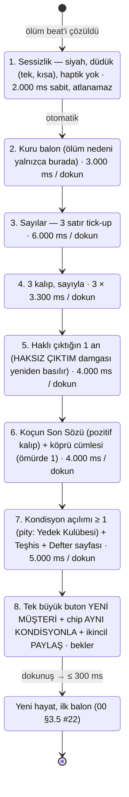

# 07 — UX/UI, Ekran Haritası, FTUE ve Juice Spesifikasyonu

> **Belge türü:** Ayrıntılı tasarım dokümanı (07/11). **Üst belge:** `00-VIZYON-ve-KARARLAR.md` (bağlayıcı); çelişkide sıra 00 → T9 → T-dokümanları → konseptler (D-060).
> **Sürüm:** v1.0 · 2026-11-06 · **Sahip:** UX/UI baş tasarımcısı · **Durum:** Sprint planına girmeye hazır.
> **Kapsadığı sistemler (00 §5, satır 07):** ekran haritası (Hayat Akışı, Defter, Karne, Sözlük, Kamp, Ayarlar, Yardım, Mağaza), FTUE senaryosu (00 §4.2'nin UI katmanı), "Resmî Evrak + antrenman" sanat yönü (acid-lime vurgu, Fraunces italik el yazısı), damga/zarf/fiş juice spec'i, paylaşım kartları (9:16 + 1:1), erişilebilirlik ve lokalizasyon yerleşimi, iki platformda kusursuz çalışma.
> **Bu belge ne yapmaz:** satır yazmaz (01), olay seçmez (03), fiyat koymaz (06), lint kuralı yazmaz (08). Bu sistemlerin **ekrandaki yüzünü** tasarlar ve o yüzün ms, dp, sp, karakter ve haptik cinsinden ölçülebilir kurallarını koyar.

---

## 0. Künye — uygulanan D-kararları, bağımlı dokümanlar, sürüm

### 0.1 Uygulanan D-kararları (her biri → bu belgedeki somut tasarım ögesi)

| D | Karar (kısa) | Bu belgede nasıl uygulandı |
|---|---|---|
| D-003 | Anlatıcı adı = marka = Motto | Logo yok; açılışta koçun ilk balonu markadır. Paylaşım kartlarında tek marka satırı "YILIN MOTTOSU" + küçük "Motto" wordmark (§2.6). |
| D-007 | Ölüm ekranında reklam yok | Roast Raporu → Yeni Müşteri akışında `AdSlot` bileşeni **monte edilmez**; ekran haritasında ölüm dalında reklam düğümü yoktur (§2.2.7, AC-07-18). |
| D-008 | Interstitial yalnızca gönüllü oturum sonunda | "Bugünlük yeter" ve Devre Arası ekranlarında, 3. oturumdan itibaren tek `AdSlot`; kapatma butonu ≥ 44 pt (§2.2.1, §4). |
| D-009 | İddia Defteri UI: sarı fiş, 0,35–0,65, koç sonucu etkilemez | `WagerSlip` bileşeni: olay kartının sağ üst köşesine iğnelenen sarı fiş; [Oranı göster] dokunuşu gerçek `pOdds`'u açar (§2.4.9, §2.5). |
| D-010 | HAKSIZ ÇIKTIM: Heavy + 400 ms mürekkep; 12 kozmetik varyant | `Stamp` bileşeninin `wrong` varyantı; Defter'de "Damga Koleksiyonu" rafı (§2.2.2, §2.5). |
| D-011 | Zarf = pending-outcome nesnesi; hışırtı, haptik yok | `Envelope` bileşeni Kısa Karne'nin alt satırı; oturum sonunda "açılır ama çözülmez" durumu (§2.4.9, §2.5). |
| D-012 | Ruh hâli: Normal / Yorgun (23:00–06:00) | UI'da ruh hâli **görselleştirilmez**; yalnızca koç balonunun glifi değişir (Noto Emoji monokrom); gerçek saat hakkında hiçbir HUD ögesi yok (§2.4.7). |
| D-013 | Tercüme kartı + Sözlük | `DocumentCard` (antetli evrak) + [Tercüme] 250 ms flip + kaşe sesi; Sözlük sekmesi 5 bölüm; 1:1 paylaşım kartı (§2.2.4, §2.5). |
| D-014 | Aile Grubu sohbet ekranı yok; "Okunmamış" HUD sayacı | `UnreadCounter` HUD'da, hiç sıfırlanmaz; yılların ~%40'ında 1 `BeatCard` + "Görüldü, cevap yok" seçeneği (§2.2.1). |
| D-015 | Açılış satırı; ilk kahkaha ≤ 4 sn | FTUE 0:01–0:04: ilk balon, siyah zemin, "yazıyor…" ≤ 1 sn (§2.3). |
| D-016 | Ölüm → yeni hayatın ilk kelimesi ≤ 40 sn | Rebirth akışı adım adım ms bütçesi (toplam otomatik 34 sn, her adım atlanabilir); tek büyük **Yeni Müşteri** + tek dokunuş **Aynı kondisyonla** (§2.2.7). |
| D-019 | Kamp: haftalık seed, 40 **hayali** kohort, KMP-XXXX | Kamp sekmesi; her kohort kartında zorunlu "hayali / fictional" etiketi; geri sayım gerçek Pazartesi 00:00 yerel (§2.2.6). |
| D-020 | Yıl medyanı 90 sn; Kısa Karne varsayılan | Kısa Karne tek ekran ≤ 8 sn okuma; "Tam Karne" dokunarak; "Aynı hedef" tek dokunuş (§2.2.3). |
| D-021 | 6 not; TR Pekiyi…Zayıf, EN A–F | `ReportCard` 6 satır; not sözcükleri locale havuzundan; renk tek anlam taşıyıcısı değil (§2.4.9). |
| D-022 | Yılın Mottosu ≤ 6 kelime | Karne ve paylaşım kartında Fraunces italik, en büyük tipografik öge (§2.6). |
| D-023 | Tek Hedef: 3 öneri + Hedefsiz + Aynı hedef | `GoalPicker` kartı; 4 buton + üstte "Aynı hedef" chip'i (§2.2.3). |
| D-025 | Roast Raporu sırası; ölüm nedeni yalnızca 2. balonda | Rebirth state machine aynen bu sırayla; adımlar atlanabilir, geri alınamaz (§2.2.7). |
| D-026 | Ses ayarı Nazik / Normal / Acımasız; ilk "Bugünlük yeter"den sonra tek soru | `VoiceKnob` 3 kademeli segment; ilk oturum sonu kartı; Ayarlar'da her zaman (§2.2.9). |
| D-028 | 60+ yaşta ≤ 1 balon | Feed yoğunluğu yaş bandına göre: `maxBubblesPerBeat` HUD'a değil feed'e yansır (§2.2.1). |
| D-029 | Streak = Mola ritüeli, duraklar, satılmaz | `MolaPill` + Mola sheet'i: 14 günlük şerit, "duraklatıldı" gri; Sakatlık İzni/Telafi görünür; satın alma düğmesi yok (§2.2.5). |
| D-030 | Bildirim ≤ 1/gün; soft-ask ilk "Bugünlük yeter"den sonra (oturum ≥ 8 dk); Android izni 2. oturumdan önce asla | İzin state machine'i (§2.3.4); `PermissionPrePrompt` koç ağzında; "Beni rahat bırak" tek dokunuş. |
| D-031 | Welcome-back = Sakatlık Raporu, 40 sn, atlanabilir | `InjuryReport` ekranı; büyük karar rafta bekler; ödül sabit (§2.2.5). |
| D-033 | Para soyut "Para/Cash" | HUD'da `◆ 4.250` biçimi; para birimi sembolü hiçbir bileşende yok (§2.4.9). |
| D-037 | 16+; mağaza metadata 4+ | Ekran görüntüsü üretim şablonu yalnızca 4+ vitrin havuzundan; ölüm/Roast kartı mağaza vitrininde yok (§5). |
| D-038 | Torpil tek seferlik; restore | Mağaza: tek kart, mağaza API fiyatı KDV dahil, **Geri Yükle** her zaman görünür (§2.2.10). |
| D-039 | Rewarded yerleşimleri; ilk 10 dk reklamsız; ödül daima | Bağlamsal `RewardedOffer` kartı; "Hayır" seçeneği eşit boyutta; ödül reklam kapanmadan da verilir (§2.2.1, §5). |
| D-043 | Expo SDK 58 / RN 0.88 / TS 6 | Bileşen kütüphanesi seçimleri bu yığına göre: Reanimated 4, FlashList 2, react-native-view-shot, expo-haptics, expo-audio (§2.4). |
| D-047 | Buton bütçesi TR 18 / EN 16 | `UiStrings` bütçe tablosu; yorum: tek satırlık sabit UI butonları için sert kural; olay seçenekleri 2 satıra sarar (§2.7.3). |
| D-050 | Gerçek-zaman satırları oyuncuyu yorumlamaz | HUD'da saat/konum/takvim ögesi yok; 03:12 satırı yalnızca feed'de ve hedefi koç (§5). |
| D-052 | Düşük Keyif: roast kapalı; "Gerçek hayatta yardım" ayrı ve şakasız | Oyundaki **tek koç-sessiz ekran**; acid-lime yok, Fraunces yok (§2.2.8). |
| D-054 | ATT ön-ekranı, KVKK aydınlatma + ayrı rıza, UMP | Rıza akışı 2. oturum başında, tek "Resmî Evrak" kartı dizisi; SDK'lar rıza öncesi başlatılmaz (§2.3.4, §4). |
| D-055 | Sahte aciliyet/stok/sayaç yok | Geri sayım yalnızca gerçek takvimden (Pazartesi 00:00, Telafi 48 sa); `Countdown` bileşeni yalnızca `source: 'calendar'` kabul eder (§5). |
| D-056 | Ölüm = içerik | Roast Raporu'nda her adım bir "kazanım" gösterir (Teşhis, Defter sayfası, Kondisyon) (§2.2.7). |
| D-059 | Juice spec sabit | §2.5 tablosu D-059'un değerlerini değiştirmeden genişletir; eksik tipleri tamamlar. |
| D-060 | Doküman hiyerarşisi | Bu belge D-kararlarını yeniden tartışmaz; boşlukları §7'de D-ÖNERİ olarak işaretler. |

### 0.2 Bağımlı dokümanlar

- **Okur ve uygular:** 00 (tümü), T8 (UX/UI/FTUE/sanat yönü), T11 (juice, pacing, pending queue), T7 TL;DR (bildirim, welcome-back), T3 TL;DR (ses kuralları UI metinlerine de uygulanır), T10 TL;DR (TR/EN uzunluk, buton bütçesi), T9 (rıza akışı, yardım ekranı, 4+ metadata).
- **Beslediği dokümanlar:** 01 (balon/glif kuralları, boş durum satırları buradan şablon alır), 03 (`effects` çıkışı → `JuiceEvent` eşlemesi §2.5), 05 (Mola/Kamp/Teşhis yüzeyleri), 06 (Mağaza ve `AdSlot` yerleşimleri), 08 (buton bütçesi lint'i, yardım ekranı metni), 09 (UI string anahtarları ve bütçeleri), 10 (bileşen kütüphanesi, Playwright hedefleri), 11 (UX KPI'ları).
- **Konseptlerden alınan somut örnekler:** A1 §7.1 (sarı fiş UI, damga koleksiyonu, 80 ms/400 ms juice), A4 §4.3/§7.1 (Koçun Defteri, Karne kartı, Kamp temaları), A2 §7.1 (250 ms flip + kaşe), A3 §7.1 (≤ 40 sn yeniden doğuş zaman bütçesi).

### 0.3 Sürüm

v1.0 — ilk tam sürüm. Değişiklik yalnızca yeni D-kaydı veya bu belgenin v1.x revizyonuyla; §7'deki D-ÖNERİ'ler 00'a alınırsa D-xxx numarası alır ve buradaki "D-ÖNERİ" etiketi düşer.

---

## 1. Amaç ve kapsam — MVP / Soft launch / 1.0

**Amaç:** Oyuncunun ilk 4 saniyede gülmesini, 22. saniyede karar vermesini, 56. saniyede paylaşılabilir bir karne görmesini ve ölünce 40 saniye içinde yeni bir hayata başlamasını **ekranda** mümkün kılan; her geri bildirimin üç kanalı (görsel + metin + haptik/ses) olan; iki dilde aynı ızgaraya oturan; iOS ve Android'de **birebir aynı hissi** veren bir arayüz. UX'in işi anlatıcıyı taşımaktır, gölgelemek değil: ekranın en pahalı pikseli koçun cümlesidir.

**Beş UX ilkesi (T8'in 12 maddesinin bu oyuna indirgenmiş hâli):**
1. **Karar başparmağın altında.** Tüm birincil kararlar ekranın alt üçte birinde; üst köşelerde geri dönülemez hiçbir eylem yok.
2. **Tek ses.** Boş durum, hata, ayar açıklaması, izin ön-ekranı: her metin koçun ağzından (istisna: §2.2.8 yardım ekranı ve hukuki metinler).
3. **Modal karar yok.** Olay ve seçim akışın içinde yaşar; sheet'ler yalnızca ikincil yüzeyler için.
4. **Sürtünme sıfır.** "Yükleniyor" yok, retry ekranı yok, "emin misin?" yalnızca veri silmede; dokunma her animasyonu keser.
5. **Kırpılan metin yok.** Konteyner büyür; Türkçe ek yığılması butonu 2 satıra sarar, kesmez.

| Kapsam ögesi | **MVP (dikey kesit, 10 hafta)** | **Soft launch (TR + CA/NZ)** | **1.0 (global)** |
|---|---|---|---|
| Ekranlar | Hayat Akışı, Defter, Karne (Kısa + Tam), Sözlük (Sözlük + Teşhis segmentleri), Kamp (2 tema), Mola sheet, Ölüm/Roast/Yeni Müşteri, Yardım, Ayarlar, Mağaza iskeleti | + Onyıl Karnesi (30/40), Sakatlık Raporu tam, Kamp 8 tema + arşiv, Mağaza tam (Torpil canlı), Kader kişiliği seçimi (Torpil) | + Onyıl 4 yaş, Kamp 16 tema, Sezon Paketi kartı, karne temaları, defter dışa aktarımı |
| FTUE | 00 §4.2 saniye saniye; sekme açılışları; bildirim soft-ask | + rıza akışı tam (ATT/UMP/KVKK) 2. oturumda; rating istemi kuralları | + A/B hazır varyantlar (buton sırası) |
| Tasarım sistemi | Token'lar, 3 font, 24 bileşen, koyu + açık tema, reduced motion, düşük performans modu | + karne temaları (Torpil), tablet ölçekleme | + ikinci kişilik teması (Kader: "Gişe 7" antet varyantı) |
| Juice | §2.5'in tüm satırları (18 olay tipi) | ses paketi final mix, haptik Android kalibrasyonu | — |
| Paylaşım kartları | Karne (9:16 + 1:1), Roast Raporu (9:16 + 1:1), Lally günü (1:1) | + Sözlük sayfası, Kamp kıyas kartı, HAKSIZ ÇIKTIM defter sayfası | + karne temaları kartlara yansır |
| Erişilebilirlik | Dynamic type, VoiceOver/TalkBack etiketleri, 4.5:1, reduced motion, tek el | + pseudo-localization CI ekran görüntüleri, XL metin regresyonu | + tablet ve katlanabilir düzen testleri |
| Platform | iOS 16.4+ / Android 24+; safe area, edge-to-edge, tahmini geri, 16 KB sayfa boyutu build'i | + Android 13+ bildirim izni akışı canlı; iOS Dynamic Island regresyonu | — |
| Playwright | 12 web-export testi (§6.3) | 20 | 25+ |

**MVP'de bilinçli dışarıda:** avatar/illüstrasyon (§7 D-ÖNERİ-07-06), müzik (D-ÖNERİ-07-07), swipe kart destesi (T8'in ikincil modeli; "bir yıl daha" ritmini kırar, 1.0 sonrası ayrı karar), tablet özel düzen (ölçeklenir, özelleşmez), açık tema paylaşım kartı varyantı (kartlar her zaman "Resmî Evrak" koyu kâğıt).

---

## 2. Tasarım

### 2.1 Navigasyon modeli ve ekran haritası

**Model:** T8'in "Akış + Kart" hibriti. Tek kök ekran (**Hayat Akışı**) + 4 yardımcı sekme + üstte "Daha" menüsü (Ayarlar, Mağaza, Yardım, Lisanslar). **Yaşlan** butonu bir FAB değildir: olay yokken karar bölgesinin kendisidir (feed footer'ı), böylece 5 sekmeli bir çubukla çakışmaz ve klavye/safe-area sorunları doğurmaz. Sekme çubuğu başta tek sekmeyle açılır; diğerleri **soluk + kilit ikonu** ile görünür, ilgili ilk olayla canlanır (progressive disclosure, §2.3.5).

```mermaid
flowchart TD
    A0[Soğuk açılış ≤ 2 sn<br/>siyah + 'yazıyor…'] --> A1{Kayıt var?}
    A1 -- hayır --> F[FTUE = ilk yıl<br/>Hayat Akışı içinde]
    A1 -- evet, hayat sürüyor --> M{Yokluk ≥ 3 gün?}
    A1 -- evet, hayat yok --> R7[Yeni Müşteri ekranı]
    M -- evet --> IR[Sakatlık Raporu 40 sn<br/>atlanabilir] --> H
    M -- hayır --> H[HAYAT AKIŞI<br/>HUD + feed + karar bölgesi]
    F --> H
    H --> D[DEFTER<br/>Not · İddia · İtiraf · KAPANDI · Damgalar]
    H --> K[KARNE<br/>Karne Dosyası · Tam Karne · Onyıl]
    H --> S[SÖZLÜK<br/>Sözlük · Teşhis · Mottolar]
    H --> C[KAMP<br/>haftanın teması · hayali kohort · KMP kodu]
    H -- MolaPill --> MO[(Mola sheet<br/>streak şeridi · Sakatlık İzni · Telafi)]
    H -- Daha --> MORE[(Daha sheet)]
    MORE --> SET[AYARLAR]
    MORE --> SHOP[MAĞAZA]
    MORE --> HELP[GERÇEK HAYATTA YARDIM<br/>koç sessiz]
    MORE --> LIC[Lisanslar & Teşekkürler]
    H -- yıl sonu --> KK[Kısa Karne kartı<br/>feed içinde] --> GP[Tek Hedef kartı] --> H
    KK -- 'Tam Karne' --> TK[Tam Karne sayfası] --> GP
    H -- ölüm --> RR[ROAST RAPORU<br/>7 adım, hepsi atlanabilir] --> R7
    R7 -- Yeni Müşteri / Aynı kondisyonla --> F2[Yeni hayat ilk balon ≤ 300 ms] --> H
    H -- 'Bugünlük yeter' --> SE[Oturum sonu özeti<br/>+ paylaşım + (3. oturumdan itibaren) AdSlot] --> EXIT((çıkış))
    C -- 'Kampa gir' --> H
    KK -- Paylaş --> SC[ShareCard 9:16 / 1:1<br/>react-native-view-shot]
    RR -- Paylaş --> SC
    S -- Paylaş --> SC
```

**Navigasyon kuralları:**
- Sekmeler durumunu korur (her sekme kendi scroll konumunu hatırlar); Hayat'a dönüş her zaman en alta (karar bölgesine) kaydırır.
- Sheet'ler (Mola, Daha) yarım ekran, sürükleyerek kapanır, arka plan %60 karartma; hiçbir sheet bir karar içermez.
- Tam ekran geçişler (Tam Karne, Roast Raporu, Ayarlar, Mağaza, Yardım) native stack; iOS'ta kenardan kaydırarak geri, Android'de tahmini geri jesti destekli (§4).
- "Yükleniyor" durumu **yoktur**: içerik paketi uygulamayla gemiye biner (≤ 2 MB gzip), on yıl dilimleri bellekte önden açılır; yeni EAS Update paketi bir sonraki soğuk açılışta devreye girer, oyun sırasında asla.

### 2.2 Ekranlar

Her ekran için aynı şablon: amaç → wireframe → bileşenler → durumlar (boş / çevrimdışı / özel) → etkileşimler → sabit UI metinleri (TR/EN, bütçe).

#### 2.2.1 Hayat Akışı (kök ekran)

**Amaç:** Oyunun %90'ı burada geçer: koç konuşur, olay kartı gelir, oyuncu seçer, yıl biter, karne düşer. Göz üstten tarar, el altta çalışır; en kritik okunacak şey (olay metni) karar bölgesine en yakın yerde durur.

```
┌──────────────────────────────────────────┐  ← status bar (light content)
│ ▣ Deniz Ertelemez · 19 · Kadıköy    ⋯    │  ← IdentityHeader (dosya sekmesi görünümü) + Daha
│ ◆ 4.250   Okunmamış: 23   ⟳ 3 gün        │  ← Para · UnreadCounter · MolaPill
│ Sağlık 70 ▲  Keyif 55 ▼  Kafa 60   Çek 50│  ← StatBar (4 pill, delta okları)
├──────────────────────────────────────────┤
│ ── 18 ──                                 │  ← YearDivider
│ ◐ 18 oldun. Tebrikler. Buradan sonrası   │  ← NarratorBubble (sol, glif + metin)
│   resmî olarak senin suçun.              │
│                   [Önce kahvaltı]  ▸     │  ← PlayerBubble (sağ, seçilen)
│ ◐ Keyif +4. Kafa −2. Kahvaltı böyle bir  │
│   şey.                                   │
│ ── 19 ──                                 │
│ ┌────────────── KARNE 2026 ────────────┐ │  ← ReportCard (kısa, feed içinde)
│ │ Sağlık İyi · Para Geçer · … · Dav. Orta│ │
│ │ HEDEF: Bir bölüme gir → [YARIM]      │ │
│ │ "Başladı. Teknik olarak."            │ │
│ │ ✉ Deftere bir zarf eklendi. Açmadım. │ │  ← Envelope satırı
│ └──────────────────────────────────────┘ │
├──────────────────────────────────────────┤
│ ┌ İLK PARA ───────────────────┐ ┌─────┐  │  ← BeatCard + WagerSlip (sağ üst köşe, iğneli)
│ │ Dayın "hayata atıl" diye    │ │İDDİA│  │
│ │ para verdi. Dayın 2009'da   │ │Mart'ı│ │
│ │ yaşıyor.                    │ │görmez│ │
│ └─────────────────────────────┘ │ — M.│  │
│ [ Biriktir                          ]    │  ← ChoiceButton ×3 (56 dp, tam genişlik)
│ [ Arkadaşlarla ye, hayat kısa       ]    │
│ [ Kripto                            ]    │
├──────────────────────────────────────────┤
│  Hayat   Defter   Karne   Sözlük   Kamp  │  ← TabBar (kilitliler soluk + 🔒 değil, Phosphor "lock")
└──────────────────────────────────────────┘
```

Olay yokken karar bölgesi tek ögeye iner: **Yaşlan** (72 dp yüksek, tam genişlik, pill) + üstünde koçun 1 satırı. İlk yılda spring ile yükselir ve 3 kez nabız atar; sonra sakin.

**Bileşenler:** `IdentityHeader`, `MoneyCounter`, `UnreadCounter`, `MolaPill`, `StatBar`/`StatPill`, `LifeFeed` (FlashList), `NarratorBubble`, `PlayerBubble`, `YearDivider`, `ReportCard(compact)`, `Envelope`, `BeatCard` / `DocumentCard`, `WagerSlip`, `ChoiceButton`, `AgeUpButton`, `RewardedOffer`, `Toast`, `TabBar`.

**Durumlar:**
- *İlk açılış:* HUD yok; stat çubuğu ilk sonuçla "doğar" (0:22–0:27). Sekme çubuğunda yalnızca Hayat aktif.
- *Çevrimdışı:* **birebir aynı.** Kritik yolda ağ çağrısı yok; `RewardedOffer` reklam yüklenemediyse hiç görünmez (hata metni yok).
- *Yıl sonu:* feed'e Kısa Karne kartı düşer, karar bölgesi `GoalPicker`'a döner.
- *Düşük Keyif (Keyif ≤ 15 iki yıl üst üste):* koç roast'u kapatır (01'in işi); UI tarafında **tek değişiklik** "Daha" menüsündeki "Gerçek hayatta yardım" satırının kısa süreli vurgulanması (acid-lime nokta) ve feed'e bir kez, şakasız, koç dışı sistem kartı: TR *"Bu bir oyun. Gerçek hayatta destek istersen: Daha → Gerçek hayatta yardım."* / EN *"This is a game. If you want real-life support: More → Real-life help."* Konfeti, haptik, ses yok.
- *60+ yaş:* beat başına ≤ 1 balon (D-028); feed görsel olarak seyrekleşir, yıl ayraçları arası kısalır — "sessizlik" tasarımın parçası.
- *Kamp modu:* HUD'ın altında ince acid-lime bant: TR *"ERTELEME KAMPI · 3. gün · hayali kohort 40"* / EN *"PROCRASTINATION CAMP · Day 3 · 40 fictional campers"*.
- *Oturum sonu sezildi (T11 3c):* director en ağır zarfı **açar ama çözmez**; feed'e `Envelope(open)` düşer; karar bölgesinde **[Bir Yıl Daha]** birincil, **[Bugünlük yeter]** ikincil.

**Etkileşimler:**
- `ChoiceButton` dokunuş: `selection` haptik, 80 ms scale 0,96→1; kart akışa katlanır (layout animation 220 ms); sonuç balonu ≤ 300 ms içinde.
- `WagerSlip` dokunuş: fiş 180° döner → arka yüzde gerçek oran (*"Oran: %55. Zar benim değil."* / *"Odds: 55%. Not my dice."*) + **[Oranı göster]** metni zaten görünür; oyuncu bakmayabilir.
- Uzun basma `AgeUpButton`: yok (T8'in "×3 hızlı yaşlan" kısayolu alınmadı; 90 sn'lik yıl zaten hızlı, "bir yıl daha" ritmi korunur).
- `UnreadCounter` dokunuş: hiçbir şey açılmaz; sayaç 1 kez titrer, koç 1 satır (yılda ≤ 1): TR *"Açmayacaksın. Ben de açmıyorum."* / EN *"You're not opening it. Neither am I."*
- Feed'de geriye kaydırma serbest; karar bölgesi sabit (footer), yeni balon gelince "↓ yeni" chip'i; otomatik kaydırma yalnızca oyuncu zaten en alttaysa.
- `RewardedOffer` (Ek Antrenman, Forma Sponsoru, Taktik Değişikliği, Fizyoterapi): koç ağzında 1 satır + iki **eşit boyutlu** buton [İzle] / [Kalsın]; ilk 10 dakikada bileşen hiç monte edilmez; 3. seçenek olarak gelen Taktik Değişikliği diğer seçeneklerle aynı stil + küçük "30 sn" etiketi, asla önceden seçili değil.

**Sabit UI metinleri (bütçe: CTA TR 18 / EN 16):**

| Anahtar | TR | EN | Not |
|---|---|---|---|
| `cta.ageUp` | Yaşlan | Age Up | 72 dp pill |
| `cta.oneMoreYear` | Bir Yıl Daha | One More Year | birincil |
| `cta.enoughToday` | Bugünlük yeter | Enough for today | ikincil (16/16) |
| `cta.share` | Paylaş | Share | |
| `cta.showOdds` | Oranı göster | Show the odds | WagerSlip |
| `cta.translate` | Tercüme | Translate | DocumentCard |
| `cta.seenNoReply` | Görüldü, cevap yok | Seen, no reply | Aile kartı seçeneği |
| `cta.watchAd` / `cta.noThanks` | İzle · 30 sn / Kalsın | Watch · 30 s / Pass | eşit boyut |
| `hud.unread` | Okunmamış: {n} | Unread: {n} | ICU number |
| `hud.money` | ◆ {n} | ◆ {n} | birim sembolü yok (D-033) |
| `tab.life/notebook/report/glossary/camp` | Hayat · Defter · Karne · Sözlük · Kamp | Life · Notebook · Report · Glossary · Camp | sekme bütçesi 8/8 |
| `feed.newBelow` | ↓ yeni | ↓ new | chip |

#### 2.2.2 Koçun Defteri

**Amaç:** Anlatıcı hafızasının okunabilir yüzü (00 §3.3). Oyuncu her göndermeyi buradan doğrular; **hafıza uydurulmaz** kuralının UI kanıtı. Ayrıca HAKSIZ ÇIKTIM koleksiyonu burada yaşar.

```
┌──────────────────────────────────────────┐
│ ‹ Defter                      Dışa aktar │  ← Torpil'de aktif; değilse kilit ikonu + "Torpil"
│ [ KAPANDI 1 ] [ KAPANDI 2 ] [ ● Açık ]   │  ← NotebookShelf (yatay; ücretsizde son 3)
│ (Hepsi) (Not) (İddia) (İtiraf)           │  ← filtre chip'leri
├──────────────────────────────────────────┤
│ 2029  "Bu sefer farklı" dedi.        ↗   │  ← NotebookEntry(note) · Fraunces italik · ↗ "Doğrula" → feed'e atlar
│ 2030  ┌─ İDDİA ───────────────┐          │  ← NotebookEntry(wager): sarı fiş
│       │ Bu para Mart'ı görmez │ ░İSABET░ │     damga + "Oran %55"
│       └───────────────────────┘          │
│ 2031  ┌─ İDDİA ───────────────┐          │
│       │ O işi alamaz. — M.    │ ▓HAKSIZ▓ │  ← HAKSIZ ÇIKTIM damgası (varyant #4)
│       └───────────────────────┘ ▓ÇIKTIM▓ │
│ 2033  İtiraf: Yalan söyledim, çalıştı.   │  ← NotebookEntry(confession) · nadir · [Paylaş]
├──────────────────────────────────────────┤
│ DAMGA KOLEKSİYONU  4 / 12                │  ← StampShelf: 12 yuva, açılmayanlar silüet
│ ▓ ▓ ▓ ▓ ░ ░ ░ ░ ░ ░ ░ ░                  │
└──────────────────────────────────────────┘
```

**Bileşenler:** `NotebookShelf`, `NotebookEntry` (3 varyant), `Stamp`, `StampShelf`, `FilterChips`, `ShareCard` (defter sayfası, 1:1; soft launch).

**Durumlar:**
- *Boş (ilk iddiadan önce sekme kilitli; kilidi açıldığı anda ≥ 1 girdi vardır).* Yine de teknik boş durum metni: TR *"Defter boş. Henüz bir şey söylemedin ki yazayım."* / EN *"Empty notebook. You haven't said anything worth writing down. Yet."*
- *KAPANDI defter açık:* salt okunur; sayfa kenarında "KAPANDI · 74 yaş" damgası; girdiler soluk.
- *Ücretsiz arşiv sınırı (3):* 4. hayatta en eski defter raftan düşer; düşmeden önce bir kez Toast: TR *"En eski defteri kaldırıyorum. Torpil'de raf sınırsız; satış değil, bilgi."* / EN *"Removing the oldest notebook. Torpil has unlimited shelf space; not a pitch, a fact."*
- *Çevrimdışı:* fark yok (tümü yerel SQLite).

**Etkileşimler:** girdiye dokunma → kaynak yıl vurgulanıp feed'e atlar (↗ "Doğrula" / "Verify"); fişe dokunma → oran arka yüzü; damgaya uzun basma → varyant adı ve nasıl kazanıldığı; İtiraf sayfasında [Paylaş].

**Sabit UI metinleri:** `nb.verify` Doğrula / Verify (7/6) · `nb.export` Dışa aktar / Export (10/6) · `nb.closed` KAPANDI / CLOSED · `nb.stamps` Damga Koleksiyonu / Stamp Collection · filtre: Hepsi·Not·İddia·İtiraf / All·Note·Wager·Confession.

#### 2.2.3 Karne — Kısa Karne, Tam Karne, Karne Dosyası, Onyıl Karnesi

**Amaç:** Yılın paylaşım birimi ve "bir yıl daha"nın kapısı. **Kısa Karne** feed içinde tek ekran (D-020, ≤ 8 sn okuma); **Tam Karne** dokunarak açılan tam sayfa; **Karne** sekmesi = Karne Dosyası (bu hayatın tüm yılları) + Onyıl Karneleri.

```
KISA KARNE (feed kartı, 328 dp)            TAM KARNE (tam sayfa)
┌────────── KARNE 2026 ──────────┐          ┌──────────────────────────────┐
│ Sağlık  İyi    Para     Geçer  │          │ ‹                     Paylaş │
│ İlişk.  Orta   Kafa     İyi    │          │ ░░ MOTTO · MÜŞTERİ DOSYASI ░░│ ← antet
│ Cesaret Geçer  Davranış Orta   │          │ KARNE 2026 · Deniz E. · 18   │
│ ─────────────────────────────  │          │ 6 not + koçun 1 cümlelik notu │
│ HEDEF: Bir bölüme gir  [YARIM] │          │ her satırda                  │
│ ❝ Başladı. Teknik olarak. ❞    │ ← Motto  │ HEDEF + damga (anim. tekrar)  │
│ ✉ Deftere bir zarf eklendi.    │          │ İDDİA: 1 isabet · 1 haksız    │
│   Açmadım. Hâlâ.               │          │ Koçun isabeti: %50            │
│ Tam Karne ›            Paylaş  │          │ ❝ Başladı. Teknik olarak. ❞   │
└────────────────────────────────┘          │ Koçun notu (Fraunces italik)  │
                                            │ seed: HYT-7K3Q                │
TEK HEDEF (karar bölgesi)                   └──────────────────────────────┘
┌────────────────────────────────┐
│ ◐ Bu yıl için tek hedef. Bir.  │
│ ( Aynı hedef: Bir bölüme gir ) │ ← chip, tek dokunuş (D-023)
│ [ 5.000 biriktir            ]  │
│ [ Bir arkadaş edin          ]  │
│ [ Bir bölüme gir (devam)    ]  │
│ [ Hedefsiz yaşa             ]  │ ← ikincil stil, aynı boyut
└────────────────────────────────┘
```

**Not sözcükleri:** TR Pekiyi / İyi / Orta / Geçer / Zayıf, EN A / B / C / D / F (D-021). Renk **ikincil** taşıyıcı: Pekiyi/A ve İyi/B kâğıt-krem, Orta/C mürekkep-gri, Geçer/D ve Zayıf/F kayıt-kırmızısı `#C9372C` **yalnızca harf/sözcük rengi**, çubuk yok (karne bir barem değil, bir evraktır).

**Hedef damgası:** TAMAM / YARIM / ERTELENDİ ↔ DONE / HALFWAY / POSTPONED; `Stamp` bileşeni 80 ms basış + "tak" + Medium (D-059). YARIM damgasında near-miss varsa fişte oran satırı: *"3.412 / 5.000. Az kaldı; gerçekten az."* / *"3,412 / 5,000. Close. Actually close."*

**Onyıl Karnesi (30/40/50/60):** Tam Karne şablonu + üstte "ONYIL" bandı; yalnızca karar kalemleri (D-051): "Ev", "İş", "Bir şeyler"; listede olmayan ama yapılan 3 madde; puan. Medeni durum/çocuk kalemi **yoktur**. Zorunlu lift satırı en altta, Fraunces italik.

**Durumlar:** *Kısa Karne ilk yıl:* konfeti (tek seferlik, ≤ 60 partikül, "kâğıt parçası" şekilli). *Karne Dosyası boş:* sekme kilitli (ilk karneyle açılır). *Onyıl Karnesi yok:* liste yalnızca yılları gösterir, boş yuva yok (sahte ilerleme yok).

**Sabit UI metinleri:** `rc.fullReport` Tam Karne / Full Report (10/11) · `rc.goal` HEDEF / GOAL · `rc.sameGoal` Aynı hedef / Same goal · `rc.noGoal` Hedefsiz yaşa / No goal, respect (13/16) · `rc.coachAccuracy` Koçun isabeti: {p} / Coach accuracy: {p} · `rc.decade` ONYIL KARNESİ / DECADE REVIEW · `rc.mottoLabel` YILIN MOTTOSU / MOTTO OF THE YEAR.

#### 2.2.4 Sözlük (koleksiyon sekmesi: Sözlük · Teşhis · Mottolar)

**Amaç:** İkinci koleksiyon (D-013) ve Teşhis koleksiyonunun yüzeyi; Reels formatına hazır 1:1 kart. Üç segment: **Sözlük** (Tercümeler; bölümler Kurumsal / Ev Sahibi / Aile / Flört / Sağlık), **Teşhis** (30 → 60 → 120), **Mottolar** (oyuncunun aldığı Yılın Mottosu geçmişi).

```
┌──────────────────────────────────────────┐
│ Sözlük            ( Sözlük | Teşhis | Mottolar ) │ ← SegmentedControl
│ Kurumsal 6/14 · Ev Sahibi 2/8 · Aile 3/8 · Flört 0/6 · Sağlık 1/4 │ ← yatay bölüm chip'leri + sayaç
├──────────────────────────────────────────┤
│ ┌───────────────┐ ┌───────────────┐      │
│ │ "Son e-posta- │ │ "Evladım gibi-│      │  ← GlossaryCard: antet kırpıntısı
│ │  ma istinaden"│ │  sin, ama…"   │      │
│ │ → Kızgınım ve │ │ → Zam geliyor │      │     Tercüme (Fraunces italik)
│ │   kanıtım var │ │               │      │
│ │ 2031 · Kurumsal│ │ 2029 · Ev Sh.│      │
│ └───────────────┘ └───────────────┘      │
│ ┌───────────────┐ ┌───────────────┐      │
│ │   ░░░░░░░░    │ │   ░░░░░░░░    │      │  ← kilitli: silüet, ipucu yok (p < 0,30)
│ │   ░░░░░░░░    │ │  Az kaldı: 1  │      │  ← p ≥ 0,80: "Az kaldı" (T11 3e)
│ └───────────────┘ └───────────────┘      │
└──────────────────────────────────────────┘
```

**Teşhis segmenti:** rozet değil **dosya damgası** estetiği (yuvarlak kaşe, Space Grotesk büyük harf): "OKUNDU BIRAKAN", "KRONİK". Her Teşhis kartında nasıl alındığı ("3 hayatta aynı #1 kalıp") ve tier etiketi (sim-kalibreli; T11 3e). **Mottolar segmenti:** yıl + motto + o yılın 6 notunun mini şeridi; her satır 1:1 kart olabilir.

**Durumlar:** *Boş (ilk Tercüme'den önce sekme kilitli).* Kilit açıldığı anda ilk kart vardır. *Teşhis boş (ilk ölümden önce yarısı kalıp bazlı olduğundan ilk Teşhis ömür içinde gelebilir):* TR *"Teşhis yok. Henüz tanı koyacak kadar tekrar yapmadın."* / EN *"No diagnosis. Not enough reps to call anything yet."* *Çevrimdışı:* fark yok.

**Etkileşimler:** karta dokunma → tam kart (orijinal evrak + Tercüme + "Şu olayda öğrendin: 2031 ↗") + [Paylaş] 1:1; kilitli karta dokunma → hiçbir ipucu (Loewenstein eşiği), yalnızca selection haptik ve chip sayacı titrer.

**Sabit UI metinleri:** segment: Sözlük · Teşhis · Mottolar / Glossary · Diagnoses · Mottos (8/9 — segment bütçesi 10/10) · `gl.learnedAt` Şu olayda: {year} / Learned in: {year} · `gl.almost` Az kaldı: {n} / Almost: {n} · `gl.locked` (metin yok; silüet).

#### 2.2.5 Mola / streak yüzeyi ve Sakatlık Raporu

**Amaç:** Günün ilk kararı (Mola, 90 sn ritüel) ve karar bazlı streak'in **duraklayan, utandırmayan** yüzeyi (D-029). Streak bir sekme değildir; HUD'daki `MolaPill` ve ondan açılan sheet.

```
MolaPill (HUD):  ⟳ 47 gün          ⟳ 47 · duraklatıldı          ⟳ Telafi 31 sa
                 (aktif, lime)      (gri; kırmızı yok)           (gerçek geri sayım)

MOLA SHEET
┌──────────────────────────────────────────┐
│ ◐ 3 gün yoktun. Antrenman kaçırdın.      │
│   Ceza yok; gıcıklık için varım, ceza    │
│   için değil. Sayaç: 47 gün, duraklatıldı│
│ ● ● ● ● ○ ○ ○ ● ● ● ● ● ● ●              │  ← 14 günlük şerit (dolu = karar verildi)
│ Sakatlık İzni: ■ ■  (7 günde 1 yenilenir)│
│ Telafi: 31 sa kaldı · 3 karar yeter      │  ← gerçek pencere (48 sa), oyunla onarım
│ Kilometre taşları: 3 7 14 21 30 ●66 100 365│
│ [ Bugünün ilk kararı › ]                 │  ← sheet'i kapatır, feed'e döner
└──────────────────────────────────────────┘
```

**Kurallar (UI):** kırmızı renk hiçbir streak durumunda kullanılmaz; "kaybettin / bozuldu / sıfırlandı" sözcükleri UI'da **yok** (lint, 08); satın alma butonu **yok**; alev/ateş ikonu yok (düdük ikonu `whistle`, Phosphor özel SVG). 66. gün kartı (Lally günü) 1:1 paylaşım kartıdır (05'in içeriği, bu belgenin `ShareCard` şablonu).

**Sakatlık Raporu (welcome-back, D-031):** ≥ 3 gün yokluk → tam sayfa, 40 sn, her satır dokunarak geçilir, [Atla] sağ üstte: başlık "SAKATLIK RAPORU / INJURY REPORT", 3–5 satır (gerçek yokluk → oyun zamanı), "rafta bekleyen karar" satırı, sabit küçük ödül (1 Sakatlık İzni, cap içinde). Haptik: açılışta `impact.soft` + düdük (kısa, Mola düdüğü). Hiçbir satır oyuncunun gerçek hayatını yorumlamaz (D-050): *"Annen 14 kez aradı, patron 1."* karakter hakkındadır.

**Sabit UI metinleri:** `mola.paused` duraklatıldı / paused · `mola.repair` Telafi: {h} sa / Repair: {h} h · `mola.leave` Sakatlık İzni / Injury Leave · `mola.firstDecision` Bugünün ilk kararı / Today's first call (18/18 → EN 16'ya sığsın: "First call today" 16) · `ir.title` SAKATLIK RAPORU / INJURY REPORT · `ir.skip` Atla / Skip.

#### 2.2.6 Kamp (Antrenman Kampı)

**Amaç:** Haftalık seed'li hayat + **hayali** kohort kıyası (D-019); fresh-start etkisi; paylaşım kodu.

```
┌──────────────────────────────────────────┐
│ Kamp                                     │
│ ┌──────────────────────────────────────┐ │
│ │ ERTELEME KAMPI · 2026-W45            │ │  ← CampCard: tema + kısıt
│ │ "sonra/yarın" seçenekleri kilitli;   │ │
│ │ koç her kilidi sayar.                │ │
│ │ Bitiş: Pzt 00:00 · 3 gün 4 sa        │ │  ← gerçek takvim geri sayımı
│ │ Kod: KMP-7K3Q        [ Kampa gir ]   │ │
│ └──────────────────────────────────────┘ │
│ HAYALİ KOHORT (40) — hayali, kurgusal    │  ← zorunlu etiket, her kartta
│ 1. hayali Ayşe   Karne ort. İyi   71 yaş │
│ 2. hayali Jordan Karne ort. İyi   68 yaş │
│ … sen: 14. · Karne ort. Orta · 58 yaş    │
│ [ Kıyas kartını paylaş ]                 │
│ Geçen haftalar ›                         │  ← arşiv (soft launch)
└──────────────────────────────────────────┘
```

**Durumlar:** *İlk oturum:* sekme kilitli; 2. oturum başında canlanır (koç 1 balon: TR *"Yeni sekme: Kamp. Pazartesi herkes aynı hayatı yaşar; sonuçlar farklı. Hayali herkes, not düşeyim."* / EN *"New tab: Camp. Mondays, everyone lives the same life; results differ. Everyone's fictional, for the record."*). *Kamp sürüyor:* kart "SÜRÜYOR" damgalı, Hayat'ta bant. *Tamamlandı:* Kamp Teşhisi damgası + kıyas kartı. *Hafta değişti, kamp bitmedi:* "ISINMA SAYILDI" damgası (ceza yok), yeni tema. *Çevrimdışı:* seed yerel (`hash(YYYY-WW + locale + contentHash)`), fark yok.

**Sabit UI metinleri:** `camp.enter` Kampa gir / Enter camp (9/10) · `camp.endsIn` Bitiş: {dt} / Ends: {dt} · `camp.fictional` hayali / fictional · `camp.cohort` HAYALİ KOHORT / FICTIONAL COHORT · `camp.you` sen / you · `camp.shareCompare` Kıyas kartı / Compare card.

#### 2.2.7 Ölüm → Roast Raporu → Yeni Müşteri (≤ 40 sn)

**Amaç:** Ölüm içeriktir (D-056); Roast Raporu güldürür ve sayar; yeni hayatın ilk kelimesi ≤ 40 sn (D-016); **reklam yok** (D-007).



Zaman bütçesi: otomatik ilerlemede 2 + 3 + 6 + 9,9 + 4 + 4 + 5 = **33,9 sn** + dokunuş + 0,3 sn = ≤ 35 sn; hedef ≤ 40 sn'in altında 5 sn pay. Oyuncu her adımı dokunarak hızlandırabilir (minimum: 2 sn sessizlik + 7 dokunuş ≈ 6 sn). **Geri alınamaz**: Android geri jesti ve iOS kenar kaydırması bu akışta "bir sonraki adım" demektir (çıkış değil). `AdSlot`, `RewardedOffer`, `Countdown`, Mağaza girişi bu akışta **derleme zamanında** yoktur (AC-07-18).

Ekran dili: "Resmî Evrak" koyu kâğıt, ROAST RAPORU antedi, kalıp satırları Space Grotesk tabular rakamla, Koçun Son Sözü Fraunces italik; "KAPANDI" damgası 7. adımda deftere basılır (Medium + "tak"). Adım 5'teki damga `wrong` varyantıdır (Heavy + 400 ms mürekkep): ömrün duygusal zirvesi, oyuncunun koçu yanılttığı an.

**Yeni Müşteri ekranı:** tek birincil buton 72 dp **[Yeni Müşteri]**; altında chip **[Aynı kondisyonla]** (önceki hayatın Kondisyon seçimini kopyalar, Müşteri Dosyası'nı atlamaz — isim yine karışır); sağ üstte **[Paylaş]** (Roast Raporu kartı). Hiçbir "ölümden dönüş" seçeneği yoktur.

**Sabit UI metinleri:** `death.report` ROAST RAPORU / ROAST REPORT · `death.newClient` Yeni Müşteri / New Client (12/10) · `death.sameConditioning` Aynı kondisyonla / Run it back (16/11) · `death.closed` KAPANDI / CLOSED · `death.bench` Yedek Kulübesi / The Bench (pity açılımı başlığı).

#### 2.2.8 Yardım / "Gerçek hayatta yardım"

**Amaç:** D-052'nin ekranı. Oyundaki **tek koç-sessiz** yüzey: acid-lime yok, Fraunces yok, damga yok, haptik yok, ses yok. Düz Inter, kâğıt-krem metin, bol boşluk.

```
┌──────────────────────────────────────────┐
│ ‹ Gerçek hayatta yardım                  │
│                                          │
│ Motto bir oyundur ve koçu kurgusaldır.   │
│ Zor bir dönemdeysen gerçek biriyle       │
│ konuşmak işe yarar.                      │
│                                          │
│ Türkiye · Acil: 112                      │
│ Türkiye · Destek hatları: findahelpline.com/tr │
│ ABD · 988 Suicide & Crisis Lifeline      │
│ Birleşik Krallık · Samaritans 116 123    │
│ Diğer ülkeler · findahelpline.com        │
│                                          │
│ Bu sayfa her zaman Daha menüsünde.       │
└──────────────────────────────────────────┘
```

Kurallar: liste cihaz bölgesine göre sıralanır (yalnızca `expo-localization` bölge kodu; konum izni istenmez); linkler `Linking.openURL`; metin 08'in onayından geçer (hukuk); "intihar" sözcüğü TR başlıkta **yok** (kurum adı olan "988 Suicide & Crisis Lifeline" özel ad olarak kalır); oyuncu buradan feed'e döndüğünde koç **o beat'te konuşmaz** (01'e kural: `helpScreenVisitedThisSession → suppressRoastOnce`).

#### 2.2.9 Ayarlar

Tek liste, gruplu; her satır `SettingsRow`. Açıklama metinleri koç ağzında, kısa (≤ 60 karakter), hukuki satırlar hariç.

| Grup | Satır | Kontrol | Varsayılan | Koç açıklaması TR / EN |
|---|---|---|---|---|
| Koç | Ses ayarı | 3'lü segment: Nazik / Normal / Acımasız (Gentle / Normal / Brutal) | Normal (D-026) | "Adalet değişmez; sadece ağız." / "Fairness stays. Only the mouth changes." |
| Koç | Koç kişiliği | seçim listesi; Kader yalnızca Torpil'de | Motto | "Gişe 7'den biri var. Torpil'de." / "There's a clerk from Window 7. Torpil only." |
| Dil | Dil | TR / EN segment | sistem (tr→TR, aksi EN) | "Aynı şaka, farklı kas." / "Same joke, different muscle." |
| Görünüm | Metin boyutu | S / M / L / XL + "Sistemi takip et" | Sistem | "Büyüt. Kimse bakmıyor." / "Go bigger. Nobody's watching." |
| Görünüm | Tema | Koyu / Açık / Sistem | **Koyu** (D-ÖNERİ-07-01) | — |
| Görünüm | Hareketi azalt | anahtar + "Sistem" | Sistem | "Damga yine iner; yavaş değil, sessiz." / "The stamp still lands. Quieter, not slower." |
| Geri bildirim | Ses efektleri | anahtar | Açık | "Düdük yalnızca Mola ve ölümde. Söz." / "Whistle only at Mola and at death. Promise." |
| Geri bildirim | Titreşim | anahtar | Açık | — |
| Bildirim | Mola hatırlatıcı | anahtar (sistem izni gerektirir) | Kapalı (soft-ask'a kadar) | "Günde en fazla bir. Üç kez yok sayarsan susarım." / "One a day, max. Ignore three and I go quiet." |
| Bildirim | Beni rahat bırak | tek dokunuş buton | — | "Tamam. Defter açık." / "Fine. Notebook stays open." |
| Torpil | Torpil | durum + [Mağaza] | — | fiyat Mağaza'da |
| Torpil | Satın alımları geri yükle | buton **her zaman görünür** | — | hukuki metin (Apple 3.1.1) |
| Gizlilik | Analitik paylaşımı (açık rıza) | anahtar, **ayrı** | Kapalı | KVKK açık rıza metni (08) |
| Gizlilik | Reklam tercihleri | buton → UMP formu / iOS Ayarlar derin linki | — | — |
| Gizlilik | Aydınlatma metni · Gizlilik politikası · Kullanım koşulları | linkler | — | — |
| Veri | Koçun Raporu'nu dışa aktar | buton → JSON paylaş | — | "Kişisel veri yok; beat sayıları var." / "No personal data. Just beat counts." |
| Veri | Veriyi sıfırla | 2 adımlı onay (tek "emin misin?" yeri) | — | "Defterleri yakıyorum. Geri gelmez." / "Burning the notebooks. No undo." |
| Destek | Gerçek hayatta yardım | satır → §2.2.8 | — | **koç sessiz** |
| Destek | Destek e-postası · Lisanslar & Teşekkürler · Sürüm | — | — | Sürüm'e 7 dokunuş: dev build tuning paneli |

#### 2.2.10 Mağaza

**Amaç:** Torpil (tek seferlik), Sezon Paketi (1.0), geri yükleme. Roast tonu **kapalı** (00 §8): koç konuşur ama iğnelemez.

```
┌──────────────────────────────────────────┐
│ ‹ Mağaza                                 │
│ ┌──────────────────────────────────────┐ │
│ │ TORPİL — koçun gözdesi               │ │
│ │ • Reklam yok  • 2 ek koç kişiliği    │ │
│ │ • Karne temaları  • Defter dışa akt. │ │
│ │ • Sınırsız arşiv  • 3 kayıt yeri     │ │
│ │ Hayatın değişmez; menü değişir.      │ │
│ │ [ 199,99 ₺ · tek seferlik ]          │ │ ← fiyat StoreKit/Play API'den, KDV dahil
│ └──────────────────────────────────────┘ │
│ (1.0) SEZON PAKETİ — içindekiler yazılı  │
│ [ Satın alımları geri yükle ]            │ ← her zaman
│ Kullanım koşulları · Gizlilik            │
└──────────────────────────────────────────┘
```

Kurallar: hiçbir seçenek önceden işaretli değil; geri sayım, "en popüler", "X kişi aldı" yok (D-040, D-055); fiyat metni yalnızca mağaza API'sinden (`displayPrice` / `formattedPrice`); satın alma hatası koç ağzında tek satır, suçlamasız: TR *"Olmadı. Mağaza, ben değil. Tekrar dene ya da deneme."* / EN *"Didn't go through. The store, not me. Try again, or don't."*

**Sabit UI metinleri:** `shop.restore` Geri Yükle / Restore (10/7; satır başlığı "Satın alımları geri yükle" 25 karakter, satır bütçesi 28) · `shop.oneTime` tek seferlik / one-time · `shop.contents` İçindekiler / Contents.
