# 09 — i18n ve İki Dilli İçerik Üretim Hattı (TR + EN)

> **Belge türü:** Ayrıntılı tasarım dokümanı (00 §5 satır 09). **Sahip olduğu sistemler:** intent spec → iki native realization süreci, gün başına içerik JSON'unun locale katmanı (`intent` / `tr` / `en` / `review` / `universality`), i18next + ICU runtime'ı, `trInflect()`, EN yardımcıları, isim havuzları, soyut para ve takvim yerelleştirmesi, kültürel ikame tablosu, funny-check rubriği, EN punch-up süreci, içerik operasyonları (CSV, toplu üretim, sürümleme, kill-switch, SLA), mağaza metni ve sürüm notu sesi, `SC-*` lint kuralları.
> **Hiyerarşi:** 00 > T9 > T-dokümanları > konseptler (D-060). Bu belge D-kararlarını **uygular**; yeniden tartışmaz. 00'ın kapsamadığı kararlar §7.3'te `D-ÖNERİ-09-xx` olarak işaretlidir.
> **Durum:** v1.0 · 2026-11-07 · Yazar: Baş Tasarımcı (09 sahibi) · Girdi: 00 (tümü, özellikle §9 ve §12), T10 (tam), T4 (tam), T3/T5/T9 (TL;DR), 03 §2.2 şeması, 08 §2.2 linter mimarisi, 10 §2.2/§2.3.8, 01 §2.15, 04 §2.11.

---

## 0. Künye — uygulanan D-kararları, bağımlı dokümanlar, sürüm

### 0.1 00 §5'in 09 satırı → bu belgedeki karşılığı

| 00 §5 ifadesi | Burada |
|---|---|
| Intent spec → iki native realization | §2.1 ilke, §2.3 iş akışı, §2.3.2 prompt şablonları (birebir) |
| Olay başına JSON (tr+en+intent+review) | §2.2 gün dosyası formatı; §3.1–3.3 üç tam örnek |
| i18next + ICU + `trInflect()` | §2.4 teknik i18n; §2.4.4 `trInflect` tam kural seti + 44 birim testi |
| İsim havuzları | §2.5.1 (TR/EN havuz yapısı, blocklist devri 08'e) |
| 70/20/10 evrensellik etiketi | §2.2.3 (`universality` enum'u 03 ile aynı: `universal` / `localizedShell` / `localeOnly`) |
| İkame olay tablosu | §2.7 (44 satır, nihai kararlı) + §2.2.3 ikiz-olay sözleşmesi |
| Funny-check rubriği | §2.3.4 (dil başına 5 ölçüt, 0–5, geçme eşiği) |
| EN punch-up süreci | §2.3.5 (kapsam, saatlik ücret, bütçe, takvim, sözleşme) |
| CI lint | §2.6 (`SC-01..SC-34`; 08'in `tools/content-lint` paketinde barınır) |

### 0.2 Uygulanan D-kararları (her biri → somut tasarım öğesi)

| Karar | Bu belgede nasıl uygulanıyor |
|---|---|
| **D-003** Anlatıcı adı iki dilde Motto | `names/fixed.json`'da `motto` anahtarı çevrilmez; lint `SC-21` "Motto" dışında koç adı BLOK |
| **D-005** "Rüşvet/bribe" yasak | Locale başına redline listesi 08'de; bu belgedeki prompt şablonlarının "Asla" satırında (§2.3.2) |
| **D-017** Tanıdık Yüzler, `metaMemories` | 8 NPC adı locale başına sabit çift (`names/fixed.json`); isim üreteci bu adları üretmez (§2.5.1) |
| **D-019** Kamp seed'ine `locale` girer | §2.4.8: `locale` seed bileşeni; "herkes" = aynı dildeki herkes; Kamp kartı "hayali/fictional" etiketi iki dilde |
| **D-021** Karne notları TR Pekiyi…Zayıf / EN A–F | `ui.grade.*` sabit sözlüğü (§2.4.7); çevrilmez, eşlenir |
| **D-022** Yılın Mottosu locale başına ayrı yazılır, ≤ 6 kelime | `content/mottos/{tr,en}.json` ayrı havuz; `SC-13` kelime bütçesi (§2.4.6) |
| **D-030** Bildirim ≤ 110 karakter, emoji yok | `push` namespace bütçesi ve `SC-12` (§2.4.6) |
| **D-033** Para soyut "Para/Cash", gerçek birim yok | `{amount, number}` ICU; `SC-16` "₺/$/TL/USD/dolar/lira" BLOK (§2.5.2) |
| **D-034** Makro ekonomi şakası yok | Prompt "Asla" satırı + 08 `RL-*` devri |
| **D-035** İsim üreteci blocklist | §2.5.1 blocklist devri: gerçek kişi, küfür, ikonik karakter, 8 NPC adı |
| **D-036** FTUE adları Deniz Ertelemez / Alex Tomorrow | `names/ftue.{tr,en}.json` sabit çift; §2.5.1 |
| **D-037** 16+; "+18 ağız" yok | Funny-check "Hedef" ölçütü; kırmızı çizgi matrisi locale asimetrilerinin **hepsi kapatıldı** (§5.1: EN'de "hafif uyuşturucu şakası" T10 önerisi reddedildi) |
| **D-045** Olay başına tek JSON (`tr`+`en`+`intent`+`review`+`universality`…) | §2.2 formatı; 03 §2.2.1 şemasıyla bire bir; locale meta `review.locales` ile genişletilir (D-ÖNERİ-09-02) |
| **D-046** i18next + react-i18next + i18next-icu + expo-localization; `trInflect()` 300 isimlik golden test; EN Amerikan yazım + İngiliz deadpan; Tier A punch-up 4–10 bin USD | §2.4 (kütüphane sürümleri 10 ile aynı), §2.4.4 (`packages/i18n-tr`), §2.3.5 |
| **D-047** CI lint release'i bloklar | §2.6 `SC-*` kataloğu; `pnpm lint:content --release` çıkış kodu 2 |
| **D-048** Locale-only ikame | §2.2.3 ikiz-olay sözleşmesi + §2.7 tablosu; kolonya yalnızca TR rahatlama beat'i (satır 29) |
| **D-049** Mağaza yasaklı adlar | §2.9 mağaza metni; `ST-*` (08) + `SC-31` |
| **D-050** Gerçek davranışa roast yok | Prompt "Asla"; funny-check "Hedef" ölçütü 0 → red |
| **D-053** "motivasyon" metadata/pitch'te yasak | §2.9.3 sürüm notu sesi; `SC-31` store kapsamı ("motivasyon/wellness/alışkanlık/terapi", EN "motivation/wellness/habit/therapy/self-help") |
| **D-061** Zaman birimi gün; atlama özetleri | Gün dosyası = 03 `GameEvent`; `skip` namespace ICU `{days, plural}` (§2.4.6); takvim yerelleştirmesi §2.5.3 |
| **D-062** Karakterler konuşur; `dialog[]` | Her `DialogLine` `tr`+`en` natively; NPC ses kuralları (04) locale başına ayrı lint; prompt şablonu NPC ses kitabını alır (§2.3.2) |
| **D-064** Roast dozu | Funny-check "Hedef" ölçütü "karar/durum"; `coach[].roast` EN'de de ≥ 1 (03 L03-01) |

### 0.3 Bağımlı dokümanlar

| Doküman | Bu belgeye verdiği | Bu belgeden aldığı |
|---|---|---|
| **03** Olay motoru | `GameEvent`, `DialogLine`, `L`, `intent`, `review`, `universality`, `substituteFor` tipleri (tek doğruluk kaynağı) | `review.locales`, `onlyLocale`, `l10n` genişletmesi (D-ÖNERİ-09-02/03); ikiz-parite kuralı |
| **08** Lint | Kural motoru, `Scope`, `Severity`, muafiyet modeli, `RL/TN/QT/DL/ST` katalogları, `redlines/` | `SC-*` kataloğu (bu belge §2.6), pseudo-locale, ikiz-parite, uzunluk/placeholder/ICU kuralları |
| **10** Teknik mimari | Monorepo yerleşimi (`packages/content`, `packages/i18n-tr`, `apps/mobile/src/i18n`), `content:build`, manifest/kill, CI işleri | `trInflect` API'si, bundle üretim sözleşmesi, `keys.d.ts` üretimi, Playwright locale projeleri |
| **01** Anlatıcı | Ses kuralları, EN ses kılavuzu (§2.15), satır sistemi | Funny-check rubriği, punch-up Tier A listesi |
| **04** NPC'ler | 8 Tanıdık Yüz adları ve ses yüklemleri (§2.11) | İsim çakışma kuralı, NPC adı sabit çiftleri |
| **07** UX/UI | Buton/balon piksel bütçeleri, font seçimi | Karakter/kelime bütçeleri, cmap kontrolü, İ/ı snapshot'ı |
| **06/11** Mağaza, KPI | Fiyat/KDV gösterimi, soft launch pazarları (TR + CA/NZ) | Mağaza metni iki dilde, sürüm notu şablonu, locale bazlı KPI tanımları |

### 0.4 Sürüm

v1.0 (2026-11-07). D-061/D-062/D-064 (00 §12) sonrası yazıldı; T10'un "beat/yıl" varsayımları gün modeline çevrildi. T10'un isim adayı ("Kismet") ve 12+/17+ tartışması 00 §0.1 ve D-037 ile kapanmıştır; burada tekrar açılmaz.

---

## 1. Amaç ve kapsam — MVP (vertical slice) / Soft launch / 1.0

**Amaç:** İki dilde, aynı gün aynı kalitede, "çeviri kokmayan" içerik üretmek ve bunu **mühendislikle** garanti etmek: EN yazarı TR'yi görmez; her satır dilden bağımsız bir niyetten doğar; CI eksik, bozuk, uzun, yasaklı ya da incelenmemiş hiçbir satırı release'e sokmaz; Türkçe ekler hiçbir zaman "Ayşe'ya" olmaz; mağaza sayfası ve sürüm notları koçun ağzıyla ama 4+ vitrin kurallarında yazılır.

| Alan | MVP (10 hafta) | Soft launch (+8 hafta) | 1.0 |
|---|---|---|---|
| Olay (gün) dosyası, locale başına | 250 universal+shell + 10 localeOnly çifti | 450 + 20 çift | 700 (+40 zincir) + 30 çift |
| Koç satırı / İddia / Motto / Karne / Kalıp / Teşhis / Sözlük / Bildirim | 00 §7 tablosu MVP sütunu (≈ 1.650 satır ≈ 32–36 bin kelime/locale) | ≈ 3.000 satır | ≈ 4.800 satır |
| Intent spec kapsamı | Her olay + her koç satırı ailesi (varyantlar tek intent) | aynı | aynı |
| Funny-check | AI jüri (3 çağrı medyanı) + geliştirici (TR) + yazar (EN); Tier A %100 | aynı; Tier B %100 AI, %20 insan örneklem | aynı; telemetri ile Tier C yeniden yazım |
| EN punch-up | Tier A (demo 200 olay + karne/motto/iddia/Roast/Teşhis + showcase + yardım + mağaza) | + Kader kişiliği 20 satır + bildirimler | + sezon paketi şablonu |
| `trInflect` | Tam kural seti; golden CSV 300 isim × 7 hal | + 120 soyadı/şehir | + sayı ve kısaltma okuma sözlüğü büyür |
| i18next runtime | `ui`, `evt`, `coach`, `skip`, `push`, `motto`, `glossary`, `diag`, `sys` namespace'leri; TR/EN gömülü; pseudo `xx` dev'de | + içerik paketinden locale yükleme (manifest) | + en-GB **yalnızca** mağaza listing varyantı |
| Lint | `SC-01..SC-26` | + `SC-27..SC-31` (store, swap kapsamı) | + `SC-32..SC-34` (telemetri eşikleri) |
| Playwright locale snapshot | 10 ekran × 3 proje | 25 × 3 | 25 × 3 + 2 viewport |
| Mağaza | TR + en-US metin, ekran görüntüsü locale başına | + CA/NZ custom listing (Play) | + en-GB listing varyantı |
| İsim havuzu | TR 300 ad + 60 şaka soyadı + 120 düz soyadı; EN aynı | +%30 | +%50; nesil ağırlıkları kalibre |

**Kapsam dışı (tüm fazlar):** üçüncü dil; runtime'da LLM; makine çevirisi (herhangi bir biçimde, draft olarak bile); gerçek takvime bağlı tatil içeriği; EN bölgesel lehçe paketleri; oyuncunun yazdığı serbest metin (isim hariç; isim de havuzdan).

---

## 2. Tasarım

### 2.1 Dört ilke (her alt sistemin test sorusu)

1. **Niyet tek, gerçekleştirme iki.** Her satırın `intent`'i (setup / mechanism / punch / lift / target) dilden bağımsızdır; TR ve EN bu niyeti **ayrı promptlarda, birbirini görmeden** yazar. Test: *EN yazar TR'yi hiç görmeden aynı `intent`'ten kendi başına komik bir satır yazabildi mi?* Yazamadıysa niyet eksiktir, satır değil.
2. **Aynı kimlik, ayrı havuz.** `id`, `type`, `tags`, `pre`, `effects`, `pattern`, `check`, `wager`, `valence`, `intensity` iki locale için **tektir** (denge tek kalır); `tr`/`en` metinleri, `cultureNote`, uzunluk ve ritim ayrıdır. Locale-only durumlarda ikiz olay mekanik olarak aynıdır (§2.2.3).
3. **Motor dil bilmez.** Motor `textKey + params` döner (10 §2.3.8); isimler önceden çekimlenmiş gelir; sayı/tarih `Intl` ile biçimlenir. Test: *motoru `locale:'xx'` ile çalıştırınca davranış değişiyor mu?* Değişiyorsa hata.
4. **İncelenmemiş satır sevk edilmez.** `review.status < 'linted'` build'e girmez; `review.locales.*.state ≠ 'ok'` ya da `legal:'review'` release'i bloklar (D-047). Delme mekanizması yalnızca 08'in muafiyet modelidir (`author ≠ reviewer`, ≤ 180 gün).

### 2.2 Gün başına içerik dosyası

#### 2.2.1 Tek doğruluk kaynağı: 03 §2.2.1 `GameEvent`

Dosya `content/events/{universal,tr-only,en-only}/<id>.json` (10 §2.2). Şema 03'ün zod tanımıdır; bu belge **yalnızca** locale katmanını ayrıntılandırır ve üç alan ekler (D-ÖNERİ-09-02/03). Yazarların gördüğü alanlar:

```ts
// 03 §2.2.1'e ek — packages/content/schema/l10n.ts
export type LocaleState = 'fresh' | 'needs-review' | 'needs-check' | 'ok';

export interface LocaleReview {
  rev: number;            // bu locale'in metin revizyonu; metin değişince +1 (build hesaplar: locale metin hash'i)
  reviewedRev: number;    // insan incelemecinin onayladığı rev
  state: LocaleState;     // türev: rev===reviewedRev → 'ok'; aksi 'needs-review' (ya da 'needs-check', §2.3.6)
  funny?: { surprise: 0|1|2|3|4|5; specific: 0|1|2|3|4|5; target: 0|1|2|3|4|5; lift: 0|1|2|3|4|5; native: 0|1|2|3|4|5; total: number; by: 'ai-jury'|'curator'|'writer' };
  reviewer?: string;      // GitHub handle
  punched?: boolean;      // EN: profesyonel punch-up'tan geçti (Tier A'da zorunlu)
  textHash: string;       // sha256(bu locale'in tüm metin alanları); rev artışı buna bağlı
}

export interface ReviewBlock {               // 03 review bloğunun tamamı (genişletilmiş)
  status: 'draft' | 'curated' | 'linted' | 'punched' | 'approved';
  tier: 'A' | 'B';                           // 08 D-ÖNERİ-08-12 tanımı
  legal: 'ok' | 'review';
  needsReview?: string[];                    // serbest etiketler: 'expr', 'substance', 'crime'…
  cultureNote?: string;                      // localizedShell / localeOnly'de zorunlu
  intentRev: number;                         // intent değişince +1 → her iki locale 'needs-review'
  locales: { tr?: LocaleReview; en?: LocaleReview };   // localeOnly'de yalnızca onlyLocale
  funnyTr?: 1|2|3|4|5; funnyEn?: 1|2|3|4|5;  // 03 uyumluluğu: locales.*.funny.total / 5 yuvarlanmış
}

export interface L10nBlock {                 // yeni, opsiyonel; lint localizedShell/localeOnly'de zorunlu kılar
  swaps?: Array<{ row: number; tr: string; en: string }>;   // §2.7 tablosu satır numarası + kullanılan yüzey
  onlyLocale?: 'tr' | 'en';                  // universality:'localeOnly' ise zorunlu
  mechanismNote?: string;                    // 'pun' yalnızca localeOnly'de; burada gerekçe
}

// GameEvent'e eklenen alanlar: review: ReviewBlock; l10n?: L10nBlock
// (03'teki substituteFor ve universality aynen kalır)
```

**Niyet bloğu (03 ile aynı, burada sözleşmesi):**

| Alan | Kural | Lint |
|---|---|---|
| `intent.setup` | Durumu dilden bağımsız, kurum/nesne/sayı ile anlatır; ≤ 20 kelime | `SC-05` boş → BLOK |
| `intent.mechanism` | `bathos` · `reversal` · `literalism` · `escalation` · `callback` · `deadpan_report` · `translation` (Tercüme kartı) · `count` (sayaç) · `understatement`; **`pun` yalnızca `localeOnly`** | `SC-06` |
| `intent.punch` | Vuruşun **işlevi** (ne kırılıyor), metni değil | `SC-05` |
| `intent.lift` | ≤ 6 kelimelik oyun içi sonraki adım; "kendine inan" sınıfı yasak | `SC-07` (01 lift sözlüğü) |
| `intent.target` | `decision` · `situation` · `coach` · `npc` (03 enum'u; `player`/`society` yok — 08 D-ÖNERİ-08-11) | zod |

#### 2.2.2 Metin alanlarının envanteri (ne yerelleştirilir, bütçesi ne)

| Alan | TR bütçe | EN bütçe | Not |
|---|---|---|---|
| `dialog[].tr/en` | NPC ses yüklemi (04 §2.11): Anne ≤ 8 kelime ve `?` oranı ≥ %50; Barış CAPS ≤ 60 kr.; Yağmur ≤ 3 kelime; Pamuk 1 kelime; Nevin Hanım İK sözlüğü | Aynı yüklemler **EN'e ayrı** uygulanır (Jordan CAPS, Sam ≤ 3 words, Biscuit 1 word) | `delayMs` ve `avatar` locale'den bağımsız |
| `text[].tr/en` | ≤ 220 karakter, ≤ 3 cümle | ≤ 240 karakter, ≤ 3 cümle | Varyant sayısı rarity'e göre (03 §2.2.7); her varyant aynı `intent` |
| `choices[].tr/en` | ≤ 18 karakter | ≤ 16 karakter | Buton = cevap balonu metni (D-062); 2 satır izni yok |
| `choices[].hint` | ≤ 24 | ≤ 22 | |
| `outcomes.*.tr/en` | ≤ 160, ≤ 2 cümle | ≤ 170, ≤ 2 cümle | Sistem balonu; koç değil |
| `outcomes.*.nearMiss` | ≤ 120 | ≤ 130 | Yalnızca fail dalında |
| `outcomes.*.coach[].tr/en` | ≤ 160; `lift:true` ise ≤ 6 kelime | ≤ 170; lift ≤ 6 words | Normal/Brutal ≥ 1 `roast:true` |
| `document.letterhead/body/translate` | body ≤ 200; `translate.to` ≤ 60 | ≤ 220; ≤ 60 | Sözlük kartına girer (D-013) |
| `wager.slip` | ≤ 60 (fiş) | ≤ 56 | Oran placeholder'ı `{odds, number, percent}` zorunlu (`SC-19`) |
| `chain`/`envelope.teaserKey` → `sys.env.*` | ≤ 90 | ≤ 90 | Bildirim türevi; bkz. `push` |

Uzunluk oranı `len(en)/len(tr)` her alan için 0,7–1,3 bandında (`SC-09`, UYARI; buton/fiş/lift için BLOK). Türkçe eklemeli dil olduğu için EN sıklıkla daha uzun çıkar; 1,3 üstü neredeyse her zaman "açıklayan" EN demektir, "komik" değil.

#### 2.2.3 `universality` ve ikiz-olay sözleşmesi (70 / 20 / 10)

| Etiket (03 enum) | Anlam | Dosya | Ek zorunluluk |
|---|---|---|---|
| `universal` | Aynı niyet, aynı kabuk iki dilde çalışır | `events/universal/` | — |
| `localizedShell` | Niyet aynı, yüzey referansı §2.7 tablosundan ikame | `events/universal/` | `review.cultureNote` + `l10n.swaps[]` ≥ 1 (`SC-22`) |
| `localeOnly` | Durum diğer kültürde yok; diğer locale'de **ikiz olay** | `events/tr-only/` veya `events/en-only/` | `l10n.onlyLocale`, `substituteFor` = ikizin id'si; ikiz dosyada ters yönde aynı (`SC-23`) |

**İkiz-parite kuralı (`SC-24`, BLOK):** `localeOnly` olay ile ikizi şu alanlarda birebir eşittir: `type`, `rarity`, `valence`, `intensity`, `cooldownDays`, `maxPerLife`, `exclusiveGroup`, `pre` (yaş/stat/flag; `npc` ve `career` locale'den bağımsız), `choices[].id`, `choices[].pattern`, `choices[].check`, `outcomes` yapısı (dal sayısı, `p`), `effects` (sayısal alanlar ±1 tolerans; `flags` ve `followUp` eşit; `diagnosis`/`glossary` anahtarları eşit). Yani askerlik ↔ student loans aynı **mekanik** olaydır; farklı **hikâye**dir. Denge tek kalır, harness iki locale'de aynı eğriyi verir (AC-09-14).

**Hedef dağılım (locale başına, lint raporu):** universal ≥ %65, localizedShell %15–25, localeOnly %5–12; sapma UYARI (`SC-25`). Aynı `pre`'ye sahip `localeOnly` olay sayısı 1.0'da ≤ 30 çift.

**L alanı kuralı localeOnly'de:** `L` nesnesinde yalnızca `onlyLocale` anahtarı bulunur (zod refinement; 03'ün "iki locale zorunlu" kuralı `universal`/`localizedShell` için geçerli kalır). Build, `en` bundle'ına `tr-only/` olaylarını **koymaz**, ikizini koyar.

#### 2.2.4 Anahtar üretimi (`content:build`)

Her metin alanı deterministik bir i18next anahtarına derlenir; anahtar iki locale'de aynıdır, metin farklıdır:

```
evt.<id>.dialog.<n>                 // dialog[n]
evt.<id>.dialog.<n>.alt.<k>         // alt[k]
evt.<id>.text.<variantId>
evt.<id>.choice.<choiceId>
evt.<id>.choice.<choiceId>.hint
evt.<id>.out.<choiceId>.<branch>    // branch: 0..n (tek dal → 0)
evt.<id>.out.<choiceId>.<branch>.nearMiss
evt.<id>.out.<choiceId>.<branch>.coach.<j>
evt.<id>.doc.letterhead | .body | .translate.from | .translate.to
evt.<id>.wager.slip
```

Build çıktıları: `dist/locales/tr/evt.json`, `dist/locales/en/evt.json` (+ `ui`, `coach`, `skip`, `push`, `motto`, `glossary`, `diag`, `sys`), `dist/locales/keys.d.ts`, `dist/content.v{N}.json` (metinsiz motor verisi), `dist/content.hash`. `textVariantId` = anahtarın kendisi (03 §2.2.7 sayaçları için).

### 2.3 Yazım iş akışı: intent → iki native realization → küratör → funny-check → punch-up → onay

```mermaid
stateDiagram-v2
    [*] --> intent: Intent batch (CSV/JSON; 20 olay/durum sınıfı)
    intent --> realizedTR: TR prompt (TR görür: intent + swap + NPC ses kitabı TR)
    intent --> realizedEN: EN prompt (EN görür: intent + swap + NPC voice bible EN; TR'yi GÖRMEZ)
    realizedTR --> curatedTR: Küratör (geliştirici) 3 adaydan seçer/yeniden yazar
    realizedEN --> curatedEN: Küratör 3 adaydan seçer (ses kılavuzu 01 §2.15)
    curatedTR --> funnyTR: AI jüri ×3 medyan + küratör puanı
    curatedEN --> funnyEN: AI jüri ×3 medyan
    funnyTR --> curatedTR: < 15/25 veya ölçüt 0 → yeniden yaz
    funnyEN --> curatedEN: < 15/25 veya ölçüt 0 → yeniden yaz
    funnyTR --> linted: status 'curated' → lint (SC/RL/TN/DL)
    funnyEN --> linted
    linted --> punched: Tier A → EN komedi yazarı punch-up (TR'yi görmez)
    linted --> approved: Tier B → ikinci göz (curator ≠ reviewer)
    punched --> approved: reviewedRev = rev (her iki locale)
    approved --> [*]: release build
    approved --> intent: intent değişti → intentRev+1 → iki locale 'needs-review'
```



#### 2.3.1 Intent üretimi

- Birim: **durum sınıfı** (`situation`: `rent_hike`, `job_rejection`, `mom_call`, `ex_message`, `document_hr`…; 01 §3.1 durum bankasıyla aynı sözlük). Sprint başına 6–8 sınıf × 20 intent.
- Intent, `content/intents/<situation>.yaml`'da yaşar; onaylanınca olay dosyasına `intent` olarak kopyalanır, `intentRev:1`.
- Intent yazarı (geliştirici + AI): `target` seçer, `mechanism` seçer, `lift`'i önce yazar (lift yoksa satır yok), `universality`'yi etiketler; `localizedShell` ise §2.7 satır numarasını not eder; `localeOnly` ise ikiz intent'i **aynı anda** yazar.

#### 2.3.2 Prompt şablonları (birebir; `prompts/` dizininde sürümlü, `promptRev` olay `review`'ına yazılır)

**P-TR-01 — Intent'ten TR gün realization'ı:**

```
Rol: "Motto" adlı, sertifikasız bir hayat koçu anlatıcının olduğu Türkçe bir hayat simülasyonu için gün yazıyorsun.
Motto: 2.400 seminer vermiş, motivasyona inancını yitirmiş, defter tutan, oyuncuya karşı iddiaya giren, yanılınca
"HAKSIZ ÇIKTIM" damgası basan bir koç. Antrenman sözlüğü kullanır (ısınma, tekrar, sakatlık, kondisyon, devre arası).
Kararları roast eder, kimliği asla. Sayı sever, sıfat sevmez. "Yap/yapmalısın/zorundasın" demez. Emoji kullanmaz.
NPC'ler konuşur (sohbet balonu); koç NPC'lerle KONUŞMAZ, yalnızca sonuçtan sonra oyuncuya konuşur.

NPC ses kitabı (TR): {npc_voice_bible_tr}
Bu günün intent'i: {intent_yaml}
Kültürel ikame tablosu (bu olayın etiketleri için satırlar): {swap_rows_for_tags}
Şema (zod'dan üretilmiş JSON Schema, yalnızca TR alanları dolu): {schema_tr_view}

Kurallar:
- 2. tekil şahıs. Gövde ≤ 3 cümle, ≤ 220 karakter. Seçenek etiketi ≤ 18 karakter. Sonuç ≤ 2 cümle. Koç satırı ≤ 160 karakter.
- Her outcome'da ≥ 1 koç satırı roast:true (kararı/durumu sayar) ve 3 günde 1 lift:true (≤ 6 kelime, oyun içi bir sonraki seçim).
- İsimleri yalın hâlde kullan ya da {name_e} {name_i} {name_in} {name_de} {name_den} {name_le} değişkenlerini kullan; ismin sonuna ELLE EK YAZMA.
- Sayılar {n, number} / {amount, number} ile gelir; metne rakam gömme. Para birimi adı yazma ("Para" de).
- Her NPC satırı kendi ses yüklemine uysun (Anne ≤ 8 kelime, soru işaretli; Barış BÜYÜK HARF; Yağmur ≤ 3 kelime; Pamuk 1 kelime).
- mechanism pun OLAMAZ (localeOnly hariç). Aynı günde iki bathos olamaz.
Asla: gerçek kişi, gerçek marka/kurum, din/mezhep/etnisite/bölge, Atatürk, siyaset, deprem/afet, askerlikte "gitme/kaç/sakatlan",
intihar/kendine zarar, küfür (sansürlü dahi NPC/koç satırında), alkol/sigara markası veya özendirme, kumar, "rüşvet", "bahis" (koçta),
"melek/Azrail/kıyamet/karma/ahiret", enflasyon/asgari ücret/kur rakamı, oyuncunun gerçek hayatı/saati/konumu hakkında varsayım,
"motivasyon/terapi/wellness" sözcükleri, beden/kilo hakareti, "Türkiye/Türk" sözcüğü.
Çıktı: 3 aday, her biri şemaya uyan JSON (yalnızca tr alanları). Aday başına 1 satır "neden komik" notu (JSON dışında).
```

**P-EN-01 — Intent'ten EN gün realization'ı (TR metnini hiçbir zaman almaz):**

```
Role: you write days for a life sim narrated by "Motto," an uncertified life coach. Motto gave 2,400 hotel-ballroom seminars,
lost faith in motivation, keeps a notebook on the player, bets against them in writing, and stamps I WAS WRONG when they win.
Voice: gym idiom (reps, warm-up, bench, half-time, walk it off), US spelling, British deadpan reflex; GLaDOS's passive aggression
without the threat, CARROT's affection without the body jokes, The Good Place's earned optimism. Roasts decisions, never identity.
Counts, doesn't adjectivize. Never says "you should," "you got this," or "believe in yourself." No emoji. No regional slang.
NPCs talk in chat bubbles; the coach NEVER talks to NPCs, only to the player, after the outcome.

NPC voice bible (EN): {npc_voice_bible_en}
This day's intent: {intent_yaml}
Cultural swap rows for this day's tags: {swap_rows_for_tags}
Schema (JSON Schema, EN fields only): {schema_en_view}

Rules:
- Second person. Body ≤ 3 sentences, ≤ 240 chars. Choice label ≤ 16 chars. Outcome ≤ 2 sentences. Coach line ≤ 170 chars.
- Every outcome has ≥ 1 coach line with roast:true (counts the decision or the situation); one lift:true every ~3 days (≤ 6 words,
  points at an in-game next move, never advice about real life).
- Never put "a"/"an" directly before a variable; use {jobWithArticle} style variables if you need an article.
- Numbers arrive as {n, number} / {amount, number}; do not hardcode digits. Currency is "Cash"; no $ or any currency name.
- Pronouns for NPCs only via {gender, select, female {...} male {...} other {...}} with a full sentence in each branch.
- Each NPC line obeys its voice predicate (Mom ≤ 8 words, mostly questions; Jordan ALL CAPS; Sam ≤ 3 words; Biscuit 1 word).
- mechanism cannot be a pun. One bathos per day, max. Write it funny on its own; nobody will compare it to another language.
Never: real people, real brands/institutions, religion, ethnicity, race, immigration, politics, disasters, guns/school, suicide or
self-harm, profanity (even censored, in NPC/coach lines), named alcohol/tobacco/drugs or anything glamorizing them, gambling,
"bribe," "bet" (in coach lines; "wager" is fine), afterlife vocabulary, body/weight jokes, assumptions about the player's real
life/time/location, the words "motivation/therapy/wellness/self-help," the words "America/American."
Output: 3 candidates as schema-valid JSON (EN fields only), plus one line per candidate: "why it's funny."
```

**P-JURY-01 — Funny-check jürisi (dil başına; 3 bağımsız çağrı, medyan alınır):**

```
You are scoring ONE realization of a comedy line for a life sim in {locale}. You do not know the other language's version.
Score 0–5 on each: surprise (is the last beat predictable from the first? predictable=0), specificity (a number, object or
institution? none=0), target (decision/situation/coach/NPC-institution = 5; identity, body, protected group, player's real
life = 0), lift (an implied "keep going" without saying it; preachy or absent = 0), nativeness (would a native reader say
"this smells translated"? yes = 0). Return JSON {surprise, specific, target, lift, native, note} with a ≤ 20-word note.
Intent: {intent_yaml}   Candidate: {candidate_json}   Voice bible excerpt: {voice_bible_excerpt}
```

**P-PUNCH-01 — EN punch-up brief'i (insan yazara; satır başına):** "Aynı niyet, aynı uzunluk bütçesi, aynı `roast/lift` bayrakları. Değiştir ya da 'OK' yaz. Her değişiklik için 1 kelimelik neden etiketi: `rhythm | specificity | voice | native | cut`. TR metnini **görmezsin**; sorun olursa intent'i sor, çeviriyi değil."

#### 2.3.3 Küratör geçişi (geliştirici)

Günde 15–25 olay hedefi (T4 §6.1). Küratör: 3 adaydan birini seçer ya da birleştirir; `review.status:'curated'`; `locales.tr.reviewer`'ı yazar; TR'de son söz küratörde; EN'de küratör yalnızca **şema/kural** düzeltir, ses düzeltmesini punch-up'a bırakır (çeviri refleksini önlemek için). Küratörün elindeki iki araç: `pnpm content:view --locale en <id>` (yalnızca EN alanları + intent; TR gizli) ve `pnpm content:context <id>` (harness'tan 5 bağlam kartı: olay hangi durumlarda tetikleniyor; T4 §6.4).

#### 2.3.4 Funny-check rubriği (dil başına, 0–5 × 5 = 25)

| Ölçüt | Soru | 0 veren durum | 5 veren durum |
|---|---|---|---|
| **Sürpriz** | Son vuruş ilk cümleden tahmin edilir mi? | Tahmin edilir | Beklenen yön kırılır (bathos, reversal, literalism) |
| **Spesifiklik** | Somut bir sayı, nesne, kurum var mı? | Yok ("bazı şeyler") | Sayı + nesne ("400 şişe, katlanıyor") |
| **Hedef** | Kararı/durumu/koçun kendisini/kurumu mu, kimliği mi? | Kimlik, beden, korunan grup, gerçek hayat (**otomatik red**) | Karar sayılıyor |
| **Lift** | "Devam et" söylenmeden hissediliyor mu? | Nasihat ("yapmalısın") ya da yok | ≤ 6 kelime, oyun içi sonraki seçim |
| **Doğallık** | Native okur "çeviri kokuyor" der mi? | Der (TR'de "hiç" cümle başı Anglisizm; EN'de "my dear" tarzı TR kalıbı) | Anadil ritmi; TR'de kısa vuruş ("Eh."), EN'de noktalı virgül deadpan'i |

Geçme: toplam ≥ 15/25 **ve** hiçbir ölçüt 0 değil. "Hedef" 0 → yeniden yazım değil, intent'e geri dönüş (niyet yanlış). Tier A'da insan puanı AI medyanını **ezer**; Tier B'de AI medyanı yeter, %20 örneklem insan. Puan `review.locales.<l>.funny`'ye yazılır; `funnyTr/funnyEn` (03 alanı) = `round(total/5)`.

#### 2.3.5 EN punch-up: kapsam, ücret, bütçe, takvim, sözleşme

| Başlık | Karar |
|---|---|
| **Kim** | Tek freelance EN komedi yazarı (ses bütünlüğü için tek kişi); yedek yazar ücretli testle hazır. Seçim: Upwork/"comedy writer + game dialogue", 30 satırlık ücretli test (100 USD), 3 aday, rubrikle puanlama, Tier A'dan 10 satır kör test. |
| **Kapsam (Tier A, 08 D-ÖNERİ-08-12 ile aynı)** | Publisher demosu 200 olay (≈ 1.400 satır) + tüm iddia/damga satırları + 108 motto hücresi + karne notları + Roast Raporu blokları + ölüm sırası + 30 Teşhis adı + 40 Sözlük + showcase satırları + "Gerçek hayatta yardım" ekranı + mağaza metni + UI (≈ 600) + bildirim (≈ 40) + Kader 20 satır (soft launch). ≈ 2.400–2.700 satır. |
| **Hız/ücret** | ~50 satır/saat punch-up; 60–90 USD/saat (orta seviye); kalibrasyon atölyesi 50 satır birlikte (A+), 2 tur yeniden review. |
| **Bütçe** | Tier A 2.700 satır ÷ 50 = ~54 saat × 60–90 = 3.240–4.860 USD; A+ 15 saat = 900–1.350; Tier B kırmızı bayraklı %10 (≈ 12 saat) = 720–1.080; Tier C lansman sonrası en düşük 100 olay (≈ 14 saat) = 840–1.260. **Toplam 5.700–8.550 USD; tavan 10.000 USD (D-046 bandı).** Saatlik + haftalık tavan (20 saat). |
| **Takvim** | Hafta 1: atölye + 50 satır kalibrasyon; Hafta 2–3: Tier A; Hafta 4: ikinci tur (%20 değişim); Hafta 5: yedek. **EN demo bu olmadan gösterilmez** (T10 risk #15). |
| **Sözleşme** | Tam telif devri (FSEK + US work-for-hire eşdeğeri), NDA, credits ekranında isim, "voice bible" teslimi (EN), 2. yazar için 10 saatlik devir seansı maddesi. |
| **Çalışma arayüzü** | GitHub PR'ı değil; `pnpm content:export --tier A --locale en` → CSV (`key, intent, en, lengthBudget, flags`); yazar CSV'yi doldurur; `pnpm content:import` geri yazar, `punched:true`, `reviewedRev=rev`. |

#### 2.3.6 Senkron kuralları (ne değişirse ne olur)

| Değişiklik | Etki | Lint |
|---|---|---|
| `intent.*` değişti | `intentRev+1`; **her iki** locale `state:'needs-review'`, `punched:false` (Tier A'da yeniden punch-up) | `SC-10` BLOK (release) |
| Yalnızca `tr` metni değişti | `tr.rev+1` (textHash), `tr.state:'needs-review'`; `en.state:'needs-check'` (yazar 2 dakikada "aynı işi yapıyor mu?" der) | `SC-10` (needs-check release'te UYARI, 14 gün sonra BLOK) |
| Yalnızca `en` metni değişti | Simetrik | aynı |
| `effects`/`pre`/`check` değişti | Metin aynı kalır ama `review.needsReview += ['mechanics']`; ikiz varsa parite yeniden | `SC-24` |
| `choices[].id` eklendi/silindi | Her iki locale `needs-review`; anahtar farkı | `SC-01` |
| Yeni `text[]` varyantı | Yalnızca o varyant `fresh`; olay `state` en kötü varyantı alır | `SC-10` |

PR şablonu kutuları: "Hangi locale'ler değişti? Intent değişti mi? İkiz güncellendi mi?" `CODEOWNERS`: `content/**` → küratör + (EN için) yazar etiketi. Haftalık `content-report` (08 §6.1 formatında): `ok / needs-review / needs-check / fresh` sayıları, universality dağılımı, ortalama uzunluk oranı, Tier A punched oranı.

### 2.4 Teknik i18n

#### 2.4.1 Yığın (10 ile aynı sürümler)

`i18next` 26.7 + `react-i18next` 17.1 + `i18next-icu` 2.7 (intl-messageformat tabanlı) + `expo-localization` (SDK 58). Polyfill'ler uygulama girişinde koşulsuz: `@formatjs/intl-getcanonicallocales`, `@formatjs/intl-locale`, `@formatjs/intl-pluralrules` + `locale-data/{tr,en}` (Hermes `Intl.PluralRules`'ı belgelemiyor; T10 §3.1). `Intl.NumberFormat`/`DateTimeFormat` Hermes'te var; yalnızca `decimal`/`percent` stilleri kullanılır, `currency` **asla** (D-033). i18next-icu ile `{{x}}` çalışmaz; tüm placeholder'lar tek süslü `{x}`; i18next'in `_one/_other` ve `context` özellikleri **kapalı**; her şey ICU içinde.

Başlatma (`apps/mobile/src/i18n/index.ts`): `resources` = gömülü `dist/locales/{tr,en}` (soğuk başlangıçta ağ yok, 10 §2.4); `fallbackLng:'en'`; `supportedLngs:['tr','en', __DEV__ ? 'xx' : null]`; `returnNull:false`; `parseErrorHandler` → ham metin + `CrashPort.breadcrumb` (asla crash). Namespace'ler: `ui`, `evt`, `coach`, `skip`, `push`, `motto`, `glossary`, `diag`, `sys`, `names`.

#### 2.4.2 ICU: çoğul, cinsiyet, sayı, yüzde

```
// skip (D-061): TR'de sayıdan sonra çoğul eki yok → yalnızca other; EN one/other
tr: "{days, plural, other {# gün geçti.}} Hiçbir şey olmadı; bu da bir olay."
en: "{days, plural, one {A day passed.} other {# days passed.}} Nothing happened; that's an event too."

// cinsiyet yalnızca üretilen NPC'ler için (partner/çocuk); oyuncu daima "sen/you"; TR'de select yok
en: "{gender, select, female {She called. Twice.} male {He called. Twice.} other {They called. Twice.}}"
tr: "Aradı. İki kez."

// sayı ve yüzde
en: "Odds were {odds, number, percent}. It landed. Congratulations, statistics."
tr: "Oran {odds, number, percent} idi. Tuttu. Tebrikler, istatistik."
en: "Balance: {amount, number}. I didn't round. Zero doesn't round."
```

Kurallar: `plural`/`select` içinde `other` dalı zorunlu (`SC-03`); EN'de `select`'in her dalı **tam cümle** (fiil uyumu); TR bloğu EN'in `gender` değişkenini kullanmayabilir (placeholder parite istisnası; `SC-02`). Yüzde için `percent` stili `odds` 0–1 verir; motor oranı 0,42 olarak döner, i18n "%42"/"42%" basar (TR'de `Intl` "%42" yazar — doğru Türkçe biçim).

#### 2.4.3 Tipli anahtarlar (codegen)

`content:build` TR bundle'ından `dist/locales/keys.d.ts` üretir: `declare module 'i18next' { interface CustomTypeOptions { defaultNS:'ui'; resources: { ui: typeof ui; sys: typeof sys; push: typeof push; skip: typeof skip; motto: typeof motto; glossary: typeof glossary; diag: typeof diag; coach: typeof coach } } }`, `strictKeyChecks:true`. `evt` namespace'i dinamiktir (motor `textKey` üretir); derleme zamanında `EvtKey = \`evt.${string}\`` tipiyle, build zamanında `SC-01` paritesiyle doğrulanır. UI'da `t('ui.button.oneMoreYear')` yanlış yazılırsa derleme patlar; motor anahtarları `tEvt(key, params)` sarmalayıcısından geçer, eksikse geliştirici build'inde `⟦MISSING key⟧` basar, release'te lint zaten engellemiştir.

#### 2.4.4 `trInflect(word, case, opts)` — Türkçe ek motoru (`packages/i18n-tr`)

**Neden in-house:** `turkish-inflect` arşivli ve npm'de yok; diğer paketler bakımsız (T10 §3.3). ~150 satır saf TS; motor kullanmaz (10 Δ7); `content:build` (isim havuzu önceden çekimleme) ve runtime (`tEvt` sarmalayıcı, dinamik isim) kullanır.

```ts
export type TrCase = 'nom' | 'dat' | 'acc' | 'gen' | 'loc' | 'abl' | 'ins';
export interface TrInflectOpts { proper?: boolean; reading?: string; }   // proper: apostrof + yumuşama yok (varsayılan true)
export function trInflect(word: string, c: TrCase, opts?: TrInflectOpts): string;
export function trInflectAll(name: string): { name: string; name_e: string; name_i: string; name_in: string; name_de: string; name_den: string; name_le: string };
export function trUpper(s: string): string;   // toLocaleUpperCase('tr-TR'); "i"→"İ", "ı"→"I"
```

**Kural seti (sırayla uygulanır):**

1. **Analiz birimi** = son sözcük (çok sözcüklü adlarda "Nevin Hanım" → "Hanım"); `reading` verilmişse (kısaltma, sayı) analiz `reading` üzerinde yapılır, ek **orijinale** yapışır.
2. **Sayılar** → son sıfır olmayan basamak grubunun okunuşu: `…1→bir, 2→iki, 3→üç, 4→dört, 5→beş, 6→altı, 7→yedi, 8→sekiz, 9→dokuz; 10→on, 20→yirmi, 30→otuz, 40→kırk, 50→elli, 60→altmış, 70→yetmiş, 80→seksen, 90→doksan; 100→yüz; 1.000→bin; 10⁶→milyon`. Örn. 2029 → "dokuz", 2024 → "dört", 100 → "yüz".
3. **Kısaltmalar** (tamamı büyük harf, ≤ 4 harf) → harf okunuşları: `A a, B be, C ce, Ç çe, D de, E e, F fe, G ge, H he, I ı, İ i, J je, K ke, L le, M me, N ne, O o, Ö ö, P pe, R re, S se, Ş şe, T te, U u, Ü ü, V ve, Y ye, Z ze`; sözlük istisnası (`İK → ika`, `TV → teve`, `PDF → pedeefe`). Son harfin okunuşu kullanılır.
4. **Son ünlü** (okunuşta): ön `{e, i, ö, ü}` / arka `{a, ı, o, u}`; düz `{a, e, ı, i}` / yuvarlak `{o, ö, u, ü}`.
   - 2'li uyum (dat/loc/abl/ins): ön → `e`, arka → `a`.
   - 4'lü uyum (acc/gen): `{a,ı}→ı`, `{e,i}→i`, `{o,u}→u`, `{ö,ü}→ü`.
5. **İstisna sözlüğü** (son ünlü arka ama ince `l`/`k` ile biten alıntı/özel adlar → ön ek): `Kemal, Celal, Cemal, Bilal, Hilal, Nihal, Meral, İkbal, Jale(-)` + ortak adlar `saat, hal, kalp, harf, alkol, petrol, gol, rol, kabul, meşgul, sual, hayal, ideal, normal, festival, metal, kristal, mahsul, usul, istikbal` (ortak adlarda `proper:false`). Sözlük `packages/i18n-tr/exceptions.json`; eklemek golden CSV'ye satır gerektirir.
6. **Son ses**: ünlü ile bitiyorsa **tampon**: dat/acc → `y` (Ayşe'**y**e, Ayşe'**y**i), gen → `n` (Ayşe'**n**in), ins → `y` (Ayşe'**y**le); loc/abl tamponsuz (Ayşe'de, Ayşe'den).
7. **Sertleşme** (ünsüz benzeşmesi): sözcük `f s t k ç ş h p` ile bitiyorsa loc/abl `-te/-ta`, `-ten/-tan` (Ahmet'**t**e, Yusuf'**t**an, Barış'**t**a).
8. **Yumuşama** yalnızca `proper:false` ve ≥ 2 heceli sözcükte, ünlüyle başlayan ekten önce: `p→b, ç→c, t→d, k→ğ` (`dolap→dolaba`, `kitap→kitabı`; tek heceli korunur: `top→topu`, `at→ata`; istisna listesi: `hukuk→hukuku`, `millet→milleti`, `devlet→devleti`, `saat→saati`). Özel adlarda **asla** (`Tokat'ı`, `Burak'a`).
9. **Kesme işareti**: `proper:true` ve sayılarda `'`; ortak adlarda yok. Çıktı asla iki kesme içermez; girdi zaten kesme içeriyorsa hata.
10. **`ins`**: `ile`'nin ekleşmiş biçimi `'le/'la` (tampon kuralı 6); yazım politikası ayrı sözcük "ile" tercih eder; `name_le` yalnızca şablon bunu istediğinde.
11. **Büyük/küçük**: ek daima küçük; `trUpper` yalnızca buton/damga metninde ve **yazar tarafından** uygulanmış CAPS'in lint eşitliğinde (Barış satırı; 04 §4).
12. **Boş/garip girdi**: boş string → boş; sondaki boşluk kırpılır; Latin dışı karakter → ek yine son harfe göre, lint `SC-18` UYARI.

**Yazım politikası:** şablon ismi mümkünse yalın hâlde kullanır ("Ayşe ile", "Ayşe aradı"); `{name}'e` biçiminde elle ek **yasak** (`SC-17` BLOK). Önceden çekimlenmiş değişkenler: `{name_e}` yönelme, `{name_i}` belirtme, `{name_in}` ilgi, `{name_de}` bulunma, `{name_den}` ayrılma, `{name_le}` ile. Motor `params.name`'i verir, `tEvt` sarmalayıcısı `trInflectAll` ile altı türevi ekler (10 §2.3.8); build adımı isim havuzundaki her ismi önceden çekimler ve golden CSV ile karşılaştırır.

**Birim testleri (vitest; `packages/i18n-tr/test/inflect.test.ts`) — 44 vaka, hepsi golden CSV'de:**

| # | Girdi | Hal | Beklenen | Kural |
|---|---|---|---|---|
| 1 | Ayşe | dat | Ayşe'ye | 4, 6 (y) |
| 2 | Ali | dat | Ali'ye | 6 |
| 3 | Ahmet | dat | Ahmet'e | 4 ön |
| 4 | Yusuf | dat | Yusuf'a | 4 arka |
| 5 | Deniz | dat | Deniz'e | |
| 6 | Yağmur | dat | Yağmur'a | |
| 7 | Barış | dat | Barış'a | |
| 8 | Pamuk | dat | Pamuk'a | 8: özel ad yumuşamaz |
| 9 | Gül | dat | Gül'e | |
| 10 | Umut | dat | Umut'a | |
| 11 | Ayşe | acc | Ayşe'yi | 4'lü i + y |
| 12 | Ali | acc | Ali'yi | |
| 13 | Ahmet | acc | Ahmet'i | |
| 14 | Yusuf | acc | Yusuf'u | 4'lü u |
| 15 | Gül | acc | Gül'ü | 4'lü ü |
| 16 | Barış | acc | Barış'ı | 4'lü ı |
| 17 | Ayşe | gen | Ayşe'nin | 6 (n) |
| 18 | Ali | gen | Ali'nin | |
| 19 | Yusuf | gen | Yusuf'un | |
| 20 | Gül | gen | Gül'ün | |
| 21 | Deniz | gen | Deniz'in | |
| 22 | Yağmur | gen | Yağmur'un | |
| 23 | Ahmet | loc | Ahmet'te | 7 sertleşme |
| 24 | Ayşe | loc | Ayşe'de | tamponsuz |
| 25 | Yusuf | loc | Yusuf'ta | 7 |
| 26 | Kadıköy | loc | Kadıköy'de | ön (ö) |
| 27 | Barış | loc | Barış'ta | 7 (ş) |
| 28 | Ahmet | abl | Ahmet'ten | 7 |
| 29 | Ayşe | abl | Ayşe'den | |
| 30 | Yusuf | abl | Yusuf'tan | |
| 31 | Nevin Hanım | dat | Nevin Hanım'a | 1 son sözcük |
| 32 | Şükran Teyze | dat | Şükran Teyze'ye | |
| 33 | Kemal | dat | Kemal'e | 5 istisna |
| 34 | Nihal | gen | Nihal'in | 5 |
| 35 | 2029 | loc | 2029'da | 2 (dokuz) |
| 36 | 2024 | loc | 2024'te | 2 + 7 (dört) |
| 37 | 3 | dat | 3'e | 2 (üç) |
| 38 | 100 | dat | 100'e | 2 (yüz) |
| 39 | İK | dat | İK'ya | 3 (ika) |
| 40 | Ayşe | ins | Ayşe'yle | 10 + 6 |
| 41 | Ahmet | ins | Ahmet'le | 10 |
| 42 | dolap `{proper:false}` | dat | dolaba | 8 yumuşama |
| 43 | saat `{proper:false}` | dat | saate | 5 istisna, 8 istisna |
| 44 | "" | dat | "" | 12 |

Golden CSV: `packages/i18n-tr/golden/names.csv`, 300 isim × 7 hal (2.100 hücre) elle doğrulanmış; her `trInflect` değişikliği CSV'ye karşı koşar (AC-09-05). Beta'da TR oyunculara "ek hatası bildir" düğmesi (Ayarlar › Yardım) → yerel rapor dosyasına satır (ağ yok).

#### 2.4.5 EN yardımcıları (`packages/i18n-en`, ~80 satır)

- `aOrAn(word)`: ünlü **sesi** sezgisi + istisna listesi (`an hour, an honest, an heir, a university, a one-time, a European, an FAQ, a URL`); şablonda `\b(a|an) \{` deseni **yasak** (`SC-17`), gerekirse `{jobWithArticle}` değişkeni build'de üretilir.
- `pluralize(word, n)`: `-s/-es/-ies` + düzensizler (`life→lives, child→children, person→people, foot→feet, mouse→mice, cactus→cacti`); yalnızca değişken sözcüklerde (iş adı, varlık adı); sayılar ICU `plural` ile.
- `ordinal(n)`: `1st, 2nd, 3rd, 4th, 11th, 12th, 13th, 21st, 101st, 111th`.
- `numberWords(n, {max: 99})`: koç küçük sayıları yazıyla yazar ("forty-seven"); stat/oran/sayaç rakamla (01 §2.15); `{n, number}` değil `{nWords}` param'ı build'de türetilir (`n ≤ 99 && field.startsWith('coach')`).
- `titleCaseButton(s)`: EN buton metni Title Case değil, Sentence case ("One more year" değil **"One More Year"** yalnızca birincil düğmede — 07 kararı; yardımcı iki modu da sunar).

#### 2.4.6 Uzunluk bütçeleri (tam tablo; `SC-11/12/13` BLOK)

| Öğe | TR | EN | Birim | Not |
|---|---|---|---|---|
| Birincil düğme | 18 | 16 | karakter | 375 pt genişlik; tek satır |
| İkincil düğme / seçenek etiketi | 18 | 16 | karakter | = cevap balonu |
| Olay/gün başlığı (varsa) | 28 | 28 | karakter | |
| Gövde `text[]` | 220 / 3 cümle | 240 / 3 | karakter | |
| Sonuç | 160 / 2 | 170 / 2 | | |
| Koç satırı | 160 | 170 | karakter | 60+ bandı ≤ 100 |
| Lift | 6 | 6 | kelime | D-027 |
| Yılın Mottosu | 6 | 6 | kelime | D-022; ≤ 40 karakter (kart) |
| Karne koç notu | 90 | 96 | karakter | |
| Teşhis adı | 3 | 3 | kelime | rozet |
| Kalıp adı | 2 | 2 | kelime | |
| Sözlük `translate.to` | 60 | 60 | karakter | |
| İddia fişi | 60 | 56 | karakter | sarı fiş genişliği |
| Damga | 14 | 12 | karakter | HAKSIZ ÇIKTIM 13 / I WAS WRONG 11 |
| Atlama özeti | 14 | 14 | kelime | D-ÖNERİ-03-08 |
| NPC balonu | ses yüklemi (04) | aynı | kelime | Anne 8, Yağmur 3, Pamuk 1, Barış ≤ 60 kr. |
| Bildirim başlık / gövde | 40 / 110 | 40 / 110 | karakter | D-030; emoji yok |
| Mağaza ad / alt başlık | 30 / 30 | 30 / 30 | karakter | Apple |
| Apple keyword | 100 | 100 | **byte** | ş/ğ/ı/ö/ü/ç 2 byte |
| Play kısa açıklama | 80 | 80 | karakter | |
| Sürüm notu | 400 | 400 | karakter | okunur kısım |

#### 2.4.7 Sabit sözlükler (çevrilmez, eşlenir)

`ui.grade`: Pekiyi/İyi/Orta/Geçer/Zayıf ↔ A/B/C/D/F (D-021). `ui.goalStamp`: TAMAM/YARIM/ERTELENDİ ↔ DONE/HALFWAY/POSTPONED. `ui.stamp`: HAKSIZ ÇIKTIM ↔ I WAS WRONG; İSABET ↔ CALLED IT. `ui.subject`: Sağlık/Para/İlişkiler/Kafa/Cesaret/Davranış ↔ Health/Money/Relationships/Brain/Courage/Conduct. `ui.money`: Para ↔ Cash. `ui.torpil`: "Torpil" iki dilde; EN alt açıklama "the nepotism pass". `names.fixed`: Motto; Anne ↔ Mom; Barış ↔ Jordan; Nevin Hanım ↔ Ms. Carver; Yağmur ↔ Sam; Şükran Teyze ↔ Mrs. Dale; Dayı ↔ your uncle; Pamuk ↔ Biscuit; Taksici ↔ the cab driver (D-017/D-036). `diag.*` ve `pattern.*` adları locale başına **ayrı yazılır**, eşlenmez (00 §9 #4).

#### 2.4.8 Runtime dil seçimi ve değiştirme

- İlk açılış: `getLocales()[0].languageCode === 'tr'` → `tr`, aksi `en` (bölge değil, dil; `tr-CY` de `tr`). Ayarlar › Dil: TR / EN (iki seçenek; sistem dilini izle kapalı/açık). Seçim MMKV `settings.locale`.
- Değişim anında: `i18n.changeLanguage(l)` → React ağacı yeniden render; motor `locale`'i yalnızca havuz filtresi ve seed bileşeni olarak alır (10 §2.3.1). **Hayat ortasında** değişince: oyuncu adı **değişmez** (literal string), 8 Tanıdık Yüz adı **eşlenir** (anahtar), Kamp seed'i `locale` içerdiğinden mevcut haftanın Kamp kartı "bu dilde yeniden hesaplanır" uyarısıyla yenilenir (D-019); localeOnly ikizler bir sonraki gün planında devreye girer. Koç tek balon: TR *"Dil değişti. Defter aynı: aynı müşteri, aynı notlar."* / EN *"New language. Same notebook: same client, same notes."*
- Mağaza/fiyat: RevenueCat fiyat string'i mağazadan gelir, KDV dahil, locale biçimli (06); biz biçimlemeyiz.
- Pseudo-locale `xx` yalnızca `__DEV__` ve e2e; `EXPO_PUBLIC_PSEUDO=1` → `@antisoftwareclub/i18next-pseudo` postProcess: %35 uzatma, `⟦ ⟧` sarmalama, aksanlı harfler. Sarmalanmamış metin = hardcoded string; kırpılmış `⟧` = taşma (`SC-26`, Playwright).

#### 2.4.9 Font ve diyakritik kontrolü

Fontlar (07): koç el yazısı **Fraunces** italik + UI sans (07 seçer). Repo'ya giren her font için `scripts/font-check.ts` (fontkit cmap): `U+0130 İ, U+0131 ı, U+015E/015F Ş/ş, U+011E/011F Ğ/ğ, U+00C7/00E7 Ç/ç, U+00D6/00F6 Ö/ö, U+00DC/00FC Ü/ü, U+2019 ’, U+201C/201D “ ”, U+2026 …, U+2212 −` zorunlu; eksik = CI hatası (`SC-27`). Tasarımsal kontrol: "İSTATİSTİK" ve "HAKSIZ ÇIKTIM" damgasını içeren snapshot (İ noktası kırpılması, ı/i karışması). Android OEM fontlarına güvenilmez; font **gömülür** (`expo-font`, variable). `textTransform:'uppercase'` RN'de locale duyarsızdır → **kullanılmaz**; büyük harf string düzeyinde (`trUpper`) ya da yazar tarafından.

### 2.5 İsim havuzları, soyut para, takvim

#### 2.5.1 İsim havuzları (`content/names/{tr,en}.json`)

```ts
interface NamePool {
  first: Array<{ n: string; g: 'f'|'m'|'x'; decades: Record<'1950s'|'1960s'|'1970s'|'1980s'|'1990s'|'2000s'|'2010s', number> }>;  // ağırlık
  surnamePlain: string[];                      // 120 sıradan soyadı (TR: yaygın; EN: SSA/ABD yaygın)
  surnameJoke: Array<{ s: string; tag: 'procrastination'|'money'|'family'|'risk'|'work'|'neutral' }>;   // 60 bileşik şaka soyadı
  ftue: Array<{ full: string; city: string }>; // D-036: "Deniz Ertelemez · Kadıköy" / "Alex Tomorrow · Cleveland" + 11 yedek
  reading?: Record<string, string>;            // TR: okunuş istisnaları (trInflect için)
}
```

- **TR `first`**: TÜİK sık ad listelerinden nesil ağırlıklı (T10 §2.5): oyuncu 2008 doğumluysa "Yusuf/Zeynep/Elif", annesi 1980'lerden "Fatma/Ayşe/Mehmet", komşu 1950'lerden "Şükran/Hayriye". Oyuncu adayları cinsiyetsiz ağırlıklı (`x`: Deniz, Derya, Evren, Ümit…). **EN `first`**: SSA on yıl listeleri aynı mantıkla (Alex, Sam, Jordan, Taylor, Casey `x`).
- **Şaka soyadları** (locale başına ayrı yazılır, çevrilmez): TR *Ertelemez, Kirayetişemeyen, Sonrabakar, Yarınbaşlar, Bakiyesıfır, Okumadıattı, Faizbilmez, Annesininoğlu(✗ — cinsiyetli, çıkarıldı), Kesinlikle, Hemenşimdi*; EN *Tomorrow, Overdraft, Snoozebutton, Lateround, Halfplan, Readreceipt, Maybeson, Lastminute, Almostdone, Pending*. Lint `SC-20`: şaka soyadı 3–14 karakter, küfür/marka/gerçek soyadı değil (TR yaygın soyadı listesiyle çakışma BLOK: "Yılmaz" asla şaka değil).
- **Üretim**: `names` RNG kanalı (T4 §5.1); `first × surnamePlain` %70, `first × surnameJoke` %30 (FTUE'de %100 şaka: "Deniz Ertelemez"); aynı hayatta aynı soyadı iki NPC'ye verilmez; doğum yılı → decade ağırlığı. Oyuncu [Karıştır] 5 kez ücretsiz; tüm adaylar havuzdan, serbest metin yok (küfür/gerçek kişi riski sıfır; KVKK'ya ek veri yok).
- **Blocklist devri (08):** üreteç çıktısı 08'in `redlines/{tr,en}/realpersons`, `slurs`, `iconic` (ikonik film/dizi karakterleri; "Şaban", "Recep", "Polat", "Walter White", "Homer") listelerine karşı **build'de** süzülür; runtime'da yalnızca süzülmüş havuz gömülür (AC-09-09). 8 Tanıdık Yüz adı + eşleri (Yağmur, Sam, Barış, Jordan, Nevin, Carver, Dale, Şükran, Pamuk, Biscuit, Alex, Deniz) üreteçten **çıkarılır** (04 §2.5; oyuncu adı Deniz yalnızca FTUE sabitinde).
- **İsim anlamına şaka yok** (T10 §2.5): "Umut" / "Hope" şakası intent'te yasak; soyadı şakaları istisna çünkü soyadı zaten şaka olarak üretildi ve iki locale'de ayrı yazıldı.

#### 2.5.2 Soyut para

Motor reel Birim tutar; UI `×1.000` basar (03 §3 notu); metin `{amount, number}` ile gelir, `Intl.NumberFormat(locale, {maximumFractionDigits:0})` ("12.000" / "12,000"). Ad: `ui.money` = Para / Cash; ikon `coin.svg`. **Yasak** (`SC-16`, tüm kapsamlar, BLOK): `₺ $ € £ TL USD EUR lira dolar euro dollar pound kuruş cent`; "asgari ücret / minimum wage", "enflasyon / inflation" rakamla (D-033/D-034). Şaka malzemesi serbest: *"Bakiye: 0. Yuvarlamadım; sıfır yuvarlanmaz."* / *"Balance: 0. I didn't round. Zero doesn't round."* Fiyat metni (Torpil 199,99 ₺ / 6,99 $) yalnızca mağaza SDK'sından gelir, içerik metninde geçmez.

#### 2.5.3 Takvim ve tatiller (locale başına)

- Gün kartı tarihi oyun takvimidir (D-061/D-066), `Intl.DateTimeFormat(locale, {weekday:'long', day:'numeric', month:'long', year:'numeric'})`: TR *"3 Mart 2026 Salı"*, EN *"Tuesday, March 3, 2026"*. Başlık formatı locale `ui.calendar.dayTitle` ICU'sunda; hassas gerçek tarihlerde (08 `RL-31`) yalnızca "Gün N · Salı".
- **Tatil dosyası** `content/calendar/{tr,en}.json`: tatil **kurgusal takvim penceresidir**, gerçek dinî/ulusal tarihe bağlanmaz, adı jenerik:

| Anahtar | TR penceresi / adı | EN penceresi / adı | Mekanik | Universality |
|---|---|---|---|---|
| `holiday.family` | Yılda 2 pencere, hayat seed'inden türeyen ay; **"bayram"** (hangi bayram olduğu söylenmez) | Yılda 1 pencere (Kasım sonu–Aralık); **"the holidays"** | Akraba sorgusu, harçlık/hediye, aile grubu +; `localizedShell` | satır 7–9 |
| `holiday.newyear` | "yılbaşı" (31 Aralık) | "New Year's" | Yılın Mottosu paylaşım hatırlatması değil; sadece olay penceresi | universal |
| `season.school` | "okullar açıldı" (Eylül) | "back to school" | Eğitim zinciri | universal |
| `season.tax` | — | "tax season" (Nisan) | `en-only` evrak günü; TR ikizi `season.rent` ("kira zammı ayı") | localeOnly çifti |
| `season.rent` | "zam ayı" (kira sözleşmesi yıldönümü, hayat seed'i) | — | ikiz | localeOnly çifti |

Kolonya, çay, simit TR kabuğunda rahatlama/ritüel nesnesidir, tatil değildir (D-048). Kurban/Ramazan/Noel/Christmas/Easter/Hanukkah/Paskalya sözcükleri `SC-16b` BLOK (din kırmızı çizgisi; "Thanksgiving" yalnızca `localizedShell` olayda ve yalnızca EN tarafında serbest — 01 §2.15).

### 2.6 Lint ve CI — `SC-*` kataloğu (08'in `tools/content-lint` paketinde; çıkış kodu 2 = BLOK)

| ID | Kural | Kapsam | Seviye | Mod |
|---|---|---|---|---|
| SC-01 | Her `L` alanında iki locale (localeOnly'de yalnızca `onlyLocale`); `choices[].id` ve `outcomes` anahtar seti iki locale'de eşit; `evt` bundle'larında anahtar kümesi birebir | event, coach, push, motto, glossary, skip | BLOK | pr |
| SC-02 | ICU argüman kümesi eşit; istisna: `gender` EN'de olup TR'de olmayabilir; `nWords` yalnızca coach | all | BLOK | pr |
| SC-03 | ICU parse (`@formatjs/icu-messageformat-parser`) hatasız; `plural/select`'te `other` var | all | BLOK | pr |
| SC-04 | `placeholder` adları sözlükte (`name, name_e…, n, amount, odds, days, gender, job, jobWithArticle, city, year, cat`) | all | BLOK | pr |
| SC-05 | `intent.setup/punch/lift/target` dolu; `lift` ≤ 6 kelime | event, coach | BLOK | pr |
| SC-06 | `intent.mechanism = 'pun'` yalnızca `localeOnly`; `l10n.mechanismNote` zorunlu | event | BLOK | pr |
| SC-07 | Lift sözlüğü: "inan/kendine inan/yapabilirsin/you got this/believe" sınıfı lift'te BLOK (01 lift bankası pozitif liste UYARI) | coach | BLOK | pr |
| SC-08 | Elle yazılmış TR eki `\{[a-z_]+\}'[a-zçğıöşü]+` ve EN `\b[Aa]n? \{` | all | BLOK | pr |
| SC-09 | `len(en)/len(tr)` 0,7–1,3 dışında (gövde/sonuç/koç UYARI; buton/fiş/lift/damga BLOK) | all | UYARI/BLOK | pr |
| SC-10 | `review.locales.*.state ≠ 'ok'` ya da `review.status ∉ {punched, approved}` ya da `legal:'review'`; Tier A'da `en.punched:false` | all | BLOK | release |
| SC-11 | Karakter bütçeleri §2.4.6 (buton, fiş, damga, Sözlük, karne notu) | all | BLOK | pr |
| SC-12 | Bildirim ≤ 40/110; emoji/Unicode emoji aralığı ve `:)` sınıfı yasak; "Türkiye/Türk/America/American" yok (08 D-ÖNERİ-08-05) | push, all | BLOK | pr |
| SC-13 | Motto ≤ 6 kelime ve ≤ 40 karakter; Teşhis ≤ 3 kelime; Kalıp ≤ 2 kelime; atlama özeti ≤ 14 kelime ve ≤ 1 sayı | motto, diag, pattern, skip | BLOK | pr |
| SC-14 | Cümle sayısı (gövde ≤ 3, sonuç ≤ 2, dipnot ≤ 1) | event | UYARI | pr |
| SC-15 | Yasaklı kelime listeleri locale başına (08 `redlines/`) — SC koşmaz, 08 `RL-*` koşar; SC-15 yalnızca **iki locale'in de tarandığını** doğrular (`lintedLocales == ['tr','en']`) | all | BLOK | pr |
| SC-16 | Para birimi sembol/adları; `SC-16b` dinî tatil adları (Kurban, Ramazan, Noel, Christmas, Easter…); "Thanksgiving" yalnızca `localizedShell`+EN | all | BLOK | pr |
| SC-17 | `{name}` kullanan TR satırda ek değişkeni dışında `'` yok; EN'de `a/an {` | event, coach | BLOK | pr |
| SC-18 | `trInflect` golden CSV'si: isim havuzundaki her ad 7 halde CSV ile eşit; CSV dışı ad → UYARI + CSV satırı iste | name | BLOK/UYARI | pr |
| SC-19 | `wager.slip` içinde `{odds, number, percent}` yok ise BLOK; damga sözcükleri sabit sözlükten | event, coach | BLOK | pr |
| SC-20 | İsim havuzu: şaka soyadı 3–14 kr.; yaygın soyadı çakışması; 8 NPC adı + FTUE adları üreteçte yok; 08 blocklist süzgeci uygulandı (`names.lock` SHA) | name | BLOK | pr |
| SC-21 | Koç adı "Motto" dışında bir ad; Kader havuzunda "Motto" | coach | BLOK | pr |
| SC-22 | `localizedShell` → `cultureNote` + `l10n.swaps` ≥ 1 ve her `swap.row` §2.7'de var; TR yüzeyi swap sözcüğünü içeriyor | event | BLOK | pr |
| SC-23 | `localeOnly` → `onlyLocale`, `substituteFor` karşılıklı; ikiz dosya doğru dizinde | event | BLOK | pr |
| SC-24 | İkiz-parite (§2.2.3 alan listesi; sayısal ±1) | event | BLOK | pr |
| SC-25 | Universality dağılımı locale başına (universal ≥ %65; localeOnly ≤ %12) | pool | UYARI | release |
| SC-26 | Pseudo-locale build'de sarmalanmamış metin (hardcoded) — `apps/mobile/src/**/*.tsx` içinde JSX metin düğümü literal'i; `testID` ve `accessibilityLabel` hariç | code | BLOK | pr |
| SC-27 | Font cmap (§2.4.9) | asset | BLOK | pr |
| SC-28 | Swap kapsamı: TR'ye özgü anahtar sözcük (askerlik, KPSS, bayram, dolmuş, kapıcı, aidat, çeyrek altın, kına, görücü, sahur, dershane, KYK, kolonya) `universal` olayda geçiyorsa | event | UYARI | pr |
| SC-29 | Tarihli argo/meme listesi (`content/dated.{tr,en}.txt`: "rizz, sus, no cap, slay, bussin"; TR "kanka olmaz ama 'gaza gelmek' olur" ayrımı listede) | all | UYARI | pr |
| SC-30 | 3-gram benzerliği > 0,6 iki locale içi (03 L03-14 ile aynı motor; locale başına ayrı) | all | UYARI | pr |
| SC-31 | Mağaza/sürüm notu: "motivasyon/motivation, wellness, alışkanlık/habit, terapi/therapy, self-help, BitLife, rakip adları, Koç/Coach ad olarak, 18+ sözcükler"; Apple keyword byte sayacı; 30/30/80/4000 limitleri | store | BLOK | release |
| SC-32 | Telemetri eşiği (soft launch+): locale başına "aynı satır 3+ kez" > %2 olan `textVariantId` listesi raporu | pool | UYARI | nightly |
| SC-33 | EN-GB listing varyantı yalnızca `store/en-GB/`; oyun içi `en-GB` bundle'ı **yok** | store, code | BLOK | release |
| SC-34 | `review.intentRev` olay içi tüm varyantlarda aynı; `promptRev` dolu (AI üretimi izlenebilirlik; T9 #12) | event | BLOK | pr |

**Playwright per-locale (tools/e2e, 10 §2.2):** `projects: [{name:'tr', locale:'tr-TR'}, {name:'en', locale:'en-US'}, {name:'xx', pseudo}]` × viewport 390×844 (+ 430×932 1.0'da). 25 kritik ekran: FTUE 0:00–1:00 adımları (6), olay kartı diyaloglu, evrak kartı + Tercüme flip, iddia fişi + damga, Kısa Karne, Tam Karne, Tek Hedef, zarf, Mola, Sakatlık Raporu, Kamp kartı, Roast Raporu 3 adımı, Koçun Defteri, Sözlük, Ayarlar › Dil, Torpil ekranı, Yardım ekranı, "İSTATİSTİK" damga ekranı. `snapshotPathTemplate` locale içerir; `--project=tr` ile tek locale baseline. Mağaza ekran görüntüleri **aynı export'tan** locale başına üretilir (tek kaynak; §2.9).

**CI işleri (10 §6.2'ye ek):** `content-lint` (pr, < 20 sn), `content-lint --release` (tag), `i18n-golden` (vitest, `packages/i18n-tr`), `font-check`, `e2e-locale` (tr/en/xx snapshot), `content-report` (haftalık, artefakt + PR yorumu).

### 2.7 Kültürel ikame tablosu (nihai; `content/swap-table.yaml`, prompt'lara `tags`'e göre enjekte edilir)

Sütun "Karar": **U** universal (ikame gerekmez), **S** localizedShell (yüzey ikamesi), **O** localeOnly (ikiz olay), **✗** iki locale'de de yok.

| # | TR referans | EN-US yüzey | Karar | Not |
|---|---|---|---|---|
| 1 | Ev sahibi zammı, "evladım gibisin" | Rent hike, "you've been like family" | U | Tercüme kartı iki dilde |
| 2 | KPSS | the government job exam | S | Kurum adı yok |
| 3 | Askerlik (celp, terhis) | Student loans (mektup, ödeme planı) | O | Aynı mekanik: 6–12 ay/para kaybı; "gitme/kaç" yok (TCK 318) |
| 4 | Anne baskısı | Mom's questions / family pressure | U | Anne sevilir (DL) |
| 5 | Çay koy | Coffee run | S | Kader kişiliğinde "tea" kalır (01) |
| 6 | Dolar kuru | "the economy did a thing" | S | Rakam yok (D-034) |
| 7 | Bayram akraba sorgusu | the holidays, relatives' table | S | Dinî ad yok; "Thanksgiving" yalnızca EN'de ve bu olayda |
| 8 | Bayram harçlığı | holiday money from grandma | S | Para + utanç + |
| 9 | Bayram (genel pencere) | the holidays | S | §2.5.3 takvimi |
| 10 | Nazar / nazar boncuğu | "the universe noticing you" | ✗ nazar boncuğu (inanç nesnesi); "nazar" sözcüğü de yok | T9: inanç nesnesi yasağı |
| 11 | Simit–çay kahvaltısı | bagel and coffee | S | |
| 12 | Dolmuş / "arkada yer var" | the bus / "there's room in the back" | S | Taksici NPC ayrı |
| 13 | İstanbul trafiği | the city's traffic | S | Şehir adı yalnızca `geo-neutral` |
| 14 | Memur olmak | a government job: stable, boring, pension | S | "Bütün memurlar" yok |
| 15 | Kıdem tazminatı | severance | U | |
| 16 | Asgari ücret | entry-level pay | S | Rakam yok |
| 17 | Kredi kartı asgari ödeme | credit card minimum | U | |
| 18 | Kredi çekmek | taking out a loan | U | Bankacı NPC "uygun/approved" |
| 19 | KYK | student loans | S | EN'de daha sert yazılır |
| 20 | Düğün takısı / çeyrek altın | wedding envelopes / "the gift table" | S | Dayı takı takar ↔ uncle hands an envelope |
| 21 | Kına gecesi | bachelorette party | S | Cinsiyetsiz: "the night before" |
| 22 | Görücü usulü / "tanıştırayım" | set up by a relative | U | |
| 23 | Bakkal veresiye | running a tab | S | |
| 24 | Kapıcı | the building super | S | |
| 25 | Site aidatı | HOA fees | S | |
| 26 | Apartman toplantısı | HOA meeting | S | Şükran Teyze ↔ Mrs. Dale |
| 27 | Komşu dedikodusu | the nosy neighbor | U | |
| 28 | Rakı sofrası | "dinner with drinks" | S | Marka/ad yok; seyrek (D-037) |
| 29 | Kolonya | — (yalnızca TR rahatlama beat'i) | O-TR (ikizi: "a hot shower") | D-048 |
| 30 | Kahve falı | horoscope | S | Kahve Falcısı kariyeri ↔ "Horoscope Writer" (04) |
| 31 | Dizi (2,5 saat) | binge-watching | U | |
| 32 | Derbi | game day | S | Takım adı yok |
| 33 | Okey / tavla | board game night | S | Kumar mekaniği yok |
| 34 | Pazar alışverişi | farmers market | S | |
| 35 | Sahur | — | ✗ | Dinî bağlam; iki locale'de de yok |
| 36 | YKS | college applications / the SAT | S | |
| 37 | Dershane | test prep | S | |
| 38 | Yurt odası | dorm room | U | |
| 39 | Ücretsiz staj | unpaid internship | U | |
| 40 | LinkedIn postu | "the professional network" post | U | Marka soyut iki dilde |
| 41 | Zam haberi | "prices did a thing again" | S | Rakam yok |
| 42 | Emekli maaşı | retirement money | S | "Social Security" yok |
| 43 | Boğaz'da yürüyüş / Bodrum tatili | walk by the water / beach vacation | S | Yer adı yok |
| 44 | Arabesk / hüzün | the sad playlist | U | |
| 45 | Elektrik kesintisi | power outage | U | |
| 46 | Deprem | — | ✗ | T9: güncel felaket; her iki locale'de yok |
| 47 | "Okundu bıraktı" | left on read | U | Teşhis adı iki dilde ayrı |
| 48 | Aile WhatsApp grubu | the family group chat | U | Marka yok |
| 49 | "Hayırlı olsun" | "congrats!!" (çift ünlem) | S | Dinî kökenli ünlem değil; serbest |
| 50 | "İnşallah/maşallah" (NPC) | — | ✗ koç; NPC'de 08 D-ÖNERİ-08-04 | |
| 51 | e-Devlet bildirimi | "a letter from the state" | S | Kurum adı yok |
| 52 | Kombi ustası (kış) | the boiler tech | U | Durumsal NPC |

Kural: yeni TR'ye özgü referans tabloya satır eklenmeden `SC-28` UYARI, `localizedShell` etiketiyle BLOK (satır numarası gerekli).

### 2.8 İçerik operasyonları

#### 2.8.1 CSV içe/dışa aktarım (yalnızca düz havuzlar; olaylar JSON)

`pnpm content:import <pool> <file.csv>` / `pnpm content:export <pool> --locale --tier`. Havuzlar: `coach`, `motto`, `glossary`, `push`, `skip`, `diag`, `pattern`, `names`, `swap`, `intents`. Ortak sütunlar: `key, intentRev, setup, mechanism, punch, lift, target, tags, tier, tr, en, tr_rev, en_rev, tr_reviewedRev, en_reviewedRev, tr_funny, en_funny, en_punched, legal, cultureNote, promptRev, note`. İçe aktarım: UTF-8 BOM'suz, `,` ayraç, `"` tırnak; boş hücre = alanı değiştirme; `key` yoksa satır reddedilir; import sonrası otomatik `content-lint --changed-only`; hatalı satırlar `import-report.json`'a. Yazarın gördüğü export'ta **diğer locale sütunu boştur** (EN export'ta `tr` sütunu gizli; `--both` yalnızca küratör).

#### 2.8.2 Toplu üretim protokolü

1. Batch = 1 durum sınıfı × 20 intent (`content/intents/<situation>.yaml`, `promptRev`).
2. `pnpm gen:realize --locale tr --batch <file>` ve ayrı süreçte `--locale en` (ayrı bağlam; aynı oturumda değil). 3 aday/locale; sıcaklık 0,9; maks. 1.200 token/aday.
3. Otomatik ön eleme: zod + `SC-01..09` + 3-gram havuz benzerliği > 0,6 → düşer (`gen-report.json`).
4. Jüri: 3 çağrı/aday/locale, medyan; < 15 ya da ölçüt 0 → düşer; sağ kalan ≤ 3 aday küratöre.
5. Küratör ≤ 25 olay/gün; `status:'curated'`.
6. Maliyet tahmini: 20 olay × 2 locale × 3 aday × ~1,2k token + jüri 2 × 3 × 3 × 0,4k ≈ 170k token/batch; sprint başına ≈ 1,5 M token (bütçe önemsiz; darboğaz küratör saati).
7. İzlenebilirlik (T9 #12 telif): her olayın `review.promptRev` + `content/provenance/<id>.jsonl` (hangi aday seçildi, küratörün diff'i) — "insan katkısı belgelenmiş" dosyası; repo içinde, `docs/` dışında.

#### 2.8.3 Sürümleme ve EAS Update / içerik paketleri

- Kod: EAS Update (`runtimeVersion` fingerprint); **içerik**: 10 §3.5 manifest'i (Ed25519 imzalı, Cloudflare Pages). İki ayrı kanal; içerik paketi `contentVersion` monoton tam sayı; olay `v`; locale `rev`.
- Paket = tüm `status ∈ {punched, approved}` olaylar + düz havuzlar; `locales:['tr','en']` **daima ikisi** (tek locale paket yok; AC-09-16).
- Geriye uyumluluk: anahtar silinmez, `deprecated:true` olur (eski kayıtlardaki Defter satırları anahtarla çözülür; silinirse `⟦MISSING⟧`); 2 paket sonra fiziksel silme.
- `contentHash` seed bileşenidir (D-019); paket değişince Kamp "v14 içerik" rozeti.
- Kill-switch (10 §3.5 `kill`): `eventIds[]`, `lineKeys[]` — **locale ön ekli** (`'en:evt.x.out.y.0.coach.1'`), `locales[]` (bir locale'in tamamını **asla**; lint reddeder), `names[]` (isim havuzundan ad çekme). Şikâyet → kill ≤ 1 saat (imza doğrulanınca anında, 10 D-ÖNERİ-10-04); düzeltme PR'ı ≤ 48 saat; yeni paket ≤ 5 iş günü.
- `content/CHANGELOG.md` sürüm notunun kaynağıdır (§2.9.3).

#### 2.8.4 İnceleme SLA'sı ve kuyruk tavanı

| Tier | Kim | SLA | Kuyruk |
|---|---|---|---|
| A (TR) | küratör + ikinci göz | 5 iş günü | 08 D-ÖNERİ-08-13: açık `needs-review` + `needs-check` + süresi dolmuş muafiyet > 40 birim → yeni içerik PR'ı BLOK |
| A (EN) | küratör şema + yazar punch-up | 10 iş günü (haftalık 20 saat tavan) | aynı |
| B | AI jüri + küratör; %20 insan örneklem | 3 iş günü | aynı |
| Hukuk örneklemi | avukat %10 Tier A, %100 Kader/yardım/mağaza/crime/drugs (08) | lansman öncesi | — |
| `needs-check` | yazar 2 dk/satır | 14 gün; sonra BLOK | — |

### 2.9 Mağaza metni ve sürüm notu sesi

#### 2.9.1 Alanlar ve limitler (`store/{tr,en-US,en-GB}/`)

| Alan | Apple | Play | TR | EN |
|---|---|---|---|---|
| Ad | 30 | 30 | Motto: Sertifikasız Hayat Koçu (30 ✓) | Motto: Uncertified Life Coach (29 ✓) |
| Alt başlık / kısa açıklama | 30 | 80 | Hayatını toparla. Ya da karakterinin. (Apple 30'a sığmaz → **"Hayat simülasyonu, koçlu."** 27) / Play: "Hayatını toparla. Ya da en azından karakterinin. Defter tutan bir koçla." | "A life sim with a coach" (24) / Play: "Get your life together. Or at least your character's. The coach keeps notes." |
| Keyword (Apple, 100 byte) | — | — | `hayat,yaşam,simülasyon,simulasyon,oyunu,komik,mizah,seçim,hikaye,metin,çevrimdışı,koç` (byte sayacı; ş/ü 2 byte) | `life,simulator,sim,text,choices,story,sarcastic,funny,dark,comedy,offline,decisions,coach,notebook` |
| Promosyon metni | 170 | — | Koç ağzında, güncel paket | aynı |
| Uzun açıklama | 4.000 | 4.000 (indekslenir) | Karne → Roast → Kalıp sırası (D-053); "hayat simülasyonu, metin tabanlı, çevrimdışı" | "life simulator, text-based life game, dark comedy, sarcastic narrator, offline, no wifi" doğal cümlelerde |
| Yasak | — | — | motivasyon, wellness, alışkanlık, terapi, BitLife, rakip adları, "Koç" tek başına ad, 18+ sözcükler, gerçek para, "Kader" kişiliği | motivation, wellness, habit, therapy, self-help, BitLife, "Coach" as name, "bribe", mature words |

Ekran görüntüleri locale başına (TR cihaz dili + TR isimler; EN aynı); ilk görsel = bir roast satırı büyük punto (4+ vitrin: "Buradan sonrası resmî olarak senin suçun." / "From here on, everything is officially your fault."); Pamuk/Biscuit ve maskot yok (08 D-ÖNERİ-08-15). App Store inceleme notu (EN): "satirical life-coach narrator; roasts the character's decisions, never identity; 16+; no real persons/brands". en-GB: yalnızca listing varyantı (yazım: "favourite" gibi değişiklik **yok**; sadece "Cash" açıklaması ve ekran görüntüsü aynı; varyant = ASO testi için).

#### 2.9.2 Play özel listing'leri

TR (tr-TR), CA ve NZ (en-US metni; soft launch D-053); 1.0'da US/UK/AU/IE/… en-US; custom listing yalnızca ekran görüntüsü sırası için.

#### 2.9.3 Sürüm notu sesi (iki dilde ayrı yazılır; değişiklik listesi aynı)

Şablon: *[koç cümlesi, ≤ 1] + [somut değişiklik listesi, 3–6 madde, sayı içerir] + [koç kapanışı, ≤ 1; nasihat yok]*. Yasak: §2.9.1 listesi + küfür + kişi hedefi + "yeni özellikler yakında" tipi boş vaat + sahte aciliyet (D-055).

- **TR v1.2:** *"Defteri güncelledim. — 80 yeni gün (hayatının ters gitmesi için 80 yeni yol). — Ev sahibinin fazla nazik olduğu hata düzeltildi. — 12 yeni Teşhis, 20 yeni Sözlük girişi. — HAKSIZ ÇIKTIM damgası artık iki kez basılmıyor; bir kez yeter. — 'Koç çok laf sokuyor' bildirimleri okundu. Not alındı."*
- **EN v1.2:** *"Notebook updated. — 80 new days (80 new ways for your life to go sideways). — Fixed a bug where the landlord was too nice. — 12 new Diagnoses, 20 new Glossary entries. — The I WAS WRONG stamp no longer lands twice; once is plenty. — Reports that the coach is 'mean' were read. Noted."*

`SC-31` sürüm notunu da tarar; `store-lint` (08 `ST-*`) byte/karakter sayar.

---

## 3. Örnek içerik — TR + EN

Notasyon 03 §3 ile aynı; `review` tam gösterildi (bu belgenin alanı). Para Birim.

### 3.1 `universal` — Ev sahibi zammı, durumsal NPC + iddia (`events/universal/evt_ev_sahibi_zam_01.json`)

```jsonc
{ "id": "evt_ev_sahibi_zam_01", "v": 2, "type": "event", "tags": ["para","ev","evSahibi"], "rarity": "common",
  "valence": -1, "intensity": 0.6, "universality": "universal",
  "cooldownDays": { "self": 300, "tags": { "ev": 40 } },
  "pre": { "housing": ["room","flat"], "age": { "min": 19 }, "npc": { "mom": { "alive": true } } },
  "dialog": [
    { "speaker": "npc:landlord", "avatar": "neutral", "tr": "{name}, evladım gibisin, biliyorsun.", "en": "{name}, you know you've been like family." },
    { "speaker": "npc:landlord", "avatar": "smug", "tr": "Ama piyasa var. Komşu daire iki katına gitti.", "en": "But there's the market. Next door went for double.", "delayMs": 700 },
    { "speaker": "npc:landlord", "avatar": "neutral", "tr": "Sana yarısını yapıyorum. Çünkü evladım gibisin.", "en": "For you, only half that. Because you're like family." }
  ],
  "choices": [
    { "id": "kabul", "tr": "Kabul, iç çek", "en": "Fine. Deep sigh", "pattern": "avoidance" },
    { "id": "pazarlik", "tr": "Pazarlık et", "en": "Negotiate", "pattern": "risk", "check": { "base": 0.5, "stat": "ego", "goal": "kira_pazarlik" } },
    { "id": "anne", "tr": "Anneme taşınırım", "en": "I'll move to Mom's", "pattern": "leanOnFamily" }
  ],
  "outcomes": {
    "kabul": { "effects": { "money": -0.3, "stats": { "joy": -3 }, "hidden": { "stress": 5 }, "flags": { "add": ["kira_zam_1"] } },
      "tr": "Ödedin. İç çekişin kapıcıya kadar gitti.", "en": "You paid. The sigh made it down to the super.",
      "coach": [ { "tr": "'Evladım gibisin' → zam. Sözlüğe yazdım; bu yıl {n}. kez duyuyorsun.", "en": "'Like family' → rent hike. Added to the glossary; that's hearing number {n} this year.", "roast": true },
                 { "tr": "Seneye önce sen ara.", "en": "Next year, you call first.", "roast": false, "lift": true } ] },
    "pazarlik": [
      { "p": 0.5, "luckScaled": true, "effects": { "money": -0.15, "meters": { "ego": 5 }, "stats": { "joy": 3 } },
        "tr": "Yarıya indi. Ev sahibi 'kurnaz' dedi; iltifat sayıyoruz.", "en": "Cut in half. The landlord called you 'sharp.' We're counting that as a compliment.",
        "coach": [ { "tr": "Pazarlık tuttu. Oran {odds, number, percent} idi; deftere 'cesur' yazdım, kalemle.", "en": "The haggle landed. Odds were {odds, number, percent}; I wrote 'brave' in pen.", "roast": true } ] },
      { "p": 0.5, "effects": { "money": -0.3, "meters": { "ego": -4, "cringe": 6 }, "npc": [ { "role": "neighbor", "memory": "pazarlik_duydu" } ] },
        "tr": "'O zaman çık' dedi. Çıkmadın. Konuşma apartman grubuna düştü.", "en": "'Then move out,' he said. You didn't. The whole thing hit the building group chat.",
        "nearMiss": { "tr": "Bir rakam daha söyleseydin kabul edecekti. Ajandasında yazıyor.", "en": "One more number and he'd have taken it. It's in his planner." },
        "coach": [ { "tr": "Pazarlık: 1 deneme, 1 grup mesajı, 0 indirim. Birim fiyat yüksek.", "en": "Negotiation: one attempt, one group chat, zero discount. Steep unit price.", "roast": true } ] } ],
    "anne": { "effects": { "money": 0.4, "housing": "momsHouse", "meters": { "momPressure": 20, "ego": -8 }, "followUp": [ { "eventId": "evt_anne_evi_sabah_01", "delayDays": [3, 10] } ] },
      "tr": "Odan aynen duruyor. Posterler dahil.", "en": "Your room's exactly as you left it. Posters included.",
      "coach": [ { "tr": "Geri adım değil, stratejik geri çekilme. Not: stratejik olanlar da geri adımdır.", "en": "Not a retreat; a strategic withdrawal. Note: the strategic ones are also retreats.", "roast": true } ] }
  },
  "wager": { "eligible": true, "check": "pazarlik", "slip": { "tr": "İDDİA: İndirim yok. — M.", "en": "WAGER: No discount. — M." } },
  "intent": { "setup": "ev sahibi sıcak sözle zam getirir", "mechanism": "translation", "punch": "'evladım gibisin' = zam; her tekrar Sözlük sayacı", "lift": "seneye önce sen ara", "target": "situation" },
  "review": { "status": "punched", "tier": "A", "legal": "ok", "intentRev": 1, "cultureNote": "'evladım gibisin' ↔ 'like family' birebir çalışır; U.",
    "locales": { "tr": { "rev": 2, "reviewedRev": 2, "state": "ok", "funny": { "surprise": 4, "specific": 4, "target": 5, "lift": 4, "native": 5, "total": 22, "by": "curator" }, "reviewer": "kurator", "textHash": "sha256:…" },
                 "en": { "rev": 2, "reviewedRev": 2, "state": "ok", "punched": true, "funny": { "surprise": 4, "specific": 4, "target": 5, "lift": 4, "native": 5, "total": 22, "by": "writer" }, "reviewer": "en-writer", "textHash": "sha256:…" } },
    "funnyTr": 4, "funnyEn": 4 } }
```

### 3.2 `localizedShell` — Bayram akraba sorgusu ↔ the holidays (`events/universal/evt_bayram_akraba_01.json`)

```jsonc
{ "id": "evt_bayram_akraba_01", "v": 1, "type": "event", "tags": ["aile","tatil","sosyal"], "rarity": "common",
  "valence": 0, "intensity": 0.5, "universality": "localizedShell",
  "pre": { "age": { "min": 22, "max": 45 }, "flags": { "none": ["evli"] }, "npc": { "mom": { "alive": true } } },
  "cooldownDays": { "self": 330 },
  "dialog": [
    { "speaker": "mom", "avatar": "happy", "tr": "Bayramda geliyorsun?", "en": "You're coming for the holidays?" },
    { "speaker": "mom", "avatar": "neutral", "tr": "Teyzen soracak. Hazır ol.", "en": "Your aunt will ask. Be ready.", "delayMs": 500 },
    { "speaker": "npc:stranger", "avatar": "smug", "tr": "Ee, ne zaman evleniyorsun?", "en": "So. When's the wedding?", "delayMs": 1200 }
  ],
  "choices": [
    { "id": "guler", "tr": "Gülüp geçiştir", "en": "Laugh it off", "pattern": "avoidance" },
    { "id": "kariyer", "tr": "'Kariyer' de", "en": "Say 'career'", "pattern": "pride" },
    { "id": "sor", "tr": "Sen ne zaman boşanıyorsun?", "en": "When's your divorce?", "pattern": "risk", "check": { "base": 0.45, "stat": "charm", "goal": "sofra" } }
  ],
  "outcomes": {
    "guler": { "effects": { "meters": { "momPressure": 6, "cringe": 3 }, "stats": { "joy": 2 } },
      "tr": "Güldün. Teyzen de güldü. İkiniz de başka şeye güldünüz.", "en": "You laughed. Your aunt laughed. You were laughing at different things.",
      "coach": [ { "tr": "Soru {n}. kez. Cevap sıfırıncı kez. Oran bozuk.", "en": "Question number {n}. Answer number zero. Bad ratio.", "roast": true } ] },
    "kariyer": { "effects": { "meters": { "ego": 4, "momPressure": 4 } },
      "tr": "'Kariyer' dedin. Teyzen 'o da güzel' dedi. Güzel değil demek.", "en": "You said 'career.' Your aunt said 'that's nice too.' Meaning: it isn't.",
      "coach": [ { "tr": "Sözlük: 'o da güzel' → 'beklemiyorum'. Yazdım.", "en": "Glossary: 'that's nice too' → 'I've stopped waiting.' Noted.", "roast": true } ] },
    "sor": [
      { "p": 0.45, "luckScaled": true, "effects": { "stats": { "joy": 6 }, "meters": { "ego": 6, "momPressure": -5 }, "npc": [ { "role": "mom", "memory": "sofrada_cevap" } ] },
        "tr": "Masa sustu. Dayın güldü. Teyzen tatlıyı sana verdi.", "en": "The table went quiet. Your uncle laughed. Your aunt passed you dessert first.",
        "coach": [ { "tr": "Bir soru, bir tatlı. İddia kaybettim; damga sende.", "en": "One question, one dessert. I lost the wager; the stamp's yours.", "roast": true } ] },
      { "p": 0.55, "effects": { "meters": { "cringe": 10, "momPressure": 10 }, "npc": [ { "role": "mom", "memory": "sofrada_rezalet" } ] },
        "tr": "Masa sustu. Kalmaya devam etti. Annen tabağına baktı.", "en": "The table went quiet and stayed that way. Your mom studied her plate.",
        "nearMiss": { "tr": "Dayın gülmek üzereydi. Teyzen önce baktı.", "en": "Your uncle was about to laugh. Your aunt looked first." },
        "coach": [ { "tr": "Cesaret {n}, zamanlama 0. Antrenmanda buna 'erken çıkış' deriz.", "en": "Courage {n}, timing zero. In training we call that a false start.", "roast": true },
                   { "tr": "Seneye tatlıdan sonra.", "en": "Next year: after dessert.", "roast": false, "lift": true } ] } ]
  },
  "wager": { "eligible": true, "check": "sor", "slip": { "tr": "İDDİA: Masa gülmez. — M.", "en": "WAGER: The table won't laugh. — M." } },
  "intent": { "setup": "aile tatili sofrası, ritüel soru", "mechanism": "reversal", "punch": "soruyu geri çevirmek; 'o da güzel' tercümesi", "lift": "seneye tatlıdan sonra", "target": "situation" },
  "l10n": { "swaps": [ { "row": 7, "tr": "bayram", "en": "the holidays" }, { "row": 20, "tr": "tatlı", "en": "dessert" } ] },
  "review": { "status": "curated", "tier": "A", "legal": "ok", "intentRev": 1,
    "cultureNote": "TR 'bayram' hangi bayram olduğu söylenmeden; EN 'the holidays' dinî ad yok; 'Thanksgiving' bu olayda da kullanılmadı (01 §2.15).",
    "locales": { "tr": { "rev": 1, "reviewedRev": 1, "state": "ok", "funny": { "surprise": 4, "specific": 3, "target": 5, "lift": 4, "native": 5, "total": 21, "by": "curator" }, "reviewer": "kurator", "textHash": "sha256:…" },
                 "en": { "rev": 1, "reviewedRev": 0, "state": "needs-review", "punched": false, "funny": { "surprise": 4, "specific": 3, "target": 5, "lift": 4, "native": 4, "total": 20, "by": "ai-jury" }, "textHash": "sha256:…" } } } }
```


### 3.3 `localeOnly` ikiz çifti — Askerlik celbi (TR) ↔ Student loan letter (EN)

`events/tr-only/evt_askerlik_celp_01.json` (yalnızca `tr` anahtarları):

```jsonc
{ "id": "evt_askerlik_celp_01", "v": 1, "type": "document", "tags": ["evrak","zorunlu","zaman"], "rarity": "common", "weight": 3,
  "valence": -1, "intensity": 0.6, "universality": "localeOnly", "substituteFor": "evt_student_loan_letter_01", "maxPerLife": 1,
  "pre": { "age": { "min": 20, "max": 28 }, "flags": { "all": ["gender_m"], "none": ["zorunlu_tamam"] } },
  "document": { "letterhead": { "tr": "ASKERLİK ŞUBESİ" }, "body": { "tr": "Durumunuz güncellenmiştir. Sevk tarihiniz aşağıdadır." },
                "translate": { "tr": { "from": "Durumunuz güncellenmiştir.", "to": "Bir yıl gidiyor. Telefon da." } }, "glossaryKey": "gl.durum_guncellendi" },
  "dialog": [ { "speaker": "mom", "avatar": "worried", "tr": "Ne zaman gidiyorsun?" }, { "speaker": "mom", "avatar": "worried", "tr": "Kazak alayım mı?", "delayMs": 600 } ],
  "choices": [
    { "id": "git", "tr": "Git, bitsin", "pattern": "patience" },
    { "id": "ode", "tr": "Kısa yol: öde", "pattern": "shortcut", "requires": { "money": { "min": 3.5 } }, "hint": { "tr": "3,5 Para gerekir" } },
    { "id": "ertele", "tr": "Ertelet", "pattern": "procrastination" }
  ],
  "outcomes": {
    "git": { "effects": { "flags": { "add": ["zorunlu_tamam"] }, "stats": { "health": 5, "brain": -2 }, "hidden": { "stress": 12 }, "meters": { "momPressure": -10 }, "followUp": [ { "eventId": "evt_askerlik_terhis_01", "delayDays": [180, 365], "forced": true } ] },
      "tr": "Saçlar gitti. Telefon gitti. Annen ilk kez bir hafta aramadı; arayamadı.",
      "coach": [ { "tr": "Bir yıl, sıfır karar. Antrenmanda buna 'zorunlu dinlenme' deriz. Defteri kapatmıyorum; sayfayı çeviriyorum.", "roast": true } ] },
    "ode": { "effects": { "money": -3.5, "flags": { "add": ["zorunlu_tamam"] }, "meters": { "ego": 3, "momPressure": -10 } },
      "tr": "Bir ay. Para gitti. Babanın bakışı ömür boyu.",
      "coach": [ { "tr": "3,5 Para, bir ay. Saati {amount, number} Para'ya aldın. Pahalı; hızlı.", "roast": true } ] },
    "ertele": { "effects": { "flags": { "add": ["zorunlu_ertelendi"] }, "hidden": { "stress": 4 }, "followUp": [ { "eventId": "evt_askerlik_celp_01", "delayDays": [540, 900] } ] },
      "tr": "'Yüksek lisans düşünüyorum' dedin. Kimse inanmadı. Sistem inandı.",
      "coach": [ { "tr": "Erteleme sayacı: {n}. Bu olayı 2 yıl sonra tekrar göreceksin. Ben de buradayım.", "roast": true }, { "tr": "Bu arada bir ders bitir.", "roast": false, "lift": true } ] }
  },
  "wager": { "eligible": false, "reason": "evrak günü (D-ÖNERİ-03-05)" },
  "intent": { "setup": "devletten tek satırlık mektup, bir yıl başlatır", "mechanism": "translation", "punch": "'güncellenmiştir' = bir yıl gidiyor", "lift": "bir ders bitir", "target": "situation" },
  "l10n": { "onlyLocale": "tr", "mechanismNote": "askerlik deneyimi şaka, kurum değil; 'gitme/kaç/sakatlan' yok (TCK 318); 'sakatlık' sözcüğü bu olayda yasak (08)" },
  "review": { "status": "curated", "tier": "A", "legal": "review", "needsReview": ["askerlik"], "intentRev": 1, "cultureNote": "TR-only; EN ikizi evt_student_loan_letter_01 (aynı mekanik: zaman/para kaybı, erteleme döngüsü).",
    "locales": { "tr": { "rev": 1, "reviewedRev": 1, "state": "ok", "funny": { "surprise": 4, "specific": 4, "target": 5, "lift": 4, "native": 5, "total": 22, "by": "curator" }, "textHash": "sha256:…" } } } }
```

`events/en-only/evt_student_loan_letter_01.json` (yalnızca `en` anahtarları; parite: aynı `type/rarity/weight/valence/intensity/pre(age, flags[none])/choices.id+pattern/outcomes yapısı/effects ±1`):

```jsonc
{ "id": "evt_student_loan_letter_01", "v": 1, "type": "document", "tags": ["evrak","zorunlu","zaman"], "rarity": "common", "weight": 3,
  "valence": -1, "intensity": 0.6, "universality": "localeOnly", "substituteFor": "evt_askerlik_celp_01", "maxPerLife": 1,
  "pre": { "age": { "min": 20, "max": 28 }, "flags": { "none": ["zorunlu_tamam"] } },
  "document": { "letterhead": { "en": "OFFICE OF STUDENT ACCOUNTS" }, "body": { "en": "Your status has been updated. Repayment begins on the date below." },
                "translate": { "en": { "from": "Your status has been updated.", "to": "A year of your money is leaving. Possibly more." } }, "glossaryKey": "gl.durum_guncellendi" },
  "dialog": [ { "speaker": "mom", "avatar": "worried", "en": "How much is it?" }, { "speaker": "mom", "avatar": "worried", "en": "Should I send a sweater?", "delayMs": 600 } ],
  "choices": [
    { "id": "git", "en": "Pay it down", "pattern": "patience" },
    { "id": "ode", "en": "Shortcut: lump sum", "pattern": "shortcut", "requires": { "money": { "min": 3.5 } }, "hint": { "en": "Needs 3.5 Cash" } },
    { "id": "ertele", "en": "Defer it", "pattern": "procrastination" }
  ],
  "outcomes": {
    "git": { "effects": { "flags": { "add": ["zorunlu_tamam"] }, "stats": { "health": 4, "brain": -2 }, "hidden": { "stress": 12 }, "meters": { "momPressure": -10 }, "followUp": [ { "eventId": "evt_loan_paid_off_01", "delayDays": [180, 365], "forced": true } ] },
      "en": "A year of minimums. The sweater arrived. It fits; nothing else does.",
      "coach": [ { "en": "A year of payments, zero decisions. In training we call that 'mandatory rest.' I'm not closing the notebook; I'm turning the page.", "roast": true } ] },
    "ode": { "effects": { "money": -3.5, "flags": { "add": ["zorunlu_tamam"] }, "meters": { "ego": 3, "momPressure": -10 } },
      "en": "One payment. Cash gone. Your dad's look: permanent.",
      "coach": [ { "en": "3.5 Cash, one month. You bought the time at {amount, number} Cash. Expensive; fast.", "roast": true } ] },
    "ertele": { "effects": { "flags": { "add": ["zorunlu_ertelendi"] }, "hidden": { "stress": 4 }, "followUp": [ { "eventId": "evt_student_loan_letter_01", "delayDays": [540, 900] } ] },
      "en": "'I'm considering grad school,' you said. Nobody believed you. The form did.",
      "coach": [ { "en": "Deferral count: {n}. You'll see this letter again in two years. I'll be here.", "roast": true }, { "en": "Meanwhile, finish one course.", "roast": false, "lift": true } ] }
  },
  "wager": { "eligible": false, "reason": "document day (D-ÖNERİ-03-05)" },
  "intent": { "setup": "one-line letter from an office starts a year of loss", "mechanism": "translation", "punch": "'status updated' = a year of money leaves", "lift": "finish one course", "target": "situation" },
  "l10n": { "onlyLocale": "en", "mechanismNote": "No lender name, no interest rate, no real program; abstract 'office'." },
  "review": { "status": "curated", "tier": "A", "legal": "ok", "intentRev": 1, "cultureNote": "EN-only twin of evt_askerlik_celp_01; gender flag dropped on purpose (loans are not gendered) — parite kuralı `pre.flags.all` farkına izin verir (D-ÖNERİ-09-04).",
    "locales": { "en": { "rev": 1, "reviewedRev": 0, "state": "needs-review", "punched": false, "funny": { "surprise": 3, "specific": 4, "target": 5, "lift": 4, "native": 4, "total": 20, "by": "ai-jury" }, "textHash": "sha256:…" } } } }
```

### 3.4 Diğer kısa örnekler

- **Atlama özeti (`skip`, ICU plural):** TR *"{days, plural, other {# gün geçti.}} Kedi {n} kez uyandırdı; sen {m} kez uyandın."* / EN *"{days, plural, one {A day passed.} other {# days passed.}} The cat woke you {n} times; you woke up {m}."*
- **Bildirim (≤ 110, zarftan):** TR *"Zarf hâlâ kapalı. Ben açmadım; prensip. Sen açabilirsin."* (56) / EN *"Envelope's still sealed. I didn't open it; principle. You can."* (57)
- **Koç, dil değişimi (`sys.locale_changed`):** TR *"Dil değişti. Defter aynı: aynı müşteri, aynı notlar."* / EN *"New language. Same notebook: same client, same notes."*
- **Funny-check geçmeyen aday (EN, native 0):** *"My dear, the rent has increased, what a pity."* → jüri notu: "TR kalıbı ('canım', 'ne yazık'); EN'de kimse böyle konuşmaz" → düşer. Geçen: *"Rent went up. Your salary heard about it and stayed home."* (surprise 4, specific 3, target 5, lift 3, native 5 = 20).
- **Funny-check geçmeyen aday (TR, target 0):** *"Zaten hep böylesin, beceriksizsin."* → kimlik; intent'e geri döner.

---

## 4. Platform notları (iOS / Android)

| Konu | iOS | Android | Nasıl ele alıyoruz |
|---|---|---|---|
| Uygulama başına dil | iOS 13+: Ayarlar › Motto › Dil; yalnızca `CFBundleLocalizations` listelenirse görünür | Android 13+: Ayarlar › Uygulama dili; `locales_config.xml` gerekir | `expo-localization` config plugin `supportedLocales: { ios: ['tr','en'], android: ['tr','en'] }` → iki dosya otomatik; AC-09-18 |
| Cihaz dili algılama | `getLocales()[0].languageCode`; bölge `tr-CY` → `tr` | aynı; OEM'lerde `languageTag` bazen `tr-TR-#u-…` ek uzantılı | `languageCode` yalnızca; uzantı yok sayılır; `useLocales()` hook'u sistem değişimini yakalar |
| Dil değişince uygulama | Yeniden başlatma yok | Sistem dili değişince Activity yeniden yaratılır; Expo durumu korur | Ayarlar'dan değişim `changeLanguage` ile anında; sistemden değişim soğuk başlangıç sırasına girer (10 §2.4) |
| `Intl` | Hermes: NumberFormat/DateTimeFormat/Collator/`toLocaleUpperCase` var; PluralRules belgelenmemiş | aynı; Android 7–9 NumberFormat kenar durumları | formatjs polyfill'leri koşulsuz; `currency` stili yok; `decimal`/`percent` |
| Büyük harf İ/ı | `toLocaleUpperCase('tr-TR')` doğru | doğru; OEM fontunda İ glifi eksik olabilir | Font gömülü (Fraunces + UI sans); `textTransform` yok; damga metni yazar CAPS'i |
| Dinamik yazı boyutu | Dynamic Type AX5'te buton 2 satıra iner | `fontScale` 1,3+ yaygın | `maxFontSizeMultiplier 1,4` (07); bütçeler **karakter** (buton) / **kelime** (balon); Playwright ×1,3 fontScale snapshot'ı 1.0'da |
| Bildirim kesme | ~4 satır gövde, başlık 1 satır | kanal + OEM'e göre 2–3 satır katlanmış | 40/110 bütçesi; gerçek cihazda TR/EN 10 bildirim elle okunur (checklist) |
| Mağaza metni | Ad 30 / alt başlık 30 / keyword 100 **byte** / promo 170; "başka uygulama adı" yasak (2.3.7); metadata 4+ (2.3.8) | Başlık 30 / kısa 80 / uzun 4.000 indekslenir; custom listing ülke bazlı | `SC-31` + 08 `ST-*`; keyword byte sayacı; TR'de "simulasyon" ASCII varyantı A/B |
| Mağaza locale'leri | `tr`, `en-US` (+ `en-GB` listing) | `tr-TR`, `en-US` (+ CA/NZ custom listing) | Tek oyun içi EN paketi; en-GB yalnızca listing (`SC-33`) |
| Fiyat gösterimi | StoreKit yerelleştirilmiş fiyat | Play Billing yerelleştirilmiş | RevenueCat string'i; biz biçimlemeyiz (D-033 ile çelişmez: fiyat mağaza metnidir) |
| Pseudo-locale | yalnızca dev/e2e | aynı | `xx` release bundle'ında yok (`SC-26` build kontrolü) |
| Ekran görüntüsü üretimi | 6,7"/6,5"/5,5" set | telefon/7"/10" | Tek Playwright web export'u, locale projesi, cihaz çerçevesi script'i; içerik iki dilde **ayrı** çekim |
| Tarih biçimi | `Intl.DateTimeFormat('tr-TR')` "3 Mart 2026 Salı" | aynı | `ui.calendar.dayTitle` ICU; hassas günlerde başlık nötr (08 `RL-31`) |
| İzinler | Yerelleştirme izin istemez | aynı | — (bildirim izni 05/D-030) |
| Paket boyutu | İki locale gömülü ≈ +1,2 MB (1.0) | aynı | Kabul; locale ayrı indirme **yok** (offline-first) |

---

## 5. Hukuk ve politika kontrolü

### 5.1 Bu sistem T9 / 00 §1.2 içinde nasıl kalıyor

| Kırmızı çizgi | Mekanizma (bu belge) |
|---|---|
| Gerçek kişi / marka / kurum | Prompt "Asla" satırı iki dilde; isim havuzu 08 blocklist'inden **build'de** süzülür; swap tablosunda marka adı yok ("the professional network"); `SC-20` |
| Din, mezhep, etnisite, inanç nesnesi | Tatiller jenerik ("bayram", "the holidays"); `SC-16b` dinî tatil adları BLOK; nazar boncuğu/sahur tablo satırı ✗; "Thanksgiving" yalnızca EN kabuk |
| Atatürk, siyaset, deprem | Prompt "Asla"; `localizedShell` ekonomi satırları rakamsız (D-034); deprem ✗ iki locale |
| Askerlik (TCK 318) | TR-only olayda "gitme/kaç/sakatlan" yok; `l10n.mechanismNote` zorunlu; `legal:'review'` → avukat örneklemi; EN ikizi askerlik içermez |
| Alkol/sigara/uyuşturucu | T10'un "EN'de hafif uyuşturucu şakası" asimetrisi **reddedildi**: iki locale aynı kural (08 D-ÖNERİ-08-14); swap satır 28 "dinner with drinks" markasız |
| Beden/kilo | T10 "TR'de yumuşak beden şakası" asimetrisi **reddedildi**: iki locale'de yok (funny-check target 0) |
| Küfür | Prompt'ta koç/NPC satırında sansürlü dahi yok; olay metninde `[sansür]/[redacted]` 08 kotası |
| Oyuncunun gerçek hayatı | EN/TR prompt "Asla"; rubrik target 0; takvim yorumu yok |
| Motivasyon/wellness konumlandırması | `SC-31` mağaza + sürüm notu; sürüm notu şablonunda nasihat yok |
| AI üretimi telif (T9 #12) | Provenance kayıtları (`content/provenance/`), `promptRev`, küratör diff'i; EN yazarı sözleşmesi tam devir; tüm Tier A insan elinden geçer |
| KVKK | Pipeline tamamen geliştirici tarafında; runtime'da LLM/ağ **yok**; oyuncu serbest metin girmez (isim havuzdan); "ek hatası bildir" yerel dosya |
| 7578 / 16+ | Her iki locale aynı derecelendirme içeriği; locale'e özel "daha sert" havuz yok |

### 5.2 Bilinçli olarak tasarımdan çıkarılan en cazip 5 ihlal

1. **Runtime'da LLM ile "kişiselleştirilmiş" koç satırı** (cihazda ya da API ile). Sonsuz çeşitlilik vaat eder; denetlenemez, KVKK aktarımı doğurur, T9 kırmızı çizgilerini runtime'a taşır. Yok: tüm metin derleme zamanında, insan onaylı.
2. **Gerçek takvime senkron dinî/ulusal tatil içeriği** ("bugün bayram, annen arıyor"). Retention kaldıracı güçlü; din ve hassas gün çizgisine basar. Yok: tatiller kurgusal pencere, jenerik ad.
3. **"BitLife" ve rakip adlarını keyword/alt başlıkta kullanmak.** ASO'da bedava trafik; Apple 2.3.7 ihlali ve marka davası. Yok (`SC-31`); yalnızca Apple Search Ads teklifi ayrı karar (11).
4. **TR ekonomi/enflasyon şakalarını EN'e "tercüme etmek"** ("your salary tripled, your purchasing power halved"). TR'de siyasi, EN'de çeviri kokar. Yok: `localizedShell` satırlar kişisel ölçekte, rakamsız; intent "count" mekanizmasıyla.
5. **Locale asimetrik "sert" havuzlar** (EN'de uyuşturucu şakası, TR'de beden şakası — T10 §4.5 önerileri). Her biri bir pazarda "normal"; derecelendirmeyi ve T9'u iki kez açar. Yok: tek kırmızı çizgi seti, iki locale.

---

## 6. Ölçüm ve kabul kriterleri

### 6.1 KPI'lar (locale başına ayrı ölçülür; 11'in ağacına girer)

| KPI | Hedef | Kaynak |
|---|---|---|
| Time-to-first-laugh (TR / EN) | ≤ 10 sn (hedef 4) her locale'de ayrı; EN 5 anadil playtest | kahkaha günlüğü |
| EN "çeviri kokuyor" oranı | Playtest anketi "Bu metin başka dilden çevrilmiş gibi mi?" ≤ 1/5 | RITE |
| Funny-check geçme oranı (ilk deneme) | ≥ %60 TR, ≥ %50 EN; sprint raporu | `gen-report` |
| Tier A punched oranı | %100 demo öncesi | `content-report` |
| Uzunluk oranı medyanı | 0,9–1,2 | lint |
| `needs-review` kuyruğu | ≤ 40 (08 tavanı) | `content-report` |
| Pseudo-loc taşma | 0 kırpılmış `⟧` | Playwright |
| `trInflect` hata bildirimi | < 1 / 1.000 TR oyuncu-gün (beta) | yerel rapor |
| Aynı satır 3+ kez (locale başına) | < %2 | harness + telemetri |
| Universality dağılımı | 65–75 / 15–25 / 5–12 | lint |
| Mağaza dönüşümü TR vs EN | fark ≤ %20 (localize varlıklar) | 11 |

### 6.2 Harness / simülasyon testleri (`pnpm sim --locale tr|en`, 10.000 hayat × 2)

- **H-09-01 Locale eşdeğerliği:** aynı `lifeSeed` ile TR ve EN koşusu; olay **id dizisi** localeOnly ikiz çiftleri eşlenince birebir aynı (ikizler `substituteFor` ile normalize edilir). Fark > 0 → BLOK.
- **H-09-02 İkiz-parite denge:** TR ve EN koşularında medyan ölüm, para eğrisi p50/p90, Keyif ortalaması farkı ≤ %2.
- **H-09-03 Kapsama:** her `textVariantId` iki locale'de ≥ 1 kez çözüldü, `⟦MISSING⟧` = 0.
- **H-09-04 Tekrar:** locale başına "3+ kez görülen satır" < %2 (koç), ilk 3 hayatta tekrar < %15 (1.0).
- **H-09-05 Placeholder çözümü:** sim çıktısındaki tüm satırlar ICU ile gerçekten çözülür (parametre eksik = hata).
- **H-09-06 Uzunluk:** çözülmüş satırların %99'u bütçede (ICU plural dalları + isim çekimi dahil).
- **H-09-07 Golden:** 300 isim × 7 hal CSV = `trInflect` çıktısı; EN `aOrAn` 60 vakalı liste.

### 6.3 Kabul kriterleri (sprint planı için; her satır test edilebilir)

| ID | Kriter | Doğrulama |
|---|---|---|
| AC-09-01 | `packages/content/schema` 03 `GameEvent`'e `review.locales`, `review.intentRev`, `l10n` alanlarını zod ile ekler; `localeOnly` olayda `L` yalnızca `onlyLocale` anahtarını kabul eder | vitest şema testi |
| AC-09-02 | `content:build` §2.2.4 anahtar şemasıyla `dist/locales/{tr,en}/*.json` ve `keys.d.ts` üretir; TR/EN anahtar kümeleri birebir | build testi |
| AC-09-03 | `tr-only/` olayı `en` bundle'ında yoktur, ikizi vardır (ve tersi) | build testi |
| AC-09-04 | `SC-24` ikiz-parite: alan listesindeki herhangi bir fark BLOK; sayısal ±1 tolerans | lint testi (negatif set) |
| AC-09-05 | `trInflect` §2.4.4'teki 44 vakayı ve golden CSV'nin 2.100 hücresini geçer; CSV değişmeden kural değişikliği CI'da düşer | vitest |
| AC-09-06 | `{name}'e` tipi elle ek ve EN `a {` deseni `SC-08/17` BLOK | lint testi |
| AC-09-07 | i18next-icu ile `plural` (TR other-only, EN one/other), `select` (EN; her dalda tam cümle) ve `number percent` iki locale'de doğru basılır ("%42" / "42%") | jest-expo |
| AC-09-08 | `other` dalı eksik ICU mesajı `SC-03` BLOK; parse hatası runtime'da crash değil ham metin + breadcrumb | lint + jest |
| AC-09-09 | İsim üreteci build'de 08 blocklist + 8 NPC adı + FTUE adları ile süzülür; runtime havuzunda yasaklı ad sıfır; `names.lock` SHA CI'da | build testi |
| AC-09-10 | Para metinlerinde `SC-16` listesi sıfır; `{amount, number}` TR "12.000", EN "12,000" | lint + jest |
| AC-09-11 | Funny-check rubriği `review.locales.*.funny` alanına yazılır; toplam < 15 ya da ölçüt 0 olan olay `status:'curated'` olamaz | lint |
| AC-09-12 | `intent` değişince `intentRev+1` ve iki locale `needs-review`; yalnızca TR metni değişince EN `needs-check`; `SC-10` release modunda BLOK, pr modunda UYARI | lint testi |
| AC-09-13 | Tier A olayda `en.punched:false` release BLOK | lint testi |
| AC-09-14 | H-09-01 ve H-09-02 eşikleri 10.000 hayatta tutar | harness |
| AC-09-15 | Pseudo-locale `xx` dev build'inde 25 ekranda sarmalanmamış metin 0; release bundle'ında `xx` yok | Playwright + build |
| AC-09-16 | İçerik paketi manifest'i `locales:['tr','en']` içermeden imzalanamaz; `kill.lineKeys` locale ön ekli; locale'in tamamını öldüren kill reddedilir | release script testi |
| AC-09-17 | Ayarlar › Dil değişimi ≤ 300 ms'de tüm ekranı yeniler; oyuncu adı sabit, 8 NPC adı eşlenir; Kamp kartı yeniden hesaplanır; `sys.locale_changed` tek balon | jest-expo + cihaz |
| AC-09-18 | `supportedLocales` ile iOS Ayarlar'da uygulama dili TR/EN görünür; Android 13 uygulama dili listesinde TR/EN | cihaz smoke listesi |
| AC-09-19 | Font cmap kontrolü §2.4.9 listesini doğrular; "İSTATİSTİK" ve "HAKSIZ ÇIKTIM" snapshot'ı tr projesinde | CI + Playwright |
| AC-09-20 | 25 kritik ekran × 3 proje (tr/en/xx) × 390×844 snapshot'ı CI'da; locale'e özel baseline | Playwright |
| AC-09-21 | Swap tablosu `content/swap-table.yaml` 52 satırla repoda; `localizedShell` olayda `l10n.swaps[].row` tabloda yoksa BLOK; `SC-28` TR'ye özgü anahtar sözcük UYARI | lint testi |
| AC-09-22 | `store/{tr,en-US}` metinleri 30/30/100 byte/80/4.000 limitlerinde; `SC-31` yasaklı sözcük sıfır; sürüm notu iki dilde şablona uyar | store-lint |
| AC-09-23 | CSV import/export `coach`/`motto`/`push` havuzlarında kayıpsız gidiş-dönüş (round-trip eşitlik); EN export'ta `tr` sütunu boş | vitest |
| AC-09-24 | Provenance: her `status ≥ curated` olayın `review.promptRev` dolu ve `content/provenance/<id>.jsonl` mevcut | lint `SC-34` |
| AC-09-25 | Haftalık `content-report` artefaktı: state sayıları, universality dağılımı, uzunluk oranı medyanı, Tier A punched oranı | CI |
| AC-09-26 | EN 5 anadil playtest (demo 200 olay) "çeviri kokuyor" ≤ 1/5; TTFL ≤ 10 sn 5/8 oyuncuda her locale | playtest raporu |

### 6.4 İki haftalık içerik sprint şablonu (1 geliştirici-küratör + AI + EN yazar 20 sa/hafta)

| Gün | İş | Çıktı / kapı |
|---|---|---|
| 1 | Sprint planı: 6 durum sınıfı seç; 120 intent yaz (AI + küratör); `localizedShell`/`localeOnly` etiketle, swap satırlarını bağla | `content/intents/*.yaml`; universality dağılımı ön kontrol |
| 2 | TR ve EN realization batch'leri (ayrı süreçler); ön eleme + jüri | `gen-report`: geçme oranı ≥ %50 |
| 3–4 | Küratör: 25 olay/gün TR seçimi; EN şema düzeltmesi; `curated` | 50 olay `curated` |
| 5 | Lint (`SC`+`RL`+`TN`+`DL`); harness 1.000 hayat/locale; bağlam kartları; düzeltme | PR açık; `needs-review` kuyruğu ≤ 40 |
| 6–8 | Küratör: kalan 70 olay; EN yazar Tier A punch-up (CSV export/import, 20 sa) | 120 `curated`; Tier A satırları `punched` |
| 9 | İkinci tur jüri + ikinci göz (author ≠ reviewer); koç/motto/push düz havuz CSV import | `approved` ≥ 100 olay |
| 10 | Harness 10.000 × 2 locale; H-09-01..07; Playwright tr/en/xx; `content-report` | Kapı: H eşikleri + 0 BLOK |
| 10 (öğleden sonra) | RITE playtest 3–4 kişi/locale, kahkaha günlüğü; < %10 gülme oranı olan satırlar yeniden yazım listesine | Sprint retro: funny geçme oranı, uzunluk oranı, kuyruk |
| Sürekli | Her gün `content:view --locale en` kör okuma 10 satır (küratör çeviri refleksi testi); haftalık `content-report` | — |

Hedef hız: 120 olay + 200 düz satır / sprint / locale → MVP 250 olayı 2,5 sprintte; punch-up Tier A'nın 200 olayı demo öncesi 3 sprintte.

---

## 7. Açık sorular, riskler ve D-ÖNERİ listesi

### 7.1 Açık sorular

1. **Publisher'ın EN lehçe beklentisi** (US/UK): yazım US sabit; yazar seçimi publisher imzasına kadar US/UK fark etmez; UK publisher'da yazar İngiliz olabilir (11).
2. **`gender` bayrağı localeOnly parite istisnası** (askerlik `gender_m`): D-ÖNERİ-09-04 istisnayı tanımlar; harness H-09-01'de eşleme kuralı kadın karakterde TR tarafında askerlik gelmez, EN ikizi gelir → id dizisi farkı. Çözüm adayı: TR tarafına kadın karakter için üçüncü bir "zorunlu zaman kaybı" olayı (ör. uzun süreli bakım/sınav yılı) ile üçlü eşleme; 04 ile karar.
3. **"simulasyon" ASCII keyword'ünün** TR arama eşleşmesi (A/B, soft launch).
4. **Hermes `Intl.PluralRules`** cihazda doğrulama (Sprint 0); polyfill her hâlükârda.
5. **Yılın Mottosu kart genişliği** 40 karakter EN'de "Everyone's happy. Except you." (29) rahat; 6 kelimelik TR mottolar 07'nin font boyutunda iki satıra iner mi — 07 ile ölçüm.
6. **EN yazarın sözleşme tipi** saatlik + haftalık tavan (öneri); satır başı reddedildi.
7. **Kader kişiliği (Torpil) EN "clerk" sesi** için punch-up soft launch'ta; hukuki okuma (00 açık soru 3) ile aynı pakette.

### 7.2 Riskler

| Risk | Olasılık | Etki | Önlem |
|---|---|---|---|
| EN "çevrilmiş Türkçe" kokar, publisher 5 dakikada fark eder | Yüksek | Kritik | EN prompt TR'yi görmez; küratör EN'de yalnızca şema düzeltir; Tier A punch-up; 5 anadil playtest; demo yalnızca `punched` olaylarla |
| Tek EN yazara bağımlılık | Orta | Yüksek | Voice bible; 50 satır kalibrasyon seti; yedek yazar ücretli test; devir seansı maddesi |
| TR/EN senkronu bozulur (TR güncel, EN eski) | Yüksek | Orta | `needs-check` 14 gün BLOK; haftalık rapor; kuyruk tavanı 40 |
| `trInflect` hataları ("Ayşe'ya") itibar | Orta | Orta | Golden 2.100 hücre; yalın hâl politikası; beta bildir düğmesi; istisna sözlüğü |
| İkiz-parite yazarı kısıtlar, EN olayları "zorlama" olur | Orta | Orta | Parite yalnızca mekanik; hikâye serbest; 1.0'da ≤ 30 çift |
| Pseudo-loc'ta görünmeyen taşma (dinamik yazı boyutu) | Orta | Düşük | fontScale 1,3 snapshot 1.0'da; balon bütçeleri kelime bazlı |
| Apple keyword byte kaybı TR'de | Kesin | Düşük | ASCII varyant A/B; alt başlık indekslenir |
| Dated argo lint listesi eskir | Orta | Düşük | Sürüm başına liste taraması; yazar brief'i |
| Jüri modeli "kendi şakasını beğenir" | Orta | Orta | 3 çağrı medyanı; Tier A'da insan puanı ezer; jüri promptu realization promptundan farklı model/ayar |

### 7.3 D-ÖNERİ listesi (00 §11'e eklenmek üzere; D-060 gereği burada karar **alınmaz**)

| ID | Öneri | Gerekçe |
|---|---|---|
| **D-ÖNERİ-09-01** | `localeOnly` olaylar **ikiz dosya** olarak yazılır (`tr-only/` ↔ `en-only/`, karşılıklı `substituteFor`, `l10n.onlyLocale`); ikiz-parite alan listesi §2.2.3 BLOK; `L` localeOnly'de tek anahtar | D-048 "ikame olay" der, dosya/denge sözleşmesini tanımlamaz; denge tek kalır |
| **D-ÖNERİ-09-02** | 03 `review` bloğuna `locales.{tr,en}` (`rev/reviewedRev/state/funny/punched/textHash`), `intentRev`, `tier` eklenir; 08'in `ReviewMeta.status` (`needs-review/needs-check`) olay düzeyinde **türev**dir (en kötü locale state'i), ayrı alan değil | 03 ve 08 iki farklı review enum'u tanımlıyor; tek kaynak gerekli |
| **D-ÖNERİ-09-03** | `l10n` bloğu (`swaps[]`, `onlyLocale`, `mechanismNote`) ve `intent.mechanism` enum'u (`bathos, reversal, literalism, escalation, callback, deadpan_report, translation, count, understatement, pun*`) şemaya girer | 03 `mechanism: string` serbest; lint için enum şart |
| **D-ÖNERİ-09-04** | İkiz-parite istisnası: `pre.flags` içinde cinsiyet bayrağı (`gender_*`) farkına izin verilir; harness eşlemesi bu çiftleri "ya biri ya diğeri" olarak sayar | Askerlik TR'de cinsiyetli, student loans değil |
| **D-ÖNERİ-09-05** | Tatiller kurgusal takvim penceresidir; `content/calendar/{tr,en}.json`; dinî tatil adları `SC-16b` BLOK; "Thanksgiving" yalnızca EN `localizedShell` | T10 "gerçek takvim yok" + T9 din çizgisi; 01 §2.15 ile uyumlu |
| **D-ÖNERİ-09-06** | T10 §4.5'in locale-asimetrik izinleri (EN'de hafif uyuşturucu şakası, TR'de yumuşak beden şakası) **reddedilir**; iki locale tek kırmızı çizgi seti | D-037 16+ tek derecelendirme; 08 D-ÖNERİ-08-14 |
| **D-ÖNERİ-09-07** | Oyuncu adı hayat boyunca literal (dil değişince çevrilmez); 8 Tanıdık Yüz adı anahtarla eşlenir; FTUE adı locale'e göre `names/ftue` sabit çiftinden | D-036 çiftleri + dil değişimi davranışı tanımsızdı |
| **D-ÖNERİ-09-08** | `kill.lineKeys` locale ön ekli; bir locale'in tamamını kapatan kill ve tek locale içerik paketi **yasak** (`locales` daima ikisi) | S5 "iki dilde yerli" sütunu; tek dil kalan uygulama = çeviri ürünü |
| **D-ÖNERİ-09-09** | AI üretim izlenebilirliği: `review.promptRev` + `content/provenance/<id>.jsonl` zorunlu (`SC-34`); `prompts/` sürümlü | T9 #12 (AI çıktısı telif korumasız; insan katkısı belgelenir) |
| **D-ÖNERİ-09-10** | EN punch-up sözleşmesi: tek yazar, saatlik + haftalık 20 sa tavan, tam telif devri, NDA, credits, voice bible teslimi, devir seansı; Tier A tanımı 08 D-ÖNERİ-08-12 ile aynı | 00 açık soru 4 |
| **D-ÖNERİ-09-11** | `trInflect` kural seti ve 44 birim testi + 300 isimlik golden CSV bağlayıcı; şablonda elle ek `SC-08/17` BLOK; `name_le` yalnızca istenirse | D-046 "golden test" der, kural setini tanımlamaz |
| **D-ÖNERİ-09-12** | `SC-*` kataloğu 08'in `tools/content-lint` paketinde barınır; `SC` kuralları muafiyet modeline tabidir, **`SC-10`, `SC-16`, `SC-24`, `SC-31` muaf tutulamaz** | 08 §7 devri; D-047 |
| **D-ÖNERİ-09-13** | en-GB yalnızca mağaza listing varyantı; oyun içi tek EN paketi; `SC-33` | T10 §1.2; ASO testi için |
| **D-ÖNERİ-09-14** | Mağaza alt başlıkları: TR "Hayat simülasyonu, koçlu." (Apple 30), EN "A life sim with a coach"; 00 §0.3 tagline'ı Play kısa açıklamasında (80) ve Apple promosyon metninde kullanılır | 00 §0.3 TR tagline'ı Apple 30 karakterine sığmıyor (37) |

### 7.4 Diğer dokümanlarla çelişki kayıtları (sahipleri günceller)

- **03 §2.2.1 `review`**: `status` enum'u korunur; `locales`, `intentRev`, `tier`, `l10n` eklenir (D-ÖNERİ-09-02/03). `universality:'localeOnly'`'de "her `L` için iki locale zorunlu" zod notu istisna alır.
- **08 §2.2.2 `ReviewMeta`**: `status: needs-review/needs-check` olay düzeyinde türev; `universality` enum'u 08'de `'localized' | 'locale-only'` yazılmış, 03/09'daki `'localizedShell' | 'localeOnly'` esastır.
- **08 §2.2.5 isim havuzu**: süzme **build'de** (bu belge), runtime'da değil; `names.lock` SHA eklenir.
- **10 §2.3.8**: `tEvt` sarmalayıcısı `trInflectAll` + `nWords`/`jobWithArticle` türevlerini de ekler; `packages/i18n-en` (yeni, ~80 satır) monorepoya girer.
- **01 §2.15**: "Thanksgiving yalnızca `localized` olaylarda" → `localizedShell` adıyla aynı kural; satır 7 bu olayda bile "the holidays" tercih edildi (örnek §3.2).
- **00 §0.3**: TR mağaza tagline'ı (37 karakter) Apple alt başlığına sığmaz; D-ÖNERİ-09-14.
- **T10 §2.4 satır 10 ve 34** (nazar → "lucky charm", sahur → "late-night snack"): ikisi de ✗'e çekildi (T9 inanç nesnesi ve dinî bağlam çizgisi; 00 > T10).

---

*Sonraki adım: 10'un Sprint 0 checklist'ine `packages/i18n-tr` (golden CSV ile), `packages/i18n-en`, `content:build` anahtar şeması, `SC-01..09` ve Playwright tr/en/xx projeleri eklenir; 03 ve 08 şema/enum çelişkilerini D-ÖNERİ-09-02/03 üzerinden kapatır; EN yazar işe alımı (D-ÖNERİ-09-10) MVP 3. haftasında başlar, kalibrasyon atölyesi 5. haftada.*
