# 10 — Teknik Mimari: Expo SDK 58 + saf TypeScript motor (iOS **ve** Android)

> **Belge türü:** Ayrıntılı tasarım dokümanı (sistem sahibi: teknik mimari). `00-VIZYON-ve-KARARLAR.md` §5 tablosunun **10. satırını** uygular; D-kararlarını yeniden tartışmaz. Hiyerarşi: 00 > T9 (hukuk) > T-dokümanları (birincil: T5) > konseptler.
> **Durum:** v1.0 · 2026-11-06 · Sahip: Teknik mimar · Girdi: 00 (tam), T5 (tam), T4/T6/T7/T10 (TL;DR), T9 (TL;DR), A1–A4 (teknik grep), Çalışma Günlüğü (2026-11-05 fizibilite probu), npm registry (2026-11-06 sürüm doğrulaması).
> **Sahibin bağlayıcı hatırlatması (2026-11-06):** *"Oyun hem iOS hem Android'de çalışacak; ona göre geliştir."* Bu belgedeki her karar iki platformda da **aynı davranışı** hedefler; fark olan her yer §4'te adıyla yazılmıştır. "iOS'ta çalışıyor, Android'de sonra bakarız" cümlesi bu projede kabul kriteri değildir, hata raporudur.

---

## 0. Künye — uygulanan D-kararları, bağımlı dokümanlar, sürüm

### 0.1 00 §5'teki satır ve bu belgedeki karşılığı

| 00 §5 (satır 10) ne diyor | Bu belgede nerede |
|---|---|
| pnpm monorepo | §2.2 (dizin ağacı, workspace kuralları, `expo install` kısıtı) |
| `packages/engine` saf TS (deterministik RNG, reducer, efekt çıkışı) | §2.3 (durum tipleri, `step()`, RNG kanalları, modüller) |
| Expo SDK 58 uygulaması | §2.4 (katmanlar, expo-router, zustand, sağlayıcılar) |
| MMKV + SQLite/Drizzle kayıt | §2.3.6 (kayıt formatı) + §2.4.4 (kalıcılık) |
| EAS Update + imzalı JSON içerik paketi | §2.3.7 (içerik yükleme, Ed25519, kill-switch) + §2.7 (kanallar) |
| Test piramidi (vitest/fast-check, jest-expo, Playwright) | §2.6 |
| CI | §2.7 |
| D-043, D-044 | §0.2 |

### 0.2 Uygulanan D-kararları (her biri tek satır "nasıl")

| D | Bu belgede nasıl uygulanıyor |
|---|---|
| **D-043** | Yığın bire bir: Expo SDK 58 / RN 0.88.1 / React 19.3 / TS 6.0.x; pnpm workspaces; zustand; MMKV + expo-sqlite/Drizzle; expo-notifications (`enableRemoteNotifications:false`); react-native-google-mobile-ads 17.4 (16.5 pini `pnpm.overrides` ile tek satır); RevenueCat P1 / expo-iap yedek aynı `IapProvider` arayüzünün arkasında; EAS Update yalnızca kod, içerik imzalı statik JSON (§2.3.7). |
| **D-044** | Motor saf TS, sıfır RN import'u (ESLint `no-restricted-imports` ile zorlanır); RNG sfc32, seed = `cyrb128(lifeId:yıl:kanal)`; `step(state, action) → {state, effects}`; `tools/sim` 10.000 hayat harness'ı CI'da D-044 eşikleriyle (medyan ölüm 72–80, koç isabeti %50–62, maks. negatif seri ≤ 2, p95 sürpriz aralığı ≤ 14 beat, ilk 3 hayatta tekrar < %15) release'i bloklar (§2.6.3). |
| **D-045** | `packages/content` olay başına tek JSON (`tr`+`en`+`intent`+`review`+`universality`+`pattern`+`wager?`+`document?`), zod şeması tek doğruluk kaynağı, build → `content.v{N}.json` + locale bundle'ları + hash (§2.3.7). |
| **D-046** | i18next + react-i18next + i18next-icu + expo-localization; `trInflect()` `packages/i18n-tr` içinde, 300 isimlik golden test vitest'te (§2.3.8). |
| **D-047** | `tools/content-lint` CI'da BLOK statüsünde; kural listesi 08/09 dokümanlarından gelir, bu belge yalnızca çalıştırma noktasını ve çıkış kodlarını sabitler (§2.7). |
| **D-030** | Bildirim planlayıcı yalnızca yerel; ≤ 1/gün, ≤ 5/hafta, 22:30–09:00 sessiz; her açılış/kapanışta "cancelAll + en yakın 12'yi yeniden kur" ritüeli; Android `POST_NOTIFICATIONS` 2. oturumdan önce istenmez; soft-ask tetikleyicisi motor efekti `notification-plan` ile gelir (§2.4.5). |
| **D-054** | `AnalyticsPort` arayüzü; varsayılan uygulama yerel "Koçun Raporu" ring-buffer'ı (50.000 satır, kişisel veri yok); Firebase/GA4 opsiyonel ve derleme bayrağıyla; ATT ön-ekranı ve UMP akışı `ConsentGate` içinde (§2.4.9–2.4.10). |
| **D-037** | AdMob `maxAdContentRating: 'T'`, `tagForUnderAgeOfConsent: false`, `tagForChildDirectedTreatment: false` kodda sabit; app.config'te yaş derecelendirme 16+ hedefine uygun izin metinleri (§2.4.9, §4). |
| **D-038** | Torpil = RevenueCat entitlement `torpil`; **3 kayıt yeri** = profil (ücretsizde 1); "sınırsız arşiv" = SQLite `lives` tablosunda `archived` satırların silinmemesi; defter dışa aktarımı = `expo-file-system` + `expo-sharing` JSON/metin (§2.4.4, §2.4.8). |
| **D-039** | Rewarded tavanları (günlük 6, Ek Antrenman yılda 1, Taktik günde 2, Fizyoterapi ömürde 1) motorun `WagerLedger` değil `AdLedger`inde sayılır; UI tavanı aşan yerleşimi **göstermez**; ilk 10 dk reklamsız kuralı `sessionClock` ile (§2.4.9). |
| **D-007 / D-008** | `AdProvider.canShow(placement, ctx)` ölüm ekranı ve ölüm → yeni hayat akışında **her zaman false**; interstitial yalnızca `SessionEnd` ve `HalfTime` bağlamlarında, oturumda ≤ 1, ilk 2 oturumda 0 (§2.4.9). |
| **D-009 / D-010** | `WagerLedger` motor durumunda; `WagerService.check()` yalnızca `playerChose && 0,35 ≤ p ≤ 0,65`; damga efekti `haptic:'stamp-heavy'` + `sfx:'ink'` (§2.3.5, §2.4.6). |
| **D-011** | `EnvelopeQueue` (min 1 / maks 2) motor durumunda; oturum sonu bildirim kopyası `effects: notification-plan { templateKey, params }` ile uygulamaya iner (§2.3.5, §2.4.5). |
| **D-012 / D-050** | Gerçek saat motora **yalnızca** `RESUME.nowWall` ile girer ve yalnızca `mood: 'tired'` etiketini üretir (23:00–06:00); saat hilesi satırları koçun defterini hedefler, oyuncuyu değil (§2.4.13, §3). |
| **D-016 / D-020 / D-059** | Performans bütçeleri bağlayıcı: Yaşlan → ilk metin ≤ 300 ms, yıl geçişi ≤ 400 ms, ölüm → yeni hayatın ilk kelimesi ≤ 40 sn, "yükleniyor" ekranı yok (§2.5). |
| **D-017 / D-018** | `Legacy.metaLog` ve `Legacy.metaMemories` tipleri motorda; "hafıza uydurulmaz" kuralı tip düzeyinde: her meta-callback `metaLogRef` zorunlu alanla bir kayda bağlanır (§2.3.2). |
| **D-019** | Haftalık seed `cyrb128('week:' + isoYearWeek + ':' + locale + ':' + contentHash)`, Pazartesi 00:00 yerel; 40 hayali kohort cihazda simüle (§2.3.4). |
| **D-024 / D-025** | `PatternCounters` (12 kalıp) motor durumunda; Roast Raporu motorun ürettiği `RoastReport` veri nesnesidir, UI yalnızca okur ve adımlar (§2.3.5). |
| **D-029** | `Streak` motor durumunda (karar bazlı, duraklar, 2 Sakatlık İzni, 48 sa Telafi); takvim günü hesabı `RESUME.nowWall` + güvenilir saat kurallarıyla (§2.4.13). |
| **D-033** | `Money` tipi reel birim `number`; ekrana `Intl.NumberFormat` ile birimsiz; para birimi sembolü UI katmanında **yok** (lint) (§2.3.2). |
| **D-055** | Enerji, giriş ödülü, loot box için motor durumunda alan yok; "yoksa yapılamaz" ilkesi (§2.3.2). |
| **D-060** | Bu belge D-kararlarını uygular; gerekli yeni kararlar §7.3'te **D-ÖNERİ-10-xx** olarak listelenir. |

### 0.3 Bağımlı dokümanlar

- **Girdi aldığım:** 00 (tümü), T5 (ADR-001, sürümler, platform 2026), T4 (RNG/seed kuralları, storylet şeması), T11 (pity / near-miss / pending-outcome sözde-kodu → `engine/reward`), T7 (bildirim tavanları, hibernation), T6 (RevenueCat/expo-iap, PBL son tarihleri), T10 (i18n yığını), T9 (KVKK, mağaza, lisans).
- **Bana bağımlı olanlar:** 03 (olay JSON şeması → `packages/content/schema`), 05 (streak/bildirim → `engine/streak`, `services/notifications`), 06 (yerleşimler → `AdProvider`/`IapProvider`), 07 (juice → efekt eşlemesi), 08 (lint kuralları → `tools/content-lint`), 09 (i18n → `packages/i18n-tr`, build), 11 (KPI → `AnalyticsPort` olay listesi).

### 0.4 Sürüm

| Sürüm | Tarih | Değişiklik |
|---|---|---|
| 1.0 | 2026-11-06 | İlk tam sürüm. ADR-001 deltaları, iki platform notları, 28 kabul kriteri. |

---

## 1. Amaç ve kapsam — MVP / Soft launch / 1.0

**Amaç:** Tek kod tabanından iOS ve Android'de **aynı** oyunu, cihazsız bir geliştirme ortamında (Node 22 + Chromium) bile ölçülebilir biçimde doğrulanabilir hâlde üretmek. Mimarinin üç yükü var: (1) 00 §4'teki süre bütçelerini (90 sn yıl, 300 ms ilk metin, 40 sn yeniden doğuş) donanımda tutmak; (2) 10.000 hayatlık harness'ı her PR'da koşabilecek kadar saf ve hızlı bir motor; (3) sıfır backend'le güvenilir kayıt, dürüst saat, imzalı içerik.

| Alan | **MVP (dikey kesit, 10 hafta)** | **Soft launch (TR + CA/NZ)** | **1.0 (global)** |
|---|---|---|---|
| Monorepo | `engine`, `content`, `i18n-tr`, `apps/mobile`, `tools/{sim,content-lint,e2e}` | + `tools/release` (manifest imzalama) | + `packages/ui` **yalnızca** ikinci bir uygulama doğarsa (bkz. D-ÖNERİ-10-08) |
| Motor | Tüm durum tipleri, `step()`, RNG kanalları, director, select, wager, pattern, envelope, hazard, karne, roast, legacy | + Kamp seed modu, Onyıl Karnesi, Fazla Bagaj callback | + Kader kişiliği havuz anahtarı, Sezon Paketi içerik katmanı |
| Kayıt | SQLite + Drizzle şema v1, MMKV, 3 döner nesil, SHA-256, migration iskeleti | + profil (Torpil 3 kayıt yeri), arşiv | + defter dışa aktarımı, `schemaVersion` ≥ 3 migration'ları fixture'lı |
| İçerik dağıtımı | Gömülü paket; EAS Update `preview` kanalı | + imzalı manifest (Ed25519) + kill-switch, `production` kanalı | + Sezon Paketi = ayrı imzalı paket + IAP entitlement eşleşmesi |
| Monetizasyon SDK | AdMob 17.4 test kimlikleri (UMP + ATT akışı çalışır), RevenueCat sandbox (Torpil) | Gerçek kimlikler, Taktik Değişikliği + Fizyoterapi yerleşimleri | Sezon Paketi IAP; publisher isterse MAX/GameAnalytics adaptörü |
| Analytics | Yerel Koçun Raporu yalnızca | + Firebase/GA4 opsiyonel derleme bayrağı (KVKK rıza ile) | Publisher SDK'sı adaptör arkasında |
| Test | vitest+fast-check, content-lint, harness 1.000/PR + 10.000 gecelik, jest-expo, Playwright FTUE (TR/EN × 2 viewport) | + pseudo-locale snapshot, cihaz smoke listesi haftalık | + Maestro cihaz akışları (opsiyonel) |
| Platform | iOS 16.4+ / Android 24+; dev build; TestFlight internal + Play internal track | Age rating anketleri, Data Safety, privacy manifest denetimi | Store listing 4+ vitrin denetimi, 16 KB `zipalign` kapısı |

**Kapsam dışı (bu belge):** olay içeriği, ses tasarımı, UI görünümü (07), lint kuralları içeriği (08), KPI tanımları (11). Bu belge *nerede koştuğunu* ve *nasıl ölçüldüğünü* sabitler.

---

## 2. Tasarım

### 2.1 ADR-001 — yeniden ifade ve deltalar

**Karar (T5 ADR-001, aynen):** Expo SDK 58 / React Native 0.88.1 / React 19.3 / TypeScript 6.0.x; pnpm workspaces monorepo; saf TS oyun motoru; Expo Router; Reanimated 4 + Moti; FlashList 2; expo-sqlite + Drizzle + MMKV; zustand; i18next; expo-notifications (yalnızca yerel); expo-audio; expo-haptics; EAS Build/Update; AdMob (react-native-google-mobile-ads) + UMP; RevenueCat; Sentry.

**Bu belgenin deltaları (T5'e göre; 00 ile çelişmez, 00'ın boş bıraktığı yerleri doldurur):**

| # | T5 ne dedi | Bu belge ne diyor | Neden |
|---|---|---|---|
| Δ1 | RNG `pure-rand` xoroshiro128+ | Motor RNG'si **in-house sfc32** (≈ 25 satır), `pure-rand` yalnızca fast-check'in kendi RNG'si | 00 D-044 "pure-rand/sfc32" ikisine de izin verir; T4, T11, T3 ve 03 taslağı sfc32 + cyrb128 ile yazıldı. 4×uint32 durum JSON'a doğrudan serileşir, bağımlılık sıfır. Tek kaynak, tek sayı dizisi. (D-ÖNERİ-10-01) |
| Δ2 | SHA-256 `expo-crypto` ile | Kayıt ve içerik hash'i `@noble/hashes` (saf TS, senkron) ile **motorda**; `expo-crypto` yalnızca rastgele bayt/UUID | Motor saf kalır, vitest'te aynı hash koşar, Hermes'te Web Crypto bağımlılığı yok. (D-ÖNERİ-10-02) |
| Δ3 | İçerik manifesti "GitHub Pages" | Statik barındırma **Cloudflare Pages** (özel alan adı), GitHub Pages yalnızca dev/preview | GitHub Pages ToS ticari dağıtımı gri bırakır; Cloudflare Pages ücretsiz, CDN'li, özel alan adı. Backend değildir: yalnızca statik dosya. (D-ÖNERİ-10-03) |
| Δ4 | İmzasız manifest + sha256 | Manifest **Ed25519 imzalı** (`@noble/ed25519`), açık anahtar uygulamada gömülü; `kill-switch` alanları | İçerik, mağaza incelemesi dışında değişen tek yüzey; imzasız JSON = MITM ile içerik enjeksiyonu riski (T9 "şikâyet edilemez"). |
| Δ5 | Saat hilesi v2 için `SystemClock.elapsedRealtime` modülü | **Soft launch'a** alınır (`modules/motto-clock` yerel Expo Module, iOS `ProcessInfo.systemUptime`, Android `SystemClock.elapsedRealtime`) | Kamp haftalık seed'i ve streak takvimi dürüst saat ister; 60 satırlık modül. (D-ÖNERİ-10-05) |
| Δ6 | `apps/web-preview` | Ayrı uygulama **yok**; `apps/mobile` içinden `expo export --platform web`, Playwright `tools/e2e`'de | T5 §4.1 zaten böyle; iki app.config sürüklenmesi riskine değmez. (D-ÖNERİ-10-07) |
| Δ7 | `packages/shared` opsiyonel | `packages/i18n-tr` (trInflect + golden test) ayrı paket; `shared` yok | trInflect hem build (content) hem runtime (app) tarafından kullanılır; motor kullanmaz. |
| Δ8 | "3 slotlu döner yedek" | **Nesil** (generation a/b/c, otomatik) ile **profil** (Torpil 3 kayıt yeri, D-038) ayrıldı | İki farklı kavram aynı kelimeyle anılıyordu. (D-ÖNERİ-10-11) |

**Reddedilenler (yeniden açılmaz):** Flutter, Unity, Godot, Capacitor (T5 §1); `expo-av`; `react-native-iap` (Expo'da); `@legendapp/state` v3 beta; `seedrandom`; Redux Toolkit; ayrı `apps/web-preview`; Expo Go ile geliştirme (dev build şart).

### 2.2 Monorepo düzeni (pnpm workspaces)

```
motto/
├─ pnpm-workspace.yaml              # packages/*, apps/*, tools/*
├─ .npmrc                           # node-linker=hoisted ; shamefully-hoist=false ; strict-peer-dependencies=false
├─ package.json                     # "packageManager": "pnpm@12.18.0"; root scripts (bkz. aşağı)
├─ tsconfig.base.json               # strict, noUncheckedIndexedAccess, exactOptionalPropertyTypes, verbatimModuleSyntax
├─ turbo.json                       # pipeline: lint → typecheck → test → content:build → sim → e2e
├─ eslint.config.mjs                # ESLint 10 flat; engine için no-restricted-imports (react, react-native, expo*)
├─ CLAUDE.md                        # ajan kuralları: motor saf, testID zorunlu, Expo pinlerine uy, latest yasak
├─ docs/                            # 00–11 tasarım, T1–T11 araştırma, ADR'ler
├─ packages/
│  ├─ engine/                       # SAF TS. Sıfır RN/Expo/React import'u. Hedef: ES2022, Node + Hermes
│  │  ├─ src/
│  │  │  ├─ index.ts                # public API: step, createLife, selectors, types
│  │  │  ├─ types/                  # state.ts, action.ts, effect.ts, content.ts (zod'dan türetilmiş)
│  │  │  ├─ rng/                    # sfc32.ts, cyrb128.ts, channels.ts, seeds.ts
│  │  │  ├─ reducers/               # age.ts, choose.ts, resume.ts, goal.ts, session.ts, death.ts
│  │  │  ├─ director/               # pacing.ts (T11 3c), reward.ts (3a pity, 3b near-miss), novelty.ts (3h)
│  │  │  ├─ select/                 # storylet.ts (salience, cooldown), lines.ts (pickLine: specificity → LRU)
│  │  │  ├─ wager/                  # service.ts (0.35–0.65 bandı), ledger.ts, stamps.ts
│  │  │  ├─ pattern/                # detector.ts (12 kalıp), chronic.ts
│  │  │  ├─ envelope/               # queue.ts (min 1 / maks 2), teaser.ts
│  │  │  ├─ hazard/                 # gompertz.ts, protection.ts (18–28), causes.ts (%5 absürt kuyruk)
│  │  │  ├─ report/                 # reportCard.ts (6 not), motto.ts (36 hücre), decade.ts, roast.ts
│  │  │  ├─ legacy/                 # metaLog.ts, metaMemories.ts, fitness.ts (Kondisyon), baggage.ts
│  │  │  ├─ streak/                 # ritual.ts (Mola), freeze.ts (Sakatlık İzni), makeup.ts (Telafi)
│  │  │  ├─ camp/                   # weekly.ts (seed), cohort.ts (40 hayali)
│  │  │  ├─ clock/                  # trusted.ts (RESUME kuralları, tamperFlags)
│  │  │  └─ save/                   # envelope.ts, migrate.ts, migrations/v1..vN.ts, hash.ts (@noble/hashes)
│  │  ├─ test/
│  │  │  ├─ unit/                   # vitest
│  │  │  ├─ props/                  # fast-check: determinism, no-death-spiral, wager-hit-rate, save-roundtrip
│  │  │  └─ fixtures/saves/         # save-v1.json … save-vN.json (her eski şema sürümü için)
│  │  ├─ package.json               # "sideEffects": false, "exports", deps: @noble/hashes yalnızca
│  │  └─ vitest.config.ts
│  ├─ content/
│  │  ├─ events/{universal,tr-only,en-only}/*.json   # olay başına tek JSON (D-045)
│  │  ├─ arcs/*.json  narrator/*.json  wagers/*.json  mottos/{tr,en}.json  glossary/*.json
│  │  ├─ schema/                    # zod: event.ts, choice.ts, narratorLine.ts, manifest.ts
│  │  ├─ build.ts                   # doğrula → dist/content.v{N}.json + dist/locales/{tr,en}.json + dist/content.hash
│  │  └─ dist/                      # (gitignore; CI artefaktı)
│  ├─ i18n-tr/                      # trInflect(), ünlü uyumu, 300 isimlik golden test
│  └─ sim-core/                     # harness koşucusu (motoru Node'da sürer; tools/sim CLI'si bunu sarar)
├─ apps/
│  └─ mobile/
│     ├─ app.config.ts              # plugins, expo-build-properties, runtimeVersion {policy:'fingerprint'}
│     ├─ eas.json                   # development / preview / production profilleri (§2.7)
│     ├─ modules/motto-clock/       # yerel Expo Module (soft launch): monoton saat (Δ5)
│     ├─ src/
│     │  ├─ app/                    # expo-router: _layout.tsx, index.tsx, life.tsx, notebook.tsx, report/[year].tsx, glossary.tsx, camp.tsx, settings/*.tsx, help.tsx
│     │  ├─ store/                  # zustand: lifeStore (motoru sarar), sessionStore, settingsStore, entitlementStore
│     │  ├─ effects/                # EffectRunner: Effect[] → ports (haptic, sfx, notify, analytics, share)
│     │  ├─ ports/                  # arayüzler: AdProvider, IapProvider, AnalyticsPort, NotificationPort, ClockPort, HapticPort, AudioPort, SharePort, CrashPort
│     │  ├─ providers/              # uygulamalar: admob/, revenuecat/, expo-iap/, firebase/ (bayraklı), local-report/, noop/ (web)
│     │  ├─ persistence/            # mmkv.ts, db/ (drizzle schema + migrations), saveRepo.ts, contentRepo.ts
│     │  ├─ content/                # loader.ts (gömülü → önbellek → manifest), verify.ts (Ed25519), killSwitch.ts
│     │  ├─ i18n/                   # i18next init, ICU, pseudo-locale, key tipleri (build'den)
│     │  ├─ ui/                     # bileşenler (EventCard, StampOverlay, Envelope, ReportCard, ShareCard…)
│     │  └─ theme/                  # tokens (07'den)
│     ├─ assets/                    # fontlar (variable), SFX (.m4a/.mp3), Lottie ≤ 5
│     ├─ e2e/                       # Playwright spec'leri (web export'a karşı), __screenshots__/
│     └─ __tests__/                 # jest-expo + RNTL bileşen testleri
├─ tools/
│  ├─ sim/                          # CLI: pnpm sim --lives 10000 --locale tr --seed 42 → report.json + eşik kontrolü
│  ├─ content-lint/                 # 08/09 kuralları; çıkış kodu 2 = BLOK
│  ├─ expo-pins/                    # bundledNativeModules.json → package.json pin senkronu (§2.2.2)
│  ├─ release/                      # manifest imzalama (Ed25519 özel anahtar yalnızca CI secret'ında), sürüm etiketleme
│  └─ e2e/                          # playwright.config.ts (TR/EN × 390×844 / 430×932), serve dist
└─ .github/workflows/               # ci.yml, nightly.yml, e2e.yml, release.yml, update.yml, content-release.yml
```

**Kök script'ler:** `pnpm lint`, `pnpm typecheck`, `pnpm test` (vitest + jest), `pnpm content:build`, `pnpm content:lint`, `pnpm sim -- --lives 1000`, `pnpm e2e` (export + serve + playwright), `pnpm pins:check` (Expo pinleri), `pnpm doctor` (`expo-doctor`).

**Bağımlılık yönü (kırılamaz):** `engine` ← hiçbir şey (yalnızca `@noble/hashes`). `content` → `engine/types` (tip paylaşımı) ve `i18n-tr` (build'de çekim). `apps/mobile` → `engine`, `content/dist`, `i18n-tr`. `tools/*` → `engine`, `content`, `sim-core`. Motor **asla** `content`'i import etmez; içerik `ContentBundle` olarak `step()`'e parametreyle girer.

#### 2.2.2 `npx expo install` bu ortamda çalışmaz — pin prosedürü

Çalışma Günlüğü (2026-11-05): `npx expo install` ağ vekili tarafından engellendi (`api.expo.dev` → Forbidden). GitHub Actions ve geliştirici makinelerinde kısıt yok; ama ajanların bu ortamda da kurabilmesi için prosedür **kalıcı**:

1. Kaynak pin dosyası: `node_modules/expo/bundledNativeModules.json` (expo ~58.0.23 paketinin içinde gelir; ağ gerekmez).
2. `tools/expo-pins/sync.ts`: bu JSON'u okur, `apps/mobile/package.json` içindeki her Expo/RN kütüphanesinin sürüm aralığını pinle eşitler, farkları listeler; `--write` ile yazar. Çıkış kodu 1 = sapma var.
3. Kurulum düz `pnpm install --frozen-lockfile`. Yeni paket eklerken: `pnpm pins:check` → `pnpm add <pkg>@<pin>`.
4. CI'da iki kapı: `pnpm pins:check` (ağ gerekmez) ve `npx expo install --check` (GitHub Actions'ta ağ var).
5. Expo pininde olmayan paketler (`zustand`, `zod`, `drizzle-orm`, `@noble/*`, `react-native-mmkv`, `react-native-google-mobile-ads`, `react-native-purchases`) **tam sürüm** (`^` yok) ile pinlenir; yükseltme yalnızca sprint sınırında PR ile.

`CLAUDE.md` kuralı: *"`latest` kurulmaz. Expo pini varsa pin, yoksa §2.8 tablosu."*

### 2.3 Motor — `packages/engine`

#### 2.3.1 İlkeler

1. **Saf:** `Date.now`, `Math.random`, IO, `setTimeout` yok. "Şimdi" aksiyonun içinde gelir (`RESUME.nowWall`, `RESUME.nowMono`). ESLint `no-restricted-globals` ile zorlanır.
2. **Deterministik:** aynı `ContentBundle.hash` + aynı `lifeSeed` + aynı aksiyon dizisi = bit-bit aynı `LifeState`. Replay, bug raporu ("şu seed'de şu aksiyonlar"), Kamp adaleti bedavaya gelir.
3. **Immutable:** `Readonly` tipler; reducer'lar yeni nesne döner. Structural sharing için `immer` **kullanılmaz** (Hermes'te Proxy maliyeti; harness hızını düşürür); el yazımı spread.
4. **Efektler bildirimseldir:** motor "Heavy haptik + mürekkep sesi" *der*, çalmaz. Uygulama `EffectRunner` ile port'lara dağıtır; web'de no-op; testte `effects` dizisi assert edilir.
5. **Metin üretmez:** motor `textKey` + ICU parametreleri döner; i18next çözer. Motor Türkçe/İngilizce bilmez; `locale` yalnızca havuz filtresi ve seed bileşenidir.
6. **Ölçülebilir:** `step()` ortalaması Node'da ≤ 20 µs (10.000 hayat × ~225 beat ≈ 2,3 M adım → ≤ 60 sn harness).

#### 2.3.2 Durum tipleri

```ts
// packages/engine/src/types/state.ts  (kısaltılmış; tam hâli zod şemasından z.infer ile türetilir)
export type Locale = 'tr' | 'en';
export type StatId = 'health' | 'joy' | 'brain' | 'charm';                       // 0..100 (D-032)
export type MeterId = 'ego' | 'cringe' | 'momPressure';                           // 0..100
export type HiddenId = 'luck' | 'stress';                                         // 0..100 (Şans = eski Karma)
export type PatternId = 'procrastination'|'avoidance'|'impulseSpend'|'peoplePleasing'|'risk'|'selfCare'
  |'overwork'|'leanOnFamily'|'shortcut'|'pride'|'generosity'|'patience';           // 12 nötr kalıp (D-024)

export type Stats = Readonly<Record<StatId, number>>;
export type Meters = Readonly<Record<MeterId, number>>;
export type Hidden = Readonly<Record<HiddenId, number>>;
export type Money = number;                                                        // reel birim; UI birimsiz basar (D-033)

export type Player = Readonly<{
  nameKey: string;             // isim havuzu kaydı (TR: "Deniz Ertelemez" ↔ EN: "Alex Tomorrow"); locale başına ayrı çözülür
  gender: 'f' | 'm' | 'x';     // yalnızca EN ICU select için veri; TR'de kullanılmaz
  cityId: string; age: number; alive: boolean;
  career?: Readonly<{ id: string; rung: number; yearsAtRung: number }>;
  education: ReadonlyArray<string>;
  assets: ReadonlyArray<Readonly<{ id: string; acquiredYear: number }>>;
}>;

export type Npc = Readonly<{
  id: string; roleId: 'mom'|'roommate'|'boss'|'ex'|'neighbor'|'uncle'|'cat'|'cabbie'|'other';
  affinity: number;            // -100..100
  memories: ReadonlyArray<Readonly<{ tag: string; year: number; eventId: string }>>;  // bu hayat (T4 §9)
  familiarFace: boolean;       // Tanıdık Yüzler (D-017) üyesi mi
}>;

export type WagerEntry = Readonly<{
  id: string; year: number; eventId: string; choiceId: string;
  prediction: 'fail' | 'succeed'; pOdds: number;                // 0.35..0.65 (D-009)
  resolvedYear?: number; outcome?: 'calledIt' | 'iWasWrong';   // İSABET / HAKSIZ ÇIKTIM
  stampVariant?: number;                                        // 0..11 kozmetik (D-010)
  goalWager?: boolean;                                          // Tek Hedef'e karşı açılan iddia (D-023)
}>;

export type Envelope = Readonly<{
  id: string; createdYear: number; dueYear: number;
  sourceEventId: string; teaserKey: string;                     // "Gelecek yıl: kapıda biri olacak."
  weight: number;                                               // oturum sonunda en ağırı açılır (D-011)
  opened: boolean; resolved: boolean;
}>;

export type NotebookEntry = Readonly<{ year: number; kind: 'note'|'wager'|'confession'; key: string; params: Params; ref?: string }>;

export type Streak = Readonly<{
  days: number; status: 'active'|'paused'; lastDecisionDay: string;  // 'YYYY-MM-DD' yerel
  freezes: number; freezeRefillDay: string;                           // 2 Sakatlık İzni, 7 günde 1 (D-029)
  makeupUntil?: string;                                               // 48 sa Telafi
  milestonesHit: ReadonlyArray<number>;                               // 3/7/14/21/30/66/100/365
}>;

export type Collections = Readonly<{
  diagnoses: ReadonlyArray<string>;      // Teşhis
  glossary: ReadonlyArray<string>;       // Sözlük (Tercüme kartları)
  stamps: ReadonlyArray<number>;         // 12 damga varyantı
  mottos: ReadonlyArray<string>;         // Yılın Mottosu kayıtları
}>;

export type RewardState = Readonly<{   // T11 3a/3b/3c/3h — tamamen deterministik
  beatsSinceSurprise: number; surprisesThisSession: number; msSinceSurprise: number;
  negStreak: number; beatsSinceLol: number; wowCount: number;
  pendingBonus: Readonly<Record<string, number>>;               // near-miss sözü gerçekten uygulanır
  seenCount: Readonly<Record<string, number>>;                  // hayat içi novelty
}>;

export type Legacy = Readonly<{                                 // hayatlar arası (D-017, D-018, D-042, D-056)
  livesCompleted: number; familiarity: number;                  // Tanışıklık 0..5 (D-058)
  metaLog: ReadonlyArray<Readonly<{ lifeId: string; year: number; kind: string; eventId?: string; npcId?: string; value?: string|number }>>;
  metaMemories: ReadonlyArray<Readonly<{ npcRoleId: string; lineKey: string; metaLogRef: number }>>;  // uydurma yok: ref zorunlu
  fitness: Readonly<{ points: number; unlocked: ReadonlyArray<string> }>;   // Kondisyon; çeşitlilik, güç değil
  baggage?: Readonly<{ eventId: string; lifeId: string; cringe: number }>;  // Fazla Bagaj
  patternRanks: ReadonlyArray<ReadonlyArray<PatternId>>;        // hayat başına sıralama → Kronik
  closedNotebooks: ReadonlyArray<string>;                       // KAPANDI defter id'leri (ücretsizde son 3 görünür)
}>;

export type RngChannelState = readonly [number, number, number, number];   // sfc32 4×uint32
export type RngStates = Readonly<Record<RngChannel, RngChannelState>>;

export type LifeState = Readonly<{
  schemaVersion: 1;
  lifeId: string; lifeSeed: string; contentHash: string; locale: Locale;
  year: number; beatIndex: number; phase: 'beat'|'yearEnd'|'goalPick'|'dead'|'roast';
  player: Player; stats: Stats; meters: Meters; hidden: Hidden; money: Money;
  npcs: ReadonlyArray<Npc>;
  goal?: Readonly<{ id: string; year: number; progress: 0|1|2 }>;         // Tek Hedef: ERTELENDİ/YARIM/TAMAM
  wagers: ReadonlyArray<WagerEntry>; envelopes: ReadonlyArray<Envelope>;
  notebook: ReadonlyArray<NotebookEntry>;                                   // ≤ 12 Not / hayat
  patterns: Readonly<Record<PatternId, number>>;                            // ömür boyu sayaç
  cooldowns: Readonly<Record<string, number>>; flags: ReadonlyArray<string>;
  reward: RewardState; director: Readonly<{ intensity: number; lastValence: -1|0|1; arcActive: boolean }>;
  rng: RngStates;
  voice: 'gentle'|'normal'|'brutal'; mood: 'normal'|'tired'|'camp';       // D-026, D-012
  clock: Readonly<{ lastSeenWall: number; lastSeenMono: number; tamperFlags: number; playTimeMs: number; sessionStartWall: number; sessionCount: number }>;
  adLedger: Readonly<{ day: string; rewardedToday: number; interstitialThisSession: number; extraPracticeYear?: number; physioUsed: boolean; tacticToday: number }>;  // D-039 tavanları
  streak: Streak; collections: Collections;
}>;

export type MetaState = Readonly<{ schemaVersion: 1; legacy: Legacy; camp: Readonly<{ weekKey: string; code?: string; cohortSeed?: string }> }>;
```

Bilerek **olmayan** alanlar (D-055): `energy`, `dailyLoginReward`, `lootBox`, `statEditor`. Olmayan alan, olmayan özellik.

#### 2.3.3 Aksiyonlar, efektler ve `step()`

```ts
export type Action =
  | { type: 'NEW_LIFE'; lifeId: string; lifeSeed: string; locale: Locale; voice: Voice; carry: MetaState; nowWall: number; nowMono: number; sameFitness?: boolean }
  | { type: 'CHOOSE'; eventId: string; choiceId: string; viaTactic?: boolean }     // viaTactic: rewarded 3. seçenek (D-039)
  | { type: 'AGE' }                                                                 // Yaşlan
  | { type: 'PICK_GOAL'; goalId: string | null }                                    // null = Hedefsiz yaşa
  | { type: 'OPEN_ENVELOPE'; envelopeId: string }                                   // açılır, çözülmez
  | { type: 'RESUME'; nowWall: number; nowMono: number; localDay: string; isoWeek: string }   // ön plan / soğuk başlangıç
  | { type: 'SUSPEND'; nowWall: number; nowMono: number }                           // arka plan
  | { type: 'SESSION_END'; reason: 'enough'|'halfTime'|'background' }               // "Bugünlük yeter" / Devre Arası
  | { type: 'SET_VOICE'; voice: Voice }
  | { type: 'REWARD_GRANTED'; placement: 'extraPractice'|'sponsor'|'tactic'|'physio'; day: string }   // reklam izlendi → ödül daima
  | { type: 'TOGGLE_FREEZE'; on: boolean }                                          // Sakatlık İzni (ücretsiz)
  | { type: 'REBIRTH'; nowWall: number; nowMono: number; sameFitness: boolean };   // Yeni Müşteri (≤ 40 sn akışının son adımı)

export type Effect =
  | { kind: 'haptic'; pattern: 'selection'|'light'|'medium'|'heavy'|'stamp-medium'|'stamp-heavy'|'error'|'drama' }
  | { kind: 'sfx'; id: 'paper'|'ink'|'stamp'|'whistle'|'flip'|'tick'|'rustle' }
  | { kind: 'notification-plan'; plan: ReadonlyArray<{ templateKey: string; params: Params; notBeforeLocal: string; priority: number }> }   // uygulama tavanları uygular (D-030)
  | { kind: 'notification-cancel-all' }
  | { kind: 'analytics'; name: AnalyticsEvent; props?: Readonly<Record<string, number|string|boolean>> }   // allowlist'li ad (11)
  | { kind: 'share-ready'; card: 'reportCard'|'roastPattern'|'glossary'|'camp'|'lally'|'stamp'; payload: SharePayload }
  | { kind: 'ask-consent'; what: 'notifications' }                                   // soft-ask zamanı (ilk "Bugünlük yeter", oturum ≥ 8 dk)
  | { kind: 'ask-voice' }                                                             // ses ayarı sorusu (ilk oturum sonu)
  | { kind: 'ad-opportunity'; placement: 'interstitialSessionEnd'|'interstitialHalfTime'|'extraPractice'|'sponsor'|'tactic'|'physio' }  // UI AdProvider.canShow ile süzer
  | { kind: 'persist'; urgency: 'debounce'|'now' }                                    // kayıt ipucu (arka plan → now)
  | { kind: 'perf-mark'; name: 'age_pressed'|'first_text'|'year_transition_done'|'death_to_new_client' };

export type StepResult = Readonly<{ state: LifeState; meta: MetaState; effects: ReadonlyArray<Effect> }>;
export function step(state: LifeState, meta: MetaState, action: Action, content: ContentBundle): StepResult;
```

**Değişmezler (property testleriyle korunur):**
- Her stat/metre `[0, 100]` içinde, `money` sonlu; NaN hiçbir alanda yok.
- `step` aynı girdiyle aynı çıktıyı verir (`JSON.stringify` eşitliği).
- `effects` içinde `ad-opportunity` **asla** `phase ∈ {dead, roast}` iken üretilmez (D-007); interstitial yalnızca `SESSION_END` aksiyonunda ve `clock.sessionCount ≥ 3` ise (D-008).
- `wagers` içinde `pOdds ∉ [0.35, 0.65]` olan kayıt yok; `WagerService` sonucu etkilemez: aksiyon dizisi aynıysa iddia açılsa da açılmasa da `stats` aynıdır (iddia bir *gözlemci*dir; test: iddia modülü kapatılarak koşulan ikiz hayat, stat yolunda bit-bit eşit).
- `envelopes.filter(!resolved).length ∈ [1, 2]` her yıl sonunda.
- `metaMemories[*].metaLogRef` geçerli bir `metaLog` indeksidir (hafıza uydurulmaz).

#### 2.3.4 RNG kanalları

```ts
// rng/sfc32.ts — bryc'in sfc32'si; 128-bit durum, PractRand geçer, Hermes'te hızlı
export function sfc32(a: number, b: number, c: number, d: number) {
  return function next(): number {            // [0, 1)
    a >>>= 0; b >>>= 0; c >>>= 0; d >>>= 0;
    let t = (a + b) | 0; a = b ^ (b >>> 9); b = (c + (c << 3)) | 0; c = (c << 21) | (c >>> 11);
    d = (d + 1) | 0; t = (t + d) | 0; c = (c + t) | 0;
    return (t >>> 0) / 4294967296;
  };
}
// rng/cyrb128.ts → string'den 4×uint32 (seed)
// rng/channels.ts
export type RngChannel = 'beats'|'outcome'|'hazard'|'names'|'wager'|'director'|'surprise'|'cosmetic'|'cohort';
export function seedFor(lifeSeed: string, year: number, ch: RngChannel): RngChannelState {
  return cyrb128(`${lifeSeed}:${year}:${ch}`);        // yıl başında her kanal yeniden türetilir (T4 kural 1)
}
```

Kurallar:
- **Kanal ayrımı** olay seçimi (`beats`) ile sonuç zarı (`outcome`) birbirini kirletmez: UI'da bir seçeneğe dokunmak diğer seçeneklerin sonucunu değiştirmez ("Oranı göster" dürüst kalır, D-009 risk #4).
- **Yıl içi durum** `state.rng[ch]` olarak taşınır; yıl sonunda `AGE` reducer'ı tüm kanalları `seedFor(lifeSeed, year+1, ch)` ile yeniler. Yıl ortasında kayıt/yükleme aynı sayıları üretir.
- **Hayat seed'i:** serbest mod `lifeSeed = base32(randomBytes(10))` (uygulama `expo-crypto` ile üretir, motor almaz-üretmez); Kamp modu `cyrb128hex('week:' + isoYearWeek + ':' + locale + ':' + contentHash)` (D-019); "aynı hayatı sen de yaşa" kodu `MTT-XXXX-XXXX` = `lifeSeed` + `contentHash[0..4]`; farklı içerik sürümünde kod "v{N} içerik" rozeti ile yine yüklenir ama Kamp tablosuna yazılmaz (T4 kural 4).
- **Günlük seed** (Koç Görevleri): `cyrb128('day:' + localDay + ':' + locale + ':' + contentHash)`; `cohort` kanalı 40 hayali kohortu aynı haftalık seed'den simüle eder — her kartta "hayali/fictional" etiketi zorunlu (D-019).
- `Math.random` motorda **lint hatası**; UI'da yalnızca kozmetik (konfeti parçacık açısı) için serbesttir ve test ortamında sabitlenir.

#### 2.3.5 Modüller ve beat hattı

```mermaid
flowchart LR
  A[CHOOSE / AGE] --> B[director.pacing\nintensity, negStreak, relax]
  B --> C[select.storylet\nkoşul → salience → cooldown → ağırlık\nTek Hedef ×1.5]
  C --> D[reward.surprise\npity 0.08/8/14, cap 6]
  D --> E[wager.check\nplayerChose && 0.35≤p≤0.65\n3–5 beat'te ≤1, yılda ≤2]
  E --> F[apply.outcome\nstat delta, near-miss ≤30%, pendingBonus]
  F --> G[pattern.count\n12 kalıp +1]
  G --> H[envelope.enqueue\nmin1/max2]
  H --> I[lines.pick\nspecificity → LRU → varyant]
  I --> J[effects\nhaptic/sfx/analytics/perf-mark]
  J --> K{yıl sonu?}
  K -- evet --> L[report.card → motto → goal.resolve → wager.resolve]
  L --> M[hazard.gompertz × health\nkoruma 18–28]
  M --> N{öldü?}
  N -- evet --> O[roast.build → legacy.update → fitness.unlock ≥1]
  N -- hayır --> P[AGE: rng reseed, cooldown--]
```



| Modül | Girdi | Çıktı | Kaynak kural |
|---|---|---|---|
| `director/pacing` | son valanslar, `beatIndex`, aktif arc | hedef yoğunluk, "relax" bayrağı (her 10 beat), neg seri freni (≤ 2), LOL aralığı 12±3 | T11 3c, D-044 |
| `select/storylet` | koşullar, etiketler, `cooldowns`, `seenCount`, hedef etiketi | tek olay + varyant | T4 §3, D-023 (×1,5), 03 |
| `director/reward` | `RewardState` | sürpriz tier'ı / near-miss / `pendingBonus` uygulaması | T11 3a/3b |
| `wager/service` | seçim, gerçek `p` (outcome kanalından **bağımsız** hesaplanan başarı olasılığı) | `{prediction, pOdds}` veya `null` | D-009 |
| `pattern/detector` | seçeneğin `pattern` etiketi | sayaç +1; ölümde top-3 + %; 3 hayat aynı #1 → `chronic` | D-024 |
| `envelope/queue` | olayın `pendingOutcome` tanımı | zarf ekle/aç; oturum sonunda en ağırını `opened:true` yapar, çözmez | D-011 |
| `hazard/gompertz` | yaş, sağlık, stres, koruma penceresi | ölüm olasılığı; `causes` %5 absürt kuyruk | 02, T4 §5 |
| `report/*` | yıl sayaçları | 6 not, hedef damgası, 36 hücreli motto anahtarı, Onyıl Karnesi | D-021, D-022, D-051 |
| `report/roast` | `patterns`, `wagers`, `metaLog` | `RoastReport` (8 blok, her adım atlanabilir; ölüm nedeni yalnızca 2. blokta) | D-025 |
| `legacy/*` | ölüm anı durumu | `metaLog` ekleri, `metaMemories` (ref'li), Kondisyon ≥ 1 açılım ("Yedek Kulübesi" pity), Fazla Bagaj | D-016, D-017, D-018, D-042 |
| `streak/*` | `RESUME.localDay` | gün sayımı (karar bazlı), duraklatma, İzin, Telafi, kilometre taşı efektleri | D-029 |
| `clock/trusted` | `nowWall`, `nowMono`, önceki değerler | geçen süre, `tamperFlags`, `mood` | D-012, §2.4.13 |

**Satır seçimi (`select/lines`):** `pickLine(ctx) → filter(tags ∧ voice ∧ mood ∧ ageBand) → sort(specificity desc) → excludeCooldown → weightedLRU(rarity)`; sık satır ≥ 5 varyant kuralı content-lint'te. 60+ yaşta beat başına ≤ 1 balon (D-028) `ageBand` filtresiyle motorda; UI ek balon çizemez çünkü motor vermez.

#### 2.3.6 Kayıt formatı, sürümleme, bütünlük

```ts
export type SaveEnvelope = Readonly<{
  format: 'motto-save'; schemaVersion: number;          // motor şeması; app sürümünden bağımsız
  engineVersion: string; contentHash: string; appVersion: string; platform: 'ios'|'android'|'web';
  profileId: string; generation: 'a'|'b'|'c';             // profil (D-038) × nesil (döner)
  savedAtWall: number; savedAtMono: number;
  life: LifeState | null; meta: MetaState;
  sha256: string;                                         // sha256(canonicalJson({…zarf, sha256: ''}) + APP_SALT)
}>;
```

- **Kanonik JSON:** anahtarlar sıralı, `undefined` atılır, sayılar `Number.prototype.toString` — iki platformda aynı bayt, aynı hash (`@noble/hashes/sha256`, senkron; 50 KB zarf için Hermes'te ≈ 2 ms).
- **Amaç bozulma tespiti, güvenlik değil** (T5 §4.3): hash tutmazsa bir önceki nesle düş; koç satırı defteri hedefler (§3). `APP_SALT` derleme sabiti; "hile" tespiti olarak kullanılmaz, oyuncu cezalandırılmaz (D-050 ruhu).
- **Nesiller:** `a → b → c → a` döner; her `persist` efekti en eski nesli ezer. Yükleme: en yeni `savedAtWall`'dan başla, hash + zod + migration geçmezse bir eskisi. Üçü de bozuksa: `life: null` ile yeni hayat, `meta`'yı ayrı `meta_backup` satırından kurtarmayı dene (meta ayrıca her ölümde tek başına yazılır; **hayatlar arası hafıza kayıt bozulmasından korunur**).
- **Yazma deseni:** `persist{debounce}` → 300 ms; `persist{now}` → `SUSPEND`, ölüm, satın alma sonrası. Tek SQLite transaction, `PRAGMA journal_mode=WAL`, `synchronous=NORMAL`. Yazma UI thread'i bloklamaz (`expo-sqlite` async API; serileştirme `InteractionManager.runAfterInteractions` sonrası).
- **Migration:** `migrations: Array<{ from: n; to: n+1; migrate(raw: unknown): unknown }>` sırayla; her eski sürüm `test/fixtures/saves/save-v{N}.json` olarak repoda kalır; test: her fixture → güncel → zod geçer → `step(AGE)` çalışır. Eski sürüm silinemez; `schemaVersion` yalnızca artar; aşağı yönlü migration yok (uygulama eski sürüme düşerse "Bu kayıt yeni sürümden" ekranı ve mağaza linki).

```mermaid
stateDiagram-v2
  [*] --> LoadNewest
  LoadNewest --> Verify: envelope okundu
  Verify --> Migrate: sha256 ✓ ∧ zod ✓
  Verify --> LoadOlder: sha256 ✗ ∨ zod ✗ (notebookLine: save_corrupt)
  LoadOlder --> Verify: nesil kaldı
  LoadOlder --> RecoverMeta: 3 nesil de ✗
  Migrate --> Ready: schemaVersion == current
  Migrate --> Ready: v(n)→v(n+1) zinciri ✓
  Migrate --> RecoverMeta: zincir ✗
  RecoverMeta --> FreshLife: meta_backup ✓ (legacy korunur)
  RecoverMeta --> FreshLife: meta_backup ✗ (sıfır meta; koç bunu da sayar)
  Ready --> [*]
  FreshLife --> [*]
```



**Yedekleme (işletim sistemi):** iOS `Documents/` (expo-sqlite varsayılan dizini) iCloud yedeğine girer; Android `allowBackup=true` + Auto Backup (25 MB tavan; kayıt + MMKV ≈ 1–3 MB). Gerçek cloud save yok (açık soru §7.1).

#### 2.3.7 İçerik yükleme: gömülü → önbellek → imzalı manifest; EAS Update sınırı

```ts
// packages/content/schema/manifest.ts (zod)
export const Manifest = z.object({
  v: z.literal(1),
  contentVersion: z.number().int(),             // monoton artar
  contentHash: z.string().length(64),           // sha256(content.v{N}.json)
  url: z.string().url(),                        // tam paket (gz)
  sizeBytes: z.number().int().max(6_000_000),
  minAppVersion: z.string(),                    // semver; altında paket yüklenmez (kill-switch 1)
  minEngineSchema: z.number().int(),
  locales: z.array(z.enum(['tr','en'])),
  publishedAt: z.string().datetime(),
  kill: z.object({                               // kill-switch 2: yalnızca DARALTIR, asla genişletmez
    eventIds: z.array(z.string()).default([]),   // hukuki şikâyet → tek olayı kapat
    lineKeys: z.array(z.string()).default([]),
    placements: z.array(z.enum(['interstitialSessionEnd','interstitialHalfTime','extraPractice','sponsor','tactic','physio'])).default([]),
    features: z.array(z.enum(['camp','share','notifications'])).default([]),
    noticeKey: z.string().optional(),            // UI'da tek satır ("Bu sürüm emekli oldu…")
  }).default({}),
  sig: z.string(),                               // Ed25519 imza (manifest'in sig hariç kanonik JSON'u üzerinde)
});
```

Akış: uygulama **her zaman** gömülü paketle açılır (0 ağ, 0 bekleme; "yükleniyor" yok, D-059). Açılıştan ≥ 5 sn sonra ve yalnızca Wi-Fi/hücresel varsa `manifest.json` (≤ 2 KB) çekilir → `sig` **gömülü açık anahtarla** doğrulanır (`@noble/ed25519.verify`) → `contentVersion` daha yeniyse paket indirilir → `sha256 == contentHash` → zod → `content-lint`'in **runtime alt kümesi** (yasaklı kelime listesi, placeholder eşleşmesi; ağır lint CI'da) → `pending` olarak yazılır → **bir sonraki soğuk başlangıçta** aktif. Yıl ortasında içerik değişmez (determinizm: `state.contentHash` ≠ aktif paket ise mevcut hayat eski paketle sürer; motor `ContentBundle`'ı parametre aldığından iki paket aynı anda bellekte olabilir; yeni hayat yeni paketle başlar).

```mermaid
stateDiagram-v2
  [*] --> Bundled: cold start (0 ms ağ)
  Bundled --> Cached: önbellekte doğrulanmış paket var
  Bundled --> Ready
  Cached --> Ready
  Ready --> CheckManifest: ≥5 sn sonra, ağ var, günde ≤1
  CheckManifest --> VerifySig
  VerifySig --> Ignore: imza ✗ (Sentry breadcrumb, oyuncuya hiçbir şey)
  VerifySig --> ApplyKill: imza ✓ → kill alanları hemen uygulanır (yalnızca daraltma)
  ApplyKill --> Download: contentVersion > aktif ∧ minAppVersion ≤ app
  ApplyKill --> Ready
  Download --> VerifyHash
  VerifyHash --> Pending: sha256 ✓ ∧ zod ✓ ∧ runtime-lint ✓
  VerifyHash --> Ignore
  Pending --> Ready: sonraki soğuk başlangıçta aktif; koç tek satır (§3)
```



**Anahtar yönetimi:** Ed25519 özel anahtar yalnızca GitHub Actions `CONTENT_SIGNING_KEY` secret'ında; `tools/release/sign.ts` CI'da koşar; geliştirici makinesinde özel anahtar **yok**. Açık anahtar `apps/mobile/src/content/publicKey.ts`'de; anahtar rotasyonu = yeni uygulama sürümü (manifest `v: 2` ile çift anahtar penceresi).

**EAS Update sınırı:** yalnızca JS kodu (hata düzeltmesi, UI yaması) ve **gömülü içerik dosyasının kendisi** (içerik de JS bundle'ın bir parçası olduğu için EAS Update ile de gider — ama o zaman MAU kotasına yazılır; kural: içerik yalnızca manifest yoluyla, kod yalnızca EAS Update ile). Apple 3.3.2 / Google politikası: güncelleme uygulamanın amacını değiştirmez; yeni monetizasyon yerleşimi veya yeni izin **asla** OTA ile açılmaz — yalnızca mağaza sürümüyle. `expo-updates`: `checkAutomatically: 'ON_LOAD'`, `fallbackToCacheTimeout: 0` (açılış asla beklemez), uygulanma sonraki soğuk başlangıçta; `runtimeVersion: { policy: 'fingerprint' }`.

#### 2.3.8 i18n entegrasyon noktaları

- Motor `{ key, params }` döner; `params` içinde isimler **önceden çekimlenmiş** gelir: content build adımı her TR isim için `name`, `name_e` (-e/-a), `name_i`, `name_in`, `name_de`, `name_den` türetir (`packages/i18n-tr/trInflect`), EN için `name` + `gender` (ICU `select`). Runtime'da çekim **yapılmaz** (deterministik ve hızlı).
- i18next: `i18next` 26.7 + `react-i18next` 17.1 + `i18next-icu` 2.7; kaynaklar `content/dist/locales/{tr,en}.json` (gömülü) + içerik paketindeki `locales` (aktif paket). `expo-localization` cihaz dilini verir; desteklenmeyen → `en`; TR cihazda `tr`. Dil ayarı Ayarlar'da değiştirilebilir; Kamp seed'i `locale` içerdiğinden dil değişimi yeni Kamp haftasında etkili.
- Key tipleri build'de üretilir (`locales/keys.d.ts`): yanlış key derlemede patlar.
- Pseudo-locale `xx` (`[!!! Ţéxţ ɱöɗé !!!]`, uzunluk ×1,3) yalnızca `__DEV__` ve e2e'de; Playwright snapshot'ında taşma testi için.
- Sayı/para: `Intl.NumberFormat(locale)`; para birimi sembolü, "₺", "$" string'leri UI katmanında lint ile yasak (D-033). Hermes `Intl` desteği tam (RN 0.88); Android'de `Intl` eksikliği yok.

### 2.4 Uygulama mimarisi — `apps/mobile`

#### 2.4.1 Katmanlar

```
UI (expo-router ekranları, bileşenler)  →  store (zustand; motoru sarar)  →  engine (saf)
            ↓ efektler                          ↓ persist
      EffectRunner → ports/* ← providers/* (admob, revenuecat, expo-iap, firebase?, local-report, noop-web)
```

Kural: UI **yalnızca** store'dan okur ve `dispatch(action)` çağırır; UI hiçbir port'u doğrudan çağırmaz (reklam/IAP/bildirim dahil). Böylece web export'ta tüm port'lar `noop` olur ve Playwright akışı değişmeden koşar.

#### 2.4.2 Navigasyon (expo-router 58)

| Route | Ekran | Not |
|---|---|---|
| `/` | Soğuk başlangıç yönlendiricisi | Hayat varsa `/life`, yoksa FTUE ilk balon doğrudan `/life` içinde (ayrı onboarding ekranı **yok**, D-015) |
| `/life` | Hayat Akışı (FlashList 2, kartlar, Yaşlan) | Android geri: "Bugünlük yeter?" alt sayfası; çıkış yok |
| `/notebook` | Koçun Defteri (Not/İddia/İtiraf; KAPANDI defterler) | Torpil'de arşiv sınırsız |
| `/report/[year]` | Tam Karne (Kısa Karne `/life` içinde modal) | Paylaşım kartı burada render edilir |
| `/glossary` | Sözlük | 1:1 paylaşım |
| `/camp` | Antrenman Kampı (haftalık; hayali kohort tablosu) | "hayali" etiketi zorunlu |
| `/settings/*` | Ses ayarı, bildirim, dil, gizlilik seçenekleri (UMP), Torpil/Restore, Koçun Raporu dışa aktar, Lisanslar, Yardım | Apple 3.1.1 restore burada; `showPrivacyOptionsForm` burada |
| `/help` | "Gerçek hayatta yardım" (şakasız) | D-052; ayrı route, roast kapalı |

Derin bağlantı: `motto://camp/KMP-XXXX` ve `motto://life/MTT-XXXX-XXXX` (seed kodu). Üniversal link yok (v1).

#### 2.4.3 State (zustand 5)

- `lifeStore`: `{ life, meta, dispatch, content }`; `dispatch` = `step()` + efekt dağıtımı + `persist` ipucu. Selector'lar `useShallow` ile; kart listesi için `history` değil **son 150 satır** state'te, gerisi SQLite'tan sayfalı.
- `sessionStore`: oturum saati, "ilk 10 dk reklamsız" sayacı, Devre Arası bayrağı, perf işaretleri.
- `settingsStore` (MMKV'ye yazar): dil, ses, haptik/ses açık-kapalı, bildirim tercihi, UMP/ATT durumu özetleri, `voice`.
- `entitlementStore`: `torpil` durumu + HMAC önbellek (§2.4.8).
- Motor state'i **tek** zustand store'da tutulur; React 19 ile `useSyncExternalStore` üzerinden; yıl geçişinde yalnızca değişen kartlar render edilir (`memo` + stabil `key`).

#### 2.4.4 Kalıcılık

| Veri | Nerede | Neden |
|---|---|---|
| Aktif hayat zarfı (3 nesil) + meta | **SQLite** `saves` | Atomik transaction, WAL, 50–200 KB |
| Bitmiş hayatlar (arşiv), karne/motto geçmişi, defter sayfaları | SQLite `lives`, `report_cards`, `notebook_pages` | Sorgulanabilir; Torpil "sınırsız arşiv" |
| Koçun Raporu ring-buffer (≤ 50.000 satır) | SQLite `metrics` | Yerel analytics; dışa aktarım |
| Ayarlar, consent özetleri, oturum imleci, son görülen manifest | **MMKV** (şifreli instance) | µs okuma; soğuk başlangıçta senkron |
| Entitlement HMAC önbelleği | MMKV (şifreli) + anahtar **SecureStore** | Offline Torpil |
| İçerik paketleri (aktif/pending) | `expo-file-system` `cache/content/` + MMKV işaretçisi | Büyük blob; OS temizleyebilir → gömülüye düş |
| Playwright/web | `expo-sqlite` wasm (`configureWeb`) + MMKV web | Aynı kod yolu |

```ts
// persistence/db/schema.ts (Drizzle)
export const saves = sqliteTable('saves', {
  profileId: text().notNull(), generation: text().notNull(), schemaVersion: integer().notNull(),
  payload: text().notNull(), sha256: text().notNull(), savedAtWall: integer().notNull(),
}, (t) => [primaryKey({ columns: [t.profileId, t.generation] })]);
export const metaBackup = sqliteTable('meta_backup', { profileId: text().primaryKey(), payload: text().notNull(), sha256: text().notNull(), savedAtWall: integer().notNull() });
export const lives = sqliteTable('lives', { lifeId: text().primaryKey(), profileId: text().notNull(), seed: text().notNull(), contentHash: text().notNull(), locale: text().notNull(), bornAt: integer().notNull(), diedAt: integer(), deathAge: integer(), roastJson: text(), archived: integer().notNull().default(0) });
export const reportCards = sqliteTable('report_cards', { lifeId: text().notNull(), year: integer().notNull(), json: text().notNull() }, (t) => [primaryKey({ columns: [t.lifeId, t.year] })]);
export const notebookPages = sqliteTable('notebook_pages', { id: integer().primaryKey({ autoIncrement: true }), lifeId: text().notNull(), year: integer().notNull(), kind: text().notNull(), key: text().notNull(), paramsJson: text().notNull() });
export const metrics = sqliteTable('metrics', { id: integer().primaryKey({ autoIncrement: true }), t: integer().notNull(), lifeId: text(), name: text().notNull(), propsJson: text() });
```

Drizzle migration'ları `drizzle-kit generate` ile `persistence/db/migrations/*.sql`; uygulama açılışında `migrate()` (expo-sqlite driver). Şema sürümü (DB) ile kayıt zarfı `schemaVersion` (motor) **ayrı** sayılardır.

#### 2.4.5 Bildirimler (yalnızca yerel)

- `expo-notifications` 58.1.8, plugin `enableRemoteNotifications: false` → iOS'ta APNs entitlement'ı ve "push" yüzeyi yok; mağaza incelemecisine "uzak bildirim yoktur" cümlesi doğrudur.
- Planlama **motor efektinden** gelir: `notification-plan` 1–3 aday (zarf teaser'ı, Kamp Pazartesi, Mola hatırlatması) → `NotificationPort.reconcile(plan)`: `cancelAllScheduled()` → tavanlar (günde ≤ 1, haftada ≤ 5, 22:30–09:00 yok, 3 yoksayma → 7 gün sessiz, "Beni rahat bırak" → hiç) → en yakın **≤ 12** bildirimi kur. Bu ritüel her `RESUME` ve `SUSPEND`'de koşar (iOS 64 bekleyen tavanı, Android hibernation/Doze kayıpları için).
- İzin: soft-ask yalnızca `ask-consent{notifications}` efektiyle (ilk "Bugünlük yeter", oturum ≥ 8 dk); Android'de `POST_NOTIFICATIONS` sistem diyaloğu **2. oturumdan önce asla** (`clock.sessionCount ≥ 2` kontrolü port'ta da tekrar edilir — çift kilit). Reddedilirse `getPermissionsAsync()` ile sessiz kal; yeniden sorma yok; Ayarlar'da link.
- Android kanal: `coach` (IMPORTANCE_DEFAULT, titreşim yok, gece sessiz). **Exact alarm kullanılmaz** (`SCHEDULE_EXACT_ALARM`/`USE_EXACT_ALARM` istenmez; `USE_EXACT_ALARM` Play politikasında yalnızca alarm/takvim uygulamalarına açıktır). Inexact teslimat ±15–60 dk kayabilir → plan `notBeforeLocal` en geç 21:15 yazar ki Doze gecikmesi 22:30'u aşmasın.
- Bildirim metni **oyun dünyasından** gelir (zarf/koç); pazarlama push'u yok; "streak at risk" yalnızca gerçekten riskteyse (D-030, Reklam Kurulu sahte aciliyet).

#### 2.4.6 Haptik ve ses

| Efekt | iOS (`expo-haptics`) | Android | Ses (`expo-audio`) |
|---|---|---|---|
| `selection` | `selectionAsync` | `selectionAsync` (API 24'te `EFFECT_TICK` varsa, yoksa 10 ms vibrasyon) | `tick` (−16 LUFS) |
| `light`/`medium`/`heavy` | `impactAsync(Light/Medium/Heavy)` | Aynı API; Android 8+ amplitüd kontrolü, altında süre eşlemesi | — |
| `stamp-medium` | Medium + 80 ms | Aynı | `stamp` ("tak") |
| `stamp-heavy` (HAKSIZ ÇIKTIM) | Heavy + 400 ms mürekkep animasyonuyla senkron | Heavy | `ink` |
| `error` | `notificationAsync(Error)` | Aynı | — |
| `drama` | Light ×3 (120 ms aralık) | Aynı | — |
| zarf | **haptik yok** (D-059) | **yok** | `rustle` |
| düdük | yalnızca Mola ve ölüm | aynı | `whistle` |

- `expo-audio` 58.0.11: `setAudioModeAsync({ playsInSilentMode: false, interruptionMode: 'mixWithOthers' })`; 6 player'lık havuz, önyükleme (preload) açılışta değil **ilk etkileşimden sonra** (soğuk başlangıç bütçesi). SFX toplam ≤ 3 MB, 25–40 efekt, CC0 (Kenney) veya CC-BY (atıf `Lisanslar` ekranında). Müzik v1'de yok.
- Her ikisi Ayarlar'dan kapatılabilir; "Düşük güç modu"nda haptik otomatik kapanmaz (kullanıcı kararı), ama sistem kapatmışsa sessizce no-op.

#### 2.4.7 Paylaşım kartları

`react-native-view-shot` 6.2.1 ile ekran dışı (`collapsable={false}`) bir `ShareCard` görünümü 9:16 (1080×1920) ve 1:1 (1080×1080) olarak PNG'ye alınır → `expo-sharing.shareAsync`. iOS'ta `UIActivityViewController`, Android'de `Intent.ACTION_SEND` (`FileProvider` Expo tarafından yapılandırılır). Kartta: marka satırı, karakter adı/yaş, 6 not, motto, seed kodu `MTT-…`, "hayali" etiketi (Kamp kartında). **Sunucu, kısa link, sayaç yok** (S4). Skia v1'de kullanılmaz; yazı tipi render'ı RN `Text` ile yeter. Web'de `SharePort` → `canvas` indirme (e2e'de kartın görsel snapshot'ı alınır).

#### 2.4.8 IAP — RevenueCat (P1), yerel HMAC entitlement önbelleği, expo-iap yedek

```ts
export interface IapProvider {
  configure(userIdAnon: string): Promise<void>;                 // RC appUserID = cihazda üretilen anonim UUID (SecureStore)
  getOfferings(): Promise<ReadonlyArray<Offer>>;                 // fiyat mağazadan, KDV dahil, locale formatlı
  purchase(productId: string): Promise<PurchaseResult>;           // 'ok' | 'cancelled' | 'pending' | 'failed'
  restore(): Promise<ReadonlyArray<EntitlementId>>;               // Apple 3.1.1 zorunlu
  getEntitlements(): Promise<ReadonlyArray<EntitlementId>>;       // ağ gerektirebilir
  onEntitlementsChanged(cb: (e: ReadonlyArray<EntitlementId>) => void): Unsubscribe;
}
```

- **RevenueCat** `react-native-purchases` 11.0.1: StoreKit 2 (iOS) ve Play Billing ≥ 8 (Android; T6: PBL 7 son tarihi geçti, hedef PBL 9) kütüphanenin içinde; makbuz doğrulama + entitlement + metrik RevenueCat'te; publisher dashboard'u tanır. Ürünler: `torpil` (non-consumable, iki mağazada aynı id), `season_01…` (non-consumable). Abonelik yok (D-041).
- **Yerel entitlement önbelleği:** `{ entitlements: ['torpil'], verifiedAtWall, source: 'rc'|'store', hmac }`; `hmac = HMAC-SHA256(deviceKey, canonicalJson)`; `deviceKey` 32 bayt, ilk açılışta `expo-crypto.getRandomBytes` ile üretilip **SecureStore**'da (iOS Keychain `kSecAttrAccessibleAfterFirstUnlock`, Android Keystore). Offline açılışta önbellek geçerliyse Torpil **anında** aktif (reklam yok). Her çevrimiçi açılışta RC ile uzlaştır; RC "iade/iptal" derse önbellek düşer, koç tek nazik satır (§3). Amaç: cihaz değişimi/offline deneyimi; kırılamazlık iddiası yok (T6 "kabul edilen risk").
- **Yedek `expo-iap` 6.4.3** aynı arayüzü uygular: StoreKit 2 JWS cihazda doğrulanır, Play purchase token `acknowledge` edilir, entitlement yerel önbellekte; RC geçişi tek satır (`providers/index.ts`). Karar: RC ücretsiz eşik (2.500 $ MTR) Sprint 0'da doğrulanır; doğrulanamazsa da RC kalır (publisher metriği değeri > %1 kesinti).
- Satın alma akışında roast **kapalı**; hiçbir seçenek önceden işaretli değil; fiyat her zaman mağaza objesinden (`priceString`), kodda fiyat yazısı **yok** (D-040, Reklam Kurulu).

#### 2.4.9 Reklam — AdMob 17.x + UMP + ATT; AdProvider; 16.5 yedek pini

```ts
export type Placement = 'interstitialSessionEnd'|'interstitialHalfTime'|'extraPractice'|'sponsor'|'tactic'|'physio';
export interface AdProvider {
  initialize(consent: ConsentState): Promise<void>;               // UMP → (iOS) ATT → mobileAds().initialize()
  preload(p: Placement): void;                                     // rewarded 2 yerleşim önceden
  canShow(p: Placement, ctx: AdContext): boolean;                  // tavanlar + bağlam + kill-switch + Torpil
  show(p: Placement): Promise<'rewarded'|'closed'|'no_fill'|'error'>;
  openPrivacyOptions(): Promise<void>;                             // UMP showPrivacyOptionsForm (Ayarlar)
}
```

**Rıza kapısı (`ConsentGate`, iki platformda aynı sıra):** (1) UMP `AdsConsent.gatherConsent()` — coğrafya EEA/UK/CH ise form; TR'de UMP formu gösterilmez ama **KVKK aydınlatma + ayrı açık rıza** ekranı (08) reklam kişiselleştirme için gösterilir; (2) iOS'ta kendi ATT ön-ekranımız (D-054) → `requestTrackingPermissionsAsync()`; reddedilirse `requestNonPersonalizedAdsOnly: true`; (3) `canRequestAds` → `initialize()`; (4) `setRequestConfiguration({ maxAdContentRating: 'T', tagForChildDirectedTreatment: false, tagForUnderAgeOfConsent: false })`. Hiçbir adım oyunu bloklamaz; rıza yoksa kişiselleştirilmemiş reklam; ATT reddi hiçbir özelliği kapatmaz (Apple 5.1.2).

**`canShow` kuralları (motorun `ad-opportunity` efektini süzer):** Torpil varsa interstitial `false`, rewarded yine `true` (opsiyonel kalır); `phase ∈ {dead, roast}` → `false` (D-007); `sessionCount ≤ 2` → interstitial `false`; oturumda ≥ 1 interstitial → `false`; `sessionClock < 10 dk` → hepsi `false`; `adLedger` tavanları (D-039); `kill.placements` içeriyorsa `false`. Rewarded kapanışında ödül **daima** verilir (`REWARD_GRANTED`); `no_fill`'de D-ÖNERİ-10-13 (06 ile).

**Sürüm:** `react-native-google-mobile-ads` **17.4.0** birincil; `pnpm.overrides` ile `16.5.0`'a düşüş tek satır + `pnpm install`; CI'da haftalık "ads smoke" (dev build, test kimlikleri, EEA debug geography) iki pinle de koşar (manuel tetik). **AppLovin MAX** (`react-native-applovin-max` 9.6.0) publisher şartıysa `providers/max/` aynı arayüzü uygular; mediation adaptörleri 17.x'in GAM paketleriyle.

#### 2.4.10 Analytics — adaptör + yerel "Koçun Raporu"

```ts
export interface AnalyticsPort { track(name: AnalyticsEvent, props?: Props): void; setConsent(c: { analytics: boolean }): void; flush(): Promise<void>; }
```
- Varsayılan uygulama `providers/local-report`: SQLite `metrics` ring-buffer; Ayarlar → "Koçun Raporu'nu dışa aktar" → JSON (cihaz kimliği yok, isim yok, yalnızca oyun olayları ve zaman damgaları). 11 dokümanı KPI'ları buradan türetir (D1/D7 yerel hesaplanır: ilk açılış günü MMKV'de).
- `AnalyticsEvent` **allowlist** bir TS union'dır (`first_laugh_candidate`, `first_decision`, `wager_opened`, `stamp_wrong`, `year_end`, `session_end`, `death`, `rebirth`, `share`, `notif_open`, `ad_shown`, `iap_ok` …); union dışı ad derlenmez. Props'ta serbest metin yok.
- Firebase/GA4 (`@react-native-firebase/*` 27.1) **derleme bayrağı** `EXPO_PUBLIC_ANALYTICS=firebase` ile ve yalnızca kullanıcı rızasıyla (`setConsent`); MVP build'inde paket **yok** (boyut). GameAnalytics vb. publisher SDK'sı aynı port'u uygular; iki sağlayıcı `CompositeAnalytics` ile yan yana koşabilir.
- Hiçbir analytics çağrısı beklenmez; başarısızlık oyunu etkilemez (D-054).

#### 2.4.11 Sentry

`@sentry/react-native` ~8.28 (Expo pini) config plugin ile; `sendDefaultPii: false`; `beforeSend` → breadcrumb'lardan olay metinleri ve isimler temizlenir (yalnızca `eventId`, `lifeSeed`, `beatIndex`); kullanıcı kimliği yok; örnekleme `tracesSampleRate: 0.1`. EAS Build'de source map yükleme (`SENTRY_AUTH_TOKEN` secret). Hata ekranı: koç tek satır + "Devam" (durum son `persist`ten gelir; "yükleniyor" ekranı değil).

#### 2.4.12 Diğer port'lar

`ClockPort` (`nowWall`, `nowMono`, `localDay`, `isoWeek`, `tz`), `HapticPort`, `AudioPort`, `SharePort`, `NotificationPort`, `CrashPort`, `StorePort` (`expo-store-review` — yalnızca ilk HAKSIZ ÇIKTIM'dan sonraki oturum sonunda, ömürde 1, Apple yılda ≤ 3 sistem kuralı). Web (`providers/noop`): hepsi no-op veya `console.info`; e2e'de `window.__mottoEffects` dizisine yazılır ve Playwright assert eder.

#### 2.4.13 Uygulama yaşam döngüsü, soğuk başlangıç, güvenilir saat

```mermaid
sequenceDiagram
  participant OS
  participant App as App (JS)
  participant MMKV
  participant DB as SQLite
  participant Eng as engine
  OS->>App: launch (splash ≤ 1 s, D-059 logo ≤ 1 s)
  App->>MMKV: settings, locale, lastGeneration (sync, <2 ms)
  App->>App: i18next init (gömülü locale) ; fonts (variable, 1 aile)
  App->>DB: saves(newest) (async, ~10–30 ms)
  DB-->>App: envelope
  App->>Eng: verify+migrate ; step(RESUME{nowWall,nowMono,localDay,isoWeek})
  Eng-->>App: state, effects[notification-cancel-all, notification-plan, perf-mark]
  App->>OS: ilk kart interaktif (hedef < 2 s orta Android)
  App->>App: +5 s: audio preload, manifest check, RC/AdMob init (rıza varsa)
```

- **Soğuk başlangıç sırası sabittir:** splash → MMKV → i18n → DB → RESUME → ilk kart. Reklam/IAP/analytics/manifest **ilk etkileşimden sonra**. Hiçbir ağ çağrısı ilk kartı bekletmez.
- `AppState` `background` → `SUSPEND` → `persist{now}` → ses durdur → bildirim ritüeli; `active` → `RESUME` → bildirimleri iptal + yeniden planla. iOS'ta arka plan süresi ~5 sn; `persist` ≤ 50 ms olduğu için yeter. Android'de `onTrimMemory` sonrası süreç ölümü → zaten yazılmış.
- **Güvenilir saat (motor `clock/trusted`):** `Δwall = nowWall − lastSeenWall`, `Δmono = nowMono − lastSeenMono` (süreç içinde). Kurallar: (1) `nowWall < lastSeenWall` → geçen süre 0, `tamperFlags++`, koç satırı **defteri** hedefler (§3), ceza yok; (2) süreç hayattayken `|Δwall − Δmono| > 5 dk` → ileri sarma şüphesi → streak günü ilerletilmez, Kamp haftası değişmez, `tamperFlags++`; (3) `localDay`/`isoWeek` uygulamadan **yerel saat dilimiyle** gelir (Pazartesi 00:00 yerel, D-019); (4) ekonomi saat atlamayı değersiz kılar: giriş ödülü yok, bekleme sayacı yok (D-055). MVP'de `nowMono = performance.now()` (süreç içi monoton); soft launch'ta `modules/motto-clock` boot'tan beri monoton saat verir (Android `SystemClock.elapsedRealtime()`, iOS `ProcessInfo.processInfo.systemUptime` — iOS'ta "System boot time" required-reason API'si → privacy manifest `35F9.1` gerekçesi, §4.1).
- `mood: 'tired'` yalnızca `localHour ∈ [23, 06)`; 03:12 satırı ömürde 1 ve hedefi koç (D-012). Gerçek saat başka hiçbir satırı tetiklemez (D-050).
