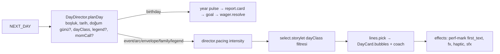

# 10 — Teknik Mimari: Expo SDK 58 + saf TypeScript motor (iOS **ve** Android)

> **Belge türü:** Ayrıntılı tasarım dokümanı (sistem sahibi: teknik mimari). `00-VIZYON-ve-KARARLAR.md` §5 tablosunun **10. satırını** uygular; D-kararlarını yeniden tartışmaz. Hiyerarşi: 00 > T9 (hukuk) > T-dokümanları (birincil: T5) > konseptler.
> **Durum:** v1.0 · 2026-11-06 · Sahip: Teknik mimar · Girdi: 00 (tam), T5 (tam), T4/T6/T7/T10 (TL;DR), T9 (TL;DR), A1–A4 (teknik grep), Çalışma Günlüğü (2026-11-05 fizibilite probu), npm registry (2026-11-06 sürüm doğrulaması).
> **Sahibin bağlayıcı hatırlatması (2026-11-06):** *"Oyun hem iOS hem Android'de çalışacak; ona göre geliştir."* Bu belgedeki her karar iki platformda da **aynı davranışı** hedefler; fark olan her yer §4'te adıyla yazılmıştır. "iOS'ta çalışıyor, Android'de sonra bakarız" cümlesi bu projede kabul kriteri değildir, hata raporudur.

---

## 0. Künye — uygulanan D-kararları, bağımlı dokümanlar, sürüm

### 0.1 00 §5'teki satır ve bu belgedeki karşılığı

| 00 §5 (satır 10) ne diyor | Bu belgede nerede |
|---|---|
| pnpm monorepo | §2.2 (dizin ağacı, workspace kuralları, `expo install` kısıtı) |
| `packages/engine` saf TS (deterministik RNG, reducer, efekt çıkışı) | §2.3 (durum tipleri, `step()`, RNG kanalları, modüller) |
| Expo SDK 58 uygulaması | §2.4 (katmanlar, expo-router, zustand, sağlayıcılar) |
| MMKV + SQLite/Drizzle kayıt | §2.3.6 (kayıt formatı) + §2.4.4 (kalıcılık) |
| EAS Update + imzalı JSON içerik paketi | §2.3.7 (içerik yükleme, Ed25519, kill-switch) + §2.7 (kanallar) |
| Test piramidi (vitest/fast-check, jest-expo, Playwright) | §2.6 |
| CI | §2.7 |
| D-043, D-044 | §0.2 |

### 0.2 Uygulanan D-kararları (her biri tek satır "nasıl")

| D | Bu belgede nasıl uygulanıyor |
|---|---|
| **D-043** | Yığın bire bir: Expo SDK 58 / RN 0.88.1 / React 19.3 / TS 6.0.x; pnpm workspaces; zustand; MMKV + expo-sqlite/Drizzle; expo-notifications (`enableRemoteNotifications:false`); react-native-google-mobile-ads 17.4 (16.5 pini `pnpm.overrides` ile tek satır); RevenueCat P1 / expo-iap yedek aynı `IapProvider` arayüzünün arkasında; EAS Update yalnızca kod, içerik imzalı statik JSON (§2.3.7). |
| **D-044** | Motor saf TS, sıfır RN import'u (ESLint `no-restricted-imports` ile zorlanır); RNG sfc32, seed = `cyrb128(lifeId:yıl:kanal)`; `step(state, action) → {state, effects}`; `tools/sim` 10.000 hayat harness'ı CI'da D-044 eşikleriyle (medyan ölüm 72–80, koç isabeti %50–62, maks. negatif seri ≤ 2, p95 sürpriz aralığı ≤ 14 beat, ilk 3 hayatta tekrar < %15) release'i bloklar (§2.6.3). |
| **D-045** | `packages/content` olay başına tek JSON (`tr`+`en`+`intent`+`review`+`universality`+`pattern`+`wager?`+`document?`), zod şeması tek doğruluk kaynağı, build → `content.v{N}.json` + locale bundle'ları + hash (§2.3.7). |
| **D-046** | i18next + react-i18next + i18next-icu + expo-localization; `trInflect()` `packages/i18n-tr` içinde, 300 isimlik golden test vitest'te (§2.3.8). |
| **D-047** | `tools/content-lint` CI'da BLOK statüsünde; kural listesi 08/09 dokümanlarından gelir, bu belge yalnızca çalıştırma noktasını ve çıkış kodlarını sabitler (§2.7). |
| **D-030** | Bildirim planlayıcı yalnızca yerel; ≤ 1/gün, ≤ 5/hafta, 22:30–09:00 sessiz; her açılış/kapanışta "cancelAll + en yakın 12'yi yeniden kur" ritüeli; Android `POST_NOTIFICATIONS` 2. oturumdan önce istenmez; soft-ask tetikleyicisi motor efekti `notification-plan` ile gelir (§2.4.5). |
| **D-054** | `AnalyticsPort` arayüzü; varsayılan uygulama yerel "Koçun Raporu" ring-buffer'ı (50.000 satır, kişisel veri yok); Firebase/GA4 opsiyonel ve derleme bayrağıyla; ATT ön-ekranı ve UMP akışı `ConsentGate` içinde (§2.4.9–2.4.10). |
| **D-037** | AdMob `maxAdContentRating: 'T'`, `tagForUnderAgeOfConsent: false`, `tagForChildDirectedTreatment: false` kodda sabit; app.config'te yaş derecelendirme 16+ hedefine uygun izin metinleri (§2.4.9, §4). |
| **D-038** | Torpil = RevenueCat entitlement `torpil`; **3 kayıt yeri** = profil (ücretsizde 1); "sınırsız arşiv" = SQLite `lives` tablosunda `archived` satırların silinmemesi; defter dışa aktarımı = `expo-file-system` + `expo-sharing` JSON/metin (§2.4.4, §2.4.8). |
| **D-039** | Rewarded tavanları (günlük 6, Ek Antrenman yılda 1, Taktik günde 2, Fizyoterapi ömürde 1) motorun `WagerLedger` değil `AdLedger`inde sayılır; UI tavanı aşan yerleşimi **göstermez**; ilk 10 dk reklamsız kuralı `sessionClock` ile (§2.4.9). |
| **D-007 / D-008** | `AdProvider.canShow(placement, ctx)` ölüm ekranı ve ölüm → yeni hayat akışında **her zaman false**; interstitial yalnızca `SessionEnd` ve `HalfTime` bağlamlarında, oturumda ≤ 1, ilk 2 oturumda 0 (§2.4.9). |
| **D-009 / D-010** | `WagerLedger` motor durumunda; `WagerService.check()` yalnızca `playerChose && 0,35 ≤ p ≤ 0,65`; damga efekti `haptic:'stamp-heavy'` + `sfx:'ink'` (§2.3.5, §2.4.6). |
| **D-011** | `EnvelopeQueue` (min 1 / maks 2) motor durumunda; oturum sonu bildirim kopyası `effects: notification-plan { templateKey, params }` ile uygulamaya iner (§2.3.5, §2.4.5). |
| **D-012 / D-050** | Gerçek saat motora **yalnızca** `RESUME.nowWall` ile girer ve yalnızca `mood: 'tired'` etiketini üretir (23:00–06:00); saat hilesi satırları koçun defterini hedefler, oyuncuyu değil (§2.4.13, §3). |
| **D-016 / D-020 / D-059** | Performans bütçeleri bağlayıcı: Yaşlan → ilk metin ≤ 300 ms, yıl geçişi ≤ 400 ms, ölüm → yeni hayatın ilk kelimesi ≤ 40 sn, "yükleniyor" ekranı yok (§2.5). |
| **D-017 / D-018** | `Legacy.metaLog` ve `Legacy.metaMemories` tipleri motorda; "hafıza uydurulmaz" kuralı tip düzeyinde: her meta-callback `metaLogRef` zorunlu alanla bir kayda bağlanır (§2.3.2). |
| **D-019** | Haftalık seed `cyrb128('week:' + isoYearWeek + ':' + locale + ':' + contentHash)`, Pazartesi 00:00 yerel; 40 hayali kohort cihazda simüle (§2.3.4). |
| **D-024 / D-025** | `PatternCounters` (12 kalıp) motor durumunda; Roast Raporu motorun ürettiği `RoastReport` veri nesnesidir, UI yalnızca okur ve adımlar (§2.3.5). |
| **D-029** | `Streak` motor durumunda (karar bazlı, duraklar, 2 Sakatlık İzni, 48 sa Telafi); takvim günü hesabı `RESUME.nowWall` + güvenilir saat kurallarıyla (§2.4.13). |
| **D-033** | `Money` tipi reel birim `number`; ekrana `Intl.NumberFormat` ile birimsiz; para birimi sembolü UI katmanında **yok** (lint) (§2.3.2). |
| **D-055** | Enerji, giriş ödülü, loot box için motor durumunda alan yok; "yoksa yapılamaz" ilkesi (§2.3.2). |
| **D-060** | Bu belge D-kararlarını uygular; gerekli yeni kararlar §7.3'te **D-ÖNERİ-10-xx** olarak listelenir. |
| **D-061 / D-062 / D-063 / D-064** (00 §12) | Gün = tur: `NEXT_DAY` aksiyonu + `calendar` durumu + `director/day.ts` (**DayDirector**, yaş bandına göre gün sıkıştırması, olaysız gün özeti); NPC diyalogları motorun `DayCard` görünüm modelinde yalnızca `textKey` olarak; D-063 şov efektleri `fx` efekti; D-064 roast kotası `select/lines` `minRoast:1` + harness H-10-08 (§2.3.9, §3.1–3.3, §6.4). |

### 0.3 Bağımlı dokümanlar

- **Girdi aldığım:** 00 (tümü), T5 (ADR-001, sürümler, platform 2026), T4 (RNG/seed kuralları, storylet şeması), T11 (pity / near-miss / pending-outcome sözde-kodu → `engine/reward`), T7 (bildirim tavanları, hibernation), T6 (RevenueCat/expo-iap, PBL son tarihleri), T10 (i18n yığını), T9 (KVKK, mağaza, lisans).
- **Bana bağımlı olanlar:** 03 (olay JSON şeması → `packages/content/schema`), 05 (streak/bildirim → `engine/streak`, `services/notifications`), 06 (yerleşimler → `AdProvider`/`IapProvider`), 07 (juice → efekt eşlemesi), 08 (lint kuralları → `tools/content-lint`), 09 (i18n → `packages/i18n-tr`, build), 11 (KPI → `AnalyticsPort` olay listesi).

### 0.4 Sürüm

| Sürüm | Tarih | Değişiklik |
|---|---|---|
| 1.0 | 2026-11-06 | İlk tam sürüm. ADR-001 deltaları, iki platform notları, 28 kabul kriteri. |
| 1.1 | 2026-11-06 | §3–7 ve Ek A/B eklendi (belge §2.3.8'de kesilmişti). D-061..D-064 motor uyarlaması (§2.3.9: `NEXT_DAY`/`ANSWER`, `DayDirector`, `DayCard`/`dialog[]`, `fx` efektleri), kod düzeyi örnekler, iOS/Android derin platform notları, SDK veri akışı × KVKK/GDPR, test piramidi/CI/perf bütçeleri, H-10 harness eşikleri, AC-10-01..28, risk kaydı, D-ÖNERİ-10-01..18, Sprint 0 checklist, npm ile doğrulanmış bağımlılık listesi (2026-11-06). |

---

## 1. Amaç ve kapsam — MVP / Soft launch / 1.0

**Amaç:** Tek kod tabanından iOS ve Android'de **aynı** oyunu, cihazsız bir geliştirme ortamında (Node 22 + Chromium) bile ölçülebilir biçimde doğrulanabilir hâlde üretmek. Mimarinin üç yükü var: (1) 00 §4'teki süre bütçelerini (90 sn yıl, 300 ms ilk metin, 40 sn yeniden doğuş) donanımda tutmak; (2) 10.000 hayatlık harness'ı her PR'da koşabilecek kadar saf ve hızlı bir motor; (3) sıfır backend'le güvenilir kayıt, dürüst saat, imzalı içerik.

| Alan | **MVP (dikey kesit, 10 hafta)** | **Soft launch (TR + CA/NZ)** | **1.0 (global)** |
|---|---|---|---|
| Monorepo | `engine`, `content`, `i18n-tr`, `apps/mobile`, `tools/{sim,content-lint,e2e}` | + `tools/release` (manifest imzalama) | + `packages/ui` **yalnızca** ikinci bir uygulama doğarsa (bkz. D-ÖNERİ-10-08) |
| Motor | Tüm durum tipleri, `step()`, RNG kanalları, director, select, wager, pattern, envelope, hazard, karne, roast, legacy | + Kamp seed modu, Onyıl Karnesi, Fazla Bagaj callback | + Kader kişiliği havuz anahtarı, Sezon Paketi içerik katmanı |
| Kayıt | SQLite + Drizzle şema v1, MMKV, 3 döner nesil, SHA-256, migration iskeleti | + profil (Torpil 3 kayıt yeri), arşiv | + defter dışa aktarımı, `schemaVersion` ≥ 3 migration'ları fixture'lı |
| İçerik dağıtımı | Gömülü paket; EAS Update `preview` kanalı | + imzalı manifest (Ed25519) + kill-switch, `production` kanalı | + Sezon Paketi = ayrı imzalı paket + IAP entitlement eşleşmesi |
| Monetizasyon SDK | AdMob 17.4 test kimlikleri (UMP + ATT akışı çalışır), RevenueCat sandbox (Torpil) | Gerçek kimlikler, Taktik Değişikliği + Fizyoterapi yerleşimleri | Sezon Paketi IAP; publisher isterse MAX/GameAnalytics adaptörü |
| Analytics | Yerel Koçun Raporu yalnızca | + Firebase/GA4 opsiyonel derleme bayrağı (KVKK rıza ile) | Publisher SDK'sı adaptör arkasında |
| Test | vitest+fast-check, content-lint, harness 1.000/PR + 10.000 gecelik, jest-expo, Playwright FTUE (TR/EN × 2 viewport) | + pseudo-locale snapshot, cihaz smoke listesi haftalık | + Maestro cihaz akışları (opsiyonel) |
| Platform | iOS 16.4+ / Android 24+; dev build; TestFlight internal + Play internal track | Age rating anketleri, Data Safety, privacy manifest denetimi | Store listing 4+ vitrin denetimi, 16 KB `zipalign` kapısı |

**Kapsam dışı (bu belge):** olay içeriği, ses tasarımı, UI görünümü (07), lint kuralları içeriği (08), KPI tanımları (11). Bu belge *nerede koştuğunu* ve *nasıl ölçüldüğünü* sabitler.

---

## 2. Tasarım

### 2.1 ADR-001 — yeniden ifade ve deltalar

**Karar (T5 ADR-001, aynen):** Expo SDK 58 / React Native 0.88.1 / React 19.3 / TypeScript 6.0.x; pnpm workspaces monorepo; saf TS oyun motoru; Expo Router; Reanimated 4 + Moti; FlashList 2; expo-sqlite + Drizzle + MMKV; zustand; i18next; expo-notifications (yalnızca yerel); expo-audio; expo-haptics; EAS Build/Update; AdMob (react-native-google-mobile-ads) + UMP; RevenueCat; Sentry.

**Bu belgenin deltaları (T5'e göre; 00 ile çelişmez, 00'ın boş bıraktığı yerleri doldurur):**

| # | T5 ne dedi | Bu belge ne diyor | Neden |
|---|---|---|---|
| Δ1 | RNG `pure-rand` xoroshiro128+ | Motor RNG'si **in-house sfc32** (≈ 25 satır), `pure-rand` yalnızca fast-check'in kendi RNG'si | 00 D-044 "pure-rand/sfc32" ikisine de izin verir; T4, T11, T3 ve 03 taslağı sfc32 + cyrb128 ile yazıldı. 4×uint32 durum JSON'a doğrudan serileşir, bağımlılık sıfır. Tek kaynak, tek sayı dizisi. (D-ÖNERİ-10-01) |
| Δ2 | SHA-256 `expo-crypto` ile | Kayıt ve içerik hash'i `@noble/hashes` (saf TS, senkron) ile **motorda**; `expo-crypto` yalnızca rastgele bayt/UUID | Motor saf kalır, vitest'te aynı hash koşar, Hermes'te Web Crypto bağımlılığı yok. (D-ÖNERİ-10-02) |
| Δ3 | İçerik manifesti "GitHub Pages" | Statik barındırma **Cloudflare Pages** (özel alan adı), GitHub Pages yalnızca dev/preview | GitHub Pages ToS ticari dağıtımı gri bırakır; Cloudflare Pages ücretsiz, CDN'li, özel alan adı. Backend değildir: yalnızca statik dosya. (D-ÖNERİ-10-03) |
| Δ4 | İmzasız manifest + sha256 | Manifest **Ed25519 imzalı** (`@noble/ed25519`), açık anahtar uygulamada gömülü; `kill-switch` alanları | İçerik, mağaza incelemesi dışında değişen tek yüzey; imzasız JSON = MITM ile içerik enjeksiyonu riski (T9 "şikâyet edilemez"). |
| Δ5 | Saat hilesi v2 için `SystemClock.elapsedRealtime` modülü | **Soft launch'a** alınır (`modules/motto-clock` yerel Expo Module, iOS `ProcessInfo.systemUptime`, Android `SystemClock.elapsedRealtime`) | Kamp haftalık seed'i ve streak takvimi dürüst saat ister; 60 satırlık modül. (D-ÖNERİ-10-05) |
| Δ6 | `apps/web-preview` | Ayrı uygulama **yok**; `apps/mobile` içinden `expo export --platform web`, Playwright `tools/e2e`'de | T5 §4.1 zaten böyle; iki app.config sürüklenmesi riskine değmez. (D-ÖNERİ-10-07) |
| Δ7 | `packages/shared` opsiyonel | `packages/i18n-tr` (trInflect + golden test) ayrı paket; `shared` yok | trInflect hem build (content) hem runtime (app) tarafından kullanılır; motor kullanmaz. |
| Δ8 | "3 slotlu döner yedek" | **Nesil** (generation a/b/c, otomatik) ile **profil** (Torpil 3 kayıt yeri, D-038) ayrıldı | İki farklı kavram aynı kelimeyle anılıyordu. (D-ÖNERİ-10-11) |

**Reddedilenler (yeniden açılmaz):** Flutter, Unity, Godot, Capacitor (T5 §1); `expo-av`; `react-native-iap` (Expo'da); `@legendapp/state` v3 beta; `seedrandom`; Redux Toolkit; ayrı `apps/web-preview`; Expo Go ile geliştirme (dev build şart).

### 2.2 Monorepo düzeni (pnpm workspaces)

```
motto/
├─ pnpm-workspace.yaml              # packages/*, apps/*, tools/*
├─ .npmrc                           # node-linker=hoisted ; shamefully-hoist=false ; strict-peer-dependencies=false
├─ package.json                     # "packageManager": "pnpm@12.18.0"; root scripts (bkz. aşağı)
├─ tsconfig.base.json               # strict, noUncheckedIndexedAccess, exactOptionalPropertyTypes, verbatimModuleSyntax
├─ turbo.json                       # pipeline: lint → typecheck → test → content:build → sim → e2e
├─ eslint.config.mjs                # ESLint 10 flat; engine için no-restricted-imports (react, react-native, expo*)
├─ CLAUDE.md                        # ajan kuralları: motor saf, testID zorunlu, Expo pinlerine uy, latest yasak
├─ docs/                            # 00–11 tasarım, T1–T11 araştırma, ADR'ler
├─ packages/
│  ├─ engine/                       # SAF TS. Sıfır RN/Expo/React import'u. Hedef: ES2022, Node + Hermes
│  │  ├─ src/
│  │  │  ├─ index.ts                # public API: step, createLife, selectors, types
│  │  │  ├─ types/                  # state.ts, action.ts, effect.ts, content.ts (zod'dan türetilmiş)
│  │  │  ├─ rng/                    # sfc32.ts, cyrb128.ts, channels.ts, seeds.ts
│  │  │  ├─ reducers/               # age.ts, choose.ts, resume.ts, goal.ts, session.ts, death.ts
│  │  │  ├─ director/               # pacing.ts (T11 3c), reward.ts (3a pity, 3b near-miss), novelty.ts (3h)
│  │  │  ├─ select/                 # storylet.ts (salience, cooldown), lines.ts (pickLine: specificity → LRU)
│  │  │  ├─ wager/                  # service.ts (0.35–0.65 bandı), ledger.ts, stamps.ts
│  │  │  ├─ pattern/                # detector.ts (12 kalıp), chronic.ts
│  │  │  ├─ envelope/               # queue.ts (min 1 / maks 2), teaser.ts
│  │  │  ├─ hazard/                 # gompertz.ts, protection.ts (18–28), causes.ts (%5 absürt kuyruk)
│  │  │  ├─ report/                 # reportCard.ts (6 not), motto.ts (36 hücre), decade.ts, roast.ts
│  │  │  ├─ legacy/                 # metaLog.ts, metaMemories.ts, fitness.ts (Kondisyon), baggage.ts
│  │  │  ├─ streak/                 # ritual.ts (Mola), freeze.ts (Sakatlık İzni), makeup.ts (Telafi)
│  │  │  ├─ camp/                   # weekly.ts (seed), cohort.ts (40 hayali)
│  │  │  ├─ clock/                  # trusted.ts (RESUME kuralları, tamperFlags)
│  │  │  └─ save/                   # envelope.ts, migrate.ts, migrations/v1..vN.ts, hash.ts (@noble/hashes)
│  │  ├─ test/
│  │  │  ├─ unit/                   # vitest
│  │  │  ├─ props/                  # fast-check: determinism, no-death-spiral, wager-hit-rate, save-roundtrip
│  │  │  └─ fixtures/saves/         # save-v1.json … save-vN.json (her eski şema sürümü için)
│  │  ├─ package.json               # "sideEffects": false, "exports", deps: @noble/hashes yalnızca
│  │  └─ vitest.config.ts
│  ├─ content/
│  │  ├─ events/{universal,tr-only,en-only}/*.json   # olay başına tek JSON (D-045)
│  │  ├─ arcs/*.json  narrator/*.json  wagers/*.json  mottos/{tr,en}.json  glossary/*.json
│  │  ├─ schema/                    # zod: event.ts, choice.ts, narratorLine.ts, manifest.ts
│  │  ├─ build.ts                   # doğrula → dist/content.v{N}.json + dist/locales/{tr,en}.json + dist/content.hash
│  │  └─ dist/                      # (gitignore; CI artefaktı)
│  ├─ i18n-tr/                      # trInflect(), ünlü uyumu, 300 isimlik golden test
│  └─ sim-core/                     # harness koşucusu (motoru Node'da sürer; tools/sim CLI'si bunu sarar)
├─ apps/
│  └─ mobile/
│     ├─ app.config.ts              # plugins, expo-build-properties, runtimeVersion {policy:'fingerprint'}
│     ├─ eas.json                   # development / preview / production profilleri (§2.7)
│     ├─ modules/motto-clock/       # yerel Expo Module (soft launch): monoton saat (Δ5)
│     ├─ src/
│     │  ├─ app/                    # expo-router: _layout.tsx, index.tsx, life.tsx, notebook.tsx, report/[year].tsx, glossary.tsx, camp.tsx, settings/*.tsx, help.tsx
│     │  ├─ store/                  # zustand: lifeStore (motoru sarar), sessionStore, settingsStore, entitlementStore
│     │  ├─ effects/                # EffectRunner: Effect[] → ports (haptic, sfx, notify, analytics, share)
│     │  ├─ ports/                  # arayüzler: AdProvider, IapProvider, AnalyticsPort, NotificationPort, ClockPort, HapticPort, AudioPort, SharePort, CrashPort
│     │  ├─ providers/              # uygulamalar: admob/, revenuecat/, expo-iap/, firebase/ (bayraklı), local-report/, noop/ (web)
│     │  ├─ persistence/            # mmkv.ts, db/ (drizzle schema + migrations), saveRepo.ts, contentRepo.ts
│     │  ├─ content/                # loader.ts (gömülü → önbellek → manifest), verify.ts (Ed25519), killSwitch.ts
│     │  ├─ i18n/                   # i18next init, ICU, pseudo-locale, key tipleri (build'den)
│     │  ├─ ui/                     # bileşenler (EventCard, StampOverlay, Envelope, ReportCard, ShareCard…)
│     │  └─ theme/                  # tokens (07'den)
│     ├─ assets/                    # fontlar (variable), SFX (.m4a/.mp3), Lottie ≤ 5
│     ├─ e2e/                       # Playwright spec'leri (web export'a karşı), __screenshots__/
│     └─ __tests__/                 # jest-expo + RNTL bileşen testleri
├─ tools/
│  ├─ sim/                          # CLI: pnpm sim --lives 10000 --locale tr --seed 42 → report.json + eşik kontrolü
│  ├─ content-lint/                 # 08/09 kuralları; çıkış kodu 2 = BLOK
│  ├─ expo-pins/                    # bundledNativeModules.json → package.json pin senkronu (§2.2.2)
│  ├─ release/                      # manifest imzalama (Ed25519 özel anahtar yalnızca CI secret'ında), sürüm etiketleme
│  └─ e2e/                          # playwright.config.ts (TR/EN × 390×844 / 430×932), serve dist
└─ .github/workflows/               # ci.yml, nightly.yml, e2e.yml, release.yml, update.yml, content-release.yml
```

**Kök script'ler:** `pnpm lint`, `pnpm typecheck`, `pnpm test` (vitest + jest), `pnpm content:build`, `pnpm content:lint`, `pnpm sim -- --lives 1000`, `pnpm e2e` (export + serve + playwright), `pnpm pins:check` (Expo pinleri), `pnpm doctor` (`expo-doctor`).

**Bağımlılık yönü (kırılamaz):** `engine` ← hiçbir şey (yalnızca `@noble/hashes`). `content` → `engine/types` (tip paylaşımı) ve `i18n-tr` (build'de çekim). `apps/mobile` → `engine`, `content/dist`, `i18n-tr`. `tools/*` → `engine`, `content`, `sim-core`. Motor **asla** `content`'i import etmez; içerik `ContentBundle` olarak `step()`'e parametreyle girer.

#### 2.2.2 `npx expo install` bu ortamda çalışmaz — pin prosedürü

Çalışma Günlüğü (2026-11-05): `npx expo install` ağ vekili tarafından engellendi (`api.expo.dev` → Forbidden). GitHub Actions ve geliştirici makinelerinde kısıt yok; ama ajanların bu ortamda da kurabilmesi için prosedür **kalıcı**:

1. Kaynak pin dosyası: `node_modules/expo/bundledNativeModules.json` (expo ~58.0.23 paketinin içinde gelir; ağ gerekmez).
2. `tools/expo-pins/sync.ts`: bu JSON'u okur, `apps/mobile/package.json` içindeki her Expo/RN kütüphanesinin sürüm aralığını pinle eşitler, farkları listeler; `--write` ile yazar. Çıkış kodu 1 = sapma var.
3. Kurulum düz `pnpm install --frozen-lockfile`. Yeni paket eklerken: `pnpm pins:check` → `pnpm add <pkg>@<pin>`.
4. CI'da iki kapı: `pnpm pins:check` (ağ gerekmez) ve `npx expo install --check` (GitHub Actions'ta ağ var).
5. Expo pininde olmayan paketler (`zustand`, `zod`, `drizzle-orm`, `@noble/*`, `react-native-mmkv`, `react-native-google-mobile-ads`, `react-native-purchases`) **tam sürüm** (`^` yok) ile pinlenir; yükseltme yalnızca sprint sınırında PR ile.

`CLAUDE.md` kuralı: *"`latest` kurulmaz. Expo pini varsa pin, yoksa §2.8 tablosu."*

### 2.3 Motor — `packages/engine`

#### 2.3.1 İlkeler

1. **Saf:** `Date.now`, `Math.random`, IO, `setTimeout` yok. "Şimdi" aksiyonun içinde gelir (`RESUME.nowWall`, `RESUME.nowMono`). ESLint `no-restricted-globals` ile zorlanır.
2. **Deterministik:** aynı `ContentBundle.hash` + aynı `lifeSeed` + aynı aksiyon dizisi = bit-bit aynı `LifeState`. Replay, bug raporu ("şu seed'de şu aksiyonlar"), Kamp adaleti bedavaya gelir.
3. **Immutable:** `Readonly` tipler; reducer'lar yeni nesne döner. Structural sharing için `immer` **kullanılmaz** (Hermes'te Proxy maliyeti; harness hızını düşürür); el yazımı spread.
4. **Efektler bildirimseldir:** motor "Heavy haptik + mürekkep sesi" *der*, çalmaz. Uygulama `EffectRunner` ile port'lara dağıtır; web'de no-op; testte `effects` dizisi assert edilir.
5. **Metin üretmez:** motor `textKey` + ICU parametreleri döner; i18next çözer. Motor Türkçe/İngilizce bilmez; `locale` yalnızca havuz filtresi ve seed bileşenidir.
6. **Ölçülebilir:** `step()` ortalaması Node'da ≤ 20 µs (10.000 hayat × ~225 beat ≈ 2,3 M adım → ≤ 60 sn harness).

#### 2.3.2 Durum tipleri

```ts
// packages/engine/src/types/state.ts  (kısaltılmış; tam hâli zod şemasından z.infer ile türetilir)
export type Locale = 'tr' | 'en';
export type StatId = 'health' | 'joy' | 'brain' | 'charm';                       // 0..100 (D-032)
export type MeterId = 'ego' | 'cringe' | 'momPressure';                           // 0..100
export type HiddenId = 'luck' | 'stress';                                         // 0..100 (Şans = eski Karma)
export type PatternId = 'procrastination'|'avoidance'|'impulseSpend'|'peoplePleasing'|'risk'|'selfCare'
  |'overwork'|'leanOnFamily'|'shortcut'|'pride'|'generosity'|'patience';           // 12 nötr kalıp (D-024)

export type Stats = Readonly<Record<StatId, number>>;
export type Meters = Readonly<Record<MeterId, number>>;
export type Hidden = Readonly<Record<HiddenId, number>>;
export type Money = number;                                                        // reel birim; UI birimsiz basar (D-033)

export type Player = Readonly<{
  nameKey: string;             // isim havuzu kaydı (TR: "Deniz Ertelemez" ↔ EN: "Alex Tomorrow"); locale başına ayrı çözülür
  gender: 'f' | 'm' | 'x';     // yalnızca EN ICU select için veri; TR'de kullanılmaz
  cityId: string; age: number; alive: boolean;
  career?: Readonly<{ id: string; rung: number; yearsAtRung: number }>;
  education: ReadonlyArray<string>;
  assets: ReadonlyArray<Readonly<{ id: string; acquiredYear: number }>>;
}>;

export type Npc = Readonly<{
  id: string; roleId: 'mom'|'roommate'|'boss'|'ex'|'neighbor'|'uncle'|'cat'|'cabbie'|'other';
  affinity: number;            // -100..100
  memories: ReadonlyArray<Readonly<{ tag: string; year: number; eventId: string }>>;  // bu hayat (T4 §9)
  familiarFace: boolean;       // Tanıdık Yüzler (D-017) üyesi mi
}>;

export type WagerEntry = Readonly<{
  id: string; year: number; eventId: string; choiceId: string;
  prediction: 'fail' | 'succeed'; pOdds: number;                // 0.35..0.65 (D-009)
  resolvedYear?: number; outcome?: 'calledIt' | 'iWasWrong';   // İSABET / HAKSIZ ÇIKTIM
  stampVariant?: number;                                        // 0..11 kozmetik (D-010)
  goalWager?: boolean;                                          // Tek Hedef'e karşı açılan iddia (D-023)
}>;

export type Envelope = Readonly<{
  id: string; createdYear: number; dueYear: number;
  sourceEventId: string; teaserKey: string;                     // "Gelecek yıl: kapıda biri olacak."
  weight: number;                                               // oturum sonunda en ağırı açılır (D-011)
  opened: boolean; resolved: boolean;
}>;

export type NotebookEntry = Readonly<{ year: number; kind: 'note'|'wager'|'confession'; key: string; params: Params; ref?: string }>;

export type Streak = Readonly<{
  days: number; status: 'active'|'paused'; lastDecisionDay: string;  // 'YYYY-MM-DD' yerel
  freezes: number; freezeRefillDay: string;                           // 2 Sakatlık İzni, 7 günde 1 (D-029)
  makeupUntil?: string;                                               // 48 sa Telafi
  milestonesHit: ReadonlyArray<number>;                               // 3/7/14/21/30/66/100/365
}>;

export type Collections = Readonly<{
  diagnoses: ReadonlyArray<string>;      // Teşhis
  glossary: ReadonlyArray<string>;       // Sözlük (Tercüme kartları)
  stamps: ReadonlyArray<number>;         // 12 damga varyantı
  mottos: ReadonlyArray<string>;         // Yılın Mottosu kayıtları
}>;

export type RewardState = Readonly<{   // T11 3a/3b/3c/3h — tamamen deterministik
  beatsSinceSurprise: number; surprisesThisSession: number; msSinceSurprise: number;
  negStreak: number; beatsSinceLol: number; wowCount: number;
  pendingBonus: Readonly<Record<string, number>>;               // near-miss sözü gerçekten uygulanır
  seenCount: Readonly<Record<string, number>>;                  // hayat içi novelty
}>;

export type Legacy = Readonly<{                                 // hayatlar arası (D-017, D-018, D-042, D-056)
  livesCompleted: number; familiarity: number;                  // Tanışıklık 0..5 (D-058)
  metaLog: ReadonlyArray<Readonly<{ lifeId: string; year: number; kind: string; eventId?: string; npcId?: string; value?: string|number }>>;
  metaMemories: ReadonlyArray<Readonly<{ npcRoleId: string; lineKey: string; metaLogRef: number }>>;  // uydurma yok: ref zorunlu
  fitness: Readonly<{ points: number; unlocked: ReadonlyArray<string> }>;   // Kondisyon; çeşitlilik, güç değil
  baggage?: Readonly<{ eventId: string; lifeId: string; cringe: number }>;  // Fazla Bagaj
  patternRanks: ReadonlyArray<ReadonlyArray<PatternId>>;        // hayat başına sıralama → Kronik
  closedNotebooks: ReadonlyArray<string>;                       // KAPANDI defter id'leri (ücretsizde son 3 görünür)
}>;

export type RngChannelState = readonly [number, number, number, number];   // sfc32 4×uint32
export type RngStates = Readonly<Record<RngChannel, RngChannelState>>;

export type LifeState = Readonly<{
  schemaVersion: 1;
  lifeId: string; lifeSeed: string; contentHash: string; locale: Locale;
  year: number; beatIndex: number; phase: 'beat'|'yearEnd'|'goalPick'|'dead'|'roast';
  player: Player; stats: Stats; meters: Meters; hidden: Hidden; money: Money;
  npcs: ReadonlyArray<Npc>;
  goal?: Readonly<{ id: string; year: number; progress: 0|1|2 }>;         // Tek Hedef: ERTELENDİ/YARIM/TAMAM
  wagers: ReadonlyArray<WagerEntry>; envelopes: ReadonlyArray<Envelope>;
  notebook: ReadonlyArray<NotebookEntry>;                                   // ≤ 12 Not / hayat
  patterns: Readonly<Record<PatternId, number>>;                            // ömür boyu sayaç
  cooldowns: Readonly<Record<string, number>>; flags: ReadonlyArray<string>;
  reward: RewardState; director: Readonly<{ intensity: number; lastValence: -1|0|1; arcActive: boolean }>;
  rng: RngStates;
  voice: 'gentle'|'normal'|'brutal'; mood: 'normal'|'tired'|'camp';       // D-026, D-012
  clock: Readonly<{ lastSeenWall: number; lastSeenMono: number; tamperFlags: number; playTimeMs: number; sessionStartWall: number; sessionCount: number }>;
  adLedger: Readonly<{ day: string; rewardedToday: number; interstitialThisSession: number; extraPracticeYear?: number; physioUsed: boolean; tacticToday: number }>;  // D-039 tavanları
  streak: Streak; collections: Collections;
}>;

export type MetaState = Readonly<{ schemaVersion: 1; legacy: Legacy; camp: Readonly<{ weekKey: string; code?: string; cohortSeed?: string }> }>;
```

Bilerek **olmayan** alanlar (D-055): `energy`, `dailyLoginReward`, `lootBox`, `statEditor`. Olmayan alan, olmayan özellik.

#### 2.3.3 Aksiyonlar, efektler ve `step()`

```ts
export type Action =
  | { type: 'NEW_LIFE'; lifeId: string; lifeSeed: string; locale: Locale; voice: Voice; carry: MetaState; nowWall: number; nowMono: number; sameFitness?: boolean }
  | { type: 'CHOOSE'; eventId: string; choiceId: string; viaTactic?: boolean }     // viaTactic: rewarded 3. seçenek (D-039)
  | { type: 'AGE' }                                                                 // Yaşlan
  | { type: 'PICK_GOAL'; goalId: string | null }                                    // null = Hedefsiz yaşa
  | { type: 'OPEN_ENVELOPE'; envelopeId: string }                                   // açılır, çözülmez
  | { type: 'RESUME'; nowWall: number; nowMono: number; localDay: string; isoWeek: string }   // ön plan / soğuk başlangıç
  | { type: 'SUSPEND'; nowWall: number; nowMono: number }                           // arka plan
  | { type: 'SESSION_END'; reason: 'enough'|'halfTime'|'background' }               // "Bugünlük yeter" / Devre Arası
  | { type: 'SET_VOICE'; voice: Voice }
  | { type: 'REWARD_GRANTED'; placement: 'extraPractice'|'sponsor'|'tactic'|'physio'; day: string }   // reklam izlendi → ödül daima
  | { type: 'TOGGLE_FREEZE'; on: boolean }                                          // Sakatlık İzni (ücretsiz)
  | { type: 'REBIRTH'; nowWall: number; nowMono: number; sameFitness: boolean };   // Yeni Müşteri (≤ 40 sn akışının son adımı)

export type Effect =
  | { kind: 'haptic'; pattern: 'selection'|'light'|'medium'|'heavy'|'stamp-medium'|'stamp-heavy'|'error'|'drama' }
  | { kind: 'sfx'; id: 'paper'|'ink'|'stamp'|'whistle'|'flip'|'tick'|'rustle' }
  | { kind: 'notification-plan'; plan: ReadonlyArray<{ templateKey: string; params: Params; notBeforeLocal: string; priority: number }> }   // uygulama tavanları uygular (D-030)
  | { kind: 'notification-cancel-all' }
  | { kind: 'analytics'; name: AnalyticsEvent; props?: Readonly<Record<string, number|string|boolean>> }   // allowlist'li ad (11)
  | { kind: 'share-ready'; card: 'reportCard'|'roastPattern'|'glossary'|'camp'|'lally'|'stamp'; payload: SharePayload }
  | { kind: 'ask-consent'; what: 'notifications' }                                   // soft-ask zamanı (ilk "Bugünlük yeter", oturum ≥ 8 dk)
  | { kind: 'ask-voice' }                                                             // ses ayarı sorusu (ilk oturum sonu)
  | { kind: 'ad-opportunity'; placement: 'interstitialSessionEnd'|'interstitialHalfTime'|'extraPractice'|'sponsor'|'tactic'|'physio' }  // UI AdProvider.canShow ile süzer
  | { kind: 'persist'; urgency: 'debounce'|'now' }                                    // kayıt ipucu (arka plan → now)
  | { kind: 'perf-mark'; name: 'age_pressed'|'first_text'|'year_transition_done'|'death_to_new_client' };

export type StepResult = Readonly<{ state: LifeState; meta: MetaState; effects: ReadonlyArray<Effect> }>;
export function step(state: LifeState, meta: MetaState, action: Action, content: ContentBundle): StepResult;
```

**Değişmezler (property testleriyle korunur):**
- Her stat/metre `[0, 100]` içinde, `money` sonlu; NaN hiçbir alanda yok.
- `step` aynı girdiyle aynı çıktıyı verir (`JSON.stringify` eşitliği).
- `effects` içinde `ad-opportunity` **asla** `phase ∈ {dead, roast}` iken üretilmez (D-007); interstitial yalnızca `SESSION_END` aksiyonunda ve `clock.sessionCount ≥ 3` ise (D-008).
- `wagers` içinde `pOdds ∉ [0.35, 0.65]` olan kayıt yok; `WagerService` sonucu etkilemez: aksiyon dizisi aynıysa iddia açılsa da açılmasa da `stats` aynıdır (iddia bir *gözlemci*dir; test: iddia modülü kapatılarak koşulan ikiz hayat, stat yolunda bit-bit eşit).
- `envelopes.filter(!resolved).length ∈ [1, 2]` her yıl sonunda.
- `metaMemories[*].metaLogRef` geçerli bir `metaLog` indeksidir (hafıza uydurulmaz).

#### 2.3.4 RNG kanalları

```ts
// rng/sfc32.ts — bryc'in sfc32'si; 128-bit durum, PractRand geçer, Hermes'te hızlı
export function sfc32(a: number, b: number, c: number, d: number) {
  return function next(): number {            // [0, 1)
    a >>>= 0; b >>>= 0; c >>>= 0; d >>>= 0;
    let t = (a + b) | 0; a = b ^ (b >>> 9); b = (c + (c << 3)) | 0; c = (c << 21) | (c >>> 11);
    d = (d + 1) | 0; t = (t + d) | 0; c = (c + t) | 0;
    return (t >>> 0) / 4294967296;
  };
}
// rng/cyrb128.ts → string'den 4×uint32 (seed)
// rng/channels.ts
export type RngChannel = 'beats'|'outcome'|'hazard'|'names'|'wager'|'director'|'surprise'|'cosmetic'|'cohort';
export function seedFor(lifeSeed: string, year: number, ch: RngChannel): RngChannelState {
  return cyrb128(`${lifeSeed}:${year}:${ch}`);        // yıl başında her kanal yeniden türetilir (T4 kural 1)
}
```

Kurallar:
- **Kanal ayrımı** olay seçimi (`beats`) ile sonuç zarı (`outcome`) birbirini kirletmez: UI'da bir seçeneğe dokunmak diğer seçeneklerin sonucunu değiştirmez ("Oranı göster" dürüst kalır, D-009 risk #4).
- **Yıl içi durum** `state.rng[ch]` olarak taşınır; yıl sonunda `AGE` reducer'ı tüm kanalları `seedFor(lifeSeed, year+1, ch)` ile yeniler. Yıl ortasında kayıt/yükleme aynı sayıları üretir.
- **Hayat seed'i:** serbest mod `lifeSeed = base32(randomBytes(10))` (uygulama `expo-crypto` ile üretir, motor almaz-üretmez); Kamp modu `cyrb128hex('week:' + isoYearWeek + ':' + locale + ':' + contentHash)` (D-019); "aynı hayatı sen de yaşa" kodu `MTT-XXXX-XXXX` = `lifeSeed` + `contentHash[0..4]`; farklı içerik sürümünde kod "v{N} içerik" rozeti ile yine yüklenir ama Kamp tablosuna yazılmaz (T4 kural 4).
- **Günlük seed** (Koç Görevleri): `cyrb128('day:' + localDay + ':' + locale + ':' + contentHash)`; `cohort` kanalı 40 hayali kohortu aynı haftalık seed'den simüle eder — her kartta "hayali/fictional" etiketi zorunlu (D-019).
- `Math.random` motorda **lint hatası**; UI'da yalnızca kozmetik (konfeti parçacık açısı) için serbesttir ve test ortamında sabitlenir.

#### 2.3.5 Modüller ve beat hattı

```mermaid
flowchart LR
  A[CHOOSE / AGE] --> B[director.pacing\nintensity, negStreak, relax]
  B --> C[select.storylet\nkoşul → salience → cooldown → ağırlık\nTek Hedef ×1.5]
  C --> D[reward.surprise\npity 0.08/8/14, cap 6]
  D --> E[wager.check\nplayerChose && 0.35≤p≤0.65\n3–5 beat'te ≤1, yılda ≤2]
  E --> F[apply.outcome\nstat delta, near-miss ≤30%, pendingBonus]
  F --> G[pattern.count\n12 kalıp +1]
  G --> H[envelope.enqueue\nmin1/max2]
  H --> I[lines.pick\nspecificity → LRU → varyant]
  I --> J[effects\nhaptic/sfx/analytics/perf-mark]
  J --> K{yıl sonu?}
  K -- evet --> L[report.card → motto → goal.resolve → wager.resolve]
  L --> M[hazard.gompertz × health\nkoruma 18–28]
  M --> N{öldü?}
  N -- evet --> O[roast.build → legacy.update → fitness.unlock ≥1]
  N -- hayır --> P[AGE: rng reseed, cooldown--]
```



| Modül | Girdi | Çıktı | Kaynak kural |
|---|---|---|---|
| `director/pacing` | son valanslar, `beatIndex`, aktif arc | hedef yoğunluk, "relax" bayrağı (her 10 beat), neg seri freni (≤ 2), LOL aralığı 12±3 | T11 3c, D-044 |
| `select/storylet` | koşullar, etiketler, `cooldowns`, `seenCount`, hedef etiketi | tek olay + varyant | T4 §3, D-023 (×1,5), 03 |
| `director/reward` | `RewardState` | sürpriz tier'ı / near-miss / `pendingBonus` uygulaması | T11 3a/3b |
| `wager/service` | seçim, gerçek `p` (outcome kanalından **bağımsız** hesaplanan başarı olasılığı) | `{prediction, pOdds}` veya `null` | D-009 |
| `pattern/detector` | seçeneğin `pattern` etiketi | sayaç +1; ölümde top-3 + %; 3 hayat aynı #1 → `chronic` | D-024 |
| `envelope/queue` | olayın `pendingOutcome` tanımı | zarf ekle/aç; oturum sonunda en ağırını `opened:true` yapar, çözmez | D-011 |
| `hazard/gompertz` | yaş, sağlık, stres, koruma penceresi | ölüm olasılığı; `causes` %5 absürt kuyruk | 02, T4 §5 |
| `report/*` | yıl sayaçları | 6 not, hedef damgası, 36 hücreli motto anahtarı, Onyıl Karnesi | D-021, D-022, D-051 |
| `report/roast` | `patterns`, `wagers`, `metaLog` | `RoastReport` (8 blok, her adım atlanabilir; ölüm nedeni yalnızca 2. blokta) | D-025 |
| `legacy/*` | ölüm anı durumu | `metaLog` ekleri, `metaMemories` (ref'li), Kondisyon ≥ 1 açılım ("Yedek Kulübesi" pity), Fazla Bagaj | D-016, D-017, D-018, D-042 |
| `streak/*` | `RESUME.localDay` | gün sayımı (karar bazlı), duraklatma, İzin, Telafi, kilometre taşı efektleri | D-029 |
| `clock/trusted` | `nowWall`, `nowMono`, önceki değerler | geçen süre, `tamperFlags`, `mood` | D-012, §2.4.13 |

**Satır seçimi (`select/lines`):** `pickLine(ctx) → filter(tags ∧ voice ∧ mood ∧ ageBand) → sort(specificity desc) → excludeCooldown → weightedLRU(rarity)`; sık satır ≥ 5 varyant kuralı content-lint'te. 60+ yaşta beat başına ≤ 1 balon (D-028) `ageBand` filtresiyle motorda; UI ek balon çizemez çünkü motor vermez.

#### 2.3.6 Kayıt formatı, sürümleme, bütünlük

```ts
export type SaveEnvelope = Readonly<{
  format: 'motto-save'; schemaVersion: number;          // motor şeması; app sürümünden bağımsız
  engineVersion: string; contentHash: string; appVersion: string; platform: 'ios'|'android'|'web';
  profileId: string; generation: 'a'|'b'|'c';             // profil (D-038) × nesil (döner)
  savedAtWall: number; savedAtMono: number;
  life: LifeState | null; meta: MetaState;
  sha256: string;                                         // sha256(canonicalJson({…zarf, sha256: ''}) + APP_SALT)
}>;
```

- **Kanonik JSON:** anahtarlar sıralı, `undefined` atılır, sayılar `Number.prototype.toString` — iki platformda aynı bayt, aynı hash (`@noble/hashes/sha256`, senkron; 50 KB zarf için Hermes'te ≈ 2 ms).
- **Amaç bozulma tespiti, güvenlik değil** (T5 §4.3): hash tutmazsa bir önceki nesle düş; koç satırı defteri hedefler (§3). `APP_SALT` derleme sabiti; "hile" tespiti olarak kullanılmaz, oyuncu cezalandırılmaz (D-050 ruhu).
- **Nesiller:** `a → b → c → a` döner; her `persist` efekti en eski nesli ezer. Yükleme: en yeni `savedAtWall`'dan başla, hash + zod + migration geçmezse bir eskisi. Üçü de bozuksa: `life: null` ile yeni hayat, `meta`'yı ayrı `meta_backup` satırından kurtarmayı dene (meta ayrıca her ölümde tek başına yazılır; **hayatlar arası hafıza kayıt bozulmasından korunur**).
- **Yazma deseni:** `persist{debounce}` → 300 ms; `persist{now}` → `SUSPEND`, ölüm, satın alma sonrası. Tek SQLite transaction, `PRAGMA journal_mode=WAL`, `synchronous=NORMAL`. Yazma UI thread'i bloklamaz (`expo-sqlite` async API; serileştirme `InteractionManager.runAfterInteractions` sonrası).
- **Migration:** `migrations: Array<{ from: n; to: n+1; migrate(raw: unknown): unknown }>` sırayla; her eski sürüm `test/fixtures/saves/save-v{N}.json` olarak repoda kalır; test: her fixture → güncel → zod geçer → `step(AGE)` çalışır. Eski sürüm silinemez; `schemaVersion` yalnızca artar; aşağı yönlü migration yok (uygulama eski sürüme düşerse "Bu kayıt yeni sürümden" ekranı ve mağaza linki).

```mermaid
stateDiagram-v2
  [*] --> LoadNewest
  LoadNewest --> Verify: envelope okundu
  Verify --> Migrate: sha256 ✓ ∧ zod ✓
  Verify --> LoadOlder: sha256 ✗ ∨ zod ✗ (notebookLine: save_corrupt)
  LoadOlder --> Verify: nesil kaldı
  LoadOlder --> RecoverMeta: 3 nesil de ✗
  Migrate --> Ready: schemaVersion == current
  Migrate --> Ready: v(n)→v(n+1) zinciri ✓
  Migrate --> RecoverMeta: zincir ✗
  RecoverMeta --> FreshLife: meta_backup ✓ (legacy korunur)
  RecoverMeta --> FreshLife: meta_backup ✗ (sıfır meta; koç bunu da sayar)
  Ready --> [*]
  FreshLife --> [*]
```



**Yedekleme (işletim sistemi):** iOS `Documents/` (expo-sqlite varsayılan dizini) iCloud yedeğine girer; Android `allowBackup=true` + Auto Backup (25 MB tavan; kayıt + MMKV ≈ 1–3 MB). Gerçek cloud save yok (açık soru §7.1).

#### 2.3.7 İçerik yükleme: gömülü → önbellek → imzalı manifest; EAS Update sınırı

```ts
// packages/content/schema/manifest.ts (zod)
export const Manifest = z.object({
  v: z.literal(1),
  contentVersion: z.number().int(),             // monoton artar
  contentHash: z.string().length(64),           // sha256(content.v{N}.json)
  url: z.string().url(),                        // tam paket (gz)
  sizeBytes: z.number().int().max(6_000_000),
  minAppVersion: z.string(),                    // semver; altında paket yüklenmez (kill-switch 1)
  minEngineSchema: z.number().int(),
  locales: z.array(z.enum(['tr','en'])),
  publishedAt: z.string().datetime(),
  kill: z.object({                               // kill-switch 2: yalnızca DARALTIR, asla genişletmez
    eventIds: z.array(z.string()).default([]),   // hukuki şikâyet → tek olayı kapat
    lineKeys: z.array(z.string()).default([]),
    placements: z.array(z.enum(['interstitialSessionEnd','interstitialHalfTime','extraPractice','sponsor','tactic','physio'])).default([]),
    features: z.array(z.enum(['camp','share','notifications'])).default([]),
    noticeKey: z.string().optional(),            // UI'da tek satır ("Bu sürüm emekli oldu…")
  }).default({}),
  sig: z.string(),                               // Ed25519 imza (manifest'in sig hariç kanonik JSON'u üzerinde)
});
```

Akış: uygulama **her zaman** gömülü paketle açılır (0 ağ, 0 bekleme; "yükleniyor" yok, D-059). Açılıştan ≥ 5 sn sonra ve yalnızca Wi-Fi/hücresel varsa `manifest.json` (≤ 2 KB) çekilir → `sig` **gömülü açık anahtarla** doğrulanır (`@noble/ed25519.verify`) → `contentVersion` daha yeniyse paket indirilir → `sha256 == contentHash` → zod → `content-lint`'in **runtime alt kümesi** (yasaklı kelime listesi, placeholder eşleşmesi; ağır lint CI'da) → `pending` olarak yazılır → **bir sonraki soğuk başlangıçta** aktif. Yıl ortasında içerik değişmez (determinizm: `state.contentHash` ≠ aktif paket ise mevcut hayat eski paketle sürer; motor `ContentBundle`'ı parametre aldığından iki paket aynı anda bellekte olabilir; yeni hayat yeni paketle başlar).

```mermaid
stateDiagram-v2
  [*] --> Bundled: cold start (0 ms ağ)
  Bundled --> Cached: önbellekte doğrulanmış paket var
  Bundled --> Ready
  Cached --> Ready
  Ready --> CheckManifest: ≥5 sn sonra, ağ var, günde ≤1
  CheckManifest --> VerifySig
  VerifySig --> Ignore: imza ✗ (Sentry breadcrumb, oyuncuya hiçbir şey)
  VerifySig --> ApplyKill: imza ✓ → kill alanları hemen uygulanır (yalnızca daraltma)
  ApplyKill --> Download: contentVersion > aktif ∧ minAppVersion ≤ app
  ApplyKill --> Ready
  Download --> VerifyHash
  VerifyHash --> Pending: sha256 ✓ ∧ zod ✓ ∧ runtime-lint ✓
  VerifyHash --> Ignore
  Pending --> Ready: sonraki soğuk başlangıçta aktif; koç tek satır (§3)
```



**Anahtar yönetimi:** Ed25519 özel anahtar yalnızca GitHub Actions `CONTENT_SIGNING_KEY` secret'ında; `tools/release/sign.ts` CI'da koşar; geliştirici makinesinde özel anahtar **yok**. Açık anahtar `apps/mobile/src/content/publicKey.ts`'de; anahtar rotasyonu = yeni uygulama sürümü (manifest `v: 2` ile çift anahtar penceresi).

**EAS Update sınırı:** yalnızca JS kodu (hata düzeltmesi, UI yaması) ve **gömülü içerik dosyasının kendisi** (içerik de JS bundle'ın bir parçası olduğu için EAS Update ile de gider — ama o zaman MAU kotasına yazılır; kural: içerik yalnızca manifest yoluyla, kod yalnızca EAS Update ile). Apple 3.3.2 / Google politikası: güncelleme uygulamanın amacını değiştirmez; yeni monetizasyon yerleşimi veya yeni izin **asla** OTA ile açılmaz — yalnızca mağaza sürümüyle. `expo-updates`: `checkAutomatically: 'ON_LOAD'`, `fallbackToCacheTimeout: 0` (açılış asla beklemez), uygulanma sonraki soğuk başlangıçta; `runtimeVersion: { policy: 'fingerprint' }`.

#### 2.3.8 i18n entegrasyon noktaları

- Motor `{ key, params }` döner; `params` içinde isimler **önceden çekimlenmiş** gelir: content build adımı her TR isim için `name`, `name_e` (-e/-a), `name_i`, `name_in`, `name_de`, `name_den` türetir (`packages/i18n-tr/trInflect`), EN için `name` + `gender` (ICU `select`). Runtime'da çekim **yapılmaz** (deterministik ve hızlı).
- i18next: `i18next` 26.7 + `react-i18next` 17.1 + `i18next-icu` 2.7; kaynaklar `content/dist/locales/{tr,en}.json` (gömülü) + içerik paketindeki `locales` (aktif paket). `expo-localization` cihaz dilini verir; desteklenmeyen → `en`; TR cihazda `tr`. Dil ayarı Ayarlar'da değiştirilebilir; Kamp seed'i `locale` içerdiğinden dil değişimi yeni Kamp haftasında etkili.
- Key tipleri build'de üretilir (`locales/keys.d.ts`): yanlış key derlemede patlar.
- Pseudo-locale `xx` (`[!!! Ţéxţ ɱöɗé !!!]`, uzunluk ×1,3) yalnızca `__DEV__` ve e2e'de; Playwright snapshot'ında taşma testi için.
- Sayı/para: `Intl.NumberFormat(locale)`; para birimi sembolü, "₺", "$" string'leri UI katmanında lint ile yasak (D-033). Hermes `Intl` desteği tam (RN 0.88); Android'de `Intl` eksikliği yok.

### 2.4 Uygulama mimarisi — `apps/mobile`

#### 2.4.1 Katmanlar

```
UI (expo-router ekranları, bileşenler)  →  store (zustand; motoru sarar)  →  engine (saf)
            ↓ efektler                          ↓ persist
      EffectRunner → ports/* ← providers/* (admob, revenuecat, expo-iap, firebase?, local-report, noop-web)
```

Kural: UI **yalnızca** store'dan okur ve `dispatch(action)` çağırır; UI hiçbir port'u doğrudan çağırmaz (reklam/IAP/bildirim dahil). Böylece web export'ta tüm port'lar `noop` olur ve Playwright akışı değişmeden koşar.

#### 2.4.2 Navigasyon (expo-router 58)

| Route | Ekran | Not |
|---|---|---|
| `/` | Soğuk başlangıç yönlendiricisi | Hayat varsa `/life`, yoksa FTUE ilk balon doğrudan `/life` içinde (ayrı onboarding ekranı **yok**, D-015) |
| `/life` | Hayat Akışı (FlashList 2, kartlar, Yaşlan) | Android geri: "Bugünlük yeter?" alt sayfası; çıkış yok |
| `/notebook` | Koçun Defteri (Not/İddia/İtiraf; KAPANDI defterler) | Torpil'de arşiv sınırsız |
| `/report/[year]` | Tam Karne (Kısa Karne `/life` içinde modal) | Paylaşım kartı burada render edilir |
| `/glossary` | Sözlük | 1:1 paylaşım |
| `/camp` | Antrenman Kampı (haftalık; hayali kohort tablosu) | "hayali" etiketi zorunlu |
| `/settings/*` | Ses ayarı, bildirim, dil, gizlilik seçenekleri (UMP), Torpil/Restore, Koçun Raporu dışa aktar, Lisanslar, Yardım | Apple 3.1.1 restore burada; `showPrivacyOptionsForm` burada |
| `/help` | "Gerçek hayatta yardım" (şakasız) | D-052; ayrı route, roast kapalı |

Derin bağlantı: `motto://camp/KMP-XXXX` ve `motto://life/MTT-XXXX-XXXX` (seed kodu). Üniversal link yok (v1).

#### 2.4.3 State (zustand 5)

- `lifeStore`: `{ life, meta, dispatch, content }`; `dispatch` = `step()` + efekt dağıtımı + `persist` ipucu. Selector'lar `useShallow` ile; kart listesi için `history` değil **son 150 satır** state'te, gerisi SQLite'tan sayfalı.
- `sessionStore`: oturum saati, "ilk 10 dk reklamsız" sayacı, Devre Arası bayrağı, perf işaretleri.
- `settingsStore` (MMKV'ye yazar): dil, ses, haptik/ses açık-kapalı, bildirim tercihi, UMP/ATT durumu özetleri, `voice`.
- `entitlementStore`: `torpil` durumu + HMAC önbellek (§2.4.8).
- Motor state'i **tek** zustand store'da tutulur; React 19 ile `useSyncExternalStore` üzerinden; yıl geçişinde yalnızca değişen kartlar render edilir (`memo` + stabil `key`).

#### 2.4.4 Kalıcılık

| Veri | Nerede | Neden |
|---|---|---|
| Aktif hayat zarfı (3 nesil) + meta | **SQLite** `saves` | Atomik transaction, WAL, 50–200 KB |
| Bitmiş hayatlar (arşiv), karne/motto geçmişi, defter sayfaları | SQLite `lives`, `report_cards`, `notebook_pages` | Sorgulanabilir; Torpil "sınırsız arşiv" |
| Koçun Raporu ring-buffer (≤ 50.000 satır) | SQLite `metrics` | Yerel analytics; dışa aktarım |
| Ayarlar, consent özetleri, oturum imleci, son görülen manifest | **MMKV** (şifreli instance) | µs okuma; soğuk başlangıçta senkron |
| Entitlement HMAC önbelleği | MMKV (şifreli) + anahtar **SecureStore** | Offline Torpil |
| İçerik paketleri (aktif/pending) | `expo-file-system` `cache/content/` + MMKV işaretçisi | Büyük blob; OS temizleyebilir → gömülüye düş |
| Playwright/web | `expo-sqlite` wasm (`configureWeb`) + MMKV web | Aynı kod yolu |

```ts
// persistence/db/schema.ts (Drizzle)
export const saves = sqliteTable('saves', {
  profileId: text().notNull(), generation: text().notNull(), schemaVersion: integer().notNull(),
  payload: text().notNull(), sha256: text().notNull(), savedAtWall: integer().notNull(),
}, (t) => [primaryKey({ columns: [t.profileId, t.generation] })]);
export const metaBackup = sqliteTable('meta_backup', { profileId: text().primaryKey(), payload: text().notNull(), sha256: text().notNull(), savedAtWall: integer().notNull() });
export const lives = sqliteTable('lives', { lifeId: text().primaryKey(), profileId: text().notNull(), seed: text().notNull(), contentHash: text().notNull(), locale: text().notNull(), bornAt: integer().notNull(), diedAt: integer(), deathAge: integer(), roastJson: text(), archived: integer().notNull().default(0) });
export const reportCards = sqliteTable('report_cards', { lifeId: text().notNull(), year: integer().notNull(), json: text().notNull() }, (t) => [primaryKey({ columns: [t.lifeId, t.year] })]);
export const notebookPages = sqliteTable('notebook_pages', { id: integer().primaryKey({ autoIncrement: true }), lifeId: text().notNull(), year: integer().notNull(), kind: text().notNull(), key: text().notNull(), paramsJson: text().notNull() });
export const metrics = sqliteTable('metrics', { id: integer().primaryKey({ autoIncrement: true }), t: integer().notNull(), lifeId: text(), name: text().notNull(), propsJson: text() });
```

Drizzle migration'ları `drizzle-kit generate` ile `persistence/db/migrations/*.sql`; uygulama açılışında `migrate()` (expo-sqlite driver). Şema sürümü (DB) ile kayıt zarfı `schemaVersion` (motor) **ayrı** sayılardır.

#### 2.4.5 Bildirimler (yalnızca yerel)

- `expo-notifications` 58.1.8, plugin `enableRemoteNotifications: false` → iOS'ta APNs entitlement'ı ve "push" yüzeyi yok; mağaza incelemecisine "uzak bildirim yoktur" cümlesi doğrudur.
- Planlama **motor efektinden** gelir: `notification-plan` 1–3 aday (zarf teaser'ı, Kamp Pazartesi, Mola hatırlatması) → `NotificationPort.reconcile(plan)`: `cancelAllScheduled()` → tavanlar (günde ≤ 1, haftada ≤ 5, 22:30–09:00 yok, 3 yoksayma → 7 gün sessiz, "Beni rahat bırak" → hiç) → en yakın **≤ 12** bildirimi kur. Bu ritüel her `RESUME` ve `SUSPEND`'de koşar (iOS 64 bekleyen tavanı, Android hibernation/Doze kayıpları için).
- İzin: soft-ask yalnızca `ask-consent{notifications}` efektiyle (ilk "Bugünlük yeter", oturum ≥ 8 dk); Android'de `POST_NOTIFICATIONS` sistem diyaloğu **2. oturumdan önce asla** (`clock.sessionCount ≥ 2` kontrolü port'ta da tekrar edilir — çift kilit). Reddedilirse `getPermissionsAsync()` ile sessiz kal; yeniden sorma yok; Ayarlar'da link.
- Android kanal: `coach` (IMPORTANCE_DEFAULT, titreşim yok, gece sessiz). **Exact alarm kullanılmaz** (`SCHEDULE_EXACT_ALARM`/`USE_EXACT_ALARM` istenmez; `USE_EXACT_ALARM` Play politikasında yalnızca alarm/takvim uygulamalarına açıktır). Inexact teslimat ±15–60 dk kayabilir → plan `notBeforeLocal` en geç 21:15 yazar ki Doze gecikmesi 22:30'u aşmasın.
- Bildirim metni **oyun dünyasından** gelir (zarf/koç); pazarlama push'u yok; "streak at risk" yalnızca gerçekten riskteyse (D-030, Reklam Kurulu sahte aciliyet).

#### 2.4.6 Haptik ve ses

| Efekt | iOS (`expo-haptics`) | Android | Ses (`expo-audio`) |
|---|---|---|---|
| `selection` | `selectionAsync` | `selectionAsync` (API 24'te `EFFECT_TICK` varsa, yoksa 10 ms vibrasyon) | `tick` (−16 LUFS) |
| `light`/`medium`/`heavy` | `impactAsync(Light/Medium/Heavy)` | Aynı API; Android 8+ amplitüd kontrolü, altında süre eşlemesi | — |
| `stamp-medium` | Medium + 80 ms | Aynı | `stamp` ("tak") |
| `stamp-heavy` (HAKSIZ ÇIKTIM) | Heavy + 400 ms mürekkep animasyonuyla senkron | Heavy | `ink` |
| `error` | `notificationAsync(Error)` | Aynı | — |
| `drama` | Light ×3 (120 ms aralık) | Aynı | — |
| zarf | **haptik yok** (D-059) | **yok** | `rustle` |
| düdük | yalnızca Mola ve ölüm | aynı | `whistle` |

- `expo-audio` 58.0.11: `setAudioModeAsync({ playsInSilentMode: false, interruptionMode: 'mixWithOthers' })`; 6 player'lık havuz, önyükleme (preload) açılışta değil **ilk etkileşimden sonra** (soğuk başlangıç bütçesi). SFX toplam ≤ 3 MB, 25–40 efekt, CC0 (Kenney) veya CC-BY (atıf `Lisanslar` ekranında). Müzik v1'de yok.
- Her ikisi Ayarlar'dan kapatılabilir; "Düşük güç modu"nda haptik otomatik kapanmaz (kullanıcı kararı), ama sistem kapatmışsa sessizce no-op.

#### 2.4.7 Paylaşım kartları

`react-native-view-shot` 6.2.1 ile ekran dışı (`collapsable={false}`) bir `ShareCard` görünümü 9:16 (1080×1920) ve 1:1 (1080×1080) olarak PNG'ye alınır → `expo-sharing.shareAsync`. iOS'ta `UIActivityViewController`, Android'de `Intent.ACTION_SEND` (`FileProvider` Expo tarafından yapılandırılır). Kartta: marka satırı, karakter adı/yaş, 6 not, motto, seed kodu `MTT-…`, "hayali" etiketi (Kamp kartında). **Sunucu, kısa link, sayaç yok** (S4). Skia v1'de kullanılmaz; yazı tipi render'ı RN `Text` ile yeter. Web'de `SharePort` → `canvas` indirme (e2e'de kartın görsel snapshot'ı alınır).

#### 2.4.8 IAP — RevenueCat (P1), yerel HMAC entitlement önbelleği, expo-iap yedek

```ts
export interface IapProvider {
  configure(userIdAnon: string): Promise<void>;                 // RC appUserID = cihazda üretilen anonim UUID (SecureStore)
  getOfferings(): Promise<ReadonlyArray<Offer>>;                 // fiyat mağazadan, KDV dahil, locale formatlı
  purchase(productId: string): Promise<PurchaseResult>;           // 'ok' | 'cancelled' | 'pending' | 'failed'
  restore(): Promise<ReadonlyArray<EntitlementId>>;               // Apple 3.1.1 zorunlu
  getEntitlements(): Promise<ReadonlyArray<EntitlementId>>;       // ağ gerektirebilir
  onEntitlementsChanged(cb: (e: ReadonlyArray<EntitlementId>) => void): Unsubscribe;
}
```

- **RevenueCat** `react-native-purchases` 11.0.1: StoreKit 2 (iOS) ve Play Billing ≥ 8 (Android; T6: PBL 7 son tarihi geçti, hedef PBL 9) kütüphanenin içinde; makbuz doğrulama + entitlement + metrik RevenueCat'te; publisher dashboard'u tanır. Ürünler: `torpil` (non-consumable, iki mağazada aynı id), `season_01…` (non-consumable). Abonelik yok (D-041).
- **Yerel entitlement önbelleği:** `{ entitlements: ['torpil'], verifiedAtWall, source: 'rc'|'store', hmac }`; `hmac = HMAC-SHA256(deviceKey, canonicalJson)`; `deviceKey` 32 bayt, ilk açılışta `expo-crypto.getRandomBytes` ile üretilip **SecureStore**'da (iOS Keychain `kSecAttrAccessibleAfterFirstUnlock`, Android Keystore). Offline açılışta önbellek geçerliyse Torpil **anında** aktif (reklam yok). Her çevrimiçi açılışta RC ile uzlaştır; RC "iade/iptal" derse önbellek düşer, koç tek nazik satır (§3). Amaç: cihaz değişimi/offline deneyimi; kırılamazlık iddiası yok (T6 "kabul edilen risk").
- **Yedek `expo-iap` 6.4.3** aynı arayüzü uygular: StoreKit 2 JWS cihazda doğrulanır, Play purchase token `acknowledge` edilir, entitlement yerel önbellekte; RC geçişi tek satır (`providers/index.ts`). Karar: RC ücretsiz eşik (2.500 $ MTR) Sprint 0'da doğrulanır; doğrulanamazsa da RC kalır (publisher metriği değeri > %1 kesinti).
- Satın alma akışında roast **kapalı**; hiçbir seçenek önceden işaretli değil; fiyat her zaman mağaza objesinden (`priceString`), kodda fiyat yazısı **yok** (D-040, Reklam Kurulu).

#### 2.4.9 Reklam — AdMob 17.x + UMP + ATT; AdProvider; 16.5 yedek pini

```ts
export type Placement = 'interstitialSessionEnd'|'interstitialHalfTime'|'extraPractice'|'sponsor'|'tactic'|'physio';
export interface AdProvider {
  initialize(consent: ConsentState): Promise<void>;               // UMP → (iOS) ATT → mobileAds().initialize()
  preload(p: Placement): void;                                     // rewarded 2 yerleşim önceden
  canShow(p: Placement, ctx: AdContext): boolean;                  // tavanlar + bağlam + kill-switch + Torpil
  show(p: Placement): Promise<'rewarded'|'closed'|'no_fill'|'error'>;
  openPrivacyOptions(): Promise<void>;                             // UMP showPrivacyOptionsForm (Ayarlar)
}
```

**Rıza kapısı (`ConsentGate`, iki platformda aynı sıra):** (1) UMP `AdsConsent.gatherConsent()` — coğrafya EEA/UK/CH ise form; TR'de UMP formu gösterilmez ama **KVKK aydınlatma + ayrı açık rıza** ekranı (08) reklam kişiselleştirme için gösterilir; (2) iOS'ta kendi ATT ön-ekranımız (D-054) → `requestTrackingPermissionsAsync()`; reddedilirse `requestNonPersonalizedAdsOnly: true`; (3) `canRequestAds` → `initialize()`; (4) `setRequestConfiguration({ maxAdContentRating: 'T', tagForChildDirectedTreatment: false, tagForUnderAgeOfConsent: false })`. Hiçbir adım oyunu bloklamaz; rıza yoksa kişiselleştirilmemiş reklam; ATT reddi hiçbir özelliği kapatmaz (Apple 5.1.2).

**`canShow` kuralları (motorun `ad-opportunity` efektini süzer):** Torpil varsa interstitial `false`, rewarded yine `true` (opsiyonel kalır); `phase ∈ {dead, roast}` → `false` (D-007); `sessionCount ≤ 2` → interstitial `false`; oturumda ≥ 1 interstitial → `false`; `sessionClock < 10 dk` → hepsi `false`; `adLedger` tavanları (D-039); `kill.placements` içeriyorsa `false`. Rewarded kapanışında ödül **daima** verilir (`REWARD_GRANTED`); `no_fill`'de D-ÖNERİ-10-13 (06 ile).

**Sürüm:** `react-native-google-mobile-ads` **17.4.0** birincil; `pnpm.overrides` ile `16.5.0`'a düşüş tek satır + `pnpm install`; CI'da haftalık "ads smoke" (dev build, test kimlikleri, EEA debug geography) iki pinle de koşar (manuel tetik). **AppLovin MAX** (`react-native-applovin-max` 9.6.0) publisher şartıysa `providers/max/` aynı arayüzü uygular; mediation adaptörleri 17.x'in GAM paketleriyle.

#### 2.4.10 Analytics — adaptör + yerel "Koçun Raporu"

```ts
export interface AnalyticsPort { track(name: AnalyticsEvent, props?: Props): void; setConsent(c: { analytics: boolean }): void; flush(): Promise<void>; }
```
- Varsayılan uygulama `providers/local-report`: SQLite `metrics` ring-buffer; Ayarlar → "Koçun Raporu'nu dışa aktar" → JSON (cihaz kimliği yok, isim yok, yalnızca oyun olayları ve zaman damgaları). 11 dokümanı KPI'ları buradan türetir (D1/D7 yerel hesaplanır: ilk açılış günü MMKV'de).
- `AnalyticsEvent` **allowlist** bir TS union'dır (`first_laugh_candidate`, `first_decision`, `wager_opened`, `stamp_wrong`, `year_end`, `session_end`, `death`, `rebirth`, `share`, `notif_open`, `ad_shown`, `iap_ok` …); union dışı ad derlenmez. Props'ta serbest metin yok.
- Firebase/GA4 (`@react-native-firebase/*` 27.1) **derleme bayrağı** `EXPO_PUBLIC_ANALYTICS=firebase` ile ve yalnızca kullanıcı rızasıyla (`setConsent`); MVP build'inde paket **yok** (boyut). GameAnalytics vb. publisher SDK'sı aynı port'u uygular; iki sağlayıcı `CompositeAnalytics` ile yan yana koşabilir.
- Hiçbir analytics çağrısı beklenmez; başarısızlık oyunu etkilemez (D-054).

#### 2.4.11 Sentry

`@sentry/react-native` ~8.28 (Expo pini) config plugin ile; `sendDefaultPii: false`; `beforeSend` → breadcrumb'lardan olay metinleri ve isimler temizlenir (yalnızca `eventId`, `lifeSeed`, `beatIndex`); kullanıcı kimliği yok; örnekleme `tracesSampleRate: 0.1`. EAS Build'de source map yükleme (`SENTRY_AUTH_TOKEN` secret). Hata ekranı: koç tek satır + "Devam" (durum son `persist`ten gelir; "yükleniyor" ekranı değil).

#### 2.4.12 Diğer port'lar

`ClockPort` (`nowWall`, `nowMono`, `localDay`, `isoWeek`, `tz`), `HapticPort`, `AudioPort`, `SharePort`, `NotificationPort`, `CrashPort`, `StorePort` (`expo-store-review` — yalnızca ilk HAKSIZ ÇIKTIM'dan sonraki oturum sonunda, ömürde 1, Apple yılda ≤ 3 sistem kuralı). Web (`providers/noop`): hepsi no-op veya `console.info`; e2e'de `window.__mottoEffects` dizisine yazılır ve Playwright assert eder.

#### 2.4.13 Uygulama yaşam döngüsü, soğuk başlangıç, güvenilir saat

```mermaid
sequenceDiagram
  participant OS
  participant App as App (JS)
  participant MMKV
  participant DB as SQLite
  participant Eng as engine
  OS->>App: launch (splash ≤ 1 s, D-059 logo ≤ 1 s)
  App->>MMKV: settings, locale, lastGeneration (sync, <2 ms)
  App->>App: i18next init (gömülü locale) ; fonts (variable, 1 aile)
  App->>DB: saves(newest) (async, ~10–30 ms)
  DB-->>App: envelope
  App->>Eng: verify+migrate ; step(RESUME{nowWall,nowMono,localDay,isoWeek})
  Eng-->>App: state, effects[notification-cancel-all, notification-plan, perf-mark]
  App->>OS: ilk kart interaktif (hedef < 2 s orta Android)
  App->>App: +5 s: audio preload, manifest check, RC/AdMob init (rıza varsa)
```

- **Soğuk başlangıç sırası sabittir:** splash → MMKV → i18n → DB → RESUME → ilk kart. Reklam/IAP/analytics/manifest **ilk etkileşimden sonra**. Hiçbir ağ çağrısı ilk kartı bekletmez.
- `AppState` `background` → `SUSPEND` → `persist{now}` → ses durdur → bildirim ritüeli; `active` → `RESUME` → bildirimleri iptal + yeniden planla. iOS'ta arka plan süresi ~5 sn; `persist` ≤ 50 ms olduğu için yeter. Android'de `onTrimMemory` sonrası süreç ölümü → zaten yazılmış.
- **Güvenilir saat (motor `clock/trusted`):** `Δwall = nowWall − lastSeenWall`, `Δmono = nowMono − lastSeenMono` (süreç içinde). Kurallar: (1) `nowWall < lastSeenWall` → geçen süre 0, `tamperFlags++`, koç satırı **defteri** hedefler (§3), ceza yok; (2) süreç hayattayken `|Δwall − Δmono| > 5 dk` → ileri sarma şüphesi → streak günü ilerletilmez, Kamp haftası değişmez, `tamperFlags++`; (3) `localDay`/`isoWeek` uygulamadan **yerel saat dilimiyle** gelir (Pazartesi 00:00 yerel, D-019); (4) ekonomi saat atlamayı değersiz kılar: giriş ödülü yok, bekleme sayacı yok (D-055). MVP'de `nowMono = performance.now()` (süreç içi monoton); soft launch'ta `modules/motto-clock` boot'tan beri monoton saat verir (Android `SystemClock.elapsedRealtime()`, iOS `ProcessInfo.processInfo.systemUptime` — iOS'ta "System boot time" required-reason API'si → privacy manifest `35F9.1` gerekçesi, §4.1).
- `mood: 'tired'` yalnızca `localHour ∈ [23, 06)`; 03:12 satırı ömürde 1 ve hedefi koç (D-012). Gerçek saat başka hiçbir satırı tetiklemez (D-050).

#### 2.3.9 D-061 / D-062 / D-063 / D-064 motor uyarlaması (00 §12 eki; §2.3.3'ü **genişletir**, geçersiz kılmaz)

00 §12 (2026-11-06 akşam) zaman birimini **gün** yaptı. §2.3.3'teki `AGE` aksiyonu ve `beatIndex` alanı **korunur** (harness ve eski fixture'lar için), ama birincil tur aksiyonu artık `NEXT_DAY`'dir; `AGE` yalnızca doğum günü sınırında `NEXT_DAY`'in takma adıdır (reducer aynı). Somut tipler, örnekler ve veri akışı §3'te; aşağıdaki tablo yalnızca neyin değiştiğini sabitler.

| Alan | §2.3.3 (yıl = tur) | §3 (gün = tur, D-061) | Not |
|---|---|---|---|
| Tur aksiyonu | `AGE` | `NEXT_DAY` (doğum gününde UI etiketi "Bir Yıl Daha"; aksiyon aynı) | `AGE` deprecated alias; lint uyarısı, hata değil |
| Seçim aksiyonu | `CHOOSE` | `ANSWER` (`via: 'tap' \| 'swipe' \| 'tactic'`; D-065 Reigns swipe adaptasyonu) | `CHOOSE` alias |
| Durum | `year`, `beatIndex`, `phase` | + `calendar: { dayIndex, date, shownDaysThisYear, shownDaysTotal, skippedSinceLast, birthdayMMDD }` | `beatIndex` = gösterilen gün sayacı olarak **aynı anlamda** kalır |
| Faz | `'beat' \| 'yearEnd' \| 'goalPick' \| 'dead' \| 'roast'` | + `'skip'` (olaysız gün özeti kartı) | Özet kartı ayrı bir `step` değildir; `NEXT_DAY` sonucunda `DayCard.skip` dolu gelir |
| Director | `director/pacing` (beat bütçesi yıl başına) | `director/day.ts` = **DayDirector** (gün sıkıştırması yaş bandına göre, §3.2) | `pacing` korunur; DayDirector onu çağırır |
| Efekt | `haptic`, `sfx`, … | + `fx` (D-063 şov efektleri: `stamp-slam`, `ink-splash`, `shake`, `flash:red\|lime\|gold`, `stat-fly`, `aging-wipe`, `legend-frame`, `mom-calling`, `diagnosis-slam`, `ekg-flatline`) | UI reduced-motion'da sessizce düşürür (D-063); motor bilmez |
| İçerik | olay `text.tr/en` | + `dialog[]` (NPC balonları) ve `reply` (oyuncunun cevap balonu) | 03 şeması; motor yalnızca `textKey` taşır |
| Roast | Normal'de %35–45 | Normal'de **her sonuçta ≥ 1** roast satırı (D-064); `select/lines` `minRoast: 1` parametresi | Nazik'te 0 olabilir; harness H-10-07 sayar |

---

## 3. Örnek içerik — kod düzeyinde örnekler (TR + EN)

Bu bölümdeki her örnek **derlenebilir niyetle** yazılmıştır (TS 6.0, `strict`); Sprint 0'da `packages/engine/src/**` içine aynen taşınır ve aşağıdaki testler bire bir koşar. Örnek metinler 01/03 dokümanlarının tonunda, iki dilde ayrı yazılmıştır (transcreation; çeviri değil).

### 3.1 `step()` imzası ve gün bazlı aksiyonlar (D-061)

```ts
// packages/engine/src/types/action.ts  (v1.1 — gün bazlı; §2.3.3'ün üstüne)
export type AnswerVia = 'tap' | 'swipe' | 'tactic';            // tactic = rewarded 3. seçenek (D-039)

export type Action =
  | { type: 'NEW_LIFE'; lifeId: string; lifeSeed: string; locale: Locale; voice: Voice; carry: MetaState;
      nowWall: number; nowMono: number; birthdayMMDD: string; startDate: string; sameFitness?: boolean }
  | { type: 'NEXT_DAY' }                                        // "Ertesi Gün" (doğum gününde UI: "Bir Yıl Daha")
  | { type: 'ANSWER'; eventId: string; choiceId: string; via: AnswerVia }   // cevap balonu
  | { type: 'PICK_GOAL'; goalId: string | null }                // doğum günü karnesinden sonra
  | { type: 'OPEN_ENVELOPE'; envelopeId: string }
  | { type: 'EYE_CONTACT'; hit: boolean; precision: number }    // D-063 mini oyun sonucu (0..1); motor yalnızca sonucu alır
  | { type: 'RESUME'; nowWall: number; nowMono: number; localDay: string; isoWeek: string }
  | { type: 'SUSPEND'; nowWall: number; nowMono: number }
  | { type: 'SESSION_END'; reason: 'enough' | 'halfTime' | 'background' }
  | { type: 'SET_VOICE'; voice: Voice }
  | { type: 'REWARD_GRANTED'; placement: 'extraPractice' | 'sponsor' | 'tactic' | 'physio'; day: string }
  | { type: 'TOGGLE_FREEZE'; on: boolean }
  | { type: 'REBIRTH'; nowWall: number; nowMono: number; sameFitness: boolean }
  /** @deprecated D-061: NEXT_DAY kullan. Reducer NEXT_DAY'e yönlendirir; yalnızca eski fixture'lar için. */
  | { type: 'AGE' }
  /** @deprecated D-061/D-062: ANSWER kullan. */
  | { type: 'CHOOSE'; eventId: string; choiceId: string; viaTactic?: boolean };

export type Calendar = Readonly<{
  dayIndex: number;              // gösterilen gün sayacı (0 = Müşteri Dosyası günü); = beatIndex
  date: string;                  // 'YYYY-MM-DD' oyun takvimi (FTUE 2026-03-03 Salı ile açılır)
  birthdayMMDD: string;          // 'MM-DD'; bu tarihe gelince phase 'yearEnd' (Karne)
  shownDaysThisYear: number;     // DayDirector bütçesine karşı sayaç
  shownDaysTotal: number;        // harness: ömür 450–600 hedefi
  skippedSinceLast: number;      // son kartta atlanan takvim günü (özet satırı için)
}>;

// state.ts'e eklenen alanlar (diğerleri §2.3.2'deki gibi):
//   calendar: Calendar;
//   phase: 'beat' | 'skip' | 'yearEnd' | 'goalPick' | 'dead' | 'roast';
//   card: DayCard | null;        // UI'nın çizdiği görünüm modeli (§3.3); türetilmiş ama kayda girer (replay için)
```

```ts
// packages/engine/src/index.ts — imza değişmez (§2.3.3); yalnızca Action birleşimi genişledi
export function step(state: LifeState, meta: MetaState, action: Action, content: ContentBundle): StepResult;
```

**Reducer sözleşmesi — `NEXT_DAY` (`reducers/nextDay.ts`):**

1. `phase === 'beat'` ve `card?.choices.length` > 0 ise **hata değil, no-op**: cevaplanmamış günde gün ilerlemez (UI düğmeyi zaten gizler; çift kilit). `effects: [{ kind: 'haptic', pattern: 'error' }]`.
2. `DayDirector.planDay()` → `{ skippedDays, date, isBirthday, eventId, … }` (§3.2). `calendar` güncellenir; `skippedDays > 0` ise `card.skip = { days, summaryKey, params }`.
3. `isBirthday` ise önce yıl pulse'ı (02 §2.1.1: yaş+1, drift, gelir−gider, hazard zarı) → `phase: 'yearEnd'` + Karne verisi; **o gün olay yok** (doğum günü kartı = Karne). Aksi hâlde `select/storylet` → `card` kurulur, `phase: 'beat'`.
4. Efektler: her `NEXT_DAY`'de `perf-mark{first_text}` **ilk** efekt olarak döner; UI bu işareti ilk `Text` paint'inde kapatır (≤ 300 ms, AC-10-12). Doğum gününde ek `fx{aging-wipe}` + `perf-mark{year_transition_done}`.
5. `NEXT_DAY` **asla** `ad-opportunity` üretmez (reklam yalnızca `SESSION_END`/`HalfTime` ve rewarded tekliflerde; D-007/D-008).

**Çalışan örnek (vitest, `test/unit/nextDay.test.ts`):**

```ts
import { createLife, step } from '@motto/engine';
import { bundle } from '../fixtures/content.min';          // 40 olaylık test paketi, hash sabit

const meta0 = emptyMeta();
let { state, meta } = createLife({ lifeId: 'L1', lifeSeed: 'MTT-TEST-0001', locale: 'tr', voice: 'normal',
  carry: meta0, nowWall: 1_772_000_000_000, nowMono: 0, birthdayMMDD: '03-03', startDate: '2026-03-03' });

// Gün 0: Müşteri Dosyası (olay yok)
expect(state.calendar).toMatchObject({ dayIndex: 0, date: '2026-03-03', shownDaysThisYear: 0 });

// Gün 1: İLK GÜN olayı (FTUE elle yazılmış; director ilk 3 günü sabitler)
({ state, meta } = step(state, meta, { type: 'NEXT_DAY' }, bundle));
expect(state.phase).toBe('beat');
expect(state.card?.skip).toBeUndefined();                       // ilk günde atlama yok (D-015: FTUE)
expect(state.card?.bubbles[0]).toMatchObject({ speaker: 'narrator', textKey: 'ev.ftue_first_day.body' });

// Cevap: "Önce kahvaltı"
const r = step(state, meta, { type: 'ANSWER', eventId: 'ftue_first_day', choiceId: 'breakfast', via: 'tap' }, bundle);
expect(r.state.stats.joy).toBe(59); expect(r.state.stats.brain).toBe(58);         // +4 / −2 (00 §4.2)
expect(r.effects).toContainEqual({ kind: 'fx', name: 'stat-fly', stat: 'joy', delta: 4 });
expect(r.state.card?.reply).toMatchObject({ textKey: 'ev.ftue_first_day.c.breakfast', side: 'right' });
expect(r.state.card?.coach.filter(b => b.roast).length).toBeGreaterThanOrEqual(1);  // D-064 Normal'de ≥ 1 roast

// Gün 2'ye geç: director 11 gün atladı (seed'e bağlı; snapshot ile sabit)
const n = step(r.state, r.meta, { type: 'NEXT_DAY' }, bundle);
expect(n.effects[0]).toEqual({ kind: 'perf-mark', name: 'first_text' });
expect(n.state.card?.skip).toEqual({ days: 11, summaryKey: 'skip.nothing_happened', params: { days: 11 } });
expect(n.state.calendar.date).toBe('2026-03-15');

// Determinizm: aynı aksiyon dizisi → bit-bit aynı
expect(JSON.stringify(step(r.state, r.meta, { type: 'NEXT_DAY' }, bundle).state)).toBe(JSON.stringify(n.state));
```

Özet satırı metinleri (`skip.*`, 01 tonunda; `{days}` ICU plural):

| key | TR | EN |
|---|---|---|
| `skip.nothing_happened` | `{days} gün geçti. Hiçbir şey olmadı; bu da bir olay.` | `{days} days passed. Nothing happened; that counts as an event.` |
| `skip.routine` | `{days} gün: iş, ev, telefon, uyku. Sıralama değişti bazen.` | `{days} days: work, home, phone, sleep. The order changed sometimes.` |
| `skip.after_loss` | `{days} gün sessizlik. Saymadım. Saydım.` | `{days} days of quiet. I didn't count. I counted.` |
| `skip.summer` | `{days} gün yaz. Hepsinde "yarın başlıyorum" dedin.` | `{days} days of summer. You said "starting tomorrow" on all of them.` |

### 3.2 DayDirector modül API'si (`director/day.ts`)

DayDirector, 02 §2.1.2'deki beat bütçesini **gün bütçesine** çevirir ve `pacing` (T11 3c) ile `select/storylet`'in **önüne** oturur. Tek görevi vardır: "bir sonraki gösterilen gün hangi tarih, kaç gün atlandı, doğum günü mü, hangi olay sınıfı?" Olayın kendisini seçmez (bunu `select` yapar), yalnızca `storylet` filtresine `dayClass` ve `intensity` verir.

```ts
// packages/engine/src/director/day.ts
export type AgeBandD061 = '18-25' | '26-40' | '41-60' | '60+';
export const SHOWN_DAYS_PER_YEAR: Readonly<Record<AgeBandD061, readonly [min: number, max: number]>> = {
  '18-25': [12, 18], '26-40': [8, 12], '41-60': [5, 8], '60+': [3, 5],          // D-061, harness ile ayarlanır
};
export type DayClass = 'ftue' | 'event' | 'arc' | 'envelope' | 'family' | 'legend' | 'birthday' | 'quiet';

export type DayPlan = Readonly<{
  date: string;                 // 'YYYY-MM-DD'
  dayIndex: number;
  skippedDays: number;          // 0 = ardışık gün
  skipSummaryKey?: string;      // skippedDays > 0 ise zorunlu
  isBirthday: boolean;
  dayClass: DayClass;           // select/storylet filtresi
  intensity: number;            // pacing'den (0..1); director.lastValence'a göre fren
  legend: boolean;              // EFSANE OLAY (D-063): yılda ≤ 1, p = 0.06, pity 30 gün
  momCall: boolean;             // ANNE ARIYOR baskını: meters.momPressure ≥ 75 ∧ 10 günde ≤ 1
  forcedEventId?: string;       // FTUE günleri 1–3 ve zarf due günü sabit olay
}>;

export type DayDirectorInput = Readonly<{
  calendar: Calendar; age: number; stress: number; momPressure: number;
  envelopes: ReadonlyArray<Envelope>; arcActive: boolean; director: LifeState['director'];
  reward: RewardState; fastLife: boolean; rng: RngStates;                     // kanallar: 'director', 'beats'
}>;

export function shownDaysBudget(age: number, rng: Rng): number;               // bant aralığından tek örnek; Stres > 70 → +1 (tavan: max+1)
export function planDay(input: DayDirectorInput, content: ContentBundle): Readonly<{ plan: DayPlan; rng: RngStates }>;
export function daysUntilBirthday(date: string, birthdayMMDD: string): number;
```

**Kurallar (property testleriyle korunur, §6.4):**

- **Atlama dağılımı:** yılın 365 günü, `shownDaysBudget` kadar gösterilen güne bölünür; boşluklar `director` kanalından **Dirichlet benzeri** (normalize edilmiş rastgele ağırlık) ile çekilir; hiçbir boşluk `> 90` gün olamaz (koç "üç ay nerede kaldın" demesin), FTUE'nin ilk 3 günü boşluksuz (D-015: elle yazılmış ilk yıl).
- **Doğum günü sabit noktadır:** `daysUntilBirthday` boşluk hesabına tavan koyar; yılın son gösterilen günü her zaman doğum günüdür (`dayClass: 'birthday'`, Karne). Böylece `shownDaysThisYear ∈ [min, max+1]` **her yıl** tutar.
- **Zarf günü sabittir:** `envelope.dueDate` gösterilen bir güne denk **getirilir** (boşluk kısaltılır), olay `forcedEventId` ile gelir (D-011: zarf çözülmez, açılır).
- **Hızlı Yaşa** (02 §2.1.2): bütçe bandın `min`'i; arc/zarf günleri yine oynanır.
- **Oturum hedefi (15–25 gün):** DayDirector oturumu bilmez; `SESSION_END` heuristiği `sessionStore`'dadır. Harness, oturum = 15–25 `NEXT_DAY` varsayımıyla ölçer.
- `legend` ve `momCall` kararları `director` kanalındandır; `beats` kanalını **tüketmez** (§2.3.4 kanal ayrımı: UI'da bir balona dokunmak olay seçimini değiştirmez).



### 3.3 Diyalog render veri akışı (D-062)

**Zincir:** olay JSON `dialog[]` → `content:build` (textKey üretir, TR isimleri çekimler) → motor `DayCard` görünüm modeli (yalnızca `textKey` + `params`) → zustand `lifeStore.card` → `DialogThread` bileşeni (FlashList 2) → i18next çözümü → daktilo (2–3 kelimelik parça, rAF) → cevap balonu (sağ) → sonuç balonları → **koç balonu en sonda, ayrı katman** (koç karakterlerle konuşmaz).

```ts
// packages/engine/src/types/card.ts — motorun ürettiği görünüm modeli; metin YOK, yalnızca key
export type Speaker = 'narrator' | 'player' | 'coach' | NpcRoleId | `npc:${string}`;   // npc:courier gibi durumsal
export type Bubble = Readonly<{
  id: string; speaker: Speaker; side: 'left' | 'right' | 'system';
  textKey: string; params: Params;
  avatar?: string;                         // 'mom' | 'baris' | … ; durumsal NPC'de jenerik ikon
  coachFace?: 'neutral' | 'smirk' | 'shock' | 'sad';   // yalnızca speaker 'coach' (D-063)
  roast?: boolean;                         // D-064 sayacı (harness)
  delayMs: number;                         // balonlar arası bekleme; "…" için +250 ms (T5 §6.2)
}>;
export type ChoiceView = Readonly<{ id: string; textKey: string; params: Params; wager?: { prediction: 'fail' | 'succeed'; pOdds: number }; tactic?: boolean }>;
export type DayCard = Readonly<{
  date: string; dayIndex: number; skip?: Readonly<{ days: number; summaryKey: string; params: Params }>;
  legend: boolean; momCall: boolean;
  bubbles: ReadonlyArray<Bubble>;          // olay anlatımı + NPC balonları (cevaptan önce)
  choices: ReadonlyArray<ChoiceView>;      // cevap verilince boşalır
  reply?: Bubble;                          // "Sen: …" / "You: …"
  outcome: ReadonlyArray<Bubble>;          // sonuç + NPC tepkisi
  coach: ReadonlyArray<Bubble>;            // ≤ 2 balon (60+ yaşta ≤ 1, D-028); Normal'de ≥ 1 roast (D-064)
  statDeltas: ReadonlyArray<{ stat: StatId | MeterId; delta: number }>;
}>;
```

```mermaid
sequenceDiagram
  participant C as content/dist (JSON)
  participant E as engine.step
  participant S as lifeStore (zustand)
  participant T as DialogThread (UI)
  participant I as i18next
  participant R as EffectRunner
  E->>S: {state.card: DayCard, effects}
  S-->>R: effects[] (perf-mark first_text, fx, haptic)
  S-->>T: card (useShallow selector)
  T->>I: t(bubble.textKey, bubble.params)  (önceden çekimlenmiş isimler)
  T->>T: typewriter (chunk 2–3 kelime, rAF; dokununca tamamla)
  T-->>R: onFirstTextPainted → perf.mark('first_text') kapanır
  T->>S: dispatch(ANSWER{via:'tap'|'swipe'})
  S->>E: step(state, meta, ANSWER, content)
  E-->>S: card.reply + card.outcome + card.coach + statDeltas + effects(fx stat-fly, stamp-slam?)
  T->>T: reply balonu sağdan girer → outcome → koç balonu (ayrı stil, avatar ifadesi)
```

**Olay JSON örneği (03 şeması, `dialog[]` ile; locale başına ayrı yazım):**

```json
{
  "id": "mom_calls_dinner_01",
  "universality": "universal",
  "tags": ["family", "mom", "pressure"],
  "dayClass": "family",
  "conditions": { "ageMin": 18, "ageMax": 45, "momPressureMin": 40 },
  "weight": 1.0, "cooldownDays": 120,
  "intent": "Anne Baskısı metresi görünür olsun; oyuncu kaçamak cevabı seçince cringe artsın",
  "review": { "status": "approved", "by": "ton-editörü", "at": "2026-11-06" },
  "dialog": [
    { "speaker": "mom",   "tr": "Yedin mi?",                                  "en": "Did you eat?" },
    { "speaker": "mom",   "tr": "Ne yedin?",                                  "en": "What did you eat?" },
    { "speaker": "mom",   "tr": "O yemek mi şimdi?",                          "en": "You call that food?" }
  ],
  "choices": [
    { "id": "lie",    "pattern": "avoidance",      "tr": "Yedim anne, köfte.",           "en": "I ate, Mom. Meatballs.",
      "effects": { "momPressure": -5, "cringe": 6 },
      "outcome": { "dialog": [{ "speaker": "mom", "tr": "Fotoğrafını at.", "en": "Send me a photo." }],
                   "coachTr": "Köfte. Buzdolabında tek şey ketçap. Not aldım.", "coachEn": "Meatballs. Your fridge has ketchup and regret. Noted." } },
    { "id": "truth",  "pattern": "patience",       "tr": "Yemedim, akşam yiyeceğim.",   "en": "Haven't yet. Tonight.",
      "effects": { "momPressure": 4, "health": 1 },
      "outcome": { "dialog": [{ "speaker": "mom", "tr": "Akşam? Saat altı.", "en": "Tonight? It's six." }],
                   "coachTr": "Doğruyu söyledin. Annene. Cesaret bu değil, ama yakın.", "coachEn": "You told your mother the truth. Not courage, but adjacent." } },
    { "id": "mute",   "pattern": "avoidance",      "tr": "Telefonu sessize al.",        "en": "Mute the phone.",
      "effects": { "momPressure": 12, "joy": 2 },
      "wager": { "prediction": "fail", "pOddsHint": 0.45 },
      "outcome": { "coachTr": "Sessize aldın. O da seni sessize aldı mı sanıyorsun? Anne Baskısı +12.", "coachEn": "You muted her. You think she muted you? Mom Pressure +12." } }
  ]
}
```

Build çıktısı bu olaydan `ev.mom_calls_dinner_01.dialog.0` … `ev.mom_calls_dinner_01.c.lie.coach` anahtarlarını üretir; NPC ses kuralları (Anne ≤ 6 kelime + soru işareti; Barış BÜYÜK HARF; Yağmur ≤ 3 kelime; Pamuk 1 kelime) **content-lint** kuralıdır (08), motor denetlemez.

**`DialogThread` sözleşmesi (apps/mobile/src/ui/DialogThread.tsx):** `testID="day-card-{dayIndex}"`, her balon `testID="bubble-{id}"` + `accessibilityRole="text"` + `accessibilityLabel="{speakerName}: {text}"`; cevap seçenekleri `accessibilityRole="button"`; swipe cevabı yalnızca 2 seçenekli günlerde ve `reduceMotion` kapalıyken; 60+ yaşta koç ≤ 1 balon motor tarafından garanti (UI ek balon üretmez).

### 3.4 Kayıt JSON örneği (`SaveEnvelope`, schemaVersion 2 — `calendar` ve `card` eklendi)

```json
{
  "format": "motto-save", "schemaVersion": 2,
  "engineVersion": "0.3.0", "contentHash": "9f2c…e41a", "appVersion": "0.1.0+12", "platform": "android",
  "profileId": "p1", "generation": "b",
  "savedAtWall": 1772131200000, "savedAtMono": 48213,
  "life": {
    "schemaVersion": 2, "lifeId": "L-01JD…", "lifeSeed": "MTT-7Q4K-M2PX", "contentHash": "9f2c…e41a", "locale": "tr",
    "year": 2027, "beatIndex": 23, "phase": "beat",
    "calendar": { "dayIndex": 23, "date": "2027-01-19", "birthdayMMDD": "03-03", "shownDaysThisYear": 9, "shownDaysTotal": 23, "skippedSinceLast": 6 },
    "player": { "nameKey": "deniz_ertelemez", "gender": "x", "cityId": "kadikoy", "age": 18, "alive": true, "education": ["hs"], "assets": [] },
    "stats": { "health": 68, "joy": 61, "brain": 57, "charm": 50 },
    "meters": { "ego": 40, "cringe": 22, "momPressure": 58 }, "hidden": { "luck": 50, "stress": 44 }, "money": 1860,
    "npcs": [{ "id": "mom", "roleId": "mom", "affinity": 62, "memories": [{ "tag": "lied_about_food", "year": 2026, "eventId": "mom_calls_dinner_01" }], "familiarFace": true }],
    "goal": { "id": "enroll", "year": 2026, "progress": 1 },
    "wagers": [{ "id": "w1", "year": 2026, "eventId": "ftue_first_money", "choiceId": "save", "prediction": "fail", "pOdds": 0.55, "resolvedYear": 2026, "outcome": "iWasWrong", "stampVariant": 3 }],
    "envelopes": [{ "id": "e1", "createdYear": 2026, "dueYear": 2027, "sourceEventId": "ftue_first_money", "teaserKey": "env.someone_at_door", "weight": 3, "opened": false, "resolved": false }],
    "notebook": [{ "year": 2026, "kind": "wager", "key": "nb.wager.wrong", "params": { "eventId": "ftue_first_money" }, "ref": "w1" }],
    "patterns": { "procrastination": 3, "avoidance": 2, "impulseSpend": 0, "peoplePleasing": 1, "risk": 0, "selfCare": 1, "overwork": 0, "leanOnFamily": 1, "shortcut": 0, "pride": 0, "generosity": 1, "patience": 1 },
    "cooldowns": { "mom_calls_dinner_01": 97 }, "flags": ["ftue_done"],
    "reward": { "beatsSinceSurprise": 5, "surprisesThisSession": 1, "msSinceSurprise": 0, "negStreak": 1, "beatsSinceLol": 2, "wowCount": 1, "pendingBonus": {}, "seenCount": { "mom_calls_dinner_01": 1 } },
    "director": { "intensity": 0.42, "lastValence": -1, "arcActive": false },
    "rng": { "beats": [1737034891, 4042246337, 2290281305, 3128516127], "outcome": [2, 3, 5, 7], "hazard": [11, 13, 17, 19], "names": [1, 1, 2, 3], "wager": [5, 8, 13, 21], "director": [34, 55, 89, 144], "surprise": [233, 377, 610, 987], "cosmetic": [1, 2, 4, 8], "cohort": [16, 32, 64, 128] },
    "voice": "normal", "mood": "normal",
    "clock": { "lastSeenWall": 1772131200000, "lastSeenMono": 48213, "tamperFlags": 0, "playTimeMs": 1483000, "sessionStartWall": 1772129800000, "sessionCount": 3 },
    "adLedger": { "day": "2026-11-06", "rewardedToday": 1, "interstitialThisSession": 0, "physioUsed": false, "tacticToday": 0 },
    "streak": { "days": 3, "status": "active", "lastDecisionDay": "2026-11-06", "freezes": 2, "freezeRefillDay": "2026-11-10", "milestonesHit": [3] },
    "collections": { "diagnoses": ["dx.tomorrow_person"], "glossary": ["gl.kombi"], "stamps": [3], "mottos": ["motto.started_technically"] },
    "card": { "date": "2027-01-19", "dayIndex": 23, "skip": { "days": 6, "summaryKey": "skip.routine", "params": { "days": 6 } }, "legend": false, "momCall": false,
              "bubbles": [{ "id": "b1", "speaker": "narrator", "side": "system", "textKey": "ev.landlord_rent_01.body", "params": { "name": "Deniz", "name_e": "Deniz'e" }, "delayMs": 0 }],
              "choices": [{ "id": "pay", "textKey": "ev.landlord_rent_01.c.pay", "params": {} }, { "id": "stall", "textKey": "ev.landlord_rent_01.c.stall", "params": {} }],
              "outcome": [], "coach": [], "statDeltas": [] }
  },
  "meta": { "schemaVersion": 2, "legacy": { "livesCompleted": 0, "familiarity": 0, "metaLog": [], "metaMemories": [], "fitness": { "points": 0, "unlocked": [] }, "patternRanks": [], "closedNotebooks": [] }, "camp": { "weekKey": "2026-W45" } },
  "sha256": "3b7a…c902"
}
```

Migration `v1 → v2` (`save/migrations/v2.ts`): `calendar` türetilir (`dayIndex = beatIndex`, `date = startDate + beatIndex × 365/ortalamaGünBütçesi` yaklaşık; `birthdayMMDD = '03-03'`), `card = null` (sonraki `NEXT_DAY` yeniden kurar), `phase` eski değerini korur. Fixture `test/fixtures/saves/save-v1.json` repoda kalır (AC-10-08).

### 3.5 İçerik paketi manifest örneği (`manifest.json`, Ed25519 imzalı)

```json
{
  "v": 1,
  "contentVersion": 14,
  "contentHash": "9f2c0e7b1d5a4c8e6f3a2b1c0d9e8f7a6b5c4d3e2f1a0b9c8d7e6f5a4b3c2d1e41a",
  "url": "https://content.motto.example/packs/content.v14.json.gz",
  "sizeBytes": 2731008,
  "minAppVersion": "0.4.0",
  "minEngineSchema": 2,
  "locales": ["tr", "en"],
  "publishedAt": "2026-11-06T18:30:00Z",
  "kill": {
    "eventIds": ["landlord_rent_03"],
    "lineKeys": ["coach.rent.var_4"],
    "placements": [],
    "features": [],
    "noticeKey": "notice.content_refresh"
  },
  "sig": "base64:ZkY1…(64 bayt)…Qw=="
}
```

Doğrulama sırası (uygulama `content/verify.ts`): `sig` → `minAppVersion` → `contentVersion > aktif` → indir → `sha256 == contentHash` → zod → runtime-lint (yasaklı kelime + placeholder) → `pending`. `kill` alanları imza doğrulanır doğrulanmaz **hemen** uygulanır (yalnızca daraltır). Koç satırı bir sonraki soğuk başlangıçta tek balon: TR *"Defterimi güncelledim. Sen de güncellenirsin diye umutluyum; değilim."* · EN *"Updated my notebook. Hoping you update too; I'm not."*

### 3.6 Koç satırları — teknik olaylar için (§2'nin "koç satırı (§3)" atıfları)

Motor bu satırları `notebookLine` / `coach` efektiyle **key** olarak verir; hiçbiri oyuncuyu cezalandırmaz, hepsi defteri/koçu hedefler (D-050).

| Durum (tetikleyen) | key | TR | EN |
|---|---|---|---|
| Kayıt bozuk, önceki nesle düşüldü (§2.3.6) | `sys.save_corrupt` | Kayıt dosyan bozulmuş. Hayatın gibi. Yedeği açıyorum; bir gün geri gittik, kimse fark etmez. | Your save file got corrupted. Like your life. Loading the backup; we lost a day, nobody will notice. |
| Üç nesil de bozuk, meta kurtarıldı | `sys.save_lost_meta_ok` | Dosyan gitti. Defterim duruyor. Yeni müşteri, eski koç. | Your file's gone. My notebook isn't. New client, same coach. |
| Üç nesil de bozuk, meta yok | `sys.save_lost_all` | Her şey gitti. Ben de dahil, teknik olarak. Yine de buradayım; profesyonellik. | Everything's gone. Including me, technically. Still here; professionalism. |
| Saat geri alındı (`tamperFlags++`, kural 1) | `sys.clock_back` | Saat geri gitmiş. Benim defterimde gitmedi. Devam. | The clock went backwards. Not in my notebook. Carry on. |
| İleri sarma şüphesi (kural 2) | `sys.clock_jump` | Takvim bir anda ilerlemiş. Streak'in değil; o benim defterimde, saatinde değil. | The calendar jumped. Your streak didn't; it lives in my notebook, not your clock. |
| İçerik paketi `pending` → aktif | `sys.content_applied` | Defterimi güncelledim. Sen de güncellenirsin diye umutluyum; değilim. | Updated my notebook. Hoping you update too; I'm not. |
| Kill-switch `noticeKey` (olay kapatıldı) | `notice.content_refresh` | Bir sayfayı yırttım. Sorma. | Tore out a page. Don't ask. |
| RC "iade/iptal" → Torpil düştü (§2.4.8) | `sys.torpil_lost` | Torpil kalkmış. Reklamlar geri geldi; ben hiç gitmemiştim. Ayarlar → Satın alımları geri yükle, gerekirse. | Torpil's gone. Ads are back; I never left. Settings → Restore purchases, if that's wrong. |
| Offline, entitlement önbellekten (geçerli) | `sys.torpil_cached` | İnternet yok. Torpil var. Sorun yok. | No internet. Torpil's here. No problem. |
| Rewarded `no_fill` (D-ÖNERİ-10-13) | `sys.ad_no_fill` | Reklam gelmedi. Ödülü yine veriyorum; sponsor benim bugün. | The ad didn't show. You get the reward anyway; I'm the sponsor today. |
| Hata ekranı (Sentry `beforeSend` sonrası, §2.4.11) | `sys.crash_resume` | Bir şey çöktü. Sen değil. Kaldığımız yerden. | Something crashed. Not you. Picking up where we were. |
| Eski uygulama, yeni kayıt (`schemaVersion` ileri) | `sys.save_from_future` | Bu kayıt benden yeni. Mağazadan güncelle; ben buradayım, yaşlanmıyorum. | This save is newer than me. Update from the store; I'll wait, I don't age. |
| Düşük depolama, önbellek temizlendi → gömülü paket | `sys.content_fallback` | Telefonun yer açmış. Benim sayfalarımdan. Eski defter de iş görür. | Your phone freed up space. Out of my pages. The old notebook still works. |

---

## 4. Platform notları (iOS / Android)

İlke (§0 sahibin hatırlatması): iki platformda **aynı davranış**; fark olan her satır bu bölümde adıyla yazılır. Tablo dışı kalan her şey ortaktır.

### 4.1 iOS

| Konu | Karar / değer | Not |
|---|---|---|
| Minimum sürüm | **iOS 16.4** (Expo SDK 58 `expo-modules-core` podspec) | `app.config.ts` `ios.deploymentTarget` **yazılmaz**; Expo varsayılanı. iOS 15.x cihaz payı < %2 (2026). |
| Derleyici | **Xcode 26 / iOS 26 SDK** zorunlu (28 Nis 2026'dan beri App Store Connect kabulü); Expo SDK 58 iOS 27 / Xcode 27 ile de uyumlu | EAS Build imajı `latest` yerine **sabit**: `"image": "macos-sequoia-15.6-xcode-26.1"` (eas.json, §4.3); yükseltme sprint sınırında. |
| Mimari | Yalnızca New Architecture (RN 0.88); `SceneDelegate` RN 0.88 şablonu | `UIScene` zorunluluğu (iOS 26 SDK) Expo şablonunda hazır; özel `AppDelegate` yazılmaz. |
| Privacy manifest (`PrivacyInfo.xcprivacy`) | Expo config plugin üretir. Bizim kullandığımız **required-reason API'ler** ve gerekçeler: `NSPrivacyAccessedAPICategoryUserDefaults` → `CA92.1` (MMKV/ayarlar); `NSPrivacyAccessedAPICategoryFileTimestamp` → `C617.1` (expo-file-system, SQLite); `NSPrivacyAccessedAPICategoryDiskSpace` → `E174.1` (içerik paketi indirme kontrolü); `NSPrivacyAccessedAPICategorySystemBootTime` → `35F9.1` (**yalnızca soft launch `motto-clock` modülüyle**; MVP'de yok) | `NSPrivacyTracking: true` (AdMob kişiselleştirme), `NSPrivacyTrackingDomains` AdMob'un yayımladığı liste; `NSPrivacyCollectedDataTypes` = Data Safety ile **aynı** liste (§5.1). Üçüncü parti SDK'lar (GoogleMobileAds, RevenueCat, Sentry) kendi manifest'lerini taşır; EAS build log'unda "missing privacy manifest" uyarısı = **bloklayıcı** (AC-10-21). |
| ATT | `expo-tracking-transparency` 58.0.2; `NSUserTrackingUsageDescription` (TR/EN `InfoPlist.strings`): TR *"Reklamları sana göre seçmek için izin istiyoruz. Reddedersen reklam yine var, sadece daha alakasız."* · EN *"We'd like permission to pick ads for you. Decline and you still get ads, just less relevant ones."* | Sıra: UMP (EEA) → bizim ön-ekran → sistem ATT → `initialize()`. Reddi hiçbir özelliği kapatmaz (Apple 5.1.2). ATT **asla** ilk 60 sn'de (D-054); ilk rewarded teklifinden hemen önce. |
| StoreKit 2 | RevenueCat 11.0.1 StoreKit 2 ile (`usesStoreKit2IfAvailable` varsayılan); ürünler non-consumable; **Restore** düğmesi Ayarlar'da (Apple 3.1.1) | Sandbox: `eas build --profile preview` + Sandbox Apple ID; "Ask to Buy" ve iade senaryoları RevenueCat sandbox'ında test. Fiyat yalnızca `product.priceString` (D-040). |
| Bildirim sınırları | `UNUserNotificationCenter` bekleyen bildirim tavanı **64**; biz ≤ 12 planlarız (§2.4.5). İzin isteği tek sefer; reddedilirse `getPermissionsAsync` → sessiz | `enableRemoteNotifications: false` → `aps-environment` entitlement'ı yok; App Store inceleme notunda "uzak bildirim yok" cümlesi. Zamanlama `calendar` trigger (yerel saat dilimi), `repeats: false`. |
| TestFlight | Internal (≤ 100 test kullanıcısı, incelemesiz, anında) haftalık; External (≤ 10.000; ilk build Beta App Review) soft launch öncesi 2 hafta; build 90 gün geçerli | Haftalık TestFlight ritüeli = cihaz smoke listesi (§6.2 `device-smoke`). Crash'ler TestFlight + Sentry'de çift görünür. |
| Boyut | İndirme ≤ 50 MB hedef; Hermes bytecode; variable font 1 aile; Lottie ≤ 5 | App thinning otomatik; `expo-updates` asset'leri OTA'ya girmez (yalnızca JS). |
| Arka plan | `background` → ~5 sn pencere; `persist{now}` ≤ 50 ms | `UIApplicationExitsOnSuspend` yok; "Background Modes" **hiç** açılmaz (bildirim yerel, ses yok). |
| Düşük güç modu / Reduce Motion | `AccessibilityInfo.isReduceMotionEnabled` → D-063 `fx` efektleri UI'da düşer (sarsıntı, konfeti, flaş); daktilo anında tamamlanır | Haptik Reduce Motion'dan **bağımsız** (kullanıcı ayarı). Dynamic Type: `allowFontScaling` açık, tavan ×1.3 (07). |
| Yedekleme | SQLite `Documents/` iCloud yedeğine girer; MMKV dosyası `Library/` (yedeklenir); SecureStore Keychain (`AfterFirstUnlock`, cihaza bağlı **değil** → yeni cihazda entitlement önbelleği HMAC tutmaz, RC ile yeniden doğrulanır) | "Telefon değiştirdim" senaryosu: hayat iCloud'dan gelir, Torpil RC `restore` ile. |
| İnceleme notları | Reklam akışı videosu (UMP→ATT→rewarded), "uzak bildirim yok", "UGC yok", 16+ anket cevapları, demo hesabı gerekmez (giriş yok) | Apple 2.5.2: OTA yalnızca kod/içerik, yeni izin/yerleşim açmaz (§2.3.7). |

### 4.2 Android

| Konu | Karar / değer | Not |
|---|---|---|
| SDK seviyeleri | **minSdk 24 / targetSdk 36 / compileSdk 37**, NDK 27.1, Kotlin 2.2 (RN 0.88 şablonu) — `expo-build-properties` ile **açıkça** pinlenir | Play: 31 Ağu 2026'dan beri yeni/güncelleme için API 36 şart. API 24 cihaz payı ≈ %1; minSdk yükseltmesi 1.0'da yeniden değerlendirilir (D-ÖNERİ-10-16). |
| 16 KB sayfa boyutu | AGP ≥ 8.5.1 + NDK r27+ ile hizalı; **CI kapısı:** EAS artefaktı (`.aab` → `bundletool build-apks` → `zipalign -c -P 16 -v 4`) her release build'de | 1 Şub 2027'den sonra desteklemeyen güncelleme yayınlanamaz. Hizasız `.so` bulan kütüphane → sürüm değiştir ya da `pnpm.overrides`; liste §7.2 risk #4. |
| Play Billing | **PBL ≥ 8** şart (Ağu 2026'dan beri yeni sürümler PBL 7'yi kabul etmez); RevenueCat 11.0.1 PBL 8.x taşır; `expo-iap` 6.4.3 PBL 9.1 | Ürünler non-consumable; `acknowledge` RC'de; "pending purchase" (nakit ödeme) `purchase() → 'pending'` → koç tek satır. Play Console sandbox: License testers listesi. |
| `POST_NOTIFICATIONS` | Android 13+ runtime izni; **2. oturumdan önce asla** (çift kilit: motor `ask-consent` efekti + port `sessionCount ≥ 2` kontrolü); reddedilirse sessiz; Ayarlar'da sistem ayarına link | Android 14+ `USE_FULL_SCREEN_INTENT` **istenmez** (ANNE ARIYOR oyun içi bir ekrandır, sistem çağrısı değil). Exact alarm izni **istenmez** (§2.4.5). |
| Doze / App Standby / hibernation | Inexact teslimat ±15–60 dk → `notBeforeLocal ≤ 21:15`; App Standby bucket'ı düşük olan uygulamada günde 1 bildirim zaten tavan; hibernation (≥ 3 ay kullanılmayan) izinleri sıfırlar → `RESUME`'da `getPermissionsAsync` yeniden okunur, bildirim planı yeniden kurulur | `WorkManager`/arka plan görev **yok** (MVP); `expo-background-task` faz 2 (içerik indirme için bile gerekmez: açılışta +5 sn yeter). |
| Geri jesti | Tahmini geri (`android:enableOnBackInvokedCallback="true"`, Android 14+); kök ekranda geri = arka plan (dialog **yok**); sheet açıksa kapat; Roast'ta = sonraki adım; `BackHandler` tek yerde (`app/_layout.tsx`) | 07 AC-07-27 ile aynı; e2e'de web'de `history.back()` ile simüle, cihazda Maestro (opsiyonel). |
| Edge-to-edge | SDK 58 şablonu `edgeToEdgeEnabled=true`; `react-native-safe-area-context` 5.11 inset'leri; sistem çubukları saydam, koyu tema | Android 15+ zorunlu edge-to-edge ile uyumlu; `expo-status-bar` `style="light"`. |
| App Bundle boyutu | **İndirme ≤ 35 MB / kurulu ≤ 80 MB** (T5 §6.5) ; `.aab` zorunlu; `enableMinifyInReleaseBuilds` + `enableShrinkResourcesInReleaseBuilds` **açık** (RN 0.88 şablonunda kapalı); ABI split Play tarafından; Hermes | CI: `bundletool get-size total` → eşik aşımı = release bloklanır (AC-10-23). Firebase/Skia MVP'de yok. |
| Düşük segment performans | Referans cihaz: **Galaxy A15 / A25 (4–6 GB RAM, Android 14)** + bir 3 GB "Go-benzeri" cihaz. Hedefler: soğuk başlangıç < 2 s, `NEXT_DAY` → ilk metin ≤ 300 ms, FlashList 60 fps (2.000 satırlık sahte hayat), JS thread < %60 daktilo açıkken | Reanimated 4 CSS transitions; `memo` + stabil `key`; görsel yok; Lottie ≤ 5; `InteractionManager.runAfterInteractions` sonrası serileştirme; `android:largeHeap` **yok**. `perf monitor` + `adb shell dumpsys gfxinfo` haftalık. |
| Yedekleme | `allowBackup=true` + Auto Backup (25 MB tavan; bizim veri 1–3 MB); `fullBackupContent` kuralı: SQLite + MMKV **dahil**, `cache/content/` **hariç** | Android Keystore anahtarı yedeklenmez → yeni cihazda entitlement HMAC tutmaz, RC ile yeniden doğrulanır (iOS ile aynı davranış). |
| Data Safety | AdMob (reklam kimliği, kaba konum IP, cihaz tanımlayıcı), Sentry (çökme + cihaz bilgisi), RevenueCat (satın alma geçmişi, anonim id); PostHog/Firebase MVP'de **yok** → beyan edilmez | §5.1 tablosu tek kaynak; form her SDK yükseltmesinde yeniden kontrol (AC-10-22). |
| Hedef kitle beyanı | "13+ ve üzeri" (Families dışı); IARC anketi 16+ hedefiyle | Yaş kapısı yok; mağaza derecelendirmesi + UMP/ATT (T5 §7.2). |

### 4.3 EAS Build profilleri, kanallar ve bu ortamın `expo install` kısıtı

```jsonc
// apps/mobile/eas.json
{
  "cli": { "version": ">= 27.5.0", "appVersionSource": "remote" },
  "build": {
    "base": { "node": "22.23.4", "pnpm": "12.18.0", "env": { "EXPO_PUBLIC_ANALYTICS": "local" },
              "ios": { "image": "macos-sequoia-15.6-xcode-26.1" }, "android": { "image": "ubuntu-24.04-jdk-17-ndk-r27" } },
    "development": { "extends": "base", "developmentClient": true, "distribution": "internal", "channel": "development",
                     "android": { "buildType": "apk" }, "ios": { "simulator": false } },
    "preview":     { "extends": "base", "distribution": "internal", "channel": "preview",
                     "env": { "EXPO_PUBLIC_ADS_TEST_IDS": "1", "EXPO_PUBLIC_UMP_DEBUG_GEO": "EEA" },
                     "android": { "buildType": "app-bundle" } },
    "production":  { "extends": "base", "channel": "production", "autoIncrement": true,
                     "android": { "buildType": "app-bundle" }, "ios": { "autoIncrement": "buildNumber" } }
  },
  "submit": {
    "production": { "ios": { "ascAppId": "…", "appleTeamId": "…" }, "android": { "track": "internal", "serviceAccountKeyPath": "./play-sa.json" } }
  }
}
```

- **Kanallar:** `development` (dev client, günlük), `preview` (TestFlight internal + Play internal, haftalık, test reklam kimlikleri + UMP debug geography), `production` (tag `v*`). EAS Update `preview`/`production` kanallarına **yalnızca kod**; içerik manifest yoluyla (§2.3.7). `runtimeVersion: { policy: 'fingerprint' }` → native değişiklikte OTA otomatik ayrışır.
- **Bu geliştirme ortamında `npx expo install` çalışmaz** (Çalışma Günlüğü 2026-11-05: `api.expo.dev` → vekil `Forbidden`). Sürümler **`node_modules/expo/bundledNativeModules.json`** (expo 58.0.23) dosyasından okunur ve **düz `pnpm add <pkg>@<pin>` / `pnpm install --frozen-lockfile`** ile kurulur; `tools/expo-pins/sync.ts` farkı listeler (§2.2.2). GitHub Actions ve EAS Build'de kısıt yoktur; orada `npx expo install --check` ikinci kapıdır. Ek B'deki tablo bu dosyadan ve `npm view` ile 2026-11-06'da doğrulandı.
- **EAS kota:** ücretsiz plan build sayısı sınırlı (T5 açık soru #1) → `development` build'i ayda 1–2 (yalnızca native değişince), `preview` haftada 1, `production` tag'de. Native değişiklik olmadan JS yamaları EAS Update ile (MAU tavanı 1.000; soft launch'ta Starter plan).

### 4.4 Platform farkı özeti (davranış aynı; mekanizma farklı)

| Davranış | iOS | Android |
|---|---|---|
| Bildirim izni | Sistem diyaloğu tek sefer; ön-ekran bizim | `POST_NOTIFICATIONS` (13+); 12 ve altı izin gerekmez ama ön-ekran yine gösterilir (aynı deneyim) |
| Bildirim teslimatı | Dakika hassasiyeti | Inexact (Doze) → `notBeforeLocal ≤ 21:15` |
| Geri | Kenardan kaydırma (stack) | Sistem geri + tahmini geri; kökte arka plan |
| Reklam rızası | UMP (EEA) → ATT | UMP (EEA); ATT yok; TR'de KVKK ekranı her ikisinde |
| Satın alma | StoreKit 2, Restore zorunlu | PBL ≥ 8, `pending` durumu, Restore yine var |
| Entitlement anahtarı | Keychain | Keystore |
| Yedek | iCloud (Documents) | Auto Backup (25 MB) |
| Monoton saat (soft launch) | `ProcessInfo.systemUptime` (+ privacy manifest `35F9.1`) | `SystemClock.elapsedRealtime()` |
| Haptik | Taptic Engine preset'leri | API 26+ amplitüd; 24–25 süre eşlemesi |
| Build | EAS (bulut, Xcode 26.1 imajı) | EAS veya yerel (Linux'ta da derlenir) |

---

## 5. Hukuk ve politika kontrolü

Bu bölüm T9'un kurallarını **koda** bağlar: hangi SDK hangi veriyi nereye gönderir, hangi kapı kodda nerede kilitli, hangi lint hangi karanlık deseni derlemeden önce yakalar. Hukuki tavsiye değildir; lansman öncesi avukat kontrolü T9 §5(f) listesine göre yapılır.

### 5.1 SDK veri akışları — KVKK / GDPR eşlemesi

| SDK | Toplanan veri | Amaç | Gittiği yer | Hukuki dayanak (KVKK / GDPR) | Kodda kapı |
|---|---|---|---|---|---|
| `react-native-google-mobile-ads` 17.4 (AdMob + UMP) | Reklam kimliği (IDFA/GAID — yalnızca rıza varsa), IP'den kaba konum, cihaz modeli/OS, uygulama kimliği | Reklam sunma/ölçme; kişiselleştirme **yalnızca rızayla** | Google (ABD; yurt dışı aktarım) | KVKK m.5/1 **açık rıza** (kişiselleştirme), m.9 aktarım (standart sözleşme / Google'ın yeterlilik durumu — avukat); GDPR Art.6(1)(a) via TCF; meşru menfaat yalnızca kişiselleştirilmemiş reklam | `ConsentGate` → `initialize()` ancak `canRequestAds`; TR'de `kvkk.adsPersonalized` **false** ise `requestNonPersonalizedAdsOnly: true`; `tagForUnderAgeOfConsent:false`, `maxAdContentRating:'T'` sabit |
| `react-native-purchases` 11.0 (RevenueCat) | Anonim `appUserID` (cihazda üretilen UUID), satın alma makbuzu, ülke, uygulama sürümü | Satın alma doğrulama, entitlement, iade | RevenueCat (ABD) + Apple/Google | KVKK m.5/2(c) **sözleşmenin ifası** (satın alma); aydınlatma metninde yer alır; aktarım m.9 | `configure()` **ilk satın alma niyetinde** (Mağaza ekranı açılınca) çağrılır, açılışta değil; anonim id dışında kimlik yok; `collectDeviceIdentifiers()` **çağrılmaz** |
| `@sentry/react-native` 8.28 | Çökme yığını, cihaz modeli/OS, uygulama sürümü, breadcrumb (temizlenmiş: `eventId`, `lifeSeed`, `dayIndex`) | Hata ayıklama | Sentry (AB bölgesi seçilir: `dsn` EU) | KVKK m.5/2(f) **meşru menfaat** (hizmet güvenliği), aydınlatma; kişisel veri minimizasyonu | `sendDefaultPii:false`; `beforeSend` olay metinlerini/isimleri siler (test: AC-10-25); IP adresi **kaydedilmez** (`sendClientReports:false`, EU DSN) |
| `expo-notifications` (yerel) | Hiçbiri (cihaz dışına çıkmaz) | Hatırlatma | — | — | `enableRemoteNotifications:false` → token üretimi yok |
| `expo-updates` (EAS Update) | Uygulama/runtime sürümü, platform, kanal, cihaz kimliği **yok** (Expo anonim istek) | Kod güncelleme | Expo (ABD) | Meşru menfaat (güvenlik yaması); aydınlatma metninde | `checkAutomatically:'ON_LOAD'`; kişisel veri taşımaz |
| İçerik manifest (Cloudflare Pages) | IP (CDN erişim logu; biz tutmayız), uygulama sürümü (query yok; sabit URL) | İçerik güncelleme | Cloudflare (AB/ABD edge) | Meşru menfaat; log tutulmaz (Cloudflare analytics kapalı) | Sabit URL, cookie yok, `User-Agent` varsayılan |
| Yerel Koçun Raporu (SQLite `metrics`) | Oyun olayları + zaman damgası; **isim, cihaz kimliği, IP yok** | Oyuncunun kendi istatistiği; KPI (11) | Cihaz; dışa aktarım oyuncu eliyle | Kişisel veri sayılmayacak biçimde tasarlandı (kimliksiz); yine de aydınlatma metninde "cihazda tutulan oyun istatistikleri" cümlesi | `AnalyticsEvent` allowlist union; props'ta serbest metin **derlenmez** |
| Firebase/GA4 (faz 2, bayraklı) | Uygulama etkileşimleri, cihaz, kaba konum | Ürün analitiği | Google | **Açık rıza** (KVKK m.5/1, GDPR 6(1)(a)); `setConsent` öncesi hiçbir olay | Derleme bayrağı `EXPO_PUBLIC_ANALYTICS=firebase`; MVP'de paket yok |

**Aydınlatma ve açık rıza metinleri ayrıdır** (KVKK Kurul İlke Kararı 2026/347; T9 TL;DR #8): `settings/privacy.tsx` iki ayrı ekran; rıza kutusu **önceden işaretsiz**; reddetmek oyunu kısıtlamaz. Metinler GitHub Pages'te (T9 §5(d)) ve uygulama içinde `Lisanslar & Gizlilik` ekranında; mağaza metadata'sında link (Apple 5.1.1).

### 5.2 Rıza kapısı kodda (`ConsentGate`) — SDK'lar rızasız **import bile edilmez**

```ts
// apps/mobile/src/providers/consent/ConsentGate.ts
export type ConsentState = Readonly<{
  region: 'EEA' | 'UK' | 'CH' | 'TR' | 'OTHER';
  ump: 'unknown' | 'required' | 'obtained' | 'notRequired';   // UMP SDK durumu
  kvkkAdsPersonalized: boolean | null;   // TR: ayrı açık rıza (null = henüz sorulmadı)
  att: 'unknown' | 'granted' | 'denied' | 'unavailable';      // iOS; Android 'unavailable'
  analytics: boolean;                                           // faz 2; MVP'de daima false
}>;

export async function gateAds(c: ConsentState): Promise<{ allowed: boolean; personalized: boolean }> {
  if (c.region === 'EEA' || c.region === 'UK' || c.region === 'CH') {
    const r = await AdsConsent.gatherConsent();                 // IAB TCF 2.3 via UMP
    if (!r.canRequestAds) return { allowed: false, personalized: false };
    return { allowed: true, personalized: r.status === 'OBTAINED' && (Platform.OS !== 'ios' || c.att === 'granted') };
  }
  if (c.region === 'TR') {
    // KVKK: kişiselleştirme yalnızca ayrı açık rıza ile; rıza yoksa kişiselleştirilmemiş reklam (meşru menfaat)
    const personalized = c.kvkkAdsPersonalized === true && (Platform.OS !== 'ios' || c.att === 'granted');
    return { allowed: true, personalized };
  }
  return { allowed: true, personalized: Platform.OS !== 'ios' || c.att === 'granted' };
}

// providers/admob/index.ts — tek giriş noktası; dinamik import rıza kapısından SONRA
export async function createAdProvider(c: ConsentState): Promise<AdProvider> {
  const g = await gateAds(c);
  if (!g.allowed) return noopAds;                                // oyun reklamsız devam eder; hiçbir şey kilitlenmez
  const { default: mobileAds, MaxAdContentRating } = await import('react-native-google-mobile-ads');
  await mobileAds().setRequestConfiguration({ maxAdContentRating: MaxAdContentRating.T, tagForChildDirectedTreatment: false, tagForUnderAgeOfConsent: false });
  await mobileAds().initialize();
  return new AdmobProvider({ nonPersonalized: !g.personalized });
}
```

**Lint/test kilitleri:** (1) ESLint `no-restricted-imports`: `react-native-google-mobile-ads`, `react-native-purchases`, `@sentry/react-native`, `@react-native-firebase/*` yalnızca `src/providers/**` içinden import edilebilir (AC-10-24); (2) jest-expo testi: `ConsentState{ump:'required', kvkkAdsPersonalized:null}` ile `createAdProvider` → `noopAds` ve `mobileAds().initialize` **çağrılmaz** (mock assert); (3) ATT ön-ekranı `sessionCount ≥ 2 ∧ firstRewardedOffer` dışında render edilmez (AC-10-26); (4) `AnalyticsPort.track` `setConsent` öncesi çağrılırsa yerel rapora yazar, ağa **asla** (MVP'de ağ yolu derlenmez).

### 5.3 Kod yollarında karanlık desen yok (Reklam Kurulu 2025 "karanlık ticari tasarım"; T9 §6)

| Yasak desen (T9) | Kodda nasıl imkânsız kılındı | Doğrulama |
|---|---|---|
| Önceden seçili ücretli seçenek | `PurchaseSheet` içinde `defaultSelected` prop'u **yok**; tek ürün, tek düğme; seçim state'i `null` başlar | RNTL: ilk render'da hiçbir `accessibilityState.selected` true değil (AC-10-27) |
| Sahte geri sayım / sahte stok | `Countdown` bileşeni yalnızca motor `effects`'ten gelen gerçek zamanlı bir `until` alır (Kamp Pazartesi, Telafi 48 sa); UI'da el yazımı sayaç **lint hatası** (`no-literal-countdown`) | Lint + e2e: Kamp sayacı `isoWeek`'ten hesaplanır |
| Gizli iptal / zor iade | Abonelik yok (D-041); non-consumable; Restore düğmesi Ayarlar'da ilk ekranda; iade linki mağazaya | Manuel + ekran görüntüsü artefaktı |
| Utandırma butonu ("Hayır, fakir kalmak istiyorum") | `SecondaryButton` metni içerik paketinden gelir ve content-lint `shame-button` kuralı (08) BLOK; kodda sabit metin yok | content-lint |
| Enerji / bekleme duvarı / loot box | Motor durumunda alan yok (D-055); `Timer`/`Energy` bileşeni repo'da yok | `rg -n "energy|lootbox|waitTimer" apps packages` CI'da boş dönmek zorunda (AC-10-28) |
| Reklam ölüm ekranında / iki tıkta bir | `AdSlot` ölüm rotasında derleme zamanında monte edilmez; `canShow` D-007/D-008 kuralları motor + port çift kilit | Property testi (§2.3.3 değişmezleri) + RNTL ölüm akışı |
| "Streak at risk" sahte aciliyeti | Bildirim yalnızca motor `notification-plan` efektinden; `streak.status==='active' ∧ gün gerçekten bitiyor` koşulu motorda | vitest + harness H-10-09 |
| Fiyat metni kodda | `priceString` yalnızca mağaza objesinden; lint `no-currency-literal` (`₺`, `$`, `TL`, `USD` string'leri UI'da yasak; D-033) | Lint |

### 5.4 İçerik güvenliği zinciri (T9 kırmızı çizgiler → teknik kapı)

1. **Yazım:** olay JSON `review.status` ∈ `draft | approved`; `approved` olmayan olay `content:build`'de **pakete girmez**.
2. **content-lint (08 kuralları) CI'da BLOK** (çıkış kodu 2): gerçek kişi/marka/din/etnisite/siyaset/intihar/askerlikten soğutma/uyuşturucu özendirme/alkol-tütün marka listeleri; NPC ses kuralları; roast kotası (D-064); varyant sayısı.
3. **Runtime alt küme** (uygulama içinde, indirilen paket için): yasaklı kelime listesi + placeholder eşleşmesi; geçmezse paket `Ignore` (§2.3.7).
4. **Kill-switch** (imzalı manifest): tek olay/satır/yerleşim/özellik **daraltma**; şikâyet → ≤ 1 saat içinde kapanış (mağaza incelemesiz). Genişletme OTA ile **imkânsız** (şema `default([])`, yalnızca kapatma alanları).
5. **UGC yok, ağ metni yok:** oyuncudan gelen hiçbir metin ekrana/basılı karta girmez (isim havuzu kapalı liste; "Karıştır" düğmesi); paylaşım kartı yalnızca oyunun ürettiği key'lerden; böylece TCK 125/216 riski oyuncu eliyle oluşamaz.
6. **AI üretimi varlıklar** (T9 #12): içerik dosyalarında `review.by` **insan** editör adı zorunlu (lint); görsel/ikon kaynak dosyaları `assets/SOURCES.md`'de insan katkısı notuyla.

### 5.5 Mağaza politika haritası (kod/mimari tarafı)

| Politika | Gereklilik | Bu belgede |
|---|---|---|
| Apple 2.5.2 / Google "Deceptive behavior" | OTA uygulamanın amacını/izinlerini değiştirmez | §2.3.7 EAS Update sınırı; manifest yalnızca daraltır |
| Apple 3.1.1 | IAP yalnızca StoreKit; Restore; fiyat mağazadan | §2.4.8, §4.1 |
| Apple 5.1.1 / 5.1.2 | Gizlilik politikası linki; ATT; veri minimizasyonu; ATT reddi özellik kapatmaz | §5.1, §5.2 |
| Apple 2.3.8 / Google Store listing | Vitrin 4+ (ekran görüntüsü/ikon) | 07; CI'da `store/` klasörü content-lint'ten geçer |
| Apple 4.2 (minimum işlevsellik) | Ağsız tam oyun | §2.4.13 soğuk başlangıç ağsız |
| Google Data Safety / Apple Privacy Nutrition | SDK listesiyle bire bir | §5.1 tablosu tek kaynak (AC-10-22) |
| Google Families | Dışında (13+ beyanı) | §4.2 |
| Google Ads policy (UMP, EEA) | Sertifikalı CMP | §5.2 |
| 7578 sayılı Kanun / 5651 (TR oyun düzenlemesi) | Yaş derecelendirme beyanı; BTK yönetmeliği bekleniyor | Mağaza 16+ beyanı; T9 açık soru; D-ÖNERİ-10-17 |

---

## 6. Ölçüm ve kabul kriterleri

### 6.1 Test piramidi (MVP sayıları ve süre bütçeleri)

| Katman | Araç | MVP hedef adet | Süre bütçesi (CI) | Ne test eder |
|---|---|---|---|---|
| Motor birim | vitest 5.1 | ≥ 250 test | ≤ 20 sn | Reducer'lar (NEXT_DAY, ANSWER, RESUME…), DayDirector, select, wager, pattern, envelope, hazard, report, legacy, streak, clock, save/migrate |
| Motor property | fast-check 4.10 | ≥ 25 özellik × 200 koşu | ≤ 60 sn | Determinizm; `[0,100]` sınırları; NaN yok; `shownDaysThisYear` bandı; zarf `[1,2]`; iddia gözlemci (ikiz hayat bit-bit eşit); `ad-opportunity` ∉ `{dead,roast}`; save round-trip; migration zinciri; `metaLogRef` geçerli; `NEXT_DAY` cevaplanmamış günde no-op |
| İçerik | vitest + zod + content-lint | tüm olaylar (MVP ≈ 300 olay × 2 locale) | ≤ 30 sn | Şema, çeviri eksiği, uzunluk, yasaklı liste, NPC ses kuralları, roast kotası, varyant sayısı, `review.status` |
| i18n-tr golden | vitest | 300 isim × 6 çekim | ≤ 5 sn | `trInflect` |
| Harness (PR) | `tools/sim` | 1.000 hayat × 2 locale | ≤ 90 sn | §6.4 eşikleri (gevşek: p95) |
| Harness (gecelik) | `tools/sim` | 10.000 hayat × 2 locale × 3 ses ayarı | ≤ 15 dk | §6.4 eşikleri (sıkı) + rapor artefaktı |
| UI bileşen | jest-expo 58 + RNTL 14 | ≥ 60 test | ≤ 90 sn | DialogThread, DayCard, StampOverlay, Envelope, ReportCard, PurchaseSheet, ConsentGate (mock), BackHandler |
| Görsel/akış (web export) | Playwright 1.65 | 12 spec × TR/EN × 2 viewport = 48 | ≤ 6 dk | FTUE 60 sn, Ertesi Gün akışı, özet kartı, doğum günü Karne, zarf, ölüm → Yeni Müşteri, Ayarlar/Gizlilik, pseudo-locale taşma |
| Cihaz smoke (haftalık, manuel) | TestFlight + Play internal | 14 maddelik liste | 30 dk/platform | Haptik, ses, bildirim, UMP/ATT, rewarded test reklamı, sandbox satın alma/restore, arka plan→ön plan, 16 KB `zipalign`, Reduce Motion |

### 6.2 CI işleri (GitHub Actions)

| İş (dosya) | Tetik | Adımlar | Süre hedefi | Bloklar mı? |
|---|---|---|---|---|
| `ci.yml / check` | push, PR | `pnpm install --frozen-lockfile` → `pins:check` → lint → typecheck → vitest (engine, content, i18n-tr) → `content:build` → `content:lint` → jest-expo | ≤ 8 dk | **Evet** (hepsi) |
| `ci.yml / sim` | PR (engine/content/director değişince; `paths` filtresi) | `pnpm sim -- --lives 1000 --locale tr,en` → eşik kontrolü → `report.json` artefakt | ≤ 3 dk | **Evet** |
| `e2e.yml` | PR | `expo export --platform web` → serve → Playwright (48 spec) → `__screenshots__` artefakt + bundle boyutu eşiği | ≤ 10 dk | **Evet** |
| `nightly.yml` | 03:00 UTC | 10.000 hayat × 2 × 3; `expo-doctor`; `npx expo install --check`; `pnpm audit --prod`; TS 7 `tsgo --noEmit` deneysel (bloklamaz) | ≤ 25 dk | Hayır (issue açar) |
| `ads-smoke.yml` | manuel (haftalık) | dev build artefaktıyla reklam akışı check-list'i (iki pin: 17.4.0 / 16.5.0) | — | Hayır |
| `release.yml` | tag `v*` | `eas build --platform all --profile production --non-interactive` → `bundletool` boyut + `zipalign -P 16` → privacy manifest log grep → `eas submit` (internal track / TestFlight) | ≤ 45 dk | **Evet** (boyut/zipalign/manifest) |
| `update.yml` | manuel | `eas update --channel {preview|production}` yalnızca JS; `fingerprint` eşleşmezse reddeder | ≤ 5 dk | Evet |
| `content-release.yml` | `packages/content` tag `c*` | `content:build` → lint → `tools/release/sign.ts` (Ed25519, secret) → Cloudflare Pages deploy → manifest smoke (imza doğrulama Node'da) | ≤ 5 dk | **Evet** |

### 6.3 Performans bütçeleri (bağlayıcı; ölçüm noktaları `perf-mark` + Playwright `performance.mark`)

| Metrik | Bütçe | Nerede ölçülür | Cihaz/ortam |
|---|---|---|---|
| Soğuk başlangıç → ilk kart etkileşimli | **< 2.000 ms** (p75) | `app_start` → `first_card_interactive` (yerel Koçun Raporu; Sentry perf 0.1 örnekleme) | Galaxy A15 / iPhone 12 |
| **Ertesi Gün → ilk metin boyanır** | **≤ 300 ms** (p95) | `perf-mark{first_text}` → `DialogThread.onFirstTextPainted` | Cihaz + Playwright (web ≤ 150 ms uyarı) |
| Doğum günü geçişi (Karne) | ≤ 400 ms | `year_transition_done` | Cihaz |
| Ölüm → Yeni Müşteri ilk kelime | ≤ 40 sn (otomatik akış), ≤ 6 sn (dokunarak) | `death_to_new_client` | Cihaz + Playwright |
| `step()` ortalama | ≤ 20 µs (Node 22); ≤ 200 µs (Hermes) | harness; dev build `console.time` | CI / cihaz |
| `persist{now}` | ≤ 50 ms (serileştirme + hash + SQLite) | `saveRepo` ölçümü | Cihaz |
| Harness 10.000 hayat | ≤ 60 sn / locale | CI | ubuntu-latest |
| JS bundle (web export, gzip) | ≤ 1,8 MB; içerik paketi ≤ 6 MB (gz ≤ 1,5 MB) | e2e.yml eşiği | CI |
| Android indirme / kurulu | ≤ 35 MB / ≤ 80 MB; iOS indirme ≤ 50 MB | release.yml `bundletool get-size`; App Store Connect | CI / ASC |
| FlashList 2.000 satır | 60 fps, JS thread < %60 daktilo açıkken, dropped frames < %1 | `perf monitor`, `dumpsys gfxinfo` | Galaxy A15 |
| Bellek (ömür sonu, 600 gün) | < 180 MB RSS Android; state'te son 150 satır | Android Studio profiler haftalık | Cihaz |
| Pil | 20 dk oturumda ≤ %3 (Battery Historian) | Haftalık smoke | Galaxy A15 |

### 6.4 Harness eşikleri (`tools/sim`, D-044 + D-061 ekleri; ihlal = PR bloklanır)

| # | Ölçüt | Eşik (PR, 1.000 hayat) | Eşik (gecelik, 10.000) |
|---|---|---|---|
| H-10-01 | Medyan ölüm yaşı | 70–82 | **72–80** (D-044) |
| H-10-02 | Koç iddia isabeti | %45–67 | **%50–62** |
| H-10-03 | Maks. negatif seri | ≤ 3 | **≤ 2** |
| H-10-04 | p95 sürpriz aralığı (gün) | ≤ 16 | **≤ 14** |
| H-10-05 | İlk 3 hayatta olay tekrarı | < %18 | **< %15** |
| H-10-06 | **Ömür gösterilen gün** (D-061) | 420–640 | **450–600** (medyan 520 ± 40) |
| H-10-07 | Yıl başına gösterilen gün bandı ihlali (yaş bandına göre) | 0 | 0 |
| H-10-08 | Normal ayarda roast'sız sonuç oranı (D-064) | < %3 | **0** (Nazik hariç) |
| H-10-09 | Sahte "streak at risk" bildirimi (streak aktif değilken plan) | 0 | 0 |
| H-10-10 | Olaysız gün boşluğu > 90 gün | 0 | 0 |
| H-10-11 | Dialog'lu gün oranı (D-062) | ≥ %55 | ≥ %60 |
| H-10-12 | "0 uygun olay" günü | 0 | 0 |
| H-10-13 | Zarf açık sayısı `∉ [1,2]` doğum günü anı | 0 | 0 |
| H-10-14 | Aynı koç satırı 3+ kez / hayat | < %3 | < %2 |
| H-10-15 | Tahmini ömür süresi (gün × 10 sn + yıl sabit payları) | 80–130 dk | **90–120 dk** |

### 6.5 Kabul kriterleri (sprint planı için; her satır test edilebilir)

| # | Kriter | Doğrulama |
|---|---|---|
| AC-10-01 | `packages/engine` hiçbir `react`, `react-native`, `expo*` import'u içermez; `Date.now`, `Math.random`, `setTimeout` kullanmaz. | ESLint `no-restricted-imports` + `no-restricted-globals`; CI BLOK |
| AC-10-02 | `step()` imzası `(state, meta, action, content) → {state, meta, effects}` olarak sabittir; `NEXT_DAY` ve `ANSWER` birincil aksiyonlardır; `AGE`/`CHOOSE` deprecated alias olarak derlenir. | Tip testi (`tsd`) + unit |
| AC-10-03 | Aynı `contentHash` + `lifeSeed` + aksiyon dizisi iki platformda ve Node'da **bit-bit** aynı `LifeState` üretir. | fast-check determinizm + cihazda replay fixture karşılaştırması (sha256) |
| AC-10-04 | `NEXT_DAY` cevaplanmamış günde durumu değiştirmez; doğum gününde `phase:'yearEnd'` + Karne verisi üretir; o gün olay seçilmez. | unit |
| AC-10-05 | Her yıl `shownDaysThisYear` yaş bandı aralığında (18–25: 12–18, 26–40: 8–12, 41–60: 5–8, 60+: 3–5; Stres > 70 ile +1); hiçbir boşluk > 90 gün; FTUE ilk 3 gün boşluksuz. | property + H-10-07/10 |
| AC-10-06 | `DayCard` yalnızca `textKey` + `params` taşır; motor çıktısında Türkçe/İngilizce **metin yoktur**. | Snapshot'ta `/[ğüşıöçĞÜŞİÖÇ]/` ve boşluklu cümle regex'i 0 eşleşme |
| AC-10-07 | Normal ses ayarında her `ANSWER` sonucu `card.coach` içinde `roast:true` ≥ 1 balon içerir; 60+ yaşta `card.coach.length ≤ 1`. | property + H-10-08 |
| AC-10-08 | Her eski kayıt şeması için fixture repoda; `v1 → v2` migration zinciri zod'dan geçer ve `step(NEXT_DAY)` çalışır; eski fixture silinemez. | vitest fixture döngüsü; CI'da `git diff --diff-filter=D test/fixtures/saves` boş |
| AC-10-09 | Kayıt zarfı sha256 bozulunca bir önceki nesle düşülür; üçü de bozuksa `meta_backup`'tan `legacy` korunur; her durumda ilgili `sys.*` koç satırı key'i efekt olarak döner. | unit (3 senaryo) |
| AC-10-10 | `persist{now}` SUSPEND'de ≤ 50 ms; `persist{debounce}` 300 ms içinde tek transaction; WAL açık. | cihaz ölçümü + jest mock sayacı |
| AC-10-11 | Soğuk başlangıç → ilk kart etkileşimli < 2 s (p75, Galaxy A15 / iPhone 12); hiçbir ağ çağrısı ilk karttan önce yapılmaz. | perf işaretleri + `nock`/proxy logu boş |
| AC-10-12 | **Ertesi Gün → ilk metin ≤ 300 ms** (p95 cihaz; web ≤ 150 ms uyarı). | `perf-mark{first_text}` + Playwright `performance.measure` |
| AC-10-13 | Doğum günü geçişi ≤ 400 ms; ölüm → Yeni Müşteri ≤ 40 sn otomatik, ≤ 6 sn dokunarak. | cihaz + Playwright |
| AC-10-14 | `step()` Node'da ortalama ≤ 20 µs; 10.000 hayat harness'ı ≤ 60 sn/locale. | CI zamanlaması |
| AC-10-15 | Harness eşikleri H-10-01..15 PR'da (1.000) ve gecelikte (10.000) geçer; ihlal PR'ı bloklar. | `tools/sim` çıkış kodu |
| AC-10-16 | İçerik manifest'i Ed25519 imzasız/yanlış imzalı ise yok sayılır; `kill` alanları yalnızca daraltır (şema testinde "ekleme" alanı yoktur); indirilen paket sha256 + zod + runtime-lint'ten geçmeden `pending` olmaz. | unit + e2e (sahte manifest sunucusu) |
| AC-10-17 | İçerik paketi yıl ortasında değişmez: `state.contentHash ≠ aktif` iken mevcut hayat eski paketle sürer, yeni hayat yeni paketle başlar. | unit |
| AC-10-18 | `ad-opportunity` efekti `phase ∈ {dead, roast}` iken **hiç** üretilmez; interstitial yalnızca `SESSION_END` ve `sessionCount ≥ 3`; `AdSlot` ölüm rotasında monte değildir. | property + RNTL |
| AC-10-19 | Bildirim ritüeli her RESUME/SUSPEND'de: `cancelAll` → tavanlar (≤ 1/gün, ≤ 5/hafta, 22:30–09:00 yok) → ≤ 12 planlı; Android `notBeforeLocal ≤ 21:15`. `POST_NOTIFICATIONS` `sessionCount < 2` iken çağrılmaz. | jest port testi + cihaz smoke |
| AC-10-20 | UMP → (iOS) ATT → `initialize()` sırası; rıza yoksa `noopAds`; `maxAdContentRating:'T'`, `tagForUnderAgeOfConsent:false`, `tagForChildDirectedTreatment:false` sabit. | jest mock + ads-smoke |
| AC-10-21 | iOS build'inde `PrivacyInfo.xcprivacy` gerekçeleri (`CA92.1`, `C617.1`, `E174.1`; soft launch'ta `35F9.1`) ve üçüncü parti manifest'ler mevcut; EAS log'unda "missing privacy manifest" **yok**. | release.yml grep |
| AC-10-22 | §5.1 SDK veri akışı tablosu = Google Data Safety formu = Apple Privacy Nutrition beyanı (üç liste bire bir); SDK ekleme/yükseltme PR'ı tabloyu günceller. | PR şablonu kontrol kutusu + release checklist |
| AC-10-23 | Android `.aab`: `zipalign -c -P 16 -v 4` tüm `.so` için geçer; indirme ≤ 35 MB; iOS ≤ 50 MB; JS bundle gzip ≤ 1,8 MB. | release.yml / e2e.yml eşikleri |
| AC-10-24 | Reklam/IAP/Sentry/Firebase paketleri yalnızca `src/providers/**` içinden import edilir; UI hiçbir port'u doğrudan çağırmaz. | ESLint `no-restricted-imports` (UI katmanı) |
| AC-10-25 | Sentry `beforeSend` olay metinlerini, isimleri ve serbest metni siler; `sendDefaultPii:false`; EU DSN. | unit (sahte event) |
| AC-10-26 | ATT ön-ekranı ve bildirim soft-ask'ı ilk 60 sn'de ve `sessionCount < 2` iken render edilmez. | RNTL + Playwright FTUE spec |
| AC-10-27 | Satın alma ekranında önceden seçili seçenek yok; fiyat yalnızca `priceString`; Restore görünür; abonelik/enerji/loot box bileşeni repoda yok. | RNTL + `rg` CI kuralı |
| AC-10-28 | Web export + Playwright: 48 spec (12 × TR/EN × 2 viewport) yeşil, pseudo-locale'de taşma yok; her etkileşimli öğede `testID` + `accessibilityLabel`. | e2e.yml |

---

## 7. Açık sorular, riskler ve D-ÖNERİ listesi

### 7.1 Açık sorular

1. **Cloud save:** backend'siz cihazlar arası taşıma — iCloud KVS/CloudKit için Expo modülü yok; Android Auto Backup yalnızca aynı hesap/yeni cihaz. Soft launch'ta "dışa aktar/içe aktar" (imzalı JSON) yeterli mi? (D-ÖNERİ-10-15)
2. **EAS plan:** ücretsiz build kotası ve kuyruk süresi; soft launch öncesi Starter'a geçiş tarihi.
3. **RevenueCat fiyatlandırma 2026:** ücretsiz MTR eşiği; `expo-iap` cihaz üstü JWS doğrulamasının publisher için yeterliliği.
4. **Hermes V1** SDK 58'de varsayılan mı; soğuk başlangıç farkı ölçülmeli (Sprint 1 kapısı).
5. **AdMob 17.x Android "Next-Gen"** backend'inde UMP/mediation kapsamı ve README "To-Do" maddeleri (dev build'de).
6. **7578 sayılı Kanun BTK yönetmeliği:** yaş derecelendirme beyanı için teknik gereklilik (uygulama içi etiket? metadata?) — avukat + T9.
7. **Apple "flört/sanal arkadaş" tanımlayıcısı** (Kasım 2026 anketi): tek oyunculu ilişki olayları olan oyuna uygulanıyor mu? Teknik tarafta "gerçek kişi eşleştirme yok" cümlesini destekleyecek kanıt: ağ çağrısı listesi (§5.1).
8. **Minimum Android** 24 → 26 yükseltmesi 1.0'da (haptik amplitüd, bildirim kanalları sadeleşir); cihaz payı verisi soft launch'tan.
9. **DayDirector sabitleri** (bant aralıkları, boşluk dağılımı) harness'la ayarlanacak; 02 dokümanı D-061 revizyonundan sonra kaynak olacak — hangi sprintte?
10. **Göz teması mini oyunu** (D-063) için girdi hassasiyeti: motor yalnızca `EYE_CONTACT{hit, precision}` alıyor; mini oyunun zamanlaması UI'da deterministik değil → harness'ta nasıl simüle edilir (varsayılan `precision` dağılımı)?

### 7.2 Risk kaydı (ilk 10)

| # | Risk | Olasılık / Etki | Erken sinyal | Azaltma | Sahip |
|---|---|---|---|---|---|
| 1 | Expo SDK çeyreklik yükseltmesinde native modül kırılması (Reanimated/Worklets/Nitro/MMKV) | Yüksek / Orta | `expo-doctor` uyarısı; gecelik `expo install --check` farkı | Expo pinleri; en fazla 1 SDK geride; yükseltme ayrı branch'te sprint sınırında; `pins:check` | Teknik mimar |
| 2 | `react-native-google-mobile-ads` 17.x regresyonu (Android Next-Gen backend, UMP) → gelir sıfır | Orta / Yüksek | ads-smoke başarısız; `no_fill` oranı > %20 | 16.5.0 yedek pini (`pnpm.overrides`); `AdProvider` arayüzü; MAX adaptörü hazır; `no_fill`'de ödül yine verilir | Teknik mimar |
| 3 | Cihazsız ortam → iOS'a özgü hatalar (ses oturumu, SceneDelegate, Keychain) geç fark edilir | Yüksek / Orta | TestFlight crash oranı > %1 | Haftalık TestFlight; iOS'a özgü kod yalnızca `providers/`; Sentry EU | Geliştirici |
| 4 | 16 KB sayfa hizası olmayan `.so` (üçüncü parti) → 1 Şub 2027 sonrası güncelleme yayınlanamaz | Orta / Yüksek | release.yml `zipalign -P 16` hatası | CI kapısı Sprint 0'dan itibaren; kütüphane değişimi/`overrides`; Expo 59'a geçiş planı | Teknik mimar |
| 5 | Kayıt bozulması / veri kaybı ("600 günlük hayatım gitti") | Düşük / Çok yüksek | `sys.save_corrupt` oranı > %0,5 | WAL + 3 nesil + sha256 + `meta_backup` + migration fixture'ları + OS yedeği; ölümde meta ayrı yazılır | Motor sahibi |
| 6 | D-061 gün modeli ömrü 90–120 dk bandının dışına taşırır (çok uzun/kısa) | Orta / Orta | H-10-06/15 ihlali | DayDirector sabitleri harness'la; `fastLife`; 02 revizyonu | Tasarım + motor |
| 7 | Daktilo + diyalog balonları düşük segment Android'de jank | Orta / Orta | Galaxy A15'te dropped frames > %1 | Parça bazlı reveal (rAF), `memo`, FlashList 2, Reduce Motion yolu; Sprint 1 performans kapısı | UI sahibi |
| 8 | Mağaza reddi: UMP/ATT sırası, privacy manifest, Data Safety tutarsızlığı, 16+ anket | Orta / Yüksek | TestFlight External Beta Review notu | §4.1/§4.2 checklist; §5.1 tek kaynak; inceleme notunda akış videosu; T9 ile son kontrol | Yayın sahibi |
| 9 | İçerik dağıtımı: imza anahtarı sızması / manifest sunucusu erişilemez | Düşük / Yüksek | Cloudflare 5xx; imza doğrulama hataları Sentry'de | Özel anahtar yalnızca CI secret; rotasyon = yeni sürüm; uygulama her zaman gömülü paketle açılır (sunucu yoksa hiçbir şey olmaz) | Teknik mimar |
| 10 | Toolchain sürüklenmesi: TS 7 / typescript-eslint uyumsuzluğu; ajanların `latest` kurma refleksi; `expo install` bu ortamda yok | Orta / Düşük | `pins:check` çıkış 1; CI typecheck farkı | Kökte `typescript ~6.0.3` pin; `CLAUDE.md` kuralı; `tools/expo-pins`; gecelik `expo install --check` | Geliştirici |

### 7.3 D-ÖNERİ listesi (00 §11'e eklenmek üzere; D-060 gereği burada karar **alınmaz**)

| # | Öneri | Gerekçe | Etkilediği |
|---|---|---|---|
| D-ÖNERİ-10-01 | Motor RNG'si in-house **sfc32** + cyrb128; `pure-rand` yalnızca fast-check'te | §2.1 Δ1: tek sayı dizisi, sıfır bağımlılık, JSON'a doğrudan serileşir | 03, 02, harness |
| D-ÖNERİ-10-02 | Hash'ler `@noble/hashes` (sha256, hmac) ile motorda; `expo-crypto` yalnızca rastgele bayt/UUID | Δ2: saf motor, vitest'te aynı hash | kayıt, içerik |
| D-ÖNERİ-10-03 | İçerik manifest barındırma **Cloudflare Pages** (özel alan adı); GitHub Pages yalnızca dev | Δ3: ToS netliği, CDN | yayın |
| D-ÖNERİ-10-04 | Manifest **Ed25519 imzalı**; `kill` alanları yalnızca daraltır | Δ4: MITM/enjeksiyon riski; şikâyette ≤ 1 saat kapatma | hukuk (T9), içerik |
| D-ÖNERİ-10-05 | `modules/motto-clock` (boot'tan beri monoton saat) soft launch'ta; MVP'de `performance.now()` | Δ5: Kamp/streak dürüstlüğü; privacy manifest `35F9.1` | 05, Kamp |
| D-ÖNERİ-10-06 | **`NEXT_DAY` / `ANSWER` aksiyon modeli** D-061/D-062'nin motor karşılığı olarak sabitlenir; `AGE`/`CHOOSE` deprecated alias | §2.3.9, §3.1 | 02, 03, 07, harness |
| D-ÖNERİ-10-07 | Ayrı `apps/web-preview` yok; e2e `expo export --platform web` üzerinden | Δ6 | CI |
| D-ÖNERİ-10-08 | `packages/ui` yalnızca ikinci uygulama doğarsa | Erken soyutlama borcu | monorepo |
| D-ÖNERİ-10-09 | **DayDirector sabitleri** (`SHOWN_DAYS_PER_YEAR`, boşluk tavanı 90 gün, legend p=0,06/pity 30 gün, momCall ≥ 75 ∧ 10 günde ≤ 1) harness H-10-06/15 ile ayarlanır; 02 revizyonu kaynak olur | D-061 "ayar harness'la yapılır" | 02, 03 |
| D-ÖNERİ-10-10 | `dialog[]`/`reply` motorda **yalnızca key** olarak `DayCard` görünüm modelinde taşınır; NPC ses kuralları content-lint'te | D-062; motor metin bilmez | 03, 04, 08 |
| D-ÖNERİ-10-11 | **Nesil** (a/b/c otomatik) ile **profil** (Torpil 3 kayıt yeri) ayrı kavramlar | Δ8 | 06, kayıt |
| D-ÖNERİ-10-12 | Pseudo-locale `xx` yalnızca `__DEV__`/e2e; Playwright taşma snapshot'ı zorunlu | i18n taşma riski (risk #8 T5) | 09 |
| D-ÖNERİ-10-13 | Rewarded `no_fill`/`error` durumunda ödül **yine verilir** (`REWARD_GRANTED` gönderilir), koç `sys.ad_no_fill` satırı; günlük tavandan **düşmez** | Oyuncu cezalandırılmaz; D-039 tavanları gerçek izlemeyi sayar | 06 |
| D-ÖNERİ-10-14 | Hermes V1 kararı Sprint 1 performans kapısında ölçümle; varsayılan değiştirilmez | T5 açık soru #6 | performans |
| D-ÖNERİ-10-15 | Cloud save yerine soft launch'ta **imzalı dışa/içe aktarım** (JSON, HMAC, QR/paylaşım dosyası) | Backend yok; cihaz değişimi şikâyeti | 05, 06 |
| D-ÖNERİ-10-16 | Android minSdk 24 MVP/soft launch; 1.0'da 26'ya yükseltme cihaz payı verisiyle | Haptik/bildirim kanalı sadeleşmesi | platform |
| D-ÖNERİ-10-17 | 7578/BTK yaş derecelendirme beyanı için uygulama içinde "16+" etiketi + Lisanslar ekranında beyan satırı (yönetmelik çıkınca güncellenir) | T9 TL;DR #7 | hukuk, 07 |
| D-ÖNERİ-10-18 | D-063 şov efektleri motor `fx` efekti olarak bildirilir; UI Reduce Motion'da düşürür; harness `fx` sayısını raporlar (yılda ≤ 1 EFSANE) | Motor/UI ayrımı korunur | 07 |

---

## Ek A. Sprint 0 adım adım checklist (10 iş günü; "bitti" = CI yeşil + FTUE ekran görüntüsü artefaktı + 1.000 hayat raporu)

**Gün 1 — Repo iskeleti**
1. `git init`; `pnpm-workspace.yaml` (`packages/*`, `apps/*`, `tools/*`); `.npmrc` (`node-linker=hoisted`, `strict-peer-dependencies=false`); kök `package.json` `"packageManager": "pnpm@12.18.0"`, `engines.node ">=22.12"`.
2. `tsconfig.base.json` (`strict`, `noUncheckedIndexedAccess`, `exactOptionalPropertyTypes`, `verbatimModuleSyntax`, `target ES2022`); `typescript ~6.0.3` kökte pin.
3. `eslint.config.mjs` (ESLint 10 flat + `eslint-config-expo` + `typescript-eslint`); engine için `no-restricted-imports`/`no-restricted-globals`; `prettier 3.9.10`.
4. `turbo.json` pipeline; `CLAUDE.md` (motor saf; `testID` zorunlu; Expo pini varsa pin; `latest` yasak; `expo install` bu ortamda yok → Ek B).
5. `.github/workflows/ci.yml` iskeleti (install + lint + typecheck) → **ilk yeşil**.

**Gün 2–3 — Motor çekirdeği**
6. `packages/engine`: `types/` (§2.3.2 + §3.1 `calendar`, `card`), `rng/` (sfc32, cyrb128, channels), `save/hash.ts` (`@noble/hashes`).
7. Reducer'lar: `newLife`, `nextDay` (DayDirector çağırır), `answer`, `pickGoal`, `resume`, `suspend`, `sessionEnd`; `AGE`/`CHOOSE` alias.
8. `director/day.ts` (§3.2) + `director/pacing.ts` (T11 3c) + `select/storylet.ts` + `select/lines.ts` (`minRoast`).
9. vitest: §3.1 örnek testi + 10 property (determinizm, sınırlar, NaN, bant, boşluk, no-op NEXT_DAY, zarf, iddia gözlemci, save round-trip, migration v1→v2 iskeleti).

**Gün 4 — İçerik ve i18n**
10. `packages/content`: zod şemaları (`event.ts` `dialog[]` + `reply` + `review` + `universality` + `pattern`; `manifest.ts` §2.3.7); **40 örnek olay** (20 universal + 10 tr-only + 10 en-only; §3.3 formatında, FTUE ilk 3 gün elle yazılmış); `build.ts` → `dist/content.v1.json` + `locales/{tr,en}.json` + `keys.d.ts` + hash.
11. `packages/i18n-tr`: `trInflect()` + 300 isimlik golden test.
12. `tools/content-lint`: 08'den ilk 12 kural (yasaklı liste, placeholder, uzunluk, NPC ses kuralları, roast kotası, `review.status`); çıkış kodu 2 = BLOK; CI'a ekle.

**Gün 5 — Harness**
13. `packages/sim-core` + `tools/sim` CLI: `pnpm sim -- --lives 1000 --locale tr,en --seed 42` → `report.json` (ölüm yaşı dağılımı, gösterilen gün, yıl başına gün, roast oranı, dialog oranı, en sık 20 olay, "0 uygun olay" günleri) + H-10 eşik kontrolü (çıkış kodu).
14. `ci.yml / sim` işi (paths filtresi) → **1.000 hayat raporu artefaktı**.

**Gün 6–7 — Uygulama iskeleti (bu ortamda cihazsız)**
15. `apps/mobile`: `create-expo-app@latest -t default` SDK 58 ile üret (bu ortamda çalışır; yalnızca `expo install` çalışmaz) → monorepo'ya taşı; `app.config.ts` (`expo-build-properties`: minSdk 24 / target 36 / compile 37, `enableMinifyInReleaseBuilds`, `enableShrinkResourcesInReleaseBuilds`; `expo-notifications` `enableRemoteNotifications:false`; `runtimeVersion {policy:'fingerprint'}`; `edgeToEdgeEnabled`).
16. Bağımlılıkları **Ek B**'den `pnpm add <pkg>@<pin>` ile kur; `tools/expo-pins/sync.ts` yaz; `pnpm pins:check` → 0 sapma.
17. expo-router rotaları (`/`, `/life`, `/notebook`, `/report/[year]`, `/settings/*`, `/help`); `store/lifeStore` (`step` sarmalayıcı + `EffectRunner` + `persist` ipucu); `ports/*` arayüzleri; `providers/noop` (web) + `providers/local-report`.
18. `ui/DialogThread`, `DayCard`, `SkipSummary`, `ChoiceBar` (tap + swipe), `CoachBubble` (avatar ifadesi), `StampOverlay` (D-063 `fx`), `ReportCard`; her öğede `testID` + `accessibilityLabel`; Reduce Motion yolu.
19. `persistence/`: MMKV ayarlar; Drizzle şeması (§2.4.4) + migration 1; `saveRepo` (3 nesil + sha256 + `meta_backup`); "bozuk kayıt" testi.

**Gün 8 — Web export + Playwright**
20. `expo export --platform web` → `tools/e2e` (serve + Playwright 1.65); 6 spec: FTUE 60 sn, Ertesi Gün ×3 (özet kartı dahil), doğum günü Karne, zarf, ölüm → Yeni Müşteri, Ayarlar/Gizlilik; TR/EN × 390×844 / 430×932; pseudo-locale taşma; `window.__mottoEffects` assert; `performance.measure('first_text')` ≤ 150 ms (web).
21. `e2e.yml` → **FTUE ekran görüntüsü artefaktı**; JS bundle gzip eşiği.

**Gün 9 — Native yüzeyler (kod; cihaz testi Sprint 1 TestFlight/Play internal)**
22. `expo-haptics` + `expo-audio` havuzu (10 CC0 SFX, −16 LUFS); `expo-notifications` yerel port (ritüel + tavanlar + `POST_NOTIFICATIONS` çift kilit); `AppState` → `SUSPEND`/`RESUME`; güvenilir saat kuralları + testleri.
23. `ConsentGate` (§5.2) + `providers/admob` (dinamik import; test kimlikleri) + `providers/revenuecat` (sandbox) + `expo-tracking-transparency` ön-ekranı; jest mock testleri (AC-10-20, 26, 27).
24. `@sentry/react-native` config plugin (EU DSN, `beforeSend` temizliği testi); `eas.json` (§4.3); `eas init` (ağ: geliştirici makinesi/GitHub Actions).

**Gün 10 — Kapanış**
25. `release.yml` kuru çalıştırma (EAS production build + `bundletool` boyut + `zipalign -P 16` + privacy manifest grep; `eas submit` **kapalı**); `content-release.yml` (imzalama CI secret'ı ile; Cloudflare Pages dev projesi).
26. İlk dev build (Android APK, EAS) → geliştirici cihazında FTUE; iOS için Apple Developer hesabı + `eas credentials` (TestFlight internal ilk yükleme Sprint 1).
27. Definition of Done kontrolü: CI yeşil (check + sim + e2e) · FTUE ekran görüntüsü artefaktı · 1.000 hayat raporu H-10 eşiklerinde · `pins:check` 0 sapma · AC-10-01..09, 12 (web), 14–17, 24–28 yeşil; kalanlar Sprint 1 cihaz kapısına (AC-10-10, 11, 13, 18–23).
28. ADR-001 + bu belge + `docs/plan/sprint-0.md` güncellenir; açık sorular §7.1 sprint planına taşınır.

## Ek B. Tam bağımlılık listesi (2026-11-06; `npm view <pkg> version` ve `bundledNativeModules.json` ile doğrulandı)

Kural: **Expo pini varsa pin** (`~`/tam, dosyadaki gibi), yoksa **tam sürüm** (`^` yok). "npm latest" sütunu yalnızca bilgi; kurulacak sürüm "Kullanılan" sütunudur. Doğrulama kaynağı: `node_modules/expo/bundledNativeModules.json` (expo 58.0.23) + `npm view` (bu ortamdan erişilebilir; `expo install` erişilemez).

**B.1 `apps/mobile` — runtime**

| Paket | Expo pini (SDK 58) | npm latest | **Kullanılan** | Not |
|---|---|---|---|---|
| expo | — | 58.0.23 | `~58.0.23` | SDK 58 |
| react / react-dom | 19.3.0 | 19.3.1 | `19.3.0` | Expo pini önce |
| react-native | 0.88.1 | 0.88.1 | `0.88.1` | New Arch only |
| react-native-web | ~0.21.4 | 0.21.4 | `~0.21.4` | e2e web export |
| expo-router | ~58.0.30 | 58.0.30 | `~58.0.30` | |
| expo-constants / expo-linking / expo-status-bar / expo-system-ui / expo-splash-screen | ~58.0.15 / ~58.0.16 / ~58.0.4 / ~58.0.7 / ~58.0.13 | aynı | pin | şablon |
| expo-font / expo-localization | ~58.0.11 / ~58.0.5 | aynı | pin | variable font; cihaz dili |
| expo-haptics / expo-audio | ~58.0.7 / ~58.0.11 | aynı | pin | `expo-av` **yok** |
| expo-notifications | ~58.1.8 | 58.1.8 | `~58.1.8` | `enableRemoteNotifications:false` |
| expo-sqlite | ~58.0.15 | 58.0.15 | `~58.0.15` | WAL; web wasm |
| expo-crypto / expo-secure-store | ~58.0.7 / ~58.0.2 | aynı | pin | rastgele bayt; Keychain/Keystore |
| expo-file-system / expo-sharing | ~58.0.13 / ~58.0.22 | aynı | pin | içerik önbelleği; paylaşım |
| expo-updates | ~58.0.21 | 58.0.21 | `~58.0.21` | yalnızca kod |
| expo-tracking-transparency | ~58.0.2 | 58.0.2 | `~58.0.2` | ATT |
| expo-store-review / expo-application / expo-device / expo-keep-awake | ~58.0.2 / ~58.1.2 / ~58.0.5 / ~58.0.3 | aynı | pin | |
| expo-build-properties / expo-dev-client | ~58.0.12 / ~58.0.18 | aynı | pin | SDK seviyeleri; dev build |
| react-native-reanimated | 4.7.1 | 4.7.1 | `4.7.1` | CSS transitions |
| react-native-worklets | 0.13.0 | 0.13.1 | `0.13.0` | **Expo pini** (0.13.1 değil) |
| react-native-gesture-handler | ~3.3.0 | 3.5.0 | `~3.3.0` | **Expo pini** (3.5.0 değil) |
| react-native-screens | ~4.30.1 | 4.30.1 | `~4.30.1` | |
| react-native-safe-area-context | ~5.11.1 | 5.11.1 | `~5.11.1` | edge-to-edge |
| @shopify/flash-list | 2.3.2 | 2.3.3 | `2.3.2` | **Expo pini** |
| react-native-svg | 15.16.0 | 15.16.1 | `15.16.0` | **Expo pini** |
| lottie-react-native | ~7.5.0 | 7.5.0 | `~7.5.0` | ≤ 5 dosya |
| react-native-view-shot | 6.1.1 | 6.2.1 | `6.1.1` | **Expo pini**; §2.4.7'deki "6.2.1" T5'in npm değeridir, kurulan pin 6.1.1 |
| moti | — | 0.30.0 | `0.30.0` | |
| react-native-mmkv | — | 4.3.2 | `4.3.2` | Nitro ≥ 0.35 |
| react-native-nitro-modules | — | 0.37.2 | `0.37.2` | MMKV peer |
| drizzle-orm | — | 0.45.4 | `0.45.4` | peer expo-sqlite ≥ 14 |
| zustand | — | 5.1.0 | `5.1.0` | T5'teki 5.0.16'dan minor ileri; Sprint 0'da 5.1.0 ile başlanır |
| i18next / react-i18next / i18next-icu | — | 26.7.2 / 17.1.13 / 2.7.0 | `26.7.2` / `17.1.13` / `2.7.0` | ICU plural/select |
| zod | — | 4.6.7 | `4.6.7` | şema tek kaynak |
| @noble/hashes / @noble/ed25519 | — | 2.4.0 / 3.2.0 | `2.4.0` / `3.2.0` | sha256, hmac; manifest imza doğrulama |
| react-native-google-mobile-ads | — | 17.4.0 | `17.4.0` (yedek `16.5.0` via `pnpm.overrides`) | peer RN ≥ 0.86 |
| react-native-purchases | — | 11.0.1 | `11.0.1` | RevenueCat; SK2 + PBL 8.x |
| expo-iap (yedek, kurulu değil) | — | 6.4.3 | — | `IapProvider` alternatifi |
| @sentry/react-native | ~8.28.0 | 8.34.0 | `~8.28.0` | **Expo pini** |
| @react-native-async-storage/async-storage | 2.2.0 | — | **kurulmaz** | yalnızca bir SDK zorunlu kılarsa pin 2.2.0 |

**B.2 `packages/engine` / `content` / `i18n-tr` / `sim-core`**

| Paket | Kullanılan | Not |
|---|---|---|
| @noble/hashes | `2.4.0` | motorun **tek** runtime bağımlılığı |
| zod | `4.6.7` | content şemaları; engine tipleri `z.infer` ile |
| pure-rand | `8.4.2` | yalnızca fast-check'in RNG'si (dev) |

**B.3 dev / test / tooling (kök)**

| Paket | npm latest | **Kullanılan** | Not |
|---|---|---|---|
| typescript | 7.0.2 | `~6.0.3` | typescript-eslint 8.72 peer `<6.1.0`; TS 7 yalnızca gecelik `tsgo --noEmit` deneyi |
| @types/react | — | `~19.3.0` | |
| vitest | 5.1.0 | `5.1.0` | Node ≥ 22.12 (ortam 22.23.4) |
| fast-check | 4.10.2 | `4.10.2` | |
| jest / jest-expo | 30.5.2 / 58.0.14 | `30.5.2` / `~58.0.14` | jest-expo Expo pini |
| @testing-library/react-native | 14.1.0 | `14.1.0` | |
| @playwright/test | 1.65.0 | `1.65.0` | T5'teki 1.63.0'dan ileri; ortamda tarayıcı kurulu |
| eslint / eslint-config-expo / typescript-eslint | 10.14.0 / 58.0.4 / 8.72.1 | `10.14.0` / `~58.0.4` / `8.72.1` | flat config |
| prettier | 3.9.10 | `3.9.10` | |
| drizzle-kit | 0.31.11 | `0.31.11` | migration üretimi |
| turbo | 2.11.10 | `2.11.10` | |
| pnpm | 12.18.0 | `12.18.0` | `packageManager` alanı (§2.2 ile aynı) |
| eas-cli | 27.5.0 | `27.5.0` (global; CI'da `npx eas-cli@27.5.0`) | `eas.json` `cli.version ">= 27.5.0"` |
| expo-doctor | 1.21.6 | `npx expo-doctor@1.21.6` | gecelik |
| @typescript/native-preview | — | opsiyonel, gecelik | `tsgo` hız deneyi |

**B.4 Faz 2 adayları (şimdi kurulmaz):** `@react-native-firebase/{app,analytics,remote-config} 27.1.0`, `react-native-applovin-max 9.6.0`, `@shopify/react-native-skia 2.14.0`, `expo-background-task ~58.0.12` (Expo pini), `expo-insights`, `posthog-react-native 4.85.x`.

**Kurulum komutu (bu ortam, ağ vekili arkasında):**

```bash
pnpm install --frozen-lockfile                 # lockfile varsa
pnpm --filter mobile add expo@~58.0.23 react@19.3.0 react-native@0.88.1 expo-router@~58.0.30 …   # Ek B.1 pinleri
pnpm pins:check                                 # bundledNativeModules.json ile sapma 0 olmalı
# npx expo install   ← bu ortamda api.expo.dev engelli; GitHub Actions'ta `npx expo install --check` koşar
```
