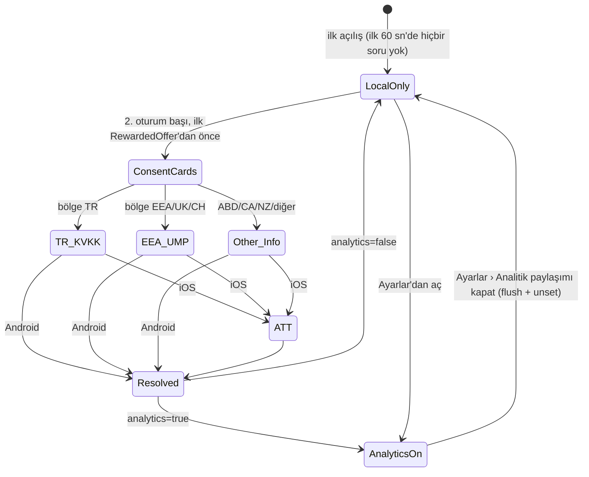
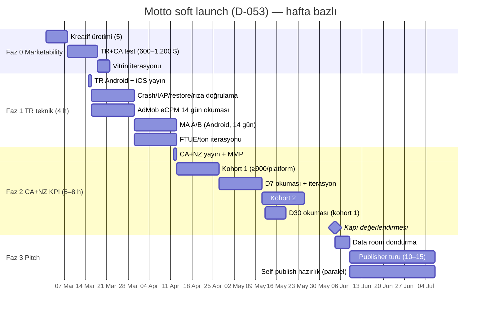

# 11 — KPI, Analytics, Soft Launch ve Publisher Planı: Ölçmeden Karar Yok

> **Belge türü:** Ayrıntılı tasarım dokümanı (sistem sahibi: KPI ağacı, analytics şeması ve rıza kapısı, yerel "Koçun Raporu", MVP playtest protokolü, marketability testi, soft launch planı ve kapıları, publisher pitch/deal/data room, gelir senaryoları, ASO).
> **Sürüm:** v1.0 · 2026-11-07 · Sahip: KPI/analytics/soft launch/publisher tasarımcısı · Girdi: 00 (tümü; özellikle §2.2, §5, §7, §8, §10, §12), T6 (tümü), T2 (tümü), T1/T7/T9 (TL;DR), `12-benzer-oyunlar-ozellik-karsilastirmasi.md`, `research/12-app-store-teardown/D-yorum-madenciligi-aso-fiyat.md`, kardeş dokümanlar 05 §6.1, 06 §2.9–2.10, 10 §2.4.10.
> **Tek cümlelik özet:** Oyun hiçbir ölçüme bağlı değildir; ölçüm oyuna bağlıdır. Her KPI'nın bir olayı, her olayın bir allowlist adı, her kapının bir sayısı ve bir "ya tutmazsa" kuralı vardır; publisher'a gidilen paket soft launch'ın kendisidir, sonradan yazılmış bir slayt değil.

---

## 0. Künye — uygulanan D-kararları, bağımlı dokümanlar, sürüm

### 0.1 00 §5'teki satırım

| # | Dosya | Sahip olduğu sistemler | 00'daki ana karar |
|---|---|---|---|
| 11 | `docs/design/11-kpi-analytics-softlaunch-publisher.md` | KPI ağacı, Firebase/GA4 (opsiyonel) + yerel "Koçun Raporu" dışa aktarımı, soft launch planı (TR + CA/NZ), kabul kapıları, publisher pitch sırası, anlaşma kırmızı çizgileri | §2.2 KPI; **D-053, D-054** |

### 0.2 Uygulanan kararlar (her biri → bu belgede somut bir tasarım öğesi)

| Karar | Bu belgede nasıl uygulandı |
|---|---|
| **D-053** | Soft launch **TR (teknik, 4 hafta) → Kanada + Yeni Zelanda (KPI, 6–8 hafta)**; kapılar D1 ≥ %35 / D7 ≥ %15 / D30 ≥ %6 kapı değeri, hedef 40/18/8 (§2.5.3); pitch demosu ve deck sırası **Karne → Roast → Kalıp** (§2.6.2); "motivasyon/wellness/alışkanlık/terapi" sözcükleri ASO sözlüğünde, deck'te ve data room'da **lint ile yasak** (§2.8.4, §5). |
| **D-054** | `AnalyticsPort` arkasında üç sink: yerel `local-report` (varsayılan, her zaman), Firebase/GA4 (derleme bayrağı + analitik rızası), publisher SDK'sı (yalnızca soft launch build'i, aynı port). Oyun hiçbir sink'i beklemez; ATT ön-ekranı, KVKK aydınlatma + **ayrı** açık rıza, EEA/UK/CH'de UMP = `ConsentGate` durum makinesi (§2.2.4). |
| D-002 / D-049 | ASO başlık/alt başlık bileşik marka ("Motto: Sertifikasız Hayat Koçu" / "Motto: Uncertified Life Coach"); yasaklı adlar ve rakip marka adları anahtar kelime alanında yok (§2.8). |
| D-005 | Hiçbir analytics olay adı, parametre değeri, deck cümlesi veya data room dosyasında "rüşvet/bribe" yok; `ST-10` lint bu belgenin tüm metinlerini de tarar (§5). |
| D-006 / D-057 | Saha Çalışması ve roguelike meta yığını pitch'te **yok**; A3 ekonomisi yalnızca "Sezon 2 yol haritası" slaydında bir cümle (§2.6.3 slayt 14). |
| D-007 / D-008 | Gelir modelinde interstitial/DAU 0,9–1,1 bandı (ölüm akışında reklam yok); senaryolar 06 §2.9.3 ile birebir (§2.7). |
| D-016 | "Ölüm → Yeni Müşteri (2 dk)" KPI'sı ≥ %65 bağlayıcı, ≥ %70 "iyi" eşiği (D-ÖNERİ-11-08); olay çifti `death` → `rebirth{msSinceDeath}` (§2.1.3). |
| D-019 | Kamp kıyas kartı paylaşımı `share{card:'camp'}`; hiçbir kohort sayısı sunucudan gelmez, dolayısıyla hiçbir KPI "gerçek kohort" iddia etmez (§2.1, §5). |
| D-030 | Bildirim KPI'ları (open ≥ %8 / bağlamsal ≥ %12, push kaynaklı oturum payı %20–30, 72 sa sessizlik < %15) 05 §6.1'den alınır; ölçüm olayları `notif_plan`, `notif_open` (§2.1.2). |
| D-037 | Yaş 16+: UA ağlarında yaş hedefleme 18+ değil; AdMob `T`, soft launch'ta MA A/B'si 06 §2.7.5'e göre; eCPM etkisi ölçülür (§2.5.5). |
| D-038 – D-041 | Monetizasyon KPI'ları: rewarded opt-in, gösterim/DAU, Torpil D30 dönüşümü, 2. ölüm teklifi dönüşümü, iade oranı; abonelik KPI'sı **yok** (v1'de abonelik yok) (§2.1.2). |
| D-044 | Harness kabulleri (medyan ölüm 72–80, koç isabeti %50–62, p95 sürpriz ≤ 14, tekrar < %15) KPI dosyasının "ürün kalitesi" sekmesinde publisher'a gösterilir; canlı veri harness'la karşılaştırılır (§2.5.6). |
| D-047 | CI lint release'i bloklar → build-for-review checklist'inde "lint yeşil" ön koşul (§2.6.5). |
| D-050 / D-052 | **Asla-loglanmaz listesi**: oyuncunun gerçek davranışı hakkında türetilmiş hiçbir alan; "Gerçek hayatta yardım" ekranı ziyareti **ölçülmez** (§2.2.3). |
| D-055 | Mağaza sayfasında, kreatifte ve pitch'te sahte sayaç/stok/"şu an X kişi oynuyor" yok; "en popüler" rozeti gerçek veri yoksa yok (§2.8, §5). |
| D-061 / D-066 | Zaman birimi gün → **gün tabanlı KPI'lar**: gösterilen gün/oturum, gün/dakika, D7 içinde gösterilen gün/yükleme (SD7), hız modu dağılımı (§2.1.3). |
| D-064 | Roast dozu yükseldi → satır düzeyi "Komik / Değil" mikro-puanı (`line_rating`, D-ÖNERİ-11-02) ve "aynı satırı 3+ kez gördü" < %2 ölçümü (§2.2.2). |
| D-060 | Bu belge hiçbir D-kararını yeniden tartışmaz; farklılaşan araştırma önerileri §7.3'te "çatışma" olarak listelenir ve 00 lehine çözülür. |

### 0.3 Bağımlı dokümanlar

| Doküman | Bu belgeden aldığı | Bu belgeye verdiği |
|---|---|---|
| **10** Teknik mimari | Nihai `AnalyticsEvent` allowlist'i (§2.2.2), `local-report` export şeması (§2.2.5), `ConsentGate` durumları (§2.2.4) | `AnalyticsPort`, SQLite ring-buffer (50.000 satır), Sentry PII temizliği, `ClockPort.localDay` |
| **06** Monetizasyon | Monetizasyon KPI eşikleri ve kill kuralları birebir (06 §2.9.1, §2.9.4) | Rıza akışı sırası ve bölgesel kartlar (06 §2.7), `ad_*`/`purchase*` olayları (06 §2.10) |
| **05** Retention | Streak/bildirim/Kamp/welcome-back KPI'ları (05 §6.1) olduğu gibi KPI ağacına girer | `notif_*`, `streak_*`, `camp_*`, `wb_*` olay adları |
| **03** Olay motoru | Harness eşikleri KPI dosyasında "kalite sekmesi" | `shownDays == events`, director sayaçları (`negStreak`, `wowBudget`) → `session_end` özet parametreleri |
| **07** UX/UI | Koçun Raporu ekranı iskeleti, "Komik / Değil" uzun basış, ATT ön-ekranı metinleri (06 ile ortak) | FTUE zaman damgaları (`ftue_*` perf-mark'ları), paylaşım kartı tipleri |
| **08** Hukuk/linter | ASO ve pitch metinleri için yasaklı sözlük (`ST-*` kuralları bu belgeyi de tarar) | Asla-loglanmaz listesinin KVKK dayanağı; "yardım ekranı ölçülmez" |
| **09** i18n | `locale` her olayda zorunlu parametre; funny-check ≥ 3/5 → canlı `line_rating` ile karşılaştırma | — |

---

## 1. Amaç ve kapsam — MVP / Soft launch / 1.0 farkları

**Amaç.** Üç soruya sayı ile cevap vermek: (1) *Oyun gerçekten komik ve tutuyor mu?* (playtest + retention), (2) *Para kazanabilir mi?* (ARPDAU, Torpil, eCPM), (3) *Birisi buna UA parası koyar mı?* (CPI, LTV, publisher kapıları). Hepsi backend'siz, rızaya saygılı ve Türkiye'de kurulu bir şirket için şikâyet edilemez biçimde.

**İlke sırası:** (1) ölçüm oyunu asla bekletmez ve asla bozmaz (D-054), (2) ölçülmeyen şey KPI olmaz; her KPI'nın bir olayı vardır, (3) her kapının yazılı bir "tutmazsa ne yapacağız" kuralı vardır, (4) publisher'a gösterilen her sayı "ölçüm / tahmin / hedef" etiketlidir.

| Alan | **MVP dikey kesit** (10 hafta; 5–8 testçi/locale) | **Soft launch** (TR 4 h + CA/NZ 6–8 h) | **1.0 global** | Lansman sonrası |
|---|---|---|---|---|
| Analytics sink | Yalnızca `local-report` (Koçun Raporu); Firebase paketi build'de **yok** | + Firebase/GA4 (rıza ile); + MMP (CA/NZ build'i, rıza ile); publisher isterse GameAnalytics adaptörü | GA4 + (publisher SDK'sı varsa) | BigQuery export değerlendirmesi |
| KPI kaynağı | Playtest JSON dışa aktarımı + `tools/report-aggregate` | GA4 kohortları + MMP + mağaza konsolları + AdMob/RevenueCat | aynı | aynı |
| Kapı | 00 §7 MVP çıkış: ilk kahkaha ≤ 10 sn (5/8), ilk karar ≤ 25 sn, ilk oturum medyanı ≥ 8 dk, Bir Yıl Daha ≥ %70, ölüm → yeni hayat ≥ %60, aynı satır 3+ < %2 | TR: crash-free ≥ %99,3, FTUE tamamlama ≥ %75, opt-in'ler; CA/NZ: D1/D7/D30 kapı 35/15/6, hedef 40/18/8 | Pitch eşiği: D1 ≥ %40, D7 ≥ %18, D30 ≥ %8, CPI ≤ 1,20 $ (CA Android) | — |
| Marketability | Yok (kreatif storyboard'ları hazır) | Faz 0: 3–5 kreatif, 600–1.200 $ | Lansman kreatif seti (≥ 8) | Aylık kreatif yenileme |
| Publisher | Yok (hedef liste + "istemiyoruz" sayfası taslağı) | Faz 2 ortasında ön temas; Faz 3 pitch turu | İmza ya da self-publish | Live-ops raporu (çeyreklik) |
| ASO | Başlık/alt başlık/ikon kararı; marka taraması (Sprint 0) | TR + EN vitrin canlı; mağaza listeleme deneyleri (Play Console) | 2 ek vitrin dili yok (00 §2.4); Custom Product Pages (iOS) 3 adet | Sezonluk ekran görüntüsü |

**Kapsam dışı (bilinçli):** sunucu taraflı A/B (bandit, uzak deney) yok; her A/B iki varyant, elle, imzalı statik JSON ile (10 §2.3.7); kullanıcı başına kohort kimliği **cihazda** kalır. Gerçek zamanlı dashboard yok; haftalık rapor var.

---

## 2. Tasarım

### 2.1 KPI ağacı

#### 2.1.1 Kuzey Yıldızı ve dört dal

Dışa dönük Kuzey Yıldızı publisher'ın dili olan **D7**'dir. İçe dönük Kuzey Yıldızı ise gün tabanlı modele (D-061) uygun **SD7 — ilk 7 günde yükleme başına gösterilen gün** (D-ÖNERİ-11-01): `SD7 = Σ shownDays(install..install+7g) / installs`. Hedef ≥ 100 (ör. 5 oturum × 20 gösterilen gün). SD7 düşerken D7 sabit kalıyorsa oyuncu "check-in" yapıyor ama yaşamıyor demektir (05 §7 risk 1'in sayısal yüzü).

```
                    SD7 (iç) · D7 (dış)
        ┌───────────────┬───────────────┬───────────────┬───────────────┐
    İlk 60 sn        Oturum/gün       Geri dönüş      Para + pazar
  (FTUE hunisi)   (gün tabanlı tempo)  (D1/D7/D30,    (opt-in, ARPDAU,
                                        bildirim,       Torpil, CPI,
                                        streak)         paylaşım)
```

#### 2.1.2 Faz bazlı KPI tablosu (bağlayıcı eşikler; "kapı" = altında kalınırsa yazılı kural devreye girer)

| Dal | KPI | Tanım / formül | Olay(lar) | MVP playtest | TR teknik | CA/NZ KPI (kapı → hedef) | Pitch eşiği (min / iyi) |
|---|---|---|---|---|---|---|---|
| İlk 60 sn | İlk kahkaha (TTFL) | Playtest: kahkaha günlüğünde ilk kodlanmış gülme; canlı vekil: ilk koç balonunun görülme anı + `line_rating=+1` | günlük; `ftue_line_seen{ms}` | ≤ 10 sn (5/8 testçi), hedef 4 sn | vekil ≤ 10 sn medyan | aynı | — |
| İlk 60 sn | İlk karar (TTFD) | Uygulama açılışından ilk `ANSWER`'a ms | `ftue_decision{ms}` | ≤ 25 sn medyan (hedef 22) | ≤ 25 sn | ≤ 25 sn | — |
| İlk 60 sn | İlk damga / ilk karne | `ftue_stamp{ms}`, `ftue_report_card{ms}` | perf-mark | ≤ 41 sn / ≤ 56 sn | p75 ≤ 60 sn / ≤ 90 sn | aynı | — |
| İlk 60 sn | FTUE tamamlama | İlk karne + zarfı gören / açılış | `ftue_report_card` / `first_open` | ≥ %80 | ≥ %75 | ≥ %75 | ≥ %75 |
| Oturum | Oturum medyanı | `session_end.durMs` medyanı (≥ 30 sn oturumlar) | `session_end` | ≥ 8 dk (ilk oturum) | ≥ 10 dk | ≥ 12 dk | ≥ 12 dk |
| Oturum | Oturum/gün | DAU başına oturum | `session_start` | ölçülür | ≥ 2,5 | ≥ 3 | ≥ 3 |
| Oturum | **Gösterilen gün/oturum** | `session_end.shownDays` medyanı | `session_end` | 15–25 | 15–25 | 15–25 (medyan 20) | — |
| Oturum | **Gün/dakika** | `shownDays / (durMs/60000)`; ▶ hızında ≈ 5 | `session_end` | 4–6 | 4–6 | 4–6 | — |
| Oturum | **SD7** | yukarıda | `session_end`, `first_open` | — | ≥ 80 | ≥ 100 | — |
| Oturum | "Bir Yıl Daha" / Karne sonrası devam | Doğum günü karnesinden sonra oturum devam etti / karne gösterildi | `year_end{continued}` | ≥ %70 | ≥ %70 | ≥ %70 | — |
| Oturum | Aynı satırı 3+ kez gördü | `seenCount ≥ 3` olan koç satırı gösterimi / tüm koç satırı gösterimi | `line_seen{seen}` (örneklenmiş %5) | < %2 | < %2 | < %2 | — |
| Oturum | Ölüm → Yeni Müşteri (2 dk) | `rebirth.msSinceDeath ≤ 120000` / `death` | `death`, `rebirth` | ≥ %60 | ≥ %65 | ≥ %65 (iyi ≥ %70) | ≥ %65 |
| Geri dönüş | D1 / D7 / D30 | Klasik kohort (yükleme günü = D0; yerel: `first_open` günü) | `first_open`, `session_start` | — | ölçülür (TR normu 19/5/1) | **35/15/6 → 40/18/8** | 40/18/8 (iyi 45/20/10) |
| Geri dönüş | Streak ≥ 3 DAU payı | 05 §6.1 | `streak_day` | — | ≥ %40 | ≥ %45 | — |
| Geri dönüş | Bildirim soft-ask kabul / sistem izni | 05 §6.1 | `softask{result}`, `notif_perm{result}` | — | ≥ %60 / iOS ≥ %50, Android ≥ %60 | aynı | — |
| Geri dönüş | Push open genel / karakter mesajı | `notif_open` / `notif_plan` | `notif_plan`, `notif_open` | — | ≥ %8 / ≥ %12 | ≥ %8 / ≥ %12 | ≥ %8 |
| Geri dönüş | Push kaynaklı oturum payı | `session_start.source='push'` | `session_start` | — | %20–30 | %20–30 | — |
| Geri dönüş | Welcome-back tamamlama | `wb_done / wb_shown` | `wb_shown`, `wb_done` | — | ≥ %70 | ≥ %75 | — |
| Para | Rewarded opt-in | izleyen / teklif gören DAU | `ad_offer_shown`, `ad_shown` | — | ≥ %35 | ≥ %40 | ≥ %40 |
| Para | Rewarded gösterim/DAU | `ad_shown{placement∈rewarded}` / DAU | `ad_shown` | — | ≥ 1,5 | ≥ 2,0 | ≥ 2,0 |
| Para | Interstitial/DAU | D-008 tavanı | `ad_shown` | — | 0,8–1,1 | 0,9–1,2 | — |
| Para | ARPDAU (reklam net + IAP) | (Σ `ecpmCents`/1000 + Σ IAP net) / DAU | `ad_shown`, `purchase` + RevenueCat | — | ≥ 0,009 $ | ≥ 0,035 $ | ≥ 0,06 $ (Tier-1) |
| Para | Torpil D30 dönüşümü | Torpil alan / yükleme (30 gün) | `purchase{sku:'torpil'}` | — | ≥ %0,8 | ≥ %1,5 | ≥ %2 |
| Para | 2. ölüm teklifi → satın alma | `purchase{surface:'post_death_2'}` / `paywall_view{surface:'post_death_2'}` | aynı | — | ≥ %4 | ≥ %6 | — |
| Para | İade oranı (Torpil) | RevenueCat | `refund` | — | ≤ %3 | ≤ %3 | — |
| Pazar | Paylaşım / oturum | `share{exported:true}` / `session_end` | `share` | ≥ %3 (playtest: 8 testçiden ≥ 5 en az 1 kez) | ≥ %3 | ≥ %3 | ≥ %3 |
| Pazar | Seed içe aktarma / yükleme | `seed_import` / installs | `seed_import` | — | ≥ %1 | ≥ %2 | — |
| Pazar | CPI | ağ harcaması / atribüe yükleme | mağaza konsolu (TR), MMP (CA/NZ) | — | Android ≤ 0,30 $ | CA/NZ Android ≤ 1,20 $, iOS ≤ 2,00 $ | ≤ 1,20 $ Android |
| Pazar | ATT opt-in (iOS) | `att{result:'authorized'}` / `att` | `att` | — | ≥ %35 | ≥ %40 | — |
| Kalite | Crash-free oturum | Sentry | — | ≥ %99 | ≥ %99,3 | ≥ %99,5 | < %1 crash |
| Kalite | `no_fill` oranı | `ad_skip{reason:'no_fill'}` / `ad_opportunity` | aynı | — | ≤ %8 | ≤ %5 | — |

İlk kahkaha için iki not: (a) brief'teki "< 20 sn / < 30 sn" eşikleri T6'nın MVP eşikleridir; 00 §2.2 ve §7 bunları **≤ 10 sn (hedef 4) / ≤ 25 sn** olarak sıkılaştırdı, bu belge 00'ı uygular; (b) kahkaha canlı veride **ölçülemez**; vekil olarak satır puanı (§2.2.2) ve playtest günlüğü kullanılır, hiçbir zaman mikrofon/kamera yok (§5).

#### 2.1.3 Gün tabanlı metrikler — formüller

D-061 sonrası "yıl/oturum" metriği anlamını yitirdi; yerine üç türev:

```
shownDaysPerSession   = median(session_end.shownDays)                      # hedef 15–25
daysPerMinute         = Σ shownDays / Σ (durMs / 60000)                   # ▶ hızında ≈ 5 (12 sn/gün)
speedMix              = {play: %, fast: %, auto: %} of shownDays          # 'auto' > %40 → otomatik mod oyunu oynuyor, oyuncu değil (uyarı)
yearsPerSession       = median(session_end.birthdays)                     # 1–3 (Karne sayısı; yalnızca bilgi)
rebirth2m             = count(rebirth.msSinceDeath ≤ 120000) / count(death)
SD7                   = Σ shownDays[installDay..installDay+7) / installs
lineRepeat3           = count(line_seen.seen ≥ 3) / count(line_seen)      # %5 örnekleme
```

`speedMix` bir KPI değil, teşhis sayacıdır: ▶▶ payı > %60 ise günler sıkıcıdır (director/içerik), `auto` payı > %40 ise karar değeri düşüktür. Harness (03 §6.2) aynı sayaçları sentetik hayatlarda üretir; canlı/harness farkı > 2× ise önce ölçüm, sonra tasarım sorgulanır (§2.5.6).

#### 2.1.4 KPI ağacı veri tipi (tek kaynak; dashboard, haftalık rapor ve kapı değerlendirmesi bundan türer)

```ts
// packages/kpi/tree.ts — saf TS, test edilir; eşikler burada, slaytta değil
export type Phase = 'mvp' | 'tr_tech' | 'canz_kpi' | 'pitch';
export type KpiId =
  | 'ttfl' | 'ttfd' | 'ftue_complete' | 'session_median_min' | 'sessions_per_dau'
  | 'shown_days_per_session' | 'days_per_minute' | 'sd7' | 'continue_after_report'
  | 'line_repeat3' | 'rebirth_2m' | 'd1' | 'd7' | 'd30' | 'streak3_share'
  | 'notif_open' | 'notif_open_character' | 'push_session_share' | 'wb_complete'
  | 'rewarded_optin' | 'rewarded_per_dau' | 'interstitial_per_dau' | 'arpdau_usd'
  | 'torpil_d30' | 'torpil_post_death2' | 'refund_rate' | 'share_per_session'
  | 'seed_import_rate' | 'cpi_usd' | 'att_optin' | 'crash_free' | 'no_fill_rate';

export interface KpiDef {
  id: KpiId;
  unit: 'ms' | 'min' | 'ratio' | 'count' | 'usd';
  direction: 'higher' | 'lower' | 'band';
  gate: Partial<Record<Phase, number | [number, number]>>;   // altında kalınca kill/iterate kuralı
  target: Partial<Record<Phase, number | [number, number]>>; // hedef
  source: 'local' | 'ga4' | 'mmp' | 'store' | 'admob' | 'revenuecat' | 'sentry' | 'playtest';
  minSample: number;            // bu örneklemin altında KPI "okunmaz" (ör. kohort 900)
  rule?: string;                // §2.5.4 kill/iterate kural kimliği
}

export const KPI_TREE: ReadonlyArray<KpiDef> = [
  { id: 'd7', unit: 'ratio', direction: 'higher', gate: { canz_kpi: 0.15 }, target: { canz_kpi: 0.18, pitch: 0.18 }, source: 'ga4', minSample: 900, rule: 'K-02' },
  { id: 'rebirth_2m', unit: 'ratio', direction: 'higher', gate: { mvp: 0.60, tr_tech: 0.65, canz_kpi: 0.65 }, target: { canz_kpi: 0.70 }, source: 'local', minSample: 200, rule: 'K-05' },
  { id: 'shown_days_per_session', unit: 'count', direction: 'band', gate: { tr_tech: [12, 30] }, target: { canz_kpi: [15, 25] }, source: 'ga4', minSample: 500, rule: 'K-06' },
  // … tablo 2.1.2'nin tamamı; vitest: her KpiId için gate ≤ target (higher) / gate ≥ target (lower)
];
```

### 2.2 Analytics mimarisi

#### 2.2.1 Katmanlar

```mermaid
flowchart LR
  E[engine step → effects: analytics{name, props}] --> R[EffectRunner]
  R --> P[AnalyticsPort.track]
  P --> C{ConsentGate}
  C -- her zaman --> L[local-report\nSQLite ring-buffer 50k]
  C -- analytics rızası + bayrak --> F[Firebase/GA4]
  C -- analytics rızası + soft launch build --> M[MMP: Adjust/AppsFlyer\nkurulum atribüsyonu]
  C -- publisher adaptörü --> G[GameAnalytics vb.]
  L --> X[Ayarlar › Koçun Raporu\ndışa aktar JSON]
  X --> A[tools/report-aggregate\nD1/D7, oturum, gün KPI'ları]
```

Kurallar: `track()` senkron ve atılabilir (fire-and-forget); kuyruk dolarsa en eski düşer; hiçbir sink `await` edilmez; sink hatası `console.info` + Sentry breadcrumb (PII'siz). Motor **hangi sink'in açık olduğunu bilmez** (D-054).

#### 2.2.2 Olay şeması (GA4 sınırları içinde; allowlist = TS union; bu liste 05/06/10'daki adların nihai hâlidir)

GA4 uygulama sınırları (T6 §5.1, doğrulandı): 500 farklı olay adı (uygulama örneği başına), olay başına 25 parametre, 25 kullanıcı özelliği, olay adı ≤ 40 karakter, parametre adı ≤ 40, parametre değeri ≤ 100 karakter, kullanıcı başına günde 100.000 olay. Tasarım: **42 olay adı, olay başına ≤ 10 parametre, 8 kullanıcı özelliği**; vitest `schema.test.ts` sınırları derleme zamanında doğrular.

| Grup | Olay | Parametreler (tümü sayı/enum; serbest metin yok) | KPI |
|---|---|---|---|
| Yaşam döngüsü | `first_open` | `locale`, `platform`, `installSource?` | D0 tanımı |
| | `session_start` | `source: cold\|push\|share\|resume`, `sessionNo` | oturum/gün, push payı |
| | `session_end` | `durMs`, `shownDays`, `birthdays`, `speedPlay`, `speedFast`, `speedAuto`, `negStreakMax`, `endReason: enough\|background\|death\|crash` | tempo, gün/dk |
| FTUE (perf-mark) | `ftue_line_seen` · `ftue_decision` · `ftue_wager` · `ftue_stamp` · `ftue_report_card` · `ftue_envelope` | `ms` (açılıştan), `locale` | 60 sn hunisi |
| Çekirdek | `day_shown` (örneklenmiş %10) | `ageBand`, `eventId`, `kind: event\|skip\|document`, `dialogCount` | içerik performansı |
| | `answer` | `eventId`, `choiceIdx`, `via: tap\|swipe\|tactic\|auto`, `pattern?`, `valence` | karar kalitesi, kalıp dağılımı |
| | `wager_opened` · `wager_resolved` | `eventId`, `pOdds` (0–100), `result: hit\|wrong` | koç isabeti canlı (%50–62) |
| | `year_end` | `age`, `grades` (6 harf kodu), `goalStamp`, `continued` | Bir Yıl Daha |
| | `goal_pick` | `goalId`, `same`, `none` | Tek Hedef |
| | `envelope_opened` | `kind`, `daysPending` | zarf kadansı |
| | `death` | `age`, `causeId`, `lifeNo`, `shownDaysTotal`, `chronic` | ölüm yaşı dağılımı (harness kıyası) |
| | `roast_step` | `step` (1–8), `skipped` | Roast Raporu atlama |
| | `rebirth` | `msSinceDeath`, `sameConditioning`, `unlocks` | ölüm → yeni hayat |
| | `line_seen` (örneklenmiş %5) | `lineId`, `seen`, `voice`, `ageBand` | tekrar < %2 |
| | `line_rating` | `lineId`, `value: 1\|-1`, `voice` | canlı funny-check (D-ÖNERİ-11-02) |
| Koleksiyon | `diagnosis_granted` · `glossary_add` · `stamp_variant` | `id` | koleksiyon ilerlemesi |
| Retention | `streak_day` · `streak_paused` · `makeup_done` · `milestone` | `days`, `n` | 05 §6.1 |
| | `quest_done` · `camp_start` · `camp_done` | `questId` / `campId`, `rank` | 05 §6.1 |
| | `softask` · `notif_perm` · `notif_plan` · `notif_open` · `quiet_mode` | `result`, `templateKey`, `delayMin` | bildirim |
| | `wb_shown` · `wb_done` | `absentDays`, `gameMonths` | welcome-back |
| Para | `ad_opportunity` · `ad_offer_shown` · `ad_skip` · `ad_shown` · `ad_reward` · `ad_report` | 06 §2.10 ile birebir (`placement`, `reason`, `network`, `ecpmCents?`, `viaTicket`) | ARPDAU reklam |
| | `paywall_view` · `purchase` · `purchase_pending` · `restore` · `refund` | 06 §2.10 (`sku`, `priceMicros`, `currency`, `surface`) | Torpil |
| Rıza/izin | `consent_state` · `att` | `kvkkAds`, `kvkkTransfer`, `analytics`, `ump`, `result` | KVKK raporu; **yalnızca local sink'e yazılır** |
| Viral | `share` · `seed_import` | `card`, `exported`, `ratio: 9x16\|1x1` | paylaşım |

Kullanıcı özellikleri (≤ 25; biz 8): `locale`, `voice`, `torpil` (bool), `lifeNoBucket` (1 / 2–3 / 4–9 / 10+), `platform`, `contentVersion`, `abVariant` (tek harf), `installWeek` (ISO). Kimlik yok: GA4'ün kendi app-instance id'si dışında hiçbir `userId` set edilmez.

JSON örneği (local sink satırı):

```json
{ "t": 1762510200, "n": "session_end", "p": { "durMs": 812000, "shownDays": 21, "birthdays": 2, "speedPlay": 17, "speedFast": 4, "speedAuto": 0, "negStreakMax": 2, "endReason": "enough" } }
```

`t` = Unix saniye, **dakikaya yuvarlanmış** (D-ÖNERİ-11-09); D1/D7 `localDay` ile hesaplanır, saat çözünürlüğü gerekmez.

**Satır puanı (D-ÖNERİ-11-02).** Koç balonuna uzun basış → iki küçük ikon ("Komik" / "Değil"; metin yok, emoji yok, koç cevap vermez). Günde istem yok, her zaman sessizce erişilebilir; `line_rating{lineId, value}`. Kullanımı: canlı funny-check; `value=-1` oranı > %30 olan satır bir sonraki içerik paketinde `needs-review` alır. Hiçbir satır oyuncunun puanıyla **kişiselleşmez** (öğrenen seçim yok; D-050 ruhu: oyun oyuncu hakkında varsayım yapmaz).

#### 2.2.3 Asla-loglanmaz listesi (CI testi `never-log.test.ts` props anahtarlarını ve değer tiplerini tarar)

1. Oyuncunun yazdığı/seçtiği karakter adı, şehir adı (yalnızca `cityId` enum).
2. Herhangi bir serbest metin: olay metni, koç satırı metni, paylaşım kartı metni (yalnızca `lineId`/`eventId`).
3. Gerçek saat/dakika (yalnızca `localDay`, `isoWeek`, dakikaya yuvarlanmış `t`); `mood:'tired'` bile loglanmaz (D-012/D-050: oyuncunun gerçek gece davranışı veri değildir).
4. Konum, IP, cihaz kimliği, reklam kimliği, kişi listesi, takvim, sağlık verisi — SDK'lar kendi işlediklerini kendi politikalarıyla işler; **bizim** şemada yok.
5. "Gerçek hayatta yardım" ekranı ziyareti ve Düşük Keyif eşiği geçişleri (D-052; 08 D-ÖNERİ-08-07).
6. Ses ayarı değişikliği **anı** (yalnızca kullanıcı özelliği olarak mevcut değer).
7. Makbuz/token/JWS, `purchaseToken`, e-posta.
8. Doğum tarihi/yaşı (oyuncunun), cinsiyet, gerçek ad; yaş kapısı cevabı (yalnızca "16+ onaylandı" bool, local).
9. Oyuncunun **gerçek** davranışı hakkında türetilmiş alanlar (ör. "gece oynuyor", "hafta sonu oyuncusu") — bunlar rapor sorgusunda bile üretilmez.
10. Reddedilen rıza sonrası hiçbir dış sink'e **hiçbir** olay (reddetme olayı dahil; `consent_state` yalnızca local).

#### 2.2.4 Rıza kapısı (ATT / UMP / KVKK) — durum makinesi

06 §2.7 bölgesel kart sırasını tanımlar; burada analytics'in bu durumlara tepkisi:



Kurallar: (1) **"Analitik paylaşımı"** TR'de açık rıza kartındaki iki anahtardan (kişiselleştirilmiş reklam, yurt dışına aktarım) **ayrı, üçüncü bir anahtardır**; kapalı başlar (Kurul 2026/347; 08 `ST-08`). (2) EEA/UK/CH'de UMP'nin TCF amaçları ("analytics/measurement") okunur; TCF amacı yoksa GA4 başlamaz. (3) ABD/CA/NZ'de bilgi kartı tek buton + **ayrı** "Analitik paylaşımı" anahtarı (kapalı başlar); ATT reddi analytics'i etkilemez (ATT = izleme; GA4 app-instance ölçümü izleme değildir, ama `attributionEnabled` yalnızca ATT onayıyla). (4) MMP SDK'sı (CA/NZ build'i) analytics anahtarına bağlıdır; iOS SKAdNetwork postback'leri rızasız ve kimliksiz çalışır, CPI'nın iOS ayağı SKAN ile okunur. (5) Rıza değişince `flush()` → dış sink'ler `reset()`; local buffer kalır (cihazda, oyuncunun). (6) Oyun hiçbir durumda rızaya bağlı değildir; reddeden oyuncu aynı oyunu oynar.

#### 2.2.5 Koçun Raporu — tamamen offline ölçüm ve dışa aktarım

**Ekran (Ayarlar › Koçun Raporu):** oyuncuya dönük sayılar + dışa aktarma. Koç ağzında, roast kapalı (Ayarlar bölgesi). Satırlar: toplam gösterilen gün, hayat sayısı, en uzun Mola serisi, en çok görülen Teşhis, koçun isabeti (%), HAKSIZ ÇIKTIM sayısı, paylaşılan kart sayısı, satın almalar (ad + tarih). Altta: **[JSON olarak dışa aktar]** (sistem paylaşım sayfası; dosya `motto-report-YYYYMMDD.json`), **[Raporu sil]**.

**Dosya şeması:**

```ts
export interface CoachReportExport {
  schema: 'motto.report/1';
  exportedAtDay: string;            // 'YYYY-MM-DD' (yerel)
  app: { version: string; contentVersion: string; platform: 'ios'|'android'; locale: 'tr-TR'|'en-US' };
  installDay: string;               // D0 (yerel gün)
  summary: { shownDaysTotal: number; lives: number; longestStreak: number; wagerHitRate: number; stampsWrong: number; shares: number };
  rows: Array<{ t: number; n: AnalyticsEvent; p?: Record<string, number|string|boolean> }>;  // ≤ 50.000, FIFO
  // yok: cihaz kimliği, isim, şehir adı, IP, makbuz, serbest metin
}
```

**Toplayıcı (`tools/report-aggregate`, Node, salt yerel):** N dosyayı okur → her dosya bir "kullanıcı" → `KPI_TREE`'deki her `source:'local'` KPI'yı hesaplar → `kpi.csv` + `kpi.md`. Sözde kod:

```
for file in exports:
  u = parse(file); assert u.schema == 'motto.report/1'
  days = groupBy(u.rows, r => localDay(r.t))
  d1 = exists(days[u.installDay + 1]); d7 = exists(days[u.installDay + 7])   # klasik gün-N tanımı
  sessions = u.rows.filter(n == 'session_end')
  shownDaysPerSession = median(sessions.map(p.shownDays))
  rebirth2m = count(rebirth.msSinceDeath ≤ 120000) / count(death)
  ttfd = first(ftue_decision).p.ms ; ttfl_proxy = first(ftue_line_seen).p.ms
  ...
aggregate: medians + rates + n; output marks n < minSample as "okunmaz"
```

Kullanım: (a) MVP playtest'te 5–8 testçiden toplanan JSON'lar (tek KPI kaynağı), (b) soft launch'ta rıza vermeyenlerin QA/destek kayıtları (yalnızca oyuncu gönderirse), (c) publisher'a "kapalı beta özeti" — n küçük, etiketi **"kapalı beta, n=…"** (sahte ölçek yok). Rapor ekranı metinleri §3.1'de.

### 2.3 MVP playtest protokolü (RITE + kahkaha günlüğü)

**Yöntem:** RITE (Rapid Iterative Testing and Evaluation): her oturumdan sonra bulgular sınıflandırılır, "açık sebep + ucuz çözüm" olanlar bir sonraki testçiden önce düzeltilir. Üç tur, her tur 5–8 testçi **locale başına** (TR ve EN ayrı; EN testçileri anadil, 00 §9 madde 9), toplam 30–48 oturum.

| Tur | Zaman | Build | Odak | Çıkış |
|---|---|---|---|---|
| R1 | MVP 6. hafta | İlk 60 sn + ilk ölüm (Hızlı Yaşa) | TTFL/TTFD, FTUE hunisi, "cici koç" riski, ses ayarı sorusu zamanı | TTFL ≤ 10 sn 5/8; "nasihat" yorumu 0 |
| R2 | 8. hafta | Tam oturum (12–15 dk) + welcome-back simülasyonu (cihaz saati ileri) | gösterilen gün/oturum, Bir Yıl Daha, zarf merakı, Mola ritüeli, tekrar hissi | Bir Yıl Daha ≥ %70; aynı satır 3+ < %2 |
| R3 | 10. hafta | 2 ömür + Roast Raporu + Yeni Müşteri + paylaşım | ölüm → yeni hayat ≥ %60, kart paylaşma niyeti, Kalıp Dedektörü "yaralayıcı mı?" | 00 §7 MVP çıkış kriterleri tamamı |

**Testçi profili:** 00 §2.2 segmentlerinden en az 2'şer kişi (TR 18–29 Reels/roast tüketicisi; 25–40 Carrot/Duolingo bırakmış; EN 18–34 Stanley Parable/GLaDOS seven; BitLife oyuncusu). Oyun geliştirici/akraba yok. Ücret: TR 500 ₺ / EN 40 $ hediye kartı (telif/KVKK: tester sözleşmesi, ad-soyad yalnızca ödeme için, araştırma notlarında kod adı "T-03").

**Oturum akışı (60 dk):** 5 dk ısınma (telefon kendi cihazı; TestFlight/Play internal) → **sessiz oynama 15 dk** (moderatör konuşmaz; "sesli düşün" yok — kahkaha doğal çıkmalı) → 10 dk serbest → 15 dk yarı yapılandırılmış görüşme → 5 dk SUS-benzeri 6 soru + "Bir arkadaşına nasıl anlatırsın?" (tek cümle; pitch tagline malzemesi) → JSON dışa aktarımı.

**Kahkaha günlüğü (moderatör kodlar; kayıt yalnızca not, ses/görüntü kaydı yok — §5):**

| Kod | Tanım | Örnek |
|---|---|---|
| L3 | Sesli gülme | Kahkaha, "hahaha" |
| L2 | Burun/nefes gülmesi, gülümseme + baş sallama | "pff", gülümseyerek ekranı gösterme |
| L1 | Dudak kıvrımı, "hmm" onayı | — |
| C | Cringe/rahatsızlık (kaş çatma, geri çekilme) | "bu biraz fazla" |
| N | "Nasihat" tespiti | "bana akıl veriyor" |
| R | Tekrar tespiti | "bunu demişti" |
| S | Paylaşma niyeti | ekran görüntüsü alma, "bunu atayım" |

Her kod `lineId/eventId` ve `ms`'yle not edilir; **ilk L2+ anı = TTFL**. Tur raporu: TTFL dağılımı, L3/dk, C ve N sayısı (hedef C ≤ 1/oturum, N = 0), R < 2/oturum, S ≥ 1 (8'de 5).

**Moderatör betiği (kısaltılmış; TR/EN §3.2'de):** (1) "Bu bir test, sen değil oyun sınavda." (2) "15 dakika ben yokum; istediğin gibi oyna." (3) Görüşme soruları: *"Koç kim? Bir cümleyle."* · *"Sana bir şey öğretmeye mi çalıştı?"* (N kontrolü) · *"Koçun yanıldığı bir an oldu mu? Ne hissettin?"* · *"Bir yıl daha basmadan önce ne düşündün?"* · *"Karneyi kime gönderirdin?"* · *"Neyi silmek isterdin?"* (C). (4) Ses ayarı sorusu: hangi kademeyi seçti, neden.

**Önceliklendirme:** Bulgu = (etki: S1 FTUE'yi bozar / S2 KPI'yı düşürür / S3 pürüz) × (frekans: ≥ 3 testçi / 2 / 1). S1 veya "≥ 3 testçi" olan her şey bir sonraki tura kadar kapanır; diğerleri backlog. İçerik bulguları (satır) doğrudan 09 pipeline'ına `needs-review` olarak döner.

### 2.4 Marketability (CPI/CTR) test planı — Faz 0

**Amaç:** "ton CPI'yı düşürüyor mu?" hipotezini 600–1.200 $ ile, soft launch'tan **önce** test etmek (T6 öneri 8, P0). Kanal: TikTok + Meta (Reels), 9:16, 15–20 sn, ses açık varsayımı, ilk 2 sn'de damga/karne/çağrı görünür. Hedef sayfa: mağaza sayfası (TR Play açık → Faz 1 ile aynı hafta), ikinci kanal olarak CA App Store/Play ön-kayıt sayfası.

| # | Kreatif | Kanca (ilk 2 sn) | Gövde (15–20 sn) | Kapanış satırı | Hipotez |
|---|---|---|---|---|---|
| K1 | **Damga** | Sarı iddia fişi iğnelenir: "İDDİA: bu para Mart'ı görmez. — M." | Oyuncu [Biriktir] seçer, HAKSIZ ÇIKTIM damgası ekranı sarsar, mürekkep sıçrar | "Sana karşı iddiaya girer. Yanılırsa damga basar." / "Bets against you. Stamps itself wrong." | En düşük CPI (benzersiz mekanik) |
| K2 | **Karne** | "Oyun bana karne verdi." / "The game gave me a report card." | Karne damga animasyonu, 6 not, YILIN MOTTOSU "Başladı. Teknik olarak." / "Started. Technically." | "Hayatını toparla. Ya da en azından karakterinin." | En yüksek CTR (UGC formatı) |
| K3 | **Anne Arıyor** | Tam ekran çağrı baskını "ANNE ARIYOR" | 3 cevap seçeneği; "Görüldü, cevap yok" → Okunmamış: 847 | "Karakterler cevap verir." / "Characters talk back." | TR'de en iyi; EN'de "mom call" evrensel |
| K4 | **Kalıp kartı** | "Erteleme: 1.204 seçim." / "Procrastination: 1,204 choices." | Roast Raporu sayaçları akar, 3 kalıp, "Ben oradaydım." | "Öl. Roast'lan. 40 saniyede yeni hayat." | 25–40 segmenti |
| K5 | **Dürüst model** (yalnızca EN) | "No forced ads. Even the coach is surprised." | Koç: "Ad incoming. I don't want it either." (gönüllü oturum sonu) | "Uncertified Life Coach" | Reklam yorgunu BitLife oyuncusu |

Bütçe dağılımı: 5 kreatif × 2 pazar (TR Android, CA Android+iOS) × ~100 $ = 1.000 $; her hücre ≥ 150 tıklama olmadan okunmaz. Ölçümler: CTR, IPM (install/1.000 gösterim), CPI, mağaza sayfası dönüşümü (Play Console "store listing conversion", App Analytics "conversion rate"). Atribüsyon TR'de **mağaza tarafı** (Apple App Analytics kampanya linkleri, Play Console UTM) — SDK yok, rıza sorusu yok (D-ÖNERİ-11-03); CA'da MMP ücretsiz katmanı (soft launch build'i).

**Kapılar (hipotez eşikleri; ilk ölçümden sonra kalibre edilir ve "tahmin" etiketi düşer):**

| Metrik | Yeşil | Sarı (iterasyon) | Kırmızı |
|---|---|---|---|
| TR Android CPI | ≤ 0,30 $ | 0,30–0,60 $ | > 0,60 $ (TR'de bile pahalıysa ton çalışmıyor) |
| CA Android CPI | ≤ 1,20 $ | 1,20–2,00 $ | > 2,00 $ |
| CA iOS CPI (SKAN) | ≤ 2,00 $ | 2,00–3,00 $ | > 3,00 $ |
| En iyi kreatif CTR (TikTok) | ≥ %1,2 | %0,8–1,2 | < %0,8 |
| Mağaza sayfası dönüşümü | ≥ %25 (Play), ≥ %30 (iOS CPP) | %15–25 | < %15 (vitrin sorunu, kreatif değil) |

Kırmızıda ne olur: kreatif değil **vitrin** değişir (ekran görüntüsü yazıları, ilk 3 görsel), ikinci tur 300 $; ikinci tur da kırmızıysa soft launch yine başlar (D-053), ama pitch'te "CPI kanıtı" yerine "organik/paylaşım kanıtı" vurgulanır ve publisher listesi Tier B/C'ye kayar (§2.6.1). Kreatif kuralları: tagline'lar 00 §0.3'ten; gerçek kişi/marka yok; "motivasyon" yok; kreatifte gösterilen her şey oyunda **aynen** vardır (yanıltıcı reklam = Reklam Kurulu; T9).

### 2.5 Soft launch planı

#### 2.5.1 Fazlar ve takvim



Tarihler göstermeliktir (MVP bitişine göre kayar); süreler bağlayıcıdır: Faz 0 2–3 hafta, Faz 1 **4 hafta**, Faz 2 **6–8 hafta** (D-053 "8 hafta" = Faz 1+2'nin KPI okuması), Faz 3 4–6 hafta. Toplam 16–20 hafta.

#### 2.5.2 Pazar ve platform kararları

| Faz | Pazar | Platform | Neden | UA |
|---|---|---|---|---|
| 1 | **Türkiye** | Android **ve** iOS aynı gün (sahip: iki platform kusursuz) | Düşük CPI, ton testi, crash/IAP/rıza akışı; TR retention normu (19/5/1) KPI kanıtı için zayıf → KPI kapısı **yok**, teknik kapı var | 500–1.000 $; paid UA ilk 2 hafta Android ağırlıklı (iOS organik + 100 $) — D-ÖNERİ-11-04 |
| 2 | **Kanada + Yeni Zelanda** | iOS ve Android ayrı kohort | Tier-1 İngilizce davranışı, ABD'ye en yakın eCPM, yönetilebilir CPI; NZ küçük ama "temiz"; Filipinler **yok** (D-053; 00 açık soru 7 — eCPM/CPI dengesi için NZ yeterli bulundu; PH yalnızca kohort dolmuyorsa yedek, §7) | 5.000–8.000 $ |
| 3 | — | — | Pitch | 0 |

Kohort matematiği: D7 = %15 varsayımıyla n = 900 → SE = √(0,15·0,85/900) ≈ 1,2 puan → %95 GA ±2,3 puan; kapı (15) ile hedef (18) ayrışır. n < 900 → KPI "okunmaz" etiketi; n ≥ 1.500 → kapı kararı tek kohortla alınabilir. Platform başına ayrı kohort, çünkü iOS/Android retention farkı 3–5 puan olabilir ve publisher'lar iOS'u ayrı ister.

#### 2.5.3 Kapılar

| Kapı | Zaman | Ölçüt | Geçerse | Geçmezse (kural) |
|---|---|---|---|---|
| G0 Marketability | Faz 0 sonu | En iyi kreatif CA Android CPI ≤ 2,00 $ **ve** CTR ≥ %0,8 | Faz 1 | Vitrin iterasyonu; Faz 1 yine başlar |
| G1 Teknik | Faz 1 sonu | crash-free ≥ %99,3; Torpil satın alma/restore/iade akışı iki platformda sandbox+prod yeşil; FTUE tamamlama ≥ %75; TTFD p50 ≤ 25 sn; rıza kartları hukuk onaylı; `no_fill` ≤ %8 | Faz 2 | **K-01:** FTUE < %60 veya TTFD > 40 sn → 2 hafta FTUE/ton iterasyonu, Faz 2 ertelenir |
| G1b eCPM | Faz 1 14. gün | TR Android rewarded eCPM ölçümü | — | **K-03:** < 1,5 $ → Mahalle senaryosu geçersiz; TR yalnızca ton/QA pazarı, Faz 2 öne çekilir (06 §2.9.4) |
| G2 KPI | Faz 2 D7 okuması (2 kohort) | D1 ≥ %35, D7 ≥ %15, oturum ≥ 12 dk, gösterilen gün/oturum 15–25 | D30 bekle | **K-02:** D7 < %12 → publisher turu iptal, self-publish + organik (T6 §6.7); %12–15 → 4 hafta iterasyon (zarf/bildirim/director) + kohort 3 |
| G3 Pitch | D30 okuması | D30 ≥ %6, ARPDAU ≥ 0,035 $, Torpil D30 ≥ %1,5, CPI ≤ 1,20 $ (CA Android), rewarded/DAU ≥ 2,0 | Faz 3 Tier A | **K-04:** D30 < %6 ama D7 ≥ %18 → Tier B/C ile konuş, "içerik hacmi" argümanı; CPI > 1,20 $ ama D7 ≥ %20 → "LTV180 + organik" argümanı |

Ek kurallar: **K-05** ölüm → Yeni Müşteri < %55 → Roast Raporu adım atlama analizi (`roast_step`), 2 dk içinde iki iterasyon; **K-06** gösterilen gün/oturum < 12 → DayDirector bütçesi (02 §2.1.3) ve Mola kartı bağlama kuralı; **K-07** `speedAuto` payı > %40 → otomatik mod varsayılanı kapatılır (D-066 korunur, varsayılan değişir); **K-08** "aynı satır 3+" > %2 → o hafta içerik paketi (varyant) EAS Update; **K-09** "uygunsuz reklam bildir" > 1/1.000 → 06 §2.9.4.

#### 2.5.4 Bütçe (T6 §6.7 ile uyumlu; 1 $ = 45 ₺)

| Kalem | USD | ₺ (yaklaşık) |
|---|---|---|
| Faz 0 kreatif testi | 600–1.200 | 27–54 bin |
| Faz 1 TR UA + organik TikTok (içerik üreticisi 2 × 150 $) | 800–1.300 | 36–59 bin |
| Faz 2 CA+NZ UA (2 kohort × 2 platform × ≥ 900 × ~1,2–1,8 $) | 5.000–8.000 | 225–360 bin |
| Araçlar (EAS, RevenueCat %1, MMP ücretsiz katman, Sentry ücretsiz) | 300–600 | 14–27 bin |
| Hukuk (rıza metinleri onayı, publisher sözleşme ön incelemesi) | 1.000–2.000 | 45–90 bin |
| **Toplam** | **7.700–13.100** | **~350–590 bin** |

#### 2.5.5 Haftalık rapor ve A/B'ler

Her Pazartesi `kpi.md` (toplayıcı + GA4 CSV + AdMob + RevenueCat + Sentry): 2.1.2 tablosunun fazdaki sütunu, kohort n, "okunmaz" bayrakları, açık K-kuralları. A/B'ler (elle, iki varyant, cihaz-tarafı `abVariant`, imzalı JSON): (1) AdMob T vs MA (Android TR, 14 gün, 06 §2.7.5), (2) soft-ask kopyası (05 §7), (3) Torpil 2. ölüm teklif metni, (4) mağaza listeleme deneyi (Play Console yerleşik; iOS Product Page Optimization) — ekran görüntüsü sırası K1-önce vs K2-önce. Hiçbir A/B fiyatı, iddia oranını, hazard'ı veya ödülü değiştirmez (mekanik adalet D-009/D-039).

#### 2.5.6 Canlı veri ↔ harness kıyası (publisher'ın "bu sayılar ayarlandı mı?" sorusuna cevap)

| Harness (D-044) | Canlı karşılığı | Kabul |
|---|---|---|
| Medyan ölüm yaşı 72–80 | `death.age` medyanı (≥ 200 ölüm) | ±6 yaş |
| Koç isabeti %50–62 | `wager_resolved.result='hit'` oranı | %48–64 |
| Maks. negatif seri ≤ 2 | `session_end.negStreakMax` p95 ≤ 2 | — |
| İlk 3 hayatta tekrar < %15 | `line_seen.seen ≥ 2` (lifeNo ≤ 3) | < %15 |
| Gösterilen gün/yıl bantları | `year_end` arası `day_shown` sayısı | bant içinde %90 |

Fark 2×'i aşarsa önce ölçüm (örnekleme, saat) sonra tasarım.

### 2.6 Publisher planı

#### 2.6.1 Hedef liste ve uyum puanı

Puan = Tür uyumu (1–5) + KPI eşik uyumu (1–5) + Anlaşma şartı şeffaflığı (1–3) + TR/EN iki dil değeri (1–2); kaynak T2 §5, T6 §3.5, D.3.4. "Kamuya açık KPI" sütunu T6'da doğrulanmış olanlardır; diğerleri "ikincil".

| Tier | Publisher | Portföy | Bilinen eşik | Puan | Dil / pitch açısı | Ne zaman |
|---|---|---|---|---|---|---|
| **A** | Supersonic (Tripledot) | hybrid-casual boru hattı, LiveGames indie servisi | test → iterasyon → anlaşma; tutarlar "taraflarca" (yarışma şartları recoupable idi) | 12 | "yüksek playtime + rewarded + düşük CPI"; ilk soru: test ödemesi recoupable mı? | G3 sonrası, ilk hafta |
| **A** | Homa | hybrid-casual, Homa Lab portalı + kontrol listeleri | yayınlanmış eşik yok | 11 | aynı; Homa Lab checklist'ini data room'a birebir eşle | aynı |
| **A** | Kwalee | hyper/hybrid + PC | portal; CPI testi formülü bilinir | 10 | kreatif testi verisiyle | aynı |
| **A** | CrazyLabs | hypercasual, **simülasyon** sever, CLIK paneli | "5 adım" | 11 | "text sim + persona" | aynı |
| **A** | SayGames | hybrid; erken aşamada CPI'ya bakmıyor | — | 9 | retention + içerik hızı | aynı |
| **A** | Voodoo | hybrid-casual | **D1 %45 / D7 %15 / D30 %10** (doğrulandı) | 9 | yalnızca D1 ≥ %42 ise; aksi hâlde zaman kaybı | G3 + D1 ≥ %42 |
| **B** | Rollic (Zynga) | TR'nin en büyük kapısı; hybrid | form; eşik yok | 8 | "TR'den ilk global hayat simülasyonu; portföy çeşitlendirme" | G2 sonrası ön temas (Mobidictum) |
| **B** | Udo Games | hybrid/casual; küçük ekiplerle çalışır | yok | 8 | aynı | aynı |
| **C** | Tilting Point | casual/midcore; "neredeyse bitmiş + ARPU" | D7 %20+, D30 %8+ (ikincil) | 7 | yalnızca D30 ≥ %8 ve 1.0'a yakın build | 1.0 öncesi |
| **C** | Azur Games, Lion Studios (AppLovin) | geniş hybrid/midcore | form | 6 | ad-stack argümanı (MAX) | G3 sonrası 2. dalga |
| **C** | Stratejik satın alma (Stillfront tipi) | BitLife'ı alan grup | — | 5 | **1.0'dan önce konuşulmaz** (D-ÖNERİ-11-06) | 1.0 + 6 ay |
| **—** | Netflix Games, Devolver, premium port yayıncıları | abonelik / premium | — | 2 | F2P + reklam modeliyle uyumsuz; **başvurulmaz** | — |
| **—** | Fomo, Good Job, Fugo | hypercasual/puzzle | — | 3 | tür uyumsuz | — |

Paralel kanal: **Mobidictum** etkinliği (yüz yüze, Tier B), Pocket Gamer Connects (Tier A). İlk temas e-postası ≤ 120 kelime + 30 sn video + 1 sayfa; deck ve data room linki **görüşme onayından sonra** (data room NDA'sız ama sayfa erişimi loglanır).

#### 2.6.2 Pitch sırası: Karne → Roast → Kalıp (D-053) ve canlı demo betiği

Neden bu sıra: Karne 10 saniyede "ne" sorusunu kapatır (paylaşım birimi, marka taşıyıcısı), Roast 30 saniyede "neden farklı" sorusunu (ölüm = içerik, anlatıcı karakter), Kalıp 60 saniyede "neden tutar" sorusunu (kalıcı sayaçlar, hayatlar arası hafıza = D30 kaldıracı). "Motivasyon" sözcüğü hiçbir cümlede geçmez; "sertifikasız hayat koçu" karakter tanımıdır, kategori değil.

Canlı demo (7 dk, publisher'ın elinde cihaz; cheat paneliyle):
1. 0:00–1:00 — FTUE (§4.2 ilk 60 sn) kesintisiz; ilk damga ve ilk karne.
2. 1:00–2:30 — Karne paylaşım kartı; YILIN MOTTOSU; "bu kart 9:16, sunucu yok, her kartta marka."
3. 2:30–4:30 — Cheat: "ölüme atla" → Roast Raporu (sessizlik 2 sn dahil; publisher'ı 2 sn bekletiriz, bilerek) → Kondisyon açılımı → Yeni Müşteri ≤ 40 sn.
4. 4:30–6:00 — Kalıp Dedektörü sayacı + Tanıdık Yüzler callback'i ("Rehberde bir isim var. Sen eklememiştin.") → "oyun eski sevgilimi hatırladı" videosu.
5. 6:00–7:00 — Sayılar: 2.1.2 tablosunun pitch sütunu, "ölçüm / tahmin" etiketleriyle.

#### 2.6.3 Deck (15 slayt; her slayt tek iddia + tek sayı)

| # | Slayt | İçerik | Kaynak |
|---|---|---|---|
| 1 | Kanca | Tagline + 20 sn video (K1 kreatifi) | 00 §0.3 |
| 2 | Karne | Karne + Yılın Mottosu kartı; "her yıl bir paylaşım birimi" | D-021/D-022 |
| 3 | Roast | Roast Raporu akışı ≤ 40 sn; "ölüm = içerik"; ölüm ekranında reklam yok | D-007/D-016/D-025 |
| 4 | Kalıp + hafıza | 12 kalıp, Kronik, Tanıdık Yüzler, Fazla Bagaj → D30 kaldıracı | D-017/D-018/D-024 |
| 5 | Kimsede olmayan 5 şey | 12-benzer-oyunlar §3 (konuşan karakterler, gün gün, iddia, Anne Arıyor, iki dil native) | D-061/062 |
| 6 | Pazar ve boşluk | Simülasyon #5 tür; BitLife 13 kişi ~26 M $; boş kesişim haritası (T2 §4.1); rakip adı **yok** | T2 |
| 7 | Traction | D1/D7/D30 eğrileri (kohort n, platform ayrı), SD7, oturum, gün/oturum | GA4/MMP |
| 8 | Marketability | 5 kreatif, CPI/CTR/IPM, TR vs CA | Faz 0 |
| 9 | Monetizasyon | Yerleşim haritası (koç ağzında), rewarded/DAU, Torpil dönüşümü, ARPDAU; "dopamin var, dolandırıcılık yok" | 06 |
| 10 | İçerik hızı | Olay/hafta, varyant sayısı, AI üretim → insan küratör → lint → funny-check → harness; 4 haftalık log | 09 |
| 11 | Live-ops backend'siz | Kamp (haftalık seed), Sezon Paketi takvimi, yerel bildirim kadansı, EAS Update | 05/06 |
| 12 | Uyum | 16+, KVKK/GDPR/UMP, lint'in bloke ettiği sınıflar, "sürpriz yok" | 08 |
| 13 | Ekip | Solo + AI ajan hattı + EN punch-up yazarı + avukat/mali müşavir; süreklilik planı | 00 §7 |
| 14 | Yol haritası | 1.0 kapsamı; Sezon 2 (A3 ekonomisi "yol haritası" olarak, D-057); "Çocukla devam" değerlendirme | 00 §7 |
| 15 | İstek ve şartlar | UA bütçesi, hizmetler, MG; "istiyoruz / istemiyoruz" tek sayfa | §2.6.6 |

Ek: analytics ekran görüntüleri, retention tabloları, yorum örnekleri (kapalı beta; gerçek, tarihli, izinli).

#### 2.6.4 Data room (salt okunur, sürümlü, erişim loglu; GitHub Pages/Drive)

```
/00-ozet            1 sayfa (TR/EN), 30 sn video, deck PDF
/01-build           TestFlight public link + Play closed test link, cheat paneli kılavuzu, test reklam ID notu
/02-kpi             kpi.csv (haftalık), kohort tabloları (platform × pazar), SD7/gün metrikleri, harness vs canlı
/03-marketability   kreatifler (mp4), CPI/CTR/IPM tablosu, mağaza dönüşümü
/04-monetizasyon    06 dokümanı, AdMob + RevenueCat salt-okunur dashboard erişimi, yerleşim haritası
/05-icerik          4 haftalık üretim/QA log'u, funny-check sonuçları, satır puanı dağılımı (lineId düzeyi)
/06-uyum            yaş anketi cevapları (rating-answers.md), gizlilik/KVKK/EULA linkleri, lisans ekranı, lint raporu
/07-anlasma         "istiyoruz / istemiyoruz" sayfası, avukat ön inceleme notu
/08-ekip            CV'ler, süreklilik planı, AI içerik telif notu (T9 #12)
```

Veri odasında **kişisel veri yok** (dashboard erişimi toplu görünümlerle sınırlı; GA4'te "User Explorer" kapalı rol).

#### 2.6.5 Build-for-review checklist (hepsi yeşil değilse link gönderilmez)

- [ ] TestFlight + Play **closed testing** (organizasyon hesabı; §4) linkleri; iki platformda aynı `contentVersion`.
- [ ] ≥ 2 ömür içerik (≥ 450 gösterilen gün/ömür), Tier A EN punch-up tamamlanmış (00 §9 madde 10; **aksi hâlde EN demo gösterilmez**).
- [ ] Cheat paneli: yaşa atla, ölüme atla, Torpil aç/kapat, hız, locale, ses ayarı; yalnızca `__DEV__`/review build.
- [ ] Reklamlar test ID'leri; UMP debug coğrafyası; ATT ön-ekranı çalışıyor.
- [ ] Crash-free ≥ %99,5 (son 7 gün); soğuk başlangıç < 2 sn orta Android.
- [ ] Tüm 42 olay ateşleniyor (vitest + Playwright `window.__mottoEffects` doğrulaması).
- [ ] CI lint yeşil, `needs-review` = 0 (D-047); yasaklı sözlük taraması deck/data room metinlerinde de koşturuldu.
- [ ] 30 sn video, 1 sayfa özet, press kit, mağaza sayfası taslağı (4+ görseller).
- [ ] Yaş anketi (Apple + IARC) aynı kota tablosundan; `docs/compliance/rating-answers.md`.
- [ ] "İstemiyoruz" sayfası + avukat ön incelemesi (T9 kuralı).

#### 2.6.6 Anlaşma kırmızı çizgileri ve çapalar

**Kırmızı çizgiler (00 §5; imzalanmaz):** (1) IP devri — türevler, karakter (Motto), marka dahil; "50/50 IP" de hayır; (2) mağaza hesabı publisher'da; (3) UA recoup'u **yalnızca geliştirici payından** ("1 M $ olmadan sıfır" senaryosu); (4) audit hakkı yokluğu; (5) süresiz/dünya çapında münhasırlık; (6) dolaylı maliyetlerin (iç personel, QA, lokalizasyon) recoup'a dahil edilmesi; (7) sözlü vaat; (8) **içerik üzerinde tek taraflı değişiklik hakkı** (ölüm ekranına reklam koyma, Saha ekleme, "rüşvet" dili — D-005/D-007; sözleşmeye "tasarım kırmızı çizgileri eki" olarak girer); (9) performans çıkışı olmayan süre (≥ 12 ay KPI/UA taahhüdü tutmazsa fesih).

**Çapalar (D-ÖNERİ-11-07; Voyer 2026 + sektör):** avanssız anlaşmada geliştirici payı **≥ %65**; avanslı **≥ %50** + recoup sonrası ≥ 50/50; UA recoup toplam net gelirden; MG iade edilmez ama mahsup edilir; test/iterasyon ödemesi recoupable ise avans sayılır; münhasırlık ≤ 24 ay ve pazar bazlı; geri alım opsiyonu 12–18 ay; publisher'ın asgari UA taahhüdü yazılı (ör. ilk 6 ayda ≥ 50 K $).

#### 2.6.7 Müzakere playbook'u

1. **BATNA yazılı:** self-publish planı (§2.6.8) ve rakamları (Şehir senaryosu) masaya gelmeden önce hazır; "imzalamazsak ne olur" cevabı sayıdır.
2. **Sıra:** aynı hafta ≥ 3 Tier A görüşmesi (rekabet); term sheet istemeden önce "istiyoruz/istemiyoruz" sayfası paylaşılır (sürpriz yok).
3. **İlk görüşmede sorulacak 8 soru:** test ödemesi recoupable mı? recoup tabanı nedir? UA taahhüdü? hangi SDK'lar zorunlu (mediation, analytics)? içerik üzerinde onay hakkı? raporlama sıklığı ve audit? münhasırlık kapsamı/süresi? son 3 lansmanın D7/CPI'ı (şeffaflık testi).
4. **Veri paylaşım kuralı:** toplu KPI açık; ham olay verisi yok; dashboard erişimi salt okunur ve süreli.
5. **Hayır deme kalıbı:** "Bu madde 00 §1.2 listemizde; ürün kuralı, pazarlık kalemi değil." Alternatif sunulur (ör. ölüm ekranı reklamı yerine rewarded/DAU hedefi).
6. **Hukuk:** TR'de yetkili avukat her term sheet'i görür; İngiliz/ABD hukuku seçimi varsa tahkim yeri ve dil müzakere edilir.
7. **Zaman kutusu:** 6 hafta içinde term sheet yoksa self-publish başlar; publisher görüşmeleri "1.0 sonrası" olarak açık bırakılır.

#### 2.6.8 Self-publish fallback (plan B, Candywriter/Finch kanıtı)

Tetik: K-02 (D7 < %12), G3'ü geçip term sheet gelmemesi, ya da yalnızca kırmızı çizgili teklifler. Plan: (1) 1.0 global TR + EN; UA bütçesi aylık 1.000–3.000 $ yalnızca LTV90 ≥ CPI olan hücrelerde (CA/NZ/UK iOS); (2) organik motor: Karne/Roast kartları + 2 TikTok içerik üreticisi (TR/EN) aylık 300 $; haftalık Kamp paylaşım kodu; (3) ASO deneyleri aylık; (4) Sezon Paketi 3 ayda 1; (5) mediation: AdMob + MAX adaptörü (06), eCPM +%10–20 beklenir; (6) 6. ayda abonelik değerlendirmesi (D-041); (7) publisher kapısı kapanmaz: 1.0 + 3 ay verisiyle Tier C ve stratejik görüşmeler.

### 2.7 Gelir senaryoları (T6 §6.8 yapısı, 06 §2.9.3 sayıları; 1 $ = 45 ₺; interstitial/DAU D-008'e göre)

| | **Mahalle** (TR, self-publish) | **Şehir** (TR + CA/NZ/EN, self) | **Dünya** (publisher UA, %80 Tier-1) |
|---|---|---|---|
| DAU | 3.000 | 15.000 | 60.000 |
| Rewarded/DAU × eCPM | 1,8 × 2,5 $ → 0,0045 $ | 2,2 × 9 $ → 0,0198 $ | 2,5 × 14 $ → 0,0350 $ |
| Interstitial/DAU × eCPM | 0,9 × 1,5 $ → 0,0014 $ | 1,0 × 6 $ → 0,0060 $ | 1,1 × 9 $ → 0,0099 $ |
| IAP ARPDAU | %0,08 × 4 $ → 0,0032 $ | %0,15 × 7 $ → 0,0105 $ | %0,25 × 8 $ → 0,0200 $ |
| **ARPDAU** | **≈ 0,0091 $** | **≈ 0,0363 $** | **≈ 0,0649 $** |
| Aylık brüt | ≈ 820 $ ≈ 37 bin ₺ | ≈ 16.300 $ ≈ 735 bin ₺ | ≈ 117.000 $ ≈ 5,3 M ₺ |
| Mağaza kesintisi (IAP) | −41 $ | −680 $ (%15) | −5.400 $ (%15) / −9.000 $ (%25 Google AEA/UK/ABD) |
| RevenueCat (%1 MTR > 2.500 $) | 0 | ≈ −47 $ | ≈ −360 $ |
| Publisher payı | — | — | UA recoup + 50/50 → geliştiriciye ilk yıl ~%30–40 |
| **Geliştiriciye aylık net** | **≈ 780 $ ≈ 35 bin ₺** | **≈ 15.600 $ ≈ 700 bin ₺** | **≈ 33–45 bin $ ≈ 1,5–2,0 M ₺** |
| LTV90 (≈ 8,7 aktif gün × ARPDAU) | ≈ 0,08 $ | ≈ 0,32 $ | ≈ 0,56 $ |
| Sürdürülebilir CPI (LTV90) | 0,08 $ | 0,32 $ | 0,56 $ |

Okuma: (1) TR tek başına giderleri karşılar, geçim sağlamaz (eCPM < 1,5 $ ölçülürse onu da karşılamaz → K-03). (2) Şehir senaryosu paid UA ile değil organik/viral ile büyür; CPI 1,2 $ > LTV90 0,32 $. (3) Dünya senaryosu publisher'ı yalnızca LTV180 + organik çarpanla ikna eder; kaldıraçlar rewarded/DAU 2,0 → 2,5 (+%10–15), Torpil %1,5 → %2 (+%8–10), Sezon Paketi (IAP ARPDAU 0,02 → 0,03 $, ölçülmeden yazılmaz). (4) Tüm ₺ sayıları "tahmin" etiketli; kur, KDV %20, DHV %5 (2027: %2,5), Apple SBP %15 / Google %15 kaydı lansman öncesi yapılır (T6 D.3.1). Deck'te yalnızca **net** sayılar ve mağaza × bölge matrisi gösterilir.

### 2.8 ASO planı (TR / EN)

#### 2.8.1 Metadata

| Alan | EN | TR | Not |
|---|---|---|---|
| Başlık (30) | **Motto: Uncertified Life Coach** (28) | **Motto: Sertifikasız Hayat Koçu** (29) | D-002 |
| Alt başlık (30) | **Day-by-day life simulator** (25) | **Gün gün hayat simülasyonu** (26) | "life simulator" baş terimi; D-061 vaadi |
| Apple anahtar kelime alanı (100) | `life sim,text,story,choices,dark comedy,roast,career,relationships,death,report card,streak,offline` (92) | `hayat simülatörü,yaşam,seçim,kara mizah,kariyer,ilişki,ölüm,karne,çevrimdışı,hikaye,koç` (90) | Rakip marka adı yok; "motivasyon" yok |
| Promosyon metni (170) | "Your coach bets against you. New camp every Monday." | "Koçun sana karşı iddiaya girer. Her Pazartesi yeni kamp." | Haftalık güncellenebilir, indekslenmez |
| Ekran görüntüsü yazıları (5; indekslenir) | "Your coach bets against you." · "Every day, one event." · "Characters talk back." · "Die. Get roasted. Start over in 40 s." · "No forced ads. Even the coach is surprised." | "Koçun sana karşı iddiaya girer." · "Her gün bir olay." · "Karakterler cevap verir." · "Öl. Roast'lan. 40 saniyede yeni hayat." · "Zorunlu reklam yok. Koç bile şaşırdı." | 4+ vitrin (Apple 2.3.8): görsellerde damga/karne/çağrı; küfür, alkol, ölüm görseli yok ("Öl" sözcüğü metin; mezar taşı görseli **yok**) |
| Açıklama 1. cümle | "The life sim where time flows on its own and your coach keeps the receipts." | "Zamanın kendi kendine aktığı, koçunun her kararını deftere yazdığı hayat simülasyonu." | "text-based" 2. cümlede; "BitLife"/"games like" yok |
| Google Play kısa açıklama (80) | "Day-by-day life sim. Your coach bets against you and stamps itself wrong." | "Gün gün hayat simülasyonu. Koçun sana karşı iddiaya girer, yanılınca damga basar." | Play'de başlık+kısa açıklama en ağır alanlar |
| Kategori | Games › Simulation (ikincil: Role Playing) | Oyunlar › Simülasyon | "Lifestyle/Health" asla (D-053 konumlandırma) |
| İkon | Düdük + defter, acid-lime; yüz yok | aynı | 4+; marka tescili bileşik ad + logo |

#### 2.8.2 Yasaklı ASO sözlüğü (CI `aso-lint`, 08 `ST-*` ile aynı motor)

`motivasyon, motivation, wellness, alışkanlık, habit, terapi, therapy, self-help, kişisel gelişim, mindfulness, BitLife, AltLife, Alter Ego, Reigns, games like, benzeri oyunlar, rüşvet, bribe, kader (başlık/alt başlıkta), Koç (tek başına ad), Terminal, Son Durak, Last Stop, Toparlan, Get a Grip, en popüler (veri yoksa), şu an X kişi, sınırlı süre, limited time` — ayrıca Apple 2.3.7'ye göre başka uygulama adı yok.

#### 2.8.3 Deneyler ve bakım

- Play Console **mağaza listeleme deneyleri**: ikon (2 varyant), ilk ekran görüntüsü (K1 vs K2), kısa açıklama; her deney ≥ 2 hafta, tek değişken.
- iOS **Product Page Optimization** (ekran görüntüsü sırası) + 3 **Custom Product Page** (damga / karne / anne) → kreatif K1/K2/K3 ile eşleştirilmiş derin linkler; CPP dönüşümü Faz 0 ölçümüne girer.
- Yorum cevap politikası: 48 saat içinde, koç ağzında değil **şirket ağzında** (nazik, kısa; roast yok — mağaza yorumu oyuncunun gerçek hayatıdır, D-050).
- Puan istemi: `expo-store-review`, yalnızca ilk HAKSIZ ÇIKTIM'dan sonraki oturum sonunda, ömürde 1 (10 §2.4.12); hiçbir yerde "5 yıldız ver" metni yok (Apple 1.1.7 / Play).
- Yerelleştirilmiş vitrin yalnızca tr-TR ve en-US (+ en-CA/en-NZ/en-GB EN'den kopya); üçüncü dil yok (00 §2.4).

---

## 3. Örnek içerik — TR + EN (EN ayrı yazıldı)

### 3.1 Koçun Raporu ekranı (Ayarlar; roast kapalı, koç kuru)

| Satır | TR | EN |
|---|---|---|
| Başlık | Koçun Raporu | The Coach's Report |
| Giriş | Senin hakkında bildiğim her şey bu ekranda. Daha fazlası yok; deftere bakabilirsin. | Everything I know about you fits on this screen. There's no more; check the notebook. |
| Gösterilen gün | 1.412 gün yaşadın. Takvimde 51 yıl. Ben hepsinde oradaydım; bazılarında uyuyordum. | You've lived 1,412 days. Fifty-one years on the calendar. I was there for all of them; asleep for some. |
| Koç isabeti | İddialarımın %57'si tuttu. İstatistik bana güveniyor; sen güvenme. | Fifty-seven percent of my wagers landed. Statistics trusts me. You shouldn't. |
| Damga | 11 kez haksız çıktım. Mürekkep bitti; yenisini aldım. | Wrong eleven times. Ran out of ink. Bought more. |
| Paylaşım | 6 kart paylaştın. Kime, bilmiyorum. Bilmek istemiyorum; defterde yazmıyor. | You've shared six cards. With whom, I don't know. Don't want to; it's not in the notebook. |
| Satın alma | Torpil · 14 Mart. Menü değişti. Hayat değişmedi; söz vermiştim. | Torpil · March 14. The menu changed. Your life didn't; I promised. |
| Dışa aktar butonu | [Raporu dışa aktar (JSON)] — İsim yok, cihaz yok; yalnızca oyun. | [Export report (JSON)] — No name, no device; just the game. |
| Sil butonu | [Raporu sil] — Silersen hatırlamam. Defter kalır; o başka. | [Delete report] — Delete it and I won't remember. The notebook stays; that's different. |
| Boş durum | Henüz bir şey yok. İlk kararını ver; sayarım. | Nothing yet. Make one decision; I'll count it. |

### 3.2 Rıza kartları — "Analitik paylaşımı" anahtarı (06 §2.7 kartlarına eklenen üçüncü anahtar; düz dil, koç sesi yok)

| | TR | EN |
|---|---|---|
| Anahtar etiketi | ☐ Analitik paylaşımı (oyun olayları, isimsiz, yurt dışındaki sağlayıcıya) | ☐ Share analytics (game events, no name, sent to a provider abroad) |
| Açıklama | Hangi ekranda ne kadar kaldığını ve hangi kartları gördüğünü sayılarla paylaşırız. İsmin, şehrin, yazdığın hiçbir şey gitmez. Kapalıysa oyun aynı; sayılar yalnızca cihazında kalır (Ayarlar › Koçun Raporu). | We share numbers about which screens you use and which cards you see. Your name, your city and anything you type never leave. Off, the game is identical; the numbers stay on your device (Settings › Coach's Report). |
| ATT ön-ekranı (iOS) | Bir sonraki ekranda iOS bir izin soracak. "İzin ver" dersen reklamlar diğer uygulamalardaki etkinliğine göre seçilir. İki seçenek de tamam; oyun değişmez. | iOS will ask for a permission on the next screen. "Allow" means ads are picked based on your activity in other apps. Either answer is fine; the game doesn't change. |

### 3.3 Playtest moderatör betiği (açılış + 3 görüşme sorusu)

| Adım | TR | EN |
|---|---|---|
| Açılış | Bugün sınavda olan sensin değil, oyun. Yanlış cevap yok; yanlış oyun var. On beş dakika konuşmayacağım, sen de bana anlatmak zorunda değilsin. Gülersen gül, sıkılırsan bırak. | Today the game is being tested, not you. There are no wrong answers, only wrong games. For fifteen minutes I'll stay quiet; you don't have to narrate. Laugh if it's funny, quit if it's boring. |
| Soru (N kontrolü) | Koç sana bir şey öğretmeye çalıştı mı? Ne zaman? | Did the coach try to teach you something? When? |
| Soru (iddia) | Koçun yanıldığı bir an oldu mu? O an ne hissettin? | Was there a moment the coach got it wrong? What did that feel like? |
| Soru (paylaşım) | Karneyi kime gönderirdin? Göndermezsen neden? | Who would you send the report card to? If nobody, why? |

### 3.4 Kreatif senaryoları — K1 ve K3 (15 sn; ekran metinleri; 4+ görsel kuralı)

**K1 Damga.** 0:00 siyah, yazıyor… · 0:01 "Dayın 'hayata atıl' diye para verdi. Dayın 2009'da yaşıyor." / "Your uncle handed you cash to 'get started.' Your uncle lives in 2009." · 0:04 sarı fiş iğnelenir: "İDDİA: Bu para Mart'ı görmez. — M." / "WAGER: This money doesn't see March. — M." · 0:07 parmak [Biriktir] / [Save it] · 0:09 tam ekran damga, sarsıntı, mürekkep: HAKSIZ ÇIKTIM / I WAS WRONG · 0:11 koç: "Hm. Haksız çıktım. Keyfini çıkar; nadir olur." / "Huh. I was wrong. Enjoy it; it's rare." · 0:13 logo + "Sana karşı iddiaya girer. Yanılırsa damga basar." / "Bets against you. Stamps itself wrong."

**K3 Anne Arıyor.** 0:00 olay kartı ortasında ekran titrer · 0:01 tam ekran "ANNE ARIYOR" / "MOM CALLING" (avatar: sabit çizgi karakter, gerçek fotoğraf yok) · 0:03 Anne balonu: "Yemek yedin mi?" / "Did you eat?" · 0:05 seçenekler: [Yedim] [Yiyeceğim] [Görüldü, cevap yok] / [I ate] [I will] [Seen, no reply] · 0:08 parmak [Görüldü, cevap yok] → HUD "Okunmamış: 847" / "Unread: 847" · 0:10 koç: "Anne Baskısı +9. Ben saymıyorum; o sayıyor." / "Mom Pressure +9. I'm not the one counting." · 0:13 logo + "Karakterler cevap verir." / "Characters talk back."

### 3.5 Pitch tek cümleleri (deck slayt 1–4; "motivasyon" yok)

| Slayt | TR | EN |
|---|---|---|
| Kanca | Seni ölene kadar not alan, sana karşı bahse giren, yanılınca damga basan bir koçla yaşanan hayat simülasyonu. | A life sim narrated by a coach who keeps a notebook on you, bets against you, and stamps itself wrong. |
| Karne | Her yıl bir karne, her karne bir paylaşım, her paylaşımda marka. Sunucu yok. | A report card every year, a share every card, the brand on every share. No server. |
| Roast | Ölüm ekranımızda reklam yok; Roast Raporu var. Ölüm bizim en iyi içeriğimiz. | No ad on our death screen; a Roast Report instead. Death is our best content. |
| Kalıp | Oyun yargılamaz, sayar: "1.204 kez yarın dedin, 9 kez başladın." Üçüncü hayatta eski sevgilin seni tanır. | The game doesn't judge, it counts: "You said tomorrow 1,204 times, started nine." In your third life, your ex recognizes you. |

### 3.6 Satır puanı mikro-UI (uzun basış; metin yok, ikon başlığı erişilebilirlik için)

| | TR | EN |
|---|---|---|
| Erişilebilirlik etiketi 1 | Komikti | That was funny |
| Erişilebilirlik etiketi 2 | Değildi | That wasn't |
| Geri bildirim (haptik yalnızca; metin yok) | — | — |

Koç puan verildiğini **fark etmez** (satır yok). Bir kez olsun "beğenmedin mi?" demez; D-050 ve "oyuncunun gerçek davranışına roast yok" kuralı.

### 3.7 Mağaza açıklaması — ilk üç cümle

**TR:** Zamanın kendi kendine aktığı, koçunun her kararını deftere yazdığı hayat simülasyonu. Metin tabanlı, gün gün, 18'den ölüme. Zorunlu reklam yok; koç bile buna şaşırdı.
**EN:** The life sim where time flows on its own and your coach keeps the receipts. Text-based, day by day, from eighteen to the grave. No forced ads; even the coach is surprised.

---

## 4. Platform notları (iOS / Android)

| Konu | iOS | Android | Nasıl ele alıyoruz |
|---|---|---|---|
| İzleme izni | **ATT** (5.1.2) zorunlu; ön-ekran bizim, sistem diyaloğu Apple'ın; red → kişiselleştirilmemiş reklam, SKAdNetwork | ATT yok; `AD_ID` izni GMA SDK ile; Android 13+ reklam kimliği sıfırlanabilir | `ConsentGate` iOS'ta bir ek durum (§2.2.4); Android'de KVKK/UMP aynı, ATT adımı atlanır; analytics her ikisinde ayrı anahtar |
| Gizlilik beyanı | App Privacy "Nutrition Label" (App Store Connect); GA4/AdMob/RevenueCat/Sentry veri türleri beyan edilir; "Data Used to Track You" yalnızca ATT onayıyla | Play **Data safety** formu; aynı SDK'lar; "veri paylaşımı" bölümünde reklam/analitik | Tek kaynak `docs/compliance/data-inventory.md`; iki form aynı tablodan doldurulur; SDK eklenince form güncellenmeden release yok (CI kontrol listesi) |
| Atribüsyon | SKAdNetwork 4 (postback, kimliksiz, gecikmeli); Apple Search Ads kampanya raporu; App Analytics kampanya linkleri | Play Install Referrer; Google Ads/Meta/TikTok MMP ile; Play Console UTM | TR fazı mağaza tarafı (D-ÖNERİ-11-03); CA/NZ MMP; iOS CPI "SKAN tahmini" etiketi |
| Kapalı test dağıtımı | TestFlight (public link, 10.000 testçi, 90 gün build ömrü; dış test için Apple ön incelemesi) | Play **internal** (100) → **closed testing**; kişisel geliştirici hesaplarında "12 testçi × 14 gün" şartı — biz **organizasyon hesabıyız** (şirket), şart uygulanmaz; yine de closed test ≥ 20 kişi | Playtest R1–R3 TestFlight + internal; publisher linki TestFlight public + closed testing |
| Kademeli yayın | Phased release (7 gün, yalnızca otomatik güncellemeler); ülke seçimi "Pricing and Availability" | Staged rollout (% bazlı, durdurulabilir); ülke seçimi "Countries/regions" | Soft launch ülke listesi iki konsolda **aynı gün**; hotfix Android'de %10 → %100, iOS'ta phased + EAS Update |
| Ön kayıt | Pre-order (ülke bazlı) | Pre-registration (+ pre-registration rewards = **kullanmıyoruz**; kozmetik bile vaat etmeyiz, 1.0 kapsamı değişebilir) | Faz 0'da CA/NZ ön-kayıt sayfası CPI tıklama hedefi olarak; ödül yok |
| Mağaza deneyleri | Product Page Optimization (3 varyant, ekran görüntüsü/ikon), Custom Product Pages (35), promo text | Store listing experiments (ikon/ekran görüntüsü/metin), custom store listings (ülke/UTM) | §2.8.3; aynı hipotez iki mağazada ayrı ölçülür, sonuç ayrı uygulanır |
| Bildirim ölçümü | `getPresentedNotificationsAsync` teslim doğrulaması; bekleyen 64 tavanı | Doze/hibernation teslimi düşürür; `POST_NOTIFICATIONS` 2. oturumdan önce asla (D-030) | Open rate platform bazlı raporlanır; Android open rate iOS'un yarısının altındaysa 05 §7 risk 7 |
| Crash | Sentry (dSYM EAS'ta) | Sentry (ProGuard mapping) + Play **pre-launch report** (robot testi) ve Android vitals (ANR < %0,47 eşiği) | Crash-free KPI iki kaynaktan; Android ANR ayrı satır |
| Puan istemi | `SKStoreReviewController` yılda ≤ 3 sistem kuralı | In-app review API (kota belirsiz, Google karar verir) | `expo-store-review` tek nokta (§2.8.3) |
| Yaş kapısı/derece | 16+ Apple; metadata 4+ | IARC 16; "çocuklara yönelik değil"; nötr yaş ekranı | Rating-answers tek tablo; UA ağlarında yaş hedeflemesi 18+ (platform kuralı) — 16–17 reklamla hedeflenmez, organik gelir |
| Fiyat gösterimi | `displayPrice` KDV dahil; TR storefront manuel | `formattedPrice` KDV dahil; TR manuel | Aynı ₺; iki mağazada aynı gün güncelleme (06 §2.8) |
| GA4 farkları | `first_open` IDFV tabanlı; ATT'den bağımsız | `first_open` app-instance id; `AD_ID` olmadan da çalışır | Kohort tanımı platform başına aynı (`first_open` günü) |
| Performans | Soğuk başlangıç < 2 sn (A13+) | Orta segment Android (TR çoğunluk) < 2 sn hedefi; `session_end.durMs` düşük cihazda "yükleniyor" gecikmesini içermemeli | `perf_mark` olayları (`ftue_*`) cihaz sınıfı kullanıcı özelliğiyle değil, **yok** — cihaz modeli loglanmaz; Sentry performans örneklemesi %10 |

---

## 5. Hukuk ve politika kontrolü

**Nasıl içeride kalıyoruz (09 / 00 §1.2 eşlemesi):**

| Alan | Kural | Bu belgedeki uygulama |
|---|---|---|
| KVKK aydınlatma + ayrı açık rıza (Kurul 2026/347), yurt dışı aktarım (7499) | Analitik/MMP SDK = yurt dışına aktarım; rıza ayrı, kapalı başlar; standart sözleşme bildirimi | §2.2.4; `consent_state` yalnızca local; GA4/MMP rıza olmadan başlamaz; veri envanteri (§4) |
| Veri minimizasyonu | Yalnızca gerekli alan | §2.2.3 asla-loglanmaz listesi; 42 olay; serbest metin sıfır; dakika yuvarlama |
| Apple 5.1.1/5.1.2, 2.5.18, 2.3.8, 1.1 | ATT; reklam bildirme; 4+ vitrin; "mean-spirited" | ASO görselleri 4+; `ad_report` KPI'sı; ATT ön-ekranı düz dil |
| Google Data safety, Families, Better Ads | Beyan doğruluğu; "çocuklara yönelik değil" | §4; UA'da 18+ yaş hedeflemesi |
| Reklam Kurulu karanlık tasarım / yanıltıcı reklam | Sahte aciliyet/stok/sayaç yok; kreatifte olmayan özellik yok | §2.4 kreatif kuralı; §2.8.2 yasaklı sözlük; "en popüler" yalnızca gerçek veriyle |
| T9 gerçek kişi/marka/din/siyaset | Kreatif, deck, data room, mağaza metni dahil | `ST-*` lint bu belgenin metinlerini ve deck'i tarar; rakip adı yok (Apple 2.3.7) |
| 7578 / BTK yaş derecelendirme | 16+ bağlayıcı; avukat sorusu açık | Data room /06-uyum; publisher'a "açık soru" olarak dürüstçe |
| Playtest etiği | Ses/görüntü kaydı yok; kod adı; tester sözleşmesi; 18+ testçi | §2.3 |

**Bilerek tasarım dışı bıraktığımız 5 cazip ihlal:**

1. **"İlk kahkaha"yı mikrofonla ölçmek.** Teknik olarak mümkün (ses genliği), KPI'yı doğrudan verirdi. KVKK özel nitelikli veriye yaklaşır, Apple/Google izin diyaloğu FTUE'yi öldürür, "oyun beni dinliyor" yorumu markayı bitirir. Yerine: playtest günlüğü + satır puanı vekili.
2. **Rıza vermeyen oyuncunun "reddetme" olayını GA4'e göndermek** ("rıza oranını ölçmek için"). Red = sıfır dış olay (§2.2.3 #10). Rıza oranı yalnızca yerel rapordan ve oyuncu gönderirse.
3. **Gece oynayanı segmentlemek** ("Yorgun ruh hâli oyuncuları daha mı az dönüyor?"). D-050'nin ölçüm tarafı: gerçek saat davranışı veri değildir. Yerine: `mood` loglanmaz; 03:12 satırı KPI üretmez.
4. **"Şu an 3.412 kişi oynuyor" / "En popüler" rozetini mağaza ve paywall'a koymak** (dönüşüm +%). D-055 ve Reklam Kurulu; Kamp kohortu da "hayali" etiketli kalır, pitch'te "gerçek kohort" diye sunulmaz.
5. **Publisher'a ham olay verisi / BigQuery erişimi vermek** ("data room daha güçlü olsun"). Kişisel veri aktarımı riski ve geri alınamazlık. Yerine toplu KPI CSV'leri + salt okunur, süreli dashboard rolü; ham veri hiçbir sözleşmede devredilmez.

Bonus (6): **"Koç" ağzıyla yorumlara cevap vermek** (mağaza yorumlarında roast). Mağaza yorumu oyuncunun gerçek hayatıdır; şirket ağzı, nazik, kısa (§2.8.3).

---

## 6. Ölçüm ve kabul kriterleri

### 6.1 KPI özeti

§2.1.2 tablosu bağlayıcıdır; tekrar edilmez. Rapor kadansı: playtest turu başına rapor; soft launch'ta haftalık `kpi.md`; publisher'a aylık; kapı kararları yalnızca `minSample` tutan satırlarla.

### 6.2 Harness / simülasyon ve otomatik testler (`packages/kpi`, `packages/engine/sim`, CI)

| Test | Ne doğrular |
|---|---|
| H-11-01 `schema.test.ts` | 42 olay adı ≤ 40 kr, parametre ≤ 25 ve ≤ 40 kr, değer ≤ 100 kr, kullanıcı özelliği ≤ 25; `AnalyticsEvent` union dışı ad derlenmez |
| H-11-02 `never-log.test.ts` | Props anahtarlarında yasak alanlar (`name`, `city`, `text`, `ip`, `deviceId`, `hour`, `mood`, `token`, `email`, `birth*`) yok; `string` tipli değerler yalnızca enum listesinden |
| H-11-03 `consent-gate.test.ts` | 3 bölge × 2 platform × {kabul, red, sonradan değiştir} = 18 senaryo; red'de dış sink çağrısı 0; değişiklikte `flush` + `reset` |
| H-11-04 `aggregate.golden.test.ts` | 12 sentetik `CoachReportExport` dosyasından D1/D7/SD7/gün metrikleri bilinen değerlere eşit; n < minSample "okunmaz" |
| H-11-05 harness → KPI köprüsü | 10.000 sentetik hayat `session_end`/`death`/`rebirth` olayları üretir; §2.5.6 tablosundaki bantlar harness üstünde tutar (canlı kıyas için referans) |
| H-11-06 `kpi-tree.test.ts` | Her `KpiDef`'te gate/target yönü tutarlı; her KPI'nın en az bir olay kaynağı var; `rule` kimlikleri §2.5.3'te tanımlı |
| H-11-07 Playwright (web export) | FTUE boyunca `window.__mottoEffects` içinde `ftue_line_seen` → `ftue_decision` → `ftue_wager` → `ftue_stamp` → `ftue_report_card` sırası ve `ms` monoton |
| H-11-08 `aso-lint` | Mağaza metadata dosyaları (tr/en) + deck markdown + data room README'leri §2.8.2 sözlüğünden temiz; başlık ≤ 30, alt başlık ≤ 30, anahtar kelime ≤ 100 |
| H-11-09 `sampling.test.ts` | `day_shown` %10, `line_seen` %5 örneklemesi deterministik (seed = lifeId) ve oranlar ±%1 |
| H-11-10 Perf | `track()` p99 < 1 ms; ring-buffer 50.000'de FIFO; export ≤ 2 sn, dosya ≤ 5 MB |

### 6.3 Kabul kriterleri (sprint planı için; AC-11-nn)

| ID | Kriter | Doğrulama |
|---|---|---|
| **AC-11-01** | Analytics hiçbir sink olmadan ve rıza reddedilmişken oyun tüm akışlarıyla (FTUE, ölüm, satın alma, paylaşım) çalışır; `track()` hataları UI'da görünmez. | Playwright + cihaz testi, dış sink devre dışı |
| **AC-11-02** | `AnalyticsEvent` allowlist'i 42 olaydan oluşur; union dışı olay adı derleme hatasıdır; hiçbir prop serbest metin taşımaz. | H-11-01, H-11-02 |
| **AC-11-03** | Rıza reddinde GA4/MMP/publisher SDK'sına **sıfır** ağ çağrısı (ağ proxy'siyle doğrulanır); reddetme olayı dışarı gitmez. | H-11-03 + Charles/mitmproxy oturumu |
| **AC-11-04** | TR'de "Analitik paylaşımı" anahtarı KVKK açık rıza kartında **ayrı**, kapalı başlar; [Kaydet]/[Reddet] eşit boyut; Ayarlar'dan her an değişir. | UI inceleme + 08 `ST-08` lint |
| **AC-11-05** | iOS'ta ATT ön-ekranı sistem diyaloğundan önce gelir, ilk 60 sn'de ve ilk oturumda görünmez; Android'de ATT adımı yoktur. | Cihaz testi iki platform |
| **AC-11-06** | Koçun Raporu ekranı §3.1 satırlarıyla, dışa aktarım `motto.report/1` şemasında, cihaz kimliği/isim/şehir adı/serbest metin içermez; "Raporu sil" buffer'ı temizler. | Şema testi + manuel export incelemesi |
| **AC-11-07** | `tools/report-aggregate` 8 playtest dosyasından TTFD, TTFL vekili, oturum medyanı, gösterilen gün/oturum, Bir Yıl Daha, ölüm → yeni hayat (2 dk), aynı satır 3+ oranlarını üretir; n < minSample satırları "okunmaz" etiketler. | H-11-04 |
| **AC-11-08** | MVP R3 playtest çıkışı: TTFL ≤ 10 sn (5/8), TTFD ≤ 25 sn medyan, ilk oturum ≥ 8 dk medyan, Bir Yıl Daha ≥ %70, ölüm → yeni hayat ≥ %60, aynı satır 3+ < %2, "nasihat" kodu (N) = 0, cringe (C) ≤ 1/oturum — iki locale ayrı. | Tur raporu |
| **AC-11-09** | Kahkaha günlüğü kodları (L1–L3, C, N, R, S) her oturumda `lineId/eventId + ms` ile kaydedilir; ses/görüntü kaydı yoktur; testçiler kod adıyla raporlanır. | Rapor şablonu denetimi |
| **AC-11-10** | Faz 0'da 5 kreatif, 2 pazar; her hücre ≥ 150 tıklama; CTR/IPM/CPI/mağaza dönüşümü tablosu; kreatifte gösterilen her mekanik build'de birebir vardır. | Faz 0 raporu + QA eşlemesi |
| **AC-11-11** | TR fazında atribüsyon mağaza tarafı (Apple kampanya linki / Play UTM) ile yapılır; TR build'inde MMP SDK'sı yoktur. | Bağımlılık listesi (`package.json`) + konsol raporu |
| **AC-11-12** | Soft launch ülke kümeleri iki mağazada aynı gün açılır (TR; sonra CA+NZ); platform başına kohort ≥ 900 yükleme olmadan D1/D7/D30 "okunmaz". | Konsol ekran görüntüleri + `kpi.md` |
| **AC-11-13** | G1 teknik kapı: crash-free ≥ %99,3, Torpil satın alma/restore/iade iki platformda prod'da yeşil, FTUE tamamlama ≥ %75, `no_fill` ≤ %8, rıza metinleri avukat onaylı. | Kapı toplantısı kaydı |
| **AC-11-14** | TR Android rewarded eCPM 14 günde ölçülür ve 06 §2.9.2 varsayımlarını ezer; < 1,5 $ ise K-03 uygulanır ve karar `kpi.md`'de yazılıdır. | AdMob raporu + karar kaydı |
| **AC-11-15** | G2/G3 kapı kararları yalnızca §2.5.3 tablosu ve K-01..K-09 kurallarıyla verilir; "iterasyon" kararı hangi sistemi (zarf/bildirim/director/FTUE) değiştireceğini isimlendirir. | Kapı protokolü |
| **AC-11-16** | Gün metrikleri (`shownDaysPerSession`, `daysPerMinute`, `speedMix`, `SD7`) GA4 ve yerel toplayıcıda aynı formülle hesaplanır; harness üretimiyle §2.5.6 bantlarında. | H-11-05 + GA4 explore |
| **AC-11-17** | Canlı koç isabeti (`wager_resolved`) %48–64 bandında; dışında kalırsa 03'e "ayar" bileti açılır, iddia mekaniği değişmez. | Haftalık rapor |
| **AC-11-18** | Satır puanı: koç balonuna uzun basış iki ikon gösterir, metin/emoji/koç cevabı yok; `line_rating` loglanır; hiçbir satır seçimi oyuncu puanına göre kişiselleşmez. | UI + motor testi (seçim fonksiyonu `line_rating` okumaz) |
| **AC-11-19** | Build-for-review checklist'inin 10 maddesi yeşil değilse publisher linki gönderilmez; EN demo Tier A punch-up tamamlanmadan gösterilmez. | Checklist PR'ı |
| **AC-11-20** | Deck 15 slayt, §2.6.3 sırası; Karne → Roast → Kalıp; "motivasyon/wellness/alışkanlık/terapi", rakip adı ve "rüşvet" sıfır; her sayı "ölçüm/tahmin/hedef" etiketli. | H-11-08 + manuel okuma |
| **AC-11-21** | Data room §2.6.4 yapısında, erişim loglu, kişisel veri içermez; dashboard erişimi salt okunur ve süreli; ham olay verisi yoktur. | Erişim denetimi |
| **AC-11-22** | "İstemiyoruz/istiyoruz" sayfası §2.6.6'daki 9 kırmızı çizgi ve çapalarla; TR'de yetkili avukat ön incelemesi tarihli. | Belge |
| **AC-11-23** | ASO metadata §2.8.1 ile birebir; başlık/alt başlık ≤ 30, anahtar kelime ≤ 100; `aso-lint` yeşil; Apple ekran görüntüleri 4+ (mezar taşı, alkol, küfür görseli yok). | H-11-08 + mağaza inceleme notu |
| **AC-11-24** | Gelir senaryoları 06 §2.9.3 ile aynı sayılardır; deck'te net rakamlar ve mağaza × bölge kesinti matrisi; tüm ₺ değerleri "tahmin" etiketli. | Çapraz kontrol |
| **AC-11-25** | Apple App Privacy ve Play Data safety formları `data-inventory.md`'den doldurulur; yeni SDK eklenen PR'da envanter güncellenmeden merge yok. | CI kontrol listesi |

---

## 7. Açık sorular, riskler ve D-ÖNERİ listesi

### 7.1 Açık sorular (sahip; kapanış: faz başlangıcından önce)

1. **Yeni Zelanda kohortu dolar mı?** NZ nüfusu küçük; 6–8 haftada ≥ 900/platform için CPI × hacim hesabı Faz 0'da doğrulanır; dolmazsa **Avustralya** (eCPM yüksek, CPI yüksek) mı, **Filipinler** (00 açık soru 7) mi yedek — karar G1'de, veriyle.
2. **MMP seçimi ve ücretsiz katman sınırları** (Adjust başlangıç / AppsFlyer Zero): KVKK aktarım bildirimi için işleyici sözleşmesi; sağlayıcıya göre **avukat**.
3. **GA4 "User Explorer" rolü** publisher erişiminde tamamen kapatılabiliyor mu; değilse dashboard ekran görüntüleri ile sınırlanır.
4. **Apple App Analytics kampanya linkleri** TR'de CPI için yeterli çözünürlük veriyor mu (gün/kampanya düzeyi)? Faz 0'ın ilk haftasında test.
5. **Play closed testing organizasyon hesabı** için "12 testçi" şartının gerçekten uygulanmadığı konsolda teyit edilir (hesap türü doğrulaması Sprint 0).
6. **Torpil fiyat testi:** RevenueCat Experiments ücretli katmanda kalırsa storefront bazlı test (CA 6,99 $ vs NZ 5,99 $ eşdeğeri) — 06 açık sorusuyla ortak.
7. **Publisher SDK zorunluluğu:** Tier A publisher kendi mediation/analytics SDK'sını isterse `AnalyticsPort`/`AdProvider` adaptörü yeterli mi; SDK'nın KVKK aktarım kapsamı rıza kartına eklenmeli mi (**avukat**).
8. **16+ ile UA ağlarının 18+ yaş hedeflemesi:** 16–17 yaş organik; bunun kohort retention'ına etkisi ölçülür, raporda yaş kırılımı **yoktur** (yaş loglanmaz) — yalnızca toplam.

### 7.2 Riskler

| # | Risk | Belirti | Azaltma |
|---|---|---|---|
| 1 | Rıza oranı düşük → GA4 kohortları küçük, D7 "okunmaz" | Analitik anahtarı açan < %40 | Kohort hedefi **rıza veren** üzerinden hesaplanır (gereken yükleme = 900 / rıza oranı); yerel rapor gönüllü gönderimi; CA/NZ'de bilgi kartı düz dil |
| 2 | TR eCPM < 1,5 $ | 14 günlük AdMob | K-03 yazılı; Mahalle senaryosu düşer, pitch değişmez |
| 3 | "Ölçüm oyunu bekletiyor" regresyonu | Soğuk başlangıç > 2 sn, `track` p99 > 1 ms | H-11-10 CI; sink'ler ilk etkileşimden sonra init (10 §2.4.13) |
| 4 | Publisher deck'i "self-help" okur | "oyun mu?" sorusu | Karne → Roast → Kalıp sırası; kategori Simülasyon; lint |
| 5 | Kreatifte gösterilen mekanik build'de farklı (yanıltıcı reklam) | QA eşlemesi uyumsuz | AC-11-10; kreatif = oyun kaydı, sahne yok |
| 6 | Satır puanı "oyun beni dinliyor" algısı | yorum | İkonlar sessiz; koç tepki vermez; kişiselleşme yok; gizlilik sayfasında açıklanır |
| 7 | Kohort okuması iOS/Android karışık | tek sayı | Platform başına ayrı; deck'te ayrı |
| 8 | NZ kohortu dolmaz | 4. haftada < 500 | Açık soru 1; yedek pazar G1'de |

### 7.3 Kardeş/araştırma dokümanlarıyla çatışmalar (00 lehine çözüldü)

| Kaynak | Öneri | Çözüm |
|---|---|---|
| Teardown D §2.3 / §6 #1 | "Sertifika" kalıcı premium 7,99 $ / 349,99 ₺ + Torpil 4,99 $ | **D-038 uygulanır**: tek Torpil 6,99 $ / 199,99 ₺; "Sertifika" SKU'su yok; ASO ve gelir modeli buna göre |
| T6 §6.7 | Faz 2 pazarı CA + PH (+ NO/NL) | **D-053**: CA + NZ; PH yalnızca yedek (açık soru 1) |
| T6 §6.3 / T2 §6 | Interstitial ölüm sonrası | **D-008**: gönüllü oturum sonu; senaryolar 06 §2.9.3 |
| Brief / T6 §6.5 | İlk kahkaha < 20 sn, ilk karar < 30 sn | **00 §2.2/§7**: ≤ 10 sn (hedef 4) / ≤ 25 sn |
| Brief | Ölüm → yeniden doğuş ≥ %70 | **00 §4.1 (D-016)**: ≥ %65 bağlayıcı; %70 "iyi" eşiği (D-ÖNERİ-11-08) |
| T2 §4.3 | ASO'da "bitlife alternative" anahtar kelimesi | **D-049 / T9 / Apple 2.3.7**: rakip adı hiçbir alanda yok |
| T6 §5.2, 10 §2.4.10, 05/06 | Olay adları farklı (`ad_reward` vs `iap_ok`, `notif_open` vs `push_open`) | Bu belgenin §2.2.2 listesi nihaidir; 05/06/10 bir sonraki revizyonda bu adlara hizalanır |
| T6 §6.5 | MVP TTFL < 20 sn | 00 §7 ile değiştirildi |
| T1 TL;DR #9 | "Yerel leaderboard: senin 12 eski hayatın" | KPI değil; 05'in alanı; burada yalnızca `share{card:'camp'}` ölçülür |

### 7.4 D-ÖNERİ listesi (00'a eklenmek üzere; gerekçeli)

| ID | Öneri | Gerekçe |
|---|---|---|
| **D-ÖNERİ-11-01** | İç Kuzey Yıldızı **SD7** (ilk 7 günde yükleme başına gösterilen gün), hedef ≥ 100; dış Kuzey Yıldızı D7. | D-061 sonrası "yıl/oturum" anlamsız; SD7 "check-in" ile "yaşama"yı ayırır. |
| **D-ÖNERİ-11-02** | Koç balonuna uzun basış → "Komik / Değil" ikonları (`line_rating`); koç tepki vermez; kişiselleştirme yok. | Kahkaha canlıda ölçülemez; satır düzeyi funny-check'in tek etik vekili. |
| **D-ÖNERİ-11-03** | TR fazında atribüsyon **mağaza tarafı** (Apple kampanya linkleri / Play UTM); MMP SDK'sı yalnızca CA/NZ build'inde ve analitik rızasıyla. | KVKK aktarım yükü ve ilk 60 sn'de izin sorusu yok kuralı; TR'de CPI zaten yalnızca ton testi. |
| **D-ÖNERİ-11-04** | TR'de iki platform aynı gün yayınlanır; paid UA ilk 2 hafta Android ağırlıklı, iOS organik + 100 $. | Sahip: iki platform kusursuz; T6: TR Android-first UA ekonomik. |
| **D-ÖNERİ-11-05** | Marketability kapıları: TR Android CPI ≤ 0,30 $, CA Android ≤ 1,20 $, CA iOS ≤ 2,00 $ (SKAN), CTR ≥ %0,8; kırmızıda vitrin değişir, soft launch yine başlar. | T6'nın "600–1.200 $" testine yazılı eşik yoktu. |
| **D-ÖNERİ-11-06** | Publisher sıralaması Tier A (Supersonic/Tripledot, Homa, Kwalee, CrazyLabs, SayGames, Voodoo-koşullu) → B (Rollic, Udo) → C (Tilting Point, Azur, Lion); Netflix/Devolver/premium port yayıncılarına başvurulmaz; stratejik satın alma görüşmesi 1.0 + 6 aydan önce yok. | T2/T6 uyum puanları; F2P model uyumu; özerklik (Nerial dersi). |
| **D-ÖNERİ-11-07** | Anlaşma çapaları: avanssız ≥ %65, avanslı ≥ %50 + recoup sonrası ≥ 50/50; recoup toplam net gelirden; münhasırlık ≤ 24 ay ve pazar bazlı; geri alım 12–18 ay; asgari UA taahhüdü yazılı; "tasarım kırmızı çizgileri eki" sözleşmeye girer. | Voyer 2026; 00 §5 kırmızı çizgilerinin pozitif karşılığı. |
| **D-ÖNERİ-11-08** | Ölüm → Yeni Müşteri (2 dk) için %65 bağlayıcı kapı, **%70 "iyi"** eşiği; MVP'de %60. | Brief'teki %70 ile 00'daki %65'in tek tabloda yaşaması. |
| **D-ÖNERİ-11-09** | Yerel rapor zaman damgası **dakikaya yuvarlanır**; export'ta cihaz kimliği, isim, şehir adı, serbest metin yok; buffer 50.000 satır FIFO; "Raporu sil" her zaman. | Veri minimizasyonu; D1/D7 gün çözünürlüğüyle hesaplanır. |
| **D-ÖNERİ-11-10** | Varsayılan dış sink GA4; GameAnalytics/publisher SDK'sı yalnızca publisher isterse ve aynı `AnalyticsPort` arkasında; aynı anda ≤ 2 dış sink. | SDK şişmesi ve KVKK aktarım kapsamı. |
| **D-ÖNERİ-11-11** | Kohort hedefi rıza veren oyuncu üzerinden hesaplanır: gereken yükleme = 900 / analitik rıza oranı (tahmin %45 → ~2.000/platform); UA bütçesi buna göre. | Rıza gating'i olmadan "≥ 900" sayısı anlamsız. |
| **D-ÖNERİ-11-12** | Mağaza yorumlarına cevap şirket ağzında; koç sesi mağaza yorumlarında kullanılmaz. | Yorum = oyuncunun gerçek hayatı (D-050); Apple 1.1 "mean-spirited". |
