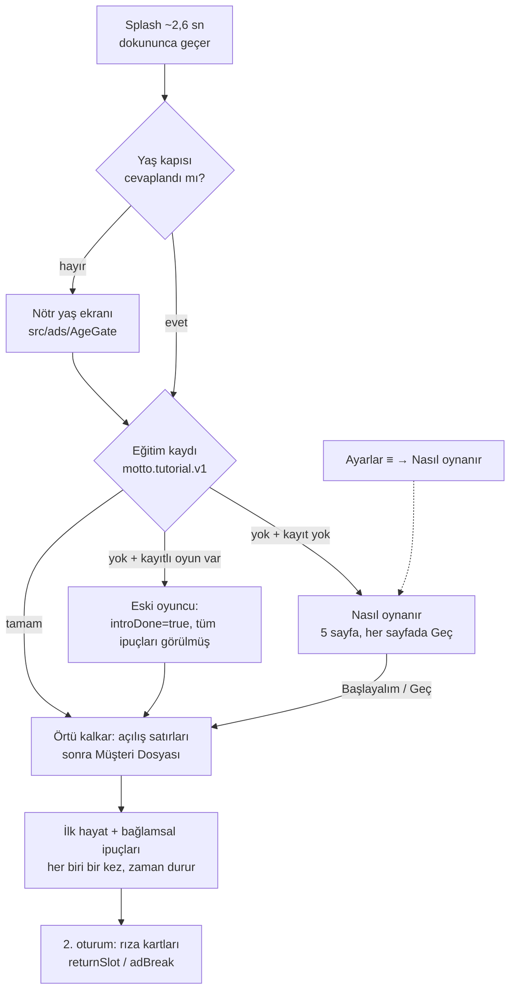

# 18 — Eğitim ve İlk Kullanım (Nasıl Oynanır + İpuçları)

> **Tetikleyen:** sahip geri bildirimi (2026-11-13): *"Eğitim sayfası yapsana, insanlar anlamıyor ilk oynadığında."*
> **Kanıt:** `docs/playtest/2026-11-12-ux.md`, `-davranis.md`, `-deneyim.md` (aşağıda §2'de bulgu bulgu eşlendi).
> **Kod:** `apps/mobile/src/state/tutorial.ts` (saf mantık + mağaza), `src/state/tutorialRuntime.ts`, `src/components/TutorialIntro.tsx`, `src/components/CoachMark.tsx`, `src/screens/LifeScreen.tsx` (sıralama ve tetikler), `src/components/SettingsSheet.tsx` (giriş), `src/state/useGame.ts` (`hold`, saat kapısı), `src/components/ActionZone.tsx` (kaydırarak seçim). Metinler `src/i18n/{tr,en}.ts → tutorial`.
> **Testler:** `apps/mobile/test/tutorial.test.ts` (24 test).

---

## 0. Karar ve önceki kararlarla ilişkisi

00 §"Tasarım ASLA'ları" listesinde **"onboarding/tutorial ekranı"** vardı; 07 §2.3.1 de *"Logo yok, onboarding yok, tutorial yok, tooltip turu yok"* diyordu. Gerekçe: ilk 60 saniyenin kendisi öğretici olsun, ilk kahkaha ≤ 4 sn gelsin.

Sahip geri bildirimi ve üç playtest raporu bu varsayımın tutmadığını gösteriyor: ilk yıl komik ve hızlı, ama **sistem katmanı açıklanmıyor** (zaman nasıl akıyor, neyi optimize ediyorum, Okunmamış ne, karne nerede, neden öldüm). Bu yüzden:

| No | Karar | Gerekçe |
|---|---|---|
| **D-ÖNERİ-18-01** | 00'daki "onboarding/tutorial ekranı" ASLA'sı şu biçimde daraltılır: **zorunlu, atlanamaz, uzun** eğitim yasak; **≤ 5 sayfalık, her sayfada Geç'i olan, bir kez gösterilen** "Nasıl oynanır" serbest. | Sahip talebi; UX #4/#5/#11/#14, davranış #3/#12. Atlanabilirlik ASLA'nın asıl kaygısını (oyuncuyu tutmak) karşılar. |
| **D-ÖNERİ-18-02** | "Tooltip turu yok" kuralı korunur: ipuçları **tur değil**, bağlama bağlı ve seyrek (ilk hayatta en fazla 5, aralarında en az bir oyun beat'i). | Playtest yorgunluğu; 07'nin "progressive disclosure" ilkesiyle uyumlu. |
| **D-ÖNERİ-18-03** | 07 §2.3 FTUE sayaçları (ilk kahkaha ≤ 4 sn, ilk karar ≤ 22 sn) **eğitim kapandıktan sonra** başlar (yaş kapısında olduğu gibi). | Ölçüm tutarlılığı; eğitimi atlayan oyuncu için süre değişmez. |
| **D-ÖNERİ-18-04** | Oklu (`swipe: left/right`) seçenekler **gerçekten kaydırılarak** da seçilir (≥ 72 px yatay sürükleme). | UX #20: oklar kaydırma vaat ediyordu ama çalışmıyordu; eğitim yalan söyleyemez. Dokunma aynen çalışır. |

**Güncellenmesi gereken belgeler (bu iş kapsamında düzenlenmedi):** 00 ASLA listesi, 07 §2.3.1 ilk paragraf ve "Skip kuralları" satırı, 07 AC-07-33 (sayaç başlangıcı).

---

## 1. Akış

- **Sıra:** splash → (yaş kapısı) → eğitim → ilk hayat. Oyun bu üçü kapanana kadar "örtülü"dür (`GameController.uncover` yalnızca eğitim kapanınca çağrılır); saat ve Otomatik çalışmaz.
- **Açılış satırları:** "18 oldun. Tebrikler…" ve "Ben Motto…" eskiden splash'in altında yazılıp bitiyordu; artık örtü kalkınca yazılıyor, sonra Müşteri Dosyası geliyor (07 §2.3.2'deki sıra). Yan etki: Dosya, örtü kalktıktan ~1,7 sn sonra görünür.
- **Rıza kartlarıyla çakışma yok:** rıza/ATT/analitik istemi yalnızca 2. oturumdan itibaren `returnSlot` içinde, `adBreak=true` iken gelir. İpucu tetiği `adBreak`, `offer`, `session`, `moment`, `ageUp`, büyük damga, Ayarlar ve Mağaza açıkken **hiç değerlendirilmez**; ilk hayat 2. oturuma taşarsa ipucu, rıza akışı bitip beat'ler yeniden aktıktan sonra gelir. Eğitim ilk açılışta, rıza ise 2. oturumda olduğundan ikisi asla üst üste binmez.
- **Uygulama eğitim ortasında kapatılırsa:** kayıt yazılmamıştır, bir sonraki açılışta eğitim baştan gelir.
- **Dil:** eğitim TopBar'ı örttüğü için kendi TR/EN düğmeleri vardır (oyunun dil ayarını değiştirir).

---

## 2. Neden bu içerik: playtest bulguları → çözüm

| Playtest bulgusu | Ne anlaşılmadı | Eğitimdeki karşılığı |
|---|---|---|
| UX #4 (Yüksek) takvim tutarsız, "zamanın nasıl aktığını anlamaz" | Zaman kendi akıyor mu, ben mi ilerletiyorum | Sayfa 2 "Zaman kendi akar" + ipucu **speed** |
| UX #5 (Yüksek) dört stat sözlüğü, "neyi optimize ettiğini bilmiyor" | Çubuklar ne, hangisi önemli | Sayfa 4 lejant (HUD ile aynı adlar, `s.stat`) + ipucu **stats** |
| UX #6 / davranış #12 / deneyim #2 ölüm habersiz | Sağlık biterse ne olur | Sayfa 4 "Sağlık: biterse hayat biter" + ipucu **stats** aynı cümle |
| UX #8 (Yüksek) karne "Bir Yıl Daha"nın altında kalıyor | Doğum günü = karne; okumadan geçiliyor | Sayfa 5 + ipucu **report** (karneyi çerçeveler, zaman durur) |
| UX #11 Okunmamış açıklamasız, kaygı yaratıyor | Görev mi, gelen kutusu mu | Sayfa 4 "Okunmamış: aile grubu; dokunursan anlatırım" + ipucu **meters** |
| UX #12 iddia/damga neye ait, ne kazanıyorum | İddia mekaniği | Sayfa 3 "Oran fişte yazar; sonucu damgayla basarım" + çizimde gerçek fiş |
| UX #14 "Otomatik" açıklamasız | Otomatik ne yapar | Sayfa 3 dipnot "Otomatik: seçimleri ben yaparım. Önermem." |
| UX #20 oklar kaydırma vaat ediyor | Kaydırılır mı | D-ÖNERİ-18-04 + sayfa 3 + ipucu **choices** |
| UX #9 hız kontrolü küçük/uzakta | II'nin varlığı | ipucu **speed** kontrolü çerçeveler |
| Davranış #17 sağlıklı durma ipuçları | "Bugünlük yeter" kaydeder mi | Sayfa 5 son satır |
| Davranış #13 / UX #17 ölüm → yeni hayat | Ölümden sonra ne olur | Sayfa 5 "Sonra yeni müşteri, yeni hayat" |

Bilerek **dışarıda bırakılanlar:** Hızlı yaşa (Dosya'da zaten etiketli; ikinci hayatta anlamlı), Defter/Tercüme (kendini anlatıyor), Anne Arıyor (overlay kendini anlatıyor), mağaza. Eğitim sistemi öğretir, içeriği spoilerlamaz.

---

## 3. Eğitim sayfaları (Nasıl oynanır / How it works)

Her sayfa: küçük bir çizim (gerçek UI parçalarının kâğıt/damga üslubunda kopyası, aynı renk ve fontlar) + başlık + en fazla üç kısa satır. Duvar metni yok. Alt bölüm: sayfa noktaları (her biri 44×44 dokunma alanı), **Geri** (2. sayfadan itibaren), **İleri** / son sayfada **Başlayalım** (Ayarlar'dan açılınca **Oyuna dön**). Üst sağda her sayfada **Geç**. Yatay kaydırma ile de sayfa değişir.

| # | Çizim | TR | EN |
|---|---|---|---|
| 1 `what` | Koç yüzü + Müşteri Dosyası kâğıdı, "YENİ MÜŞTERİ" damgası | **Ben Motto. Hayat koçun.** Bir hayat yaşatıyorsun: 18 yaşından son güne kadar. · Ben anlatırım, sen seçersin, defter not alır. · Sertifikam yok. Ücretim de ona göre: bedava. | **I'm Motto. Your life coach.** You run one life, from eighteen to the last day. · I narrate, you choose, the notebook keeps score. · No certificate. Priced accordingly: free. |
| 2 `time` | Tarih pill'i "GÜN 1 · 3 MART · SALI" + dolan gün çubuğu (döngü) + II ▶ ▶▶ (▶ seçili) + "II → ERTESİ GÜN" | **Zaman kendi akar.** Günler kendiliğinden geçer. Üstteki çizgi günün saati. · II durdurur, ▶ normal, ▶▶ hızlı. Durunca Ertesi Gün düğmesiyle sen ilerletirsin. · Okumaya vakit lazımsa II. Ayıp değil. | **Time runs by itself.** Days pass on their own. The line up top is the day's clock. · II stops it, ▶ is normal, ▶▶ is fast. Stopped, you move on with Next Day. · Need time to read, hit II. No shame. |
| 3 `cards` | "OLAY · ANNE" kartı (FTUE Gün 1 metni) + sarı iddia fişi ve gerçek oran + iki oklu seçenek sağa-sola sallanır, "‹ kaydır ›" | **Kart gelir, zaman durur.** Bir şey olunca kart açılır; sen seçene kadar beklerim. · Seçeneğe dokun. Oklu seçenekler sola ya da sağa kaydırınca da seçilir. · Bazen iddiaya girerim. Oran fişte yazar; sonucu damgayla basarım. — *Otomatik: seçimleri ben yaparım. Önermem.* | **A card comes up, time stops.** When something happens, a card opens and I wait for you. · Tap a choice. The ones with arrows also take a swipe left or right. · Sometimes I wager against you. Odds are on the slip; the stamp says who won. — *Auto: I make the choices. Not recommended.* |
| 4 `stats` | HUD'un birebir kopyası: ◆ 1.200 · Okunmamış 9 ⓘ · Anne Baskısı 40 · Cringe 12 + dört çubuk | **Dört çubuk, birkaç sayaç.** Sağlık: biterse hayat biter. · Keyif: moral. Düşükken her şey zor. · Kafa: okul, iş, akıl. · Çekicilik: insanlar seni nasıl görür. · ◆ paran. Anne Baskısı ve Cringe: düşük olan iyi. Okunmamış: aile grubu; dokunursan anlatırım. | **Four bars, a few counters.** Health: runs out, life's over. · Joy: morale. Low, and everything's harder. · Brain: school, work, wits. · Looks: how people see you. · ◆ is money. Mom Pressure and Cringe: lower is better. Unread: the family chat; tap it and I'll explain. |
| 5 `life` | Mini karne (4 not, "Başladı. Teknik olarak." lime şerit, İŞLENDİ) + KAPANDI → YENİ MÜŞTERİ | **Doğum günü karne. Sonu yeni müşteri.** Her doğum günü karne gelir: yılın notları ve mottosu. Bir Yıl Daha ile devam. · Bir gün dosya kapanır. Herkesinki kapanır. Sonra yeni müşteri, yeni hayat. · Bugünlük yeter dersen kaydederim; kaldığın günden devam. | **Birthdays bring a report card. The end brings a new client.** Each birthday: the year's grades and its motto. One More Year to keep going. · One day the file closes. Everyone's does. Then a new client, a new life. · Enough for today saves it; you pick up on the same day. |

Sabit metinler: TR `Nasıl oynanır · Geç · İleri · Geri · Başlayalım · Oyuna dön · Sayfa i/n` — EN `How it works · Skip · Next · Back · Let's begin · Back to the game · Page i of n`.

**Ton (01 §2.8):** ünlem yok, uzun tire yok, "yapmalısın" yok, soru işareti yok, emoji yok (◆ ve ▶ UI glifi). Koçun kuruluğu her sayfada en fazla bir vuruşta ("Ücretim de ona göre: bedava.", "Ayıp değil.", "Önermem.", "Herkesinki kapanır."); açıklayıcı cümleler düz ve somut. Ölüm satırı (sayfa 5) 01 §2.10'a uygun: şakasız, kuru, kısa. EN metinler çeviri değil, ayrı yazıldı (01 §2.8.3 #10): "Priced accordingly: free.", "No shame.", "Everyone's does."

---

## 4. Bağlamsal ipuçları (yalnızca ilk hayat)

Bir ipucu = ekran kararır, **gerçek** UI parçası lime çerçeveyle açık kalır, yanında Motto'dan tek satır ("MOTTO'DAN NOT" etiketi + "Dokun, devam."). Ekranın herhangi bir yerine dokunmak kapatır. Açıkken **saat ve Otomatik durur** (`game.hold('tutorial', true)`); kuyruktaki beat'ler zaten bitmiştir (tetik `busy=false` ister).

| Öncelik | id | Tetik (hepsi: ilk hayat, Otomatik kapalı, beat yok, üstte başka katman yok) | Çerçeve | TR | EN | Bağlı bulgu |
|---|---|---|---|---|---|---|
| 1 | `report` | İlk doğum günü: karne + Bir Yıl Daha ekranda | En yeni karne | Doğum günü: yılın karnesi. Notları ve mottoyu oku; hazır olunca Bir Yıl Daha. | Birthday: the year's report card. Read the grades and the motto, then One More Year. | UX #8 |
| 2 | `choices` | İlk karar kartı, seçenekler ekranda | Seçenek paneli | Kart açıkken zaman durur. Seçeneğe dokun; oklu olanlar kaydırınca da seçilir. | Time stops while a card is open. Tap a choice; the arrowed ones also swipe. | UX #20, #13 |
| 3 | `stats` | Dört çubuktan biri ilk kez değişti (float göründü), kart kapalıyken | Stat satırı | Seçimlerin bu dört çubuğu oynatır. Sağlık biterse hayat biter. | Your choices move these four bars. Health runs out, life runs out. | UX #5, #6; davranış #3 |
| 4 | `speed` | Saat gerçekten akıyor (ilerleme > %5, ⏸ değil) ve ≥ 2. gösterilen gün | II ▶ ▶▶ | Zaman kendi akar. II durdurur, ▶ normal, ▶▶ hızlı. Okumaya vakit lazımsa II. | Time runs by itself. II stops it, ▶ is normal, ▶▶ is fast. Need to read, hit II. | UX #4, #9 |
| 5 | `meters` | İlk para değişimi (para float'ı ya da maaş/kira/harçlık satırı) ve ≥ 3. gün; değilse en geç 6. gün; kart kapalıyken | Para + sayaç satırı | ◆ paran. Anne Baskısı ve Cringe: düşük olan iyi. Okunmamış'a dokunursan anlatırım. | ◆ is your money. Mom Pressure and Cringe: lower is better. Tap Unread and I'll explain. | UX #11; davranış #9 |

**Seyreklik kuralları (playtest yorgunluğu):**
- Her ipucu **bir kez**; gösterildiği anda "görüldü" yazılır (uygulama ipucu açıkken öldürülse bile tekrar çıkmaz).
- Arka arkaya iki ipucu yok: bir ipucu kapandıktan sonra sıradaki ancak **yeni bir beat dizisi bittikten sonra** (`epoch > lastHintEpoch`) gelebilir. Pratikte: Gün 1 kartı → `choices`; cevap → sonuç → `stats` (çubuk değiştiyse); 2. gün akarken `speed`; 3.–6. gün `meters`; ilk doğum günü `report`. Playwright koşusunda ilk ~90 saniyede 4 ipucu, ilk doğum gününde 5.
- Otomatik açıkken ipucu yok (bekler; Otomatik kapanınca gelir).
- Eğitimi **atlayan** oyuncu ipuçlarını yine görür: en çok onların ihtiyacı var.
- Mevcut oyuncular (kayıtlı oyunu olan) ipucu görmez.
- Ayarlar → **İpuçlarını sıfırla**: hepsi bir kez daha çıkabilir, ilk hayatta olmasa da (`replayHints`); beşi de yeniden görülünce bayrak kendiliğinden kalkar.

**Yerleşim:** çerçeve hedefin ölçülen dikdörtgeni (+6 px), pencere koordinatında ölçülür ve telefon çerçevesine kırpılır (uzun karne görünen kısmıyla çerçevelenir). Balon hedefin altına sığarsa alta, yoksa üstüne, o da olmazsa en alta konur. Hedef ölçülemezse balon ortada, çerçevesiz çıkar (asla takılmaz).

**Bilinçli olarak ipucu olmayanlar:** Okunmamış'ın kendisi (ⓘ zaten açıklıyor; `meters` oraya yönlendiriyor), iddia damgası (07 juice'u açıklıyor + sayfa 3), ölüm (DeathFlow; sayfa 5), Anne Arıyor, efsane gün.

---

## 5. Ayarlar girişi

Ayarlar (≡) sayfasının en üstünde iki satır:

| Satır | TR | EN | Davranış |
|---|---|---|---|
| Nasıl oynanır | "Eğitim sayfalarını baştan gösterir." [Göster] | "Shows the intro pages again." [Show] | Ayarları kapatır, eğitimi açar; zaman durur; son düğme "Oyuna dön". İlk bitişin nasıl olduğu (bitti/geçildi) değişmez. |
| İpuçlarını sıfırla | "Ekrandaki kısa notlar bir kez daha çıkar." [Sıfırla → Sıfırlandı] | "The short on-screen notes come back once more." [Reset → Done] | §4 son madde. Hemen ipucu patlatmaz; bir sonraki beat'ten sonra uygun olan gelir. |

Her iki satır eski oyunculara da görünür (sahip isteği: "zorlanmasınlar ama girişi olsun").

---

## 6. Kalıcılık

- Anahtar: **`motto.tutorial.v1`** (oyun kaydından ayrı: içerik değişince düşen kayıt eğitimi tekrar oynatmaz; eğitim sıfırlaması hayata dokunmaz).
- Şema: `{ v: 1, introDone: boolean, via?: 'done' | 'skip' | 'legacy', hints: HintId[], replayHints?: true }`. Bilinmeyen ipucu id'leri ve tekrarlar okunurken atılır; bozuk JSON = kayıt yok.
- **Eski oyuncu tespiti** (anahtar yoksa, bir kez): `motto.save.v1` içinde bir hayat varsa (`life` nesne) ya da `meta.legacy.livesCompleted > 0` ise → `{ introDone: true, via: 'legacy', hints: hepsi }` yazılır. Yalnızca Müşteri Dosyası'nı görmüş (hayatı başlatmamış) bir kayıt yeni oyuncu sayılır. Bilerek `decodeSave` kullanılmaz: motor/içerik değişince geçersiz sayılan bir kayıt da oyuncunun oyunu bildiğini kanıtlar.
- Depolama hiç çalışmıyorsa (gizli sekme, modül yok) eğitim her açılışta gelir ama oyunu bozmaz (tüm okuma/yazmalar `storage.ts` korumalı).

---

## 7. Ölçüm: FTUE hunisi ve izlenecek metrikler

**Analitik durumu:** `src/analytics` içinde eğitim/ipucu için hazır bir yardımcı yok (mevcut `tutorial_begin`/`tutorial_complete` = ilk hayat FTUE hunisi, `ftue_*` adımları). Bu iş kapsamında `src/analytics`'e dokunulmadı; `TutorialStore` `onEvent` kancasıyla hazır (`intro_open {replay}`, `intro_done {page, replay}`, `intro_skip {page, replay}`, `hint {id}`), `tutorialRuntime.ts`'te TODO notu var. Önerilen olaylar (11/17 şemasına eklenmeli):

| Olay | Parametre | Not |
|---|---|---|
| `ftue_intro_open` | `replay: bool` | ilk açılışta 1 kez; Ayarlar'dan her açılış `replay=true` |
| `ftue_intro_done` / `ftue_intro_skip` | `page: int` (0–4), `ms` | Geç'e basılan sayfa = terk noktası |
| `ftue_hint` | `id` (`choices`/`stats`/`speed`/`meters`/`report`), `ms` | gösterim anı |
| `settings_change` | `setting: 'hints_reset'` | enum'a eklenmeli |

**Huni (kurulum kohortu):** app_first_launch → yaş kapısı geçti → `ftue_intro_open` → `ftue_intro_done` ∪ `ftue_intro_skip` → `ftue_life_start` → `ftue_decision` → `ftue_hint{choices}` → `ftue_stamp` → `ftue_report_card` (`tutorial_complete`) → D1.

| Metrik | Hedef / alarm | Neden |
|---|---|---|
| Eğitimi bitiren (`done`) / açan | ≥ %55; < %35 alarm | Çok düşükse sayfalar uzun ya da sıkıcı |
| Geç sayfası dağılımı | Geç'lerin ≥ %50'si 1. sayfada normal; 3.–4. sayfada yığılma = içerik sorunu | Hangi sayfa bıktırıyor |
| Eğitim süresi (medyan) | 20–45 sn | > 60 sn: metin çok |
| `ftue_life_start` / `ftue_intro_open` | ≥ %92 | Eğitim terk ettiriyorsa burada düşer |
| TTFD (`ftue_decision.ms`, eğitim süresi düşülmüş) | 07 hedefi korunur (≤ 22 sn, sert 30) | D-ÖNERİ-18-03 |
| FTUE tamamlama (`ftue_report_card` / açılış) | 07 §: ≥ %80 | Eğitim öncesi kohortla A/B kıyas |
| İlk hayatta ⏸ kullanımı, ▶▶ kullanımı | artmalı (speed ipucu sonrası) | UX #4/#9 anlaşıldı mı |
| Okunmamış'a dokunma oranı | artmalı | UX #11 |
| Ayarlar → Nasıl oynanır açılma oranı | izlenir; yüksekse eğitim yetersiz | Sahip sorusunun kendisi |
| D1, D7 (eğitimli vs. eğitimsiz kohort) | D1 ≥ eski kohort | Asıl başarı ölçütü |

**Uzaktan ayar önerisi (ileride):** `tutorial_enabled` (A/B), `hint_set` — şimdilik kodda sabit.

---

## 8. Erişilebilirlik ve düzen

- Tüm dokunma hedefleri ≥ 44 pt (Geç, dil düğmeleri, noktalar, Geri 58 pt, İleri/Başlayalım 58 pt).
- 390×844 ve 360×740'ta yatay taşma yok (Playwright `scrollWidth ≤ innerWidth`, 5 sayfa); içerik `ScrollView` içinde, küçük ekranda dikey kayar.
- Başlıklar `accessibilityRole="header"`; çizimler ekran okuyucudan gizli (metin her şeyi söylüyor); nokta satırı `progressbar` + "Sayfa 2/5"; eğitim ve ipucu katmanı `accessibilityViewIsModal`; ipucu açılınca satır `announceForAccessibility` ile okunur, katmanın etiketi "satır + Dokun, devam."
- Azaltılmış hareket: çizim animasyonları durur (sabit kare), sayfa geçişi ve ipucu belirişi animasyonsuz.
- Renk: çerçeve lime (#c9ff3a) koyu zemin üstünde; metin ink (#f1eee2), kontrast > 12:1.

---

## 9. Kabul kriterleri ve testler

| AC | Ölçüt | Nasıl |
|---|---|---|
| AC-18-01 | Yeni kurulumda eğitim splash + yaş kapısından sonra, Müşteri Dosyası'ndan önce bir kez görünür; bitince/geçince kaydedilir ve bir daha gelmez. | `tutorial.test.ts` "intro: once per fresh install"; Playwright yeniden yükleme |
| AC-18-02 | Kayıtlı oyunu olan oyuncuya eğitim ve ipucu gösterilmez; Ayarlar girişi çalışır. | "existing players" (4 test) |
| AC-18-03 | Ayarlar → Nasıl oynanır eğitimi açar, saati tutar, ilk bitiş türünü değiştirmez. | "replay from Settings"; Playwright |
| AC-18-04 | Her ipucu bir kez; kalıcı; sıfırlanınca bir kez daha. | "hints: each shown once, persisted"; Playwright "no hint shown twice" |
| AC-18-05 | İpucu açıkken saat ilerlemez. | "time is paused…" (`clockMayRun` + mağaza simülasyonu); Playwright HUD saati 3 sn sabit |
| AC-18-06 | İki ipucu arasında en az bir beat; tetikler §4 tablosundaki gibi. | "hint triggers" (8 test) |
| AC-18-07 | Tüm satırlar TR+EN, ≤ 22 kelime, "!" ve "—" yok. | i18n testleri |
| AC-18-08 | 360 genişlikte taşma yok; tüm hedefler ≥ 44 pt. | Playwright |
| AC-18-09 | Oklu seçenek ≥ 72 px kaydırmayla seçilir. | Playwright (`swipe-check`) |

---

## 10. Açık konular

1. **00 / 07 metinleri** D-ÖNERİ-18-01..04'e göre güncellenmeli (bu iş belge 18 dışında tasarım belgesine dokunmadı).
2. **Analitik olayları** §7 tablosu 11/17 şemasına eklenip `tutorialRuntime.ts` `onEvent`'e bağlanmalı.
3. **İlk hayat 2. oturuma taşarsa** ipucu, `returnSlot` (rıza / reklam) bittikten sonra gelir; bu doğru ama Playwright ile 2. oturum senaryosu henüz koşulmadı.
4. **Kaydırma** yalnızca seçenek paneli üstünde çalışır (kartın kendisi değil); Reigns tarzı kart sürükleme ve D-069 "etkilenecek stat noktaları" ayrı iş.
5. Metinler yerel konuşur gözünden geçmeli (özellikle EN "Looks" = Çekicilik; HUD etiketi zaten böyle).
6. Uzaktan ayar (`tutorial_enabled`) ile A/B yapılmadan eğitimin D1 etkisi ölçülemez; ilk sürümde eğitimli/eğitimsiz kohort kıyası için yayın tarihi kesim noktası kullanılabilir.
