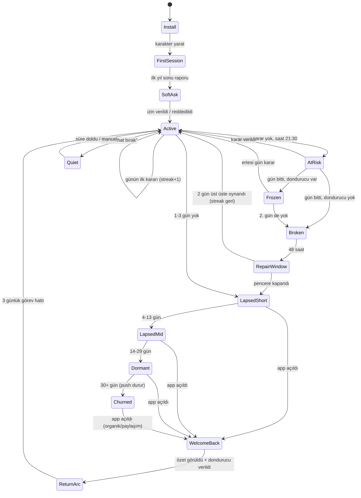

# T7 — Geri Dönüş Döngüsü ve Backend'siz Live-Ops

**Konu:** Bildirimler, günlük/haftalık içerik, "sen yokken hayat devam etti", streak tasarımı, oturum uzatma
**Proje:** 18 yaşında başlayan, kara mizahlı, "taşak geçen ama motive eden" mobil hayat simülasyonu (iOS + Android, backend yok, Expo/React Native, solo geliştirici + AI ajanlar)
**Tarih:** 2026-11-05 · **Durum:** Araştırma dokümanı v1

---

## TL;DR

- **Backend'siz oyunda tek "live-ops" kanalımız cihazın kendisidir:** local push (expo-notifications), tarih tohumlu (date-seeded) içerik ve EAS Update ile OTA içerik paketi. Bu üçlü doğru kurgulanırsa, server'lı rakiplerin yaptığı geri dönüş döngüsünün %80'ini sıfır sunucu maliyetiyle yaparız.
- **iOS'ta bekleyen local bildirim tavanı 64**; Android'de exact alarm izni Android 14+'ta yeni kurulumlara varsayılan kapalı, Doze alarmları erteler, 3 ay dokunulmayan uygulama "hibernation"a girip bekleyen bildirimleri kaybedebilir. Çözüm: her app açılış/kapanışında **"cancelAll + en yakın 12–15 bildirimi yeniden kur"** ritüeli.
- **İzin isteme zamanı opt-in'i belirler:** Sektör medyanı iOS ~%49, Android ~%53 (Airship 2025); oyun kategorisi çok daha düşük (iOS ~%21 / Android ~%28, ikincil kaynak). Soft-ask + "değer anı" (ilk yıl sonu cliffhanger'ı) ile +%30–50 kabul artışı raporlanıyor.
- **Frekans tavanı hayat kurtarır:** haftada 6+ push alanlarda 30 gün içinde uninstall 3,4 kat (Klaviyo'ya atfedilen, ikincil); haftada 2–5 push ile kullanıcıların ~%46'sı bildirimleri kapatıyor (Localytics, eski). Bizim tavan: **günde 1, haftada 5, 22:30–09:00 sessiz saat, lapsed kullanıcıda azalan kadans.**
- **Ton = Duolingo'nun baykuşu + Carrot Weather'ın kişiliği, ama suçluluk yerine "hayat devam ediyor" çerçevesi.** Bildirim, pazarlama mesajı değil; oyun içindeki karakterin hayatından gelen bir "haber" olmalı ("Annen 14 kez aradı").
- **Günlük/haftalık içerik backend istemez:** `hash(tarih + içerik sürümü)` ile deterministik "Bugünün Hayatı" (ör. *sosyal fobik DJ*) ve "Haftanın Hayatı" üretilir; Spelunky/Wordle modeli. Herkes aynı günü yaşar → paylaşılabilir karşılaştırma kartı.
- **Sezonluk takvim uygulamayla gemiye biner, tarihle kilidi açılır:** Yılbaşı, Sevgililer, 1 Nisan, Ramazan/Kurban Bayramı, Anneler Günü, YKS haftası, 29 Ekim, Halloween, Black Friday, "maaş günü" (her ayın 15'i). Yeni içerik: store update + EAS Update (runtime version eşleşmeli) + opsiyonel static JSON.
- **"Sen yokken hayat devam etti" = suçlandırmayan welcome-back.** Yokluk süresini oyun-içi zamana çevir (gerçek 3 gün → oyunda 3 ay), 40 saniyelik "ne kaçırdın" özeti, affedici ödül; kayıp değil, hikâye biriktir. Duolingo Weekend Amulet: +%4 geri dönüş, −%5 streak kaybı.
- **Streak'i "oynanan gün" değil "verilen karar" üzerinden say;** 2 otomatik dondurucu, 48 saat "streak onarım" penceresi, kilometre taşları 3-7-14-30-66-100-365. Lally (2010): tek bir atlanan gün alışkanlık otomatikliğini bozmuyor → tasarım bunu kullanıcıya açıkça söylesin.
- **Uzun oturumun motoru "bir yıl daha" düğmesidir:** her yıl sonu raporu bir cliffhanger teaser'ıyla biter, yıllara yayılan arc'lar (3–7 yıl) açık uç bırakır, mini oyunlar (mülakat, yalan makinesi, pazarlık, anneyle telefon) ritmi kırar. BitLife referansı: günde ~34 dk, 5 oturum, D7 ~%15 (Gamigion, ikincil).
- **Her oturum bir paylaşım kartıyla biter:** "Hayatım 1 Sayfada" (9:16 TikTok/Story + 1:1), ölüm ilanı kartı, "aynı hayatı sen de yaşa" seed kodu (HYT-XXXX). Wordle'ın emoji grid'i gibi: Unicode + görsel, sunucu yok.
- **KPI'lar lokal analytics SDK'sı ile izlenir (opsiyonel, oyunu bloklamaz):** opt-in oranı, push open rate, push-kaynaklı oturum payı, push sonrası 24 saat uninstall, streak≥3 DAU payı, welcome-back tamamlama, share export oranı, D1/D7/D30.
- **Hedef bantlar (narrative sim için iddialı ama gerçekçi):** D1 ≥%40, D7 ≥%15, D30 ≥%6; oturum medyanı ≥12 dk; günde ≥3 oturum; push open ≥%8 (bağlamsal push'ta ≥%12).
- **Etik çizgi:** Apple 4.5.4 ve Google Play "sistem bildirimi sadece entegre özellikler için" kuralı; push oyunu oynamak için şart değil, pazarlama push'u ayrı opt-in, sahte aciliyet yok (streak-at-risk sadece gerçekten risk varsa), tek dokunuşla "Beni rahat bırak" modu.

---

## 0. Varsayımlar

1. Teknoloji yığını Expo SDK 52+ (React Native), `expo-notifications`, `expo-updates` (EAS Update), `expo-sharing`, `react-native-view-shot`, lokal kayıt için SQLite/MMKV. Development build kullanılıyor (Expo Go değil; Android'de remote push SDK 53'ten beri Expo Go'da yok, local push var).
2. Backend yok; ancak ücretsiz statik barındırma (GitHub Pages / Cloudflare Pages / CDN) "opsiyonel okuma kanalı" olarak kabul edilebilir çünkü sunucu mantığı içermez.
3. Analytics SDK (ör. Firebase/Amplitude) opsiyonel; oyun offline tamamen oynanabilir.
4. Anlatıcı sesi: ikinci tekil şahıs, alaycı, küfürsüz ama acımasız. Bildirim metinleri mağaza/OS yüzeyinde göründüğü için **küfür yok, hakaret yok, "hafif yaş sınırı 12+" toleransı.**
5. Oyuncu adı ve karakter adı farklı olabilir; bildirimlerde `{ad}` = oyuncu, `{karakter}` = oyun içi karakter.
6. Oyun döngüsünün çekirdeği "yıl" birimidir (BitLife modeli): her yıl 3–6 storylet + yıl sonu raporu. Bu doküman diğer konu dokümanlarındaki (T1–T6, T8) sistem kararlarını önceden varsaymaz; çakışırsa GDD sentezinde çözülür.
7. İlk pazar Türkiye; tarih/tatil takvimi TR odaklı, sonra EN lokalizasyonuyla genişler.

---

## 1. Backend'siz Local Push Stratejisi

### 1.1 Teknik zemin: expo-notifications ne yapabiliyor

`expo-notifications` local bildirimleri `scheduleNotificationAsync({ content, trigger })` ile planlar. Tetikleyici tipleri (SDK tip dosyasından): `DATE`, `TIME_INTERVAL` (repeats destekli), `DAILY` (hour/minute), `WEEKLY` (weekday 1=Pazar…7), `MONTHLY`, `YEARLY`, `CALENDAR` (iOS; year/month/weekday/weekOfMonth vb.). Android'de `channelId` ve `delivery` alanı var: `'bestEffort'` (varsayılan) `setExactAndAllowWhileIdle()` kullanır, exact alarm izni yoksa "sistem bildirimi istenen zamandan geç teslim edebilir"; `'alarmClock'` ise `setAlarmClock()` kullanır ve `SCHEDULE_EXACT_ALARM`/`USE_EXACT_ALARM` ister — Google Play `USE_EXACT_ALARM`'ı sadece alarm/takvim uygulamalarına izinli kılıyor, dolayısıyla **bizim için yok** [1][2].

İçerik alanları: `title`, `subtitle`, `body`, `data` (görünmez payload — hangi ekrana derin bağlantı), `badge`, `sound` (false = sessiz), iOS `attachments` (görsel/ses), iOS `interruptionLevel` (`passive | active | timeSensitive | critical`), `categoryIdentifier` (aksiyon butonları), `threadIdentifier` (gruplama), Android `color`, `priority`, `vibrate`, `sticky`, `autoDismiss` [2].

İzinler: iOS tarafında `allowProvisional` ("Notification Center'a sessizce, kesintisiz bildirim gönderme yetkisi"), `allowAlert/allowBadge/allowSound`, `provideAppNotificationSettings`; durum `ios.status` → `NOT_DETERMINED | DENIED | AUTHORIZED | PROVISIONAL | EPHEMERAL` [3]. Android'de izin istemi "en az bir notification channel oluşturulmadan görünmez" [1].

| Yetenek | iOS | Android | Bizim kullanım |
|---|---|---|---|
| Belirli tarih/saat | ✅ | ✅ (bestEffort = exact-if-allowed) | Ladder, streak-at-risk |
| Günlük/haftalık tekrar | ✅ | ✅ | "Günün ilk kararı" hatırlatıcısı |
| Takvim eşleşmesi | ✅ CALENDAR | ❌ (DATE ile emüle) | Sezonluk |
| Görsel ek | ✅ attachments | ⚠️ sınırlı (largeIcon/renk) | Share-card önizleme, karakter portresi |
| Aksiyon butonları | ✅ categories | ✅ | "Kararı ver" / "Yarın hatırlat" |
| Sessiz teslim | ✅ provisional/passive | ✅ düşük importance kanal | Lapsed kullanıcı, "fısıltı modu" |
| Bekleyen limit | **64** | ~500 (ikincil) | Rolling window (bkz. 1.2) |

### 1.2 Platform sınırları ve tuzaklar

- **iOS 64 bekleyen bildirim tavanı:** 64'ten fazlasını planlarsanız sistem en yakın 64'ü tutar; geliştirici forumlarında "65. bildirimden sonra hiçbiri gelmedi" vakaları da var [4][5]. Kural: **asla 64'e yaklaşma; 12–15 aktif bildirimle çalış, her foreground/background geçişinde yeniden kur.**
- **Android exact alarm (12+/14+):** Android 14 `SCHEDULE_EXACT_ALARM`'ı Android 13+ hedefleyen yeni kurulumlara varsayılan vermiyor; yedekten geri yüklemede de izin kapalı kalıyor [6]. Expo `getExactAlarmPermissionsAsync` / `requestExactAlarmPermissionsAsync` sunuyor, ama kullanıcıyı sistem ayarına göndermek sürtünme. Karar: **exact alarm isteme; bestEffort'a razı ol, kopyayı "saat 21:00'de" değil "bu akşam" diye yaz.**
- **Doze:** Cihaz Doze'dayken sıradan alarmlar ertelenir; `setAndAllowWhileIdle` türevleri muaf ama Doze sırasında uygulama başına 15 dakikada 1 ile sınırlı; bildirimler cihazı Doze'dan çıkarmaz [7]. Pratik: iki bildirimi 15 dakikadan yakın planlama.
- **Hibernation / unused app:** 3 ay etkileşim yoksa sistem uygulamayı hibernation'a alıp bekleyen bildirimleri iptal edebiliyor; cihaz yeniden başlatma ve force-stop da alarmları siler (Cordova plugin dokümanı aynı Android davranışını not ediyor) [5]. Sonuç: **30 günden uzun lapsed ladder'a güvenme; en uzun planlı bildirim D30.**
- **Android 13+ POST_NOTIFICATIONS:** Runtime izin; Batch verisine göre Android ortalama opt-in bir yılda %85 → %67'ye düştü [8]. Android'de de artık soft-ask şart.
- **Android 15 Notification Cooldown:** Aynı uygulamadan art arda gelen bildirimlerin sesi kademeli kısılıyor, varsayılan açık [9]. Ard arda bildirim göndermek fiziksel olarak da cezalandırılıyor.
- **iOS provisional:** `allowProvisional` ile izin istemeden Notification Center'a sessiz bildirim; kullanıcı "Keep" / "Turn Off" seçer [10]. Oyunlar için iki ucu keskin: opt-in prompt'u atlatır ama kilit ekranında banner yok, ses yok. Bizim kullanımı: **soft-ask'ı reddeden kullanıcı için ikinci şans** (bkz. 1.3).
- **`timeSensitive` ve `critical`:** Oyun için uygun değil (entitlement + politika riski). Yalnızca `active`, lapsed'de `passive`.

### 1.3 İzin isteme zamanı ve opt-in benchmark'ları

Sayılar (kaynaklar vendor raporları; medyan/ortalama farkına dikkat):

| Kaynak | iOS | Android | Not |
|---|---|---|---|
| Airship 2026 raporu (2025 verisi, medyan) | %48,85 | %53,3 | tüm sektörler [11] |
| Batch 2025 (ortalama) | %56 | %67 (↓ %85'ten) | Android 13 etkisi [8] |
| Business of Apps 2025 | %48,9 | — | 2021'de %51,2 [12] |
| Oyun kategorisi (ikincil, doğrulanamadı) | ~%20,6 | ~%27,8 | [13] |
| Eğitim kategorisi | %76 | — | en yüksek; Duolingo etkisi [12] |

Soft-ask (ön-izin ekranı) etkisi: NHL soft-ask ile +%36 opt-in (Airship vaka) [14]; Airship, daha önce reddedenlere in-app mesajla +%14 ortalama kazanım [14]; Pushwoosh'a atıfla "sonra hatırlat" seçenekli soft-ask sistem prompt kabulünü %30–50 artırıyor [15]; Plotline "2–3x" diyor ama kaynak göstermiyor [16]. **Oyun kategorisinde taban düşük olduğu için soft-ask'ın göreli etkisi daha yüksek olmalı** — çünkü düşük tabanın sebebi genelde "açılışta cold prompt".

"Moment of value" seçimi — hangi an?

1. **İlk yıl sonu raporu** (ortalama 4–6 dk sonra): oyuncu ilk cliffhanger'ı yeni gördü. Soft-ask metni: *"{karakter}'in hayatı sen yokken de akacak. Önemli bir şey olunca haber vereyim mi? (Günde en fazla 1, gece yok, söz.)"* → Evet → sistem prompt. Hayır → `allowProvisional` ile sessiz mod denemesi yok, çünkü iOS'ta provisional ile normal prompt aynı anda olmaz; bunun yerine **D3'te ikinci soft-ask**.
2. **İlk streak-at-risk anı olamaz** (kullanıcı yok). Dolayısıyla ikinci soft-ask noktası: **ilk "bekleyen karar" bırakılarak çıkıldığında** (app background'a giderken in-app değil, bir sonraki açılışta).
3. **Üçüncü ve son:** 7 günlük streak rozetinde ("Rozeti korumak için hatırlatayım mı?").

Reddedenlerde `canAskAgain=false` olur; bir daha sormayız, Ayarlar'da "Bildirimler" satırı sistem ayarına yönlendirir. Apple 4.5.4: push oyunun çalışması için şart olamaz; pazarlama push'u sadece açık opt-in ve in-app opt-out ile [17]. Google Play: sistem bildirimleri yalnızca uygulamanın entegre özellikleri için; sistem uyarılarını taklit eden içerik yasak [18]. **Bizim push'ların tamamı oyun durumu bildirimi olarak kurgulanır; IAP/indirim push'u ayrı bir toggle'dır ve varsayılan kapalıdır.**

### 1.4 Ton: Duolingo, Carrot, Finch, Lifeline'dan ne alıyoruz

- **Duolingo:** Jorge Mazal'ın anlatımına göre ilk büyük kazanım "streak-saver" bildirimi; kopya ve zamanlama ML + bandit algoritmasıyla seçiliyor; 10 günlük streak'e ulaşanların düşme ihtimali belirgin azalıyor; CURR (current user retention) DAU'ya MAU'nun 6 katı etki ediyor [19][20]. Baykuşun "tehdidi" animasyon karakterden geldiği için yumuşuyor — akademik analizlerdeki tespit bu [21]. Ünlü "Bu hatırlatıcılar işe yaramıyor gibi, şimdilik susuyoruz" kopyası ise kendi sınırını komediye çeviren örnek. **Ders:** tehdidi karaktere, suçu hayata yükle; oyuncuya değil.
- **Carrot Weather:** Kişilik ayarı (profesyonel → hain) tüm kopyayı değiştiriyor; bildirimler 4.6'da eklendi ve kişilikle tutarlı [22][23]. **Ders:** "Anlatıcı sertliği" ayarı (Nazik / Normal / Acımasız) — bildirim tonunu da ölçekler; store incelemesi ve düşük yaş grubu için güvenlik sübabı.
- **Finch:** Suçlama yerine "evcil kuşa bakım" çerçevesi; mesajlar öz-bakım talebi gibi değil, kuşun ihtiyacı gibi hissettiriyor [24]. **Ders:** bildirimin öznesi {karakter}; "sen girmedin" değil "{karakter} bekliyor".
- **Lifeline (3 Minute Games):** Hikâyeyi push bildirimi üzerinden kurdu, iOS 8 kilit ekranı etkileşimi çıkış noktasıydı; %81 D1 retention raporlandı [25][26]. **Ders:** bildirim, hikâyenin devamı olabilir: "Telefonun çalıyor: arayan annen" + aksiyon butonları ("Aç" / "Meşgule at").

### 1.5 Kadans merdiveni ve frekans tavanı

Uninstall verisi (hepsi ikincil, yönsel): haftada 1 push ~%6 uninstall; haftada 6+ push → 30 gün içinde 3,4x uninstall (Klaviyo'ya atıf); haftada 2–5 push → %46 bildirim kapatma, 6–10 → %32 kullanımı bırakma (Localytics, eski) [27][28]. Öte yandan push alanların retention'ı almayanların ~2–3 katı (Airship 63M kullanıcı analizi, korelasyonel) [29][30]. Çıkarım: **az ama bağlamsal.** Batch 2025: tetiklenmiş bağlamsal push %14,4 open, genel push %4,19 [8]. Pushwoosh 2025: hypercasual oyunlarda CTR iOS %0,82 / Android %1,05 — "genel" oyun push'u berbat performans gösteriyor [31].

Tavanlar (sabit, koda gömülü):

| Kural | Değer |
|---|---|
| Günlük maksimum | 1 (streak-at-risk + ladder aynı güne denk gelirse ladder düşer) |
| Haftalık maksimum | 5 |
| Sessiz saatler | 22:30–09:00 lokal (kullanıcı değiştirebilir) |
| Lapsed azalma | D3→D5→D7→D14→D30, sonra sıfır |
| İki push arası min. | 20 saat |
| "Beni rahat bırak" | Tek dokunuş, 7/30 gün/süresiz |

### 1.6 Local save'den kişiselleştirme ve gün saati hedefleme

Backend'siz avantajımız: tüm oyun durumu cihazda. Her bildirim planlanırken save'den okunur:

- `{karakter}`, `{yaş}`, `{meslek}`, `{patron_adı}`, `{sevgili_adı}`, `{anne_durumu}`
- `{son_cliffhanger}`: yıl sonu raporundaki teaser metni (önceden yazılmış, bildirim uzunluğuna uygun ≤ 90 karakter)
- `{bekleyen_karar}`: oyuncu bir karar ekranında çıktıysa kararın başlığı
- `{streak_gün}`, `{en_uzun_streak}`, `{dondurucu_sayısı}`
- `{günlük_konsept}` / `{haftalık_konsept}`: tarih tohumundan üretilmiş (bkz. §2)

Gün saati: son 14 oturumun başlangıç saatlerinden histogram → en yoğun 2 saatlik pencere; bildirim o pencerenin **başında** planlanır (ör. oyuncu hep 21–23 arası oynuyorsa 20:55). Verisi olmayan yeni kullanıcı için varsayılan 20:30 (TR akşam dilimi). Streak-at-risk bildirimi ise sabit: **21:30** (gün bitimine 2,5 saat; sessiz saate girmeden). Hafta sonu için ayrı histogram.

### 1.7 Rich notifications

iOS `attachments` ile karakter portresi veya "yıl sonu kartı" küçük görseli (local dosya; remote görsel için Notification Service Extension gerekmez çünkü local) [2]. Android'de büyük görsel desteği Expo API'de sınırlı; renk (`color`) ve küçük ikon ile marka tutarlılığı yeterli. Emoji: iOS ve Android'de birebir çalışır, **title'da en fazla 1 emoji, body'de 0–1** (Duolingo tarzı aşırı emoji "pazarlama kokusu" verir). Aksiyon kategorileri: `KARAR` (Kararı ver / Yarına bırak), `STREAK` (Tek karar ver / Dondur), `LAPSED` (Özeti gör / Beni rahat bırak 30 gün).

### Bu oyuna nasıl uygularız

1. **NotificationPlanner modülü:** `replan()` fonksiyonu app `background`/`foreground`/`save` olaylarında çalışır: `cancelAllScheduledNotificationsAsync()` → save'i oku → önümüzdeki 30 gün için en fazla 15 bildirim üret (öncelik: streak-at-risk bugün > bekleyen karar > ladder > sezonluk > doğum günü) → tavan/sessiz saat filtresi → planla. Hepsi `data.deepLink` ve `data.pushId` taşır.
2. **Soft-ask ekranı** ilk yıl sonu raporundan sonra; anlatıcı sesinde, "Günde en fazla 1, gece yok" sözü yazılı. Red → D3 ve D7'de iki yeniden deneme, sonra sistem ayarına link.
3. **Tonality knob:** Ayarlar'da Nazik/Normal/Acımasız; her bildirim kopyasının 3 varyantı var (CSV/JSON'da `tone` sütunu).
4. **Ölçüm:** `addNotificationResponseReceivedListener` ile `pushId` → analytics event `push_open`; `getPresentedNotificationsAsync` ile teslim doğrulama; uninstall'ı doğrudan ölçemeyiz, ama "push planlanan gün → sonraki 72 saat hiç açılış yok" oranını proxy olarak izleriz.

---

## 2. Deterministik Offline Live-Ops

### 2.1 Tarih tohumlu günlük/haftalık challenge

Spelunky Daily Challenge "her gün tek bir tohum, herkes aynı seviyeleri oynar, tek can" modeliyle "skor şansa değil beceriye bağlı" hissini yarattı [32][33]. Wordle'ın gücü de aynı: herkes aynı kelime, aynı gün → paylaşılan deneyim [34]. Bizde sunucu olmadan aynı şey:

```
seed = fnv1a(`${YYYY-MM-DD}|${contentVersion}|daily`)
rng  = mulberry32(seed)
günlükHayat = {
  arketip:   pick(rng, ARKETIPLER),        // "sosyal fobik", "aşırı iyimser", "borç batağında"
  meslek:    pick(rng, MESLEKLER),         // "DJ", "noter", "influencer"
  kısıt:     pick(rng, KISITLAR),          // "hiç yalan söyleyemez", "her yıl 1 iş değiştirmeli"
  hedef:     pick(rng, HEDEFLER),          // "40 yaşına kadar ev sahibi ol"
  başlangıç: pick(rng, ŞEHİRLER)
}
```

- **"Bugünün Hayatı"** = kısa mod: 18→40 yaş, 10–15 dk, tek deneme (Spelunky kuralı; ikinci deneme "pratik" olarak işaretlenir, karta girmez). Skor: mutluluk × para × ilişkiler bileşik + "anlatıcı puanı" (en saçma karar bonusu).
- **"Haftanın Hayatı"** = Pazartesi 00:00 yenilenir; daha uzun kısıt seti ("sosyal fobik bir DJ, 1 milyon takipçiye ulaş"); 7 gün boyunca kaç kez denersen dene, en iyi skor kartta. Pazartesi seçimi Dai–Milkman–Riis "fresh start effect"ine yaslanır: insanlar yeni hafta/ay/doğum günü gibi zamansal eşiklerde hedef peşine düşmeye daha yatkın [35].
- İçerik sürümü tohuma girer; böylece OTA ile havuz büyüyünce eski günlerin tohumları değişmez (geçmiş kartlar tutarlı kalır).
- Tüm oyuncular aynı günü yaşadığı için **sunucusuz "leaderboard"** mümkün: skor karta basılır, arkadaşlar kartları karşılaştırır. Seed'i aynı olduğundan "aynı kısıt, farklı kararlar" hikâyesi sohbet malzemesi olur (Wordle grid'i etkisi).

### 2.2 Sezonluk takvim: uygulamayla gelir, tarihle açılır

Statik `seasons.json` uygulamaya gömülür; her kayıt `{id, start, end, recurrence, contentPack, notificationCopy}`. Sabit tarihliler tekrar kuralıyla, hareketli dini bayramlar yıl bazlı liste olarak girilir (Diyanet takviminden doğrulanır; yaklaşık: Ramazan Bayramı 2026 ≈ 20–22 Mart, Kurban Bayramı 2026 ≈ 27–30 Mayıs; her yıl ~11 gün öne kayar). Her sezon paketi: 3–8 özel storylet, 1 bildirim kopyası, 1 share-card çerçevesi, opsiyonel kozmetik.

| Tarih | Tema | Komedi açısı | Örnek storylet |
|---|---|---|---|
| 1 Ocak | Yılbaşı | "Yeni yıl, aynı sen" | Yeni yıl kararları listesi, 3 Ocak'ta hepsi çöker |
| 14 Şubat | Sevgililer | Yalnızlık/ilişki roast | Restoran rezervasyonu yok, ev yemeği kaosu |
| 8 Mart | Kadınlar Günü | Saygılı, roast yok | Karakterin annesi/kız kardeşi hikâyesi |
| 1 Nisan | Şaka günü | Anlatıcı oyuncuya oyun oynar | Sahte "hesabın silindi" ekranı yok (politika!), bunun yerine sahte terfi |
| 23 Nisan / 19 Mayıs / 30 Ağustos / 29 Ekim | Milli bayramlar | Nostalji, tören | "Okul töreninde şiir okuma" flashback mini-oyunu |
| Mayıs 2. Pazar / Haziran 3. Pazar | Anneler / Babalar Günü | "Anneni ara" | "Anneyle telefon" düellosu bonus seviye |
| Haziran ortası | YKS haftası | Sınav travması | Karakterin kuzeni sınava giriyor; aile baskısı |
| Eylül 2. hafta | Okullar açılıyor | Kırtasiye enflasyonu | Çocuk sahibi karakterlere özel |
| 10 Kasım | Anma | **Roast kapalı, sessiz gün** | Bildirim yok |
| 24 Kasım | Öğretmenler Günü | Eski öğretmenle karşılaşma | |
| Kasım son Cuma | Black Friday | Tüketim roast'u | "İndirimde olmayan tek şey huzur" |
| Ramazan / Ramazan Bayramı | Oruç, iftar, bayram ziyareti | Akraba kaçma simülatörü | "Bayram harçlığı" mini-ekonomi |
| Kurban Bayramı | Aile, tatil | Tatil trafiği | 9 günlük tatil arc'ı |
| Her ayın 15'i | Maaş günü | Para 3 günde biter | "Maaş geldi" kutlaması + 17'sinde roast |
| Aralık son hafta | Asgari ücret açıklaması | Ekonomi roast | Karakterin maaş zammı pazarlığı mini-oyunu |
| 31 Ekim | Halloween | Kostüm partisi | TR'de niş; EN lokalizasyonunda ana sezon |

Her hafta ayrıca **"Temalı Hafta"** (seed'den): "Dürüstlük haftası" (yalan seçenekleri kilitli), "Ekonomik kriz haftası" (fiyatlar 2x), "Hastalık haftası", "Aşk haftası". 52 temadan oluşan havuz, seed ile sıralanır; böylece herkes aynı haftada aynı temayı yaşar ve bildirim kopyası ona göre üretilir.

### 2.3 Yeni içerik nasıl gemiye biner

1. **Store update:** Native değişiklik, yeni mini-oyun motoru, yeni SDK. 4–6 haftada bir.
2. **EAS Update (OTA):** JS bundle + asset'ler (JSON içerik paketleri, görseller) değişir; runtime version birebir eşleşmeli; uygulama varsayılan olarak açılışta kontrol eder, `fallbackToCacheTimeout` içinde inmezse arka planda indirir ve bir sonraki açılışta çalışır; indirilmiş update yoksa gömülü olanla çalışır [36]. Bu bizim "haftalık içerik düşüşü" kanalımızdır: **içerik JSON'ları ve storylet metinleri OTA'ya girer**, oyun mantığı değişmezse runtime version sabit kalır. Update küçük tutulmalı (Expo'nun kendi uyarısı) — storylet paketlerini parçalı (chunk) yükle.
3. **Opsiyonel static JSON (CDN):** `content-manifest.json` bir CDN'de; uygulama online olduğunda çeker, imzasını (Ed25519, public key gömülü) doğrular, yerel cache'e yazar. Offline'da son cache veya gömülü paket. Bu, OTA'dan bağımsız "acil kopya düzeltme" ve "sezon paketi" kanalı; sunucu mantığı yok, sadece dosya.
4. **Kill-switch:** Aynı manifest'te `disabledStorylets[]` ve `notificationCopyOverrides` — zararlı/şikâyet edilen bir kopyayı store incelemesi beklemeden kapatma.

### 2.4 Saat kurcalama (clock tamper)

Tamamen güvenilir tek kaynak sunucu zamanıdır; backend'siz oyunda hedef "hile yapılamaz" değil, **"hile yapmak zahmete değmez"**. Teknik: `Date.now()` (duvar saati) ile monotonik saat — Android `SystemClock.elapsedRealtime()`, iOS `ProcessInfo.systemUptime` — birlikte kaydedilir; iki ölçüm arasındaki fark tutarsızsa (duvar saati ileri sıçramış ama uptime sıçramamış) "şüpheli" bayrağı. Reboot sonrası uptime sıfırlandığı için ilk açılışta baseline yeniden kurulur; rootlu cihazda uptime da sahtelenebilir [37][38]. Expo'da hazır API yok → 20 satırlık Expo Module (Kotlin/Swift) ile `getMonotonicMs()`.

Tasarım tarafı daha önemli:

- **Günlük challenge:** saat ileri alıp yarının hayatını bugün oynayan kazanmaz; kart "oynandığı tarihi" değil "challenge tarihini" basar. Kaybedilen sadece sürpriz. Kabul edilir.
- **Welcome-back ödülü:** yokluk süresinden bağımsız **7 günlük tavan**; 7 günden fazla "hikâye" (daha fazla olay) üretir, daha fazla "ödül" üretmez. Böylece ileri sarmanın kazancı sıfırlanır.
- **Streak:** ileri sarmak streak'i bozar (oyuncunun aleyhine, hile teşviki yok); geri sarmak streak'i uzatabilir → kural: streak monotonik saatte 20 saat geçmeden artmaz; şüpheli bayrak varsa streak "doğrulanmamış" rozeti alır (share kartına küçük yıldız). Yumuşak yaptırım; The Longing'de uyku modu yüzünden kilitlenen oyuncu gibi yanlış pozitif mağduru yaratmayız [39].
- Online olunduğunda analytics SDK'nın sunucu zamanı veya CDN `Date` header'ı ile sessiz senkron; farklıysa sadece bayrak, ceza yok.

### Bu oyuna nasıl uygularız

1. `ContentCalendar` servisi: `getDaily(date)`, `getWeekly(isoWeek)`, `getActiveSeasons(date)`, `getThemeWeek(isoWeek)` — hepsi pure function, test edilebilir, seed'den deterministik.
2. İçerik paketleri `content/packs/*.json` + `seasons.json`; OTA ile güncellenir; `contentVersion` tohuma girer.
3. Clock modülü: `TrustedClock.now()` → `{wall, mono, suspicious}`; tüm zaman bağımlı sistemler bunu kullanır.
4. İlk lansmanda 3 ay ileriye dönük sezon paketleri gömülü (lansman sonrası ilk 90 günde OTA bile gerekmesin).

---

## 3. "Sen Yokken Hayat Devam Etti"

### 3.1 Idle/offline progress ve welcome-back psikolojisi

Idle oyunlar yokluğu kaynağa çevirir ("offline kazanç"); Animal Crossing yokluğu yabani otlar ve giden komşularla cezalandırır — ve lapsed oyuncuların dönmekten çekindiği bilinen bir örnektir. Mobil re-engagement rehberleri aynı şeyi söylüyor: dönüşün ilk anı belirleyici; bağlamsal "hoş geldin", geçmişin kısa özeti, "neler yeni", sürtünme sıfır, ağır monetizasyon 2–3 oturum sonraya [40]; ödül yokluk süresine göre ölçeklenmeli, 1 haftalık ile 3 aylık aynı muameleyi görmemeli; CoD Mobile ayrı 5 günlük "returning player" görev hattı kullanıyor [41][42].

Narrative oyunda yokluk en büyük avantajımız: **hayatın oyuncu yokken de akması zaten oyunun şakası.** Gerçek zaman → oyun zamanı çevirisi:

| Gerçek yokluk | Oyun içi geçen süre | Üretilen olay sayısı | Ton |
|---|---|---|---|
| < 6 saat | 0 (aynı gün) | 0 | "Hemen döndün, özlemişsin" |
| 6–24 saat | 1 hafta | 1 küçük | "Komşu selam verdi" |
| 1–3 gün | 1–3 ay | 2–3 | "Annen 14 kez aradı" |
| 4–13 gün | 6–12 ay | 4–5 (1 orta) | "Patron bir kere sordu, sonra unuttu" |
| 14–29 gün | 1–2 yıl | 5–6 (1 büyük, oyuncu onayı gerektirir) | "Biri sana evlenme teklif etti. Sen yoktun. Cevap bekliyor." |
| 30+ gün | 2 yıl (tavan) | 6 (tavan) | "Zaman geçti ama hiçbir şey geri alınmaz değil" |

Kritik kural: **yokluk, geri döndürülemez kayıp üretmez.** Büyük olaylar (teklif, iş kaybı tehdidi, hastalık) "bekleyen karar" olarak gelir; oyuncu döndüğünde karar verir. Hayat ilerler ama oyuncunun ajansı rafta bekler.

### 3.2 Suçluluk yaratmadan dönüş

- Duolingo Weekend Amulet (hafta sonu streak koruması): +%4 bir hafta sonra geri dönme, −%5 streak kaybetme [43]; Streak Wager D1/D7/D14 artışı (yüzde raporları tutarsız, %14 rakamı ikincil) [44]; iki streak freeze stacklemek DAU +%0,38 (küçük ama pozitif, ikincil) [45]; 2026 "Streak Revival" kampanyasında 15,4M kullanıcı en uzun streak'ini geri aldı, ~8M'nin aktif streak'i yoktu (ikincil) [45]. Finlandiya'daki küçük anket: bazı kullanıcılar streak kaybedince uygulamayı tamamen bıraktı [46]. Yani kayıp gerçek bir churn tetikleyicisi, affetme gerçek bir geri kazanım aracı.
- Lally ve ark. (2010): tek bir atlanan gün otomatikliğin gelişimini anlamlı bozmuyor; medyan 66 gün, aralık 18–254 [47][48]. Bunu **oyuncuya söyleriz**: "Bir gün kaçırdın. Bilim diyor ki fark etmez. Biz de öyle diyoruz."
- Fresh start effect [35]: geri dönüşü "yeni bölüm" olarak çerçevele — "Sezon 2: {karakter} {yaş} yaşında", eski başarısızlık arşivde, yeni sayfa açık.

### 3.3 Catch-up ödülleri

Ödül = "hikâye + küçük kaynak + streak onarımı", asla "kaybettiğin günlerin tazminatı" değil (bu, yokluğu ödüllendirir):

- **Özet kartı** (40 saniye, kaydırmalı 3–6 kart, her biri bir olay + anlatıcı yorumu).
- **1 ücretsiz streak dondurucu** (envanterde yoksa) + eğer streak kırıldıysa **"48 saat onarım penceresi"**: bugün + yarın oynarsan eski streak geri gelir (Duolingo repair'in ücretsiz, zaman sınırlı versiyonu).
- **"Dönüş arc'ı"**: 3 günlük mini görev hattı (CoD Mobile modeli): "1 karar ver / 1 yıl yaşa / 1 kart paylaş" → kozmetik anlatıcı rozeti ("Geri döndü, lanet olsun").
- 14+ gün lapsed'de **büyük bekleyen karar** özetin son kartı olur — cliffhanger ile oturum başlatır.

### Bu oyuna nasıl uygularız

1. `AbsenceEngine.resolve(lastSeen, now)` → `{elapsedGameTime, events[], pendingDecision?, rewards}`; deterministik (seed = lastSeen) ki aynı yokluk aynı özeti üretsin (tekrar açınca değişmez).
2. Welcome-back ekranı tek şablon, `tone` knob'una göre 3 kopya seti; "Atla" düğmesi her zaman görünür (politika + saygı).
3. Dönüş arc'ı normal görev sistemiyle aynı altyapıda, `returning=true` bayrağıyla.
4. 30+ gün dönüşte uygulama "neler yeni" kartı gösterir (OTA ile gelen `whatsNew[]`).

---

## 4. Streak ve Günlük Ritüel

### 4.1 Neyi sayacağız?

Seçenekler: (a) uygulama açılışı — çok kolay, anlamsız; (b) bir yıl yaşamak — oyunun doğal birimi ama uzun oturumda "yıl" 3 dk, kısa oturumda da; (c) bir karar vermek — en küçük anlamlı eylem, Fogg'un "tiny behavior" ölçüsü (30 saniyeden kısa) [49]; (d) günlük challenge — çok büyük, streak'i ağırlaştırır. **Karar: (c) "Günün ilk kararı" streak'i sayar.** Günlük challenge ve "bir yıl" ayrı rozet hatlarıdır (streak'e bağlı değil). Böylece streak korumanın maliyeti 20 saniye; "zorla oynatma" hissi yok, ritüel var.

Ritüel tasarımı (Fogg: Anchor → Behavior → Celebration; Wood: sabit bağlam + ödül = otomatik tepki [50][51]):

- **Anchor:** Kullanıcının kendi seçtiği günlük an (ilk onboarding'de: "Sabah kahvesi / Öğle arası / Yatmadan önce") → günlük bildirim o saate sabitlenir; kopya ankorla konuşur ("Kahven soğumadan tek karar").
- **Behavior:** "Günün ilk kararı" ekranı: uygulama açılır açılmaz tek bir storylet, 2–3 seçenek, 20 saniye. Streak işareti anında.
- **Celebration:** Anlatıcı 1 satırlık alkış (alaycı ama gerçek): "Bak, yapabiliyormuşsun." + haptik + streak sayacı animasyonu. Fogg'un vurgusu: kutlama anında ve duygusal olmalı [49].

### 4.2 Affetme mekanikleri

| Mekanik | Kural | Gerekçe |
|---|---|---|
| Dondurucu | 2 slot, otomatik devreye girer, 7 günde 1 yenilenir, ekstra = oyun içi para (IAP değil) | Duolingo freeze; 2 slot DAU +%0,38 [45] |
| Hafta sonu muafiyeti | Cmt+Paz "opsiyonel"; oynarsan sayar, oynamazsan kırılmaz (ayarlardan kapatılabilir) | Weekend Amulet +%4 dönüş [43] |
| Onarım penceresi | Kırılan streak 48 saat içinde 2 gün üst üste oynanırsa geri gelir; ücretsiz, ayda 1 | Kayıp sonrası churn'ü keser [46] |
| Tatil modu | 1–14 gün önceden ilan, streak askıda | Suçluluksuz plansız ara |
| "Bilimsel af" | Kırılma ekranında Lally alıntısı + en uzun streak kaydı kalıcı | Kayıp aversiyonunu yumuşatır [47] |

Streak'in motivasyonel gücü kayıp aversiyonundan gelir (kazanç değil, birikmiş varlığı kaybetme korkusu); goal-gradient (hedefe yaklaştıkça hızlanma) ise kilometre taşlarıyla çalışır [52]. İkisini birlikte kullan: streak = varlık, milestone = yaklaşan hedef.

### 4.3 Kilometre taşları, takvim, share card

- **Milestone'lar:** 3 (resmiyet), 7 (rozet + anlatıcı "hımm"), 14, 21 (mit kırıcı), 30, 66 ("Lally günü": özel kart), 100, 365. Her birinde: 1 kozmetik + 1 share card + anlatıcı monologu.
- **Görsel takvim:** Aylık ızgara, dolu günler karakter yüzü, dondurucu günleri buz ikonu, kırılma günleri kırmızı çarpı ama **kaybedilmiş streak uzunluğu üstünde yazılı** ("17 gündü, iyiydi"). En uzun streak her zaman görünür.
- **Share card:** "Günün ilk kararı" streak'i 7/30/100'de kart: "{ad} {n} gündür her gün en az bir kötü karar veriyor. Tutarlılık budur."

### 4.4 Bilimin uyarıları

- Lally: alışkanlık medyan 66 gün, 18–254 arası; gün sayısı bireysel [47][48]. Oyuncuya "21 gün" mitini satma; 66'yı şakaya çevir.
- Wood: alışkanlık bağlam ipucu + ödül tekrarıyla oluşur; bağlam değişince (taşınma, yeni iş) alışkanlık kopar [50]. Ders: bildirim saatini kullanıcı davranışı değişince (histogram kayınca) otomatik güncelle.
- Streak "burnout" riski: 100+ gün sonra streak amaç haline gelir, oyun değil. Streak Society tarzı uzun-streak kulübünde **"streak'i sadece korumak için 20 saniye oyna" seçeneği meşru**; utandırma yok.

### Streak Spec (özet)

| Alan | Değer |
|---|---|
| Sayılan eylem | Günde ≥1 karar (storylet seçimi) |
| Gün sınırı | Lokal takvim günü; monotonik saatte ≥20 saat geçmeden artmaz |
| Dondurucu | 2 slot, otomatik, 7 günde 1 yenilenir |
| Hafta sonu | Varsayılan opsiyonel |
| Onarım | 48 saat, ayda 1, ücretsiz |
| Tatil modu | 1–14 gün |
| Milestone | 3,7,14,21,30,66,100,365 |
| Görsel | Aylık takvim + en uzun streak + "kayıp" etiketi |
| Bildirim | Streak-at-risk 21:30 (sadece bugün oynanmadıysa ve dondurucu yoksa / 1 kaldıysa) |
| Analytics | streak_day, freeze_used, repair_used, milestone_reached, streak_lost(length) |

### Bu oyuna nasıl uygularız

1. `StreakService` saf fonksiyon: `(state, now, action) → newState`; property-based test ile (gün geçişleri, saat dilimi, DST, dondurucu).
2. "Günün ilk kararı" ana ekranın ilk kartıdır; onboarding'de anchor seçimi zorunlu değil, önerilir.
3. Streak kırılma ekranı "ölüm ekranı" değil "kayıt ekranı": en uzun streak, onarım penceresi geri sayımı, tek dokunuşla oyna.

---

## 5. Uzun Oturum Tasarımı (Text Oyunda)

### 5.1 "Bir yıl daha" çekimi

Civilization'ın "one more turn"ü, her turun yarım kalmış bir şeye hizmet etmesinden gelir; Zeigarnik etkisi (yarım kalmış işlerin zihni meşgul etmesi) popüler açıklamadır ama literatürde evrensel geçerliliği tartışmalı, Ovsiankina etkisi (yarım kalan işi tamamlama dürtüsü) daha sağlam [53][54]. Bizim için pratik sonuç aynı: **her yıl sonu raporu en az bir açık uç bırakmalı.**

Yıl döngüsü:

1. Yıl başı: 1 satır anlatıcı girişi ("{yaş}. Yine mi?")
2. 3–6 storylet (okuma + karar), en az biri aktif bir arc'tan
3. Mini-oyun (her 2–3 yılda bir, arc'a bağlı)
4. **Yıl sonu raporu:** stat değişimi + anlatıcı özeti (roast + 1 gerçek takdir) + **teaser**: "Gelecek yıl: biri sana evlenme teklif edecek. Ya da dava açacak. Belki ikisi de."
5. Tek büyük düğme: **"Bir yıl daha"** (ikincil: "Bugünlük yeter" → oturum özeti)

Teaser'lar arc motorundan gelir, yalan değildir (sahte aciliyet yasak): "evlenme teklifi ya da dava" ise gerçekten ikisinden biri sıraya alınmıştır.

### 5.2 Yıllara yayılan arc'lar

- 3 ölçek: **kısa** (1–2 yıl: "komşuyla kavga"), **orta** (3–5 yıl: "kuzen Tarkan'ın borcu"), **uzun** (10+ yıl: "babanın gizli ailesi", "kariyer zirvesi"). Her anda 1 uzun + 1–2 orta + 1 kısa arc aktif → her yıl sonunda "devam eden bir şey" garantisi.
- Arc'lar "bekleyen sonuç" bırakır (mahkeme kararı 2 yıl sonra) → oturum uzatma + bildirim malzemesi ("Mahkeme günü geldi").
- BitLife'ın gücü de bu: oyuncular günde ~34 dk, 5 oturum, D7 ~%15 — 70 saniyede bir interstitial'a rağmen [55]. Metin tabanlı oyun uzun oturum tutabiliyor; şart: tempo ve açık uçlar.

### 5.3 Mini oyunlar (ritim kırıcılar)

| Mini oyun | Mekanik | Süre | Komedi | Arc bağlantısı |
|---|---|---|---|---|
| Mülakat quiz'i | 3 soru, 10 sn timer, "doğru" cevap bazen en saçma olan | 45 sn | "Zayıf yönünüz?" — "Mükemmeliyetçilik" cezalı | İş arc'ı |
| Yalan makinesi | Ritim tap: kalp atışını sabit tut | 30 sn | Anlatıcı sorular sorar, bazıları oyuncuya ("Dün spor yaptın mı?") | Polis/ilişki arc'ı |
| Pazarlık | Slider + blöf butonu, satıcının sabrı azalır | 40 sn | Kapalıçarşı/ikinci el araba | Ev/araba arc'ı |
| Anneyle telefon | 3 tur cevap seçimi, "suçluluk göstergesi" | 60 sn | "Kilo mu verdin? Hasta mısın?" | Aile arc'ı; Anneler Günü bonusu |
| Zam isteme | Dialog duel, patronun "bütçe" barı | 45 sn | Asgari ücret haftası özel | Kariyer |

Kural: mini oyun oturumu bölmez, zirve yapar; kaybedilirse de hikâye ilerler (roast + küçük stat kaybı), tekrar yok.

### 5.4 Hızlı ileri / auto-live modu

"Hızlı Yaşa": yıllar otomatik akar (1,5 sn/yıl, ayarlanabilir), stat barları canlı, **kesmeler**: arc düğümü, bekleyen karar, mini oyun, ölüm riski. Bu, uzun oturumun "yorulma" fazını taşır: oyuncu 40 dk aktif oynadıktan sonra izleyici moduna geçip 60 dk'ya ulaşır. İnterstitial reklam ancak bu modda ve yılda değil kesmede (BitLife'ın 70 sn aksine).

### 5.5 Bite-sized vs deep modlar ve okuma hızı

- Brysbaert (2019) meta-analizi: sessiz okuma İngilizce kurgu dışı 238 kelime/dk, kurgu 260 [56]. Türkçe eklemeli dil, kelime başına bilgi yoğun → **varsayım: mobil Türkçe ~200 kelime/dk.** Storylet gövdesi 40–70 kelime = 12–21 sn; ekranda en fazla 3 satırlık chunk, tap ile devam; seçenekler ≤ 8 kelime.
- "Okuma hızı" ayarı: Hızlı/Normal/Yavaş → auto-advance ve typewriter efektine bağlanır; ilk 10 storylet'teki "tap-to-continue" gecikmesinden otomatik kalibrasyon.
- Modlar: **Bite** (Günün ilk kararı + 1 yıl, ~3 dk), **Normal** (seans, "bugünlük yeter"e kadar), **Deep** (Hızlı Yaşa + arc'lar, 30+ dk). Ana ekran bu üçünü üç düğme olarak sunar; bildirim derin bağlantısı hangi moda düşeceğini `data.mode` ile taşır.

### 5.6 Karar zamanlayıcıları

Yalnızca mini oyunlarda ve "panik" storylet'lerinde (yılda en fazla 1: "Yangın! 5 saniye"). Hayat kararlarında asla; karar zamanlayıcısı "düşünmeden tıkla" üretir, mizahı öldürür (oyuncu şakayı okumadan geçer). Timer bitince seçim "kararsız kaldın" olur ve bu da bir sonuçtur (komik).

### 5.7 Müzik ve haptik

- Lo-fi döngü + yaşa göre değişen enstrüman katmanı (18: ukulele, 40: piyano, 70: tek viyolonsel). Anlatıcı "stinger"ları (kısa sesler) roast anlarında.
- `expo-haptics`: karar onayı (light), yıl geçişi (medium), ölüm/arc zirvesi (heavy), streak celebration (success). Haptik akış hissini destekler, bildirim değil.

### 5.8 Oturum sonu özeti, share card, life seed

- **"Bugünlük yeter"** → oturum özeti: yaşanan yıllar, en iyi/en kötü karar (anlatıcı seçer), stat deltası, "yarın seni bekleyen" (teaser), streak durumu. Kahneman'ın peak-end ilkesini pratik kullanım: oturumun sonu bir zirve kartı olsun.
- **"Hayatım 1 Sayfada":** 9:16 (TikTok/Instagram Story, 1080×1920) ve 1:1 varyant; `react-native-view-shot` → `expo-sharing` sistem paylaşım sayfası (iOS/Android yerel dosya paylaşımı destekli) [57]. İçerik: karakter adı, yaş, "mezar taşı cümlesi", 3 stat, en saçma karar, seed kodu, QR/derin bağlantı. Wordle'ın dersi: spoiler'sız ama hikâye anlatan görsel [34].
- **Ölüm ilanı kartı:** her hayat bittiğinde otomatik; en güçlü paylaşım anı (BitLife "Ribbons"ının görsel karşılığı).
- **Life seed:** `HYT-7K3Q-9ZP` = base32(seed + contentVersion + checksum). Arkadaş kodu girer → aynı doğum koşulları, aynı olay çekilişleri; kararlar farklı → "Aynı hayat, farklı sen" karşılaştırma kartı (iki kart yan yana, elle ekran görüntüsü). Derin bağlantı `expo-linking` custom scheme ile; universal link için statik sayfa (CDN) yeter, backend yok.
- **Referral'sız büyüme döngüleri:** (1) günlük challenge kartı (herkes aynı gün), (2) ölüm ilanı, (3) streak milestone kartı, (4) seed davetleri, (5) "anlatıcı en iyi roast'u" kartı (oyuncu favori cümleyi kartlaştırır). Hepsi sunucusuz; tek metrik: `share_export` ve `seed_import`.

### Session Design Checklist

- [ ] Her yıl sonu raporunda en az 1 gerçek teaser (arc motorundan)
- [ ] Her an 1 uzun + 1–2 orta + 1 kısa arc aktif
- [ ] Storylet gövdesi 40–70 kelime, seçenek ≤ 8 kelime, chunk ≤ 3 satır
- [ ] Mini oyun ≥ her 3 yılda bir, ≤ 60 sn, kaybedince de ilerleme
- [ ] Karar timer'ı yalnızca mini oyun + yılda ≤1 panik storylet
- [ ] "Bir yıl daha" tek birincil CTA; "Bugünlük yeter" her zaman görünür
- [ ] Hızlı Yaşa modu kesmelerle; reklam yalnızca kesmede
- [ ] Oturum özeti + 1 paylaşım kartı (9:16 + 1:1) + seed kodu
- [ ] Haptik 4 seviye, müzik yaşa bağlı katman
- [ ] Okuma hızı otomatik kalibrasyon + manuel ayar
- [ ] Oturum uzunluğu ≥ 25 dk'da anlatıcı 1 kez "mola?" der (etik; sahte değil, esprili)

### Bu oyuna nasıl uygularız

Özet: Arc motoru (teaser üretir) + Oturum özeti (kart üretir) + Seed sistemi (kod üretir) üç ayrı modül; hepsi saf TS, UI'dan bağımsız, AI ajanlarla hızlı test edilebilir. Reklam/IAP entegrasyonu yalnızca Hızlı Yaşa kesmelerine ve kozmetiklere.

---

## 6. Teslimatlar

### 6.1 Bildirim Merdiveni ve Türkçe Kopya (anlatıcı sesi, "Normal" ton)

Kurallar: günde 1, haftada 5, 22:30–09:00 yok, her kopyanın Nazik/Acımasız varyantı ayrı dosyada. `{…}` alanları local save'den.

**A. Yeni kullanıcı merdiveni (install sonrası, streak kırılmadıkça)**

| Gün | Saat | Tetik | Kopya |
|---|---|---|---|
| D0 | 20:30 (veya son oturum + 4 sa) | İlk gün, karakter yaratıldı | 1. "{ad}, 18 yaşındasın ve hâlâ hiçbir şey başarmadın. Normal. Gel, en azından oyunda bir şeyler yap." |
| D0 alt. | — | Karakter yaratıldı, oynanmadı | 2. "Bugün bir karakter yarattın, sonra terk ettin. Tanıdık geldi mi? Dön de düzeltelim." |
| D1 | histogram | Normal | 3. "{karakter} dün gece uyudu, hâlâ uyuyor. Sen de öyle. Biriniz kalkın artık." |
| D1 alt. | — | Bekleyen karar yok | 4. "Patronun seni soruyor. Daha doğrusu sormadı ama sorabilir. Gel kontrol et." |
| D1 cliff. | — | `{son_cliffhanger}` var | 5. "{karakter}'in telefonu çalıyor. Arayan: {kişi}. Açmak için uygulamayı aç. Evet, mecburen." |
| D2 | histogram | Normal | 6. "İki gündür yoksun. Annen 14 kez aradı. Oyundaki annen. Gerçek annen de ara bu arada." |
| D2 alt. | — | Streak 2 | 7. "Streak'in 2. gününde. Yani henüz streak değil, iki tesadüf. Üçüncüsü resmi yapar." |
| D3 | histogram | Normal | 8. "Üç gün. Bilim diyor ki alışkanlık 66 günde oluşuyor. 63 gün kaldı, panik yapma." |
| D3 alt. | — | Günlük challenge | 9. "Bugünün Hayatı: '{günlük_konsept}'. Eh, senin hayatından daha ilginç." |
| D5 | histogram | Streak 5 | 10. "5 günlük streak. Bir elin parmakları kadar. Diğer eli de dolduralım mı?" |
| D5 alt. | — | İş arc'ı aktif | 11. "{karakter} bu hafta ya terfi alacak ya kovulacak. Orta yol yok, hayat böyle. Gel bak." |
| D7 | histogram | Milestone 7 | 12. "Bir hafta oldu. Rozet verdim. Sana değil, {karakter}'a. Sen de alabilirsin, gel." |
| D7 alt. | Pazartesi | Haftalık yenilendi | 13. "Haftanın Hayatı yenilendi: '{haftalık_konsept}'. 7 gün sürer, sonra yok. Hayat gibi." |
| D10 | histogram | Streak 10 | 14. "10 gün. Araştırmalara göre bu noktada kalanlar kalıyor. Araştırmalara inanma, gel sen kal." |
| D14 | histogram | Milestone 14 | 15. "İki hafta. Ergen ilişkileri bile bu kadar sürmüyor. Tebrikler, ciddi bir şeyin içindesin." |
| D21 | histogram | Milestone 21 | 16. "21 gün. Bu bir mitti ama sen gerçek yaptın. Sana gerçekten bir şey vermem lazım: sürpriz kart hazır." |
| D30 | histogram | Milestone 30 | 17. "30 gün. {karakter} {yaş} yaşında, sen 30 gün yaşlandın. Biriniz bir şeyler başardı. Gel bak kim." |

**B. Lapsed merdiveni (son oturumdan itibaren; azalan kadans)**

| Gün | Saat | Kopya |
|---|---|---|
| L1 (bugün oynanmadı, dondurucu devrede) | 20:00 | 18. "Bugün girmedin. Dondurucun devreye girdi, {karakter} da sana bir gün daha borçlu. Yarın görüşürüz?" |
| L2 (streak kırıldı) | histogram | 19. "Streak gitti. Dünya dönüyor, {karakter} hâlâ hayatta, biz hâlâ buradayız. Sıfırdan değil, {en_uzun_streak} günden biliyoruz seni." |
| L3 | histogram | 20. "Sen yokken 3 ay geçti. {karakter} iki kere terfi etti, bir kere ağladı. Özet hazır, 40 saniye." |
| L5 | histogram | 21. "Gitmeni anladık. Bildirimleri azaltıyoruz. Yine de kapıyı açık bıraktık, ışık yanıyor." |
| L7 | histogram | 22. "Bir haftadır yoksun. Zorla tutmayacağız; sadece {karakter}'in sana söyleyecek bir şeyi var: '{son_cliffhanger}'." |
| L14 | histogram | 23. "Bu son hatırlatmalardan biri. {karakter} seni unutmadı, biz de. Gelirsen 'yeni başlangıç' var: suçluluk yok, özet var." |
| L30 (son) | histogram, `passive` | 24. "Hadi tamam, gerçekten susuyoruz. Ama seni silmeyeceğiz. {karakter} {yaş} yaşında ve hâlâ inatla yaşıyor. Senin gibi." |

**C. Olay tetiklemeli (local state'ten)**

| Tetik | Kopya |
|---|---|
| Bekleyen karar ile çıkıldı (+6 sa) | 25. "{karakter} bir kararın ortasında kaldı: '{bekleyen_karar}'. Yarım bırakılmış karar, yarım kalmış hayat." |
| Oyun içi doğum günü (gerçek tarihe bağlanmış arc) | 26. "{karakter} bugün {yaş} oluyor. Pasta yok. Sen varsın. Yeter mi? Yeter." |
| Streak-at-risk, 21:30 | 27. "Bir saat kaldı. Streak {streak_gün} gün. Tek bir karar yeterli. Bir karar. Haydi." |
| Günlük challenge açıldı (histogram) | 28. "Bugünün Hayatı: 'Sosyal fobik DJ'. Zor mu? Senin pazartesilerin daha zor." |
| Patron arc'ı bekliyor | 29. "Patronun toplantı odasında, 3 dakikadır seni bekliyor. Oyunda. Gerçekte de muhtemelen." |
| Pazartesi (fresh start) | 30. "Pazartesi. Herkesin 'bu hafta değişeceğim' dediği gün. {karakter} için gerçekten geçerli: Haftanın Hayatı yenilendi." |
| Cumartesi sabahı | 31. "Hafta sonu. {karakter}'in de izin günü. Tatil arc'ı açık: 2 saat, 1 karar, 0 pişmanlık (yalan)." |
| iOS provisional / sessiz mod | 32. "Not: {karakter} hâlâ yaşıyor. Bilgin olsun." |

**D. Sezonluk**

| Tarih | Kopya |
|---|---|
| Ramazan/Kurban Bayramı | 33. "Bayramın kutlu olsun {ad}. {karakter}'in akrabaları geldi. Kaçmak için 3 seçenek var, hepsi kötü." |
| Yılbaşı | 34. "Yeni yıl, yeni sen? Hayır. Aynı sen, yeni karakter. Yılbaşı kartı hazır." |
| 1 Nisan | 35. "Bugün hayat sana şaka yapıyor. Normalde de yapıyor ama bugün resmi." |
| Anneler Günü | 36. "Anneler Günü. {karakter}'in annesini ara. Gerçek anneni de. Bu bildirim iki iş görür." |
| Sevgililer Günü | 37. "14 Şubat. {karakter} {ilişki_durumu}. Sen? Sorma dedin, sormuyorum. Gel, en azından o mutlu olsun." |
| Maaş günü (15'i) | 38. "Maaş günü. {karakter}'in hesabına para girdi. 3 gün dayanır. Gel, nasıl bittiğini izle." |
| Black Friday | 39. "Her şey indirimde. Huzur hariç. {karakter} kredi kartını çıkardı, dur de." |
| YKS haftası | 40. "Sınav haftası. {karakter}'in kuzeni YKS'ye giriyor, aile toplandı. Birine 'ne yapacaksın?' diyecekler. Sana da." |

### 6.2 Günlük/Haftalık İçerik Takvimi Şablonu

```
# content/calendar/2026-W47.json (seed'den üretilen değerler ✱, elle girilenler ✎)
{
  "isoWeek": "2026-W47",
  "themeWeek":   "✱ Dürüstlük Haftası (yalan seçenekleri kilitli)",
  "weeklyLife":  "✱ 'Borç batağında bir noter — 50 yaşına kadar sıfır borç'",
  "daily": {
    "Mon": "✱ Bugünün Hayatı: iyimser kurye | ✎ Bildirim #30 (fresh start)",
    "Tue": "✱ Bugünün Hayatı: ...",
    "Wed": "✱ ...",
    "Thu": "✱ ...",
    "Fri": "✱ ... | ✎ Black Friday paketi (27 Kas) aktif",
    "Sat": "✱ ... | ✎ Bildirim #31 (hafta sonu arc)",
    "Sun": "✱ ..."
  },
  "seasonsActive": ["✎ black-friday-2026"],
  "whatsNew": ["✎ 12 yeni storylet: 'Kira zammı' arc'ı"],
  "otaBatch": "✎ v1.3-content-07 (EAS branch: production)"
}
```

Aylık ritim: her ay 1 OTA içerik düşüşü (≈ 30–50 storylet + 1 sezon paketi), her çeyrek 1 store update (yeni mini oyun). Lansmanda 3 aylık sezon paketi gömülü.

### 6.3 Return-Loop State Machine



Her geçişte `NotificationPlanner.replan()` çağrılır; `WelcomeBack` ve `Quiet` durumları tüm planlı push'ları iptal eder.

### 6.4 Streak Spec

Bkz. §4 "Streak Spec (özet)" tablosu; tek kaynak orası.

### 6.5 KPI Tablosu

| Alan | KPI | Nasıl ölçülür (backend'siz) | Hedef (lansman +90 gün) |
|---|---|---|---|
| Push | Opt-in oranı (iOS/Android) | `getPermissionsAsync` sonucu → analytics event | iOS ≥%55, Android ≥%65 |
| Push | Soft-ask kabul oranı | softask_shown / softask_yes | ≥%60 |
| Push | Open rate (genel / bağlamsal) | push_open / push_scheduled (teslim doğrulamalı) | ≥%8 / ≥%12 |
| Push | Push-kaynaklı oturum payı | session_start.source=push | %20–30 (daha fazlası bağımlılık sinyali) |
| Push | Push sonrası 72 sa sessizlik | push gün → 72 sa açılış yok | <%15 (lapsed hariç) |
| Push | "Beni rahat bırak" kullanımı | quiet_mode_on | <%5 (yüksekse ton/kadans sorunu) |
| Retention | D1 / D7 / D30 | analytics cohort | ≥%40 / ≥%15 / ≥%6 (GA 2025 medyanı 22 / ~3,7 / ~0,8 [58]) |
| Retention | Push lift | opt-in vs opt-out D7 (korelasyonel) | opt-in ≥1,5x |
| Streak | DAU'nun streak≥3 payı | streak_day | ≥%45 |
| Streak | Freeze/repair kullanım | freeze_used, repair_used | izleme; repair sonrası D7 ≥ normal |
| Streak | Kırılma sonrası 7 gün dönüş | streak_lost → session in 7d | ≥%50 |
| Dönüş | Welcome-back tamamlama | wb_shown → wb_completed | ≥%80 (atlama yüksekse özet uzun) |
| Dönüş | Dönüş arc'ı tamamlama | return_arc_done | ≥%40 |
| Live-ops | Günlük challenge katılımı | daily_started / DAU | ≥%35 |
| Live-ops | Haftalık challenge katılımı | weekly_started / WAU | ≥%50 |
| Live-ops | Sezon paketi storylet görülme | season_storylet_seen | sezon içinde DAU'nun ≥%70'i |
| Oturum | Medyan oturum süresi | session_end − start | ≥12 dk |
| Oturum | Oturum/gün | | ≥3 |
| Oturum | "Bir yıl daha" tıklama oranı | ymr_shown → one_more_year | ≥%70 |
| Oturum | Hızlı Yaşa kullanım payı | ff_minutes / session_minutes | %20–40 |
| Viral | Share export oranı | share_export / session | ≥%3 |
| Viral | Seed import | seed_import / install | ≥%2 |
| Etik | Uninstall proxy | push günü sonrası 0 açılış + izin kaybı | trend izleme |

---

## Bu Oyun İçin Öneriler (öncelikli, puanlı)

Puan: Etki (1–5) × Güven (1–5) / Efor (1–5). P0 = Sprint 1–2, P1 = lansman öncesi, P2 = lansman sonrası.

| # | Öneri | Etki | Güven | Efor | Skor | Öncelik |
|---|---|---|---|---|---|---|
| 1 | `NotificationPlanner.replan()` + 15 bildirimlik rolling window + frekans tavanı + sessiz saat | 5 | 5 | 2 | 12,5 | P0 |
| 2 | Soft-ask ilk yıl sonu raporunda; D3/D7 yeniden deneme; sistem prompt'u asla cold | 5 | 4 | 1 | 20 | P0 |
| 3 | "Günün ilk kararı" streak'i + 2 dondurucu + 48 sa onarım + hafta sonu muafiyeti | 5 | 4 | 2 | 10 | P0 |
| 4 | Yıl sonu raporunda arc'tan gelen gerçek teaser + "Bir yıl daha" tek CTA | 5 | 4 | 2 | 10 | P0 |
| 5 | Tarih tohumlu Bugünün/Haftanın Hayatı (seed + contentVersion) | 4 | 5 | 2 | 10 | P0 |
| 6 | Welcome-back: yokluk→oyun zamanı tablosu, 40 sn özet, 7 gün ödül tavanı, bekleyen büyük karar | 5 | 4 | 3 | 6,7 | P0 |
| 7 | "Hayatım 1 Sayfada" + ölüm ilanı kartı (9:16 + 1:1) + seed kodu | 4 | 4 | 2 | 8 | P1 |
| 8 | Sezon takvimi JSON (3 ay gömülü) + 10 Kasım "sessiz gün" kuralı | 3 | 5 | 2 | 7,5 | P1 |
| 9 | EAS Update içerik hattı + opsiyonel imzalı CDN manifest + kill-switch | 4 | 4 | 3 | 5,3 | P1 |
| 10 | Ton knob (Nazik/Normal/Acımasız) tüm bildirim kopyalarında | 3 | 4 | 2 | 6 | P1 |
| 11 | 4 mini oyun (mülakat, yalan makinesi, pazarlık, anneyle telefon) | 4 | 3 | 4 | 3 | P1 |
| 12 | Hızlı Yaşa modu + kesmeler; reklam yalnızca kesmede | 4 | 3 | 3 | 4 | P1 |
| 13 | TrustedClock (monotonik) + yumuşak yaptırım | 2 | 4 | 2 | 4 | P1 |
| 14 | Gün saati histogramı ile kişisel bildirim saati | 3 | 3 | 2 | 4,5 | P2 |
| 15 | iOS attachments ile görselli bildirim; aksiyon kategorileri | 2 | 3 | 2 | 3 | P2 |
| 16 | Kopya A/B'si: lokal "bandit" (cihaz içi epsilon-greedy, kopya varyantı başına open rate) | 3 | 2 | 3 | 2 | P2 |

Not: #16 backend'siz de mümkün (cihaz kendi içinde varyant seçer, open rate'i kendisi tutar); ama örneklem kullanıcı başına küçük olduğu için etkisi sınırlı; analytics SDK ile toplu öğrenme daha mantıklı.

---

## Açık Sorular

1. **Oyun kategorisinde opt-in tabanı gerçekten ~%21/%28 mi?** Kaynak ikincil; ilk 2 haftalık soft-launch verisiyle doğrulanmalı. Eğer soft-ask'la bile iOS <%40 kalıyorsa provisional stratejisine (sessiz Notification Center) geçiş değerlendirilmeli.
2. **Android bestEffort gecikmesi pratikte ne kadar?** Exact alarm izni olmadan 21:30 streak-at-risk bildirimi 22:30 sessiz saatinin içine kayabilir. Soft-launch'ta teslim zamanı ölçülmeli; gerekirse 21:00'e çekilir.
3. **Türkçe mobil okuma hızı:** 200 kelime/dk varsayımı; ilk 10 storylet'teki tap gecikmeleriyle kalibre edilecek. Eğer medyan 160'ın altındaysa storylet gövdesi 30–50 kelimeye iner.
4. **Streak sayımı "karar" olunca streak'i 20 saniyede korumak oyunu "check-in uygulaması"na çevirir mi?** Hipotez: hayır, çünkü ilk karar cliffhanger'a bağlanır ve %70'i devam eder. Ölçüm: bite-mode oturumlarının "bir yıl daha" oranı.
5. **Welcome-back "büyük bekleyen karar"** 14+ gün lapsed'de geri döndürülemez hissi yaratır mı? Kullanıcı testi (5 kişi, 2 hafta ara verdirilmiş).
6. **Hareketli dini bayram tarihleri** için Diyanet takvimi doğrulaması ve her yıl OTA ile `seasons.json` güncelleme sorumluluğu — operasyonel takvime girmeli.
7. **"Acımasız" tonun store incelemesi/yaş derecelendirmesi** ile ilişkisi: bildirim yüzeyinde görünen metin için ayrı bir "store-safe" kelime listesi gerekir mi?
8. **Duolingo'nun streak rakamlarının çoğu ikincil kaynaklı** (14% wager, 0,38% freeze). Tasarım kararları yönsel olarak sağlam; kesin rakamlar tasarımı değiştirmez ama yatırımcı/publisher sunumunda "Duolingo'ya atıf" dikkatli yapılmalı.
9. **Bu oturumda web araması bütçesi dolduğu için** Silverman & Barasch (2023, JCR) "kırılan streak sonrası engagement düşüşü" ve 2025 "streak incentives" çalışmaları doğrulanamadı; publisher dokümanına girmeden önce birincil kaynak kontrolü.

---

## Kaynaklar

1. Expo — expo-notifications dokümantasyonu (GitHub kaynağı): https://github.com/expo/expo/blob/main/docs/pages/versions/unversioned/sdk/notifications.mdx (canonical: https://docs.expo.dev/versions/latest/sdk/notifications/)
2. Expo — `Notifications.types.ts` (trigger tipleri, `delivery: bestEffort/alarmClock`, content alanları): https://github.com/expo/expo/blob/main/packages/expo-notifications/src/Notifications.types.ts
3. Expo — `NotificationPermissions.types.ts` (`allowProvisional`, `IosAuthorizationStatus`): https://github.com/expo/expo/blob/main/packages/expo-notifications/src/NotificationPermissions.types.ts
4. Expo Forums — iOS 64 scheduled local notification limit: https://forums.expo.io/t/not-receiving-local-scheduled-notifications-on-ios/1192
5. cordova-plugin-local-notification README (iOS 64 / Android 500 limit, hibernation, exact alarm notları): https://cdn.jsdelivr.net/npm/cordova-plugin-local-notification@1.2.3/README.md
6. Android Developers — Android 14: Schedule exact alarms are denied by default: https://developer.android.com/about/versions/14/changes/schedule-exact-alarms
7. AOSP — Platform power management (Doze, maintenance window, setAndAllowWhileIdle limiti): https://source.android.com/docs/core/power/platform_mgmt
8. Pushwoosh — Push notification benchmarks 2025 (Batch verileri dahil özet): https://www.pushwoosh.com/blog/push-notification-benchmarks/
9. 9to5Google — Android 15 notification cooldown: https://9to5google.com/2024/02/16/android-15-notification-cooldown/
10. Microsoft Learn — Provisional notifications in iOS 12 (UNAuthorizationOptionProvisional davranışı): https://learn.microsoft.com/en-us/xamarin/ios/platform/introduction-to-ios12/notifications/provisional
11. Admiral Media — Push notification strategy (Airship 2026 benchmark medyanları): https://admiral.media/push-notification-strategy-mobile-apps/
12. Business of Apps — Push notifications statistics (2026): https://www.businessofapps.com/marketplace/push-notifications/research/push-notifications-statistics/
13. MobiLoud — 50+ push notification statistics (oyun kategorisi opt-in, ikincil): https://www.mobiloud.com/blog/push-notification-statistics/
14. Airship — Mobile App Marketing How-To: Getting the Opt-In (NHL +36%, +14% in-app): https://www.airship.com/blog/mobile-app-marketing-how-to-series-getting-the-opt-in/
15. Vmobify — Push notification strategy 2026 (Pushwoosh soft-ask %30–50 atfı): https://vmobify.com/blog/push-notification-strategy
16. Plotline — How to improve push notification opt-in rates: https://www.plotline.so/blog/how-to-improve-push-notification-opt-in-rates
17. Apple Developer Forums / App Store Review Guideline 4.5.4 tartışması: https://developer.apple.com/forums/thread/76308 ; Capillary — Push notification regulations özeti: https://docs.capillarytech.com/docs/push-notification-regulations
18. Google Play politika özeti (sistem bildirimi taklidi / entegre özellik kuralı), Braze dokümanı üzerinden: https://www.braze.com/docs/user_guide/message_building_by_channel/push
19. Lenny's Newsletter — Jorge Mazal, "How Duolingo reignited user growth": https://www.lennysnewsletter.com/p/how-duolingo-reignited-user-growth
20. Deconstructor of Fun — Duolingo: How the $15B app uses gaming principles: https://www.deconstructoroffun.com/blog/2025/4/14/duolingo-how-the-15b-app-uses-gaming-principles-to-supercharge-dau-growth
21. Vicki Boykis — "Duo, the Push, and the Bandits": https://vicki.substack.com/p/duo-the-push-and-the-bandits
22. MacSparky — Carrot Weather 4.6 (bildirimler + yeni diyalog): https://www.macsparky.com/blog/2018/03/carrot-weather-46/
23. TechCrunch — Carrot Weather delivers your daily forecast with a side of snark: https://techcrunch.com/2015/03/20/carrot-weather-delivers-your-daily-forecast-with-a-side-of-snark/
24. Reteno — Finch push notification flows: https://gallery.reteno.com/flows/push-notifications-finch
25. Game Developer — Building a narrative out of push notifications in Lifeline: https://www.gamedeveloper.com/design/building-a-narrative-out-of-push-notifications-in-i-lifeline-i-
26. GameAnalytics — Lifeline / 3 Minute Games interview: https://www.gameanalytics.com/blog/lifeline-3-minute-games-interview
27. Udonis — Mobile game push notifications best practices: https://www.blog.udonis.co/mobile-marketing/mobile-games/mobile-game-push-notifications
28. Sci-Tech Today — Push notification statistics (uninstall/frekans derlemesi, ikincil): https://www.sci-tech-today.com/stats/push-notification-statistics/
29. Airship — 7 mobile engagement statistics (retention lift): https://www.airship.com/blog/7-mobile-engagement-statistics-that-show-how-push-notifications-boost-roi/
30. MediaPost — Push notifications lift app retention rates (Localytics 2015): https://www.mediapost.com/publications/article/256256/push-notifications-lift-app-retention-rates.html
31. Pushwoosh 2025 benchmark (hypercasual CTR) — bkz. [8]
32. Spelunky Wiki — Daily Challenge Mode: https://spelunky.fandom.com/wiki/Daily_Challenge_Mode_(HD)
33. Game Developer — The 24-hour ticket: examining daily runs: https://www.gamedeveloper.com/design/the-24-hour-ticket-examining-daily-runs-
34. Game Developer — Josh Wardle reflects on the unconventional road to Wordle's success (GDC 2022): https://gamedeveloper.com/gdc2022/josh-wardle-reflects-on-the-the-unconventional-road-to-wordle-s-success
35. Dai, Milkman, Riis (2014) "The Fresh Start Effect", Management Science — özet aktarım: https://leanexperiments.substack.com/p/the-goal-gradient-effect-why-users
36. Expo — How EAS Update works: https://docs.expo.dev/eas-update/how-it-works/ (GitHub: https://github.com/expo/expo/blob/main/docs/pages/eas-update/how-it-works.mdx)
37. secure_ist_time_guard (elapsedRealtime / systemUptime yaklaşımı): https://pub.dev/documentation/secure_ist_time_guard/latest/index.html
38. Unity Discussions — detecting passage of time while game closed: https://discussions.unity.com/t/how-can-i-detect-the-passage-of-time-even-when-the-game-is-closed/1692831
39. Steam Community — The Longing clock discrepancy lockout: https://steamcommunity.com/app/893850/discussions/0/2795001034233085660
40. Helpshift — Re-engagement campaigns for mobile games 2026 playbook: https://www.helpshift.com/blog/re-engagement-campaigns-for-mobile-games/
41. GameRefinery — Four ways mobile games re-engage lapsed players: https://www.gamerefinery.com/four-ways-how-mobile-games-re-engage-lapsed-players/
42. Xtremepush — Gamification for dormant player reactivation: https://www.xtremepush.com/blog/gamification-dormant-player-reactivation
43. Duolingo Blog — How streaks keep learners committed (Weekend Amulet, Streak Wager): https://blog.duolingo.com/how-streaks-keep-duolingo-learners-committed-to-their-language-goals/
44. First Round Review — The tenets of A/B testing from Duolingo's growth hacker: https://review.firstround.com/the-tenets-of-a-b-testing-from-duolingos-master-growth-hacker/
45. Yu-kai Chou — Streak design: the 5 steps behind Duolingo's daily loop (freeze/Streak Revival aktarımları): https://yukaichou.com/gamification-study/master-the-art-of-streak-design-for-short-term-engagement-and-long-term-success/
46. Oulu Üniversitesi tezi — Keeping the streak alive: motivation and Duolingo: https://oulurepo.oulu.fi/bitstream/handle/10024/54117/nbnfioulu-202502121605.pdf
47. University of Surrey — Does it really take 66 days to form a habit? (Pippa Lally): https://www.surrey.ac.uk/news/does-it-really-take-66-days-form-habit-we-asked-expert-dr-pippa-lally
48. The Behavioral Scientist — What Lally et al. (2010) actually found: https://www.thebehavioralscientist.com/articles/how-long-to-form-a-habit
49. BJ Fogg — Tiny Habits (Anchor–Behavior–Celebration) özeti: https://themeaningmovement.com/tiny-habits
50. Wendy Wood — Good Habits, Bad Habits özeti: https://www.shortform.com/summary/good-habits-bad-habits-summary-wendy-wood
51. British Psychological Society Research Digest — How to form a habit: https://bps.org.uk/research-digest/how-form-habit
52. Product Philosophy — The goal gradient effect: progress mechanics (Kivetz, Urminsky, Zheng 2006 aktarımı): https://productphilosophy.com/articles/goal-gradient-progress-mechanics
53. Psychology of Games — The Zeigarnik effect and quest logs: https://psychologyofgames.com/2013/03/the-zeigarnik-effect-and-quest-logs
54. Cavacopedia — Zeigarnik effect (Ovsiankina karşılaştırması): https://cavac.at/cavacopedia/Zeigarnik%20effect
55. Gamigion — BitLife's aggressive interstitial monetization strategy (34 dk/gün, 5 oturum, D7 %15): https://www.gamigion.com/bitlifes-aggressive-interstitial-monetization-strategy/
56. Brysbaert, M. (2019) "How many words do we read per minute?" Journal of Memory and Language: https://www.gwern.net/doc/psychology/linguistics/2019-brysbaert.pdf
57. Expo — expo-sharing dokümantasyonu: https://github.com/expo/expo/blob/main/docs/pages/versions/unversioned/sdk/sharing.mdx
58. GameAnalytics — 2026 Mobile & PC Gaming Benchmarks (2025 verisi): https://www.gameanalytics.com/reports/2026-mobile-pc-gaming-benchmarks ; Segwise özeti: https://segwise.ai/blog/mobile-gaming-app-user-retention-strategies
59. Wikipedia — Lifeline (2015 video game): https://en.wikipedia.org/wiki/Lifeline_(2015_video_game)
60. Android Central — Android 15 notification cooldown: https://www.androidcentral.com/apps-software/android-15-notification-cooldown
