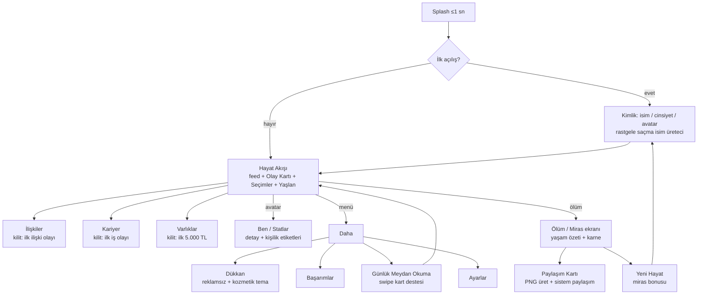

# T8 — UX/UI, FTUE (ilk 60 saniye), Erişilebilirlik ve Sıfır-Bütçe Sanat Yönü
## Metin-öncelikli mobil hayat simülasyonu için arayüz araştırması

> Proje: 18 yaşında başlayan, kara mizahlı, "taşak geçen ama motive eden" mobil hayat simülasyonu. Backend yok, solo geliştirici + AI ajanları, Expo/React Native, önce Türkçe.
> Doküman tarihi: 2026-11-05. Araştırma tipi: masaüstü araştırma + platform dokümanları + lisans doğrulaması. Doğrulanamayan her iddia metin içinde "(doğrulanmadı)" olarak işaretlendi.

---

## TL;DR

1. **Etkileşim modeli kararı:** "Akış + Kart" hibriti. Ana ekran, anlatıcının (sarkastik hayat koçu) konuştuğu sohbet/feed tarzı bir **Hayat Akışı**; güncel olay bir **Olay Kartı** olarak akışın altına sabitlenir ve 2–4 büyük **seçim butonu** başparmak bölgesinde durur. Reigns tarzı **swipe kartları** sadece "hızlı karar" ve günlük meydan okuma modunda, tempo değiştirici olarak kullanılır. Mini oyunlar MVP'de yok.
2. **İlk 15 saniyede ilk karar, ilk 5 saniyede ilk espri.** Onboarding yok; oyun, anlatıcının ilk cümlesiyle başlar. İsim/cinsiyet/avatar seçimi tek ekranda, rastgele saçma Türkçe isim üreteciyle "oyunun ilk şakası" haline getirilir.
3. **Progressive disclosure:** Başlangıçta sadece "Hayat" sekmesi görünür. Kariyer, İlişkiler ve Varlıklar sekmeleri ilk yılın ilgili olaylarıyla kilidi açılarak gelir; stat çubuğu ilk sonuçla birlikte "doğar".
4. **Benchmark hedefleri:** GameAnalytics 2025 verisine göre mobilde medyan D1 ≈ %22, üst çeyrek iOS %31–33; medyan oturum 5–6 dk, üst çeyrek 8–9 dk [1][2]. Hedefimiz: D1 ≥ %30, ilk oturum medyanı ≥ 8 dk, FTUE (ilk yıl) tamamlama ≥ %80.
5. **Dokunma hedefleri:** Seçim butonları tam genişlik ve ≥ 56 dp yükseklik; "Yaşlan" ana butonu 72 dp; aralarında ≥ 8 dp boşluk. Apple 44 pt / Material 48 dp minimumlarının üstünde kalıyoruz [36][37].
6. **Tipografi:** Gövde için **Inter** (OFL), display/anlatıcı başlıkları için **Fraunces** (OFL, opsz/wght/SOFT/WONK eksenleri) [32]; gövde 17 sp, satır yüksekliği 1.5, satırda ~36–40 karakter. Türkçe İ/ı için `toLocaleUpperCase('tr-TR')` ve Android'de `android_hyphenationFrequency="full"` zorunlu.
7. **Koyu tema varsayılan** (marka ve "kara mizah" tonu gereği), açık tema ve "sistemi takip et" seçenekleri ayarlarda. Saf siyah yerine `#0E0F12`; metin kontrastı WCAG 4.5:1'in altına inmez [40].
8. **Geri bildirim döngüsü:** expo-haptics (Light/Medium/Heavy/Rigid/Soft impact + Success/Error/Warning) [62], Reanimated spring animasyonları, sayı tik-up'ları, büyük anlarda konfeti/sarsıntı. "Juicy haptics" literatürü titreşim süslemelerinin oyuncu deneyimini artırabildiğini söylüyor [65]; ama her haptik ses + görsel ile yedeklenir (erişilebilirlik).
9. **İzin zamanlaması:** Bildirim izni ilk oturumun *sonunda* (ilk "yıl karnesi" sonrası) kendi ön-ekranımızla; ATT (reklam SDK'sı varsa) ikinci oturumda; mağaza değerlendirmesi ilk "iyi ölüm"den sonra ve en erken 3. oturum + 7. gün. Apple değerlendirme istemi 365 günde en fazla 3 kez gösterilir [10][11].
10. **Sıfır-bütçe sanat yönü:** Önerilen kimlik **"Resmi Evrak"**: brütalist/tipografik, kirli-koyu kağıt dokusu, damga/mühür motifleri, tek vurgu rengi (acid-lime), monokrom **Noto Emoji** ruh hali glifleri ve **DiceBear Notionists/Open Peeps** avatarları (CC0). Twemoji (CC-BY 4.0, jdecked forku Unicode 17) ve Kenney (CC0) yedek kaynak [16][21][25].
11. **Lisans uyarısı:** LottieFiles'ın yardım merkezi "ücretsiz animasyonlar ticari kullanıma açık" derken Kullanım Şartları "Free Plan yalnızca ticari olmayan kullanım" diyor; bu çelişki çözülene kadar LottieFiles ücretsiz varlıkları ürün içinde kullanılmaz [26][27][28]. unDraw özel lisanslı (CC0 değil) [24].
12. **AI üretimi görsel:** Google Play'in AI-Generated Content politikası *içerik üreten* uygulamaları kapsar, yalnızca AI içerik barındıranları değil [13]; Play Console'da mağaza varlıkları için AI beyanı var [14]. Öneri: AI görselleri sadece moodboard/konsept aşamasında; ürün içinde CC0/OFL varlıklar.
13. **Türkçe yerleşim:** Ölçülen Türkçe genişleme oranları %5–20 arasında değişiyor [43][44]; kelime bazında ekler yüzünden tek kelimeler çok uzayabiliyor. Buton ve etiketler için **+%30 yedek** ve çok satıra sarma zorunlu.
14. **Düşük segment Android bütçesi:** Türkiye'de mobil trafiğin ~%74–77'si Android, Android 11/12 hâlâ ~%17 pay [51][52]. Android vitals eşikleri: kullanıcı algılı crash %1.09, ANR %0.47 [45]. Hedef: indirme boyutu ≤ 35 MB (Android arm64), soğuk açılış ≤ 2 sn (Galaxy A1x/Redmi 9 sınıfı), 60 fps feed kaydırma.
15. **UX KPI seti:** Time-to-First-Decision, Time-to-First-Laugh (proxy: anlatıcı satırına "😂" tepkisi), FTUE tamamlama, ilk oturum süresi, karar/dakika, "Yaşlan"/oturum, paylaşım kartı oranı, izin opt-in oranları, crash-free oturum.

---

## Varsayımlar

- Teknoloji yığını: Expo (SDK 52+), React Native New Architecture, Hermes; `react-native-reanimated` 3/4, `moti`, `expo-haptics`, `react-native-mmkv` (kayıt), `react-native-svg`. Bu rapordaki implementasyon önerileri bu yığına göre.
- MVP içeriği metin ağırlıklı; görsel varlıklar avatar, ruh hali glifi, ikon ve nadir "büyük an" animasyonlarıyla sınırlı.
- Monetizasyon (T-serisi diğer raporlarda): opsiyonel ödüllü reklam + tek seferlik "reklamsız" IAP. Bu rapor yalnızca bunların UX yerleşimini ve izin akışını ele alır.
- Hedef cihaz alt sınırı: 3 GB RAM, Android 10, 720×1600 ekran (Türkiye'de yaygın Galaxy A0x/A1x, Redmi 9/10 sınıfı; model bazlı satış verisi bu oturumda doğrulanamadı).
- Dil: v1 Türkçe; İngilizce v1.5. Arapça/RTL plan dışı.
- Bu rapor bir "tasarım anayasası"dır; görsel üretim sprint'lerde yapılır.

---

## 1) Metin-öncelikli mobil oyun için UX ilkeleri

### 1.1 Tek el, başparmak bölgesi ve dokunma hedefleri

Steven Hoober'ın ~1.300 kişilik gözlem çalışmasında kullanıcıların %49'u telefonu tek elle, %36'sı bir elde tutup diğer elin parmağıyla, %15'i iki elle kullanıyordu [38]. Veri 2013 tarihli ve Addy Osmani gibi isimler "thumb zone" kavramının büyük ekranlarda dikkatle kullanılması gerektiğini söylüyor [39]; yine de iki şey değişmedi: (a) ekranın alt-orta bölgesi en rahat erişilen alan, (b) üst köşeler tek elde en zor alan. Bizim oyun uzun oturumlar hedeflediği için (otobüste, yatakta, tek elle) **tüm birincil kararlar alt üçte birlik bölgede** olmalı.

Dokunma hedefi minimumları: Apple HIG 44×44 pt, Material 48×48 dp, komşu hedefler arası ≥ 8 dp [36][37]. WCAG 2.2 AA (2.5.8) sadece 24×24 px ister, 44×44 eski AAA kriteridir; Material'ın 48 dp'si her eşiği aşar [36].

**Bu oyuna nasıl uygularız**

- Seçim butonları: tam genişlik, min 56 dp yükseklik, 12 dp dikey boşluk, 2–4 adet, alttan yukarı dizilir (en "güvenli"/en sık seçilen en altta değil; A/B edilecek — bkz. Açık sorular).
- "Yaşlan" butonu: 72 dp çapında, alt-orta, tab bar'ın üstünde yüzen; uzun basınca "hızlı yaşlan ×3" (gelişmiş kullanıcı kısayolu).
- Üst köşeler yalnızca ikincil işlemler: ayarlar, menü. Hiçbir "geri dönülemez" aksiyon üst bölgede olmaz.
- Swipe kartlarında yatay kaydırma yanında **sol/sağ dokunma alanları** da kabul edilir (kaydırma motor becerisi gerektirir; dokunma her zaman yedek).

### 1.2 Uzun okuma için mobil tipografi

Font adayları ve lisans durumu:

| Font | Lisans | Türkçe | Not |
|---|---|---|---|
| Inter | SIL OFL 1.1 [35] | Evet (Latin Extended) | Gövde için en güvenli seçim; Google Fonts sürümü eski olabilir, GitHub sürümünü paketleyin [35] |
| Nunito | SIL OFL 1.1 [33] | Evet (Latin Ext., Cyrillic Pro) | Yumuşak, "sevimli" — bizim tonumuz için fazla tatlı; açık tema varyantında düşünülebilir |
| Fraunces | SIL OFL 1.1; eksenler opsz 9–144, wght 100–900, SOFT 0–100, WONK 0/1 [32] | Latin Ext. (README'de açıkça yazmıyor; glyph testi yapılacak) | Anlatıcı başlıkları için "eski gazete + kara mizah" hissi; WONK=1 tuhaf harf formları mizahı destekler |
| Space Grotesk | SIL OFL 1.1, Türkçe destek listede [34] | Evet | Sayılar ve stat etiketleri için teknik/soğuk his |

Türkçeye özel tuzaklar:
- **İ/ı sorunu:** JavaScript `"istanbul".toUpperCase()` → "ISTANBUL" (noktasız I yanlış). Tüm büyük harf dönüşümleri `toLocaleUpperCase('tr-TR')` ile yapılmalı; RN `textTransform` yerine string'i önceden dönüştürün.
- Fontun `locl` OpenType özelliğinin Türkçe için "i → İ" eşlemesini desteklediğinden emin olun; desteklemiyorsa noktalı/noktasız karışır.
- Türkçe ek yığılması ("yapabileceklerinizdenmişsiniz") satırları patlatır: Android'de `android_hyphenationFrequency="full"` ve `textBreakStrategy="highQuality"`; iOS'ta sistem tireleme yetersiz, cümleleri kısa tutmak editoryal kural.

Boyutlar (bilinen platform ölçekleri; bu oturumda birincil kaynaktan yeniden doğrulanmadı): iOS Dynamic Type "Body" 17 pt, Material 3 "Body Large" 16 sp/24 sp satır yüksekliği. Bizim ölçek:

| Rol | Boyut | Satır yük. | Font |
|---|---|---|---|
| Anlatıcı satırı (feed) | 17 sp | 26 | Inter Regular |
| Anlatıcı vurgu / punchline | 18 sp | 27 | Inter Medium (italik yok; vurguyu kelime seçimi yapar) |
| Olay kartı başlığı | 22 sp | 28 | Fraunces opsz 24, wght 700, WONK 1 |
| Seçim butonu | 16 sp | 22 | Inter SemiBold |
| Stat etiketi / sayı | 13 sp / 15 sp tabular | 18 | Space Grotesk / Inter `tnum` |
| Yaş/yıl başlığı | 28 sp | 34 | Fraunces opsz 36 |

360 dp genişlik, 16 dp yan boşluk → 328 dp içerik; 17 sp Inter'de satır başına ~36–40 karakter. Bu, mobil okuma için ideal banda (30–45) denk gelir. Hizalama her zaman sola; iki yana yaslı metin Türkçede boşluk nehirleri yaratır.

### 1.3 Bilgi hiyerarşisi

Ekran, yukarıdan aşağı dört katman: **(1) Kimlik başlığı** (avatar, isim, yaş, para) → **(2) Stat çubuğu** (Mutluluk, Sağlık, Zekâ, Görünüm + gizli "İtibar") → **(3) Hayat Akışı** (anlatıcı balonları, sonuç satırları, yıl ayraçları) → **(4) Karar bölgesi** (Olay Kartı + seçim butonları veya Yaşlan butonu). Göz üstten tarar ama el altta çalışır; en kritik okunacak şey (olay metni) karar bölgesine en yakın yerde durur. Stat değişimleri feed'e "+3 Mutluluk (yine de yetmez)" gibi anlatıcı sesinde yazılır; ayrıca stat çubuğunda renkli tik-up ile görselleşir.

### 1.4 Geri bildirim döngüleri (juice)

- **Haptik:** expo-haptics üç API sunar: `impactAsync` (Light, Medium, Heavy, Rigid, Soft), `notificationAsync` (Success, Error, Warning), `selectionAsync`. Android'de VIBRATE izni otomatik eklenir; iOS'ta Düşük Güç Modu, Taptic kapalı, kamera veya dikte aktifken haptik çalışmaz [62]. Bu yüzden haptik hiçbir zaman tek geri bildirim kanalı olamaz.
- Singhal & Schneider'in "Juicy Haptic Design" çalışması, görsel geri bildirimi pekiştiren "haptik süslemelerin" telefon oyunlarında oyuncu deneyimini iyileştirebildiğini raporluyor [65]. Ancak "aşırı" haptik yorucu; bizde kural: **her karar = 1 selection tick; her stat değişimi = light impact; büyük an = notification(Success/Error)**; dakikada 20'den fazla haptik olmaz.
- **Animasyon:** Reanimated spring'leri (damping 15, stiffness 150 civarı) ve Moti ile `from/animate` deklaratif geçişler. Anlatıcı balonları 120 ms gecikmeli "yazıyor…" noktalarıyla gelir (en fazla 400 ms; uzun bekletme feed tarzında sinir bozucu).
- **Sayı tik-up'ları:** Para ve stat değerleri `withTiming(600ms, easeOut)` ile sayılır; eşik geçişlerinde (ör. 10.000 TL) haptik.
- **Büyük anlar:** evlilik, ilk ev, ölüm, başarım → konfeti (Skia tabanlı `react-native-fast-confetti` veya kendi Reanimated partikülümüz; düşük segmentte ≤ 60 partikül) + ekran sarsıntısı (6 px, 300 ms) + Success haptik. "Kötü büyük an" (iflas, boşanma) → kırmızı vinyet + Error haptik + anlatıcının "Eh." satırı.
- **Reduced motion:** Sistem "hareketi azalt" açıksa tüm spring'ler `ReduceMotion.System` ile fade'e düşer, konfeti statik rozete dönüşür (Reanimated `useReducedMotion` dokümanı bu oturumda GitHub yolundan çekilemedi; API mevcut, sürüm notlarından doğrulanacak).

### 1.5 Koyu tema varsayılan mı?

Veri zayıf: "%82 kullanıcı koyu mod kullanıyor" rakamları kendi kendine seçilmiş anketlerden geliyor [66][67]; Apple/Google'dan resmi adoption verisi yok. Karar veriyi değil **markayı** takip ediyor: kara mizah + "gece 02:00'de yatakta oynanan oyun" = koyu varsayılan. Açık tema ve "sistemi takip et" ilk sürümde ayarlarda bulunur (HIG sistem tercihine saygıyı önerir; biz bunu "ilk açılışta koyu, sonra kullanıcı seçer" olarak uyguluyoruz).

Saf siyah (#000) OLED'de harika ama beyaz metin "halasyon" yapar; koyu zemin `#0E0F12`, yüzey `#16181D`, metin `#ECE8DF` (sıcak beyaz, kağıt hissi). Normal metin ≥ 4.5:1, büyük metin (≥ 18 pt veya 14 pt bold) ≥ 3:1 [40].

### 1.6 Renk sistemi ve ikonografi

Semantik tokenlar üzerinden tek vurgu rengi (acid-lime `#C8FF3D`) + 2 durum rengi (başarı: aynı lime; tehlike: `#FF4D5E`) + nötr gri skalası. Renk hiçbir zaman tek anlam taşıyıcısı değil (renk körlüğü): stat yönü oklarla, buton türü ikon + etiketle belirtilir.

İkon kütüphaneleri (lisans doğrulandı): Lucide (ISC) [29], Phosphor (MIT) [30], Tabler (MIT, 6.257 ikon) [31]. Tek kütüphane seçin (öneri: Phosphor — "duotone" ve "fill" varyantları aktif tab durumu için işe yarar); karışım görsel tutarsızlık yaratır.

### 1.7 Boş durumlar, offline, ayarlar

- **Boş durumlar** anlatıcının sesinde yazılır: İlişkiler sekmesi boşken "Kimse yok. Senin de pek bir çaban yok ama neyse." Boş durum bir **aksiyon** içerir ("Birini tanı" butonu).
- **Hatasız offline:** Kritik yolda hiç ağ çağrısı yok. Reklam yüklenemezse "reklam izle" butonu görünmez; hata mesajı yok. Kayıt her kararda atomik (MMKV + versiyonlu JSON + 3 yedek slot); uygulama çökerse açılışta "Kaldığın yerden" otomatik devam, dialog yok.
- **Ayarlar (MVP):** Metin boyutu (sistem / S / M / L / XL), Ses, Titreşim, Hareketi azalt (sistem + manuel), Bildirimler (Günlük meydan okuma / Yaşlanma hatırlatıcı / Hiçbiri), Tema, Dil, Veriyi sıfırla, Gizlilik & ATT tekrar aç, Lisanslar.

**Bu oyuna nasıl uygularız (Bölüm 1 özeti):** Karar bölgesi her zaman alt üçte birde; 56/72 dp hedefler; Inter + Fraunces; 17 sp/1.5; tr-TR uppercase; koyu varsayılan + token tabanlı tema; haptik/animasyon bütçesi; anlatıcı sesinde boş durumlar; ağ bağımsız kritik yol.

---

## 2) UI pattern teardown ve etkileşim modeli kararı

### 2.1 Rakip ve referans analizi

| Oyun | Birincil etkileşim | Güçlü yan | Zayıf yan | Bize dersi |
|---|---|---|---|---|
| **BitLife** | Alt sekmeler (Occupation/Assets/Relationships/Activities) + ortada büyük yuvarlak "Age" butonu; yaş gruplu kayan metin günlüğü; modal seçimler; dört stat çubuğu alt bantta [59] | Tek butonla "bir yıl daha" dürtüsü; sekmeler sistemin derinliğini taşır | Günlük düz metin, mizah "cümle içinde" kalır; modal seçimler akışı keser; menü yoğunluğu yeni oyuncuyu boğar | "Yaşlan" ana CTA'sı doğru; ama olay kartı ve seçimler feed'in içinde yaşamalı, modal'da değil; sekmeler kademeli açılmalı |
| **Alter Ego** | Minimal, karanlık, tipografik; clicker + metin sohbeti | Siyah-gri paletle "Twilight Zone" ruh hali [60]; temiz arayüz övgü alıyor [61] | Sessiz ve ağır; mizah yok | Tipografik minimalizm "premium" okunabiliyor; biz aynı disipline mizah ekliyoruz |
| **Reigns** | Tinder tarzı sol/sağ swipe; dört güç boyutu; ağırlıklı "torba" kart seçimi [54] | Çok basit jestle anlam yüklü kararlar; her çekiliş farklı torba → çeşitlilik [54]; "ölüme bağımlılık" [56] | Planlama imkânı az, karar tek tek gelir; sonucun yönü belirsiz; zaman baskısı "ya sev ya nefret et" [55] | Swipe'ı **tempo** olarak kullan, ana model olarak değil; 2'den fazla seçenek gerektiğinde buton |
| **Lifeline** | Sohbet balonları + gerçek zamanlı bildirimler [57] | Temiz metin arayüzü, gecikme/bildirim kullanımı övgü alıyor [58] | Gecikmeler ustalık hissini kırar; çoğu seçim sonuçsuz [58] | Sohbet görünümü anlatıcı için mükemmel; ama gerçek zamanlı bekletme yok — oyuncu istediği kadar hızlı yaşar |
| **Tinder-swipe karar oyunları** | İkili jest | Hız, "bir tane daha" | Nüans yok; Türkçe uzun cümlelerde kart taşar | Yalnızca mikro-ikilemlerde |
| **Card-stack event UI** | Üst üste kartlar | Derinlik hissi, sonraki olayı ima | Feed'in "tarih" hissini kaybeder | Olay kartı tek, akışın altına sabit; stack sadece günlük meydan okumada |

### 2.2 Karar: "Akış + Kart" hibrit modeli

**Birincil:** Sohbet/feed tarzı **Hayat Akışı**. Anlatıcı (çalışma adı "Koç") sol hizalı balonlarla konuşur; oyuncunun seçimleri sağ hizalı, tek satır "yaptım" balonları olarak akışa düşer. Yıl geçişleri kalın ayraç ("— 19 YAŞ —"). Bu model: (a) mizahın cümle cümle, zamanlamayla verilmesine izin verir (Lifeline/Alter Ego dersi), (b) geçmişe kaydırıp "hayat hikâyeni" okumak kendi başına paylaşılabilir içerik olur, (c) metin ağırlıklı içerik üretimini en ucuz yoldan taşır.

**Karar bölgesi:** Akışın altında sabit **Olay Kartı** (başlık + 1–3 cümle) ve altında 2–4 **Seçim Butonu**. Olay yoksa kartın yerinde büyük **Yaşlan** butonu durur. Seçim yapılınca kart akışa "katlanır" (Reanimated layout animation), sonuç satırı anlatıcı balonuyla gelir.

**İkincil:** **Swipe kartları** iki yerde: (1) "Haftanın Saçmalıkları" — yıl içinde 3–5 mikro ikilem art arda, sol/sağ; (2) Günlük Meydan Okuma. Reigns'in "torba" sistemi burada kullanılır: her kartın ağırlığı stat/durumla değişir [54].

**Üçüncül (post-MVP):** 1–2 mini oyun (ör. "iş görüşmesinde göz teması" zamanlama oyunu).

Gerekçe: Hedef "uzun oturum + günlük geri dönüş". Feed modeli bir oturumda 30–60 karar taşıyabilirken swipe modeli 10–15 dakikada monotonlaşır (Reigns eleştirileri [55]). Swipe, feed'in ritmini kıran "şeker" olarak kalır.

### 2.3 MVP ekran haritası



Sekme çubuğu (alt): Hayat · İlişkiler · Kariyer · Varlıklar; ortada yüzen Yaşlan. "Ben" avatar dokunuşuyla, "Daha" sağ üst menüyle açılır. Kilitli sekmeler çubukta **görünür ama soluk** ve kilit ikonlu; dokununca anlatıcı "Önce bir hayatın olsun." der (merak → progressive disclosure).

**Bu oyuna nasıl uygularız:** Feed bileşeni `FlashList` ile ters (inverted) değil, normal yönde ve otomatik alta kaydırmalı; olay kartı `position: absolute` değil, listenin footer'ı olarak sabit alan (klavye/safe-area sorunlarını önler). Swipe destesi ayrı ekran, `react-native-gesture-handler` + Reanimated; her kartta dokunma yedeği.

---

## 3) FTUE: ilk 60–90 saniye

### 3.1 Benchmark ve ilkeler

- GameAnalytics 2025 mobil benchmark'ı (ikincil özet): medyan D1 ≈ %22; üst çeyrek iOS D1 %31–33, Android %25–27; medyan oturum 5–6 dk, üst çeyrek 8–9 dk [1][2]. GameAnalytics'in "ilk oturum süresi ↔ D1" korelasyonunu veren yayımlanmış bir grafiği bu oturumda bulunamadı; Countly'nin "ilk 72 saatte ≥ 3 oturum yapanlar çok daha yüksek 90 günlük retention gösterir" iddiası kaynak göstermiyor [3]. Dolayısıyla "ilk oturum uzunsa D1 artar" **varsayımımızdır**, kendi verimizle doğrulanacak.
- Pratik FTUE kılavuzları birleşiyor: 60 saniye içinde oynanabilir olmak, hesap/ayar/uzun tutorial yok [4][71]; zorunlu tutorial yerine bağlamsal ipucu [4]; progressive disclosure = bilgiyi eyleme dönüşebilir olduğunda vermek [4]; adım adım A/B testi [5].
- "Time-to-first-laugh" sektörde ölçülen standart bir metrik değil; biz tanımlıyoruz: anlatıcının ilk satırından oyuncunun ilk pozitif tepkisine (balona "😂" tepkisi veya ilk karara ortalama üstü hız) geçen süre. Hedef < 10 sn (proxy), ilk espri ekranda < 5 sn.

### 3.2 İzin ve istek zamanlaması

| İstek | Veri | Bizim zamanlama |
|---|---|---|
| Bildirim izni | Airship 2025 medyanı: oyun kategorisinde iPhone %43.2, Android %60.05 [8]; başka kaynaklar oyunları %20–28 (iOS) ile en düşük kategori sayıyor [84]; Batch: Android opt-in %85→%67, iOS %58→%56 [9] | İlk oturumun sonunda, "Yıl 1 Karnesi"nden hemen sonra, kendi ön-ekranımızla ("Yarın sana yeni bir saçmalık hazırlayacağım. Haber vereyim mi?"). Reddedilirse 3. oturumda bir kez daha ön-ekran; sistem istemi tek sefer harcanır. |
| ATT (yalnızca reklam SDK'sı varsa) | Oyunlarda istemi görenlerde opt-in %39 (Q1 2026) [7]; bilgilendirici ön-ekranla %65'e kadar vaka raporu (vendor) [6]; onboarding sırasında sorulması en yüksek oranı veriyor (AppsFlyer, ikincil) [68] | 2. oturumun başında, ilk reklam fırsatından **önce** ön-ekran; ilk oturumda asla (ilk oturum kutsal). |
| Mağaza değerlendirmesi | iOS: 365 günde en fazla 3 gösterim; sistem istemi her çağrıda çıkmayabilir; buton dokunuşuna bağlanmamalı [10][11]; içerik puana kilitlenemez (1.1.7) [69] | İlk "iyi ölüm" (yaşam skoru medyan üstü) sonrası, en erken 3. oturum + 7. gün; versiyon başına en fazla 1; Android In-App Review aynı kurallarla (kota açıklanmıyor). |

### 3.3 Kimlik oluşturma: oyunun ilk şakası

Tek ekran, üç alan, hepsi önceden doldurulmuş:
- **İsim:** Rastgele üreteç. Gerçek Türkçe ad + "soyadı gibi duran" saçma bileşik: `[ad] + [isim+fiil-sıfat]` kalıbı (gerçek soyadı morfolojisini taklit eder: Taşdelen → "Vergikaçıran", "Sabahuyuyamayan", "Lahmacunsever", "Kirayetişemeyen", "Ekmekarası"). "Çevir" butonu haptik tıkla yeni isim; oyuncu isterse kendi ismini yazar. Küfür/hakaret filtresi (kara liste) şart.
- **Cinsiyet/kimlik:** Erkek / Kadın / "Belirtmek istemiyorum, zaten kimse sormadı". Oyun mekaniği cinsiyete göre değişmez; yalnızca hitap ekleri.
- **Avatar:** DiceBear Notionists (CC0) seed = isim; "Çevir" ile yeni yüz. Avatar yerel SVG olarak üretilir (ağ yok).

Ekranın tek CTA'sı: **"Hadi, 18 ol."**

### 3.4 İlk 90 saniye — anlatıcı sesinde senaryo (Türkçe)

Zamanlar hedef; parantez içi UX notu.

**00:00–00:02** — Splash: logo yok, siyah ekran, tek satır tipografi: *"HAYAT. v1.0. Garanti yoktur."* (≤ 1 sn, sonra fade)

**00:02–00:05** — Koç (balon 1): *"18 oldun. Tebrikler. Artık hatalarını yasal olarak kendin yapabilirsin."* (ilk espri; selection haptik)

**00:05–00:12** — Kimlik ekranı, önceden doldurulmuş: *"Adın **Şaban Kirayetişemeyen**. Beğenmediysen çevir, ama bence sana yakıştı."* [Çevir] [Bu ben] → tek dokunuş. (TTFD sayacı başlar)

**00:12–00:18** — Koç: *"Güzel. Şimdi gerçek hayat: sınav sonucun açıklandı."* Olay Kartı: **ÜNİVERSİTE SONUCU** — *"Puanın bir bölüme yetiyor. Hangi bölüm olduğunu söylemeyeceğim, sürpriz."*
Seçimler: **[Kaydol, ne olacaksa olsun]** / **[Bir yıl daha çalışırım abi]** / **[Üniversite mi? Para kazanacağım]**
(→ İlk karar ≤ 18 sn. Buton dokunuşu: selection haptik + kart katlanma animasyonu.)

**00:18–00:26** — Sonuç balonu ve **stat çubuğunun doğuşu**: çubuk üstten kayarak gelir, sayılar tik-up: *"Mutluluk +5. Zekâ +0. Annen +40, ama o bir stat değil."* (light impact ×2; progressive disclosure: statlar ilk sonuçla tanıtılır, önce değil)

**00:26–00:40** — İkinci olay (tempo: hemen): **İLK PARA** — *"Dayın sana 'hayata atıl' diye 2.000 TL verdi. Dayın hâlâ 2009'da yaşıyor."*
Seçimler: **[Biriktir]** / **[Arkadaşlarla ye, hayat kısa]** / **[Kripto]**
("Kripto" seçilirse: Error haptik, kırmızı vinyet, *"Hayır. Henüz değil. Belki hiç."* — ilk **kara mizah "ceza"** anı; para −2.000, Mutluluk +2 "çünkü ders aldın".)

**00:40–00:50** — Koç: *"Bu kadar. Bir yılı bitirdin. Aşağıdaki büyük butona bas, zaman geçsin. Her şey senin elinde değil zaten."* **Yaşlan** butonu alttan spring ile yükselir, nabız animasyonu (tek sefer, 3 nabız; sonra sakin).

**00:50–00:58** — Yaşlan → *"— 19 YAŞ —"* ayracı, Success haptik, mini konfeti (ilk kez; sonraki yaşlarda yalnızca her 10 yılda bir). Koç: *"Bak, bir yaşında bir şey yapmadan yaşlandın. Gerçekçi."*

**00:58–01:15** — Üçüncü olay + **Kariyer sekmesinin kilidi açılır** (tab bar'da soluk ikon canlanır, 1 balon: *"Yeni sekme: Kariyer. Evet, çalışman gerekiyor."*). Oyuncu sekmeye dokunmak zorunda değil; olay akışta devam eder.

**01:15–01:30** — **Yıl 1 Karnesi** (küçük kart, akışın içinde): üç satır özet + "kişilik etiketi" (*"Dürtüsel ama iyimser"*) + [Devam]. Hemen ardından (ilk oturum 8+ dk sürmüşse; değilse ertelenir) bildirim ön-ekranı: *"Yarın yeni bir saçmalık hazırlayacağım. Haber vereyim mi?"* [Ver] [Sonra]

Ölçüm noktaları: `ftue_first_line_shown`, `ftue_identity_done`, `ftue_first_choice`, `ftue_stat_bar_revealed`, `ftue_age_up_1`, `ftue_year1_card`, `ftue_notif_preprompt`. "FTUE tamamlandı" = `ftue_year1_card`.

### 3.5 "İlk yıl" içerik kuralları

- İlk 5 olay elle yazılır, rastgele değil (kontrollü mizah eğrisi: hafif alay → küçük ceza → küçük zafer → sistem tanıtımı → karne).
- Hiçbir ilk-yıl olayı ölümle veya geri dönülemez büyük kayıpla bitmez (kripto bile "ders" olarak biter).
- Her olayda en az bir seçenek "anlatıcıya kafa tutan" seçenek olmalı ("abi" dili); oyuncunun anlatıcıyla ilişkisi FTUE'de kurulur.
- Motivasyon vuruşu ilk 90 saniyede bir kez: *"Yine de bir şey denedin. Çoğu insan denemiyor."*

**Bu oyuna nasıl uygularız:** Onboarding diye ayrı bir akış yazılmaz; FTUE = ilk yıl içeriği + progressive unlock kuralları + izin zamanlayıcısı. Analitik SDK'sı (ör. GameAnalytics/Firebase; bağlantı yoksa olaylar yerelde kuyruklanır) yukarıdaki 7 olayı zorunlu loglar.

---

## 4) Sıfır-bütçe sanat yönü

### 4.1 Kaynak ve lisans envanteri (doğrulanmış durum)

| Kaynak | Lisans | Durum / not | Kullanım kararı |
|---|---|---|---|
| **Twemoji (jdecked forku)** | Grafikler CC-BY 4.0, kod MIT [16] | twitter/twemoji 2023'ten beri güncellenmiyor ve deprecated; jdecked forku aktif, v17 Unicode 17.0 [16][17][18]; WordPress forka geçti [78]; Discourse "fork'a bağımlılık" endişesi dile getirdi [77] | Renkli emoji gerekirse birincil; atıf "Lisanslar" ekranında. Platform emojisine (Apple/Google) güvenmek yerine paketlenir → iOS/Android tutarlılığı |
| **Noto Color Emoji** | SIL OFL 1.1 [19][20] | COLRv1 TTF paketlenebilir; Zulip Flutter örneği iOS'ta paketlemiyor çünkü kullanılmıyor ve MB harcıyor [76] | iOS'ta COLRv1 desteklenmez; cross-platform için Twemoji SVG daha güvenli |
| **Noto Emoji (monokrom)** | Repo "fonts dizinindeki emoji fontları OFL 1.1" diyor; monokrom font Google Fonts'ta değişken ağırlıklı olarak yayında [19] | Siyah-beyaz, ağırlık ekseni var → tipografik kimliğe tam uyar | **Birincil "ruh hali glifi" ve ikon dili** |
| **DiceBear** | Kütüphane MIT; stiller sanatçı lisanslı: 42 stil CC0, 14 stil CC BY 4.0, 4 özel [21][22]. Lorelei (Lisa Wischofsky), Notionists (Zoish), Open Peeps (Pablo Stanley) CC0; Adventurer, Big Ears, Croodles, Micah CC BY 4.0 [21][79] | Yerel SVG üretimi (`@dicebear/core` + stil paketi), ağ gerekmez | **Notionists** (çizgi, kara mizah tonu) birincil; Open Peeps yedek |
| **Open Peeps** | CC0 [23] | El çizimi, parçalı (kafa/gövde/aksesuar) | Boş durum illüstrasyonları, ölüm ekranı figürleri |
| **Humaaans** | CC0 (ikincil kaynaklar; resmi sayfa bu oturumda açılamadı) | | Kullanmadan önce humaaans.com lisans metni teyit |
| **unDraw** | Özel lisans: ticari kullanım ve değişiklik serbest, atıf gerekmez; toplu yeniden dağıtım, rakip servis ve AI eğitimi yasak (ikincil) [24] | CC0 **değil** | Kullanılırsa lisans metni Lisanslar ekranına; stil bizim kimlikle uyumsuz, muhtemelen kullanılmaz |
| **Kenney.nl** | CC0, ticari kullanım dahil, atıf gerekmez [25] | UI ses efektleri, ikonlar, konfeti sprite'ları | **Ses efektleri ve UI paketleri** |
| **LottieFiles ücretsiz animasyonlar** | Yardım merkezi: "Lottie Simple License, ticari kullanım serbest, atıf opsiyonel" [26][28]; Kullanım Şartları: "Free Plan yalnızca ticari olmayan kullanım" [27] | **Çelişki** | Yazılı teyit alınana kadar ürün içinde yok; animasyonlar Reanimated/Skia ile kodda yazılır |
| **İkonlar** | Lucide ISC [29], Phosphor MIT [30], Tabler MIT [31] | | Phosphor |
| **Fontlar** | Inter, Nunito, Fraunces, Space Grotesk — OFL [32][33][34][35] | OFL fontlar paketlenebilir; OFL metni uygulamada bulunmalı | Inter + Fraunces (+ Space Grotesk sayılar) |

### 4.2 AI ile üretilmiş görsel

- **Google Play:** AI-Generated Content politikası, kullanıcı istemlerinden içerik *üreten* uygulamaları (chatbot, text-to-image vb.) kapsar; "yalnızca AI içerik barındıran" uygulamalar kapsam dışıdır [13][15]. Ayrı olarak Play Console, mağaza listeleme varlıkları (görsel/metin/video) için "AI ile üretildi/düzenlendi" beyanı sunar [14].
- **Apple:** 1.2 (UGC/AI içerik üretim uygulamaları için filtreleme/raporlama) ve 5.1.2 (üçüncü taraf AI'ya kişisel veri paylaşımında açık izin) [12][81][82]. Statik AI görsel varlıkları için özel bir açıklama yükümlülüğü yok.
- **Risk:** Telif belirsizliği, stil tutarsızlığı, publisher due-diligence'ında "AI art" sorusu. Karar: AI görselleri **moodboard ve konsept** aşamasında; ürün içinde CC0/OFL/MIT varlıklar + kendi tipografik tasarımımız. Mağaza görsellerinde AI kullanılırsa Play Console beyanı işaretlenir.

### 4.3 Üç moodboard yönü

**A) "Resmi Evrak" (önerilen)** — Bürokratik deadpan kara mizah.
- Palet: zemin `#0E0F12`, yüzey `#16181D`, kağıt-krem metin `#ECE8DF`, mürekkep-gri `#8A8F98`, vurgu acid-lime `#C8FF3D`, tehlike `#FF4D5E`, damga kırmızısı `#C9372C` (yalnızca "REDDEDİLDİ/ONAYLANDI" damgalarında).
- Tip: Fraunces (WONK=1) başlıklar; Inter gövde; damga etiketleri Space Grotesk büyük harf, letter-spacing 0.08em.
- Doku: ince kağıt grain overlay (tek 256×256 PNG, tile, %4 opaklık; düşük segmentte kapalı).
- Motion: "damga vuruşu" (scale 1.4→1, 180 ms, Heavy impact), kağıt sarsıntısı, katlanma. Konfeti yerine "kâğıt parçaları".
- Avatar: Notionists, tek renk çizgi, lime vurgu. Ruh hali glifi: monokrom Noto Emoji (😐 🙄 🫠 😤) anlatıcı balonunun başında, haptikle değişir.
- Neden premium okunur: az renk, çok tipografi, tutarlı ızgara; "ucuz" görünen şey renkli emoji ve stok illüstrasyon karmaşasıdır, bunlar yok.

**B) "Gece Nöbeti"** — Neon-acid, daha genç/TikTok tonu.
- Palet: `#0B0D10` zemin, lime `#C6FF3D` + pembe `#FF3D8A` ikili vurgu; Space Grotesk başlık; Twemoji renkli emoji; DiceBear Lorelei avatar. Motion: glitch kesmeleri, aşırı spring. Risk: yorucu; mizah "ucuzlaşabilir".

**C) "Mahalle Kahvesi"** — Sıcak, açık tema, nostaljik.
- Palet: krem `#F4EBDD`, çay-kırmızı `#B23A2E`, zeytin `#6B7A3A`; Nunito; Open Peeps el çizimi figürler; yumuşak wobble animasyonlar. Güçlü: samimiyet, motivasyon tonu. Zayıf: "premium" ve "kara" hissi düşük; gece oynanışta parlak.

Karar: **A birincil**, B'nin lime vurgusu A'ya taşınmış durumda; C açık tema varyantının palet esin kaynağı.

### 4.4 Maskot / anlatıcı görseli

Seçenekler: (1) **Tipografik anlatıcı** — görsel yok, yalnızca ruh hali glifi + balon stili (en ucuz, en tutarlı, en "yazar sesi"); (2) Notionists ile tek bir sabit karakter "Koç" (seed sabit, 6 ifade varyantı elle seçilir); (3) Open Peeps'ten kolajlanmış tam boy figür (ölüm/karne ekranlarında). Öneri: MVP'de (1) + (3) ölüm ekranında; (2) publisher pitch'inde "karakterleştirme" seçeneği olarak sunulur.

**Bu oyuna nasıl uygularız:** `assets/` altında LICENSES.md ile her varlığın kaynağı ve lisansı; Lisanslar ekranı otomatik üretilir. Avatar SVG'leri çalışma anında üretilip MMKV'de cache'lenir. Monokrom Noto Emoji değişken font olarak paketlenir (alt küme: ~120 yüz/el glifi, ~150–250 KB hedef).

---

## 5) Erişilebilirlik ve lokalizasyon yerleşimi

### 5.1 Font ölçekleme ve ekran okuyucu

- RN `Text` varsayılan olarak sistem metin boyutunu takip eder (`allowFontScaling` true); global kapatmak erişilebilirliği bozar, bunun yerine bileşen bazında `maxFontSizeMultiplier` [63][64]. Bizim değerler: gövde 1.6, başlık 1.3, buton 1.3, stat sayıları 1.2. Ayrıca uygulama içi metin boyutu seçeneği (sistemden bağımsız, oyuncu "daha büyük" isteyebilir).
- Her etkileşimli bileşen `accessibilityRole` + `accessibilityLabel`; seçim butonlarının etiketi metnin kendisi, ek olarak `accessibilityHint` ile tahmini etki yok (sürpriz mekanik korunur). Stat çubuğu `accessibilityValue` ile "Mutluluk 62 / 100" okur. Feed balonları `accessibilityLiveRegion="polite"` (Android) ile yeni satırı okur.
- Haptik/ses alternatifleri: her haptik olayın görsel eşdeğeri (renk + hareket + metin); titreşim kapalıysa animasyon süresi aynı kalır.

### 5.2 Kontrast ve renk

WCAG: normal metin ≥ 4.5:1, büyük metin (≥ 18 pt veya ≥ 14 pt bold) ≥ 3:1; hesaplanan değer yuvarlanmaz (4.499 geçmez) [40]. Koyu temada gri ikincil metin `#8A8F98` zemin `#0E0F12` üzerinde ~5.4:1 (tasarım aracında doğrulanacak). Lime vurgu üzerinde koyu metin kullanılır (lime zeminde beyaz metin yetersiz kalır).

### 5.3 Türkçe metin genişlemesi

Ölçülen oranlar kaynağa göre %5–15 [43] ile ~%20 [44] arasında; genel lokalizasyon tavsiyesi %15–35 yedek [42][75][74]. W3C: esnek konteyner, sabit genişlikli küçük kutulardan kaçın [41]. Türkçede asıl risk ortalama değil **tek kelime uzunluğu** (ek yığılması): "Kaydolmayacağım" bir butona sığmayabilir.

Kurallar: butonlar 2 satıra sarabilir (yükseklik artar, metin kırpılmaz); etiketlerde `numberOfLines` yerine `adjustsFontSizeToFit` **kullanılmaz** (boyut tutarsızlığı); pseudo-localization testi: tüm string'ler +%30 doldurularak CI'da ekran görüntüsü. İngilizce v1.5'te çoğu string **kısalacağı** için Türkçe-öncelikli tasarım güvenli taraf. RTL plan dışı; `I18nManager` dokunulmaz.

### 5.4 Uygulama boyutu ve performans bütçesi

- Google'ın yaygın aktarılan deneyi: her +6 MB ≈ −%1 yükleme dönüşümü; gelişen pazarlarda −10 MB ≈ +%2.5 [47][72]. Bağımsız bir test etkiyi çok daha küçük buldu (−%0.38) [48]. Rakam kaba kılavuz, yön net: küçük tut.
- Expo uygulamaları anekdotlarda 20–40 MB bandında; bir örnekte 122 MB'tan Android 38 MB / iOS 47 MB'a indirilmiş [49]. Hermes varsayılan ve boyutu/başlangıcı iyileştirir [50].
- Türkiye: mobil trafikte Android ~%74–77, iOS ~%21–23 [51]; Android 16 %31, 13 %15, 15 %14, 11 ve 12 toplam ~%17 [52]; satıcı verisinde %56 "bilinmeyen" olduğundan model dağılımı güvenilmez [53]. Model bazlı RAM verisi bulunamadı (açık soru).
- Android vitals: kullanıcı algılı crash ≥ %1.09 veya ANR ≥ %0.47 (28 günlük) görünürlüğü düşürür; model bazında %8 [45][46].

Bütçe tablosu:

| Metrik | Hedef | Ölçüm |
|---|---|---|
| Android indirme boyutu (AAB, arm64) | ≤ 35 MB (stretch 25) | Play Console "app size" |
| iOS indirme | ≤ 45 MB | App Store Connect |
| Soğuk açılış → ilk anlatıcı satırı | ≤ 2.0 sn (Galaxy A1x sınıfı), ≤ 1.2 sn (orta segment) | `expo-performance`/kendi timer |
| Feed kaydırma | 60 fps, JS thread < 50% | Flipper/Perf monitor |
| Bellek | ≤ 180 MB RSS | Android Studio profiler |
| Crash-free oturum | ≥ %99.5; ANR < %0.3 | Crashlytics/Sentry (opsiyonel SDK) |
| Font paketleri | Inter 2 ağırlık + Fraunces 1 değişken + Noto Emoji alt küme ≤ 700 KB | build raporu |

**Bu oyuna nasıl uygularız:** `expo-font` ile yalnızca gerekli ağırlıklar; görseller WebP/SVG; konfeti ve grain overlay "düşük performans modu"nda (cihaz RAM < 4 GB veya `reduceMotion`) otomatik kapalı; FlashList + memoized balonlar; tüm metin içeriği tek JSON paketi (≤ 2 MB, gzip) ve lazy-load edilen "on yıl" bölümleri.

---

## 6) Teslimatlar

### 6.1 UX ilkeleri (12 madde)

1. Karar her zaman başparmağın altında (alt üçte bir).
2. İlk espri 5 saniyede, ilk karar 18 saniyede, sistem tanıtımı sonuçla birlikte.
3. Anlatıcı tek ses: boş durum, hata, ayar açıklaması dahil her metin Koç'un ağzından.
4. Hiçbir modal karar yok; olay ve seçim akışın içinde yaşar.
5. Her geri bildirimin üç kanalı var: görsel + metin + (haptik/ses).
6. Bir ekranda tek birincil CTA.
7. Yeni sistem = akışta tek balon + soluk sekmenin canlanması; tooltip turu yok.
8. Kırpılan metin yoktur; konteyner büyür.
9. Koyu varsayılan, token tabanlı tema, 4.5:1 taban kontrast.
10. Çevrimdışı birinci sınıf: ağ yoksa hiçbir şey eksilmez, hata mesajı yok.
11. Haptik bütçesi: dakikada ≤ 20, büyük an ayrımı net.
12. Her "ceza" bir "ders"le, her "ders" bir mikro-motivasyonla biter (ton kuralı UX'in parçası).

### 6.2 Tasarım sistemi: tokenlar

```
color.bg            #0E0F12   color.surface    #16181D   color.surface2  #1E2127
color.text          #ECE8DF   color.text2      #8A8F98   color.accent    #C8FF3D
color.danger        #FF4D5E   color.stamp      #C9372C   color.border    #2A2E36
light.bg #F4EBDD  light.surface #FFFFFF  light.text #1A1A1A  light.text2 #5C5C5C  (accent/danger aynı, koyu metin)

space: 4 8 12 16 20 24 32 40 48        radius: 8 (kart) 12 (buton) 999 (pill/yaşlan)
type: body 17/26 Inter · bodyStrong 18/27 Inter-Medium · title 22/28 Fraunces700 · display 28/34 Fraunces · label 13/18 SpaceGrotesk · num 15/18 Inter tnum
motion: fast 120ms · base 220ms · slow 400ms · spring(damping 15, stiffness 150) · stamp(180ms, overshoot)
haptic: select=selection · statDelta=impact.light · choiceConfirm=impact.medium · ageUp=notification.success · bigBad=notification.error · stamp=impact.heavy
elevation: yok (flat) — ayrım border + surface tonuyla
```

### 6.3 Bileşen envanteri

| Bileşen | Sorumluluk | Notlar |
|---|---|---|
| `AppShell` | Safe area, tema, font yükleme, düşük-performans modu | Tek kök |
| `IdentityHeader` | Avatar, isim, yaş, para (tik-up) | Avatar dokunuşu → Ben |
| `StatBar` / `StatPill` | 4 stat, delta animasyonu, a11y değer | Progressive reveal |
| `LifeFeed` | FlashList, balonlar, yıl ayraçları, auto-scroll | Memoized, inverted değil |
| `NarratorBubble` | Metin + ruh hali glifi + "yazıyor" + 😂 tepkisi | TTFL proxy kaynağı |
| `PlayerBubble` | Oyuncunun seçimi | Sağ hizalı |
| `YearDivider` | "— 19 YAŞ —" | Her 10 yılda damga |
| `EventCard` | Başlık + metin + (opsiyonel glif) | Footer'da sabit |
| `ChoiceButton` | 56 dp, 2 satır, haptik, basılı durum | Max 4 |
| `AgeUpButton` | 72 dp FAB, nabız (yalnız ilk kez), uzun basma ×3 | |
| `SwipeDeck` / `SwipeCard` | Jest + dokunma yedeği, ağırlıklı torba | Günlük meydan okuma |
| `StampOverlay` | ONAYLANDI/REDDEDİLDİ damgası | Heavy haptik |
| `CounterNumber` | Reanimated sayı animasyonu | tnum |
| `Confetti` / `ShakeView` | Büyük an efektleri | Reduced motion'da fade |
| `TabBar` | 4 sekme + kilit durumu | Soluk + kilit ikonu |
| `Sheet` | Alt panel (Daha, filtreler) | Gesture-handler |
| `Toast` | Başarım bildirimi | Anlatıcı sesinde |
| `EmptyState` | İllüstrasyon (Open Peeps) + Koç satırı + CTA | |
| `ReportCard` | Yıl/hayat karnesi | Paylaşım kartının temeli |
| `DeathScreen` | Özet, miras, yeni hayat | |
| `ShareCard` | 1080×1350 PNG üretimi (react-native-view-shot) | Watermark + mağaza linki |
| `PermissionPrePrompt` | Bildirim/ATT ön-ekranı | Tek sefer sistem istemi |
| `SettingsRow` / `SettingsScreen` | Metin boyutu, ses, titreşim, hareket, bildirim, tema, dil | |
| `LicensesScreen` | Otomatik üretilen atıf listesi (CC-BY, OFL) | Mağaza uyumu |

### 6.4 Sanat yönü brief'i (özet)

- Kimlik: "Resmi Evrak" — tipografik kara mizah, koyu kağıt, damga, tek vurgu.
- Varlık kaynakları: Noto Emoji monokrom (OFL), DiceBear Notionists/Open Peeps (CC0), Kenney SFX (CC0), Phosphor (MIT), Inter/Fraunces/Space Grotesk (OFL), Twemoji (CC-BY 4.0, yalnızca renkli emoji gerekirse).
- Yasak liste: LottieFiles ücretsiz havuzu (çelişkili şartlar), unDraw (stil uyumsuz + özel lisans), ürün içi AI görsel, Apple Color Emoji'nin Android'de paketlenmesi (tescilli).
- Üretim kuralı: her yeni varlık `assets/LICENSES.md`'ye girilmeden main'e merge edilmez.

### 6.5 UX KPI listesi

| KPI | Tanım | Hedef | Alarm |
|---|---|---|---|
| TTFD — Time to First Decision | Uygulama açılışı → ilk seçim dokunuşu | ≤ 18 sn medyan | > 30 sn |
| TTFL — Time to First Laugh (proxy) | İlk anlatıcı satırı → ilk 😂 tepkisi veya ≤ 3 sn'de karar | ≤ 10 sn, tepki oranı ≥ %25 | < %10 |
| FTUE tamamlama | `ftue_year1_card` / yükleme | ≥ %80 | < %65 |
| İlk oturum süresi | Medyan | ≥ 8 dk (üst çeyrek benchmark 8–9 dk [2]) | < 4 dk |
| Karar/dakika | Oturum içi | 2.5–4 | < 1.5 (okuma yükü fazla) |
| Yaşlan/oturum | | ≥ 6 | |
| D1 / D7 | | ≥ %30 / ≥ %12 | medyan altı (%22) |
| Bildirim opt-in | Sistem istemi gösterilenlerde | iOS ≥ %45, Android ≥ %60 (Airship oyun medyanı [8]) | < %30 |
| ATT opt-in | | ≥ %40 [7] | |
| Paylaşım kartı üretimi | Ölüm ekranında | ≥ %15 | |
| Değerlendirme istemi → puan | | ≥ %30 | |
| Metin boyutu XL kullanım | Ayar | izleme (a11y sinyali) | |
| Crash-free oturum / ANR | | ≥ %99.5 / < %0.3 | %1.09 / %0.47 [45] |
| Soğuk açılış (p75, düşük segment) | | ≤ 2.5 sn | > 4 sn |

---

## Bu oyun için öneriler (önceliklendirilmiş)

Puanlama: Etki (1–5) × Güven (1–5) / Efor (1–5).

| # | Öneri | Etki | Güven | Efor | Skor | Öncelik |
|---|---|---|---|---|---|---|
| 1 | "Akış + Kart" modelini MVP'nin tek etkileşim modeli yap; swipe'ı günlük meydan okumaya sınırla | 5 | 4 | 2 | 10.0 | P0 |
| 2 | Onboarding yazma; FTUE = elle yazılmış ilk 5 olay + progressive unlock + izin zamanlayıcısı (Bölüm 3.4 senaryosu) | 5 | 4 | 2 | 10.0 | P0 |
| 3 | Rastgele saçma Türkçe isim üreteci + Notionists avatar; kimlik ekranı tek CTA | 4 | 4 | 1 | 16.0 | P0 |
| 4 | Tasarım tokenları + koyu/açık tema + Inter/Fraunces paketleme + tr-TR uppercase yardımcıları | 4 | 5 | 2 | 10.0 | P0 |
| 5 | Haptik/animasyon bütçesi ve `reduceMotion`/düşük performans modu | 4 | 4 | 2 | 8.0 | P0 |
| 6 | İzin zamanlaması: bildirim ön-ekranı Yıl-1 karnesi sonrası; ATT 2. oturum; rating ilk iyi ölüm + 3 oturum + 7 gün | 4 | 4 | 1 | 16.0 | P0 |
| 7 | Lisans envanteri (`assets/LICENSES.md`) + Lisanslar ekranı; LottieFiles ve ürün içi AI görsel yasağı | 3 | 5 | 1 | 15.0 | P0 |
| 8 | Pseudo-localization (+%30) ve font ölçekleme (XL) ekran görüntüsü testleri CI'da | 3 | 4 | 2 | 6.0 | P1 |
| 9 | Boyut/performans bütçesi ve Galaxy A1x sınıfı test cihazı | 4 | 3 | 3 | 4.0 | P1 |
| 10 | TTFD/TTFL/FTUE olaylarını analitik şemasına ekle; 😂 tepkisi bileşeni | 4 | 3 | 1 | 12.0 | P1 |
| 11 | Paylaşım kartı (view-shot PNG) ölüm ekranında | 3 | 3 | 2 | 4.5 | P1 |
| 12 | Monokrom Noto Emoji alt kümesi + damga/katlanma motion dili (kimlik prototipi) | 3 | 3 | 2 | 4.5 | P1 |
| 13 | Mini oyunlar | 2 | 2 | 4 | 1.0 | P2 |
| 14 | Karakterleştirilmiş "Koç" maskotu (publisher pitch'i için) | 2 | 2 | 3 | 1.3 | P2 |

---

## Açık sorular

1. İlk oturum süresi ile D1 arasındaki ilişki için GameAnalytics birincil grafiği (2025 Roblox raporundaki oturum-kovası retention tablosu) bu oturumda okunamadı; kendi soft-launch verimizle doğrulanacak.
2. Seçim butonlarının sırası: "en güvenli seçenek en üstte mi, en altta mı?" — başparmak erişimi vs. okuma sırası çatışıyor; A/B testi.
3. Koyu tema "varsayılan" mı "sistemi takip et" mi? Publisher'ın App Store öne çıkarma beklentisi varsa HIG uyumu lehine değişebilir.
4. LottieFiles lisans çelişkisi: yazılı teyit istenecek; yoksa tamamen dışarıda.
5. Humaaans resmi lisans sayfası ve Fraunces/Nunito'nun Türkçe glyph kapsamı doğrudan doğrulanmadı (glyph testi sprint 0'da).
6. Google Play AAB 200 MB sınırı ve iOS hücresel indirme davranışı bu oturumda birincil kaynaktan doğrulanmadı; bütçemiz çok altında olduğundan riski düşük.
7. Türkiye'de model/RAM dağılımı için güvenilir kaynak (BTK/IDC/Counterpoint) bulunamadı; alt sınır cihaz varsayımı (3 GB RAM, Android 10) sahada test edilecek.
8. "Time-to-first-laugh" proxy'si (😂 tepkisi) oyuncu davranışını değiştirir mi? Tepkinin sessiz, isteğe bağlı ve ödülsüz olması şart.
9. Reanimated `useReducedMotion` dokümanı GitHub yolundan çekilemedi; API'nin güncel sürümdeki adı ve davranışı sprint 0'da teyit edilecek.
10. Bu oturumda web arama bütçesi tükendiği için ikon lisansları ve Twemoji fork durumu dışında bazı ikincil kaynaklar (dark mode anketleri, push opt-in oranları) çelişkili kaldı; karar vermede yalnızca yön olarak kullanıldı.

---

## Kaynaklar

1. GameAnalytics — 2026 Mobile & PC Gaming Benchmarks: https://www.gameanalytics.com/reports/2026-mobile-pc-gaming-benchmarks
2. GameDev Reports — GameAnalytics mobile gaming benchmarks in 2025 (özet): https://gamedevreports.substack.com/p/gameanalytics-mobile-gaming-benchmarks
3. Countly — Player retention metrics that predict game success: https://countly.com/blog/player-retention-analytics-the-metrics-that-predict-long-term-game-success
4. Playio — Onboarding decides your D1: https://blog.playio.co/mobile-game-onboarding-retention
5. Roblox Creator Docs — Onboarding: https://create.roblox.com/docs/production/game-design/onboarding
6. Adjust — ATT opt-in rates 2025: https://www.adjust.com/blog/att-opt-in-rates-2025/
7. Adjust — The gaming app insights report 2026 (PDF): https://investgame.net/wp-content/uploads/2026/03/2026-03-26-gaming-app-insights-report-2026_wp.pdf
8. shno.co — Push notification statistics (Airship 2025 medyanları): https://www.shno.co/marketing-statistics/push-notification-statistics
9. Batch — Benchmark notifications push & CRM mobile 2025: https://batch.com/ressources/etudes/benchmark-notifications-push-crm-mobile
10. Apple Developer — SKStoreReviewController requestReview(in:): https://developer.apple.com/documentation/storekit/skstorereviewcontroller/requestreview(in:)
11. Apple Developer Forums — requestReview sıklığı: https://developer.apple.com/forums/thread/81703
12. Apple — App Store Review Guidelines: https://developer.apple.com/app-store/review/guidelines/
13. Google Play Console Help — Understanding Google Play's AI-Generated Content policy: https://support.google.com/googleplay/android-developer/answer/14094294
14. Google Play Console Help — Declaring AI-generated content in Play Console: https://support.google.com/googleplay/android-developer/answer/17262077
15. Android Developers Blog — Enabling safe AI experiences on Google Play: https://android-developers.googleblog.com/2024/06/enabling-safe-ai-experiences.html
16. jdecked/twemoji (CC-BY 4.0 grafik, MIT kod, Unicode 17): https://github.com/jdecked/twemoji
17. twitter/twemoji — deprecated, use jdecked/twemoji (#1453): https://github.com/twitter/twemoji/issues/1453
18. jdecked/twemoji — Unicode 17.0 update (#139): https://github.com/jdecked/twemoji/issues/139
19. googlefonts/noto-emoji (fontlar OFL 1.1): https://github.com/googlefonts/noto-emoji
20. Fontsource — Noto Color Emoji (OFL-1.1): https://fontsource.org/fonts/noto-color-emoji/about
21. DiceBear — Licenses: https://www.dicebear.com/licenses/
22. dicebear/dicebear (MIT kütüphane, stiller ayrı lisans): https://github.com/dicebear/dicebear
23. Open Peeps (CC0): https://www.openpeeps.com/
24. pixels.market — unDraw license explained: https://pixels.market/blog/undraw-license
25. Kenney — Support/FAQ (CC0): https://kenney.nl/support
26. LottieFiles Help — Animation licensing basics: https://help.lottiefiles.com/animation-licensing-basics-
27. LottieFiles — Terms and Conditions: https://lottiefiles.com/page/terms-and-conditions
28. LottieFiles Help — Commercial use & attribution: https://help.lottiefiles.com/hc/en-us/articles/45243303062681-Commercial-Use-Attribution
29. lucide-icons/lucide (ISC): https://github.com/lucide-icons/lucide
30. phosphor-icons/core (MIT): https://github.com/phosphor-icons/core
31. tabler/tabler-icons (MIT): https://github.com/tabler/tabler-icons
32. undercasetype/Fraunces (OFL-1.1, eksenler): https://github.com/undercasetype/Fraunces
33. googlefonts/nunito (OFL-1.1): https://github.com/googlefonts/nunito
34. Space Grotesk — OFL, dil listesi: https://www.1001fonts.com/space-grotesk-font.html
35. Beautiful Web Type — Inter (OFL): https://beautifulwebtype.com/inter
36. OpenReplay — Improving tap targets in mobile UX (44 pt / 48 dp / 8 dp / WCAG 2.5.8): https://blog.openreplay.com/improving-tap-targets-mobile-ux/
37. Deque — Touch target spacing (iOS): https://docs.deque.com/devtools-mobile/2025.7.2/en/ios-touch-target-spacing
38. Steven Hoober, A List Apart — How we hold our gadgets: https://alistapart.com/article/how-we-hold-our-gadgets/
39. Addy Osmani — Modern touch-friendly design: https://addyosmani.com/blog/touch-friendly-design/
40. W3C WCAG — Understanding Contrast (Minimum): https://github.com/w3c/wcag/blob/main/understanding/20/contrast-minimum.html
41. W3C i18n — Text size in translation: https://www.w3.org/International/articles/article-text-size/index.en
42. SimpleLocalize — Why text expansion breaks your UI: https://simplelocalize.io/blog/posts/text-expansion-ui-localization/
43. App Screenshot Studio — Turkish App Store screenshots (Türkçe +%5–15): https://appscreenshotstudio.com/turkish-app-store-screenshots
44. WordCountTool — Turkish lorem ipsum generator (~%20 uzun, ek yığılması notu): https://www.wordcounttool.com/lorem-ipsum-generator/turkish
45. Google Play Console Help — Android vitals core metrics & thresholds: https://support.google.com/googleplay/android-developer/answer/9844486
46. Android Developers — Android vitals for games: https://developer.android.com/games/optimize/vitals
47. Android Authority — Boost your app downloads by shrinking your app size: https://www.androidauthority.com/boost-your-app-downloads-832027/
48. Martin Mazanec — Reduced app size by 42 MB, was it worth it?: https://medium.com/@martinmazanec/shrinked-app-size-by-42mb-was-it-worth-it-ac34f76b14c7
49. 72Technologies — Shrinking a React Native Expo app under 40 MB: https://www.72technologies.com/blog/react-native-app-size-under-40mb
50. React Native — Using Hermes: https://reactnative.dev/docs/hermes
51. StatCounter — Mobile OS market share Turkey: https://gs.statcounter.com/os-market-share/mobile/turkey
52. StatCounter — Mobile Android version market share Turkey: https://gs.statcounter.com/android-version-market-share/mobile/turkey
53. StatCounter — Mobile vendor market share Turkey: https://gs.statcounter.com/vendor-market-share/mobile/turkey
54. Game Developer — Game Design Deep Dive: Creating an adaptive narrative in Reigns: https://www.gamedeveloper.com/design/game-design-deep-dive-creating-an-adaptive-narrative-in-i-reigns-i-
55. TheSixthAxis — Reigns review: https://www.thesixthaxis.com/2016/08/25/reigns-review/
56. TechRaptor — Reigns review: Addicted to death: https://techraptor.net/gaming/reviews/reigns-review-addicted-to-death
57. Game Developer — Building a narrative out of push notifications in Lifeline: https://www.gamedeveloper.com/design/building-a-narrative-out-of-push-notifications-in-i-lifeline-i-
58. Emily Short — Lifeline (3 Minute Games): https://emshort.blog/2015/05/23/lifeline-3-minute-games/
59. GeKa121111/Bitlife- PR #13 — Classic BitLife UI reconstruction (sekme/menü düzeni): https://github.com/GeKa121111/Bitlife-/pull/13
60. TapTap — Alter Ego review: https://www.taptap.io/post/1663106
61. App Store — ALTER EGO: https://apps.apple.com/au/app/alter-ego/id1447605099
62. Expo — Haptics (expo-haptics) docs: https://docs.expo.dev/versions/latest/sdk/haptics/
63. React Native — Text (allowFontScaling, maxFontSizeMultiplier): https://reactnative.dev/docs/text
64. Ignite Cookbook — Accessibility font sizes: https://ignitecookbook.com/docs/recipes/AccessibilityFontSizes
65. Singhal & Schneider — Juicy Haptic Design: Vibrotactile embellishments can improve player experience in games (Waterloo Haptic Experience Lab): https://uwaterloo.ca/haptic-experience-lab/
66. Medium — Do users really like dark mode?: https://medium.com/@tanyapassan/do-users-really-like-dark-mode-780d20a6ada7
67. Android Authority — Dark mode survey results: https://androidauthority.com/dark-mode-survey-results-3682352
68. Adapty — What is App Tracking Transparency: https://adapty.io/glossary/app-tracking-transparency/
69. vp0 — Apple in-app Store review prompt safely (1.1.7): https://vp0.com/blogs/apple-in-app-store-review-prompt-safely
70. Keewano — FTUE: 5 tips for mobile games: https://keewano.com/blog/first-time-user-experience-ftue-mobile-games/
71. Recognizing Patterns — FTUE: the 60 seconds that decide if your player stays: https://recognizingpatterns.substack.com/p/first-time-user-experience-your-player
72. NimbleEdge — Mobile app SDK size reduction techniques: https://www.nimbleedge.com/blog/mobile-app-sdk-size-reduction-techniques/
73. Spotify Engineering — The what, why and how of mastering app size: https://engineering.atspotify.com/2023/11/the-what-why-and-how-of-mastering-app-size
74. Transifex — Designing a localization-friendly UI (Part 1): https://transifex.com/?p=2608
75. Linguise — Why translated websites break layouts: https://www.linguise.com/blog/guide/why-translated-websites-break-layouts-and-how-to-design-for-text-expansion-from-the-start/
76. zulip/zulip-flutter PR #436 — Noto Color Emoji bundling: https://github.com/zulip/zulip-flutter/pull/436/files
77. Discourse Meta — Would it be prudent to fork Twemoji?: https://meta.discourse.org/t/emojis-would-it-be-prudent-for-discourse-to-fork-twemoji/272853
78. WordPress Trac #57600 — Twemoji: explore alternatives (jdecked'e geçiş): https://core.trac.wordpress.org/ticket/57600
79. allsvgicons — Avatar generator libraries compared: https://allsvgicons.com/avatar-generators/
80. OpenForge — App Store Review Guidelines 2025: essential AI app rules: https://openforge.io/app-store-review-guidelines-2025-essential-ai-app-rules/
81. DEV — Apple's Guideline 5.1.2(i) AI data sharing rule: https://dev.to/arshtechpro/apples-guideline-512i-the-ai-data-sharing-rule-that-will-impact-every-ios-developer-1b0p
82. Liquid & Grit — How to nearly double opt-ins for ATT & GDPR prompts: https://blog.liquidandgrit.com/how-to-nearly-double-opt-ins-for-att-gdpr-prompts-53626d5a5d26
83. Mobiloud — Average push notification opt-in rate: https://www.mobiloud.com/blog/push-notification-opt-in-rate/
84. Pushwoosh — How to increase push notification opt-in rate: https://www.pushwoosh.com/blog/increase-push-notifications-opt-in/
85. Game Growth Advisor — Mobile game retention strategies 2026: https://gamegrowthadvisor.com/blog/2026-03-17-mobile-game-retention-strategies-2026/
86. GameAnalytics — 22 game metrics every developer should track: https://www.gameanalytics.com/blog/metrics-all-game-developers-should-know
